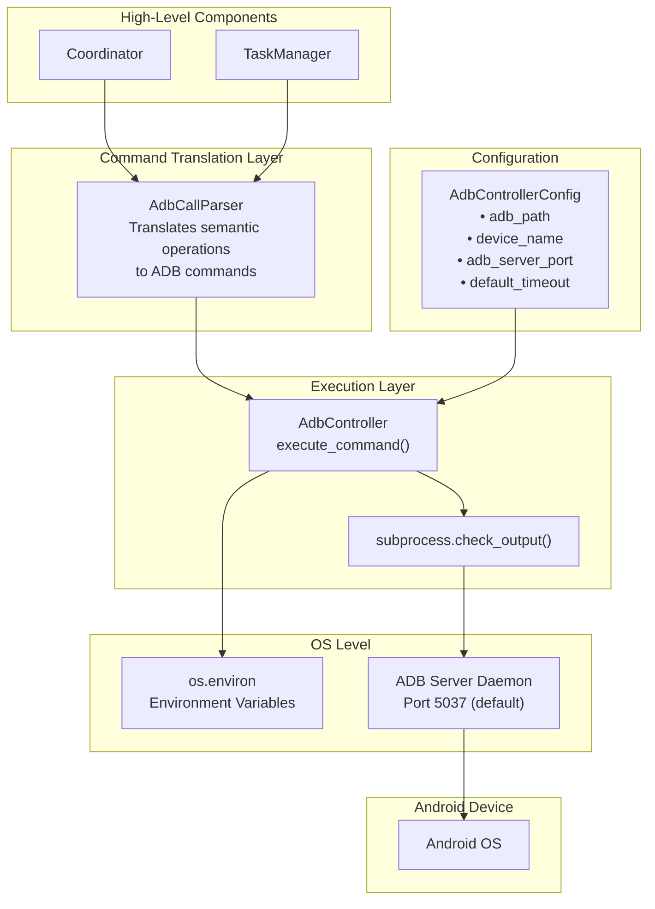
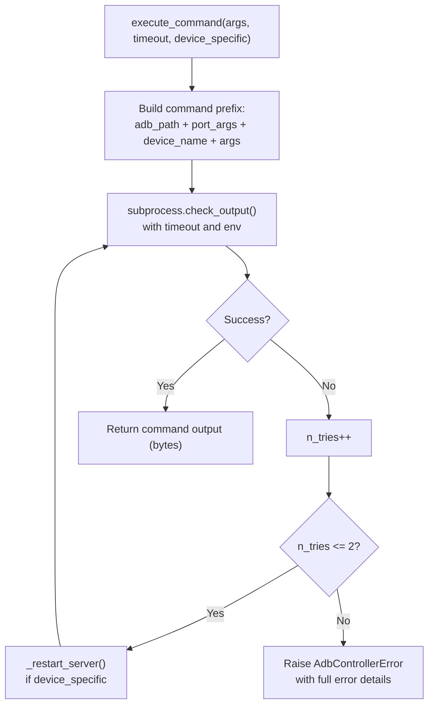
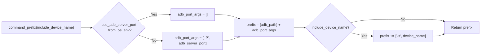
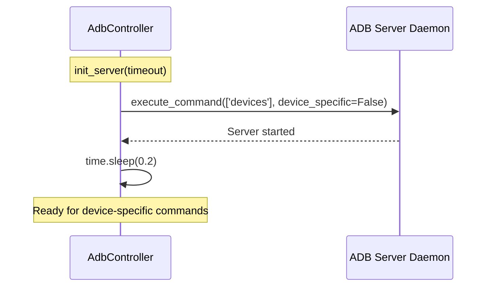
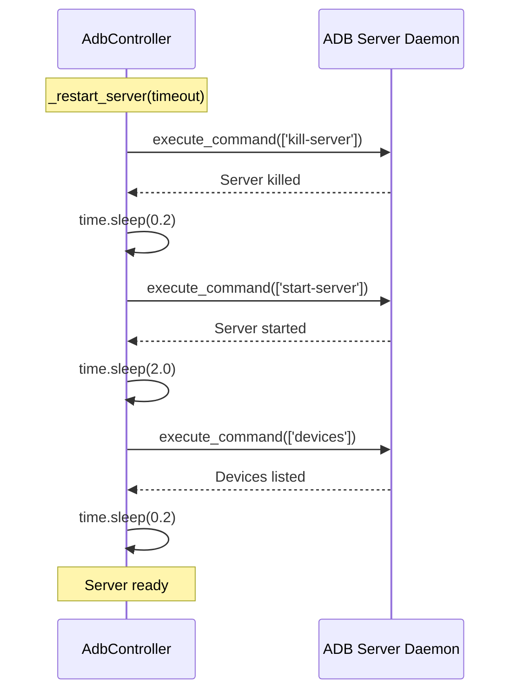
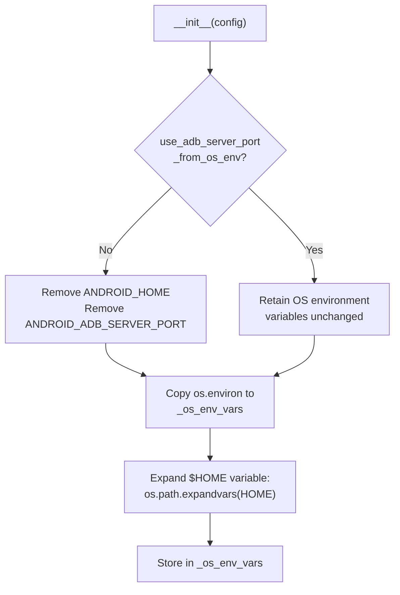
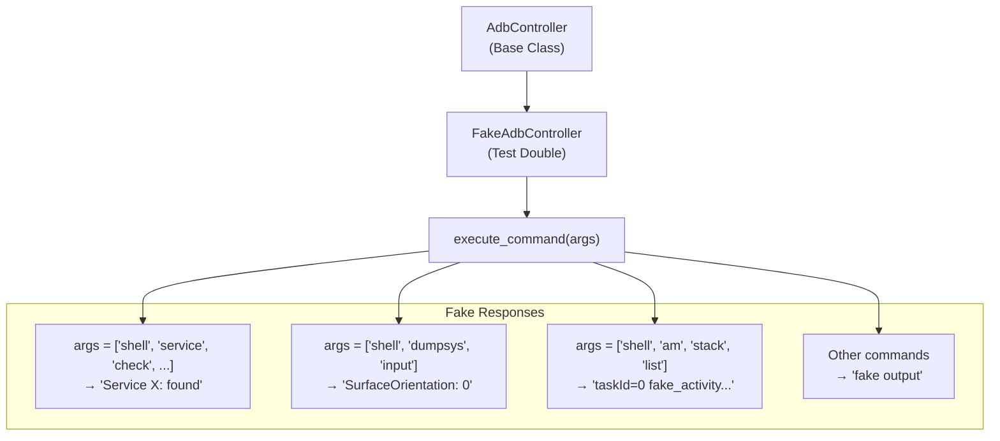

<!-- source: DeepWiki mcp.deepwiki.com · repo google-deepmind/android_env · page 6.1 ADB Controller · fetched 2026-10-26 -->

# ADB Controller

<details>
<summary>Relevant source files</summary>

The following files were used as context for generating this wiki page:

- [android_env/components/adb_controller.py](android_env/components/adb_controller.py)
- [android_env/components/adb_controller_test.py](android_env/components/adb_controller_test.py)
- [android_env/components/simulators/fake/fake_simulator.py](android_env/components/simulators/fake/fake_simulator.py)

</details>


## Purpose and Scope

The ADB Controller is the execution layer component responsible for running ADB (Android Debug Bridge) commands on Android devices via subprocess calls. It provides reliable command execution with automatic retry logic, server management, and environment variable handling.

This page covers the `AdbController` class and its command execution mechanics. For information about how high-level semantic operations are translated into ADB commands, see [ADB Call Parser](#6.2). For information about log streaming via ADB, see [Log Streams](#6.3).

Sources: [android_env/components/adb_controller.py:1-166]()

---

## Architecture Overview

The `AdbController` operates at the lowest level of the Android communication stack, translating parsed ADB commands into actual subprocess calls that interact with the ADB daemon.



**Position in System**: The `AdbController` receives command arguments from `AdbCallParser` and executes them using Python's `subprocess` module. It manages the ADB server lifecycle and implements fault tolerance through automatic retry and server restart logic.

Sources: [android_env/components/adb_controller.py:27-166]()

---

## Configuration

The `AdbController` is configured via `AdbControllerConfig`, which specifies connection parameters and behavioral settings.

### AdbControllerConfig Parameters

| Parameter | Type | Default | Description |
|-----------|------|---------|-------------|
| `adb_path` | `str` | Required | Path to the ADB binary executable |
| `device_name` | `str` | Required | Device serial identifier (e.g., "emulator-5554") |
| `adb_server_port` | `int` | 5037 | Port for the ADB server daemon |
| `default_timeout` | `float` | None | Default timeout in seconds for ADB commands |
| `use_adb_server_port_from_os_env` | `bool` | False | Whether to use `ANDROID_ADB_SERVER_PORT` from OS environment |

### Configuration Example

```python
config = AdbControllerConfig(
    adb_path='/usr/local/bin/adb',
    device_name='emulator-5554',
    adb_server_port=5037,
    default_timeout=30.0
)
controller = AdbController(config)
```

Sources: [android_env/components/adb_controller.py:30-51](), [android_env/components/adb_controller_test.py:53-73]()

---

## Command Execution

The `AdbController` executes ADB commands through the `execute_command` method, which provides robust error handling and automatic recovery.



### execute_command Method

The core execution method follows this signature:

```
execute_command(
    args: list[str],
    timeout: float | None = None,
    device_specific: bool = True
) -> bytes
```

**Parameters**:
- `args`: Command arguments (e.g., `['shell', 'dumpsys', 'input']`)
- `timeout`: Command timeout override, uses `default_timeout` if None
- `device_specific`: Whether to include device name in command prefix

**Return Value**: Raw command output as `bytes`

### Retry Logic

The controller implements a 3-attempt retry strategy with automatic server restart:

1. **Attempt 1**: Execute command normally
2. **On failure (device-specific only)**: Restart ADB server via `_restart_server()`
3. **Attempt 2**: Retry command execution
4. **On failure**: Restart ADB server again
5. **Attempt 3**: Final retry attempt
6. **On failure**: Raise `AdbControllerError` with comprehensive error details

Sources: [android_env/components/adb_controller.py:105-165](), [android_env/components/adb_controller_test.py:112-166]()

---

## Command Prefix Construction

The `command_prefix` method builds the base ADB command based on configuration.



### Example Command Constructions

| Configuration | Args | Resulting Command |
|---------------|------|-------------------|
| Standard | `['devices']` (device_specific=False) | `['adb', '-P', '5037', 'devices']` |
| Standard | `['shell', 'input', 'tap', '100', '200']` | `['adb', '-P', '5037', '-s', 'emulator-5554', 'shell', 'input', 'tap', '100', '200']` |
| OS env port | `['install', 'app.apk']` | `['adb', '-s', 'emulator-5554', 'install', 'app.apk']` |

Sources: [android_env/components/adb_controller.py:53-69]()

---

## Server Management

The `AdbController` manages the ADB server daemon lifecycle through initialization and restart operations.

### Server Initialization

The `init_server` method starts the ADB server daemon before simulator launch.



**Usage**: Call `init_server()` immediately after constructing the first `AdbController` instance and before launching the simulator.

### Server Restart

The `_restart_server` method performs a full server restart cycle to recover from errors.



**Timing**: The restart sequence includes strategic sleep delays to allow the server daemon to fully terminate and restart (total ~2.4 seconds).

Sources: [android_env/components/adb_controller.py:71-103](), [android_env/components/adb_controller_test.py:112-165]()

---

## Environment Variable Management

The `AdbController` carefully manages OS environment variables to ensure reliable ADB communication.

### Environment Variable Handling



### Removed Environment Variables (Default Mode)

When `use_adb_server_port_from_os_env=False` (default), the controller removes problematic environment variables set by Android Studio:

| Variable | Reason for Removal |
|----------|-------------------|
| `ANDROID_HOME` | Conflicts with ADB execution |
| `ANDROID_ADB_SERVER_PORT` | Prevents explicit port control |

### Retained Environment Variables (OS Env Mode)

When `use_adb_server_port_from_os_env=True`, the controller preserves these variables to use the OS-configured ADB server port.

### HOME Variable Expansion

The controller explicitly expands the `$HOME` environment variable using `os.path.expandvars()` to resolve any variable references before passing to subprocess.

Sources: [android_env/components/adb_controller.py:36-51](), [android_env/components/adb_controller_test.py:257-288]()

---

## Error Handling

The `AdbController` raises `AdbControllerError` when all retry attempts are exhausted.

### Error Information

The exception includes comprehensive diagnostic information:

```python
AdbControllerError(
    f'Error executing adb command: [{command_str}]\n'
    f'Caused by: {latest_error}\n'
    f'adb stdout: [{latest_error.stdout}]\n'
    f'adb stderr: [{latest_error.stderr}]'
)
```

### Logged Information

During retry attempts, the controller logs:
- Full command being executed
- Attempt number (1 of 3, 2 of 3, etc.)
- stdout output (if available)
- stderr output (if available)

Sources: [android_env/components/adb_controller.py:141-165]()

---

## Testing Infrastructure

The codebase provides `FakeAdbController` for testing AndroidEnv components without a real Android device.

### FakeAdbController

The `FakeAdbController` extends `AdbController` and overrides `execute_command` to return deterministic fake responses.



### Supported Fake Responses

The `FakeAdbController` provides specific responses for common ADB commands:

| Command Pattern | Fake Response |
|----------------|---------------|
| `['shell', 'service', 'check', service_name]` | `b'Service {service_name}: found'` |
| `['shell', 'dumpsys', 'input']` | `b' SurfaceOrientation: 0'` |
| `['shell', 'am', 'stack', 'list']` | `b'taskId=0 fake_activity visible=true topActivity=ComponentInfo{fake_activity}'` |
| Any other command | `b'fake output'` |

### Usage in Tests

The `FakeAdbController` is used by `FakeSimulator` to enable full AndroidEnv testing without an emulator:

```python
class FakeSimulator(BaseSimulator):
    def create_adb_controller(self):
        return FakeAdbController(config_classes.AdbControllerConfig())
```

Sources: [android_env/components/simulators/fake/fake_simulator.py:77-104]()

---

