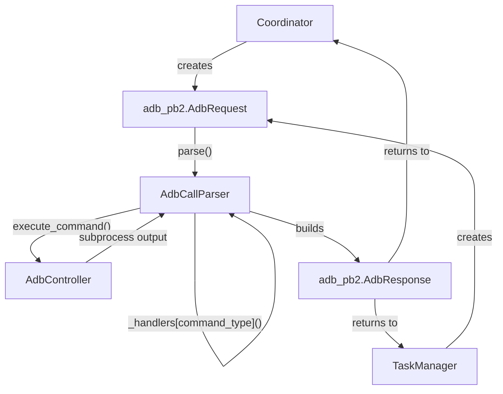
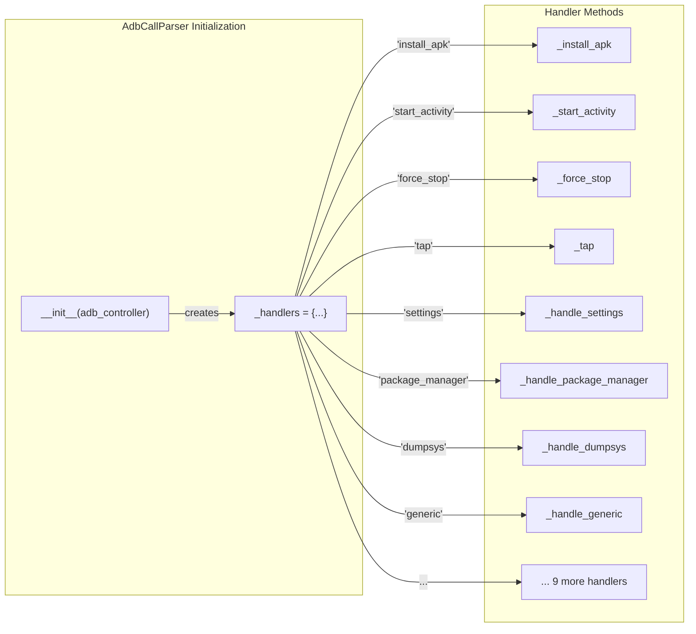
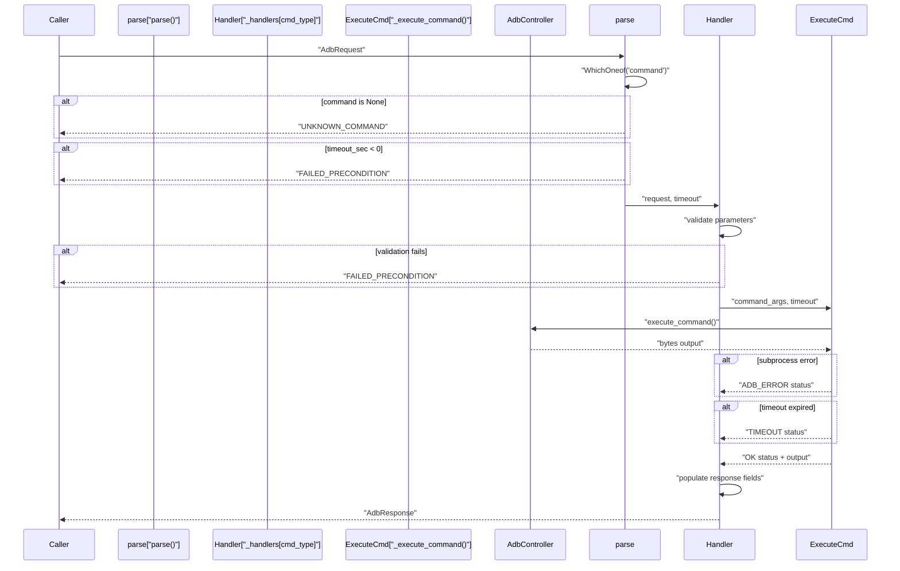
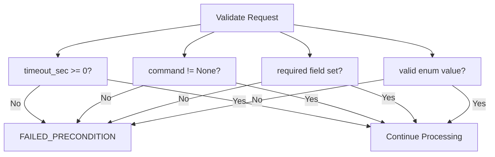

<!-- source: DeepWiki mcp.deepwiki.com · repo google-deepmind/android_env · page 6.2 ADB Call Parser · fetched 2026-10-26 -->

# ADB Call Parser

<details>
<summary>Relevant source files</summary>

The following files were used as context for generating this wiki page:

- [android_env/components/adb_call_parser.py](android_env/components/adb_call_parser.py)
- [android_env/components/adb_call_parser_test.py](android_env/components/adb_call_parser_test.py)
- [android_env/proto/adb.proto](android_env/proto/adb.proto)

</details>


## Purpose and Scope

The ADB Call Parser translates structured `AdbRequest` protobuf messages into concrete ADB shell commands for execution on Android devices. This component serves as the semantic translation layer between high-level operations requested by the Coordinator or TaskManager and low-level ADB command strings that the ADB Controller can execute.

For information about executing ADB commands via subprocess, see [ADB Controller](#6.1). For streaming log output from Android devices, see [Log Streams](#6.3).

## Architecture Overview

The `AdbCallParser` class implements a command-handler pattern where each protobuf message type maps to a specialized handler method. The parser validates request parameters, constructs appropriate ADB shell command arguments, delegates execution to the ADB Controller, and packages results into response protobufs.

**Primary Class**: `AdbCallParser` ([android_env/components/adb_call_parser.py:40-924]())

**Key Dependencies**:
- `AdbController` for command execution
- `adb_pb2.AdbRequest` and `adb_pb2.AdbResponse` protobufs for the interface contract

### Component Interaction



Sources: [android_env/components/adb_call_parser.py:40-64](), Diagram 3 from high-level architecture

### Handler Registration Pattern

The parser maintains a dictionary mapping command type strings to handler methods. When `parse()` is called, it uses `WhichOneof('command')` on the protobuf to determine which handler to invoke.



Sources: [android_env/components/adb_call_parser.py:43-63]()

## Request Processing Flow

### Main Entry Point

The `parse()` method serves as the single entry point for all ADB command requests.

**Method Signature**: `parse(request: adb_pb2.AdbRequest) -> adb_pb2.AdbResponse` ([android_env/components/adb_call_parser.py:93-111]())

**Processing Steps**:
1. Extract command type using `request.WhichOneof('command')`
2. Validate that command type is not `None` (returns `UNKNOWN_COMMAND` status)
3. Validate that `timeout_sec` is non-negative (returns `FAILED_PRECONDITION` status)
4. Convert timeout to `None` if zero, otherwise use the value
5. Invoke the appropriate handler from `_handlers` dictionary



Sources: [android_env/components/adb_call_parser.py:93-111](), [android_env/components/adb_call_parser.py:65-91]()

### Command Execution Wrapper

The `_execute_command()` helper method wraps ADB Controller calls with error handling.

**Method Signature**: `_execute_command(command_args: list[str], timeout: float | None) -> tuple[adb_pb2.AdbResponse, bytes]` ([android_env/components/adb_call_parser.py:65-91]())

**Error Handling**:
- Catches `subprocess.CalledProcessError` → sets status to `ADB_ERROR`
- Catches `subprocess.TimeoutExpired` → sets status to `TIMEOUT`
- On success → returns status `OK`

Sources: [android_env/components/adb_call_parser.py:65-91]()

## Supported Commands

The ADB Call Parser supports 17 distinct command types, organized into functional categories:

### App Management Commands

| Command Type | Handler Method | ADB Command Pattern | Description |
|--------------|----------------|---------------------|-------------|
| `install_apk` | `_install_apk` | `install -r -t -g <path>` | Installs APK from filesystem or blob |
| `uninstall_package` | `_handle_uninstall_package` | `uninstall <package>` | Removes installed package |
| `start_activity` | `_start_activity` | `shell am start [-S] -W -n <activity> [args...]` | Launches an activity |
| `force_stop` | `_force_stop` | `shell am force-stop <package>` | Terminates an app |
| `start_screen_pinning` | `_start_screen_pinning` | `shell am task lock <task_id>` | Pins app to screen (kiosk mode) |
| `send_broadcast` | `_send_broadcast` | `shell am broadcast -a <action> [-n <component>]` | Sends broadcast intent |

Sources: [android_env/components/adb_call_parser.py:252-305](), [android_env/components/adb_call_parser.py:113-136](), [android_env/components/adb_call_parser.py:307-353](), [android_env/components/adb_call_parser.py:185-217](), [android_env/components/adb_call_parser.py:219-250](), [android_env/components/adb_call_parser.py:382-419]()

#### Install APK Details

The `install_apk` command supports two location types:

**Filesystem**: Direct path to APK file ([android_env/components/adb_call_parser.py:272-281]())
- Validates file existence with `os.path.exists()`
- Returns `INTERNAL_ERROR` if file not found

**Blob**: Raw APK bytes ([android_env/components/adb_call_parser.py:282-297]())
- Creates temporary file with `.apk` suffix
- Writes blob contents to temp file
- Executes install command
- Handles Python 3.12+ `delete_on_close` parameter

**Install Flags**:
- `-r`: Replace existing application
- `-t`: Allow test packages
- `-g`: Grant all runtime permissions

Sources: [android_env/components/adb_call_parser.py:252-305]()

#### Start Activity Details

The `start_activity` command provides flexible activity launching:

**Parameters** ([android_env/proto/adb.proto:40-50]()):
- `full_activity`: Package and activity name (e.g., `com.example/com.example.MainActivity`)
- `extra_args`: Additional `am start` arguments
- `force_stop`: Whether to stop app before starting (adds `-S` flag)

**Command Construction** ([android_env/components/adb_call_parser.py:338-342]()):
```
shell am start [-S] -W -n <full_activity> [extra_args...]
```

**Flags**:
- `-S`: Force stop target app (if `force_stop=True`)
- `-W`: Wait for launch to complete
- `-n`: Component name specification

**Error Detection**: Uses regex to detect "Error" in command output ([android_env/components/adb_call_parser.py:345-349]())

Sources: [android_env/components/adb_call_parser.py:307-353](), [android_env/proto/adb.proto:40-50]()

### Input Commands

| Command Type | Handler Method | ADB Command Pattern | Description |
|--------------|----------------|---------------------|-------------|
| `tap` | `_tap` | `shell input tap <x> <y>` | Taps screen coordinates |
| `press_button` | `_press_button` | `shell input keyevent <KEYCODE>` | Sends key events |
| `input_text` | `_input_text` | `shell input text <text>` | Inputs text string |

Sources: [android_env/components/adb_call_parser.py:623-651](), [android_env/components/adb_call_parser.py:355-380](), [android_env/components/adb_call_parser.py:600-621]()

#### Press Button Mapping

The `press_button` command maps protobuf button enums to Android keycodes:

**Keycode Mapping** ([android_env/components/adb_call_parser.py:28-37]()):

| Button Enum | Android Keycode |
|-------------|-----------------|
| `HOME` | `KEYCODE_HOME` |
| `BACK` | `KEYCODE_BACK` |
| `ENTER` | `KEYCODE_ENTER` |

**Validation**: Returns `FAILED_PRECONDITION` if button not in `_BUTTON_TO_KEYCODE` dict

Sources: [android_env/components/adb_call_parser.py:28-37](), [android_env/components/adb_call_parser.py:355-380]()

#### Tap Coordinate Validation

The `tap` command validates coordinates are non-negative ([android_env/components/adb_call_parser.py:636-645]()):
- Zero is valid (represents first column/row)
- Negative values return `FAILED_PRECONDITION`
- Coordinates are absolute pixels, not normalized [0,1] floats

Sources: [android_env/components/adb_call_parser.py:623-651](), [android_env/proto/adb.proto:70-76]()

### System Query Commands

| Command Type | Handler Method | ADB Command Pattern | Description |
|--------------|----------------|---------------------|-------------|
| `get_current_activity` | `_get_current_activity` | `shell am stack list \| grep -E visible=true` | Fetches current visible activity |
| `get_orientation` | `_get_orientation` | `shell dumpsys input` | Retrieves device orientation |

Sources: [android_env/components/adb_call_parser.py:421-473](), [android_env/components/adb_call_parser.py:475-534]()

#### Get Current Activity

This command uses a multi-step process to extract the current activity:

**Step 1**: Filter for visible tasks ([android_env/components/adb_call_parser.py:437-439]()):
```
shell am stack list | grep -E visible=true
```

**Step 2**: Parse output with regex ([android_env/components/adb_call_parser.py:461-462]()):
```python
p = re.compile(r'.*\{(.*)\}')
matches = p.search(visible_task)
```

**Platform Differences**: Windows requires special handling ([android_env/components/adb_call_parser.py:453-459]())
- Uses different regex pattern to extract activity from `ComponentInfo{...}`

**Fallback**: On failure, executes `shell am stack list` without grep for debugging ([android_env/components/adb_call_parser.py:445-446]())

Sources: [android_env/components/adb_call_parser.py:421-473]()

#### Get Orientation

This command parses `dumpsys input` output to extract device rotation:

**Orientation Values** ([android_env/proto/adb.proto:349-353]()):
- `0` → 0 degrees (portrait)
- `1` → 90 degrees
- `2` → 180 degrees (upside-down portrait)
- `3` → 270 degrees

**Parsing Logic** ([android_env/components/adb_call_parser.py:506-527]()):
1. Skip devices with negative `PhysicalWidth` (invalid devices)
2. Match either `SurfaceOrientation` or `InputDeviceOrientation` fields
3. Extract the numeric rotation value
4. Validate at least 2 regex groups matched

Sources: [android_env/components/adb_call_parser.py:475-534](), [android_env/proto/adb.proto:349-353]()

### File Operation Commands

| Command Type | Handler Method | ADB Command Pattern | Description |
|--------------|----------------|---------------------|-------------|
| `push` | `_push` | `push <temp_file> <device_path>` | Uploads file to device |
| `pull` | `_pull` | `pull <device_path> <temp_file>` | Downloads file from device |

Sources: [android_env/components/adb_call_parser.py:536-565](), [android_env/components/adb_call_parser.py:567-598]()

#### Push/Pull Implementation

Both commands use temporary files to avoid exposing filesystem paths in task definitions:

**Push Flow** ([android_env/components/adb_call_parser.py:556-563]()):
1. Create `NamedTemporaryFile` with `delete=False`
2. Write `request.push.content` bytes to temp file
3. Execute `adb push <temp_file> <device_path>`
4. Delete temp file with `os.remove()`

**Pull Flow** ([android_env/components/adb_call_parser.py:587-596]()):
1. Create `NamedTemporaryFile` with `delete=False`
2. Execute `adb pull <device_path> <temp_file>`
3. Read file contents into `response.pull.content`
4. Delete temp file with `os.remove()`

**Design Rationale**: Using byte blobs instead of filesystem paths makes task definitions hermetic and environment-independent

Sources: [android_env/components/adb_call_parser.py:536-565](), [android_env/components/adb_call_parser.py:567-598](), [android_env/proto/adb.proto:100-124]()

### Settings and Configuration Commands

| Command Type | Handler Method | ADB Command Pattern | Description |
|--------------|----------------|---------------------|-------------|
| `settings` | `_handle_settings` | `shell settings <verb> <namespace> [args...]` | Manages Android settings |
| `package_manager` | `_handle_package_manager` | `shell pm <verb> [args...]` | Package management operations |
| `dumpsys` | `_handle_dumpsys` | `shell dumpsys [options] [service] [args...]` | Dumps system service info |

Sources: [android_env/components/adb_call_parser.py:653-754](), [android_env/components/adb_call_parser.py:775-845](), [android_env/components/adb_call_parser.py:847-923]()

#### Settings Command

The `settings` command supports five verbs (get, put, delete, reset, list) across three namespaces (system, secure, global).

**Namespace Validation** ([android_env/components/adb_call_parser.py:669-676]()):
- Returns `FAILED_PRECONDITION` if namespace is `UNKNOWN`

**Verb Handling** ([android_env/components/adb_call_parser.py:681-747]()):

| Verb | Validation | Command Pattern | Response Field |
|------|------------|-----------------|----------------|
| `get` | Requires non-empty `key` | `shell settings get <namespace> <key>` | `settings.output` |
| `put` | Requires non-empty `key` and `value` | `shell settings put <namespace> <key> <value>` | `settings.output` |
| `delete_key` | Requires non-empty `key` | `shell settings delete <namespace> <key>` | `settings.output` |
| `reset` | Requires `package_name` or `mode` | `shell settings reset <namespace> <arg>` | `settings.output` |
| `list` | No validation | `shell settings list <namespace>` | `settings.output` |

**Reset Mode Priority** ([android_env/components/adb_call_parser.py:735-738]()):
- If `package_name` provided, uses it as argument
- Otherwise, converts `mode` enum to lowercase string (e.g., `UNTRUSTED_DEFAULTS` → `untrusted_defaults`)

Sources: [android_env/components/adb_call_parser.py:653-754](), [android_env/proto/adb.proto:132-188]()

#### Package Manager Command

The `package_manager` command supports list, clear, and grant operations:

**List Operations** ([android_env/components/adb_call_parser.py:793-809]()):

| List Type | Command | Post-Processing |
|-----------|---------|-----------------|
| `features` | `shell pm list features` | Strips `feature:` prefix |
| `libraries` | `shell pm list libraries` | Strips `library:` prefix |
| `packages` | `shell pm list packages` | Strips `package:` prefix |

**Prefix Stripping Logic** ([android_env/components/adb_call_parser.py:800-807]()):
```python
prefix = {
    'features': 'feature:',
    'libraries': 'library:',
    'packages': 'package:',
}[what]
items = [x[len(prefix):] for x in items if x.startswith(prefix)]
```

**Clear Operation** ([android_env/components/adb_call_parser.py:810-825]()):
- Validates `package_name` is non-empty
- Optional `user_id` inserts `-f <user_id>` flags at position 3-4

**Grant Operation** ([android_env/components/adb_call_parser.py:826-844]()):
- Validates both `package_name` and `permissions` are non-empty
- Executes one `shell pm grant` command per permission

Sources: [android_env/components/adb_call_parser.py:775-845](), [android_env/proto/adb.proto:197-249]()

#### Dumpsys Command

The `dumpsys` command provides the most complex command construction logic with numerous optional parameters:

**Timeout Handling** ([android_env/components/adb_call_parser.py:864-889]()):
- Validates both `timeout_sec` and `timeout_ms` are non-negative
- `timeout_sec` takes precedence over `timeout_ms` if both provided
- Adds `-t <sec>` or `-T <ms>` flags as appropriate

**List-Only Mode** ([android_env/components/adb_call_parser.py:872-882]()):
- Adds `-l` flag
- Cannot combine with `service`, `args`, or `skip_services`
- Returns `FAILED_PRECONDITION` if combined

**Skip Services** ([android_env/components/adb_call_parser.py:899-909]()):
- Adds `--skip <service1,service2,...>` flag
- Cannot combine with `service` field
- Comma-separates multiple services

**Priority Filtering** ([android_env/components/adb_call_parser.py:891-897]()):
- Adds `--priority <LEVEL>` if not `UNSET`
- Supports `NORMAL`, `HIGH`, `CRITICAL` levels

**Service-Specific Dump** ([android_env/components/adb_call_parser.py:911-918]()):
- Appends service name to command
- Optionally adds custom args
- Optionally adds `--proto` flag for protobuf output

Sources: [android_env/components/adb_call_parser.py:847-923](), [android_env/proto/adb.proto:251-287]()

### Generic Command

The `generic` command provides an escape hatch for executing arbitrary ADB commands not explicitly supported:

**Command Type**: `generic` ([android_env/components/adb_call_parser.py:756-773]())

**Usage**: Directly passes `request.generic.args` list to ADB Controller

**Example from Tests** ([android_env/components/adb_call_parser_test.py:760-774]()):
```python
args = ['shell', 'am', 'broadcast', '-n', 'receiver', '-a', 'action']
generic_request = adb_pb2.AdbRequest.GenericRequest(args=args)
request = adb_pb2.AdbRequest(generic=generic_request)
```

**Error Handling**: Properly catches and converts subprocess exceptions to appropriate status codes

Sources: [android_env/components/adb_call_parser.py:756-773](), [android_env/proto/adb.proto:190-195]()

## Command Type Mapping

The following diagram shows how protobuf `oneof` fields map to handler methods and ADB commands:

```mermaid
graph TB
    subgraph "AdbRequest Proto"
        InstallApkProto["install_apk: InstallApk"]
        StartActivityProto["start_activity: StartActivity"]
        ForceStopProto["force_stop: ForceStop"]
        TapProto["tap: Tap"]
        PressButtonProto["press_button: PressButton"]
        ScreenPinProto["start_screen_pinning: StartScreenPinning"]
        BroadcastProto["send_broadcast: SendBroadcast"]
        UninstallProto["uninstall_package: UninstallPackage"]
        GetActivityProto["get_current_activity: GetCurrentActivity"]
        GetOrientProto["get_orientation: GetOrientationRequest"]
        PushProto["push: Push"]
        PullProto["pull: Pull"]
        InputTextProto["input_text: InputText"]
        SettingsProto["settings: SettingsRequest"]
        GenericProto["generic: GenericRequest"]
        PackageMgrProto["package_manager: PackageManagerRequest"]
        DumpsysProto["dumpsys: DumpsysRequest"]
    end
    
    subgraph "Handler Methods"
        InstallApkHandler["_install_apk()"]
        StartActivityHandler["_start_activity()"]
        ForceStopHandler["_force_stop()"]
        TapHandler["_tap()"]
        PressButtonHandler["_press_button()"]
        ScreenPinHandler["_start_screen_pinning()"]
        BroadcastHandler["_send_broadcast()"]
        UninstallHandler["_handle_uninstall_package()"]
        GetActivityHandler["_get_current_activity()"]
        GetOrientHandler["_get_orientation()"]
        PushHandler["_push()"]
        PullHandler["_pull()"]
        InputTextHandler["_input_text()"]
        SettingsHandler["_handle_settings()"]
        GenericHandler["_handle_generic()"]
        PackageMgrHandler["_handle_package_manager()"]
        DumpsysHandler["_handle_dumpsys()"]
    end
    
    InstallApkProto -->|"'install_apk'"| InstallApkHandler
    StartActivityProto -->|"'start_activity'"| StartActivityHandler
    ForceStopProto -->|"'force_stop'"| ForceStopHandler
    TapProto -->|"'tap'"| TapHandler
    PressButtonProto -->|"'press_button'"| PressButtonHandler
    ScreenPinProto -->|"'start_screen_pinning'"| ScreenPinHandler
    BroadcastProto -->|"'send_broadcast'"| BroadcastHandler
    UninstallProto -->|"'uninstall_package'"| UninstallHandler
    GetActivityProto -->|"'get_current_activity'"| GetActivityHandler
    GetOrientProto -->|"'get_orientation'"| GetOrientHandler
    PushProto -->|"'push'"| PushHandler
    PullProto -->|"'pull'"| PullHandler
    InputTextProto -->|"'input_text'"| InputTextHandler
    SettingsProto -->|"'settings'"| SettingsHandler
    GenericProto -->|"'generic'"| GenericHandler
    PackageMgrProto -->|"'package_manager'"| PackageMgrHandler
    DumpsysProto -->|"'dumpsys'"| DumpsysHandler
```



Sources: [android_env/proto/adb.proto:289-307](), [android_env/components/adb_call_parser.py:45-63]()

## Error Handling and Status Codes

The ADB Call Parser uses a structured error handling approach with six distinct status codes defined in `adb_pb2.AdbResponse.Status`:

### Status Code Table

| Status Code | Numeric Value | When Used | Typical Cause |
|-------------|---------------|-----------|---------------|
| `UNDEFINED` | 0 | Never used (reserved) | Default protobuf value |
| `OK` | 1 | Success | Command executed successfully |
| `UNKNOWN_COMMAND` | 2 | Invalid request | `WhichOneof('command')` returns `None` |
| `FAILED_PRECONDITION` | 3 | Validation failure | Missing required field, negative timeout, invalid enum |
| `INTERNAL_ERROR` | 4 | Execution failure | APK not found, activity extraction failed, task ID not found |
| `ADB_ERROR` | 5 | ADB failure | `subprocess.CalledProcessError` caught |
| `TIMEOUT` | 6 | Timeout expired | `subprocess.TimeoutExpired` caught |

Sources: [android_env/proto/adb.proto:316-332]()

### Error Handling Patterns

**Validation Errors** return `FAILED_PRECONDITION` with descriptive messages:



Sources: [android_env/components/adb_call_parser.py:93-111]()

**Subprocess Errors** are caught and converted ([android_env/components/adb_call_parser.py:83-89]()):

```python
except subprocess.CalledProcessError as adb_error:
  if adb_error.stdout is not None:
    response.status = adb_pb2.AdbResponse.Status.ADB_ERROR
    response.error_message = adb_error.stdout
except subprocess.TimeoutExpired:
  response.status = adb_pb2.AdbResponse.Status.TIMEOUT
  response.error_message = 'Timeout'
```

**Internal Errors** indicate unexpected runtime conditions ([android_env/components/adb_call_parser.py:274-277]()):
- File not found: `INTERNAL_ERROR` with message "Could not find local_apk_path: {fpath}"
- Regex match failed: `INTERNAL_ERROR` with message "Could not extract current activity..."
- Empty dumpsys output: `INTERNAL_ERROR` with message "Failed to execute `dumpsys input`"

Sources: [android_env/components/adb_call_parser.py:65-91](), [android_env/components/adb_call_parser.py:274-277](), [android_env/components/adb_call_parser.py:498-501]()

## Validation Rules

Each handler method implements specific validation rules before executing commands:

### Common Validation Patterns

| Validation Type | Example Commands | Rule | Error Message Pattern |
|-----------------|------------------|------|----------------------|
| Non-empty string | `force_stop`, `start_activity`, `input_text` | Field length > 0 | "`<field_name>` cannot be empty." |
| Non-negative integer | `tap`, `dumpsys` | Value >= 0 | "must be non-negative. Got: {value}" |
| Valid enum | `press_button`, `settings` | In allowed set | "must be one of [...]. Got: {value}" |
| File existence | `install_apk` (filesystem) | `os.path.exists()` | "Could not find local_apk_path: {path}" |
| Mutually exclusive | `dumpsys` list_only | Cannot combine fields | "cannot be combined with other options" |

Sources: [android_env/components/adb_call_parser.py:128-131](), [android_env/components/adb_call_parser.py:641-645](), [android_env/components/adb_call_parser.py:369-374](), [android_env/components/adb_call_parser.py:272-277](), [android_env/components/adb_call_parser.py:872-879]()

### Field-Specific Validation

**Tap Coordinates** ([android_env/components/adb_call_parser.py:636-645]()):
```python
if x < 0 or y < 0:
  return adb_pb2.AdbResponse(
      status=adb_pb2.AdbResponse.Status.FAILED_PRECONDITION,
      error_message=f'Tap coordinates must be non-negative. Got: {request.tap}.')
```

**Settings Namespace** ([android_env/components/adb_call_parser.py:669-676]()):
```python
if (request.name_space == 
    adb_pb2.AdbRequest.SettingsRequest.Namespace.UNKNOWN):
  response.status = adb_pb2.AdbResponse.Status.FAILED_PRECONDITION
  response.error_message = f'Unknown SettingsRequest.name_space. Got: {request}.'
```

**Dumpsys Timeout** ([android_env/components/adb_call_parser.py:864-870]()):
```python
if request.timeout_sec < 0 or request.timeout_ms < 0:
  response.status = adb_pb2.AdbResponse.Status.FAILED_PRECONDITION
  response.error_message = (
      'DumpsysRequest.timeout_{sec, ms} should be non-negative. '
      f'Got: {request}.')
```

Sources: [android_env/components/adb_call_parser.py:636-645](), [android_env/components/adb_call_parser.py:669-676](), [android_env/components/adb_call_parser.py:864-870]()

## Usage Examples

### Example: Installing APK from Blob

```python
# Create request with APK bytes
request = adb_pb2.AdbRequest()
request.install_apk.blob.contents = apk_bytes

# Parse and execute
parser = AdbCallParser(adb_controller)
response = parser.parse(request)

if response.status == adb_pb2.AdbResponse.Status.OK:
  # Installation successful
else:
  # Check response.error_message
```

Sources: [android_env/components/adb_call_parser_test.py:83-112]()

### Example: Starting Activity with Force Stop

```python
# Create request
request = adb_pb2.AdbRequest()
request.start_activity.full_activity = 'com.example/com.example.MainActivity'
request.start_activity.force_stop = True
request.start_activity.extra_args.extend(['--es', 'key', 'value'])

# Parse and execute
response = parser.parse(request)

# Response contains activity name and output
if response.status == adb_pb2.AdbResponse.Status.OK:
  print(response.start_activity.full_activity)
  print(response.start_activity.output)
```

Sources: [android_env/components/adb_call_parser_test.py:125-144]()

### Example: Listing Installed Packages

```python
# Create package manager list request
request = adb_pb2.AdbRequest(
    package_manager=adb_pb2.AdbRequest.PackageManagerRequest(
        list=adb_pb2.AdbRequest.PackageManagerRequest.List(
            packages=adb_pb2.AdbRequest.PackageManagerRequest.List.Packages())))

response = parser.parse(request)

# Response contains list of package names (prefixes stripped)
if response.status == adb_pb2.AdbResponse.Status.OK:
  for package in response.package_manager.list.items:
    print(package)
```

Sources: [android_env/components/adb_call_parser_test.py:927-951]()

### Example: Dumpsys with Options

```python
# Create dumpsys request with timeout and priority
request = adb_pb2.AdbRequest(
    dumpsys=adb_pb2.AdbRequest.DumpsysRequest(
        service='window',
        args=['displays'],
        timeout_sec=10,
        priority=adb_pb2.AdbRequest.DumpsysRequest.PriorityLevel.HIGH))

response = parser.parse(request)

# Response contains dumpsys output
if response.status == adb_pb2.AdbResponse.Status.OK:
  print(response.dumpsys.output.decode('utf-8'))
```

Sources: [android_env/components/adb_call_parser_test.py:1184-1197]()

## Special Considerations

### Platform Differences

**Windows `grep` Behavior** ([android_env/components/adb_call_parser.py:453-459]()):

The `get_current_activity` command requires special handling on Windows because pipe operators behave differently. The parser uses `sys.platform` to detect Windows and applies alternative regex patterns:

```python
if sys.platform == 'win32':
  visible_task_list = re.findall(
      r'visible=true topActivity=ComponentInfo{(.+?)}', visible_task)
  if not visible_task_list:
    visible_task = ''
  else:
    visible_task = 'ComponentInfo{' + visible_task_list[0] + '}'
```

Sources: [android_env/components/adb_call_parser.py:453-459]()

### Python Version Compatibility

**Temporary File Deletion** ([android_env/components/adb_call_parser.py:284-289]()):

Python 3.12+ introduced the `delete_on_close` parameter for `NamedTemporaryFile`. The parser handles both versions:

```python
if sys.version_info >= (3, 12):
  kwargs = {'suffix': '.apk', 'delete_on_close': False}
else:
  kwargs = {'suffix': '.apk'}
```

Sources: [android_env/components/adb_call_parser.py:284-289]()

### Task ID Extraction

**Screen Pinning Implementation** ([android_env/components/adb_call_parser.py:138-183]()):

The `_fetch_current_task_id()` helper method extracts task IDs from `am stack list` output using regex matching:

**Regex Pattern** ([android_env/components/adb_call_parser.py:155-157]()):
```python
regex = re.compile(
    r'^\ *taskId=(?P<id>[0-9]*): (?P<base_activity>[^\s]*) .*visible=true'
    r'.*topActivity=ComponentInfo{(?P<top_activity>[^\s]*)}$')
```

**Matching Logic**:
- Matches if `full_activity_name` equals either `base_activity` or `top_activity`
- Allows pinning tasks by either their base or top activity
- Returns `-1` if no match found (triggers `INTERNAL_ERROR`)

Sources: [android_env/components/adb_call_parser.py:138-183]()

---

