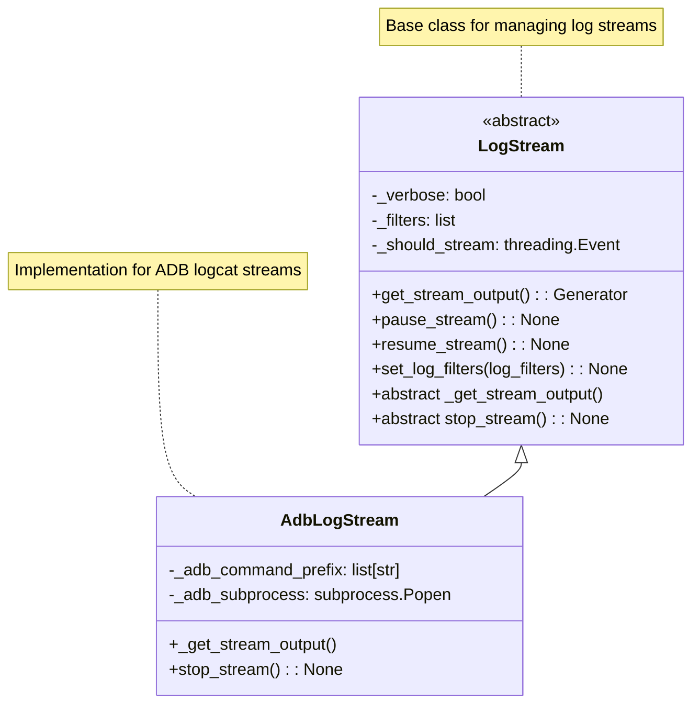
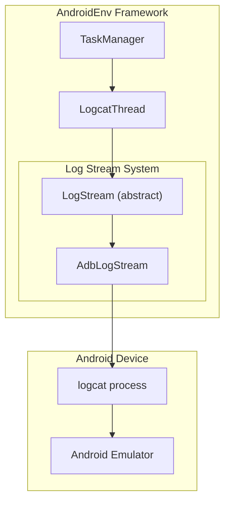
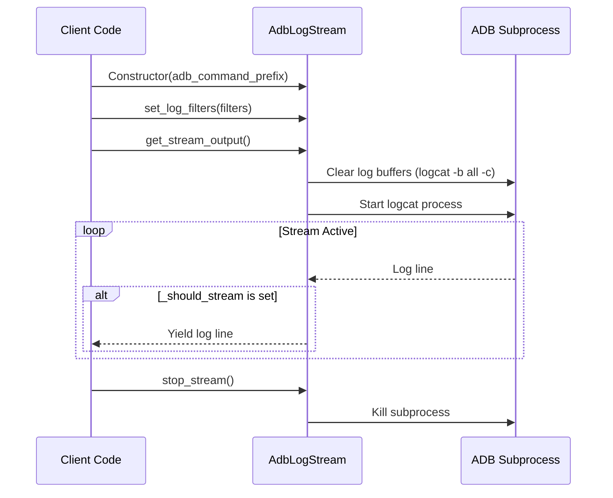

<!-- source: DeepWiki mcp.deepwiki.com · repo google-deepmind/android_env · page 6.3 Log Streams · fetched 2026-10-26 -->

# Log Streams

<details>
<summary>Relevant source files</summary>

The following files were used as context for generating this wiki page:

- [android_env/components/adb_log_stream.py](android_env/components/adb_log_stream.py)
- [android_env/components/adb_log_stream_test.py](android_env/components/adb_log_stream_test.py)
- [android_env/components/log_stream.py](android_env/components/log_stream.py)

</details>


Log streams are a core component in AndroidEnv that provide a mechanism for capturing and processing log output from Android emulators. This page documents the log stream architecture, components, and usage in the AndroidEnv framework.

## Purpose and Overview

The log stream system serves as a critical bridge between the Android device's log output and the AndroidEnv framework. It enables:

- Real-time monitoring of logcat output from Android emulators
- Filtering of log messages based on specified criteria
- Pausing and resuming of log streams as needed
- Clean termination of log stream processes

Log streams are primarily used by the TaskManager component to monitor for task-specific events that may occur in the emulator (see [Task Management](#3) for more information on how task events are processed).

## Architecture

The log stream architecture consists of an abstract base class (`LogStream`) and concrete implementations that handle different types of log sources, with `AdbLogStream` being the primary implementation for Android Debug Bridge (ADB) based logging.



**Log Stream in System Context**



Sources: [android_env/components/log_stream.py](), [android_env/components/adb_log_stream.py]()

## Core Components

### LogStream Abstract Class

The `LogStream` abstract class provides the base interface and common functionality for all log stream implementations:

| Method | Description |
|--------|-------------|
| `get_stream_output()` | Returns a generator that yields log lines |
| `pause_stream()` | Pauses the stream from yielding lines |
| `resume_stream()` | Resumes yielding lines from the stream |
| `set_log_filters(log_filters)` | Sets filters for the log stream |
| `_get_stream_output()` | Abstract method to be implemented by subclasses |
| `stop_stream()` | Abstract method to terminate the log stream |

The `LogStream` class maintains internal state through:
- `_verbose`: Flag for verbose logging
- `_filters`: List of log filters
- `_should_stream`: Threading event to control pausing and resuming

Sources: [android_env/components/log_stream.py:24-64]()

### AdbLogStream Class

`AdbLogStream` is a concrete implementation of `LogStream` that specifically manages adb logcat processes for locally running emulators:



Key implementation details:
- Before starting the logcat process, it clears all log buffers using `logcat -b all -c`
- Spawns a subprocess with the command `adb logcat -v epoch [filters] *:S` 
- The filters are provided by the caller and determine which log entries are captured
- The subprocess output is processed and yielded as log lines

Sources: [android_env/components/adb_log_stream.py:27-57]()

## Usage

### Setting Up a Log Stream

Log streams are typically set up by the `LogcatThread` component of the TaskManager. The basic setup involves:

1. Creating an `AdbLogStream` instance with the appropriate ADB command prefix
2. Setting log filters based on task requirements
3. Starting the stream and processing the log lines

Example usage pattern:

```python
# Create the log stream
log_stream = AdbLogStream(adb_command_prefix=['adb', '-s', 'emulator-5554'])

# Set filters to only capture logs from specific components
log_stream.set_log_filters(['ActivityManager:I', 'AndroidRuntime:E'])

# Start the stream and process log lines
log_stream.resume_stream()
for line in log_stream.get_stream_output():
    process_log_line(line)

# Stop the stream when done
log_stream.stop_stream()
```

Sources: [android_env/components/adb_log_stream.py:27-57](), [android_env/components/log_stream.py:32-45]()

### Log Filtering

Log streams support filtering of log output using standard Android logcat filters. These filters are specified as strings in the format `TAG:LEVEL`, where:
- `TAG` is the log tag to filter by (e.g., `ActivityManager`)
- `LEVEL` is the minimum log level to include (e.g., `V`, `D`, `I`, `W`, `E`, `F`)

When filters are set using `set_log_filters()`, the implementation adds a special filter `*:S` at the end, which suppresses all other tags not explicitly listed.

Sources: [android_env/components/log_stream.py:62-64]()

## Implementation Notes

### Stream Control

Log streams provide mechanisms to control the flow of log lines:

- **Pausing**: When `pause_stream()` is called, the internal `_should_stream` event is cleared, causing `get_stream_output()` to stop yielding lines, but continues to consume output from the subprocess.
- **Resuming**: When `resume_stream()` is called, `_should_stream` is set, allowing `get_stream_output()` to resume yielding lines.
- **Stopping**: When `stop_stream()` is called, the subprocess is terminated completely.

This fine-grained control allows tasks to temporarily ignore log output and resume processing when needed, without having to restart the log collection process.

Sources: [android_env/components/log_stream.py:52-60]()

### Error Handling

The log stream implementation includes error handling for common scenarios:

- Checks for invalid API usage, such as calling `stop_stream()` before `get_stream_output()`
- Uses appropriate subprocess timeout values to prevent hanging
- Logs errors for diagnosing issues

Sources: [android_env/components/adb_log_stream.py:52-57](), [android_env/components/adb_log_stream_test.py:54-65]()

## Related Components

The log stream system interacts with several other components in the AndroidEnv framework:

- **TaskManager**: Uses log streams through the LogcatThread to monitor for task events.
- **AdbController**: Provides the underlying ADB functionality used by AdbLogStream.
- **Simulator**: The source of the logs being streamed.

For more detailed information on these related components, see:
- [Task Management](#3) for more on the TaskManager and how it processes log events.
- [ADB Controller](#5.1) for details on the AdbController component.

---

