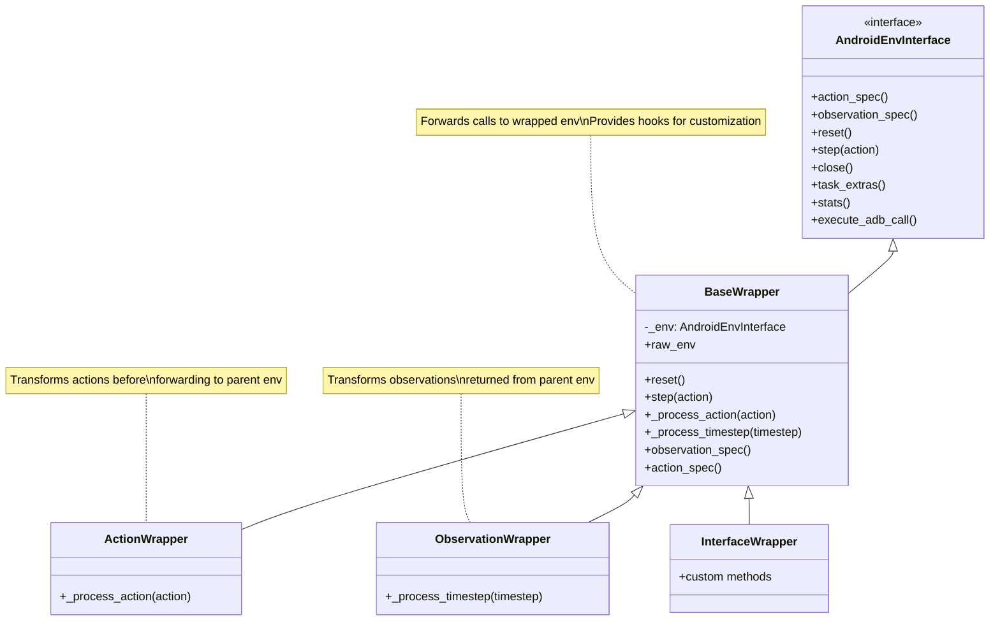
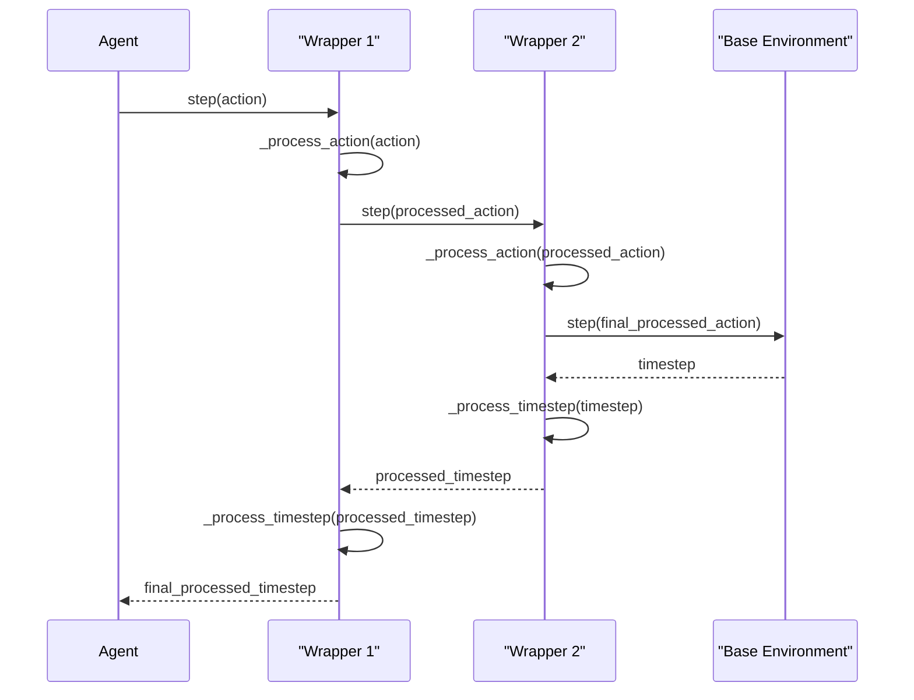
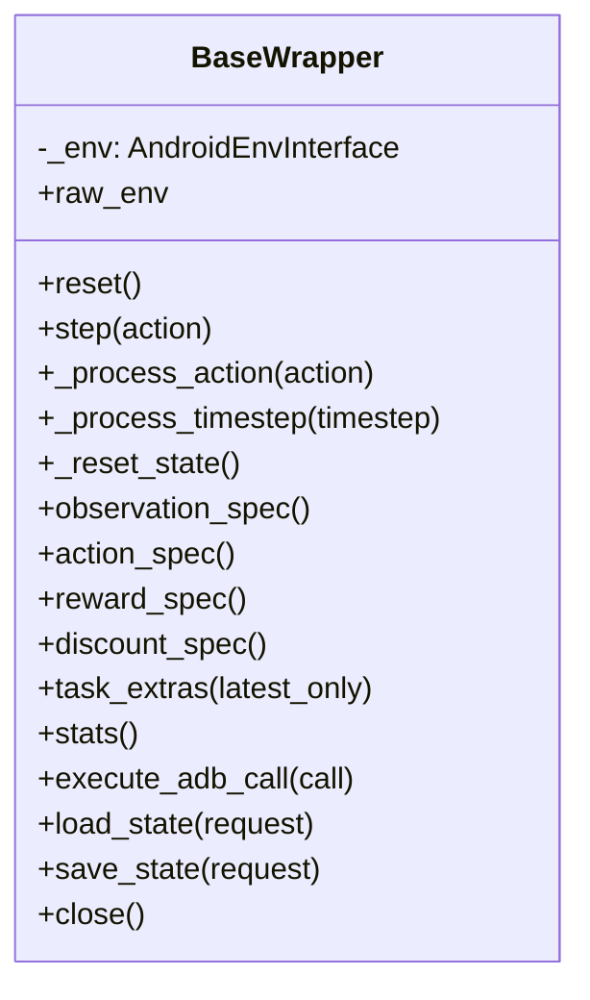
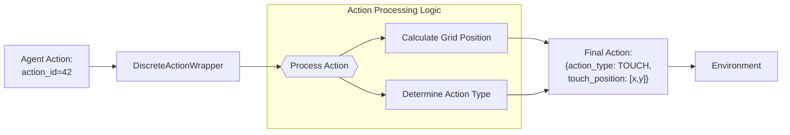
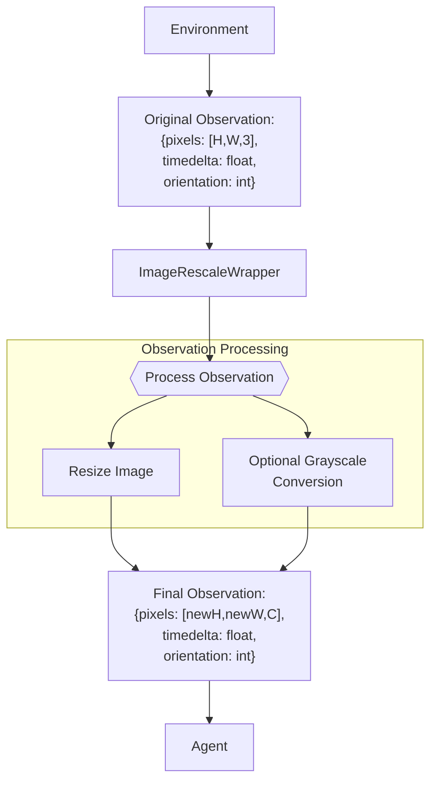

<!-- source: DeepWiki mcp.deepwiki.com · repo google-deepmind/android_env · page 7 Environment Wrappers · fetched 2026-10-26 -->

# Environment Wrappers

<details>
<summary>Relevant source files</summary>

The following files were used as context for generating this wiki page:

- [android_env/env_interface.py](android_env/env_interface.py)
- [android_env/wrappers/base_wrapper.py](android_env/wrappers/base_wrapper.py)
- [android_env/wrappers/base_wrapper_test.py](android_env/wrappers/base_wrapper_test.py)
- [android_env/wrappers/discrete_action_wrapper.py](android_env/wrappers/discrete_action_wrapper.py)
- [android_env/wrappers/discrete_action_wrapper_test.py](android_env/wrappers/discrete_action_wrapper_test.py)
- [android_env/wrappers/flat_interface_wrapper.py](android_env/wrappers/flat_interface_wrapper.py)
- [android_env/wrappers/flat_interface_wrapper_test.py](android_env/wrappers/flat_interface_wrapper_test.py)
- [android_env/wrappers/float_pixels_wrapper_test.py](android_env/wrappers/float_pixels_wrapper_test.py)
- [android_env/wrappers/gym_wrapper.py](android_env/wrappers/gym_wrapper.py)
- [android_env/wrappers/gym_wrapper_test.py](android_env/wrappers/gym_wrapper_test.py)
- [android_env/wrappers/image_rescale_wrapper.py](android_env/wrappers/image_rescale_wrapper.py)
- [android_env/wrappers/image_rescale_wrapper_test.py](android_env/wrappers/image_rescale_wrapper_test.py)
- [android_env/wrappers/last_action_wrapper_test.py](android_env/wrappers/last_action_wrapper_test.py)
- [android_env/wrappers/tap_action_wrapper.py](android_env/wrappers/tap_action_wrapper.py)
- [android_env/wrappers/tap_action_wrapper_test.py](android_env/wrappers/tap_action_wrapper_test.py)

</details>


This document provides an overview of the environment wrapper system in AndroidEnv, a mechanism that allows for modifying the agent-environment interface without changing the underlying environment implementation. For detailed information about specific wrapper types, see [Action Wrappers](#6.1), [Observation Wrappers](#6.2), and [Interface Wrappers](#6.3).

## Purpose and Architecture

Environment wrappers in AndroidEnv provide a standardized way to transform action and observation spaces, modify behavior, and adapt the environment to different interfaces. They are designed to be composable, allowing multiple wrappers to be stacked to achieve complex transformations.

### Wrapper Architecture

The wrapper system follows a chain pattern, where each wrapper wraps a parent environment (which could be another wrapper or the base environment). All wrappers inherit from the `BaseWrapper` class, which implements the `AndroidEnvInterface`.



Sources: [android_env/env_interface.py:31-109](), [android_env/wrappers/base_wrapper.py:29-125]()

### Wrapper Data Flow

When environment methods are called, the data (actions and observations) flows through the wrapper chain. Each wrapper may transform the data before passing it along.



Sources: [android_env/wrappers/base_wrapper.py:36-55]()

## Types of Wrappers

AndroidEnv provides several built-in wrappers categorized based on what they modify:

### Action Wrappers

Action wrappers transform the action space or modify actions before they're sent to the environment.

| Wrapper | Purpose |
|---------|---------|
| DiscreteActionWrapper | Converts the continuous touch screen space to a discrete action space with a configurable grid |
| TapActionWrapper | Simplifies the action space to only include tap actions (not implemented in the provided code) |

Sources: [android_env/wrappers/discrete_action_wrapper.py:30-161]()

### Observation Wrappers

Observation wrappers modify the observation space or transform observations returned from the environment.

| Wrapper | Purpose |
|---------|---------|
| FloatPixelsWrapper | Scales pixel values from [0, 255] to [0, 1] |
| ImageRescaleWrapper | Resizes observation images and optionally converts them to grayscale |
| LastActionWrapper | Adds the previous action to the observation to aid memory-less agents |

Sources: [android_env/wrappers/image_rescale_wrapper.py:34-109]()

### Interface Wrappers

Interface wrappers adapt AndroidEnv to different RL frameworks or add specific functionality.

| Wrapper | Purpose |
|---------|---------|
| GymWrapper | Adapts AndroidEnv to follow the OpenAI Gym interface |
| A11yGrpcWrapper | Adds accessibility support via gRPC |

## The BaseWrapper Class

The `BaseWrapper` class is the foundation of all wrappers in AndroidEnv, implementing the `AndroidEnvInterface` and providing methods for extending and customizing environment behavior.

### Key Methods



The `BaseWrapper` provides several extension points for creating custom wrappers:

- `_process_action(action)`: Transform actions before they're sent to the wrapped environment
- `_process_timestep(timestep)`: Transform timesteps (observations, rewards, etc.) returned from the environment
- `_reset_state()`: Perform initialization at the start of episodes
- `_wrapper_stats()`: Add wrapper-specific statistics for monitoring

Sources: [android_env/wrappers/base_wrapper.py:29-125](), [android_env/wrappers/base_wrapper_test.py:27-151]()

## Example: DiscreteActionWrapper

The `DiscreteActionWrapper` is an example of how to create an action wrapper. It transforms the continuous touch screen action space into a discrete action space by defining a grid over the screen.



Key features of the `DiscreteActionWrapper`:

- Configurable grid size (e.g., 10x10) for discretizing the touch screen
- Support for different action types (TOUCH, LIFT, REPEAT)
- Optional noise addition for more robust actions
- Two modes: redundant actions (all action types for each grid position) or compact actions (TOUCH for all grid positions + LIFT and REPEAT)

Sources: [android_env/wrappers/discrete_action_wrapper.py:30-161]()

## Example: ImageRescaleWrapper

The `ImageRescaleWrapper` demonstrates observation transformation by resizing the screen images and optionally converting them to grayscale.



Key features of the `ImageRescaleWrapper`:

- Configurable zoom factors for height and width
- Optional conversion to grayscale
- Uses PIL for high-quality image resizing

Sources: [android_env/wrappers/image_rescale_wrapper.py:34-109]()

## Using Wrappers

Wrappers can be stacked to combine their effects:

```python
# Example of stacking wrappers
env = AndroidEnv(...)
env = ImageRescaleWrapper(env, zoom_factors=(0.5, 0.5), grayscale=True)
env = FloatPixelsWrapper(env)
env = DiscreteActionWrapper(env, action_grid=(20, 20))
```

When wrappers are stacked, they are applied in the order they are created. During a step:

1. Actions flow from outer to inner wrappers (last-created to first-created)
2. Observations flow from inner to outer wrappers (first-created to last-created)

The `raw_env` property allows accessing the innermost environment, bypassing all wrappers.

Sources: [android_env/wrappers/base_wrapper.py:111-117](), [android_env/wrappers/base_wrapper_test.py:95-107]()

## Creating Custom Wrappers

To create a custom wrapper, extend the `BaseWrapper` class and override the appropriate methods:

- For action wrappers, override `_process_action` and possibly `action_spec`
- For observation wrappers, override `_process_timestep` and possibly `observation_spec`
- For more complex wrappers, override additional methods as needed

Custom wrappers should follow these principles:
1. Only override what you need to change
2. Maintain compatibility with the base interfaces
3. Keep transformations efficient
4. Update specs when transforming spaces

Sources: [android_env/wrappers/base_wrapper.py:29-125]()

## Conclusion

The environment wrapper system in AndroidEnv provides a flexible way to adapt the environment to various use cases without modifying the core implementation. By composing wrappers, complex transformations can be achieved in a modular and reusable manner.

For detailed information about specific wrapper categories, see:
- [Action Wrappers](#6.1) for wrappers that modify action spaces
- [Observation Wrappers](#6.2) for wrappers that modify observation spaces 
- [Interface Wrappers](#6.3) for wrappers that adapt to different interfaces

---

