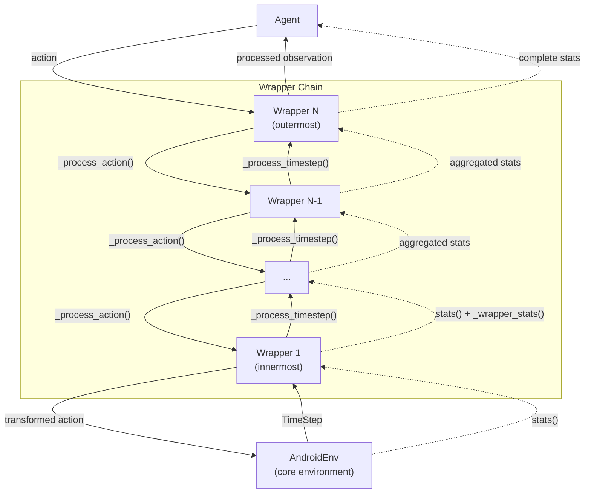
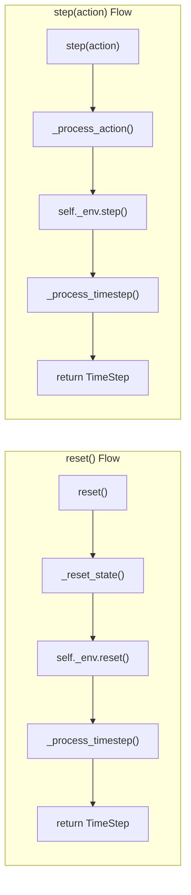
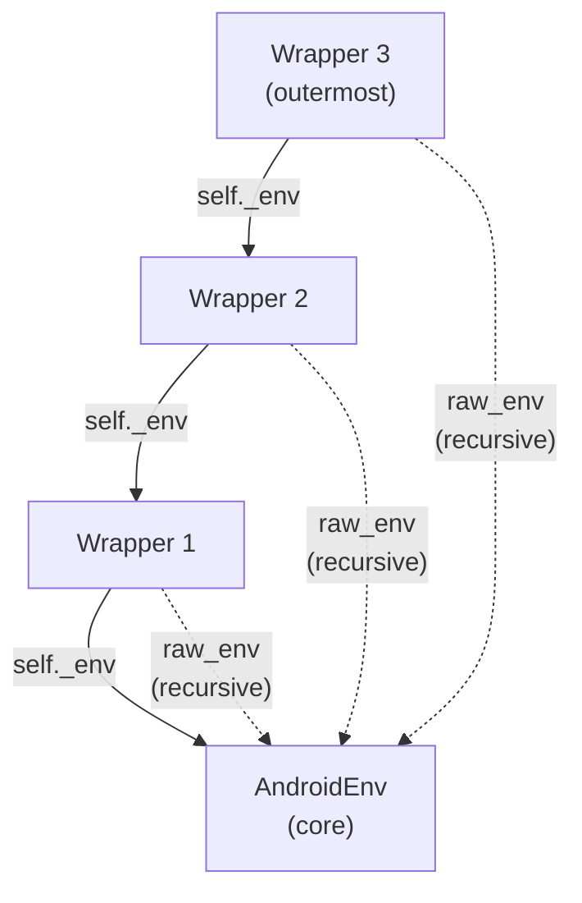
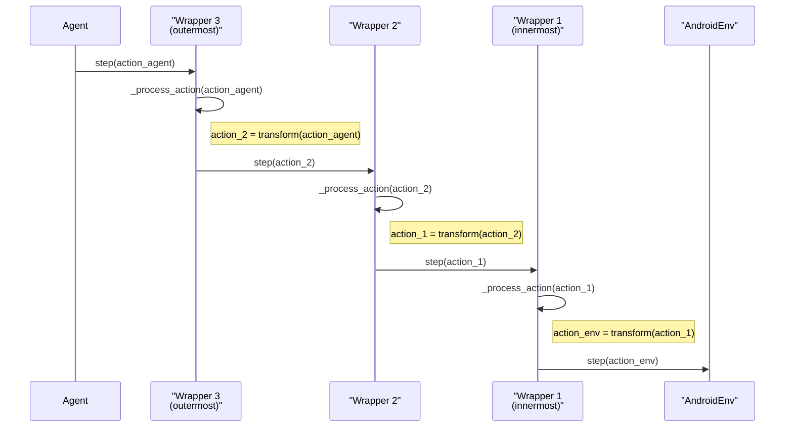
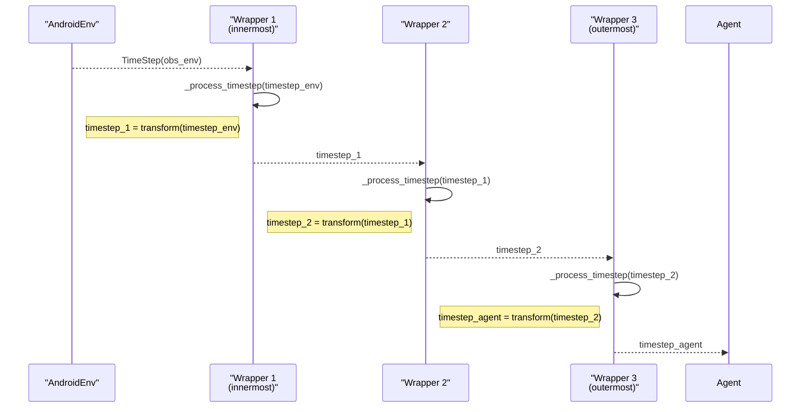
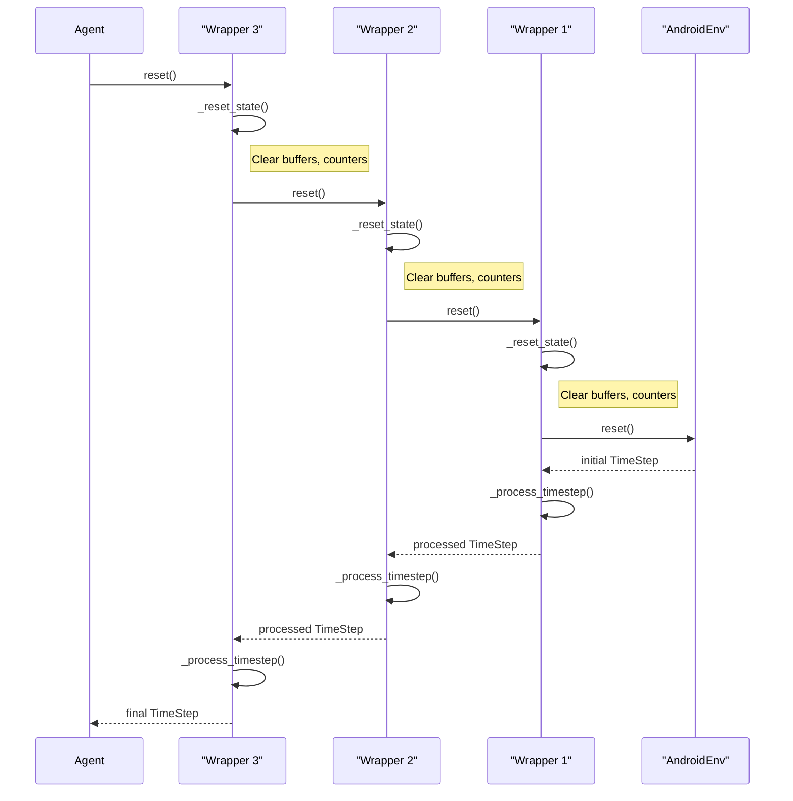
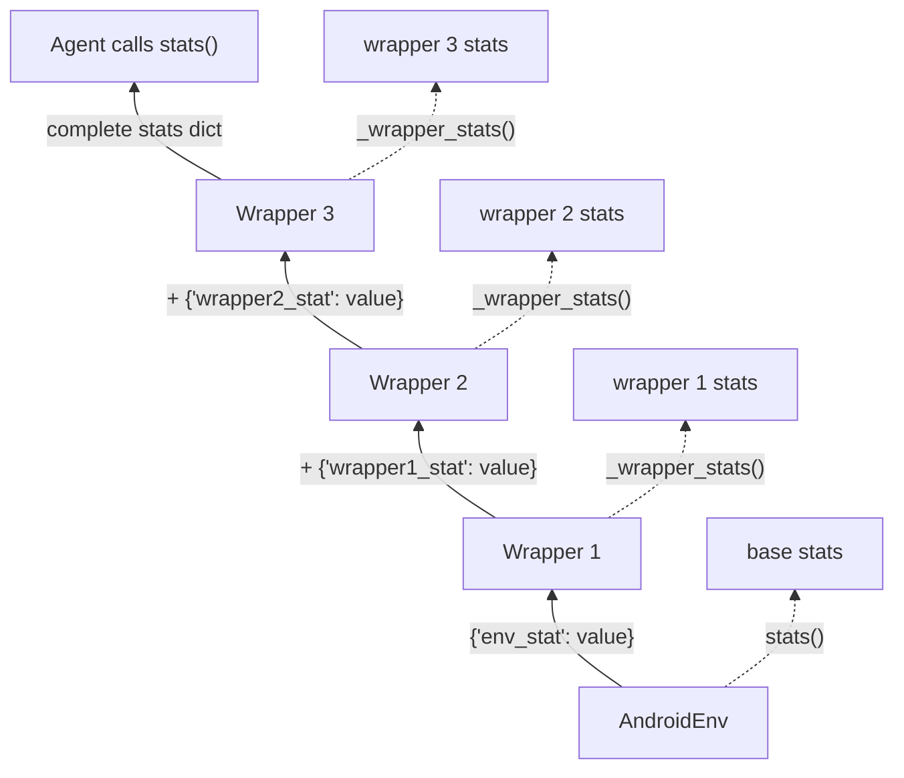

<!-- source: DeepWiki mcp.deepwiki.com · repo google-deepmind/android_env · page 7.1 Wrapper System · fetched 2026-10-26 -->

# Wrapper System

<details>
<summary>Relevant source files</summary>

The following files were used as context for generating this wiki page:

- [android_env/env_interface.py](android_env/env_interface.py)
- [android_env/wrappers/base_wrapper.py](android_env/wrappers/base_wrapper.py)
- [android_env/wrappers/base_wrapper_test.py](android_env/wrappers/base_wrapper_test.py)

</details>


## Purpose and Scope

The wrapper system provides a composable architecture for transforming observations and actions between agent space and environment space. Wrappers implement the decorator pattern to modify the behavior of AndroidEnv without changing its core implementation, enabling compatibility with agents that expect different interfaces.

This page documents the base wrapper infrastructure and chaining mechanisms. For specific wrapper implementations, see [Action Wrappers](#7.2), [Observation Wrappers](#7.3), and [Interface Wrappers](#7.4).

**Sources:** [android_env/wrappers/base_wrapper.py:1-126]()

## Architecture Overview

The wrapper system sits between the agent and the core AndroidEnv environment, implementing a chain of responsibility pattern where each wrapper can modify actions before they reach the environment and observations before they reach the agent.



**Sources:** [android_env/wrappers/base_wrapper.py:29-56]()

## BaseWrapper Class

The `BaseWrapper` class implements `AndroidEnvInterface` and serves as the foundation for all environment wrappers. Each wrapper wraps another `AndroidEnvInterface` instance, creating a chain where the innermost wrapper wraps the actual `AndroidEnv`.

### Class Structure

| Component | Type | Purpose |
|-----------|------|---------|
| `_env` | `AndroidEnvInterface` | The wrapped environment or wrapper |
| `reset()` | Method | Resets internal state and processes reset timestep |
| `step(action)` | Method | Processes action and timestep for each step |
| `_reset_state()` | Hook | Override to reset wrapper-specific state |
| `_process_action(action)` | Hook | Override to transform actions |
| `_process_timestep(timestep)` | Hook | Override to transform observations |
| `_wrapper_stats()` | Hook | Override to add wrapper-specific statistics |

**Sources:** [android_env/wrappers/base_wrapper.py:29-56]()

### Core Methods

The `BaseWrapper` implements the primary `dm_env.Environment` methods by delegating to the wrapped environment with optional transformation:



**Sources:** [android_env/wrappers/base_wrapper.py:36-55]()

### Transformation Hooks

Subclasses override these methods to implement specific transformations:

| Hook | Default Behavior | When to Override |
|------|-----------------|------------------|
| `_reset_state()` | No-op | Reset internal wrapper state (counters, buffers, etc.) |
| `_process_action(action)` | Pass-through | Transform agent actions to environment format |
| `_process_timestep(timestep)` | Pass-through | Transform environment observations to agent format |

**Sources:** [android_env/wrappers/base_wrapper.py:48-55]()

## Wrapper Chaining and Delegation

### Pass-Through Methods

Most `AndroidEnvInterface` methods are delegated directly to the wrapped environment without modification:

| Method Category | Methods | Behavior |
|----------------|---------|----------|
| Specification | `observation_spec()`, `action_spec()`, `reward_spec()`, `discount_spec()` | Direct delegation |
| Task Interface | `task_extras()` | Direct delegation |
| State Management | `load_state()`, `save_state()` | Direct delegation |
| ADB Access | `execute_adb_call()` | Direct delegation |
| Properties | `raw_action`, `raw_observation` | Direct delegation |
| Lifecycle | `close()` | Direct delegation |

**Sources:** [android_env/wrappers/base_wrapper.py:57-125]()

### Attribute Forwarding

The `BaseWrapper` implements `__getattr__` to forward any undefined attribute access to the wrapped environment, enabling wrappers to be transparent proxies:

```python
def __getattr__(self, attr) -> Any:
    """Delegate attribute access to underlying environment."""
    return getattr(self._env, attr)
```

This allows accessing methods and properties from the underlying environment even when they're not explicitly defined on the wrapper interface.

**Sources:** [android_env/wrappers/base_wrapper.py:120-122]()

### Recursive Unwrapping

The `raw_env` property recursively unwraps the wrapper chain to access the core environment:



Implementation:
```python
@property
def raw_env(self) -> env_interface.AndroidEnvInterface:
    """Recursively unwrap until we reach the true 'raw' env."""
    wrapped = self._env
    if hasattr(wrapped, 'raw_env'):
        return wrapped.raw_env
    return wrapped
```

**Sources:** [android_env/wrappers/base_wrapper.py:113-118]()

## Processing Pipeline

### Action Processing Flow

Actions flow from outermost to innermost wrapper, with each wrapper's `_process_action()` method potentially transforming the action:



**Sources:** [android_env/wrappers/base_wrapper.py:41-43]()

### Observation Processing Flow

Observations flow from innermost to outermost wrapper, with each wrapper's `_process_timestep()` method potentially transforming the timestep:



**Sources:** [android_env/wrappers/base_wrapper.py:41-43](), [android_env/wrappers/base_wrapper.py:54-55]()

### Reset Flow

The reset process allows each wrapper to clear its internal state before processing the initial timestep:



**Sources:** [android_env/wrappers/base_wrapper.py:36-39](), [android_env/wrappers/base_wrapper.py:48-49]()

## Statistics Aggregation

The wrapper chain aggregates statistics from all wrappers using the `stats()` and `_wrapper_stats()` methods. Statistics flow from the innermost wrapper outward, with each wrapper adding its own information.

### Statistics Flow



### Implementation

Each wrapper implements `stats()` to merge its own statistics with those from the wrapped environment:

```python
def stats(self) -> dict[str, Any]:
    info = self._env.stats()
    info.update(self._wrapper_stats())
    return info

def _wrapper_stats(self) -> dict[str, Any]:
    """Add wrapper specific logging here."""
    return {}
```

Subclasses override `_wrapper_stats()` to provide their own metrics. If multiple wrappers define the same key, outer wrappers overwrite inner ones.

**Sources:** [android_env/wrappers/base_wrapper.py:69-76]()

## Wrapper Construction Pattern

### Typical Usage

Wrappers are constructed by wrapping the environment or another wrapper:

```python
# Create base environment
env = android_env.load(...)

# Apply wrappers in order (innermost to outermost)
env = SomeWrapper1(env)
env = SomeWrapper2(env)
env = SomeWrapper3(env)

# The agent interacts with the outermost wrapper
timestep = env.reset()
```

Each wrapper logs its initialization:

```python
def __init__(self, env: env_interface.AndroidEnvInterface) -> None:
    self._env = env
    logging.info('Wrapping with %s', self.__class__.__name__)
```

**Sources:** [android_env/wrappers/base_wrapper.py:32-34]()

### Testing Support

The wrapper tests demonstrate the complete behavior of the wrapper chain:

| Test | Purpose |
|------|---------|
| `test_base_function_forwarding` | Verifies all methods are correctly delegated |
| `test_multiple_wrappers` | Confirms chaining works correctly |
| `test_raw_env` | Validates recursive unwrapping |
| `test_stats` | Tests basic statistics pass-through |
| `test_wrapped_stats` | Verifies statistics aggregation across chain |

**Sources:** [android_env/wrappers/base_wrapper_test.py:27-151]()

## Interface Contract

All wrappers maintain the `AndroidEnvInterface` contract, implementing the same methods as `AndroidEnv`:

### Required dm_env.Environment Methods

| Method | Purpose |
|--------|---------|
| `action_spec()` | Returns action specification (typically delegated) |
| `observation_spec()` | Returns observation specification (may be modified) |
| `reset()` | Resets episode and returns initial timestep |
| `step(action)` | Executes action and returns next timestep |
| `close()` | Releases resources |

### AndroidEnv Extensions

| Method/Property | Purpose |
|-----------------|---------|
| `task_extras(latest_only)` | Retrieves task-specific extras |
| `raw_action` | Accesses latest action (property) |
| `raw_observation` | Accesses latest observation (property) |
| `stats()` | Returns aggregated statistics |
| `execute_adb_call(call)` | Executes ADB commands |
| `load_state(request)` | Loads saved state |
| `save_state(request)` | Saves current state |

**Sources:** [android_env/env_interface.py:32-110]()

---

