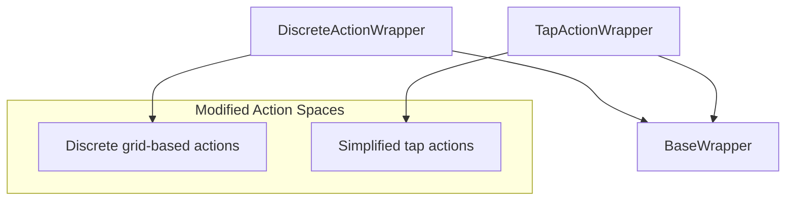
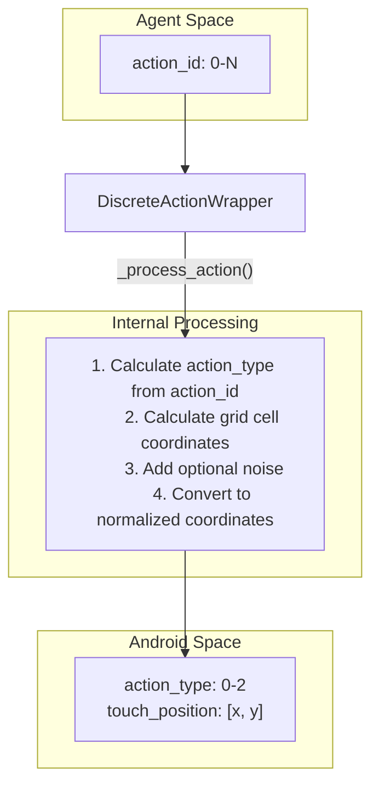
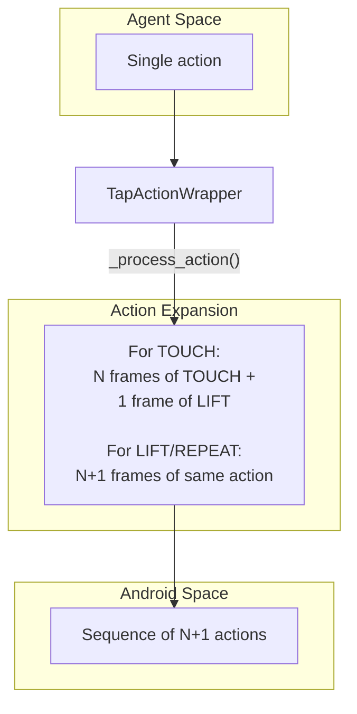
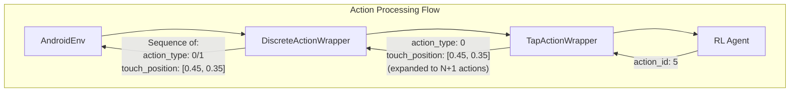

<!-- source: DeepWiki mcp.deepwiki.com · repo google-deepmind/android_env · page 7.2 Action Wrappers · fetched 2026-10-26 -->

# Action Wrappers

<details>
<summary>Relevant source files</summary>

The following files were used as context for generating this wiki page:

- [android_env/wrappers/discrete_action_wrapper.py](android_env/wrappers/discrete_action_wrapper.py)
- [android_env/wrappers/flat_interface_wrapper.py](android_env/wrappers/flat_interface_wrapper.py)
- [android_env/wrappers/image_rescale_wrapper.py](android_env/wrappers/image_rescale_wrapper.py)
- [android_env/wrappers/tap_action_wrapper.py](android_env/wrappers/tap_action_wrapper.py)

</details>


This page documents the action wrappers available in the AndroidEnv system. Action wrappers modify how agents interact with the Android environment by transforming or extending the action space. These wrappers help bridge the gap between reinforcement learning algorithms (which often work best with specific action representations) and the Android interaction model.

For information about observation wrappers, see [Observation Wrappers](#6.2).

## Action Space in AndroidEnv

Before diving into specific wrappers, it's helpful to understand the base action space in AndroidEnv:

```mermaid
classDiagram
    class "Base Action Space" {
        action_type: DiscreteArray
        touch_position: BoundedArray[2]
    }
    
    class "action_type" {
        TOUCH = 0
        LIFT = 1
        REPEAT = 2
    }
    
    "Base Action Space" -- "action_type"
```

The base AndroidEnv action space consists of:
- `action_type`: A discrete value representing the type of action (TOUCH, LIFT, REPEAT)
- `touch_position`: A continuous 2D coordinate (x, y) representing a position on the screen, normalized to [0, 1]

This action space directly maps to how humans interact with touchscreens but can be challenging for reinforcement learning algorithms that are designed for simpler or discrete action spaces.

Sources: [android_env/wrappers/discrete_action_wrapper.py:49-54]()

## Available Action Wrappers

The AndroidEnv framework provides the following action wrappers:



Sources: [android_env/wrappers/discrete_action_wrapper.py:30-31](), [android_env/wrappers/tap_action_wrapper.py:26-27]()

### DiscreteActionWrapper

The `DiscreteActionWrapper` transforms the continuous touch position space into a discrete grid of possible touch positions. This is particularly useful for algorithms that require discrete action spaces.



#### Key Features

- **Grid Division**: Divides the screen into a configurable grid (e.g., 10×10)
- **Action Mapping**: Maps discrete action IDs to grid positions and action types
- **Action Modes**:
  - **Redundant Mode**: Each action type is available for each grid position (grid_size × num_action_types actions)
  - **Non-Redundant Mode**: Only TOUCH actions use the grid, with additional actions for LIFT and REPEAT (grid_size + num_action_types - 1 actions)
- **Positional Noise**: Optional Gaussian noise applied to touch positions to prevent deterministic behavior

#### Implementation Details

The wrapper maps a discrete `action_id` to:
1. An action type (TOUCH, LIFT, or REPEAT) based on integer division or direct mapping
2. A touch position at a grid cell's center plus optional noise

The implementation is careful to:
- Keep touch positions within valid bounds even with noise
- Maintain the type consistency with the parent environment's action specification
- Properly handle the different action modes (redundant vs. non-redundant)

Sources: [android_env/wrappers/discrete_action_wrapper.py:30-161]()

### TapActionWrapper

The `TapActionWrapper` converts a single action into a sequence of actions that simulate a tap (a touch followed by a lift after a specified number of frames). This simplifies agent decision-making by handling the tap sequence automatically.



#### Key Features

- **Action Expansion**: Expands single actions into sequences that simulate natural interactions
- **Configurable Duration**: The number of frames for which a touch is maintained can be configured
- **Touch-Only Mode**: Optional mode where only touch actions are available, simplifying the action space further

#### Implementation Details

When the agent selects an action:
1. If action type is TOUCH (or in touch_only mode): 
   - The wrapper generates `num_frames` consecutive TOUCH actions
   - Followed by a single LIFT action
2. If action type is LIFT or REPEAT:
   - The wrapper generates `num_frames+1` consecutive actions of the same type

The wrapper accumulates rewards from all frames in the sequence, but only returns the final observation, making the expanded sequence appear as a single atomic action to the agent.

Sources: [android_env/wrappers/tap_action_wrapper.py:26-104]()

## Using Action Wrappers

Action wrappers can be applied to an AndroidEnv instance and can be stacked to combine their effects. Here's how you might use these wrappers:



### Common Patterns

1. **Discrete Action Space for Standard RL Algorithms**:
   ```python
   env = DiscreteActionWrapper(env, action_grid=(10, 10))
   ```

2. **Simplified Tap Interface**:
   ```python
   env = TapActionWrapper(env, num_frames=5)
   ```

3. **Combined Discrete Taps**:
   ```python
   env = TapActionWrapper(DiscreteActionWrapper(env, action_grid=(10, 10)))
   ```

4. **Discrete Actions with Exploration**:
   ```python
   env = DiscreteActionWrapper(env, action_grid=(10, 10), noise=0.1)
   ```

## Extending Action Wrappers

Creating custom action wrappers is straightforward by extending the `BaseWrapper` class and implementing:
- `__init__`: Initialize the wrapper with the parent environment
- `action_spec`: Define the new action space
- `_process_action`: Transform actions from the wrapper's format to the parent format
- `step`: Process actions and delegate to the parent environment

Sources: [android_env/wrappers/discrete_action_wrapper.py:33-161](), [android_env/wrappers/tap_action_wrapper.py:29-104]()

---

