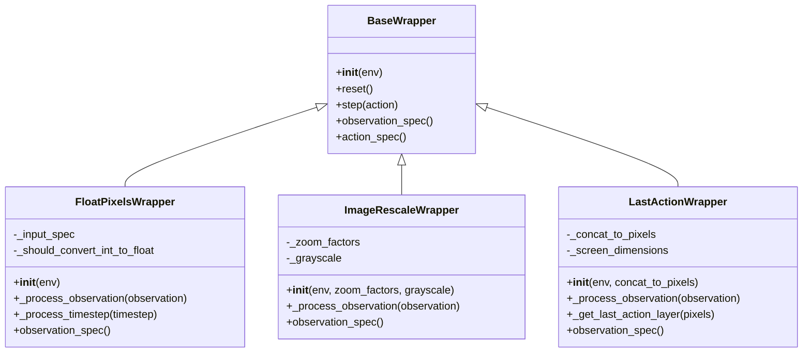
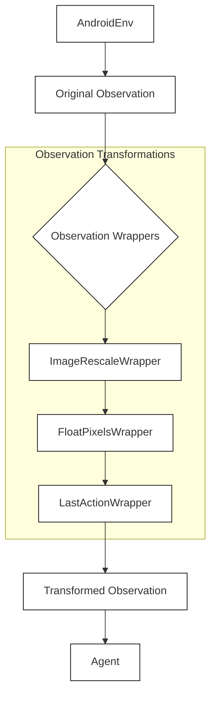
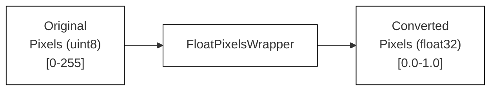
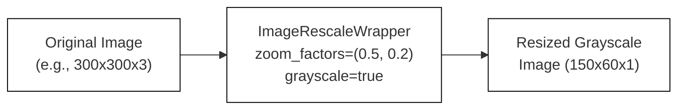
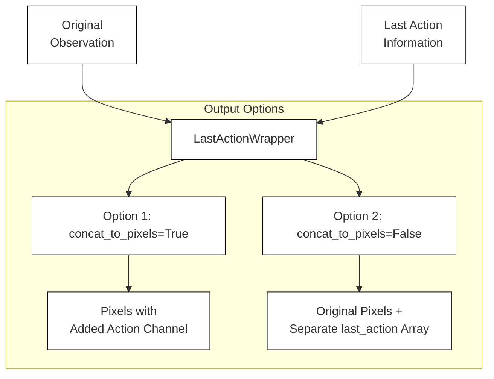
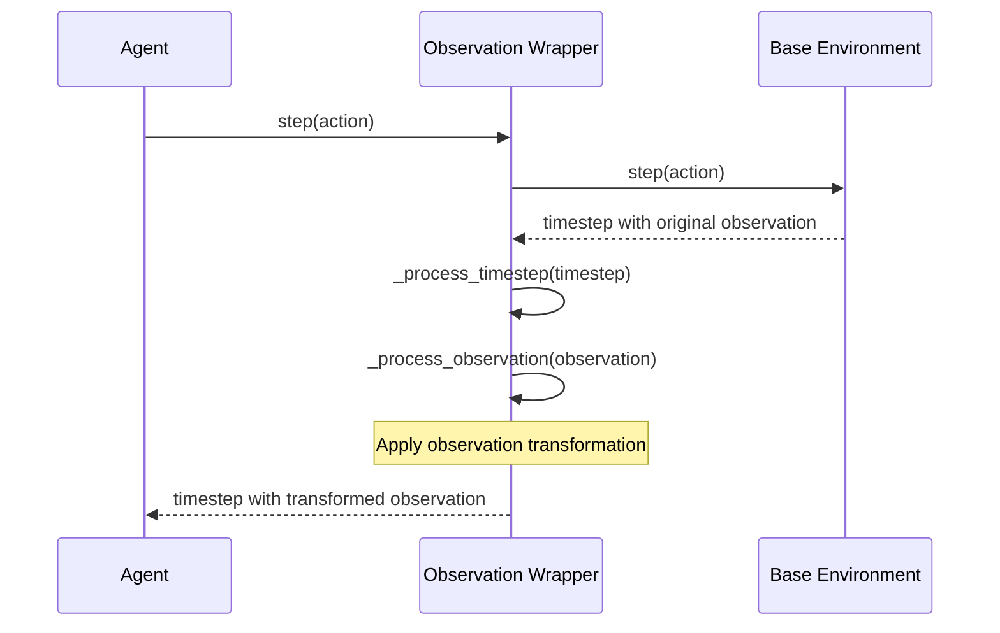

<!-- source: DeepWiki mcp.deepwiki.com · repo google-deepmind/android_env · page 7.3 Observation Wrappers · fetched 2026-10-26 -->

# Observation Wrappers

<details>
<summary>Relevant source files</summary>

The following files were used as context for generating this wiki page:

- [android_env/wrappers/discrete_action_wrapper.py](android_env/wrappers/discrete_action_wrapper.py)
- [android_env/wrappers/flat_interface_wrapper.py](android_env/wrappers/flat_interface_wrapper.py)
- [android_env/wrappers/image_rescale_wrapper.py](android_env/wrappers/image_rescale_wrapper.py)
- [android_env/wrappers/tap_action_wrapper.py](android_env/wrappers/tap_action_wrapper.py)

</details>


## Purpose and Scope

This document describes the observation wrapper components within the AndroidEnv framework. Observation wrappers modify the observation data received from the Android environment before passing it to the agent. They provide functionality to transform, resize, reformat, or augment observation data to suit various agent requirements while maintaining the same underlying environment dynamics.

For information about wrappers that modify action spaces, see [Action Wrappers](#6.1). For wrappers that adapt the environment to different interfaces like Gym, see [Interface Wrappers](#6.3).

## Overview of Observation Wrappers

Observation wrappers in AndroidEnv inherit from the `BaseWrapper` class and override methods to process observation data. They allow for transformations such as pixel normalization, image resizing, and adding supplementary information to observations.



Sources: [android_env/wrappers/float_pixels_wrapper.py](), [android_env/wrappers/last_action_wrapper.py]()

## Data Flow Through Observation Wrappers

The following diagram shows how observation data flows through the wrappers in the AndroidEnv system:



Sources: [android_env/wrappers/float_pixels_wrapper.py](), [android_env/wrappers/last_action_wrapper.py]()

## Available Observation Wrappers

### FloatPixelsWrapper

The `FloatPixelsWrapper` converts pixel observations from integer values to float32 values between 0.0 and 1.0. This normalization is often necessary for neural network processing.



Key features:
- Automatically detects whether conversion is needed based on input type
- Maintains the shape of the observation
- Updates the observation spec to reflect the new data type and range

Implementation details:
- The wrapper checks if the input is of integer type using `np.issubdtype` [android_env/wrappers/float_pixels_wrapper.py:31-32]()
- Uses `pixel_fns.convert_int_to_float` to perform the conversion [android_env/wrappers/float_pixels_wrapper.py:38-40]()
- Updates the observation spec to use float32 data type with range [0.0, 1.0] [android_env/wrappers/float_pixels_wrapper.py:59-68]()

Sources: [android_env/wrappers/float_pixels_wrapper.py](), [android_env/components/pixel_fns.py:57-70]()

### ImageRescaleWrapper

The `ImageRescaleWrapper` resizes observation images to different dimensions and can optionally convert them to grayscale. This is useful for reducing computational requirements or standardizing input sizes for neural networks.



Key features:
- Allows specification of different zoom factors for height and width
- Option to convert RGB images to grayscale
- Updates the observation spec to reflect the new dimensions and channels

From the test file, we can see that the wrapper supports:
- Specifying zoom factors as a tuple or list [android_env/wrappers/image_rescale_wrapper_test.py:57, 75, 93]()
- Setting grayscale conversion [android_env/wrappers/image_rescale_wrapper_test.py:57]()
- Properly updating the observation spec shape [android_env/wrappers/image_rescale_wrapper_test.py:59, 77, 95]()

Sources: [android_env/wrappers/image_rescale_wrapper_test.py]()

### LastActionWrapper

The `LastActionWrapper` extends observations with information about the last action taken by the agent. This provides the agent with memory of its previous actions, which can be crucial for some learning tasks.



Key features:
- Represents the last touch position as a single white pixel in a black image
- Can either add this as an additional channel to the pixels observation or as a separate observation field
- Only shows touch actions, not other action types like LIFT
- Properly updates the observation spec to reflect the changes

Implementation details:
- Stores the screen dimensions for coordinate mapping [android_env/wrappers/last_action_wrapper.py:49]()
- Uses `pixel_fns.touch_position_to_pixel_position` to convert normalized coordinates to pixel positions [android_env/wrappers/last_action_wrapper.py:79-81]()
- Sets a single pixel to 255 at the touch position [android_env/wrappers/last_action_wrapper.py:82]()
- Provides two integration options controlled by the `concat_to_pixels` parameter [android_env/wrappers/last_action_wrapper.py:62-67]()

Sources: [android_env/wrappers/last_action_wrapper.py](), [android_env/wrappers/last_action_wrapper_test.py]()

## Observation Processing Flow

The following diagram shows how observation processing works during environment stepping:



Sources: [android_env/wrappers/float_pixels_wrapper.py:44-50](), [android_env/wrappers/last_action_wrapper.py:51-54]()

## Implementation Considerations

When using observation wrappers, consider these important points:

1. **Order matters**: The order in which wrappers are applied can affect the final result. For example, applying `ImageRescaleWrapper` after `LastActionWrapper` could distort the single pixel representation of the last action.

2. **Performance impact**: Some wrappers may introduce computational overhead, particularly those that manipulate large image arrays. Consider the trade-off between preprocessing benefits and performance.

3. **Observation spec**: All wrappers update the observation spec to reflect their transformations, which is important for agents that need to know the shape and type of observations they will receive.

4. **Interaction with other wrappers**: Be mindful of how observation wrappers interact with action wrappers and interface wrappers in your environment stack.

## Example Usage

Here's an example of how to use observation wrappers in combination:

```python
# Create base environment
env = android_env.AndroidEnv(...)

# Apply observation wrappers in sequence
# First resize the image to reduce computation
env = ImageRescaleWrapper(env, zoom_factors=(0.5, 0.5))

# Convert pixels to float for neural network processing
env = FloatPixelsWrapper(env)

# Add last action information to help with temporal reasoning
env = LastActionWrapper(env, concat_to_pixels=True)

# Now use the wrapped environment with your agent
observation = env.reset()
# Agent uses the transformed observation
```

## Pixel Functions

The observation wrappers rely on utility functions from the `pixel_fns` module to perform various transformations:

| Function | Purpose |
|---|---|
| `convert_int_to_float` | Normalizes integer pixel values to float values between 0.0 and 1.0 |
| `orient_pixels` | Rotates images according to the device orientation |
| `transpose_pixels` | Transposes image dimensions (H,W,C) ↔ (W,H,C) |
| `touch_position_to_pixel_position` | Maps normalized touch positions to pixel coordinates |

Sources: [android_env/components/pixel_fns.py]()

## Observation Wrapper Selection Guide

When deciding which observation wrappers to use, consider:

1. **Agent requirements**: What format does your agent expect observations in?
   - Neural networks often work best with normalized float values (use `FloatPixelsWrapper`)
   - If input size matters, use `ImageRescaleWrapper` to standardize dimensions
   - For agents that benefit from action history, use `LastActionWrapper`

2. **Computational constraints**: If you have limited computational resources, consider using `ImageRescaleWrapper` to reduce image size.

3. **Task characteristics**: Some tasks may benefit from certain observation transformations.
   - For tasks requiring precise spatial reasoning, maintain high resolution
   - For tasks where color is less important, consider grayscale conversion

---

