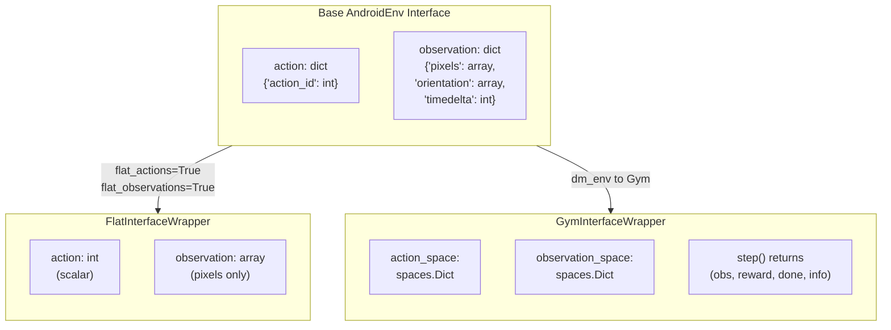
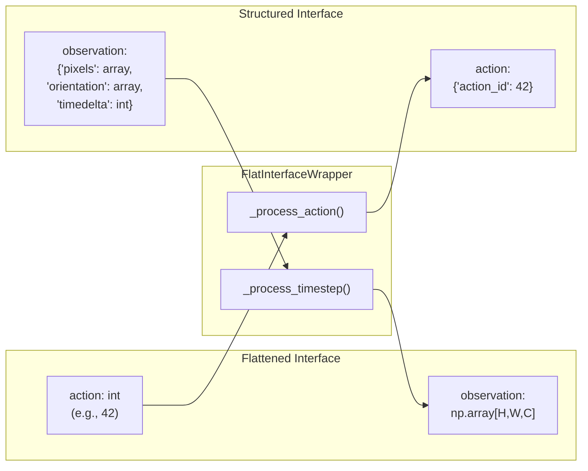
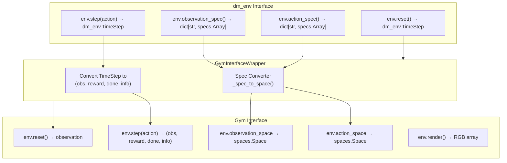
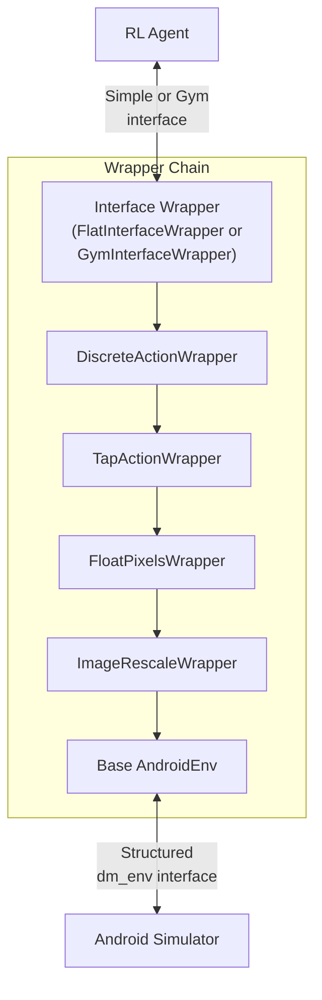

<!-- source: DeepWiki mcp.deepwiki.com · repo google-deepmind/android_env · page 7.4 Interface Wrappers · fetched 2026-10-26 -->

# Interface Wrappers

<details>
<summary>Relevant source files</summary>

The following files were used as context for generating this wiki page:

- [android_env/wrappers/discrete_action_wrapper.py](android_env/wrappers/discrete_action_wrapper.py)
- [android_env/wrappers/discrete_action_wrapper_test.py](android_env/wrappers/discrete_action_wrapper_test.py)
- [android_env/wrappers/flat_interface_wrapper.py](android_env/wrappers/flat_interface_wrapper.py)
- [android_env/wrappers/flat_interface_wrapper_test.py](android_env/wrappers/flat_interface_wrapper_test.py)
- [android_env/wrappers/float_pixels_wrapper_test.py](android_env/wrappers/float_pixels_wrapper_test.py)
- [android_env/wrappers/gym_wrapper.py](android_env/wrappers/gym_wrapper.py)
- [android_env/wrappers/gym_wrapper_test.py](android_env/wrappers/gym_wrapper_test.py)
- [android_env/wrappers/image_rescale_wrapper.py](android_env/wrappers/image_rescale_wrapper.py)
- [android_env/wrappers/image_rescale_wrapper_test.py](android_env/wrappers/image_rescale_wrapper_test.py)
- [android_env/wrappers/last_action_wrapper_test.py](android_env/wrappers/last_action_wrapper_test.py)
- [android_env/wrappers/tap_action_wrapper.py](android_env/wrappers/tap_action_wrapper.py)
- [android_env/wrappers/tap_action_wrapper_test.py](android_env/wrappers/tap_action_wrapper_test.py)

</details>


Interface wrappers adapt the environment's interface to simplify interactions or provide compatibility with other reinforcement learning frameworks. AndroidEnv provides two primary interface wrappers:

1. **`FlatInterfaceWrapper`**: Simplifies the environment interface by removing dictionary structures, exposing observations as raw pixel arrays and actions as scalar integers.
2. **`GymInterfaceWrapper`**: Adapts AndroidEnv to the OpenAI Gym interface standard.

## Overview of Interface Wrappers

Interface wrappers differ from action and observation wrappers in that they reshape the entire interaction protocol. The base AndroidEnv interface uses structured dictionaries for actions and observations, following the dm_env standard. Interface wrappers can flatten this structure or translate it to other frameworks.



Sources: [android_env/wrappers/flat_interface_wrapper.py:53-131](), [android_env/wrappers/gym_wrapper.py:28-99]()

## FlatInterfaceWrapper

The `FlatInterfaceWrapper` simplifies the environment interface by removing dictionary structures from actions and observations. This is particularly useful for agents that expect simple scalar actions and array observations.

### Purpose and Configuration

The wrapper provides three configuration options:

| Parameter | Type | Default | Description |
|-----------|------|---------|-------------|
| `flat_actions` | bool | True | Convert dictionary actions to scalar integers |
| `flat_observations` | bool | True | Extract only pixel array from observation dictionary |
| `keep_action_layer` | bool | True | Keep the action visualization layer in pixels (4th channel) |

### Interface Transformation



The wrapper expects the base environment to have:
- A single-key action dictionary (typically from `DiscreteActionWrapper`)
- An observation dictionary containing at least a 'pixels' key

### Action Processing

When `flat_actions=True`, the wrapper converts scalar actions to dictionary format:

```python
# Agent provides: action = 5
# Wrapper converts to: {'action_id': 5}
```

The wrapper retrieves the action key name from the base environment's action spec at initialization ([android_env/wrappers/flat_interface_wrapper.py:73]()).

### Observation Processing

When `flat_observations=True`, the wrapper extracts pixel observations from the dictionary:

1. **With action layer** (`keep_action_layer=True`): Returns full pixel array including action visualization
2. **Without action layer** (`keep_action_layer=False`): Strips the action layer, returning only RGB channels

The `_extract_screen_pixels()` helper function ([android_env/wrappers/flat_interface_wrapper.py:29-34]()) handles removing the action layer:
- For grayscale+action (2 channels): Returns channel 0 only
- For RGB+action (4 channels): Returns channels 0, 1, 2 only

### Spec Transformation

The wrapper modifies the action and observation specs accordingly:

**Action Spec:**
- Input: `{'action_id': DiscreteArray(num_values=N)}`
- Output: `DiscreteArray(num_values=N)` (scalar)

**Observation Spec:**
- Input: `{'pixels': BoundedArray(shape=[H,W,C]), ...}`
- Output: `BoundedArray(shape=[H,W,C])` or `BoundedArray(shape=[H,W,C-1])` if action layer removed

### Example Usage

```python
from android_env.wrappers import discrete_action_wrapper
from android_env.wrappers import flat_interface_wrapper

# Start with structured interface
env = DiscreteActionWrapper(base_env, action_grid=(10, 10))

# Flatten to simple scalars
env = FlatInterfaceWrapper(
    env,
    flat_actions=True,
    flat_observations=True,
    keep_action_layer=False
)

# Now use simple interface
obs = env.reset()  # Returns np.array directly
assert isinstance(obs, np.ndarray)
assert obs.shape == (480, 320, 3)  # RGB only, no action layer

action = 42  # Simple integer
timestep = env.step(action)
assert isinstance(timestep.observation, np.ndarray)
```

Sources: [android_env/wrappers/flat_interface_wrapper.py:53-131](), [android_env/wrappers/flat_interface_wrapper_test.py:46-166]()

## Gym Interface Wrapper

The primary interface wrapper provided in AndroidEnv is the `GymInterfaceWrapper`, which adapts the environment to use the OpenAI Gym interface.



The `GymInterfaceWrapper` handles:

1. Converting dm_env specs to Gym spaces
2. Transforming the reset and step methods to return values in Gym's format
3. Providing a render method that returns the pixel observation
4. Handling episode termination through the `done` flag

### Spec Conversion

A key part of the `GymInterfaceWrapper` is how it converts between dm_env specs and Gym spaces:

| dm_env Spec Type | Gym Space Conversion |
|------------------|----------------------|
| `specs.DiscreteArray` | `spaces.Box` with shape=(), low=0, high=(num_values-1) |
| `specs.BoundedArray` | `spaces.Box` with direct minimum/maximum values |
| `specs.Array` (uint8) | `spaces.Box` with low=0, high=255 |
| `specs.Array` (other) | `spaces.Box` with low=-inf, high=inf |
| Dictionary of specs | `spaces.Dict` with recursive conversion |
| List of specs | `spaces.Tuple` with recursive conversion |

Sources: [android_env/wrappers/gym_wrapper.py:28-98](), [android_env/wrappers/gym_wrapper_test.py:29-119]()

## Wrapper Composition

Interface wrappers are typically applied as the outermost wrapper in a chain since they fundamentally change the interaction protocol. The following diagram shows a typical wrapper composition:



### Example: FlatInterfaceWrapper Chain

```python
from android_env.wrappers import (
    discrete_action_wrapper,
    tap_action_wrapper,
    image_rescale_wrapper,
    flat_interface_wrapper
)

# Build from inside out
env = base_env
env = ImageRescaleWrapper(env, zoom_factors=(0.5, 0.5))
env = TapActionWrapper(env, num_frames=5)
env = DiscreteActionWrapper(env, action_grid=(10, 10))
env = FlatInterfaceWrapper(env, flat_actions=True, flat_observations=True)

# Agent now sees simple interface
observation = env.reset()  # np.ndarray
action = 42  # int
timestep = env.step(action)
```

### Example: GymInterfaceWrapper Chain

```python
from android_env.wrappers import (
    image_rescale_wrapper,
    float_pixels_wrapper,
    gym_wrapper
)

# Apply observation transformations
env = base_env
env = ImageRescaleWrapper(env, zoom_factors=(0.5, 0.5))
env = FloatPixelsWrapper(env)

# Apply Gym interface wrapper last
gym_env = GymInterfaceWrapper(env)

# Now compatible with Gym-based agents
observation = gym_env.reset()
action = gym_env.action_space.sample()
observation, reward, done, info = gym_env.step(action)

# Rendering support
rgb_array = gym_env.render(mode='rgb_array')
```

Sources: [android_env/wrappers/flat_interface_wrapper.py:53-131](), [android_env/wrappers/gym_wrapper.py:28-99]()

## Design Principles

Interface wrappers follow several important design principles:

1. **Transparency**: Interface wrappers try to be invisible intermediaries, forwarding all relevant information between the agent and environment.

2. **Completeness**: All methods and properties required by the target interface are implemented.

3. **Compatibility**: Conversions between interfaces preserve the semantics of the original interface as much as possible.

4. **Composition**: Interface wrappers can be combined with other wrappers, though they typically should be the outermost wrapper.

## Summary

Interface wrappers extend the versatility of AndroidEnv by making it compatible with different reinforcement learning frameworks. The primary interface wrapper, `GymInterfaceWrapper`, allows using AndroidEnv with OpenAI Gym-compatible agents and libraries. These wrappers follow the general wrapper architecture of AndroidEnv, inheriting from `BaseWrapper` and implementing the necessary conversions between interfaces.

Sources: [android_env/env_interface.py:31-109](), [android_env/wrappers/base_wrapper.py:29-125](), [android_env/wrappers/gym_wrapper.py:28-98](), [docs/environment.md:115-134]()

---

