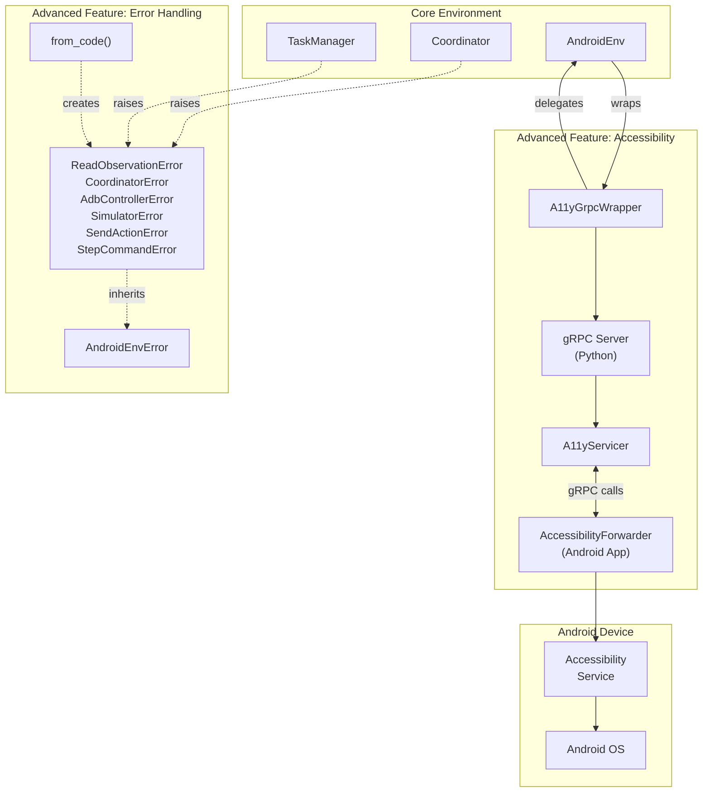
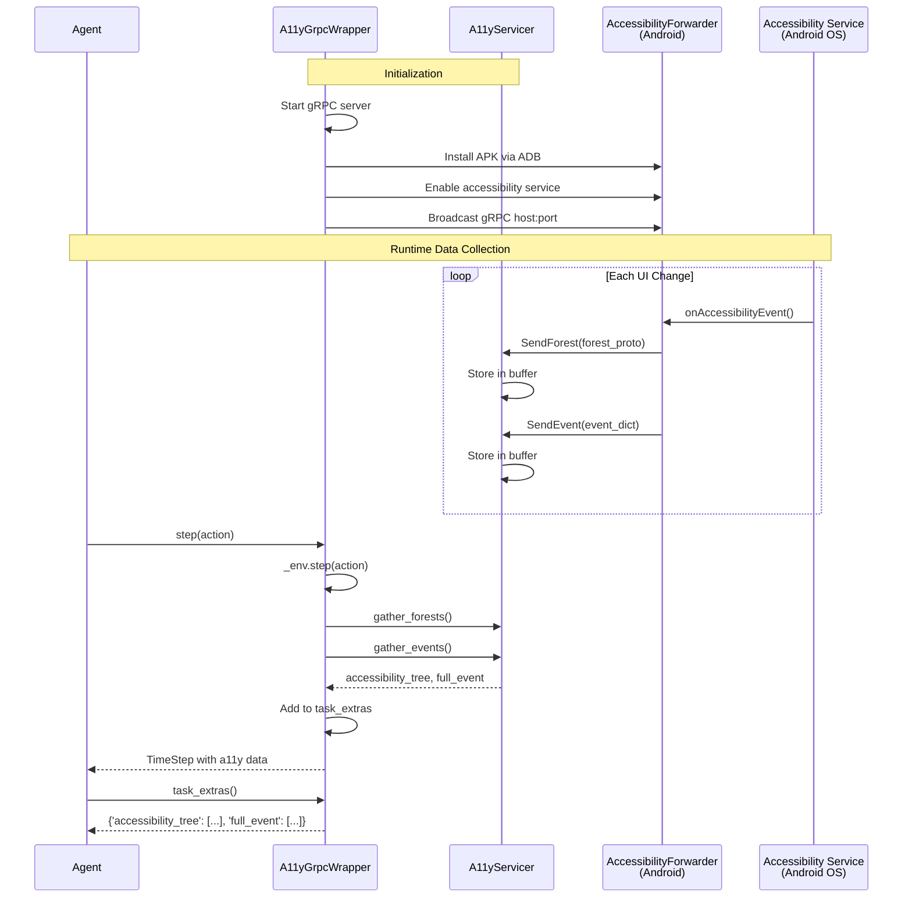
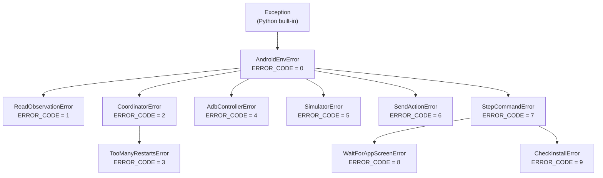
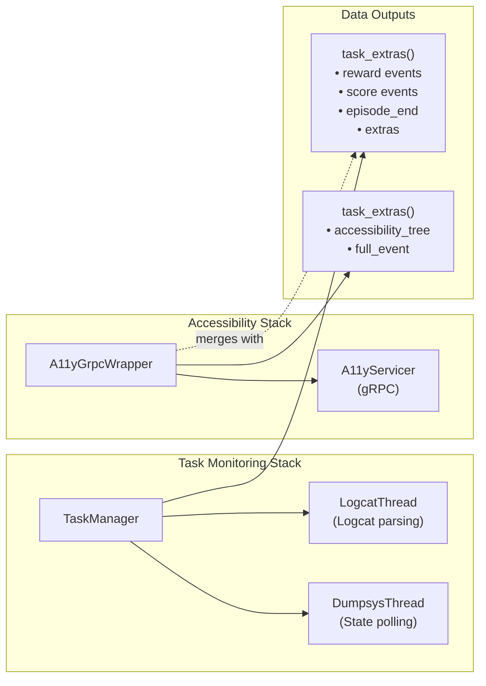
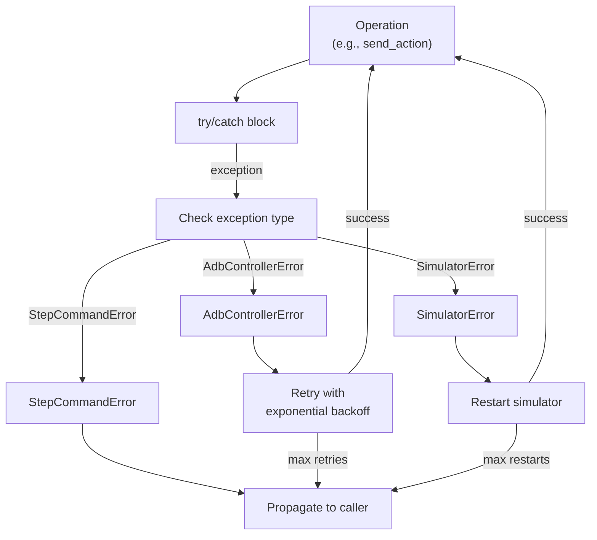

<!-- source: DeepWiki mcp.deepwiki.com · repo google-deepmind/android_env · page 8 Advanced Features · fetched 2026-10-26 -->

# Advanced Features

<details>
<summary>Relevant source files</summary>

The following files were used as context for generating this wiki page:

- [android_env/components/dumpsys_thread.py](android_env/components/dumpsys_thread.py)
- [android_env/components/errors.py](android_env/components/errors.py)
- [android_env/components/errors_test.py](android_env/components/errors_test.py)
- [android_env/wrappers/a11y_grpc_wrapper.py](android_env/wrappers/a11y_grpc_wrapper.py)
- [android_env/wrappers/a11y_grpc_wrapper_test.py](android_env/wrappers/a11y_grpc_wrapper_test.py)

</details>


## Purpose and Scope

This document provides an overview of advanced capabilities in AndroidEnv that extend beyond basic RL environment functionality. Specifically, this covers:

- **Accessibility Support**: Infrastructure for capturing Android accessibility information (UI trees and events) via gRPC
- **Error Handling**: A structured exception hierarchy with unique error codes for debugging and error recovery

For details on the basic wrapper system for observation/action transformation, see [Environment Wrappers](#7). For information on task monitoring via logcat, see [Monitoring System](#4.4).

---

## System Overview

The advanced features extend AndroidEnv's capabilities in two orthogonal dimensions:

1. **Enhanced Observations**: Accessibility support provides structured semantic information about the UI state beyond raw pixels
2. **Robust Error Management**: A typed exception hierarchy enables precise error identification and recovery strategies

Both features integrate seamlessly with the core environment while remaining optional for basic usage scenarios.



**Sources:** [android_env/wrappers/a11y_grpc_wrapper.py:51-77](), [android_env/components/errors.py:19-99]()

---

## Accessibility Support Architecture

The accessibility support system enables agents to receive structured information about the Android UI hierarchy and user interaction events. This is implemented as a wrapper that extends the base environment without modifying its core interface.

### High-Level Components

| Component | Location | Responsibility |
|-----------|----------|----------------|
| `A11yGrpcWrapper` | [android_env/wrappers/a11y_grpc_wrapper.py:51]() | Environment wrapper that manages gRPC server |
| `A11yServicer` | [android_env/wrappers/a11y/a11y_servicer.py]() | gRPC service implementation |
| `AccessibilityForwarder` | Android app | Captures accessibility data from Android OS |
| `a11y_forests` | [android_env/wrappers/a11y/a11y_forests.py]() | Processes accessibility tree structures |
| `a11y_events` | [android_env/wrappers/a11y/a11y_events.py]() | Processes accessibility events |

### Data Flow



**Sources:** [android_env/wrappers/a11y_grpc_wrapper.py:400-423](), [android_env/wrappers/a11y_grpc_wrapper.py:440-497]()

### Key Features

1. **gRPC Communication**: Uses a local gRPC server to receive data from the Android emulator ([android_env/wrappers/a11y_grpc_wrapper.py:136-150]())
2. **Network Resilience**: Automatically detects and attempts to recover from network failures ([android_env/wrappers/a11y_grpc_wrapper.py:244-274]())
3. **Data Accumulation**: Buffers accessibility data between `step()` calls to avoid data loss ([android_env/wrappers/a11y_grpc_wrapper.py:425-438]())
4. **Optional Integration**: Can be enabled/disabled via wrapper configuration without affecting core environment

For detailed implementation, configuration options, and usage patterns, see [Accessibility Support](#8.1).

---

## Error Handling Infrastructure

AndroidEnv implements a hierarchical exception system that provides structured error information for debugging, logging, and error recovery strategies.

### Exception Hierarchy



**Sources:** [android_env/components/errors.py:19-99]()

### Error Code System

Each exception class has a unique `ERROR_CODE` attribute that enables programmatic error identification:

| Error Code | Exception Class | Use Case |
|------------|-----------------|----------|
| 0 | `AndroidEnvError` | Base class for all AndroidEnv errors |
| 1 | `ReadObservationError` | Simulator failed to provide observation |
| 2 | `CoordinatorError` | Coordinator encountered an error |
| 3 | `TooManyRestartsError` | Exceeded maximum restart attempts |
| 4 | `AdbControllerError` | ADB command execution failed |
| 5 | `SimulatorError` | Simulator-specific error |
| 6 | `SendActionError` | Action could not be sent to device |
| 7 | `StepCommandError` | Setup step execution failed |
| 8 | `WaitForAppScreenError` | Timeout waiting for expected screen |
| 9 | `CheckInstallError` | App installation verification failed |

**Sources:** [android_env/components/errors.py:24](), [android_env/components/errors.py:30](), [android_env/components/errors.py:36](), [android_env/components/errors.py:42](), [android_env/components/errors.py:48](), [android_env/components/errors.py:54](), [android_env/components/errors.py:60](), [android_env/components/errors.py:66](), [android_env/components/errors.py:72](), [android_env/components/errors.py:78]()

### Error Factory Pattern

The `from_code()` factory function enables error reconstruction from error codes, useful for serialization and remote error handling:

```python
# Usage example (from test file)
error = errors.from_code(4, 'ADB command failed')
# Returns: AdbControllerError('ADB command failed')
```

**Sources:** [android_env/components/errors.py:81-99]()

For complete error handling patterns and integration with the Coordinator's retry logic, see [Error Handling](#8.2).

---

## Integration Points

### Accessibility Integration with Task Monitoring

The accessibility wrapper extends the task monitoring system by providing additional data streams alongside logcat-based monitoring:



**Sources:** [android_env/wrappers/a11y_grpc_wrapper.py:440-497](), [android_env/components/dumpsys_thread.py:26-126]()

### Error Handling Integration with Coordinator

The Coordinator uses the error hierarchy to implement retry and recovery logic:



**Sources:** [android_env/components/errors.py:19-99]()

---

## Usage Patterns

### Enabling Accessibility Support

```python
# Basic accessibility wrapper setup
from android_env.wrappers import a11y_grpc_wrapper

env = loader.load(...)
env = a11y_grpc_wrapper.A11yGrpcWrapper(
    env,
    install_a11y_forwarding=True,  # Install AccessibilityForwarder APK
    start_a11y_service=True,        # Enable accessibility service
    enable_a11y_tree_info=True,     # Collect UI tree data
    add_latest_a11y_info_to_obs=True  # Add to observations
)

timestep = env.reset()
# timestep.observation now includes 'a11y_forest' key

extras = env.task_extras()
# extras includes 'accessibility_tree' and 'full_event' arrays
```

**Sources:** [android_env/wrappers/a11y_grpc_wrapper.py:79-124]()

### Handling Errors with Type Checking

```python
from android_env.components import errors

try:
    timestep = env.step(action)
except errors.AdbControllerError as e:
    print(f"ADB error (code {e.ERROR_CODE}): {e}")
    # Implement retry logic
except errors.TooManyRestartsError as e:
    print(f"Environment failed after multiple restarts")
    # Terminate episode or reset environment
except errors.AndroidEnvError as e:
    print(f"General AndroidEnv error (code {e.ERROR_CODE}): {e}")
    # Generic error handling
```

**Sources:** [android_env/components/errors.py:19-99]()

### Error Code-Based Error Handling

```python
# Serialization example
error_code = 4
error_message = "Connection to ADB server failed"

# Reconstruct error on remote system
reconstructed_error = errors.from_code(error_code, error_message)
if reconstructed_error:
    raise reconstructed_error
```

**Sources:** [android_env/components/errors.py:81-99]()

---

## Performance Considerations

### Accessibility Overhead

The accessibility system introduces minimal performance overhead:

1. **gRPC Communication**: Asynchronous message passing with buffering
2. **Data Accumulation**: Memory overhead scales with episode length
3. **Network Monitoring**: Background thread monitors for connection issues ([android_env/wrappers/a11y_grpc_wrapper.py:244-274]())

To minimize impact:
- Use `latest_a11y_info_only=True` to limit buffer size ([android_env/wrappers/a11y_grpc_wrapper.py:89]())
- Set `enable_a11y_tree_info=False` if only events are needed ([android_env/wrappers/a11y_grpc_wrapper.py:85]())
- Configure `a11y_info_timeout` to control observation latency ([android_env/wrappers/a11y_grpc_wrapper.py:87]())

### Error Handling Overhead

The exception hierarchy has negligible runtime overhead:
- Error code lookup is a simple dictionary operation
- Exception instantiation only occurs on error paths
- No performance impact during normal operation

**Sources:** [android_env/wrappers/a11y_grpc_wrapper.py:79-168](), [android_env/components/errors.py:81-99]()

---

