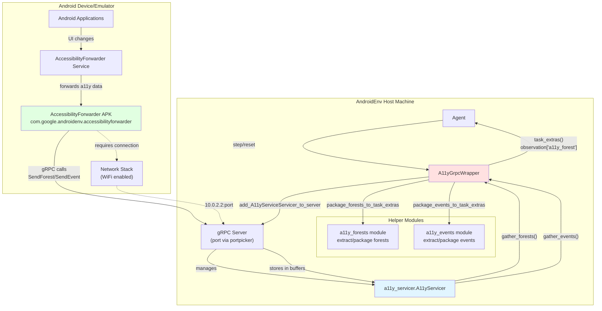
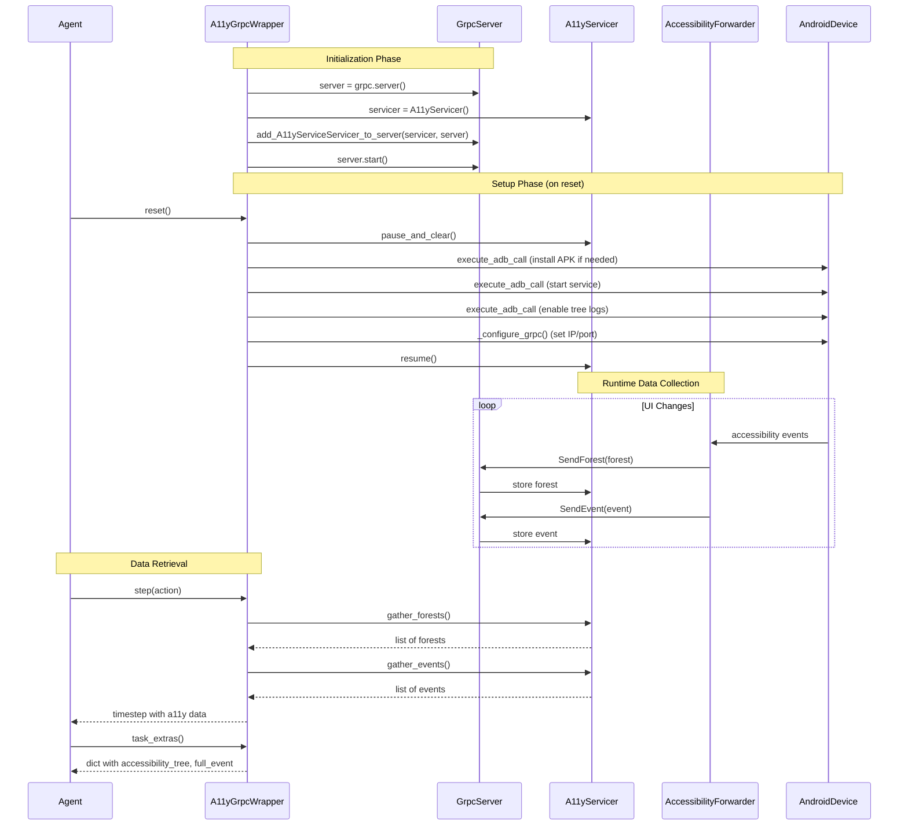
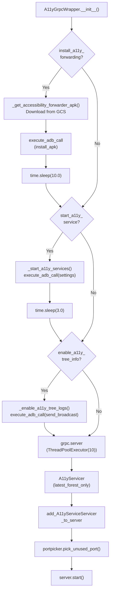
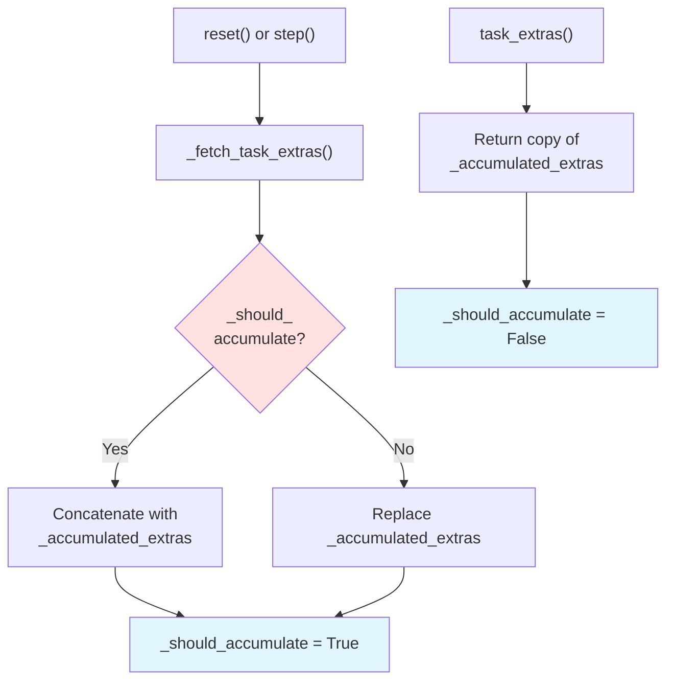
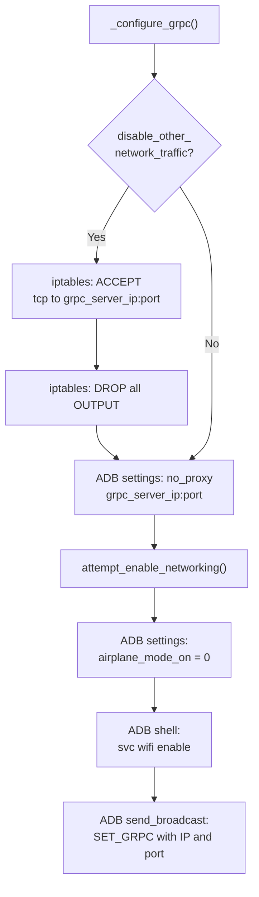

<!-- source: DeepWiki mcp.deepwiki.com · repo google-deepmind/android_env · page 8.1 Accessibility Support · fetched 2026-10-26 -->

# Accessibility Support

<details>
<summary>Relevant source files</summary>

The following files were used as context for generating this wiki page:

- [android_env/wrappers/a11y_grpc_wrapper.py](android_env/wrappers/a11y_grpc_wrapper.py)
- [android_env/wrappers/a11y_grpc_wrapper_test.py](android_env/wrappers/a11y_grpc_wrapper_test.py)

</details>


## Purpose and Scope

This page documents the accessibility support system in AndroidEnv, which provides agents with structured information about the Android UI hierarchy and user interaction events. The system uses gRPC to stream accessibility data from the Android device to the environment wrapper, enabling agents to access semantic UI information beyond raw pixel observations.

For information about the wrapper system in general, see [Environment Wrappers](#7). For task-specific reward extraction from logs, see [Monitoring System](#4.4).

## Overview

The accessibility support system consists of three main components:

1. **AccessibilityForwarder APK** - An Android application that runs on the device and forwards accessibility information via gRPC
2. **A11yGrpcWrapper** - An environment wrapper that hosts a gRPC server and receives accessibility data
3. **Accessibility Servicer** - A server-side component that buffers and organizes incoming accessibility data

The system provides two types of accessibility information:
- **Accessibility Forests** - Complete UI hierarchy trees representing the current screen state
- **Accessibility Events** - User interaction events and state changes

Sources: [android_env/wrappers/a11y_grpc_wrapper.py:16-77]()

## System Architecture

### Component Relationships



Sources: [android_env/wrappers/a11y_grpc_wrapper.py:51-77](), [android_env/wrappers/a11y_grpc_wrapper.py:136-150]()

### Communication Flow



Sources: [android_env/wrappers/a11y_grpc_wrapper.py:79-168](), [android_env/wrappers/a11y_grpc_wrapper.py:400-414](), [android_env/wrappers/a11y_grpc_wrapper.py:440-497]()

## Configuration and Initialization

### Wrapper Configuration

The `A11yGrpcWrapper` accepts several configuration parameters:

| Parameter | Type | Default | Description |
|-----------|------|---------|-------------|
| `env` | `AndroidEnvInterface` | Required | Base environment to wrap |
| `install_a11y_forwarding` | `bool` | `False` | Download and install AccessibilityForwarder APK |
| `start_a11y_service` | `bool` | `True` | Start the accessibility service on device |
| `enable_a11y_tree_info` | `bool` | `False` | Enable full UI tree logging (vs. events only) |
| `add_latest_a11y_info_to_obs` | `bool` | `False` | Add latest forest to observation dict |
| `a11y_info_timeout` | `float \| None` | `None` | Wait time (seconds) to collect a11y info |
| `disable_other_network_traffic` | `bool` | `False` | Block non-gRPC network traffic (requires root) |
| `latest_a11y_info_only` | `bool` | `False` | Servicer keeps only latest tree |
| `max_enable_networking_attempts` | `int` | `10` | Retry attempts for network recovery |
| `grpc_server_ip` | `str` | `'10.0.2.2'` | gRPC server IP address (AVD host) |

Sources: [android_env/wrappers/a11y_grpc_wrapper.py:79-124]()

### Initialization Sequence



Sources: [android_env/wrappers/a11y_grpc_wrapper.py:125-168](), [android_env/wrappers/a11y_grpc_wrapper.py:169-229]()

### AccessibilityForwarder APK Installation

The wrapper can automatically download and install the AccessibilityForwarder APK:

```python
def _get_accessibility_forwarder_apk() -> bytes:
  """Downloads the APK from Google Cloud Storage."""
  with urllib.request.urlopen(
      'https://storage.googleapis.com/android_env-tasks/2024.05.13-accessibility_forwarder.apk'
  ) as response:
    return response.read()
```

Installation is performed via ADB:

```python
install_request = adb_pb2.AdbRequest(
    install_apk=adb_pb2.AdbRequest.InstallApk(
        blob=adb_pb2.AdbRequest.InstallApk.Blob(contents=a11y_fwd_apk),
    )
)
```

Sources: [android_env/wrappers/a11y_grpc_wrapper.py:39-44](), [android_env/wrappers/a11y_grpc_wrapper.py:195-208]()

### Service Activation

The accessibility service is enabled by setting a system setting:

```python
start_service_request = adb_pb2.AdbRequest(
    settings=adb_pb2.AdbRequest.SettingsRequest(
        name_space=adb_pb2.AdbRequest.SettingsRequest.Namespace.SECURE,
        put=adb_pb2.AdbRequest.SettingsRequest.Put(
            key='enabled_accessibility_services',
            value=(
                'com.google.androidenv.accessibilityforwarder/com.google.'
                'androidenv.accessibilityforwarder.AccessibilityForwarder'
            ),
        ),
    )
)
```

Sources: [android_env/wrappers/a11y_grpc_wrapper.py:175-186]()

## Data Collection

### Accessibility Forests

Accessibility forests are complete UI hierarchy trees represented as protobuf messages. Each forest contains:
- **Windows** - List of active windows on screen
- **Nodes** - UI elements with properties like class name, text, bounds, clickability

The forests are sent from the device via the `SendForest` gRPC method and stored in the `A11yServicer`:

```python
forests = self._servicer.gather_forests()
if forests:
  base_extras.update(a11y_forests.package_forests_to_task_extras(forests))
```

Sources: [android_env/wrappers/a11y_grpc_wrapper.py:489-491]()

### Accessibility Events

Accessibility events capture user interactions and state changes. Events are sent as dictionaries via the `SendEvent` gRPC method:

```python
events = self._servicer.gather_events()
if events:
  base_extras.update(a11y_events.package_events_to_task_extras(events))
```

Sources: [android_env/wrappers/a11y_grpc_wrapper.py:493-495]()

### Data Structure in Task Extras

Accessibility data is packaged into task extras with the following keys:

| Key | Type | Description |
|-----|------|-------------|
| `accessibility_tree` | `np.ndarray` | Array of `AndroidAccessibilityForest` protobufs |
| `full_event` | `np.ndarray` | Array of `EventRequest` protobufs |

When `latest_only=True` is passed to `task_extras()`, only the most recent forest and event are kept:

```python
if latest_only:
  a11y_events.keep_latest_event_only(extras)
  a11y_forests.keep_latest_forest_only(extras)
```

Sources: [android_env/wrappers/a11y_grpc_wrapper.py:499-507]()

## Observation and Task Extras Integration

### Accumulation Strategy

The wrapper implements a sophisticated accumulation strategy to handle multiple callers and prevent data loss:



The accumulation logic:
- New extras are **accumulated** if `task_extras()` has been called since last `step()`
- New extras **replace** old extras if `task_extras()` has not been called
- This ensures no data is lost between `step()` calls while allowing multiple `task_extras()` calls to receive the same data

Sources: [android_env/wrappers/a11y_grpc_wrapper.py:425-438](), [android_env/wrappers/a11y_grpc_wrapper.py:499-507]()

### Adding to Observations

When `add_latest_a11y_info_to_obs=True`, the latest accessibility forest is added directly to observations:

```python
def _accumulate_and_return_a11y_info(
    self, timer: float | None = None, get_env_observation: bool = True
) -> dict[str, Any]:
  if timer > 0.0:
    time.sleep(timer)
  
  if get_env_observation:
    new_ts = self._env.step({
        'action_type': np.array(
            android_action_type_lib.ActionType.REPEAT,
            dtype=self._parent_action_spec['action_type'].dtype,
        ),
    })
    observation = new_ts.observation
  else:
    observation = {}
  
  extras = self.accumulate_new_extras()
  forests = a11y_forests.extract_forests_from_task_extras(extras)
  if forests:
    observation['a11y_forest'] = forests[-1]  # Latest forest
  else:
    observation['a11y_forest'] = None
  return observation
```

The `a11y_info_timeout` parameter controls how long to wait for accessibility data to arrive before returning the observation.

Sources: [android_env/wrappers/a11y_grpc_wrapper.py:346-383](), [android_env/wrappers/a11y_grpc_wrapper.py:385-398]()

### Timeout Control

The timeout for waiting on accessibility information can be specified in two ways:

1. **Global timeout** - Set via `a11y_info_timeout` constructor parameter
2. **Per-step timeout** - Set via `wait_time` key in action dict:

```python
def step(self, action: Any) -> dm_env.TimeStep:
  timeout = float(action.pop('wait_time', self._a11y_info_timeout or 0.0))
  timestep = self._env.step(action)
  new_observation = self._fetch_task_extras_and_update_observation(
      timestep.observation, timeout=timeout
  )
  timestep = timestep._replace(observation=new_observation)
  return timestep
```

Sources: [android_env/wrappers/a11y_grpc_wrapper.py:416-423]()

## Network Configuration and Error Recovery

### gRPC Network Setup

The wrapper configures the Android device to communicate with the gRPC server on the host machine:



The default gRPC server IP is `10.0.2.2`, which is the standard IP address for the AVD host machine. This can be customized via the `grpc_server_ip` parameter.

Sources: [android_env/wrappers/a11y_grpc_wrapper.py:276-344](), [android_env/wrappers/a11y_grpc_wrapper.py:244-274]()

### Network Troubleshooting and Recovery

The AccessibilityForwarder app logs errors when it cannot connect to the gRPC server. The wrapper monitors these errors and attempts recovery:

```python
if (
    self._enabling_networking_future is None
    and 'exception' in base_extras
    and base_extras['exception'].shape[0]
):
  self._a11y_exception = base_extras['exception']
  logging.warning(
      'AccessibilityForwarder logged exceptions: %s', self._a11y_exception
  )
  if self._enable_networking_attempts_left > 0:
    logging.warning(
        'Attempting to enable networking. %s attempts left.',
        self._enable_networking_attempts_left - 1,
    )
    executor = futures.ThreadPoolExecutor(max_workers=1)
    self._enabling_networking_future = executor.submit(
        self.attempt_enable_networking
    )
  else:
    raise EnableNetworkingError(
        'A11y service failed multiple times with'
        f' exception.{self._a11y_exception}.'
    )
```

The recovery process:
1. Detects `exception` key in task extras from AccessibilityForwarder logs
2. Launches a background thread to re-enable networking (non-blocking)
3. Decrements retry counter
4. Raises `EnableNetworkingError` after `max_enable_networking_attempts` failures

When accessibility data is successfully received, the retry counter is reset:

```python
if forests:
  base_extras.update(a11y_forests.package_forests_to_task_extras(forests))
  self._reset_enable_networking_attempts()
```

Sources: [android_env/wrappers/a11y_grpc_wrapper.py:465-487](), [android_env/wrappers/a11y_grpc_wrapper.py:489-496]()

### Reconfiguration on Relaunch

When the emulator is relaunched (detected via `relaunch_count` in stats), the network configuration is re-applied:

```python
if self._env.stats()['relaunch_count'] > self._relaunch_count:
  self._configure_grpc()
  self._relaunch_count = self._env.stats()['relaunch_count']
```

Sources: [android_env/wrappers/a11y_grpc_wrapper.py:405-407]()

## Usage Patterns

### Basic Setup

```python
from android_env.wrappers import a11y_grpc_wrapper

# Wrap environment with accessibility support
wrapped_env = a11y_grpc_wrapper.A11yGrpcWrapper(
    env=base_env,
    install_a11y_forwarding=True,  # Download and install APK
    start_a11y_service=True,       # Start the service
    enable_a11y_tree_info=True     # Enable full tree logging
)

# Reset environment
timestep = wrapped_env.reset()

# Get accessibility data from task extras
extras = wrapped_env.task_extras(latest_only=False)
forests = extras.get('accessibility_tree', np.array([]))
events = extras.get('full_event', np.array([]))
```

Sources: [android_env/wrappers/a11y_grpc_wrapper_test.py:123-143]()

### Adding to Observations

```python
# Configure wrapper to add a11y forest to observations
wrapped_env = a11y_grpc_wrapper.A11yGrpcWrapper(
    env=base_env,
    add_latest_a11y_info_to_obs=True,  # Add to observation dict
    a11y_info_timeout=1.0               # Wait 1 second for data
)

timestep = wrapped_env.reset()
# Access forest directly from observation
a11y_forest = timestep.observation.get('a11y_forest')
```

Sources: [android_env/wrappers/a11y_grpc_wrapper_test.py:571-580]()

### Per-Step Timeout Control

```python
# Override timeout per step
action = {
    'action_type': ...,
    'touch_position': ...,
    'wait_time': 2.0  # Wait 2 seconds for a11y data this step
}
timestep = wrapped_env.step(action)
```

Sources: [android_env/wrappers/a11y_grpc_wrapper_test.py:622-651]()

### Restricting Network Traffic

```python
# Block all non-gRPC network traffic (requires root on device)
wrapped_env = a11y_grpc_wrapper.A11yGrpcWrapper(
    env=base_env,
    disable_other_network_traffic=True  # Use iptables to block other traffic
)
```

This uses `iptables` commands to restrict network access, which requires root permissions on the Android device.

Sources: [android_env/wrappers/a11y_grpc_wrapper.py:279-319]()

### Error Handling

```python
from android_env.wrappers.a11y_grpc_wrapper import EnableNetworkingError

try:
    timestep = wrapped_env.step(action)
except EnableNetworkingError as e:
    # Accessibility service failed to connect after max retries
    # Consider resetting the environment or investigating network issues
    logging.error(f"A11y service failure: {e}")
```

Sources: [android_env/wrappers/a11y_grpc_wrapper.py:47-48](), [android_env/wrappers/a11y_grpc_wrapper_test.py:372-374]()

## Component Reference

### Key Classes

| Class | Location | Purpose |
|-------|----------|---------|
| `A11yGrpcWrapper` | [android_env/wrappers/a11y_grpc_wrapper.py:51-508]() | Main wrapper for accessibility support |
| `A11yServicer` | [android_env/wrappers/a11y/a11y_servicer.py]() | gRPC servicer that buffers forests and events |
| `a11y_forests` | [android_env/wrappers/a11y/a11y_forests.py]() | Utilities for extracting/packaging forests |
| `a11y_events` | [android_env/wrappers/a11y/a11y_events.py]() | Utilities for extracting/packaging events |

### Exception Classes

| Exception | Purpose |
|-----------|---------|
| `EnableNetworkingError` | Raised when networking cannot be restored after max retry attempts |

Sources: [android_env/wrappers/a11y_grpc_wrapper.py:1-36](), [android_env/wrappers/a11y_grpc_wrapper.py:47-48]()

---

