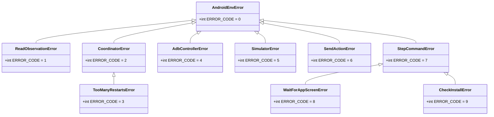
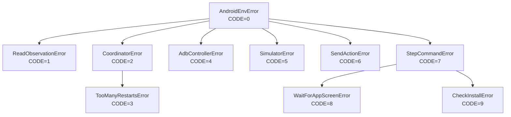
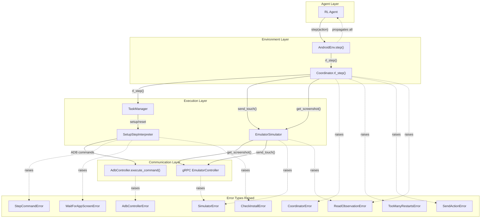
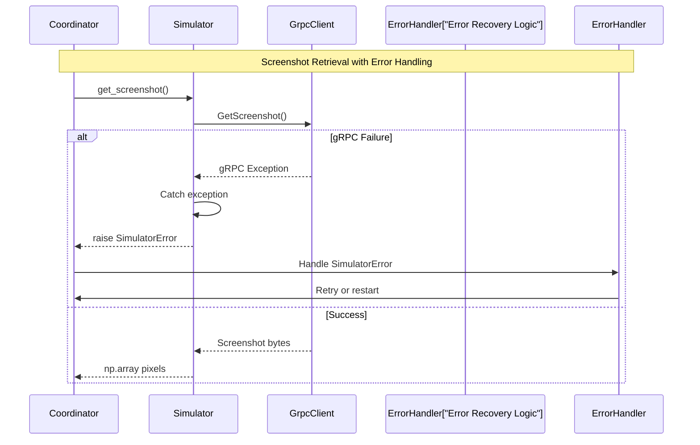

<!-- source: DeepWiki mcp.deepwiki.com · repo google-deepmind/android_env · page 8.2 Error Handling · fetched 2026-10-26 -->

# Error Handling

<details>
<summary>Relevant source files</summary>

The following files were used as context for generating this wiki page:

- [android_env/components/dumpsys_thread.py](android_env/components/dumpsys_thread.py)
- [android_env/components/errors.py](android_env/components/errors.py)
- [android_env/components/errors_test.py](android_env/components/errors_test.py)

</details>


## Purpose and Scope

This document describes the error handling infrastructure in AndroidEnv, specifically the `AndroidEnvError` exception hierarchy and error code system. All errors raised by AndroidEnv components inherit from a common base class and carry unique integer error codes for programmatic error identification and recovery.

For information about how individual components use these errors (e.g., retry logic in the Coordinator), see their respective documentation pages: [Coordinator](#3.3), [ADB Controller](#6.1), [Simulator System](#5), and [Task Management](#4).

## Error Class Hierarchy

AndroidEnv uses a structured exception hierarchy rooted in the `AndroidEnvError` base class. Each error type represents failures in specific subsystems and carries a unique `ERROR_CODE` for programmatic identification.

### Exception Class Hierarchy



**Sources:** [android_env/components/errors.py:19-78]()

### Error Type Descriptions

| Error Class | Error Code | Purpose | Raised By |
|------------|------------|---------|-----------|
| `AndroidEnvError` | 0 | Base class for all AndroidEnv errors | All components |
| `ReadObservationError` | 1 | Unable to obtain observation from simulator | Coordinator, Simulator |
| `CoordinatorError` | 2 | Generic coordinator operation failures | Coordinator |
| `TooManyRestartsError` | 3 | Exceeded maximum restart attempts | Coordinator |
| `AdbControllerError` | 4 | ADB command execution failures | AdbController |
| `SimulatorError` | 5 | Simulator operation failures | BaseSimulator implementations |
| `SendActionError` | 6 | Action could not be sent successfully | Coordinator, Simulator |
| `StepCommandError` | 7 | Setup step interpreter command failures | SetupStepInterpreter |
| `WaitForAppScreenError` | 8 | Expected app screen not reached | SetupStepInterpreter |
| `CheckInstallError` | 9 | App installation verification failed | SetupStepInterpreter |

**Sources:** [android_env/components/errors.py:19-78]()

## Error Code System

Each error class defines a class-level `ERROR_CODE` attribute that uniquely identifies the error type. This enables programmatic error handling and recovery strategies without relying on exception class names or message parsing.

### Error Code Uniqueness

Error codes are guaranteed to be unique across the hierarchy. The test suite explicitly validates this constraint:

**Sources:** [android_env/components/errors_test.py:41-56]()

### Error Hierarchy Relationships



**Sources:** [android_env/components/errors.py:19-78](), [android_env/components/errors_test.py:25-39]()

## Error Factory Function

The `from_code()` function provides a factory pattern for creating error instances from integer codes and optional messages. This is useful for deserializing errors from remote systems or reconstructing errors from logged error codes.

### Function Signature

```python
def from_code(code: int, msg: str = '') -> AndroidEnvError | None
```

### Implementation Mapping

The function maintains an internal mapping from error codes to error classes:

| Code | Error Class |
|------|-------------|
| 0 | `AndroidEnvError` |
| 1 | `ReadObservationError` |
| 2 | `CoordinatorError` |
| 3 | `TooManyRestartsError` |
| 4 | `AdbControllerError` |
| 5 | `SimulatorError` |
| 6 | `SendActionError` |
| 7 | `StepCommandError` |
| 8 | `WaitForAppScreenError` |
| 9 | `CheckInstallError` |

**Sources:** [android_env/components/errors.py:81-99]()

### Return Behavior

- **Valid code:** Returns an instance of the corresponding error class with the provided message
- **Invalid code:** Returns `None` (codes less than 0 or greater than the maximum defined code)

**Sources:** [android_env/components/errors_test.py:72-82](), [android_env/components/errors_test.py:84-106]()

## Error Propagation Through System Components

Errors propagate through the AndroidEnv component stack, allowing higher-level components to catch and handle failures from lower-level subsystems.

### Error Flow Diagram



**Sources:** [android_env/components/errors.py:19-78]()

### Component-Specific Error Usage

#### Coordinator Errors

The Coordinator raises `CoordinatorError` and its subclass `TooManyRestartsError` when orchestration operations fail or restart limits are exceeded. It also raises `ReadObservationError` when screenshot retrieval fails and `SendActionError` when touch/key events cannot be sent.

**Sources:** [android_env/components/errors.py:33-60]()

#### ADB Controller Errors

The `AdbController` raises `AdbControllerError` when subprocess execution of ADB commands fails, including timeout scenarios and server connection issues.

**Sources:** [android_env/components/errors.py:45-48]()

#### Simulator Errors

Simulator implementations raise `SimulatorError` for gRPC communication failures, invalid emulator states, or screenshot capture problems.

**Sources:** [android_env/components/errors.py:51-54]()

#### Task Setup Errors

The `SetupStepInterpreter` raises `StepCommandError` and its subclasses (`WaitForAppScreenError`, `CheckInstallError`) when task setup or reset steps fail to execute or validate successfully.

**Sources:** [android_env/components/errors.py:63-78]()

### Error Handling Example Pattern



**Sources:** [android_env/components/errors.py:51-54]()

## Usage Patterns

### Catching Specific Errors

Components can catch specific error types to implement targeted recovery strategies:

```python
try:
    coordinator.rl_step(action)
except ReadObservationError:
    # Handle observation retrieval failures
    # Potentially retry or return cached observation
    pass
except SendActionError:
    # Handle action send failures
    # Potentially restart simulator
    pass
except TooManyRestartsError:
    # Maximum restart limit reached
    # Terminate episode or raise to caller
    raise
```

**Sources:** [android_env/components/errors.py:27-42]()

### Creating Errors Programmatically

The `from_code()` factory enables reconstruction of errors from serialized forms:

```python
# Error occurred in remote system, logged as code 5
error_code = 5
error_message = "Simulator connection lost"

error = errors.from_code(error_code, error_message)
if error:
    raise error  # Raises SimulatorError with message
```

**Sources:** [android_env/components/errors.py:81-99](), [android_env/components/errors_test.py:84-106]()

### Error Logging with Codes

Error codes enable structured logging and analysis:

```python
try:
    some_operation()
except AndroidEnvError as e:
    logging.error("Operation failed: code=%d, msg=%s", 
                  e.ERROR_CODE, str(e))
    # Log analysis can aggregate by error code
```

**Sources:** [android_env/components/errors.py:19-24]()

### Inheritance-Based Handling

Catching base classes enables handling groups of related errors:

```python
try:
    setup_step_interpreter.execute()
except StepCommandError:
    # Catches StepCommandError, WaitForAppScreenError, CheckInstallError
    # All task setup/reset failures handled uniformly
    pass
```

**Sources:** [android_env/components/errors.py:63-78]()

## Error Testing Infrastructure

The error system includes comprehensive test coverage to ensure:

1. **Unique error codes:** All error codes are distinct
2. **Correct inheritance:** All errors inherit from `AndroidEnvError`
3. **Factory correctness:** `from_code()` produces correct error instances
4. **Message preservation:** Error messages are preserved through construction

**Sources:** [android_env/components/errors_test.py:1-111]()

---

