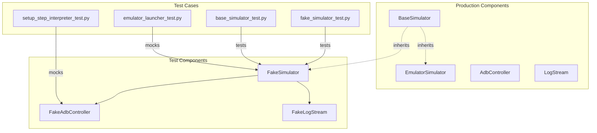
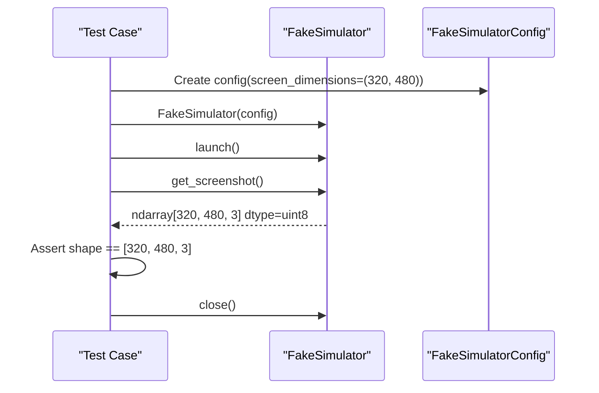
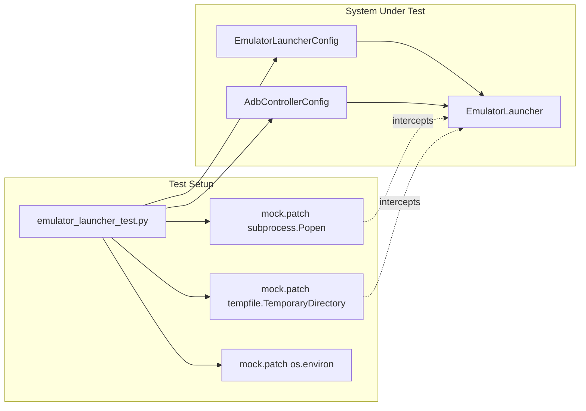
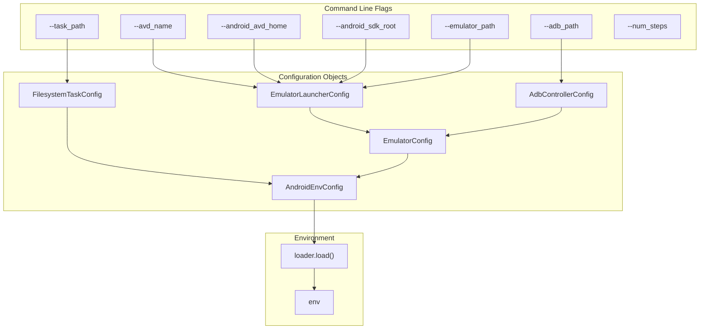
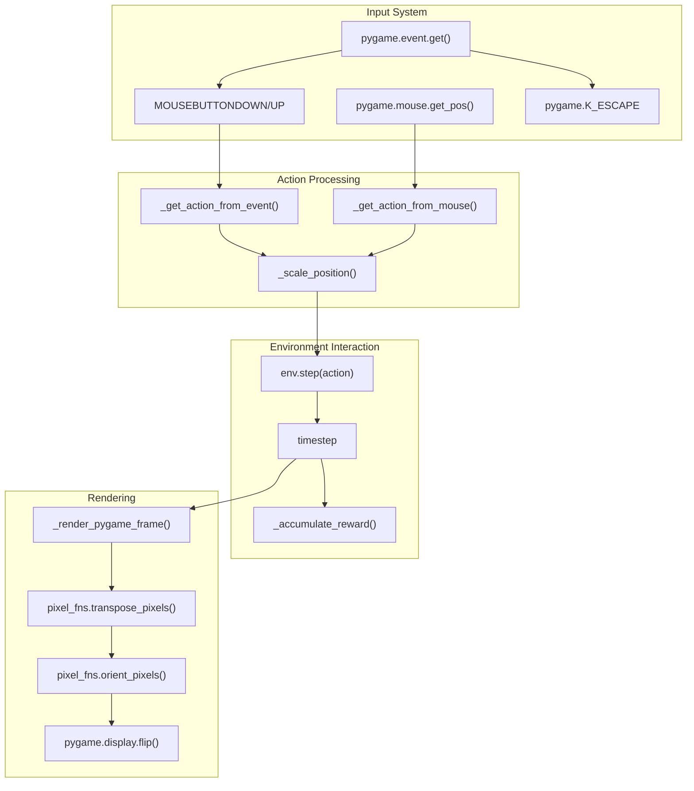
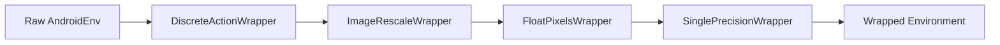

<!-- source: DeepWiki mcp.deepwiki.com · repo google-deepmind/android_env · page 9 Development and Testing · fetched 2026-10-26 -->

# Development and Testing

<details>
<summary>Relevant source files</summary>

The following files were used as context for generating this wiki page:

- [android_env/components/setup_step_interpreter_test.py](android_env/components/setup_step_interpreter_test.py)
- [android_env/components/simulators/__init__.py](android_env/components/simulators/__init__.py)
- [android_env/components/simulators/base_simulator_test.py](android_env/components/simulators/base_simulator_test.py)
- [android_env/components/simulators/emulator/__init__.py](android_env/components/simulators/emulator/__init__.py)
- [android_env/components/simulators/emulator/emulator_launcher.py](android_env/components/simulators/emulator/emulator_launcher.py)
- [android_env/components/simulators/emulator/emulator_launcher_test.py](android_env/components/simulators/emulator/emulator_launcher_test.py)
- [android_env/components/simulators/fake/__init__.py](android_env/components/simulators/fake/__init__.py)
- [android_env/components/simulators/fake/fake_simulator_test.py](android_env/components/simulators/fake/fake_simulator_test.py)
- [examples/run_acme_agent.py](examples/run_acme_agent.py)
- [examples/run_human_agent.py](examples/run_human_agent.py)
- [examples/run_random_agent.py](examples/run_random_agent.py)

</details>


This document provides guidance for developers working with AndroidEnv, covering testing infrastructure and example usage patterns. It explains how to use the fake simulator components for unit and integration testing, and provides complete examples of different agent types interacting with AndroidEnv.

For information about the core architecture and production components, see [Core Architecture](#3). For task-specific testing and configuration, see [Task Management](#4).

---

## Testing Infrastructure Overview

AndroidEnv provides a comprehensive testing infrastructure built around fake implementations of key components. This allows developers to write fast, deterministic unit tests without requiring real Android emulators or devices.

The primary testing components are:

- **FakeSimulator**: A mock implementation of `BaseSimulator` that provides deterministic responses
- **FakeAdbController**: A mock ADB controller that simulates device communication
- **FakeLogStream**: A log stream that emits predefined log lines for reward testing

These components enable testing of the full environment stack without external dependencies.

### Testing Component Architecture



**Sources:** 
- [android_env/components/simulators/fake/fake_simulator_test.py:1-115]()
- [android_env/components/simulators/base_simulator_test.py:1-182]()
- [android_env/components/simulators/emulator/emulator_launcher_test.py:1-295]()

---

## FakeSimulator Usage

### Basic Setup

The `FakeSimulator` is instantiated with a `FakeSimulatorConfig` that specifies screen dimensions and other properties. It provides deterministic responses for all simulator operations.

**Configuration and Initialization:**

```python
from android_env.components import config_classes
from android_env.components.simulators.fake import fake_simulator

config = config_classes.FakeSimulatorConfig(
    screen_dimensions=(320, 480)
)
simulator = fake_simulator.FakeSimulator(config)
simulator.launch()
```

**Sources:** [android_env/components/simulators/fake/fake_simulator_test.py:27-40]()

### Screenshot Testing

The fake simulator returns deterministic screenshots with the configured dimensions. Screenshots are numpy arrays with shape `[height, width, 3]` and dtype `uint8`.



**Sources:** [android_env/components/simulators/fake/fake_simulator_test.py:42-50]()

### Log Stream Testing

The fake simulator provides a log stream that emits predefined log lines containing rewards, extras, and episode end signals. This enables testing of the reward extraction and episode termination logic.

**Predefined Log Lines:**

| Line Content | Purpose |
|-------------|---------|
| `reward: 0.5` | Tests reward extraction |
| `reward: 1.0` | Tests reward accumulation |
| `extra: my_extra [1.0]` | Tests extras parsing |
| `episode end` | Tests episode termination detection |

**Example Usage:**

```python
simulator = fake_simulator.FakeSimulator(
    config_classes.FakeSimulatorConfig(screen_dimensions=(320, 480))
)
simulator.launch()
log_stream = simulator.create_log_stream()
log_stream.resume_stream()

for i, line in enumerate(log_stream.get_stream_output()):
    # Process log lines for rewards and episode end signals
    if i > 10:
        break
```

**Sources:** [android_env/components/simulators/fake/fake_simulator_test.py:52-70]()

### FakeAdbController Output

The fake ADB controller returns deterministic responses for common ADB commands, enabling testing of device interaction logic without a real device.

**Supported Commands and Responses:**

| Command | Response |
|---------|----------|
| `shell dumpsys input` | `SurfaceOrientation: 0` |
| `shell service check foo` | `Service foo: found` |
| `shell am stack list` | `taskId=0 fake_activity visible=true...` |

**Example:**

```python
simulator = fake_simulator.FakeSimulator(
    config_classes.FakeSimulatorConfig(screen_dimensions=(320, 480))
)
simulator.launch()
adb_controller = simulator.create_adb_controller()

# Test orientation check
line = adb_controller.execute_command(['shell', 'dumpsys', 'input'])
# Returns: b'  SurfaceOrientation: 0'

# Test service check
line = adb_controller.execute_command(['shell', 'service', 'check', 'foo'])
# Returns: b'Service foo: found'
```

**Sources:** [android_env/components/simulators/fake/fake_simulator_test.py:72-90]()

### Touch and Key Events

The fake simulator accepts touch and key events without crashing, enabling testing of action processing logic.

```python
simulator.send_touch([(0, 1, True, 0)])   # Touch down
simulator.send_touch([(0, 1, False, 0)])  # Touch up

simulator.send_key(np.int32(123), 'keydown')
simulator.send_key(np.int32(123), 'keyup')
simulator.send_key(np.int32(123), 'keypress')
```

**Sources:** [android_env/components/simulators/fake/fake_simulator_test.py:92-111]()

---

## Testing Strategies and Patterns

### Unit Testing with Mocks

When testing components that depend on simulators or ADB controllers, use mocks to isolate behavior. The unittest.mock library is used extensively in AndroidEnv tests.

**EmulatorLauncher Testing Pattern:**



**Example Test:**

```python
@mock.patch.object(os, 'makedirs')
@mock.patch.object(os, 'environ', autospec=True, return_value=dict())
@mock.patch.object(tempfile, 'TemporaryDirectory', instance=True)
def test_launch(self, mock_tmp_dir, unused_os_environ, unused_os_makedirs):
    config = config_classes.EmulatorLauncherConfig(
        adb_port=self._adb_port,
        emulator_console_port=self._emulator_console_port,
        emulator_path=self._emulator_path,
        avd_name=self._avd_name,
        grpc_port=-1,
    )
    launcher = emulator_launcher.EmulatorLauncher(
        config=config, adb_controller_config=adb_controller_config
    )
    
    with mock.patch.object(subprocess, 'Popen', autospec=True) as emulator_init:
        launcher.launch_emulator_process()
        emulator_init.assert_called_once_with(
            args=expected_command,
            env=expected_env_vars,
            stdout=mock.ANY,
            stderr=mock.ANY,
        )
```

**Sources:** [android_env/components/simulators/emulator/emulator_launcher_test.py:84-126]()

### Testing SetupStepInterpreter

The `SetupStepInterpreter` is tested by mocking the `AdbCallParser` and verifying that setup steps are correctly translated into ADB requests.

**Test Pattern:**

```python
def setUp(self):
    super().setUp()
    self._parser = mock.create_autospec(
        adb_call_parser.AdbCallParser, instance=True)

def test_adb_install_apk_filesystem(self):
    self._parser.parse.return_value = adb_pb2.AdbResponse(
        status=adb_pb2.AdbResponse.Status.OK)
    interpreter = setup_step_interpreter.SetupStepInterpreter(
        adb_call_parser=self._parser)
    interpreter.interpret([
        _to_proto(task_pb2.SetupStep, """
            adb_request: {
              install_apk: {
                filesystem: {
                  path: "/my/favorite/dir/my_apk.apk"
                }
              }
            }""")
    ])
    self._parser.parse.assert_called_once_with(
        adb_pb2.AdbRequest(
            install_apk=adb_pb2.AdbRequest.InstallApk(
                filesystem=adb_pb2.AdbRequest.InstallApk.Filesystem(
                    path='/my/favorite/dir/my_apk.apk'))))
```

**Sources:** [android_env/components/setup_step_interpreter_test.py:36-90]()

### Testing Asynchronous Behavior

The `BaseSimulator` uses an `InteractionThread` for asynchronous screenshot capture. Tests verify that exceptions in the thread bubble up correctly.

```python
def test_get_screenshot_error_async(self):
    mock_interaction_thread = mock.create_autospec(
        base_simulator.InteractionThread
    )
    mock_interaction_thread.screenshot.side_effect = (
        errors.ReadObservationError()
    )
    simulator = fake_simulator.FakeSimulator(
        config_classes.FakeSimulatorConfig(interaction_rate_sec=0.5)
    )
    with mock.patch.object(
        base_simulator,
        'InteractionThread',
        autospec=True,
        return_value=mock_interaction_thread,
    ):
        simulator.launch()
    
    self.assertRaises(errors.ReadObservationError, simulator.get_screenshot)
```

**Sources:** [android_env/components/simulators/base_simulator_test.py:71-96]()

### Testing Retry Logic

Many setup steps support retry logic. Tests verify that retries occur the expected number of times.

```python
def test_num_retries_success(self, unused_mock_sleep):
    self._parser.parse.side_effect = [
        # Fail twice
        adb_pb2.AdbResponse(...empty list...),
        adb_pb2.AdbResponse(...empty list...),
        # Succeed on third try
        adb_pb2.AdbResponse(...list with 'bar'...),
        # Should not be called
        adb_pb2.AdbResponse(...empty list...)
    ]
    interpreter.interpret([
        _to_proto(task_pb2.SetupStep, """
            success_condition: {
              check_install: {
                package_name: "bar"
                timeout_sec: 0.0001
              }
              num_retries: 5
            }""")
    ])
    # The check should succeed on the third try
    self.assertEqual(self._parser.parse.call_count, 3)
```

**Sources:** [android_env/components/setup_step_interpreter_test.py:274-309]()

---

## Example Usage Patterns

### Random Agent Example

The random agent demonstrates basic environment interaction with random actions. It's useful for testing that the environment works correctly and for debugging.

**Configuration and Setup:**



**Core Random Action Loop:**

```python
def get_random_action() -> dict[str, np.ndarray]:
    """Returns a random AndroidEnv action."""
    action = {}
    for k, v in action_spec.items():
        if isinstance(v, specs.DiscreteArray):
            action[k] = np.random.randint(low=0, high=v.num_values, dtype=v.dtype)
        else:
            action[k] = np.random.random(size=v.shape).astype(v.dtype)
    return action

_ = env.reset()

for step in range(FLAGS.num_steps):
    action = get_random_action()
    timestep = env.step(action=action)
    reward = timestep.reward
    logging.info('Step %r, action: %r, reward: %r', step, action, reward)
```

The random agent samples actions from the action spec, which can be either discrete (e.g., action type) or continuous (e.g., touch position).

**Sources:** [examples/run_random_agent.py:1-91]()

### Human Agent Example

The human agent uses pygame to render the environment and capture human input, providing an interactive testing and debugging interface.

**Architecture:**



**Action Translation:**

The human agent translates pygame mouse events to AndroidEnv actions:

```python
def _get_action_from_event(
    event: pygame.event.Event, screen: pygame.Surface, orientation: int
) -> dict[str, Any]:
    """Returns the current action by reading data from a pygame Event object."""
    
    act_type = action_type.ActionType.LIFT
    if event.type == pygame.MOUSEBUTTONDOWN:
        act_type = action_type.ActionType.TOUCH
    
    return {
        'action_type': np.array(act_type, dtype=np.int32),
        'touch_position': _scale_position(event.pos, screen, orientation),
    }
```

**Position Scaling:**

Mouse positions are scaled from pixel coordinates to normalized `[0, 1]` coordinates, with orientation handling:

```python
def _scale_position(position: np.ndarray, screen: pygame.Surface,
                    orientation: int) -> np.ndarray:
    """AndroidEnv accepts mouse inputs as floats so we need to scale it."""
    
    scaled_pos = np.divide(position, screen.get_size(), dtype=np.float32)
    if orientation == 1:  # LANDSCAPE_90
        scaled_pos = scaled_pos[::-1]
        scaled_pos[0] = 1 - scaled_pos[0]
    return scaled_pos
```

**Sources:** [examples/run_human_agent.py:1-210]()

### Acme Agent Example

The Acme agent demonstrates integration with DeepMind's Acme RL framework, showing how to apply wrappers and train a DQN agent.

**Wrapper Chain:**



**Wrapper Application:**

```python
def apply_wrappers(env):
    """Applies a series of wrappers to the environment."""
    env = discrete_action_wrapper.DiscreteActionWrapper(env, action_grid=(10, 10))
    env = image_rescale_wrapper.ImageRescaleWrapper(
        env, zoom_factors=(0.25, 0.25))
    env = float_pixels_wrapper.FloatPixelsWrapper(env)
    env = acme_wrappers.SinglePrecisionWrapper(env)
    return env
```

**Agent and Training Loop:**

```python
env = apply_wrappers(env)
env_spec = specs.make_environment_spec(env)

agent = dqn.DQN(
    environment_spec=env_spec,
    network=networks.DQNAtariNetwork(
        num_actions=env_spec.actions.num_values),
    batch_size=10,
    samples_per_insert=2,
    min_replay_size=10)

loop = acme.EnvironmentLoop(env, agent)
loop.run(num_episodes=FLAGS.num_episodes)
```

The wrapper chain transforms the environment:
1. **DiscreteActionWrapper**: Converts continuous touch positions to discrete grid actions (10x10 grid)
2. **ImageRescaleWrapper**: Reduces observation size by 75% (0.25 zoom factor)
3. **FloatPixelsWrapper**: Normalizes pixel values from `[0, 255]` to `[0.0, 1.0]`
4. **SinglePrecisionWrapper**: Ensures all arrays use float32 for compatibility with TensorFlow

**Sources:** [examples/run_acme_agent.py:1-99]()

---

## Configuration Patterns

All examples follow a common configuration pattern using hierarchical config classes.

**Standard Configuration Structure:**

| Config Class | Purpose | Key Parameters |
|-------------|---------|----------------|
| `AndroidEnvConfig` | Top-level environment config | `task`, `simulator`, `coordinator` |
| `FilesystemTaskConfig` | Task definition from file | `path` (path to task textproto) |
| `EmulatorConfig` | Emulator configuration | `emulator_launcher`, `adb_controller` |
| `EmulatorLauncherConfig` | Emulator process setup | `emulator_path`, `android_sdk_root`, `android_avd_home`, `avd_name`, `run_headless` |
| `AdbControllerConfig` | ADB communication | `adb_path`, `adb_server_port` |

**Common Configuration Pattern:**

```python
config = config_classes.AndroidEnvConfig(
    task=config_classes.FilesystemTaskConfig(path=FLAGS.task_path),
    simulator=config_classes.EmulatorConfig(
        emulator_launcher=config_classes.EmulatorLauncherConfig(
            emulator_path=FLAGS.emulator_path,
            android_sdk_root=FLAGS.android_sdk_root,
            android_avd_home=FLAGS.android_avd_home,
            avd_name=FLAGS.avd_name,
            run_headless=FLAGS.run_headless,
        ),
        adb_controller=config_classes.AdbControllerConfig(
            adb_path=FLAGS.adb_path
        ),
    ),
)
with loader.load(config) as env:
    # Use environment
```

This pattern is consistent across all examples and production code.

**Sources:** 
- [examples/run_random_agent.py:48-63]()
- [examples/run_human_agent.py:133-148]()
- [examples/run_acme_agent.py:62-77]()

---

## Testing Best Practices

### Use FakeSimulator for Unit Tests

For unit tests that don't require real device interaction, always use `FakeSimulator`:

```python
from android_env.components import config_classes
from android_env.components.simulators.fake import fake_simulator

simulator = fake_simulator.FakeSimulator(
    config_classes.FakeSimulatorConfig(screen_dimensions=(640, 480))
)
simulator.launch()
# Test your component
simulator.close()
```

### Mock External Dependencies

Use `unittest.mock` to mock subprocess calls, file system operations, and network requests:

```python
@mock.patch.object(subprocess, 'Popen', autospec=True)
@mock.patch.object(tempfile, 'TemporaryDirectory', instance=True)
def test_something(self, mock_tmp_dir, mock_popen):
    # Test with mocked dependencies
```

### Test Error Paths

Always test error handling and retry logic:

```python
def test_error_bubbles_up(self):
    mock_component.side_effect = errors.SomeError()
    self.assertRaises(errors.SomeError, system_under_test.method)
```

### Verify Call Counts

Use mock assertions to verify the expected number of calls:

```python
mock_method.assert_called_once()
self.assertEqual(mock_method.call_count, 3)
mock_method.assert_called_once_with(expected_arg)
```

**Sources:**
- [android_env/components/simulators/fake/fake_simulator_test.py:1-115]()
- [android_env/components/simulators/base_simulator_test.py:1-182]()
- [android_env/components/simulators/emulator/emulator_launcher_test.py:1-295]()
- [android_env/components/setup_step_interpreter_test.py:1-343]()

---

