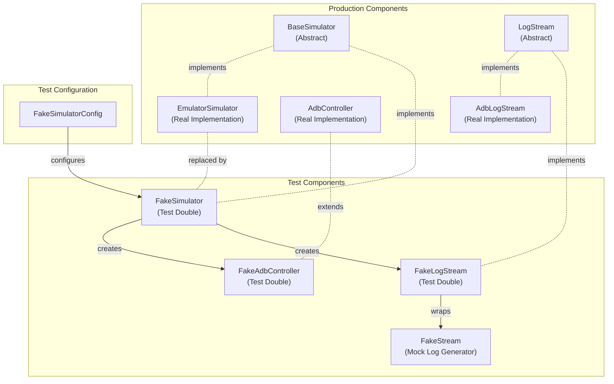
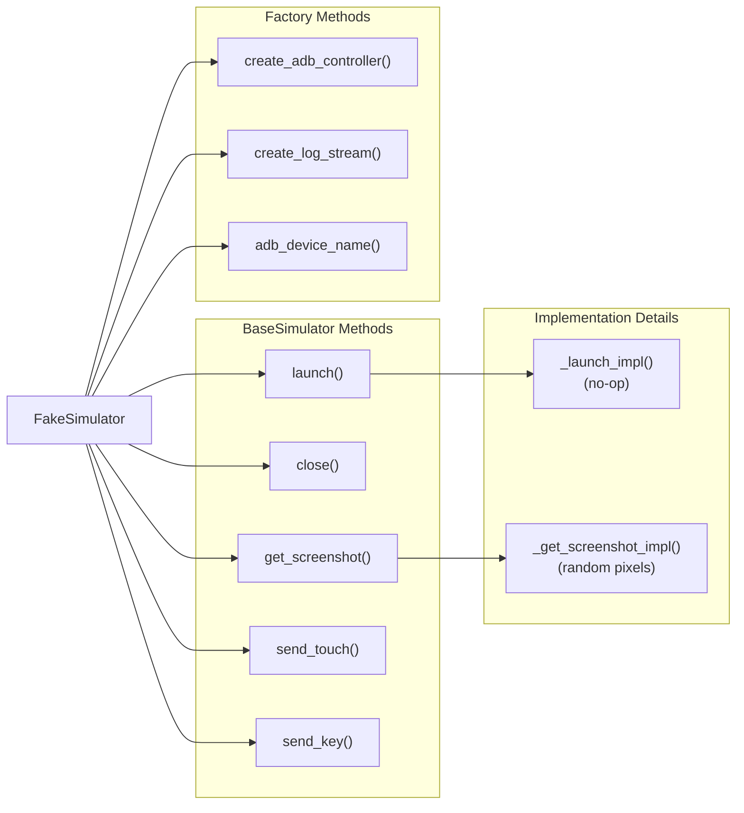
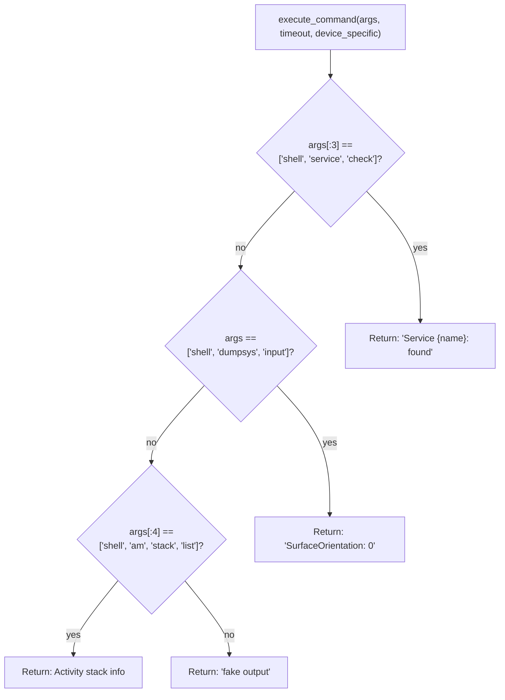
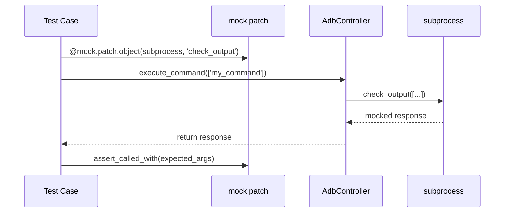
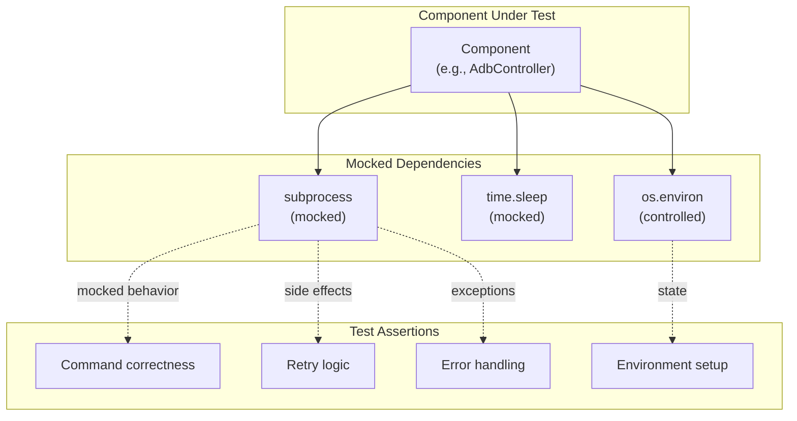
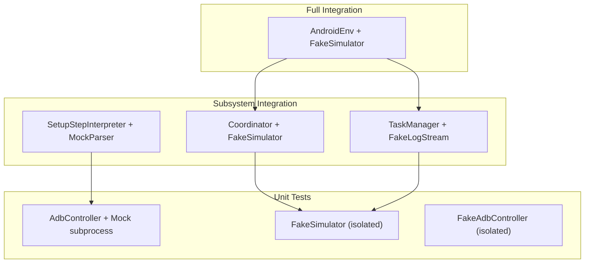
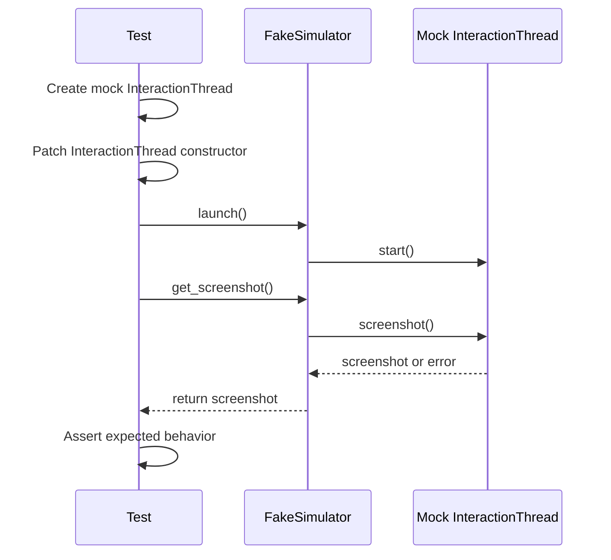

<!-- source: DeepWiki mcp.deepwiki.com · repo google-deepmind/android_env · page 9.1 Testing Infrastructure · fetched 2026-10-26 -->

# Testing Infrastructure

<details>
<summary>Relevant source files</summary>

The following files were used as context for generating this wiki page:

- [android_env/components/adb_controller.py](android_env/components/adb_controller.py)
- [android_env/components/adb_controller_test.py](android_env/components/adb_controller_test.py)
- [android_env/components/setup_step_interpreter_test.py](android_env/components/setup_step_interpreter_test.py)
- [android_env/components/simulators/__init__.py](android_env/components/simulators/__init__.py)
- [android_env/components/simulators/base_simulator_test.py](android_env/components/simulators/base_simulator_test.py)
- [android_env/components/simulators/emulator/__init__.py](android_env/components/simulators/emulator/__init__.py)
- [android_env/components/simulators/fake/__init__.py](android_env/components/simulators/fake/__init__.py)
- [android_env/components/simulators/fake/fake_simulator.py](android_env/components/simulators/fake/fake_simulator.py)
- [android_env/components/simulators/fake/fake_simulator_test.py](android_env/components/simulators/fake/fake_simulator_test.py)

</details>


This page documents the testing infrastructure provided by AndroidEnv for unit and integration testing. It covers the fake implementations that replace real Android emulators, mock-based testing patterns, and utilities for writing tests.

For information about the actual simulator implementations used in production, see [Simulator System](#5). For configuration used in tests, see [Configuration System](#2.2).

## Overview

AndroidEnv provides comprehensive testing infrastructure to enable fast, deterministic unit and integration tests without requiring a real Android emulator. The testing infrastructure consists of:

- **Fake Implementations**: Drop-in replacements for components that interact with external systems (emulator, ADB)
- **Mock-based Testing**: Extensive use of `unittest.mock` for isolating components
- **Test Utilities**: Helper functions and configuration classes for common testing scenarios

## Fake Simulator System

The fake simulator system provides lightweight, deterministic replacements for components that normally interact with Android emulators or devices.

### Architecture



**Sources:** [android_env/components/simulators/fake/fake_simulator.py:1-139](), [android_env/components/simulators/base_simulator_test.py:23-26]()

### FakeSimulator Class

The `FakeSimulator` class provides a complete simulator implementation that doesn't require an Android emulator process.

**Key Characteristics:**

| Feature | Implementation |
|---------|---------------|
| Screenshot Generation | Returns random pixel arrays with configured dimensions |
| Touch/Key Input | No-op methods that accept but ignore input |
| ADB Commands | Delegated to `FakeAdbController` with canned responses |
| Log Streaming | Returns predefined log entries via `FakeLogStream` |
| Launch/Close | No-op operations that complete immediately |

**Interface Implementation:**



**Sources:** [android_env/components/simulators/fake/fake_simulator.py:106-139]()

**Screenshot Generation:**

The `_get_screenshot_impl` method returns random pixel arrays matching the configured screen dimensions:

```python
def _get_screenshot_impl(self) -> np.ndarray:
    return np.random.randint(
        low=0, high=255, size=(*self._screen_dimensions, 3), dtype=np.uint8)
```

**Sources:** [android_env/components/simulators/fake/fake_simulator.py:136-138]()

### FakeAdbController Class

The `FakeAdbController` extends `AdbController` and overrides `execute_command` to return deterministic, hard-coded responses without executing real ADB commands.

**Supported Command Patterns:**

| Command Pattern | Fake Response | Purpose |
|----------------|---------------|---------|
| `['shell', 'service', 'check', <service>]` | `'Service <service>: found'` | Service availability checks |
| `['shell', 'dumpsys', 'input']` | `'SurfaceOrientation: 0'` | Device orientation queries |
| `['shell', 'am', 'stack', 'list']` | Activity stack with `fake_activity` | App screen verification |
| Default | `'fake output'` | All other commands |

**Implementation:**



**Sources:** [android_env/components/simulators/fake/fake_simulator.py:77-104]()

### FakeLogStream and FakeStream

The fake log streaming system simulates Android logcat output with predefined events.

**FakeStream Architecture:**

```mermaid
graph TB
    FakeStream["FakeStream"]
    
    subgraph "Internal State"
        _values["_values<br/>(predefined log lines)"]
        _kill["_kill<br/>(termination flag)"]
        _lock["_lock<br/>(thread synchronization)"]
    end
    
    subgraph "Log Line Types"
        empty["Empty line (49%)"]
        reward_05["'reward: 0.5' (15%)"]
        reward_10["'reward: 1.0' (15%)"]
        extra["'extra: my_extra [1.0]' (15%)"]
        episode_end["'episode end' (1%)"]
    end
    
    FakeStream --> _values
    FakeStream --> _kill
    FakeStream --> _lock
    
    _values --> empty
    _values --> reward_05
    _values --> reward_10
    _values --> extra
    _values --> episode_end
    
    iter["__iter__()"]
    FakeStream --> iter
    iter -->|random.choices| _values
    iter -->|time.sleep(0.1)| iter
```

**Sources:** [android_env/components/simulators/fake/fake_simulator.py:30-61]()

**Log Line Format:**

All non-empty log lines follow the Android logcat format:

```
         1553110400.424  5583  5658 D Tag: {message}
```

Where `{message}` can be:
- `reward: 0.5` or `reward: 1.0` - Reward events
- `extra: my_extra [1.0]` - Extra data events
- `episode end` - Episode termination signal

**Sources:** [android_env/components/simulators/fake/fake_simulator.py:44-46]()

## Mock-Based Testing Patterns

AndroidEnv tests extensively use `unittest.mock` to isolate components and control behavior during testing.

### Subprocess Mocking Pattern

Tests for `AdbController` mock `subprocess.check_output` to avoid executing real ADB commands.



**Example Test Pattern:**

| Test Scenario | Mock Configuration | Assertions |
|--------------|-------------------|------------|
| Successful command | `return_value = b'fake_output'` | Verify command constructed correctly |
| Command failure + retry | `side_effect = [CalledProcessError, b'success']` | Verify retry logic, server restart |
| Persistent failure | `side_effect = CalledProcessError` repeatedly | Verify error raised after retries |

**Sources:** [android_env/components/adb_controller_test.py:49-233]()

### Time Mocking Pattern

Tests that involve delays use `time.sleep` mocking to avoid actual waiting:

```python
@mock.patch.object(time, 'sleep', autospec=True)
def test_restart_server(self, mock_sleep, mock_check_output):
    # Test code that calls time.sleep()
    # ...
    mock_sleep.assert_has_calls([
        mock.call(0.2),
        mock.call(2.0),
        mock.call(0.2)
    ])
```

**Sources:** [android_env/components/adb_controller_test.py:111-165]()

### Component Interaction Mocking

Tests for `SetupStepInterpreter` mock `AdbCallParser` to verify command interpretation:

```mermaid
graph LR
    Test["Test Case"]
    Interpreter["SetupStepInterpreter"]
    MockParser["mock.create_autospec<br/>(AdbCallParser)"]
    
    Test -->|1. Create mock| MockParser
    Test -->|2. Inject| Interpreter
    Test -->|3. Call interpret()| Interpreter
    Interpreter -->|4. parse()| MockParser
    Test -->|5. Assert parse() called with| MockParser
```

**Sources:** [android_env/components/setup_step_interpreter_test.py:36-41](), [android_env/components/setup_step_interpreter_test.py:69-89]()

## Integration Testing with FakeSimulator

`FakeSimulator` enables integration tests of the full environment stack without requiring a real emulator.

### End-to-End Environment Testing

```mermaid
graph TB
    TestCase["Integration Test"]
    
    subgraph "Environment Stack"
        AndroidEnv["AndroidEnv"]
        Coordinator["Coordinator"]
        TaskManager["TaskManager"]
        FakeSim["FakeSimulator"]
        FakeAdb["FakeAdbController"]
        FakeLog["FakeLogStream"]
    end
    
    TestCase -->|1. Configure with FakeSimulatorConfig| AndroidEnv
    AndroidEnv --> Coordinator
    Coordinator --> TaskManager
    Coordinator --> FakeSim
    FakeSim --> FakeAdb
    FakeSim --> FakeLog
    
    TestCase -->|2. reset()| AndroidEnv
    TestCase -->|3. step(action)| AndroidEnv
    TestCase -->|4. Verify timestep| AndroidEnv
```

**Key Integration Test Scenarios:**

| Test Type | FakeSimulator Role | Verification |
|-----------|-------------------|--------------|
| Reset flow | Provides initial screenshot, accepts touch lifts | TaskManager receives correct initial state |
| Step execution | Returns random screenshots, accepts actions | Coordinator processes actions and observations |
| Reward extraction | Emits reward logs via FakeLogStream | TaskManager correctly parses rewards |
| Episode termination | Emits 'episode end' log | Environment detects termination |

**Sources:** [android_env/components/simulators/fake/fake_simulator_test.py:33-112]()

## Test Utilities and Configuration

### FakeSimulatorConfig

Configuration class for creating `FakeSimulator` instances:

```python
config = config_classes.FakeSimulatorConfig(
    screen_dimensions=(320, 480)
)
simulator = FakeSimulator(config)
```

**Configuration Parameters:**

| Parameter | Type | Purpose |
|-----------|------|---------|
| `screen_dimensions` | `tuple[int, int]` | Dimensions of fake screenshots (height, width) |

**Sources:** [android_env/components/simulators/fake/fake_simulator.py:109-113](), [android_env/components/simulators/fake/fake_simulator_test.py:28-31]()

### Common Test Fixtures

**BaseSimulator Testing Pattern:**

Tests that verify `BaseSimulator` functionality use `FakeSimulator` as a concrete implementation:

```python
def test_launch_close(self):
    simulator = fake_simulator.FakeSimulator(
        config_classes.FakeSimulatorConfig()
    )
    simulator.launch()
    simulator.close()
```

**Sources:** [android_env/components/simulators/base_simulator_test.py:39-46]()

### Mock Creation Best Practices

**AutoSpec Usage:**

Tests use `autospec=True` to ensure mocks match the interface of the mocked object:

```python
mock_interaction_thread = mock.create_autospec(
    base_simulator.InteractionThread
)
```

This prevents tests from accidentally calling methods that don't exist on the real object.

**Sources:** [android_env/components/simulators/base_simulator_test.py:75-89]()

## Test Coverage Patterns

### Component Isolation Testing



**Sources:** [android_env/components/adb_controller_test.py:33-254]()

### Integration Testing Layers



**Testing Philosophy:**

- **Unit Tests**: Mock all external dependencies (subprocess, time, network)
- **Subsystem Tests**: Use fake implementations (FakeSimulator) for adjacent systems
- **Integration Tests**: Combine real components with fake implementations of external systems

**Sources:** [android_env/components/adb_controller_test.py:1-292](), [android_env/components/simulators/base_simulator_test.py:1-182](), [android_env/components/setup_step_interpreter_test.py:1-343]()

## Advanced Testing Scenarios

### Asynchronous Interaction Testing

Tests for `BaseSimulator` verify the `InteractionThread` behavior by mocking the thread and controlling its responses:



**Error Propagation Test:**

The mock can raise exceptions to verify error handling:

```python
mock_interaction_thread.screenshot.side_effect = errors.ReadObservationError()
self.assertRaises(errors.ReadObservationError, simulator.get_screenshot)
```

**Sources:** [android_env/components/simulators/base_simulator_test.py:71-96]()

### Retry Logic Verification

Tests verify retry behavior with configurable failure sequences:

```python
mock_check_output.side_effect = [
    subprocess.CalledProcessError(returncode=1, cmd='blah'),  # Fail
] + ['fake_output'.encode('utf-8')] * 4  # Success after retry
```

**Expected Call Sequence:**

1. Initial command attempt → fails
2. `kill-server` command
3. `start-server` command  
4. `devices` command (verification)
5. Original command retry → succeeds

**Sources:** [android_env/components/adb_controller_test.py:112-165]()

### Screenshot Rate Testing

Tests verify that the interaction rate limits screenshot frequency:

| Scenario | Interaction Rate | Test Behavior | Expected Result |
|----------|-----------------|---------------|-----------------|
| Fast steps | 0.5 sec | Get 2 screenshots without delay | Same screenshot returned |
| Slow steps | 0.01 sec | Get 2 screenshots with 0.5 sec delay | Different screenshots |

**Sources:** [android_env/components/simulators/base_simulator_test.py:98-151]()

## Summary

The AndroidEnv testing infrastructure provides:

1. **FakeSimulator** - Complete simulator replacement requiring no emulator process
2. **FakeAdbController** - Deterministic ADB command responses
3. **FakeLogStream** - Controlled log output with predefined events
4. **Mock patterns** - Extensive use of `unittest.mock` for isolation
5. **Configuration** - Test-specific configurations like `FakeSimulatorConfig`

These tools enable fast, reliable unit and integration tests throughout the codebase without requiring Android emulator infrastructure.

---

