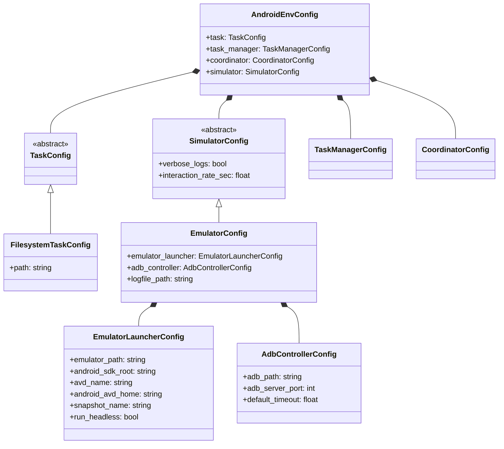
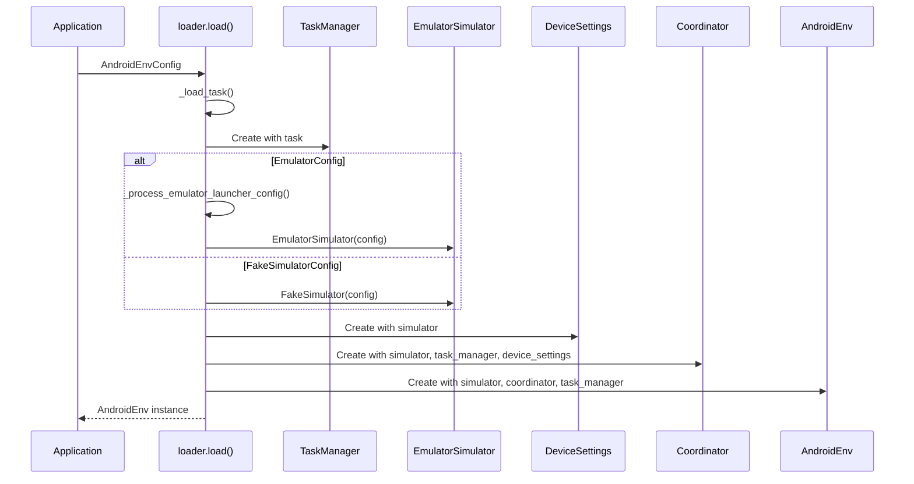
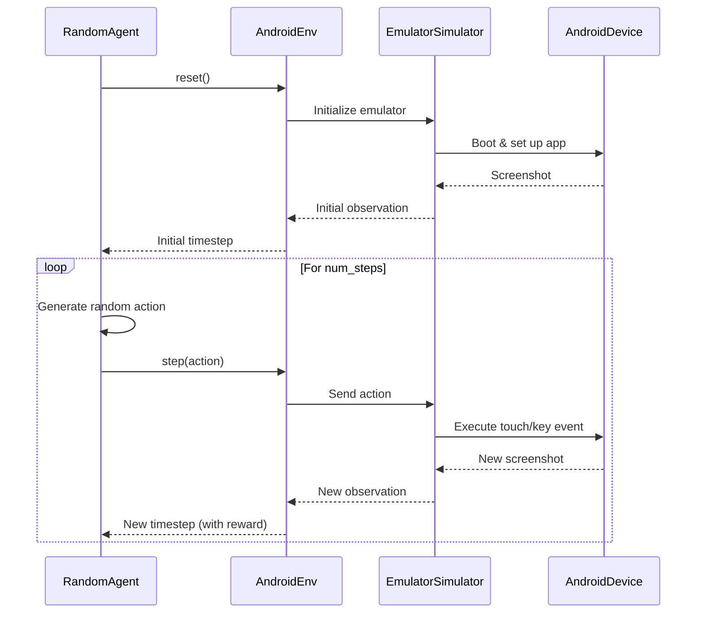
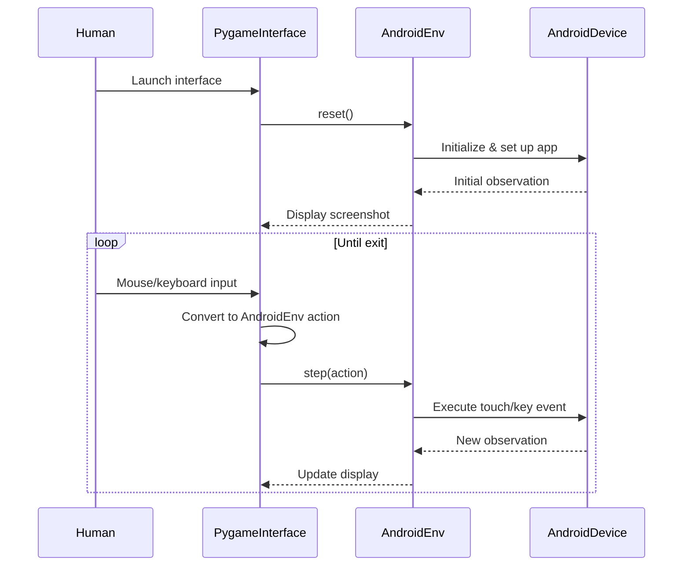
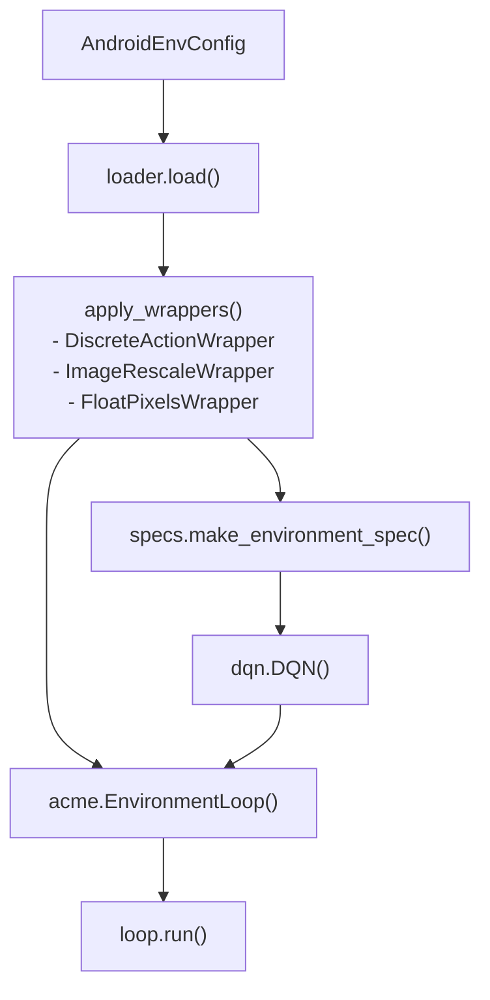
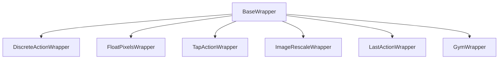

<!-- source: DeepWiki mcp.deepwiki.com · repo google-deepmind/android_env · page 9.2 Example Usage · fetched 2026-10-26 -->

# Example Usage

<details>
<summary>Relevant source files</summary>

The following files were used as context for generating this wiki page:

- [android_env/components/config_classes.py](android_env/components/config_classes.py)
- [android_env/components/simulators/emulator/emulator_launcher.py](android_env/components/simulators/emulator/emulator_launcher.py)
- [android_env/components/simulators/emulator/emulator_launcher_test.py](android_env/components/simulators/emulator/emulator_launcher_test.py)
- [android_env/loader.py](android_env/loader.py)
- [android_env/loader_test.py](android_env/loader_test.py)
- [examples/run_acme_agent.py](examples/run_acme_agent.py)
- [examples/run_human_agent.py](examples/run_human_agent.py)
- [examples/run_random_agent.py](examples/run_random_agent.py)

</details>


This page provides practical examples and configuration patterns for using AndroidEnv, a framework that allows reinforcement learning agents to interact with Android devices or emulators. For information about the overall system architecture, see [Core System Architecture](#2).

## Setting Up and Configuring AndroidEnv

Before using AndroidEnv, you need to properly configure the environment including paths to your Android SDK, emulator, and ADB tools.

### Configuration Hierarchy

AndroidEnv uses a hierarchical configuration system defined in `config_classes.py`:



Sources: [android_env/components/config_classes.py:16-204]()

### Loading the Environment

The main way to create an AndroidEnv instance is through the `loader.load()` function:



Sources: [android_env/loader.py:16-90]()

## Example Agents

AndroidEnv includes several example agents that demonstrate how to use the framework.

### Random Agent Example

The simplest example is a random agent that takes random actions in the environment:



Key code from the random agent example:

```python
# Configure environment
config = config_classes.AndroidEnvConfig(
    task=config_classes.FilesystemTaskConfig(path=FLAGS.task_path),
    simulator=config_classes.EmulatorConfig(
        emulator_launcher=config_classes.EmulatorLauncherConfig(
            emulator_path=FLAGS.emulator_path,
            android_sdk_root=FLAGS.android_sdk_root,
            android_avd_home=FLAGS.android_avd_home,
            avd_name=FLAGS.avd_name,
            run_headless=FLAGS.run_headless,
        ),
        adb_controller=config_classes.AdbControllerConfig(
            adb_path=FLAGS.adb_path
        ),
    ),
)

# Load environment and run random actions
with loader.load(config) as env:
    action_spec = env.action_spec()
    
    # Generate random actions
    def get_random_action():
        action = {}
        for k, v in action_spec.items():
            if isinstance(v, specs.DiscreteArray):
                action[k] = np.random.randint(low=0, high=v.num_values, dtype=v.dtype)
            else:
                action[k] = np.random.random(size=v.shape).astype(v.dtype)
        return action
    
    # Reset and run steps
    _ = env.reset()
    for step in range(FLAGS.num_steps):
        action = get_random_action()
        timestep = env.step(action=action)
        reward = timestep.reward
        logging.info('Step %r, action: %r, reward: %r', step, action, reward)
```

Sources: [examples/run_random_agent.py:16-90]()

### Human Agent Example

The human agent example shows how to create an interactive session where a human can control the agent through a pygame interface:



This example demonstrates:
1. Converting mouse input to AndroidEnv touch actions
2. Rendering the environment observations on a pygame surface
3. Handling device orientation for proper display

Sources: [examples/run_human_agent.py:16-210]()

### RL Agent Example (with Acme)

The DQN agent example demonstrates integration with the Acme reinforcement learning framework:



Key wrappers applied to adapt AndroidEnv for RL algorithms:
- `DiscreteActionWrapper`: Converts continuous touch positions to a discrete grid
- `ImageRescaleWrapper`: Resizes observation images
- `FloatPixelsWrapper`: Converts pixel values from uint8 to float32

Sources: [examples/run_acme_agent.py:16-99]()

## Common Configuration Settings

### Emulator Configuration

The table below shows important settings for configuring the Android emulator:

| Parameter | Description | Default |
|-----------|-------------|---------|
| `emulator_path` | Path to emulator binary | `~/Android/Sdk/emulator/emulator` |
| `android_sdk_root` | Path to Android SDK | `~/Android/Sdk` |
| `android_avd_home` | Path to AVD directory | `~/.android/avd` |
| `avd_name` | Name of Android Virtual Device | (required) |
| `run_headless` | Run without GUI | `True` |
| `snapshot_name` | Optional snapshot name | `''` |
| `gpu_mode` | GPU rendering mode | `swangle_indirect` |
| `restrict_network` | Restrict network access | `False` |
| `adb_path` | Path to ADB binary | `~/Android/Sdk/platform-tools/adb` |
| `adb_server_port` | Port for ADB server | `5037` |

Example emulator configuration:

```python
emulator_config = config_classes.EmulatorConfig(
    emulator_launcher=config_classes.EmulatorLauncherConfig(
        emulator_path='~/Android/Sdk/emulator/emulator',
        android_sdk_root='~/Android/Sdk',
        android_avd_home='~/.android/avd',
        avd_name='your_avd_name',
        run_headless=True,
        snapshot_name='my_snapshot',  # Optional
    ),
    adb_controller=config_classes.AdbControllerConfig(
        adb_path='~/Android/Sdk/platform-tools/adb',
    ),
)
```

Sources: [android_env/components/config_classes.py:83-146](), [android_env/components/simulators/emulator/emulator_launcher.py:16-169]()

### Device Settings Configuration

Device settings control how the Android device displays touches and UI elements:

| Parameter | Description | Default |
|-----------|-------------|---------|
| `show_touches` | Show circles for touches | `True` |
| `show_pointer_location` | Show blue lines for touch position | `True` |
| `show_status_bar` | Show the status bar | `False` |
| `show_navigation_bar` | Show the navigation bar | `False` |

Example device settings configuration:

```python
coordinator_config = config_classes.CoordinatorConfig(
    num_fingers=1,  # Number of virtual "fingers"
    enable_key_events=False,  # Whether to enable keyboard events
    device_settings=config_classes.DeviceSettingsConfig(
        show_touches=True,
        show_pointer_location=True,
        show_status_bar=False,
        show_navigation_bar=False,
    ),
)
```

Sources: [android_env/components/config_classes.py:39-67](), [android_env/components/device_settings.py:16-175]()

## Environment Interface

AndroidEnv follows the dm_env interface with `reset()` and `step()` methods.

### Reset Method

The `reset()` method initializes the environment:

```python
timestep = env.reset()  # Returns dm_env.TimeStep
```

This method:
1. Launches the emulator if needed
2. Installs and starts the app specified in the task
3. Executes task setup steps
4. Returns the initial observation

### Step Method

The `step()` method advances the environment by one step:

```python
action = {
    'action_type': np.array(1, dtype=np.int32),  # TOUCH
    'touch_position': np.array([0.5, 0.5], dtype=np.float32)  # Center of screen
}
timestep = env.step(action)  # Returns dm_env.TimeStep
```

The returned `timestep` contains:
- `observation`: Dictionary of observations (typically includes `pixels`)
- `reward`: Scalar reward value 
- `discount`: Discount factor for future rewards
- Status: Indicates if the step is the first, a middle step, or the last in an episode

### Action Space

The default action space contains:
- `action_type`: Touch type (0=LIFT, 1=TOUCH, 2=REPEAT)
- `touch_position`: Touch coordinates as (x, y) in [0.0, 1.0]

You can inspect the action space with:

```python
action_spec = env.action_spec()
print(action_spec)  # Shows available actions and their shapes/types
```

### Observation Space

The default observation space contains:
- `pixels`: Screenshot as uint8 numpy array (HxWxC)
- `orientation`: One-hot encoded device orientation
- `timedelta`: Time since last step in seconds

You can inspect the observation space with:

```python
observation_spec = env.observation_spec()
print(observation_spec)  # Shows available observations and their shapes/types
```

## Advanced Usage with Wrappers

AndroidEnv provides several wrappers to modify the interface for different use cases:



Common wrappers include:

1. **DiscreteActionWrapper**: Converts continuous touch positions to a discrete grid
   ```python
   env = discrete_action_wrapper.DiscreteActionWrapper(env, action_grid=(10, 10))
   ```

2. **ImageRescaleWrapper**: Resizes observation images
   ```python
   env = image_rescale_wrapper.ImageRescaleWrapper(env, zoom_factors=(0.25, 0.25))
   ```

3. **FloatPixelsWrapper**: Converts pixel values from uint8 to float32
   ```python
   env = float_pixels_wrapper.FloatPixelsWrapper(env)
   ```

4. **GymWrapper**: Adapts AndroidEnv to the OpenAI Gym interface
   ```python
   env = gym_wrapper.GymWrapper(env)
   ```