# Page: Overview

# Overview

<details>
<summary>Relevant source files</summary>

The following files were used as context for generating this wiki page:

- [android_env/components/config_classes.py](android_env/components/config_classes.py)
- [android_env/components/coordinator.py](android_env/components/coordinator.py)
- [android_env/components/coordinator_test.py](android_env/components/coordinator_test.py)
- [android_env/components/task_manager.py](android_env/components/task_manager.py)
- [android_env/components/task_manager_test.py](android_env/components/task_manager_test.py)
- [android_env/environment.py](android_env/environment.py)
- [android_env/environment_test.py](android_env/environment_test.py)
- [android_env/loader.py](android_env/loader.py)
- [android_env/loader_test.py](android_env/loader_test.py)
- [android_env/wrappers/float_pixels_wrapper.py](android_env/wrappers/float_pixels_wrapper.py)
- [android_env/wrappers/last_action_wrapper.py](android_env/wrappers/last_action_wrapper.py)

</details>


## Purpose and Scope

This page provides a high-level introduction to **AndroidEnv**, a reinforcement learning environment for training agents to interact with Android applications. It covers the overall system architecture, major components, their responsibilities, and how they collaborate to provide a standard RL environment interface.

For detailed information about specific subsystems:
- Installation and setup procedures, see [Installation and Build System](#2.1)
- Configuration details, see [Configuration System](#2.2)
- Task definition and management, see [Task Management](#4)
- Simulator implementations, see [Simulator System](#5)
- Environment wrappers, see [Environment Wrappers](#7)

## What is AndroidEnv

AndroidEnv is a Python-based reinforcement learning environment that enables RL agents to interact with Android applications running on Android emulators or devices. It implements the `dm_env.Environment` interface, providing a standard RL loop with `reset()` and `step(action)` methods that return observations, rewards, and episode termination signals.

The environment bridges the gap between high-level RL abstractions and low-level Android device control by:
- Managing Android emulator lifecycle (launch, restart, cleanup)
- Translating agent actions (touch events, key presses) into Android input commands
- Extracting observations (screenshots, device state) from the Android device
- Monitoring application logs to compute rewards and detect episode termination
- Providing a flexible task definition system via Protocol Buffers

**Key Features:**
- Standard `dm_env.Environment` interface for compatibility with RL frameworks
- Support for multiple "fingers" (multi-touch) and keyboard inputs
- Configurable task definitions with custom reward functions
- Log-based reward extraction using regex patterns
- Automatic error recovery and simulator restart mechanisms
- Extensible wrapper system for observation/action transformations

Sources: [android_env/environment.py:1-191](), [android_env/loader.py:1-90]()

## System Architecture

AndroidEnv follows a layered architecture with clear separation of concerns. The system consists of four major layers that work together to provide the RL environment interface.

```mermaid
graph TB
    subgraph "Layer 1: External Interface"
        Agent["RL Agent"]
        Config["AndroidEnvConfig"]
        LoaderFn["loader.load()"]
    end
    
    subgraph "Layer 2: Environment API"
        AndroidEnv["AndroidEnv<br/>(environment.py)"]
        EnvInterface["AndroidEnvInterface<br/>(env_interface.py)"]
        Wrappers["BaseWrapper<br/>Observation/Action Transforms"]
    end
    
    subgraph "Layer 3: Core Orchestration"
        Coordinator["Coordinator<br/>(coordinator.py)"]
        TaskManager["TaskManager<br/>(task_manager.py)"]
        DeviceSettings["DeviceSettings<br/>(device_settings.py)"]
    end
    
    subgraph "Layer 4: Device Communication"
        BaseSimulator["BaseSimulator<br/>(base_simulator.py)"]
        EmulatorSim["EmulatorSimulator<br/>(emulator_simulator.py)"]
        AdbController["AdbController<br/>(adb_controller.py)"]
        AdbCallParser["AdbCallParser<br/>(adb_call_parser.py)"]
    end
    
    subgraph "Layer 5: Android Device"
        Emulator["Android Emulator Process"]
        ADB["ADB Daemon"]
        GRPC["gRPC Server<br/>Port 8554"]
    end
    
    Agent -->|"actions"| Wrappers
    Wrappers -->|"wrapped"| AndroidEnv
    AndroidEnv -->|"observations"| Wrappers
    Wrappers -->|"processed"| Agent
    
    Config --> LoaderFn
    LoaderFn -->|"creates"| AndroidEnv
    
    AndroidEnv -.->|"implements"| EnvInterface
    AndroidEnv --> Coordinator
    AndroidEnv --> TaskManager
    
    Coordinator --> TaskManager
    Coordinator --> DeviceSettings
    Coordinator --> BaseSimulator
    Coordinator --> AdbCallParser
    
    TaskManager --> AdbCallParser
    
    BaseSimulator <|..|"implements"| EmulatorSim
    EmulatorSim --> AdbController
    AdbCallParser --> AdbController
    
    AdbController -->|"ADB commands"| ADB
    EmulatorSim -->|"gRPC calls"| GRPC
    
    ADB --> Emulator
    GRPC --> Emulator
```

**Architecture: Natural Language to Code Mapping**

This diagram maps the conceptual layers to their corresponding code entities in the codebase.

Sources: [android_env/environment.py:32-191](), [android_env/components/coordinator.py:36-287](), [android_env/loader.py:47-68]()

### Major Components

The following table summarizes the core components and their primary responsibilities:

| Component | File Path | Primary Responsibility |
|-----------|-----------|----------------------|
| **AndroidEnv** | `android_env/environment.py` | Main environment class implementing `dm_env.Environment` interface |
| **Coordinator** | `android_env/components/coordinator.py` | Orchestrates interaction between simulator, task manager, and device settings |
| **TaskManager** | `android_env/components/task_manager.py` | Manages task lifecycle, reward extraction, and episode termination logic |
| **BaseSimulator** | `android_env/components/simulators/base_simulator.py` | Abstract interface for simulator implementations |
| **EmulatorSimulator** | `android_env/components/simulators/emulator/emulator_simulator.py` | Controls Android emulator via gRPC and ADB |
| **AdbController** | `android_env/components/adb_controller.py` | Executes ADB commands via subprocess |
| **AdbCallParser** | `android_env/components/adb_call_parser.py` | Translates `AdbRequest` protobufs into ADB shell commands |
| **DeviceSettings** | `android_env/components/device_settings.py` | Manages Android device display settings and orientation |
| **loader.load()** | `android_env/loader.py` | Factory function that constructs and initializes AndroidEnv |

Sources: [android_env/environment.py:1-191](), [android_env/components/coordinator.py:1-287](), [android_env/components/task_manager.py:1-438]()

### Component Interaction Flow

The following diagram illustrates how components interact during a typical RL episode, showing the call chain from agent to Android device:

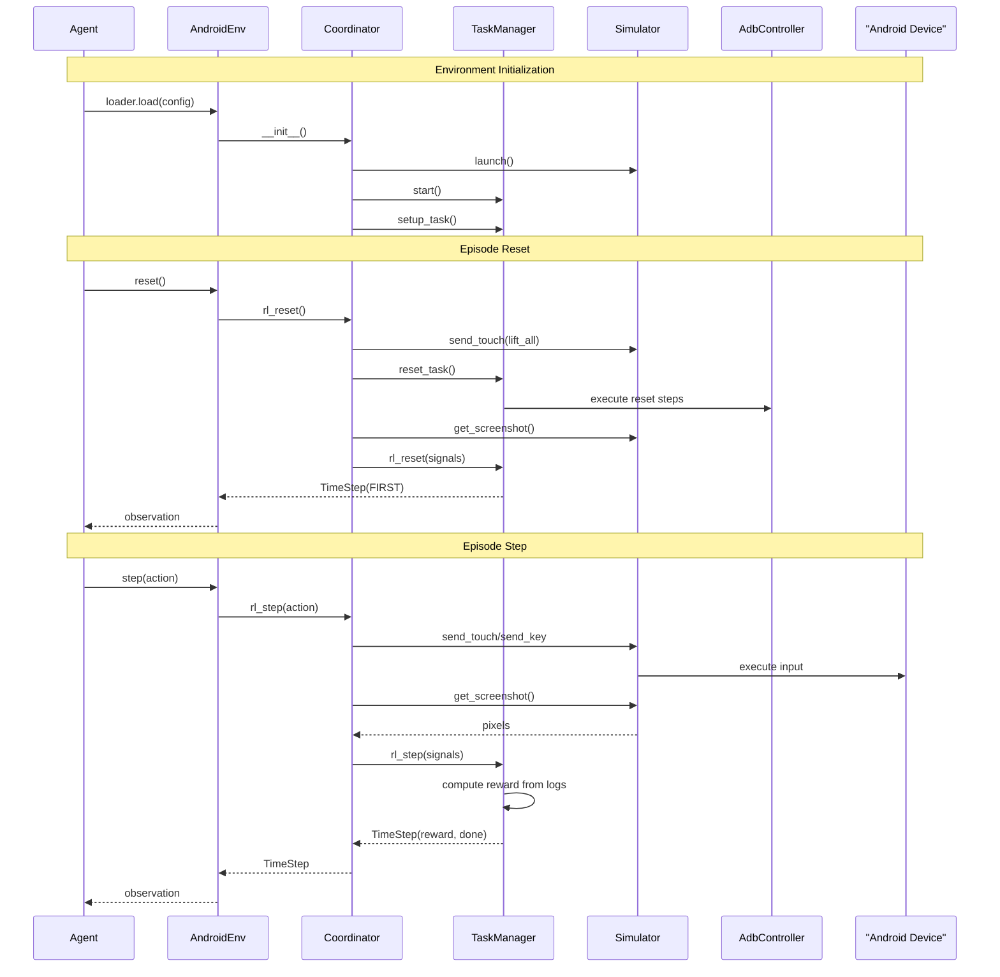

**Sequence: RL Episode Lifecycle**

This diagram shows the complete flow from environment initialization through reset and step operations, mapping each operation to its implementing class.

Sources: [android_env/environment.py:66-114](), [android_env/components/coordinator.py:180-246](), [android_env/components/task_manager.py:99-234]()

## Core Component Responsibilities

### AndroidEnv Class

The `AndroidEnv` class ([environment.py:32-191]()) is the main entry point for RL agents. It implements the `dm_env.Environment` interface and provides:

```python
# Key methods from environment.py
def reset(self) -> dm_env.TimeStep:
    """Resets the environment for a new RL episode."""
    
def step(self, action: dict[str, np.ndarray]) -> dm_env.TimeStep:
    """Takes a step in the environment."""
    
def action_spec(self) -> dict[str, dm_env.specs.Array]:
    """Returns the action specification."""
    
def observation_spec(self) -> dict[str, dm_env.specs.Array]:
    """Returns the observation specification."""
```

**Additional AndroidEnv Methods:**
- `task_extras()` - Returns task-specific extra observations
- `execute_adb_call()` - Executes arbitrary ADB commands
- `load_state()` / `save_state()` - Checkpoint management
- `stats()` - Returns performance metrics

The class maintains internal state including `_latest_observation`, `_latest_action`, and `_latest_extras`, ensuring consistency when observations are None during error recovery.

Sources: [android_env/environment.py:32-191]()

### Coordinator Orchestration

The `Coordinator` class ([coordinator.py:36-287]()) is the central orchestrator that manages:

1. **Simulator Lifecycle**: Launches simulator, handles periodic restarts ([coordinator.py:114-169]())
2. **Action Execution**: Translates agent actions to simulator commands ([coordinator.py:213-246]())
3. **Observation Collection**: Gathers screenshots, orientation, and timing data ([coordinator.py:248-264]())
4. **Error Recovery**: Tracks simulator health and triggers relaunches on failure ([coordinator.py:93-112]())
5. **Statistics Tracking**: Maintains counters for restarts, errors, and other metrics ([coordinator.py:59-71]())

**Key Configuration:**
- `num_fingers`: Number of simultaneous touch points (default: 1)
- `enable_key_events`: Whether keyboard events are enabled
- `periodic_restart_time_min`: Time between periodic simulator restarts

Sources: [android_env/components/coordinator.py:36-287]()

### TaskManager Monitoring

The `TaskManager` class ([task_manager.py:42-438]()) handles all task-specific logic:

1. **Reward Extraction**: Parses Android logcat output using regex patterns ([task_manager.py:301-353]())
2. **Episode Termination**: Detects episode end conditions from logs and app state ([task_manager.py:196-234]())
3. **Task Setup/Reset**: Executes setup and reset steps defined in task proto ([task_manager.py:99-148]())
4. **Extras Collection**: Extracts task-specific observations (arrays, JSON objects) ([task_manager.py:386-437]())
5. **Multi-threaded Monitoring**: Runs `LogcatThread` and `DumpsysThread` concurrently ([task_manager.py:243-260]())

**Supported Reward Types:**
- Direct rewards: Extracted via regex with capture groups
- Score-based rewards: Computed as delta between consecutive scores
- Event-based rewards: Fixed reward values triggered by log patterns

Sources: [android_env/components/task_manager.py:42-438]()

## Environment Lifecycle

### Initialization via loader.load()

The `loader.load()` function ([loader.py:47-68]()) is the recommended way to create an `AndroidEnv` instance. It performs the following steps:

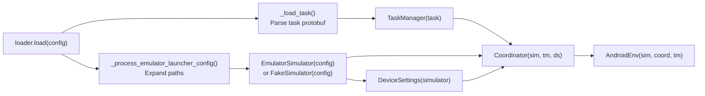

**Initialization Flow: loader.load() to AndroidEnv**

The loader handles path expansion (e.g., `~/Android/Sdk` → `/home/user/Android/Sdk`), component instantiation in dependency order, and returns a fully initialized environment.

Sources: [android_env/loader.py:47-90]()

### Reset Flow

The `reset()` method ([environment.py:66-88]()) initializes a new episode:

1. **Coordinator.rl_reset()** ([coordinator.py:180-211]())
   - Checks if simulator restart is needed
   - Lifts all fingers to neutral position
   - Calls `TaskManager.reset_task()`
   - Gathers initial observations

2. **TaskManager.reset_task()** ([task_manager.py:128-147]())
   - Pauses log monitoring
   - Executes reset steps (defined in task proto)
   - Resumes log monitoring
   - Resets internal counters

3. **TaskManager.rl_reset()** ([task_manager.py:149-165]())
   - Waits for first log line
   - Collects initial extras
   - Returns `TimeStep` with `step_type=FIRST`

Sources: [android_env/environment.py:66-88](), [android_env/components/coordinator.py:180-211](), [android_env/components/task_manager.py:128-165]()

### Step Flow

The `step(action)` method ([environment.py:90-114]()) executes one environment step:

1. **Coordinator.rl_step()** ([coordinator.py:213-246]())
   - Sends action to simulator (touch/key event)
   - Gathers new observations (screenshot, orientation, timedelta)
   - Passes signals to TaskManager

2. **TaskManager.rl_step()** ([task_manager.py:167-180]())
   - Increments step counter
   - Waits for log processing
   - Extracts accumulated rewards
   - Collects task extras
   - Determines transition type (MID, LAST)

3. **Transition Determination** ([task_manager.py:196-234]())
   - Checks if user exited app → `dm_env.truncation`
   - Checks for episode end signal in logs → `dm_env.termination`
   - Checks step/time limits → `dm_env.truncation`
   - Otherwise → `dm_env.transition`

Sources: [android_env/environment.py:90-114](), [android_env/components/coordinator.py:213-246](), [android_env/components/task_manager.py:167-234]()

## Configuration System Overview

AndroidEnv uses a hierarchical configuration system based on Python dataclasses defined in [config_classes.py:1-221](). The configuration tree structure is:

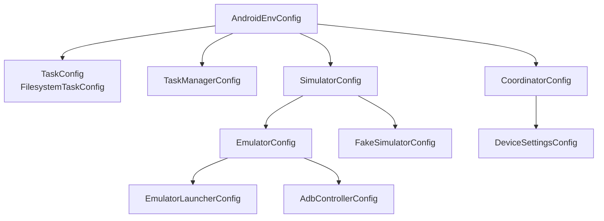

**Configuration Hierarchy**

Key configuration classes:
- **AndroidEnvConfig** ([config_classes.py:209-221]()): Top-level configuration
- **EmulatorLauncherConfig** ([config_classes.py:100-141]()): Emulator binary paths, AVD name, GPU mode
- **AdbControllerConfig** ([config_classes.py:23-43]()): ADB binary path, server port, device name
- **CoordinatorConfig** ([config_classes.py:61-75]()): Number of fingers, keyboard events, restart intervals
- **TaskManagerConfig** ([config_classes.py:175-189]()): Bad state thresholds, dumpsys check frequency

For detailed configuration documentation, see [Configuration System](#2.2).

Sources: [android_env/components/config_classes.py:1-221](), [android_env/loader.py:47-90]()

## Action and Observation Specifications

### Base Action Space

The base action space ([coordinator.py:81-85]()) consists of:

| Action Component | Type | Shape | Description |
|-----------------|------|-------|-------------|
| `action_type` | `DiscreteArray` | `()` | Action type: TOUCH (0), LIFT (1), REPEAT (2) |
| `touch_position` | `BoundedArray[float32]` | `(2,)` | Normalized coordinates [0.0, 1.0] for (x, y) |
| `action_type_N` | `DiscreteArray` | `()` | Action type for finger N (if num_fingers > 1) |
| `touch_position_N` | `BoundedArray[float32]` | `(2,)` | Touch position for finger N |

When `enable_key_events=True`, additional actions are available for keyboard input.

### Base Observation Space

The base observation space ([coordinator.py:87-91]()) provides:

| Observation | Type | Shape | Description |
|-------------|------|-------|-------------|
| `pixels` | `Array[uint8]` | `(H, W, 3)` | RGB screenshot from device |
| `orientation` | `Array[uint8]` | `(4,)` | One-hot encoded screen orientation |
| `timedelta` | `Array[int64]` | `()` | Microseconds since last observation |
| `extras` | `dict[str, np.ndarray]` | Variable | Task-specific observations from logs |

The observation space can be transformed by wrappers (see [Environment Wrappers](#7)) to provide different formats like grayscale images, resized screenshots, or discrete action spaces.

Sources: [android_env/components/coordinator.py:81-91](), [android_env/components/specs.py:1-100]()

## Key Interfaces and Contracts

### dm_env.Environment Interface

AndroidEnv implements the standard DeepMind Environment API:

```python
# From dm_env specification
class Environment(Protocol):
    def reset(self) -> TimeStep
    def step(self, action) -> TimeStep
    def observation_spec(self) -> specs.Array
    def action_spec(self) -> specs.Array
    def close(self) -> None
```

This ensures compatibility with RL frameworks like Acme, RLlib, and others that support the `dm_env` interface.

Sources: [android_env/environment.py:32-191]()

### AndroidEnvInterface Extensions

The `AndroidEnvInterface` abstract class ([env_interface.py]()) extends `dm_env.Environment` with Android-specific methods:

- `execute_adb_call(call: AdbRequest) -> AdbResponse` - Execute arbitrary ADB commands
- `load_state(request: LoadStateRequest) -> LoadStateResponse` - Load emulator snapshot
- `save_state(request: SaveStateRequest) -> SaveStateResponse` - Save emulator snapshot
- `task_extras(latest_only: bool) -> dict` - Retrieve task-specific observations
- `stats() -> dict` - Get environment statistics
- `raw_action` - Property returning the last action taken
- `raw_observation` - Property returning the last observation

These extensions enable advanced use cases like curriculum learning (via state save/load), debugging (via ADB commands), and task-specific data collection.

Sources: [android_env/env_interface.py:1-100](), [android_env/environment.py:126-191]()

### BaseSimulator Contract

All simulator implementations must inherit from `BaseSimulator` and implement:

- `launch()` - Start the simulator
- `get_screenshot() -> np.ndarray` - Capture current screen
- `send_touch(touches)` - Send touch events
- `send_key(keycode, event_type)` - Send keyboard events
- `create_adb_controller() -> AdbController` - Factory for ADB controller
- `create_log_stream() -> LogStream` - Factory for log stream
- `close()` - Cleanup resources

This abstraction allows the system to work with different backends (emulator, physical device, or fake/mock simulators for testing).

Sources: [android_env/components/simulators/base_simulator.py:1-200]()

## Error Handling and Recovery

AndroidEnv includes robust error handling with automatic recovery:

1. **Simulator Health Tracking**: `Coordinator._simulator_healthy` flag ([coordinator.py:74]())
2. **Automatic Restart**: Failed operations trigger simulator relaunch ([coordinator.py:114-169]())
3. **Retry Logic**: ADB commands and simulator operations include configurable retries
4. **Graceful Degradation**: Returns last known observation when new observation fails ([environment.py:104-106]())
5. **Statistics**: Tracks restart counts by failure type ([coordinator.py:59-71]())

**Restart Triggers:**
- Setup step failures → `relaunch_count_setup_steps`
- Reset step failures → `relaunch_count_reset_steps`
- Action execution errors → `relaunch_count_execute_action`
- Screenshot retrieval errors → `relaunch_count_fetch_observation`
- Periodic restart timer → `relaunch_count_periodic`

Sources: [android_env/components/coordinator.py:59-169](), [android_env/environment.py:90-114]()

## Quick Start Example

A minimal example of creating and using AndroidEnv:

```python
from android_env import loader
from android_env.components import config_classes

# Create configuration
config = config_classes.AndroidEnvConfig(
    task=config_classes.FilesystemTaskConfig(
        path='/path/to/task.textproto'
    ),
    simulator=config_classes.EmulatorConfig(
        emulator_launcher=config_classes.EmulatorLauncherConfig(
            avd_name='my_avd',
            android_sdk_root='~/Android/Sdk',
        )
    )
)

# Load environment
env = loader.load(config)

# Run episode
timestep = env.reset()
while not timestep.last():
    action = {
        'action_type': np.array(0),  # TOUCH
        'touch_position': np.array([0.5, 0.5])
    }
    timestep = env.step(action)
    print(f"Reward: {timestep.reward}")

env.close()
```

For complete examples with different agent types, see [Example Usage](#9.2).

Sources: [android_env/loader.py:47-68](), [android_env/environment.py:32-191]()

---

# Page: Getting Started

# Getting Started

<details>
<summary>Relevant source files</summary>

The following files were used as context for generating this wiki page:

- [.github/workflows/tests.yml](.github/workflows/tests.yml)
- [android_env/components/config_classes.py](android_env/components/config_classes.py)
- [android_env/components/simulators/emulator/emulator_launcher.py](android_env/components/simulators/emulator/emulator_launcher.py)
- [android_env/components/simulators/emulator/emulator_launcher_test.py](android_env/components/simulators/emulator/emulator_launcher_test.py)
- [android_env/loader.py](android_env/loader.py)
- [android_env/loader_test.py](android_env/loader_test.py)
- [examples/run_acme_agent.py](examples/run_acme_agent.py)
- [examples/run_human_agent.py](examples/run_human_agent.py)
- [examples/run_random_agent.py](examples/run_random_agent.py)
- [pyproject.toml](pyproject.toml)
- [setup.py](setup.py)

</details>


This document provides an overview of installing, configuring, and running your first AndroidEnv experiment. It covers the basic installation process, the configuration system, and how to load an environment. For detailed information about the build system and protobuf generation, see [Installation and Build System](#2.1). For comprehensive configuration options and the loader system, see [Configuration System](#2.2). For complete working examples with different agent types, see [Quick Start Examples](#2.3).

## Prerequisites

Before installing AndroidEnv, ensure you have the following installed on your system:

| Requirement | Version | Description |
|-------------|---------|-------------|
| Python | ≥ 3.10 | Required for AndroidEnv and dependencies |
| Android SDK | Latest | Provides platform tools including ADB |
| Android Emulator | Latest | Required for running Android Virtual Devices (AVDs) |
| ADB | Latest | Included in Android SDK platform-tools |
| KVM | - | Linux kernel virtualization (for Linux systems) |

**Important**: AndroidEnv requires filesystem paths to the Android SDK, emulator binary, and ADB binary. These paths must be fully expanded (e.g., `/home/user/Android/Sdk/emulator/emulator` rather than `~/Android/Sdk/emulator/emulator`). The loader will perform path expansion, but paths in configuration should use the tilde (`~`) syntax for portability.

Sources: [pyproject.toml:16](), [android_env/components/config_classes.py:23-44](), [android_env/loader.py:76-89]()

## Installation Process

The installation process consists of three main stages: package installation, dependency resolution, and protobuf code generation.

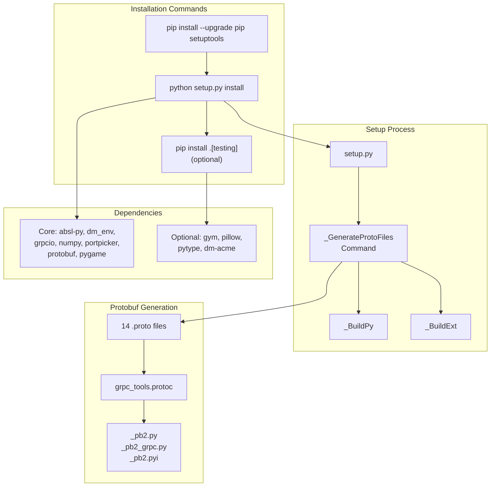

**Installation Steps:**

1. **Install the package**:
   ```bash
   pip install --upgrade pip setuptools
   python setup.py install
   ```

2. **Install optional dependencies** (for testing or specific use cases):
   ```bash
   pip install .[testing]  # For testing utilities
   pip install .[acme]     # For Acme agent examples
   pip install .[gym]      # For Gym wrapper compatibility
   ```

The `setup.py` script automatically generates Python bindings from 14 protobuf definitions during installation. These protobufs define the data structures for tasks, ADB commands, emulator control, and accessibility features.

Sources: [setup.py:30-109](), [pyproject.toml:1-39](), [.github/workflows/tests.yml:30-34]()

## Configuration Hierarchy

AndroidEnv uses a hierarchical configuration system built from dataclasses. The root configuration object is `AndroidEnvConfig`, which contains nested configurations for all major components.

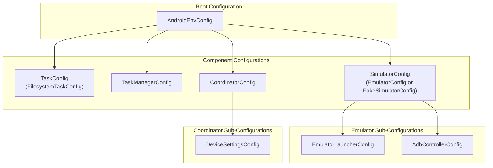

**Key Configuration Classes:**

| Class | Purpose | Key Parameters |
|-------|---------|----------------|
| `AndroidEnvConfig` | Root configuration | task, task_manager, coordinator, simulator |
| `FilesystemTaskConfig` | Task definition location | path (to .textproto or .binarypb file) |
| `EmulatorConfig` | Emulator simulator settings | emulator_launcher, adb_controller |
| `EmulatorLauncherConfig` | Emulator process parameters | emulator_path, avd_name, android_sdk_root |
| `AdbControllerConfig` | ADB connection settings | adb_path, adb_server_port |
| `CoordinatorConfig` | Environment behavior | num_fingers, enable_key_events |
| `TaskManagerConfig` | Task monitoring | max_bad_states, dumpsys_check_frequency |

Sources: [android_env/components/config_classes.py:22-221]()

## Loading an Environment

The `loader.load()` function is the primary entry point for creating AndroidEnv instances. It processes the configuration, loads the task definition, instantiates components in dependency order, and returns a fully configured environment.

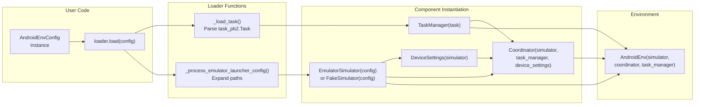

**Basic Usage Example:**

```python
from android_env import loader
from android_env.components import config_classes

# Create configuration
config = config_classes.AndroidEnvConfig(
    task=config_classes.FilesystemTaskConfig(
        path='/path/to/task.textproto'
    ),
    simulator=config_classes.EmulatorConfig(
        emulator_launcher=config_classes.EmulatorLauncherConfig(
            emulator_path='~/Android/Sdk/emulator/emulator',
            android_sdk_root='~/Android/Sdk',
            android_avd_home='~/.android/avd',
            avd_name='my_avd',
            run_headless=True,
        ),
        adb_controller=config_classes.AdbControllerConfig(
            adb_path='~/Android/Sdk/platform-tools/adb',
        ),
    ),
)

# Load environment
with loader.load(config) as env:
    timestep = env.reset()
    action = {...}  # Create action matching action_spec()
    timestep = env.step(action)
```

The loader performs the following operations:

1. **Task Loading** ([loader.py:33-44]()): Parses the task protobuf from the filesystem path
2. **Path Expansion** ([loader.py:71-89]()): Expands user directory shortcuts (`~`) in paths
3. **Component Creation** ([loader.py:47-68]()): Instantiates simulator, task manager, device settings, and coordinator
4. **Environment Assembly**: Wraps all components in the AndroidEnv interface

Sources: [android_env/loader.py:47-90](), [examples/run_random_agent.py:46-63]()

## Component Interaction Flow

Once loaded, the environment follows a standard RL interaction pattern through the `reset()` and `step()` methods. Understanding the component interaction helps debug issues and optimize performance.

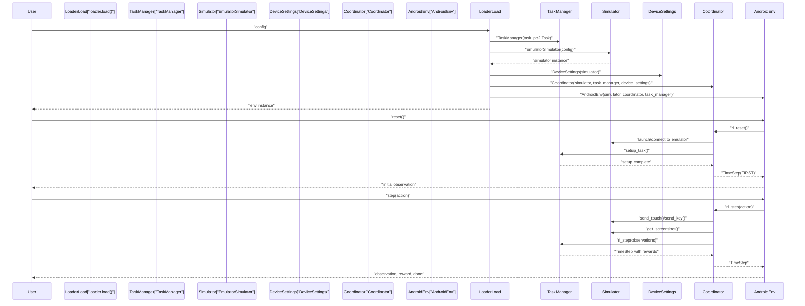

Sources: [android_env/loader.py:47-68](), [examples/run_random_agent.py:63-84]()

## Configuration Best Practices

When creating your configuration, follow these guidelines:

1. **Use Relative Paths**: Specify paths with `~` for user directory to ensure portability
   ```python
   emulator_path='~/Android/Sdk/emulator/emulator'  # Good
   emulator_path='/home/username/Android/Sdk/emulator/emulator'  # Avoid
   ```

2. **Headless Mode**: Set `run_headless=True` for training to reduce overhead
   ```python
   EmulatorLauncherConfig(run_headless=True)
   ```

3. **Port Configuration**: Leave ports at default (0) to auto-assign, or specify explicitly for multi-instance setups
   ```python
   EmulatorLauncherConfig(
       adb_port=5554,           # Explicit for multi-instance
       emulator_console_port=5555,
       grpc_port=8554,
   )
   ```

4. **GPU Mode**: Use `swangle_indirect` for headless compatibility
   ```python
   EmulatorLauncherConfig(gpu_mode='swangle_indirect')
   ```

5. **Network Restrictions**: Enable for reproducibility in training
   ```python
   EmulatorLauncherConfig(restrict_network=True)
   ```

Sources: [android_env/components/config_classes.py:99-141](), [android_env/loader.py:71-89]()

## Minimal Working Example

The simplest way to get started is to use the provided examples. Here's a condensed version of the random agent:

```python
from android_env import loader
from android_env.components import config_classes
import numpy as np

# Configure environment
config = config_classes.AndroidEnvConfig(
    task=config_classes.FilesystemTaskConfig(
        path='path/to/task.textproto'
    ),
    simulator=config_classes.EmulatorConfig(
        emulator_launcher=config_classes.EmulatorLauncherConfig(
            avd_name='my_avd',
            emulator_path='~/Android/Sdk/emulator/emulator',
            android_sdk_root='~/Android/Sdk',
            run_headless=False,  # Set to True for training
        ),
        adb_controller=config_classes.AdbControllerConfig(
            adb_path='~/Android/Sdk/platform-tools/adb',
        ),
    ),
)

# Load and run
with loader.load(config) as env:
    timestep = env.reset()
    
    for step in range(100):
        # Generate random action
        action = {
            'action_type': np.random.randint(0, 3, dtype=np.int32),
            'touch_position': np.random.random(2).astype(np.float32),
        }
        
        timestep = env.step(action)
        print(f'Step {step}: reward={timestep.reward}')
```

This example demonstrates:
- Configuration creation with default values
- Environment loading via context manager
- Basic reset/step interaction
- Action format (dictionary with `action_type` and `touch_position`)

Sources: [examples/run_random_agent.py:46-84]()

## Troubleshooting Common Issues

| Issue | Likely Cause | Solution |
|-------|--------------|----------|
| `FileNotFoundError` for emulator/adb | Incorrect paths in config | Verify paths with `which emulator` and `which adb` |
| Protobuf import errors | Build not completed | Run `python setup.py install` to generate protobufs |
| Emulator won't start | AVD not created or KVM unavailable | Create AVD via Android Studio; check `/dev/kvm` permissions |
| Port conflicts | Multiple emulator instances | Specify explicit ports or kill existing emulator processes |
| Import errors for `_pb2.py` files | Missing `grpcio-tools` | Install with `pip install grpcio-tools` |

For detailed troubleshooting and advanced configuration options, refer to the subsections:
- [Installation and Build System](#2.1) for build-related issues
- [Configuration System](#2.2) for configuration details and the `loader.load()` function
- [Quick Start Examples](#2.3) for complete working code examples

Sources: [setup.py:48-109](), [android_env/loader.py:47-90](), [.github/workflows/tests.yml:30-40]()

## Next Steps

After successfully loading your first environment, explore the following:

1. **[Installation and Build System](#2.1)**: Learn about protobuf generation, dependency management, and the build process
2. **[Configuration System](#2.2)**: Understand all configuration options and how the loader processes them
3. **[Quick Start Examples](#2.3)**: See complete examples with random agents, human agents, and Acme agents
4. **[Environment Wrappers](#7)**: Add preprocessing to observations and actions
5. **[Task Management](#4)**: Create custom tasks with reward specifications

The environment follows the `dm_env.Environment` interface, making it compatible with standard RL frameworks like Acme. For details on the core environment interface and interaction patterns, see [AndroidEnv Environment](#3.1).

Sources: [android_env/loader.py:1-90](), [examples/run_random_agent.py:1-91](), [examples/run_acme_agent.py:1-99]()

---

# Page: Installation and Build System

# Installation and Build System

<details>
<summary>Relevant source files</summary>

The following files were used as context for generating this wiki page:

- [.github/workflows/tests.yml](.github/workflows/tests.yml)
- [pyproject.toml](pyproject.toml)
- [setup.py](setup.py)

</details>


## Purpose and Scope

This page covers the installation procedures, dependency management, and build system for AndroidEnv. Specifically, it documents:

- Package installation methods via pip
- Required and optional dependencies
- Protobuf code generation process
- Custom setuptools commands and build workflow
- Development environment setup

For information about configuring AndroidEnv after installation, see [Configuration System](#2.2). For running your first environment, see [Quick Start Examples](#2.3).

## Installation Methods

AndroidEnv is distributed as a Python package that can be installed via pip. The package supports Python 3.10 and higher, with active testing on Python 3.11, 3.12, and 3.13 [.github/workflows/tests.yml:21]().

### Standard Installation

Install AndroidEnv from the repository:

```bash
pip install git+https://github.com/google-deepmind/android_env
```

Or clone and install locally:

```bash
git clone https://github.com/google-deepmind/android_env
cd android_env
pip install .
```

The installation process automatically triggers protobuf code generation before installing the package [setup.py:95-97]().

### Development Installation

For development work with editable installation:

```bash
pip install -e .
```

This allows changes to the source code to be immediately reflected without reinstalling.

### Installation with Optional Dependencies

AndroidEnv provides optional dependency groups for specific use cases [pyproject.toml:27-34]():

| Dependency Group | Command | Purpose |
|-----------------|---------|---------|
| `testing` | `pip install .[testing]` | Adds gym, pillow, pytype for testing |
| `acme` | `pip install .[acme]` | Adds dm-acme for Acme integration |
| `gym` | `pip install .[gym]` | Adds gym for OpenAI Gym compatibility |

Multiple groups can be combined:

```bash
pip install .[testing,acme]
```

**Sources:** [pyproject.toml:1-40](), [.github/workflows/tests.yml:30-34]()

## Dependencies

### Core Dependencies

AndroidEnv requires the following packages [pyproject.toml:17-25]():

| Package | Minimum Version | Purpose |
|---------|----------------|---------|
| `absl-py` | 0.1.0 | Command-line flags and logging |
| `dm_env` | (latest) | DeepMind environment interface |
| `grpcio` | (latest) | gRPC communication with emulator |
| `numpy` | 1.21 | Numerical operations and observations |
| `portpicker` | 1.2.0 | Finding available ports for emulator |
| `protobuf` | 2.6 | Protocol buffer message definitions |
| `pygame` | (latest) | Human agent interface |

### Build-Time Dependencies

The build system requires `grpcio-tools` for protobuf compilation [setup.py:103]():

```python
setup_requires=['grpcio-tools']
```

This dependency is automatically installed during the build process before proto generation begins.

### Optional Dependencies

Optional packages extend functionality:

- **Testing Suite**: `gym`, `pillow`, `pytype` for running tests and type checking
- **Acme Integration**: `dm-acme` for using Acme agents with AndroidEnv
- **Gym Compatibility**: `gym` for OpenAI Gym wrappers

**Sources:** [pyproject.toml:17-34](), [setup.py:103]()

## Protobuf Build System

AndroidEnv uses Protocol Buffers for defining data structures and communication protocols. The build system automatically generates Python code from 14 protobuf definitions during installation.

### Protobuf Files

The following protobuf files are compiled [setup.py:30-45]():

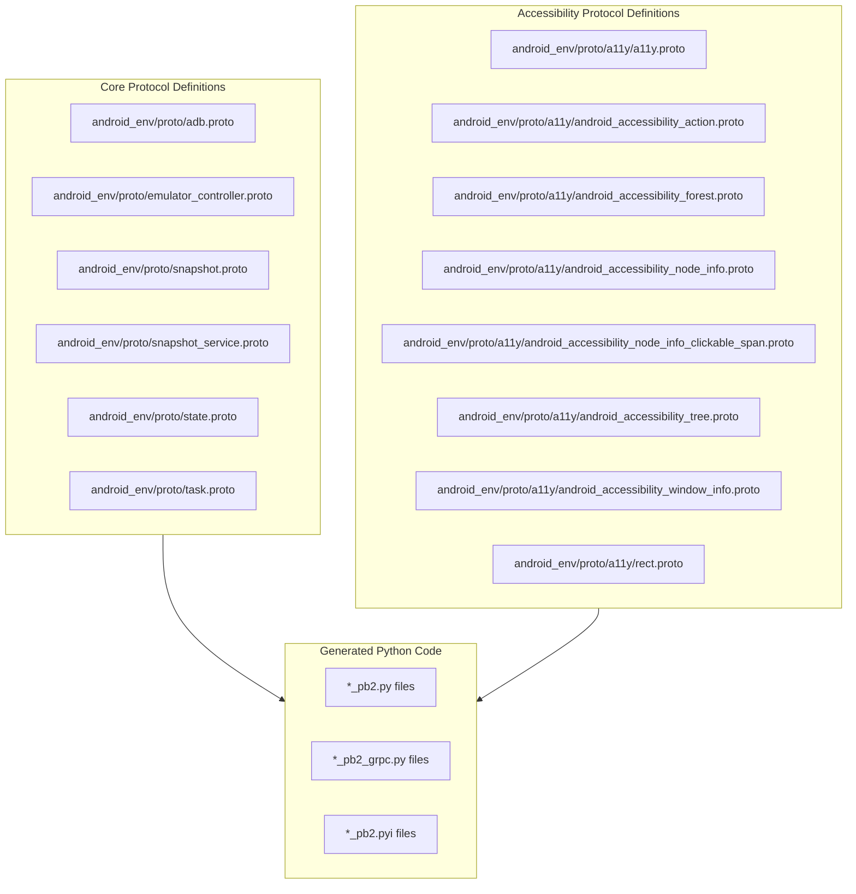

| Protobuf File | Purpose |
|--------------|---------|
| `adb.proto` | ADB command requests and responses |
| `emulator_controller.proto` | Emulator control via gRPC |
| `snapshot.proto` | Emulator state snapshots |
| `snapshot_service.proto` | Snapshot service gRPC interface |
| `state.proto` | Environment state definitions |
| `task.proto` | Task definitions and specifications |
| `a11y/*.proto` | Accessibility tree and event structures (8 files) |

**Sources:** [setup.py:30-45]()

### Build Process Architecture

The build system uses custom setuptools commands to ensure protobuf generation occurs before package building:

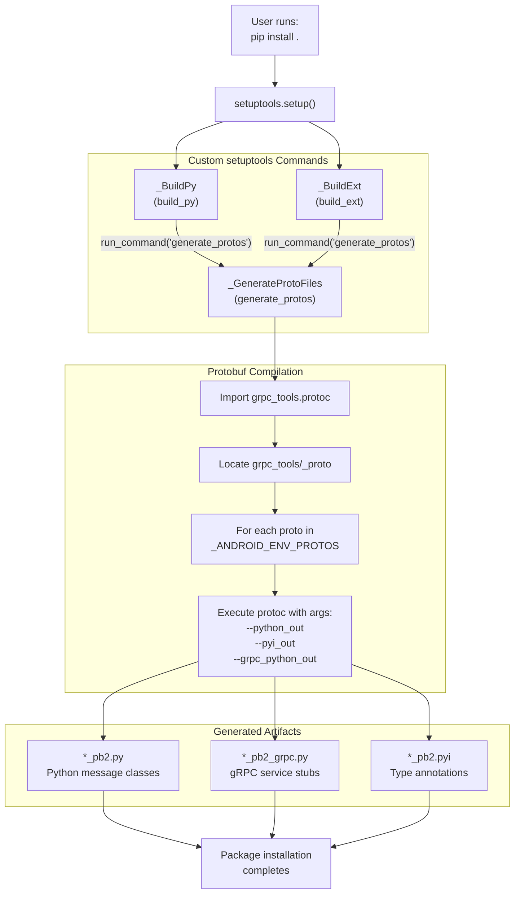

**Sources:** [setup.py:48-109]()

### Custom Build Commands

#### _GenerateProtoFiles Command

The `_GenerateProtoFiles` class [setup.py:48-82]() implements the protobuf compilation:

```python
class _GenerateProtoFiles(setuptools.Command):
  """Command to generate protobuf bindings for AndroidEnv protos."""
```

Key functionality:
1. Imports `grpc_tools.protoc` after setuptools installs build dependencies [setup.py:63]()
2. Locates the gRPC protobuf includes directory [setup.py:65-68]()
3. Iterates through each proto file in `_ANDROID_ENV_PROTOS` [setup.py:70]()
4. Executes `protoc` with arguments for Python output, type stubs, and gRPC bindings [setup.py:71-79]()

The `protoc` invocation uses these key arguments:
- `--proto_path`: Includes both gRPC protos and repository root [setup.py:73-74]()
- `--python_out`: Generates `*_pb2.py` files [setup.py:75]()
- `--pyi_out`: Generates `*_pb2.pyi` type stub files [setup.py:76]()
- `--grpc_python_out`: Generates `*_pb2_grpc.py` gRPC service code [setup.py:77]()

#### Build Integration Commands

Two custom build commands ensure proto generation runs at the correct stage:

**_BuildExt** [setup.py:84-89]() - Triggers during extension building:
```python
class _BuildExt(build_ext):
  def run(self):
    self.run_command('generate_protos')
    build_ext.run(self)
```

**_BuildPy** [setup.py:92-97]() - Triggers during Python package building:
```python
class _BuildPy(build_py):
  def run(self):
    self.run_command('generate_protos')
    build_py.run(self)
```

These commands are registered in the `cmdclass` dictionary [setup.py:104-108]():

```python
cmdclass={
    'build_ext': _BuildExt,
    'build_py': _BuildPy,
    'generate_protos': _GenerateProtoFiles,
}
```

**Sources:** [setup.py:48-109]()

## Build Workflow

The complete build and installation workflow:

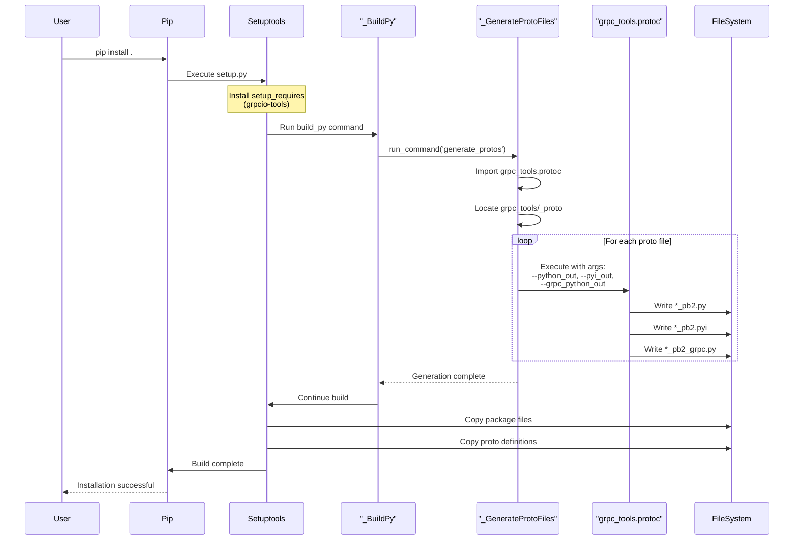

**Sources:** [setup.py:48-109](), [pyproject.toml:1-6]()

## Package Configuration

### Project Metadata

The package is configured in `pyproject.toml` [pyproject.toml:8-16]():

```toml
[project]
name = "android-env"
version = "1.2.2"
description = "AndroidEnv environment and library for training agents."
requires-python = ">=3.10"
```

Key properties:
- **Package name**: `android-env` (importable as `android_env`)
- **Current version**: 1.2.2
- **Python requirement**: 3.10 or higher

### Package Discovery

Setuptools automatically discovers packages while excluding examples [setup.py:100]():

```python
packages=find_packages(exclude=['examples'])
```

Protobuf files are included in the package distribution [setup.py:101]():

```python
package_data={'': ['proto/*.proto']}
```

**Sources:** [pyproject.toml:8-16](), [setup.py:99-102]()

## Continuous Integration

The GitHub Actions workflow validates the build system across multiple Python versions.

### Test Matrix

Tests run on [.github/workflows/tests.yml:19-21]():

| Python Version | Status |
|---------------|--------|
| 3.11 | Tested |
| 3.12 | Tested |
| 3.13 | Tested |

### CI Build Steps

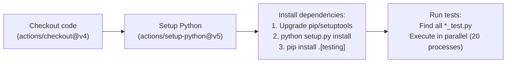

The installation command sequence [.github/workflows/tests.yml:30-34]():

```bash
pip install --upgrade pip setuptools
python setup.py install
pip install .[testing]
```

This ensures:
1. Latest pip and setuptools are available
2. Main package installs with protobuf generation
3. Testing dependencies are available

**Sources:** [.github/workflows/tests.yml:1-41]()

## Verification

### Verify Installation

After installation, verify that AndroidEnv is correctly installed:

```python
import android_env
print(android_env.__file__)
```

### Verify Protobuf Generation

Check that protobuf files were generated:

```python
from android_env.proto import task_pb2
from android_env.proto import adb_pb2

# Create a sample protobuf message
task = task_pb2.Task()
print(f"Task protobuf available: {task is not None}")
```

The protobuf modules should import without errors, and the generated `_pb2.py` files should exist in the `android_env/proto/` directory.

### Common Installation Issues

| Issue | Cause | Solution |
|-------|-------|----------|
| Import error for proto modules | Protobuf generation failed | Run `python setup.py generate_protos` manually |
| `grpcio-tools` not found | Build dependency missing | Install: `pip install grpcio-tools` |
| Python version error | Python < 3.10 | Upgrade to Python 3.10 or higher |

**Sources:** [setup.py:48-109](), [pyproject.toml:16]()

## Development Setup

### Running Protobuf Generation Manually

During development, regenerate protobuf files manually:

```bash
python setup.py generate_protos
```

This executes the `_GenerateProtoFiles` command without reinstalling the package.

### Adding New Protobuf Definitions

To add a new protobuf file:

1. Create the `.proto` file in `android_env/proto/` or a subdirectory
2. Add the path to `_ANDROID_ENV_PROTOS` tuple in `setup.py` [setup.py:30-45]()
3. Run `python setup.py generate_protos` to generate bindings
4. Import and use the generated `*_pb2.py` module

Example:
```python
_ANDROID_ENV_PROTOS = (
    # ... existing protos ...
    'android_env/proto/new_feature.proto',  # Add here
)
```

**Sources:** [setup.py:30-45](), [setup.py:48-82]()

---

# Page: Configuration System

# Configuration System

<details>
<summary>Relevant source files</summary>

The following files were used as context for generating this wiki page:

- [android_env/components/config_classes.py](android_env/components/config_classes.py)
- [android_env/loader.py](android_env/loader.py)
- [android_env/loader_test.py](android_env/loader_test.py)

</details>


This document describes the configuration system for AndroidEnv, which provides a flexible way to configure all aspects of the environment. The configuration classes enable users to specify settings for the Android emulator, task execution, and environment behavior.

## Overview

AndroidEnv uses a hierarchical configuration system based on dataclasses. At the top level, the `AndroidEnvConfig` class contains configurations for all major subsystems. Each subsystem has its own configuration class, creating a nested structure that allows for detailed control over the environment.

**Diagram: Configuration Class Hierarchy**

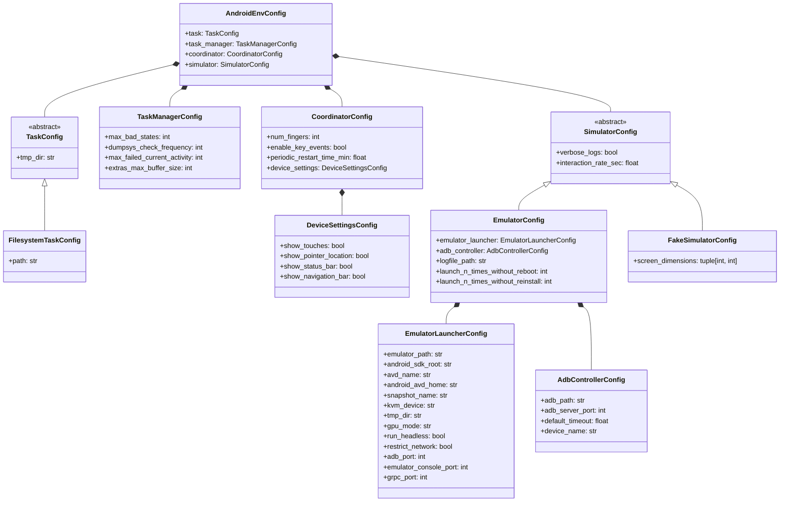

Sources: [android_env/components/config_classes.py:16-204]()

## Configuration Loading Process

When you create an AndroidEnv instance, you provide an `AndroidEnvConfig` object that is then used to initialize and configure all components of the environment. The following diagram shows the configuration loading process:

**Diagram: Configuration Loading Flow**

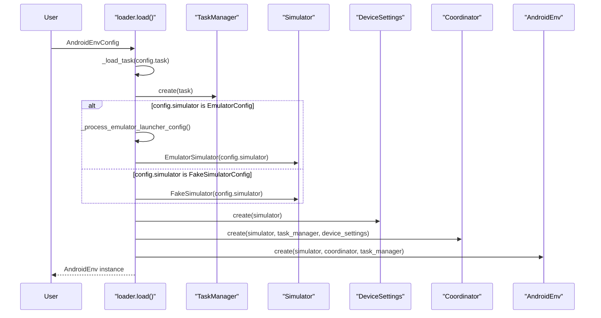

Sources: [android_env/loader.py:16-90]()

## Top-Level Configuration

The `AndroidEnvConfig` class is the top-level configuration class that contains all the settings needed to create an AndroidEnv instance. It includes configurations for the task, task manager, coordinator, and simulator.

```python
@dataclasses.dataclass
class AndroidEnvConfig:
  """Config class for AndroidEnv."""

  # Configs for main components.
  task: TaskConfig = dataclasses.field(default_factory=TaskConfig)
  task_manager: TaskManagerConfig = dataclasses.field(
      default_factory=TaskManagerConfig
  )
  coordinator: CoordinatorConfig = dataclasses.field(
      default_factory=CoordinatorConfig
  )
  simulator: SimulatorConfig = dataclasses.field(default_factory=EmulatorConfig)
```

Sources: [android_env/components/config_classes.py:192-204]()

## Task Configuration

The task configuration determines how the environment loads task definitions. The base `TaskConfig` class is abstract, and specific implementations provide different ways to load tasks.

### FilesystemTaskConfig

The `FilesystemTaskConfig` allows loading task definitions from protobuf files in the local filesystem. This is the most common way to define tasks.

```python
@dataclasses.dataclass
class FilesystemTaskConfig(TaskConfig):
  """Config for protobuf files stored in the local filesystem."""

  # Filesystem path to `.binarypb` or `.textproto` protobuf Task.
  path: str = ''
```

Sources: [android_env/components/config_classes.py:176-189](), [android_env/loader.py:33-44]()

## Task Manager Configuration

The `TaskManagerConfig` class configures the behavior of the `TaskManager`, which is responsible for managing task execution, monitoring task state, and determining reward signals.

```python
@dataclasses.dataclass
class TaskManagerConfig:
  """Config class for TaskManager."""

  # If max_bad_states episodes finish in a bad state in a row, restart
  # the simulation.
  max_bad_states: int = 3
  # The frequency to check for the current activity and view hierarchy.
  # The unit is raw observation (i.e. each call to AndroidEnv.step()).
  dumpsys_check_frequency: int = 150
  # The maximum number of tries for extracting the current activity before
  # forcing the episode to restart.
  max_failed_current_activity: int = 10
  # The maximum number of extras elements to store. If this number is exceeded,
  # elements are dropped in the order they were received.
  extras_max_buffer_size: int = 100
```

Sources: [android_env/components/config_classes.py:158-173]()

## Coordinator Configuration

The `CoordinatorConfig` class configures the `Coordinator`, which orchestrates interactions between the simulator, task manager, and device settings. It controls aspects like input handling and scheduling periodic restarts.

```python
@dataclasses.dataclass
class CoordinatorConfig:
  """Config class for Coordinator."""

  # Number of virtual "fingers" of the agent.
  num_fingers: int = 1
  # Whether to enable keyboard key events.
  enable_key_events: bool = False
  # Time between periodic restarts in minutes. If > 0, will trigger
  # a simulator restart at the beginning of the next episode once the time has
  # been reached.
  periodic_restart_time_min: float = 0.0
  # General Android settings.
  device_settings: DeviceSettingsConfig = dataclasses.field(
      default_factory=DeviceSettingsConfig
  )
```

Sources: [android_env/components/config_classes.py:53-67]()

### Device Settings Configuration

The `DeviceSettingsConfig` class configures the visual and interaction aspects of the Android device, such as whether to show touch indicators and navigation bars.

```python
@dataclasses.dataclass
class DeviceSettingsConfig:
  """Config class for DeviceSettings."""

  # Whether to show circles on the screen indicating touch position.
  show_touches: bool = True
  # Whether to show blue lines on the screen indicating touch position.
  show_pointer_location: bool = True
  # Whether or not to show the status (top) bar.
  show_status_bar: bool = False
  # Whether or not to show the navigation (bottom) bar.
  show_navigation_bar: bool = False
```

Sources: [android_env/components/config_classes.py:39-49](), [android_env/components/device_settings.py:41-174]()

## Simulator Configuration

The simulator configuration determines how AndroidEnv interacts with an Android device or emulator. The base `SimulatorConfig` class is abstract, with specific implementations for different simulator types.

```python
@dataclasses.dataclass
class SimulatorConfig:
  """Base class for all simulator configs."""

  # If true, the log stream of the simulator will be verbose.
  verbose_logs: bool = False
  # How often to (asynchronously) grab the screenshot from the simulator.
  # If <= 0, stepping the environment blocks on fetching the screenshot (the
  # environment is synchronous).
  interaction_rate_sec: float = 0.0
```

Sources: [android_env/components/config_classes.py:70-80]()

### Emulator Configuration

The `EmulatorConfig` class configures an Android emulator for use with AndroidEnv. It includes settings for the emulator launcher and ADB controller.

```python
@dataclasses.dataclass
class EmulatorConfig(SimulatorConfig):
  """Config class for EmulatorSimulator."""

  # Configuration for launching the Android Emulator.
  emulator_launcher: EmulatorLauncherConfig = dataclasses.field(
      default_factory=EmulatorLauncherConfig
  )
  # Configuration for talking to adb.
  adb_controller: AdbControllerConfig = dataclasses.field(
      default_factory=AdbControllerConfig
  )
  # Path to file which holds emulator logs. If not provided, it will be
  # determined by the EmulatorLauncher.
  logfile_path: str = ''
  # The number of times to try launching the emulator before rebooting (reboot
  # on the n+1-st try).
  launch_n_times_without_reboot: int = 1
  # The number of times to try launching the emulator before reinstalling
  # (reinstall on the n+1-st try).
  launch_n_times_without_reinstall: int = 2
```

Sources: [android_env/components/config_classes.py:127-147]()

#### Emulator Launcher Configuration

The `EmulatorLauncherConfig` class configures how the Android emulator is launched. It includes settings for the emulator binary, AVD (Android Virtual Device), and networking.

```python
@dataclasses.dataclass
class EmulatorLauncherConfig:
  """Config class for EmulatorLauncher."""

  # NOTE: If `adb_port`, `emulator_console_port` and `grpc_port` are defined
  # (i.e. not all equal to 0), it is assumed that the emulator they point to
  # exists already and EmulatorLauncher will be skipped.

  # Filesystem path to the `emulator` binary.
  emulator_path: str = '~/Android/Sdk/emulator/emulator'
  # Filesystem path to the Android SDK root.
  android_sdk_root: str = '~/Android/Sdk'
  # Name of the AVD.
  avd_name: str = ''
  # Local directory for AVDs.
  android_avd_home: str = '~/.android/avd'
  # Name of the snapshot to load.
  snapshot_name: str = ''
  # Path to the KVM device.
  kvm_device: str = '/dev/kvm'
  # Path to directory which will hold temporary files.
  tmp_dir: str = '/tmp/android_env/simulator/'
  # GPU mode override.
  # Please see
  # https://developer.android.com/studio/run/emulator-acceleration#accel-graphics.
  gpu_mode: str = 'swangle_indirect'  # Alternative: swiftshader_indirect, host
  # Whether to run in headless mode (i.e. without a graphical window).
  run_headless: bool = True
  # Whether to restrict network access.
  # If True, will disable networking on the device. This option is only
  # available for emulator version > 31.3.9 (June 2022).
  restrict_network: bool = False
  # Whether to set `SHOW_PERF_STATS=1` when launching the emulator to display
  # performance and memory statistics.
  show_perf_stats: bool = False

  # ADB port for the Android device.
  adb_port: int = 0
  # Port for telnet communication with the emulator.
  emulator_console_port: int = 0
  # Port for gRPC communication with the emulator.
  grpc_port: int = 0
```

Sources: [android_env/components/config_classes.py:83-123]()

#### ADB Controller Configuration

The `AdbControllerConfig` class configures how AndroidEnv interacts with the Android Debug Bridge (ADB) to communicate with the Android device.

```python
@dataclasses.dataclass
class AdbControllerConfig:
  """Settings for instatiating an `AdbController` instance."""

  # Filesystem path to the `adb` binary.
  # NOTE: This must be a full path and must not contain environment variables
  # or user folder shorthands (e.g. `~/some/path/to/adb`) since they will not be
  # expanded internally by AndroidEnv.
  adb_path: str = '~/Android/Sdk/platform-tools/adb'
  # Port for adb server.
  adb_server_port: int = 5037
  # Default timeout in seconds for internal commands.
  default_timeout: float = 120.0
  # Name of the device to communicate with.
  device_name: str = ''
```

Sources: [android_env/components/config_classes.py:22-36](), [android_env/loader.py:71-89]()

### Fake Simulator Configuration

The `FakeSimulatorConfig` class configures a fake simulator for testing purposes. It simulates an Android device without requiring a real emulator.

```python
@dataclasses.dataclass
class FakeSimulatorConfig(SimulatorConfig):
  """Config class for FakeSimulator."""

  # The dimensions in pixels of the device screen (HxW).
  screen_dimensions: tuple[int, int] = (0, 0)
```

Sources: [android_env/components/config_classes.py:150-154]()

## Creating and Using Configurations

To use AndroidEnv, you create an `AndroidEnvConfig` instance with your desired settings and pass it to the `loader.load()` function. The following diagram shows how configuration objects are used to create the environment:

**Diagram: Configuration Usage Flow**

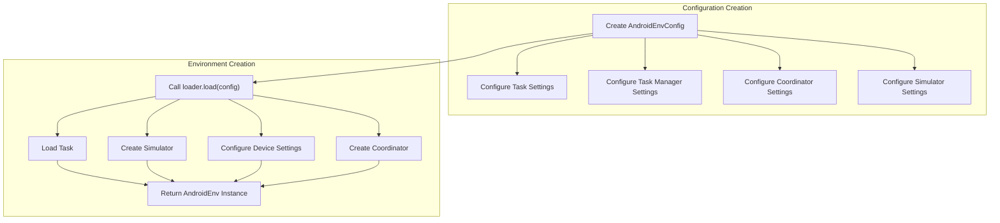

Sources: [android_env/loader.py:16-90](), [android_env/loader_test.py:42-136]()

### Example Configuration

Here's an example of creating a configuration for an emulator-based environment:

```python
from android_env.components import config_classes

# Create the top-level config
config = config_classes.AndroidEnvConfig(
    # Configure the task
    task=config_classes.FilesystemTaskConfig(
        path='/path/to/task.textproto',
    ),
    
    # Configure the task manager
    task_manager=config_classes.TaskManagerConfig(
        max_bad_states=5,
        dumpsys_check_frequency=100,
    ),
    
    # Configure the coordinator
    coordinator=config_classes.CoordinatorConfig(
        num_fingers=1,
        enable_key_events=True,
        device_settings=config_classes.DeviceSettingsConfig(
            show_touches=True,
            show_pointer_location=False,
            show_status_bar=False,
        ),
    ),
    
    # Configure the simulator
    simulator=config_classes.EmulatorConfig(
        emulator_launcher=config_classes.EmulatorLauncherConfig(
            avd_name='my_avd',
            run_headless=True,
            snapshot_name='my_snapshot',
        ),
        adb_controller=config_classes.AdbControllerConfig(
            adb_path='/path/to/adb',
            default_timeout=60.0,
        ),
    ),
)
```

Sources: [android_env/loader_test.py:42-67](), [android_env/loader_test.py:103-120]()

## Path Expansion

Some configuration fields, such as file paths, are automatically expanded by the loader. For example, the `~` character in paths like `~/Android/Sdk` is expanded to the user's home directory before being used. This is handled by the `_process_emulator_launcher_config` function in the loader.

```python
def _process_emulator_launcher_config(
    emulator_config: config_classes.EmulatorConfig,
) -> None:
  """Adjusts the configuration of the emulator depending on some conditions."""

  # Expand the user directory if specified.
  launcher_config = emulator_config.emulator_launcher
  launcher_config.android_avd_home = os.path.expanduser(
      launcher_config.android_avd_home
  )
  launcher_config.android_sdk_root = os.path.expanduser(
      launcher_config.android_sdk_root
  )
  launcher_config.emulator_path = os.path.expanduser(
      launcher_config.emulator_path
  )
  emulator_config.adb_controller.adb_path = os.path.expanduser(
      emulator_config.adb_controller.adb_path
  )
```

Sources: [android_env/loader.py:71-89]()

## Summary

The AndroidEnv configuration system provides a flexible and comprehensive way to configure all aspects of the environment. By creating an `AndroidEnvConfig` instance with your desired settings, you can control the behavior of the task, task manager, coordinator, and simulator components.

Key points to remember:
- The configuration is hierarchical, with the `AndroidEnvConfig` at the top level
- Each subsystem has its own configuration class
- Default values are provided for most settings, making it easy to get started
- Path fields with `~` are automatically expanded to full paths
- The configuration is used by the `loader.load()` function to create the environment

For information about the Coordinator component, see [Coordinator](#2.2). For information about Task Management, see [Task Management](#3).

---

# Page: Quick Start Examples

# Quick Start Examples

<details>
<summary>Relevant source files</summary>

The following files were used as context for generating this wiki page:

- [android_env/components/config_classes.py](android_env/components/config_classes.py)
- [android_env/components/simulators/emulator/emulator_launcher.py](android_env/components/simulators/emulator/emulator_launcher.py)
- [android_env/components/simulators/emulator/emulator_launcher_test.py](android_env/components/simulators/emulator/emulator_launcher_test.py)
- [android_env/loader.py](android_env/loader.py)
- [android_env/loader_test.py](android_env/loader_test.py)
- [examples/run_acme_agent.py](examples/run_acme_agent.py)
- [examples/run_human_agent.py](examples/run_human_agent.py)
- [examples/run_random_agent.py](examples/run_random_agent.py)

</details>


## Purpose and Scope

This page provides practical examples demonstrating how to configure and run AndroidEnv with different agent types. It covers three primary usage patterns: a random agent for testing, a human-controlled agent for manual interaction, and an Acme-based reinforcement learning agent for training. 

For details on installation and dependencies, see [Installation and Build System](#2.1). For comprehensive configuration options, see [Configuration System](#2.2). For advanced wrapper usage patterns, see [Environment Wrappers](#7).

---

## Common Usage Pattern

All AndroidEnv examples follow a consistent four-step pattern:

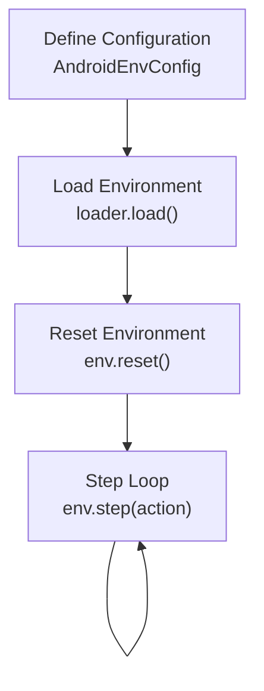

### Configuration Setup

Each example constructs an `AndroidEnvConfig` object with three main components:

| Component | Configuration Class | Purpose |
|-----------|-------------------|---------|
| Task | `FilesystemTaskConfig` | Specifies task definition protobuf path |
| Simulator | `EmulatorConfig` | Configures emulator launcher and ADB controller |
| Coordinator | `CoordinatorConfig` | Sets device settings and interaction parameters |
| Task Manager | `TaskManagerConfig` | Configures reward extraction and episode management |

The `loader.load()` function [android_env/loader.py:47-68]() instantiates all components in the correct dependency order.

**Sources:** [android_env/loader.py:33-68](), [android_env/components/config_classes.py:209-221]()

---

## Random Agent Example

### Overview

The random agent demonstrates basic environment interaction by taking uniformly random actions at each step. This example is useful for testing environment setup and verifying task configuration.

### Configuration Code Mapping

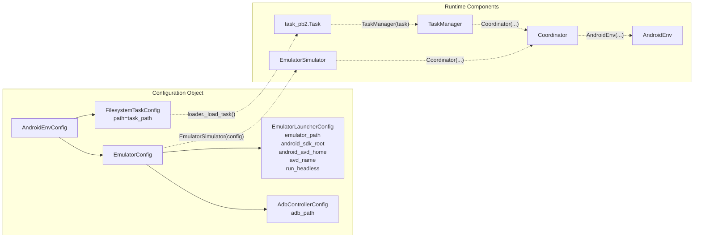

### Action Sampling Strategy

The random agent queries the environment's action specification and samples valid actions for each component:

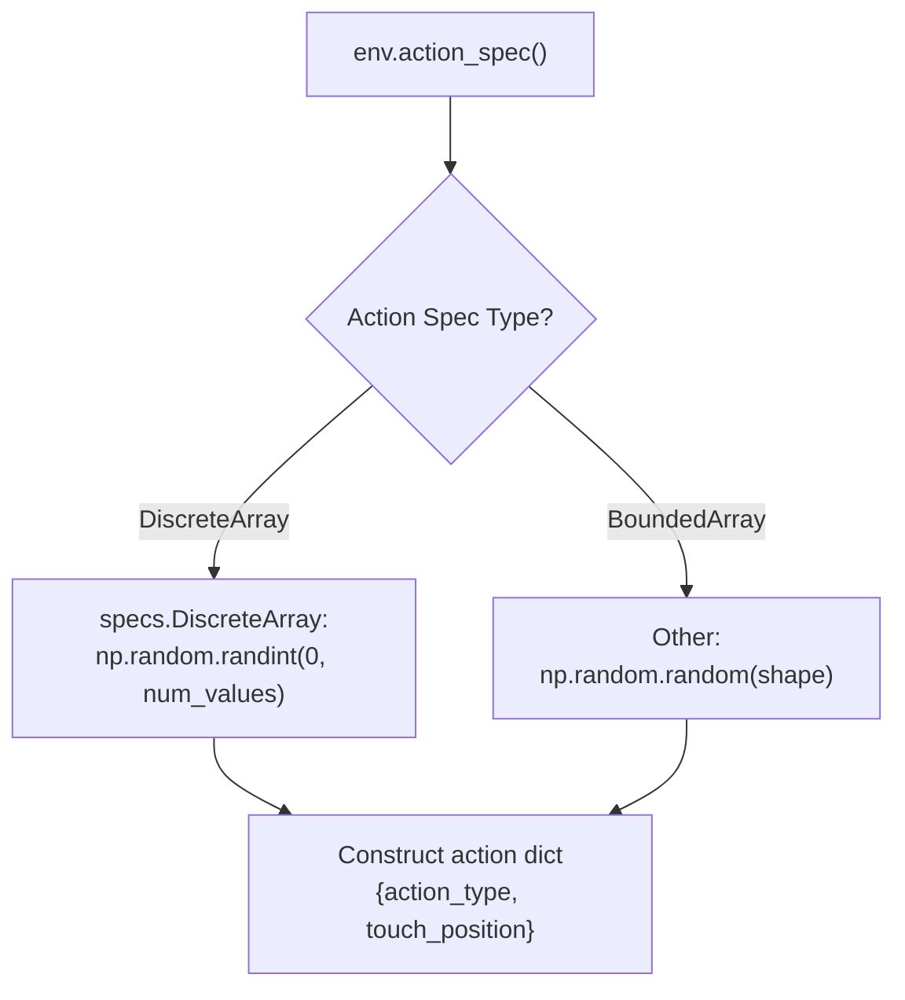

The implementation [examples/run_random_agent.py:67-75]() handles both discrete and continuous action components by inspecting the spec type.

### Execution Flow

| Step | Code Location | Description |
|------|--------------|-------------|
| 1. Parse flags | [examples/run_random_agent.py:26-43]() | Extract emulator paths and task path from command line |
| 2. Create config | [examples/run_random_agent.py:48-62]() | Construct `AndroidEnvConfig` with nested configurations |
| 3. Load environment | [examples/run_random_agent.py:63]() | Call `loader.load(config)` to instantiate environment |
| 4. Reset | [examples/run_random_agent.py:77]() | Initialize episode with `env.reset()` |
| 5. Step loop | [examples/run_random_agent.py:79-83]() | Sample random actions and call `env.step(action)` |

**Sources:** [examples/run_random_agent.py:1-91](), [android_env/loader.py:47-68]()

---

## Human Agent Example

### Overview

The human agent uses pygame to create an interactive session where a user controls the Android device through mouse input. This example demonstrates action translation from UI events to AndroidEnv actions and observation rendering.

### Action Translation Pipeline

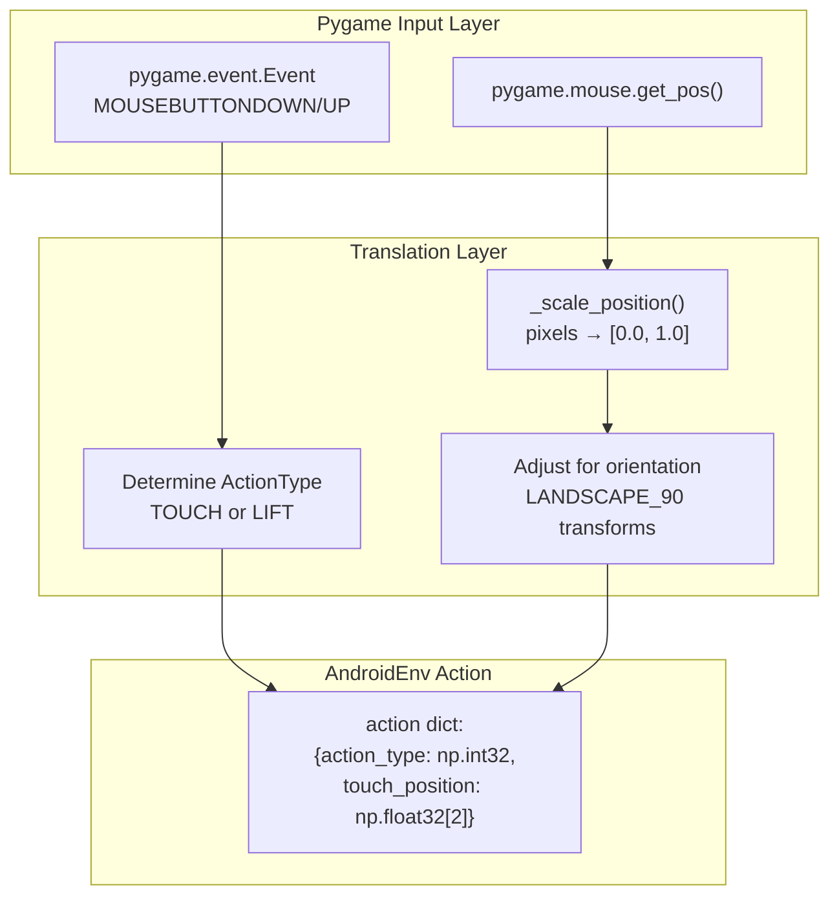

The action translation logic [examples/run_human_agent.py:52-94]() handles:
- **Action Type Mapping:** Mouse button down → `ActionType.TOUCH`, button up → `ActionType.LIFT`
- **Position Scaling:** Pygame pixel coordinates → normalized [0.0, 1.0] range
- **Orientation Handling:** Landscape orientations require coordinate transformation

### Observation Rendering Pipeline

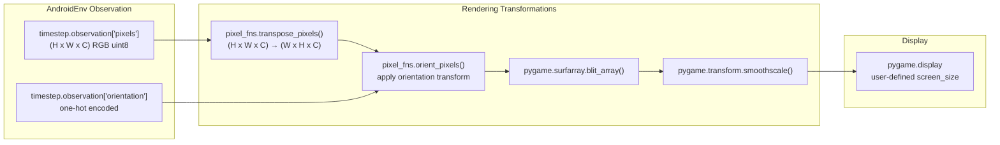

The rendering implementation [examples/run_human_agent.py:114-125]() extracts RGB pixels, applies orientation-aware transformations using `pixel_fns`, and displays them on a pygame surface scaled to the desired screen size.

### Key Components

| Component | Code Location | Function |
|-----------|--------------|----------|
| Event Processing | [examples/run_human_agent.py:52-66]() | `_get_action_from_event()` translates pygame events |
| Mouse Tracking | [examples/run_human_agent.py:69-83]() | `_get_action_from_mouse()` samples current mouse state |
| Position Scaling | [examples/run_human_agent.py:86-94]() | `_scale_position()` normalizes coordinates |
| Reward Accumulation | [examples/run_human_agent.py:97-111]() | `_accumulate_reward()` tracks episode returns |
| Frame Rendering | [examples/run_human_agent.py:114-125]() | `_render_pygame_frame()` displays observations |

**Sources:** [examples/run_human_agent.py:1-210](), [android_env/components/action_type.py]()

---

## Acme Agent Example

### Overview

The Acme agent example demonstrates integration with DeepMind's Acme reinforcement learning library. It applies environment wrappers to transform observations and actions into formats suitable for deep RL algorithms, then trains a DQN agent.

### Wrapper Application Chain

```mermaid
graph TB
    BaseEnv["loader.load(config)<br/>AndroidEnv"]
    
    Wrapper1["DiscreteActionWrapper<br/>action_grid=(10, 10)"]
    Wrapper2["ImageRescaleWrapper<br/>zoom_factors=(0.25, 0.25)"]
    Wrapper3["FloatPixelsWrapper"]
    Wrapper4["SinglePrecisionWrapper"]
    
    AgentInterface["Acme Agent Interface"]
    
    BaseEnv -->|"continuous touch<br/>{action_type, touch_position}"| Wrapper1
    Wrapper1 -->|"discrete action ID<br/>100 grid positions"| Wrapper2
    Wrapper2 -->|"downscaled pixels<br/>25% original size"| Wrapper3
    Wrapper3 -->|"float32 pixels<br/>[0.0, 1.0] range"| Wrapper4
    Wrapper4 -->|"single precision<br/>compatible specs"| AgentInterface
```

Each wrapper in the chain [examples/run_acme_agent.py:50-57]() transforms the interface:

1. **DiscreteActionWrapper:** Converts continuous touch positions to a discrete grid of 100 positions (10×10)
2. **ImageRescaleWrapper:** Reduces observation size by 75% for computational efficiency
3. **FloatPixelsWrapper:** Normalizes uint8 pixels to float32 in [0.0, 1.0] range
4. **SinglePrecisionWrapper:** Ensures all arrays use single precision for Acme compatibility

For detailed wrapper behavior, see [Observation Wrappers](#7.3) and [Action Wrappers](#7.2).

### Agent Configuration and Training Loop

```mermaid
sequenceDiagram
    participant Config as "AndroidEnvConfig"
    participant Loader as "loader.load()"
    participant Env as "Wrapped Environment"
    participant Spec as "specs.make_environment_spec()"
    participant Network as "networks.DQNAtariNetwork"
    participant Agent as "dqn.DQN"
    participant Loop as "acme.EnvironmentLoop"
    
    Config->>Loader: config object
    Loader->>Env: base AndroidEnv
    Env->>Env: apply_wrappers()
    Env->>Spec: environment instance
    Spec->>Network: env_spec
    Network->>Agent: network + env_spec
    Agent->>Loop: agent + env
    Loop->>Loop: run(num_episodes)
```

The training setup [examples/run_acme_agent.py:60-91]():

1. Creates wrapped environment with appropriate transformations
2. Generates environment specification using `specs.make_environment_spec()`
3. Instantiates `DQNAtariNetwork` with discrete action space size
4. Configures DQN agent with hyperparameters (batch_size=10, samples_per_insert=2)
5. Runs training loop with `acme.EnvironmentLoop`

### Integration Points

| Component | Type | Purpose |
|-----------|------|---------|
| `discrete_action_wrapper.DiscreteActionWrapper` | Wrapper | Converts continuous actions to discrete grid |
| `image_rescale_wrapper.ImageRescaleWrapper` | Wrapper | Reduces observation dimensions |
| `float_pixels_wrapper.FloatPixelsWrapper` | Wrapper | Normalizes pixel values |
| `acme_wrappers.SinglePrecisionWrapper` | Wrapper | Ensures float32 precision |
| `specs.make_environment_spec()` | Acme Utility | Extracts action/observation specs |
| `networks.DQNAtariNetwork` | Acme Network | CNN architecture for pixel observations |
| `dqn.DQN` | Acme Agent | Deep Q-Network algorithm implementation |
| `acme.EnvironmentLoop` | Acme Runtime | Orchestrates agent-environment interaction |

**Sources:** [examples/run_acme_agent.py:1-99](), [android_env/wrappers/discrete_action_wrapper.py](), [android_env/wrappers/image_rescale_wrapper.py](), [android_env/wrappers/float_pixels_wrapper.py]()

---

## Common Configuration Patterns

### Required Command-Line Flags

All three examples require these flags:

```
--avd_name: Name of the Android Virtual Device to launch
--task_path: Filesystem path to task definition (.textproto or .binarypb)
```

### Optional Flags with Defaults

| Flag | Default Value | Description |
|------|--------------|-------------|
| `--android_avd_home` | `~/.android/avd` | AVD storage directory |
| `--android_sdk_root` | `~/Android/Sdk` | Android SDK installation path |
| `--emulator_path` | `~/Android/Sdk/emulator/emulator` | Emulator binary path |
| `--adb_path` | `~/Android/Sdk/platform-tools/adb` | ADB binary path |
| `--run_headless` | `False` (random/human)<br/>`True` (Acme) | Whether to hide emulator window |

### Configuration Object Construction

The standard pattern [examples/run_random_agent.py:48-62]():

```python
config = config_classes.AndroidEnvConfig(
    task=config_classes.FilesystemTaskConfig(
        path=FLAGS.task_path
    ),
    simulator=config_classes.EmulatorConfig(
        emulator_launcher=config_classes.EmulatorLauncherConfig(
            emulator_path=FLAGS.emulator_path,
            android_sdk_root=FLAGS.android_sdk_root,
            android_avd_home=FLAGS.android_avd_home,
            avd_name=FLAGS.avd_name,
            run_headless=FLAGS.run_headless,
        ),
        adb_controller=config_classes.AdbControllerConfig(
            adb_path=FLAGS.adb_path
        ),
    ),
)
```

Path expansion (tilde `~` to home directory) occurs automatically in `loader._process_emulator_launcher_config()` [android_env/loader.py:71-89]().

### Environment Lifecycle Management

All examples use the context manager pattern:

```python
with loader.load(config) as env:
    timestep = env.reset()
    # interaction loop
    timestep = env.step(action)
```

This ensures proper cleanup of:
- Emulator processes [android_env/components/simulators/emulator/emulator_launcher.py:145-166]()
- Log streams [android_env/components/log_stream.py]()
- gRPC connections [android_env/components/simulators/emulator/emulator_simulator.py]()

**Sources:** [examples/run_random_agent.py:48-83](), [examples/run_human_agent.py:133-203](), [examples/run_acme_agent.py:62-91](), [android_env/loader.py:71-89]()

---

# Page: Core Architecture

# Core System Architecture

<details>
<summary>Relevant source files</summary>

The following files were used as context for generating this wiki page:

- [android_env/components/coordinator.py](android_env/components/coordinator.py)
- [android_env/components/coordinator_test.py](android_env/components/coordinator_test.py)
- [android_env/components/task_manager.py](android_env/components/task_manager.py)
- [android_env/components/task_manager_test.py](android_env/components/task_manager_test.py)
- [android_env/env_interface.py](android_env/env_interface.py)
- [android_env/environment.py](android_env/environment.py)
- [android_env/environment_test.py](android_env/environment_test.py)
- [android_env/wrappers/base_wrapper.py](android_env/wrappers/base_wrapper.py)
- [android_env/wrappers/base_wrapper_test.py](android_env/wrappers/base_wrapper_test.py)
- [android_env/wrappers/float_pixels_wrapper.py](android_env/wrappers/float_pixels_wrapper.py)
- [android_env/wrappers/last_action_wrapper.py](android_env/wrappers/last_action_wrapper.py)

</details>


This page describes the high-level architecture of AndroidEnv, explaining the core components and their interactions. It covers how data flows through the system during initialization, reset, and stepping of the environment. For specific details about the environment interface itself, see [Environment Interface](#2.1). For configuration details, see [Configuration System](#2.3).

## System Components

AndroidEnv follows a layered architecture with clear separation of concerns between components. The system comprises several key components that work together to provide an RL environment interface to Android devices.

```mermaid
classDiagram
    class AndroidEnv {
        +reset()
        +step()
        +action_spec()
        +observation_spec()
        +task_extras()
        +execute_adb_call()
        +load_state()
        +save_state()
    }
    
    class Coordinator {
        +rl_reset()
        +rl_step()
        +action_spec()
        +observation_spec()
        +execute_adb_call()
        -_launch_simulator()
        -_gather_simulator_signals()
    }
    
    class BaseSimulator {
        <<interface>>
        +launch()
        +get_screenshot()
        +send_touch()
        +send_key()
        +create_adb_controller()
        +create_log_stream()
        +load_state()
        +save_state()
    }
    
    class TaskManager {
        +start()
        +setup_task()
        +reset_task()
        +rl_reset()
        +rl_step()
        +stop()
    }
    
    class DeviceSettings {
        +update()
        +screen_width()
        +screen_height()
        +get_orientation()
    }
    
    class AdbController {
        +execute_command()
    }
    
    AndroidEnv --> Coordinator : delegates to
    AndroidEnv --> TaskManager : uses
    AndroidEnv --> BaseSimulator : interacts with
    
    Coordinator --> BaseSimulator : manages
    Coordinator --> TaskManager : orchestrates
    Coordinator --> DeviceSettings : configures
    Coordinator --> AdbCallParser : uses
    
    DeviceSettings --> BaseSimulator : gets data from
    
    BaseSimulator --> AdbController : creates
    
    note for AndroidEnv "Main environment interface\nimplements dm_env.Environment"
    note for Coordinator "Central orchestration component\nHandles component interaction"
    note for BaseSimulator "Abstract interface for\nsimulator implementations"
    note for TaskManager "Manages task execution\nand determines rewards"
    note for DeviceSettings "Configures and queries\ndevice properties"
```

Sources: [android_env/environment.py:32-191](), [android_env/components/coordinator.py:38-283](), [android_env/components/device_settings.py:41-175]()

### Key Components

1. **AndroidEnv**: The main environment class that implements the dm_env.Environment interface. It delegates most of its functionality to the Coordinator and exposes additional Android-specific methods like task_extras() and execute_adb_call().

2. **Coordinator**: The central orchestration component that manages communication between the simulator, task manager, and device settings. It handles the core RL operations (reset and step) and manages simulator lifecycles.

3. **BaseSimulator**: An abstract interface that defines operations for interacting with Android devices. It has implementations like EmulatorSimulator (real Android emulator) and FakeSimulator (for testing).

4. **TaskManager**: Manages the execution of RL tasks, processing signals from the simulator, and determining rewards and episode termination.

5. **DeviceSettings**: Handles device configuration and provides information about the device such as screen dimensions and orientation.

6. **AdbController/AdbCallParser**: Provides low-level communication with the Android device through the Android Debug Bridge (ADB).

Sources: [android_env/loader.py:47-89](), [android_env/environment.py:32-45](), [android_env/components/coordinator.py:38-60]()

## Initialization Process

The initialization process begins with loading the environment using the `loader.load()` function, which constructs the component hierarchy based on the provided configuration.

```mermaid
sequenceDiagram
    participant Client
    participant Loader
    participant AndroidEnv
    participant Coordinator
    participant TaskManager
    participant Simulator
    participant DeviceSettings
    
    Client->>Loader: load(config)
    Loader->>+Loader: _load_task(config.task)
    Loader->>TaskManager: create TaskManager(task)
    
    alt EmulatorConfig
        Loader->>Loader: _process_emulator_launcher_config()
        Loader->>Simulator: create EmulatorSimulator(config)
    else FakeSimulatorConfig
        Loader->>Simulator: create FakeSimulator(config)
    end
    
    Loader->>DeviceSettings: create DeviceSettings(simulator)
    Loader->>Coordinator: create Coordinator(simulator, task_manager, device_settings)
    Loader->>AndroidEnv: create AndroidEnv(simulator, coordinator, task_manager)
    Loader-->>Client: env
    
    Coordinator->>Simulator: launch()
    Simulator->>Simulator: start emulator process
    Coordinator->>DeviceSettings: update(config.device_settings)
    Coordinator->>TaskManager: start(adb_call_parser_factory, log_stream)
```

Sources: [android_env/loader.py:33-89](), [android_env/components/coordinator.py:116-171]()

## Data Flow During Reset and Step

The reset and step operations involve complex interactions between components. The following diagram illustrates the data flow during these operations.

```mermaid
sequenceDiagram
    participant Agent as "RL Agent"
    participant Env as "AndroidEnv"
    participant Coord as "Coordinator"
    participant Sim as "BaseSimulator"
    participant Task as "TaskManager"
    participant Device as "DeviceSettings"
    
    %% Reset Flow
    Agent->>Env: reset()
    Env->>Coord: rl_reset()
    
    alt simulator needs restart
        Coord->>Coord: _launch_simulator()
        Coord->>Sim: launch()
        Coord->>Device: update(device_settings)
        Coord->>Task: start(...)
        Coord->>Task: setup_task()
    end
    
    Coord->>Sim: get_screenshot()
    Sim-->>Coord: screenshot
    Coord->>Device: get_orientation()
    Device-->>Coord: orientation
    Coord->>Coord: _gather_simulator_signals()
    Coord->>Task: rl_reset(simulator_signals)
    Task-->>Coord: timestep
    Coord-->>Env: timestep
    Env->>Env: process observation/extras
    Env-->>Agent: timestep
    
    %% Step Flow
    Agent->>Env: step(action)
    Env->>Coord: rl_step(action)
    Coord->>Sim: send_touch/send_key
    Sim-->>Coord: result
    Coord->>Sim: get_screenshot()
    Sim-->>Coord: screenshot
    Coord->>Device: get_orientation()
    Device-->>Coord: orientation
    Coord->>Coord: _gather_simulator_signals()
    Coord->>Task: rl_step(simulator_signals)
    Task-->>Coord: timestep
    Coord-->>Env: timestep
    Env->>Env: process observation/extras
    Env-->>Agent: timestep
```

Sources: [android_env/environment.py:66-114](), [android_env/components/coordinator.py:182-248]()

### Reset Process

1. The agent calls `reset()` on AndroidEnv
2. AndroidEnv delegates to Coordinator's `rl_reset()`
3. Coordinator checks if the simulator needs restarting and launches it if necessary
4. Coordinator executes a lift action to ensure all fingers are lifted
5. Coordinator collects simulator signals (screenshot, orientation, timedelta)
6. TaskManager processes these signals and determines the initial timestep
7. AndroidEnv processes the timestep and returns it to the agent

### Step Process

1. The agent calls `step(action)` on AndroidEnv
2. AndroidEnv delegates to Coordinator's `rl_step(action)`
3. Coordinator sends the action to the simulator
4. Coordinator collects simulator signals
5. TaskManager processes these signals and determines the next timestep
6. AndroidEnv processes the timestep and returns it to the agent

## Component Communication

Components communicate primarily through method calls, with the Coordinator orchestrating most interactions. The following diagram illustrates the communication patterns between components.

```mermaid
graph TD
    subgraph "Client Application"
        Agent["RL Agent"]
    end
    
    subgraph "AndroidEnv Framework"
        AndroidEnv["AndroidEnv Class"]
        Coordinator["Coordinator Class"]
        TaskManager["TaskManager Class"]
        DeviceSettings["DeviceSettings Class"]
        
        subgraph "Simulator Component"
            BaseSimulator["BaseSimulator Interface"]
            EmulatorSim["EmulatorSimulator"]
            FakeSim["FakeSimulator"]
        end
        
        subgraph "Communication Components"
            AdbCallParser["AdbCallParser Class"]
            AdbController["AdbController Class"]
            LogStream["LogStream Interface"]
        end
    end
    
    subgraph "Android Device"
        Emulator["Android Emulator/Device"]
    end
    
    %% Client to Environment
    Agent -->|"reset(), step()"| AndroidEnv
    
    %% Main component flows
    AndroidEnv -->|"delegates"| Coordinator
    Coordinator -->|"manages"| BaseSimulator
    Coordinator -->|"orchestrates"| TaskManager
    Coordinator -->|"configures"| DeviceSettings
    
    %% Simulator relationships
    BaseSimulator -->|"implemented by"| EmulatorSim
    BaseSimulator -->|"implemented by"| FakeSim
    EmulatorSim -->|"controls"| Emulator
    
    %% Communication relationships
    EmulatorSim -->|"creates"| AdbController
    EmulatorSim -->|"creates"| LogStream
    Coordinator -->|"creates"| AdbCallParser
    AdbCallParser -->|"uses"| AdbController
    AdbController -->|"sends commands to"| Emulator
    LogStream -->|"receives logs from"| Emulator
    DeviceSettings -->|"queries"| BaseSimulator
    
    %% Additional connections
    TaskManager -->|"monitors"| LogStream
```

Sources: [android_env/environment.py:32-191](), [android_env/components/coordinator.py:38-283](), [android_env/loader.py:47-89]()

## Error Handling and Recovery

The AndroidEnv system includes robust error handling and recovery mechanisms, primarily managed by the Coordinator. The following diagram illustrates the error handling flow.

```mermaid
flowchart TD
    Start["Environment Operation\n(reset/step)"]
    Check["Check Simulator Health"]
    Periodic["Check for Periodic\nRestart Time"]
    
    Error1["Error During\nAction Execution"]
    Error2["Error During\nObservation Retrieval"]
    Error3["Error During\nTask Setup"]
    
    Relaunch["Relaunch Simulator\n_launch_simulator()"]
    MaxRetries["Check Max\nRetry Count"]
    TooMany["Raise TooManyRestartsError"]
    
    Recovery["Continue Operation\nwith Recovered State"]
    
    Start --> Check
    Check -->|"Healthy"| Periodic
    Check -->|"Unhealthy"| Relaunch
    
    Periodic -->|"Time to restart"| Relaunch
    Periodic -->|"Continue"| Recovery
    
    Error1 -->|"Mark simulator unhealthy\nIncrement relaunch_count_execute_action"| Check
    Error2 -->|"Mark simulator unhealthy\nIncrement relaunch_count_fetch_observation"| Check
    Error3 -->|"Increment relaunch_count_setup_steps"| MaxRetries
    
    Relaunch --> MaxRetries
    MaxRetries -->|"Retries < Max"| Relaunch
    MaxRetries -->|"Retries >= Max"| TooMany
    
    Relaunch -->|"Success"| Recovery
```

Sources: [android_env/components/coordinator.py:95-115](), [android_env/components/coordinator.py:116-171](), [android_env/components/coordinator.py:226-248]()

Key error handling features:

1. **Health Monitoring**: The Coordinator tracks simulator health and triggers relaunches when necessary
2. **Periodic Restarts**: Optional periodic restarts prevent stale states during long-running sessions
3. **Retry Limits**: Configurable retry limits prevent infinite restart loops
4. **Error Statistics**: Detailed error statistics are collected and accessible via the stats() method
5. **Graceful Degradation**: When errors occur during a step, the environment can often continue with partial data

## Component Responsibilities

### AndroidEnv
- Implements the dm_env.Environment interface
- Processes observations and extras
- Maintains episode state
- Provides additional Android-specific methods

### Coordinator
- Central orchestration component
- Manages simulator lifecycle
- Processes actions and observations
- Handles error recovery
- Connects components together

### TaskManager
- Manages task execution
- Processes simulator signals
- Determines rewards and episode termination
- Monitors task progress

### BaseSimulator
- Provides interface for Android interaction
- Sends actions to device
- Gets screenshots and logs
- Manages device communication

### DeviceSettings
- Configures device properties
- Retrieves device information
- Manages screen and orientation settings

Sources: [android_env/environment.py:32-45](), [android_env/components/coordinator.py:38-60](), [android_env/components/device_settings.py:41-86]()

## Configuration Hierarchy

The configuration system uses a hierarchical structure of dataclasses to configure different components of the environment.

```mermaid
classDiagram
    class AndroidEnvConfig {
        +task: TaskConfig
        +task_manager: TaskManagerConfig
        +coordinator: CoordinatorConfig
        +simulator: SimulatorConfig
    }
    
    class TaskConfig {
        <<abstract>>
        +tmp_dir: str
    }
    
    class FilesystemTaskConfig {
        +path: str
    }
    
    class TaskManagerConfig {
        +max_bad_states: int
        +dumpsys_check_frequency: int
        +max_failed_current_activity: int
        +extras_max_buffer_size: int
    }
    
    class CoordinatorConfig {
        +num_fingers: int
        +enable_key_events: bool
        +periodic_restart_time_min: float
        +device_settings: DeviceSettingsConfig
    }
    
    class DeviceSettingsConfig {
        +show_touches: bool
        +show_pointer_location: bool
        +show_status_bar: bool
        +show_navigation_bar: bool
    }
    
    class SimulatorConfig {
        <<abstract>>
        +verbose_logs: bool
        +interaction_rate_sec: float
    }
    
    class EmulatorConfig {
        +emulator_launcher: EmulatorLauncherConfig
        +adb_controller: AdbControllerConfig
        +logfile_path: str
        +launch_n_times_without_reboot: int
        +launch_n_times_without_reinstall: int
    }
    
    class FakeSimulatorConfig {
        +screen_dimensions: tuple[int, int]
    }
    
    AndroidEnvConfig *-- TaskConfig
    AndroidEnvConfig *-- TaskManagerConfig
    AndroidEnvConfig *-- CoordinatorConfig
    AndroidEnvConfig *-- SimulatorConfig
    
    TaskConfig <|-- FilesystemTaskConfig
    
    SimulatorConfig <|-- EmulatorConfig
    SimulatorConfig <|-- FakeSimulatorConfig
```

Sources: [android_env/components/config_classes.py:16-204]()

The configuration system is used during environment initialization to create and configure all components. The loader uses this configuration to instantiate the components in the correct order and with the appropriate settings.

## Integration with dm_env Interface

AndroidEnv implements the standard dm_env.Environment interface, which is used by most DeepMind RL agents. The following table shows how AndroidEnv maps its functionality to the dm_env interface:

| dm_env Method | AndroidEnv Implementation | Description |
|---------------|---------------------------|-------------|
| reset() | Delegates to Coordinator.rl_reset() | Resets the environment for a new episode |
| step(action) | Delegates to Coordinator.rl_step(action) | Executes an action and returns the next timestep |
| action_spec() | Delegates to Coordinator.action_spec() | Returns the action specification |
| observation_spec() | Delegates to Coordinator.observation_spec() | Returns the observation specification |

Sources: [android_env/environment.py:59-114](), [android_env/env_interface.py:31-110]()

In addition to the standard dm_env interface, AndroidEnv provides several additional methods to support Android-specific functionality:

- **task_extras()**: Returns extra information from the task
- **execute_adb_call()**: Executes an ADB command on the device
- **load_state()**: Loads a saved simulator state
- **save_state()**: Saves the current simulator state
- **stats()**: Returns internal statistics about the environment

Sources: [android_env/environment.py:127-190](), [android_env/env_interface.py:58-109]()

---

# Page: AndroidEnv Environment

# AndroidEnv Environment

<details>
<summary>Relevant source files</summary>

The following files were used as context for generating this wiki page:

- [android_env/components/coordinator_test.py](android_env/components/coordinator_test.py)
- [android_env/components/task_manager_test.py](android_env/components/task_manager_test.py)
- [android_env/environment.py](android_env/environment.py)
- [android_env/environment_test.py](android_env/environment_test.py)

</details>


## Purpose and Scope

This page documents the `AndroidEnv` class, which serves as the main entry point for reinforcement learning agents interacting with Android applications. The class implements the `dm_env.Environment` interface and provides the public API for episode management, action execution, and observation retrieval.

For information about the abstract environment interface contract, see [Environment Interface](#3.2). For details on the orchestration logic that AndroidEnv delegates to, see [Coordinator](#3.3). For task-specific reward and monitoring logic, see [Task Manager](#4.2).

**Sources:** [android_env/environment.py:1-191]()

---

## Class Overview

The `AndroidEnv` class is defined in [android_env/environment.py:32-191]() and serves as a thin wrapper that coordinates interactions between the agent, simulator, coordinator, and task manager.

### Class Structure

```mermaid
classDiagram
    class AndroidEnv {
        -BaseSimulator _simulator
        -Coordinator _coordinator
        -TaskManager _task_manager
        -dict _latest_action
        -dict _latest_observation
        -dict _latest_extras
        -bool _reset_next_step
        -bool _is_closed
        
        +__init__(simulator, coordinator, task_manager)
        +action_spec() dict
        +observation_spec() dict
        +reset() TimeStep
        +step(action) TimeStep
        +close() None
        +task_extras(latest_only) dict
        +raw_action dict
        +raw_observation dict
        +stats() dict
        +execute_adb_call(call) AdbResponse
        +load_state(request) LoadStateResponse
        +save_state(request) SaveStateResponse
    }
    
    class AndroidEnvInterface {
        <<abstract>>
        +action_spec()*
        +observation_spec()*
        +reset()*
        +step()*
        +close()*
    }
    
    class Coordinator {
        +action_spec() dict
        +observation_spec() dict
        +rl_reset() TimeStep
        +rl_step(action) TimeStep
        +execute_adb_call(call) AdbResponse
        +stats() dict
        +close() None
    }
    
    class TaskManager {
        +rl_reset(observation) TimeStep
        +rl_step(observation) TimeStep
        +stats() dict
        +stop() None
        +start(adb_call_parser_factory, log_stream) None
    }
    
    class BaseSimulator {
        +create_adb_controller() AdbController
        +create_log_stream() LogStream
        +load_state(request) LoadStateResponse
        +save_state(request) SaveStateResponse
    }
    
    AndroidEnv --|> AndroidEnvInterface
    AndroidEnv --> Coordinator
    AndroidEnv --> TaskManager
    AndroidEnv --> BaseSimulator
```

**Sources:** [android_env/environment.py:32-54](), [android_env/env_interface.py]()

---

## Initialization and Dependencies

The `AndroidEnv` constructor requires three components that must be created externally (typically by the `loader.load()` function):

| Parameter | Type | Description |
|-----------|------|-------------|
| `simulator` | `BaseSimulator` | Manages Android emulator/device communication and lifecycle |
| `coordinator` | `Coordinator` | Orchestrates action execution and observation gathering |
| `task_manager` | `TaskManager` | Handles task-specific logic, rewards, and episode termination |

### Initialization Process

```mermaid
sequenceDiagram
    participant Client
    participant AndroidEnv
    participant Coordinator
    participant TaskManager
    participant Simulator
    
    Client->>AndroidEnv: __init__(simulator, coordinator, task_manager)
    AndroidEnv->>AndroidEnv: Initialize internal state
    Note over AndroidEnv: _latest_action = {}<br/>_latest_observation = {}<br/>_latest_extras = {}<br/>_reset_next_step = True<br/>_is_closed = False
    AndroidEnv->>Coordinator: action_spec()
    Coordinator-->>AndroidEnv: action spec dict
    AndroidEnv->>Coordinator: observation_spec()
    Coordinator-->>AndroidEnv: observation spec dict
    AndroidEnv->>AndroidEnv: Log specs to console
    AndroidEnv-->>Client: AndroidEnv instance
```

The constructor initializes internal state variables and logs the action and observation specifications for debugging purposes [android_env/environment.py:35-54]().

**Sources:** [android_env/environment.py:35-54](), [android_env/environment_test.py:56-91]()

---

## dm_env.Environment Interface Implementation

### Action and Observation Specifications

The `action_spec()` and `observation_spec()` methods delegate directly to the coordinator:

```mermaid
graph LR
    Agent["Agent"]
    AndroidEnv["AndroidEnv"]
    Coordinator["Coordinator"]
    
    Agent -->|"action_spec()"| AndroidEnv
    AndroidEnv -->|"action_spec()"| Coordinator
    Coordinator -->|"dict[str, specs.Array]"| AndroidEnv
    AndroidEnv -->|"dict[str, specs.Array]"| Agent
```

**Action Spec Example:**
```python
{
    'action_type': dm_env.specs.DiscreteArray(num_values=4),
    'touch_position': dm_env.specs.BoundedArray(
        shape=(2,), dtype=np.float32, minimum=0.0, maximum=1.0
    )
}
```

**Observation Spec Example:**
```python
{
    'pixels': dm_env.specs.Array(shape=(height, width, 3), dtype=np.uint8),
    'orientation': dm_env.specs.Array(shape=(4,), dtype=np.uint8),
    'timedelta': dm_env.specs.Array(shape=(), dtype=np.int64)
}
```

**Sources:** [android_env/environment.py:60-64](), [android_env/environment_test.py:58-91]()

---

### Reset Method

The `reset()` method initializes a new episode and returns a `FIRST` timestep:

```mermaid
sequenceDiagram
    participant Agent
    participant AndroidEnv
    participant Coordinator
    participant TaskManager
    
    Agent->>AndroidEnv: reset()
    AndroidEnv->>AndroidEnv: Log "Resetting AndroidEnv..."
    AndroidEnv->>Coordinator: rl_reset()
    
    Note over Coordinator: Lifts all fingers<br/>Gets screenshot<br/>Resets task
    
    Coordinator->>TaskManager: reset_task()
    TaskManager-->>Coordinator: Task reset complete
    Coordinator->>TaskManager: rl_reset(observations)
    TaskManager-->>Coordinator: TimeStep(FIRST, reward=0)
    Coordinator-->>AndroidEnv: TimeStep(FIRST, ...)
    
    AndroidEnv->>AndroidEnv: Extract extras from observation
    AndroidEnv->>AndroidEnv: Store observation copy
    AndroidEnv->>AndroidEnv: Clear latest_action
    AndroidEnv->>AndroidEnv: Set reset_next_step = False
    AndroidEnv->>AndroidEnv: Log "************* NEW EPISODE *************"
    AndroidEnv-->>Agent: TimeStep(FIRST, ...)
```

**Key behaviors:**
- Calls `coordinator.rl_reset()` to execute the reset [android_env/environment.py:72]()
- Extracts and stores `extras` separately from the observation [android_env/environment.py:76-77]()
- Stores a copy of the observation for potential reuse [android_env/environment.py:77]()
- Handles `None` observations by returning the last valid observation [android_env/environment.py:78-80]()
- Clears the latest action and resets episode flags [android_env/environment.py:82-83]()

**Sources:** [android_env/environment.py:66-88](), [android_env/environment_test.py:93-145]()

---

### Step Method

The `step()` method executes an action and returns the resulting timestep:

```mermaid
sequenceDiagram
    participant Agent
    participant AndroidEnv
    participant Coordinator
    participant Simulator
    participant TaskManager
    
    Agent->>AndroidEnv: step(action)
    
    alt reset_next_step is True
        AndroidEnv->>AndroidEnv: reset()
        AndroidEnv-->>Agent: TimeStep(FIRST, ...)
    else normal step
        AndroidEnv->>Coordinator: rl_step(action)
        Coordinator->>Simulator: send_touch/send_key(action)
        Simulator-->>Coordinator: Action executed
        Coordinator->>Simulator: get_screenshot()
        Simulator-->>Coordinator: pixels
        Coordinator->>TaskManager: rl_step(observations)
        TaskManager->>TaskManager: Parse logs, calculate reward
        TaskManager-->>Coordinator: TimeStep(reward, done, ...)
        Coordinator-->>AndroidEnv: TimeStep
        
        AndroidEnv->>AndroidEnv: Extract extras from observation
        AndroidEnv->>AndroidEnv: Store observation copy
        AndroidEnv->>AndroidEnv: Store action copy
        
        alt timestep.last() is True
            AndroidEnv->>AndroidEnv: Set reset_next_step = True
            AndroidEnv->>AndroidEnv: Log "************* END OF EPISODE *************"
        end
        
        AndroidEnv-->>Agent: TimeStep
    end
```

**Key behaviors:**
- Automatically calls `reset()` if `_reset_next_step` is `True` [android_env/environment.py:94-95]()
- Delegates action execution to `coordinator.rl_step()` [android_env/environment.py:98]()
- Extracts and stores `extras` separately [android_env/environment.py:102]()
- Handles `None` observations by returning the last valid observation [android_env/environment.py:104-106]()
- Stores a copy of the action for later retrieval [android_env/environment.py:108]()
- Sets `_reset_next_step` flag when episode ends [android_env/environment.py:110-111]()

**Sources:** [android_env/environment.py:90-114](), [android_env/environment_test.py:149-207]()

---

### Close Method

The `close()` method cleans up resources:

```python
def close(self) -> None:
    """Cleans up running processes, threads and local files."""
    if not self._is_closed:
        logging.info('Cleaning up AndroidEnv...')
        if hasattr(self, '_coordinator'):
            self._coordinator.close()
        logging.info('Done cleaning up AndroidEnv.')
        self._is_closed = True
```

**Key behaviors:**
- Ensures idempotency with `_is_closed` flag [android_env/environment.py:118]()
- Delegates cleanup to coordinator [android_env/environment.py:121]()
- Automatically called by `__del__()` destructor [android_env/environment.py:55-56]()

**Sources:** [android_env/environment.py:116-123](), [android_env/environment_test.py:260-269]()

---

## State Management

AndroidEnv maintains several internal state variables to manage the episode lifecycle and provide access to recent data:

| Variable | Type | Purpose |
|----------|------|---------|
| `_latest_action` | `dict[str, np.ndarray]` | Stores the most recent action for retrieval via `raw_action` property |
| `_latest_observation` | `dict[str, np.ndarray]` | Stores the most recent observation (excluding extras) for fallback when coordinator returns `None` |
| `_latest_extras` | `dict[str, np.ndarray]` | Stores task-specific extras separately from the main observation |
| `_reset_next_step` | `bool` | Flag indicating whether the next `step()` call should trigger a `reset()` |
| `_is_closed` | `bool` | Flag preventing multiple cleanup operations |

### Observation Processing Flow

```mermaid
graph TB
    CoordTimestep["Coordinator Returns TimeStep"]
    CheckObs{"observation<br/>is None?"}
    ExtractExtras["Extract 'extras' key<br/>from observation"]
    StoreExtras["Store in _latest_extras"]
    StoreObs["Store copy in<br/>_latest_observation"]
    ReuseObs["Create new TimeStep with<br/>_latest_observation"]
    ReturnTimestep["Return TimeStep to Agent"]
    
    CoordTimestep --> CheckObs
    CheckObs -->|No| ExtractExtras
    CheckObs -->|Yes| ReuseObs
    ExtractExtras --> StoreExtras
    StoreExtras --> StoreObs
    StoreObs --> ReturnTimestep
    ReuseObs --> ReturnTimestep
```

This design ensures agents always receive valid observations, even if the coordinator encounters transient errors [android_env/environment.py:101-106]().

**Sources:** [android_env/environment.py:46-50](), [android_env/environment.py:74-80](), [android_env/environment.py:101-106]()

---

## Extended Methods Beyond dm_env

AndroidEnv provides several methods beyond the standard `dm_env.Environment` interface:

### task_extras()

Returns task-specific extra information extracted from logs:

```python
def task_extras(self, latest_only: bool = True) -> dict[str, np.ndarray]:
    """Returns latest task extras."""
    task_extras = {}
    for k, spec in self._latest_extras.items():
        extra_values = spec.astype(spec.dtype)
        task_extras[k] = extra_values[-1] if latest_only else extra_values
    return task_extras
```

- When `latest_only=True`: Returns only the most recent value for each extra [android_env/environment.py:133]()
- When `latest_only=False`: Returns all accumulated values for each extra
- Creates a copy to avoid aliasing issues [android_env/environment.py:130]()

**Sources:** [android_env/environment.py:127-134](), [android_env/environment_test.py:142-144]()

---

### raw_action and raw_observation Properties

These properties provide access to the raw, unprocessed action and observation data:

```python
@property
def raw_action(self):
    return self._latest_action.copy()

@property
def raw_observation(self):
    return self._latest_observation.copy()
```

**Use cases:**
- Debugging and logging
- Analysis of agent behavior
- Wrapper implementations that need access to base environment data

Note that `raw_observation` excludes the `extras` key [android_env/environment_test.py:187]().

**Sources:** [android_env/environment.py:136-142](), [android_env/environment_test.py:184-188]()

---

### stats()

Aggregates statistics from both coordinator and task manager:

```python
def stats(self) -> dict[str, Any]:
    coordinator_stats = self._coordinator.stats()
    task_manager_stats = self._task_manager.stats()
    return coordinator_stats | task_manager_stats
```

Returns metrics such as:
- Episode step count
- Relaunch counts
- Task-specific measurements

**Sources:** [android_env/environment.py:144-147](), [android_env/environment_test.py:146-148]()

---

### execute_adb_call()

Executes arbitrary ADB commands on the Android device:

```python
def execute_adb_call(self, call: adb_pb2.AdbRequest) -> adb_pb2.AdbResponse:
    return self._coordinator.execute_adb_call(call)
```

This allows direct control over the Android device for advanced use cases. The method delegates to the coordinator, which uses `AdbCallParser` to translate protobuf requests into ADB shell commands.

**Sources:** [android_env/environment.py:149-150](), [android_env/environment_test.py:208-224]()

---

### load_state() and save_state()

These methods provide checkpointing functionality for the emulator state:

```mermaid
sequenceDiagram
    participant Client
    participant AndroidEnv
    participant TaskManager
    participant Simulator
    
    Note over Client: Save State
    Client->>AndroidEnv: save_state(request)
    AndroidEnv->>Simulator: save_state(request)
    Simulator->>Simulator: Create snapshot via gRPC
    Simulator-->>AndroidEnv: SaveStateResponse
    AndroidEnv-->>Client: SaveStateResponse
    
    Note over Client: Load State
    Client->>AndroidEnv: load_state(request)
    AndroidEnv->>TaskManager: stop()
    Note over TaskManager: Stops monitoring threads
    AndroidEnv->>Simulator: load_state(request)
    Simulator->>Simulator: Restore snapshot via gRPC
    Simulator-->>AndroidEnv: LoadStateResponse
    AndroidEnv->>Simulator: create_adb_controller()
    AndroidEnv->>Simulator: create_log_stream()
    AndroidEnv->>TaskManager: start(adb_call_parser_factory, log_stream)
    Note over TaskManager: Restarts monitoring threads
    AndroidEnv-->>Client: LoadStateResponse
```

**load_state() behavior:**
1. Stops task manager monitoring threads [android_env/environment.py:166]()
2. Delegates state loading to simulator [android_env/environment.py:167]()
3. Restarts task manager with fresh log stream and ADB controller [android_env/environment.py:168-173]()

This ensures monitoring threads are properly reinitialized after the emulator state changes.

**Sources:** [android_env/environment.py:152-190](), [android_env/environment_test.py:226-258]()

---

## Complete Episode Lifecycle

The following diagram shows a complete episode lifecycle including reset, steps, and potential errors:

```mermaid
stateDiagram-v2
    [*] --> Uninitialized
    Uninitialized --> Ready: __init__(simulator, coordinator, task_manager)
    
    Ready --> Resetting: reset()
    Resetting --> Active: Return TimeStep(FIRST)
    
    Active --> Stepping: step(action)
    Stepping --> Active: Return TimeStep(MID) if not done
    Stepping --> EpisodeEnded: Return TimeStep(LAST) if done
    
    EpisodeEnded --> Resetting: step() auto-calls reset()
    
    Active --> ErrorRecovery: Coordinator returns None observation
    ErrorRecovery --> Active: Return last valid observation
    
    Ready --> Closed: close()
    Active --> Closed: close()
    EpisodeEnded --> Closed: close()
    Closed --> [*]
```

**Sources:** [android_env/environment.py:66-114]()

---

# Page: Environment Interface

# Environment Interface

<details>
<summary>Relevant source files</summary>

The following files were used as context for generating this wiki page:

- [android_env/env_interface.py](android_env/env_interface.py)
- [android_env/wrappers/base_wrapper.py](android_env/wrappers/base_wrapper.py)
- [android_env/wrappers/base_wrapper_test.py](android_env/wrappers/base_wrapper_test.py)

</details>


## Purpose and Scope

This page documents the `AndroidEnvInterface` abstract base class, which defines the contract that all AndroidEnv environment implementations must satisfy. This interface extends the standard `dm_env.Environment` with Android-specific functionality such as task extras, ADB command execution, and state management.

For information about the main environment implementation, see [AndroidEnv Environment](#3.1). For details on how wrappers build upon this interface, see [Wrapper System](#7.1).

## Overview

The `AndroidEnvInterface` serves as the formal contract between RL agents and Android environment implementations. It combines the standard DeepMind Environment API (`dm_env.Environment`) with Android-specific extensions that enable advanced capabilities like arbitrary ADB command execution, state snapshots, and task-specific metadata extraction.

```mermaid
graph TB
    subgraph "Standard RL Interface"
        dmenv["dm_env.Environment"]
    end
    
    subgraph "Android Extensions"
        AndroidEnvInterface["AndroidEnvInterface"]
    end
    
    subgraph "Implementations"
        AndroidEnv["AndroidEnv"]
        BaseWrapper["BaseWrapper"]
    end
    
    subgraph "Concrete Wrappers"
        DiscreteActionWrapper["DiscreteActionWrapper"]
        ImageRescaleWrapper["ImageRescaleWrapper"]
        FlatInterfaceWrapper["FlatInterfaceWrapper"]
    end
    
    dmenv -->|"extends"| AndroidEnvInterface
    AndroidEnvInterface -->|"implements"| AndroidEnv
    AndroidEnvInterface -->|"implements"| BaseWrapper
    BaseWrapper -->|"extends"| DiscreteActionWrapper
    BaseWrapper -->|"extends"| ImageRescaleWrapper
    BaseWrapper -->|"extends"| FlatInterfaceWrapper
```

**Interface Hierarchy**: `AndroidEnvInterface` extends `dm_env.Environment` and is implemented by both the core `AndroidEnv` class and the `BaseWrapper` class, enabling a decorator pattern for environment transformations.

Sources: [android_env/env_interface.py:1-111](), [android_env/wrappers/base_wrapper.py:1-126]()

## Core dm_env.Environment Methods

The `AndroidEnvInterface` requires implementations to provide the standard dm_env methods. These form the basic RL interaction loop.

### Method Specifications

| Method | Return Type | Purpose |
|--------|-------------|---------|
| `action_spec()` | `dict[str, specs.Array]` | Describes the structure and bounds of valid actions |
| `observation_spec()` | `dict[str, specs.Array]` | Describes the structure and bounds of observations |
| `reset()` | `dm_env.TimeStep` | Initializes a new episode and returns the first observation |
| `step(action)` | `dm_env.TimeStep` | Executes an action and returns the resulting timestep |
| `close()` | `None` | Releases resources (emulator, threads, connections) |

```mermaid
sequenceDiagram
    participant Agent
    participant AndroidEnvInterface
    participant Implementation
    
    Note over Agent,Implementation: Episode Initialization
    Agent->>AndroidEnvInterface: action_spec()
    AndroidEnvInterface->>Implementation: action_spec()
    Implementation-->>Agent: dict[str, specs.Array]
    
    Agent->>AndroidEnvInterface: observation_spec()
    AndroidEnvInterface->>Implementation: observation_spec()
    Implementation-->>Agent: dict[str, specs.Array]
    
    Agent->>AndroidEnvInterface: reset()
    AndroidEnvInterface->>Implementation: reset()
    Implementation-->>Agent: TimeStep(FIRST, ...)
    
    Note over Agent,Implementation: Episode Execution
    loop Each Step
        Agent->>AndroidEnvInterface: step(action)
        AndroidEnvInterface->>Implementation: step(action)
        Implementation-->>Agent: TimeStep(MID/LAST, ...)
    end
    
    Note over Agent,Implementation: Cleanup
    Agent->>AndroidEnvInterface: close()
    AndroidEnvInterface->>Implementation: close()
```

**Standard RL Loop**: Implementations must provide these abstract methods to fulfill the `dm_env.Environment` contract.

Sources: [android_env/env_interface.py:37-55]()

### Action and Observation Structure

The base `AndroidEnvInterface` expects dictionary-based actions and observations:

**Base Action Format** (as defined by implementations):
```python
{
    'action_type': np.ndarray,      # Shape: (1,), dtype: int32
    'touch_position': np.ndarray    # Shape: (2,), dtype: float32
}
```

**Base Observation Format** (as defined by implementations):
```python
{
    'pixels': np.ndarray,           # Shape: (height, width, 3), dtype: uint8
    'orientation': np.ndarray,      # Shape: (4,), dtype: int32
    'timedelta': np.ndarray         # Shape: (1,), dtype: int64
}
```

These base formats can be transformed by wrappers (see [Action Wrappers](#7.2) and [Observation Wrappers](#7.3)).

Sources: [android_env/env_interface.py:38-43](), [android_env/env_interface.py:50-51]()

## Android-Specific Extensions

Beyond the standard dm_env methods, `AndroidEnvInterface` defines additional methods that provide Android-specific functionality.

```mermaid
graph LR
    subgraph "Extension Categories"
        TaskInfo["Task Information<br/>task_extras()"]
        RawData["Raw Data Access<br/>raw_action<br/>raw_observation"]
        Diagnostics["Diagnostics<br/>stats()"]
        AdbControl["ADB Control<br/>execute_adb_call()"]
        StateManagement["State Management<br/>load_state()<br/>save_state()"]
    end
    
    AndroidEnvInterface["AndroidEnvInterface"] --> TaskInfo
    AndroidEnvInterface --> RawData
    AndroidEnvInterface --> Diagnostics
    AndroidEnvInterface --> AdbControl
    AndroidEnvInterface --> StateManagement
```

**Extension Categories**: The interface provides five categories of Android-specific functionality beyond the standard RL interface.

Sources: [android_env/env_interface.py:59-110]()

### Task Extras

```python
def task_extras(self, latest_only: bool = True) -> dict[str, np.ndarray]:
```

Returns additional task-specific information extracted by the TaskManager. When `latest_only=True`, returns only the most recent values. Otherwise, returns accumulated values across the episode.

**Common Extras Include:**
- Game scores or metrics
- Task-specific state indicators
- Custom arrays defined in task protobuf

Sources: [android_env/env_interface.py:59-62](), [android_env/wrappers/base_wrapper.py:45-46]()

### Raw Data Properties

```python
@property
def raw_action(self) -> Any:
    """Returns the latest action."""

@property
def raw_observation(self) -> Any:
    """Returns the latest observation."""
```

These properties provide access to the unprocessed action and observation before wrapper transformations. Useful for debugging or logging the actual data sent to/received from the Android device.

Sources: [android_env/env_interface.py:64-70](), [android_env/wrappers/base_wrapper.py:104-110]()

### Statistics Collection

```python
def stats(self) -> dict[str, Any]:
```

Returns diagnostic information generated during environment execution. Implementations can include timing data, error counts, frame rates, or any other internal metrics. The default implementation returns an empty dictionary.

Wrappers can augment statistics by overriding `_wrapper_stats()` in `BaseWrapper`. Statistics from all layers are merged, with outer wrappers taking precedence.

Sources: [android_env/env_interface.py:72-75](), [android_env/wrappers/base_wrapper.py:69-76]()

### ADB Command Execution

```python
def execute_adb_call(self, call: adb_pb2.AdbRequest) -> adb_pb2.AdbResponse:
```

Allows clients to execute arbitrary ADB commands on the Android device. The request and response use protobuf messages defined in [android_env/proto/adb.proto](). 

**Use Cases:**
- Custom device configuration
- Installing additional apps
- Querying device state
- Executing shell commands

The default implementation returns an empty response. Full implementations delegate to the AdbCallParser and AdbController (see [ADB Call Parser](#6.2)).

Sources: [android_env/env_interface.py:77-80](), [android_env/wrappers/base_wrapper.py:99-102]()

### State Management

```python
def load_state(self, request: state_pb2.LoadStateRequest) -> state_pb2.LoadStateResponse:
def save_state(self, request: state_pb2.SaveStateRequest) -> state_pb2.SaveStateResponse:
```

Enables checkpointing and restoration of environment state. Requests use protobuf messages defined in [android_env/proto/state.proto]().

**State Management Features:**
- Save emulator snapshots via gRPC
- Load previous states for reproducibility
- Enable experience replay with exact state restoration

The default implementation raises `NotImplementedError`. Implementations that support state management (like those using `EmulatorSimulator`) provide full functionality. See [State Management](#5.4) for details.

Sources: [android_env/env_interface.py:82-110](), [android_env/wrappers/base_wrapper.py:78-97]()

## Implementation Guidelines

### Required Abstract Methods

Concrete implementations must override these methods from `AndroidEnvInterface`:

| Method | Required | Notes |
|--------|----------|-------|
| `action_spec()` | Yes | Must return dict of Array specs |
| `observation_spec()` | Yes | Must return dict of Array specs |
| `reset()` | Yes | Must return TimeStep with step_type=FIRST |
| `step(action)` | Yes | Must return TimeStep with appropriate step_type |
| `close()` | Yes | Must clean up all resources |

Sources: [android_env/env_interface.py:37-55]()

### Optional Extension Methods

These methods have default implementations that can be overridden:

| Method | Default Behavior | Override When |
|--------|------------------|---------------|
| `task_extras()` | Returns empty dict | Task provides extras |
| `raw_action` | No default (property) | Want to expose raw actions |
| `raw_observation` | No default (property) | Want to expose raw observations |
| `stats()` | Returns empty dict | Collecting diagnostics |
| `execute_adb_call()` | Returns empty response | Supporting ADB commands |
| `load_state()` | Raises NotImplementedError | Supporting state snapshots |
| `save_state()` | Raises NotImplementedError | Supporting state snapshots |

Sources: [android_env/env_interface.py:59-110]()

### BaseWrapper Pattern

The `BaseWrapper` class provides a canonical implementation of the decorator pattern for `AndroidEnvInterface`. It forwards all calls to the wrapped environment by default.

```mermaid
graph TB
    subgraph "Wrapper Implementation Pattern"
        BaseWrapper["BaseWrapper(env)"]
        
        PublicMethods["Public Methods<br/>reset()<br/>step(action)<br/>close()"]
        
        ExtensibleHooks["Extensible Hooks<br/>_reset_state()<br/>_process_action(action)<br/>_process_timestep(ts)"]
        
        Forwarding["Direct Forwarding<br/>action_spec()<br/>observation_spec()<br/>task_extras()<br/>execute_adb_call()<br/>load_state()<br/>save_state()"]
        
        PropertyForwarding["Property Forwarding<br/>raw_action<br/>raw_observation<br/>raw_env"]
    end
    
    BaseWrapper --> PublicMethods
    BaseWrapper --> ExtensibleHooks
    BaseWrapper --> Forwarding
    BaseWrapper --> PropertyForwarding
    
    PublicMethods -.->|"uses"| ExtensibleHooks
```

**BaseWrapper Architecture**: Public methods call extensible hooks, while specifications and extended methods forward directly to the wrapped environment.

**Key Extensibility Points in BaseWrapper:**

1. **`_reset_state()`** [android_env/wrappers/base_wrapper.py:48-49](): Called at the start of `reset()`, before delegating to wrapped environment. Override to reset wrapper-specific state.

2. **`_process_action(action)`** [android_env/wrappers/base_wrapper.py:51-52](): Called during `step()` to transform actions before passing to wrapped environment.

3. **`_process_timestep(timestep)`** [android_env/wrappers/base_wrapper.py:54-55](): Called during both `reset()` and `step()` to transform observations in the returned TimeStep.

4. **`_wrapper_stats()`** [android_env/wrappers/base_wrapper.py:69-71](): Override to add wrapper-specific statistics that merge with underlying environment stats.

Sources: [android_env/wrappers/base_wrapper.py:29-126]()

### Raw Environment Access

Wrappers provide a `raw_env` property that recursively unwraps to reach the innermost environment implementation:

```python
@property
def raw_env(self) -> env_interface.AndroidEnvInterface:
    """Recursively unwrap until we reach the true 'raw' env."""
    wrapped = self._env
    if hasattr(wrapped, 'raw_env'):
        return wrapped.raw_env
    return wrapped
```

This enables accessing the core `AndroidEnv` instance even when multiple wrappers are applied.

Sources: [android_env/wrappers/base_wrapper.py:112-118]()

## Method Call Flow Through Wrappers

The following diagram illustrates how method calls propagate through a wrapper stack:

```mermaid
sequenceDiagram
    participant Agent
    participant W2["Wrapper 2<br/>(Outer)"]
    participant W1["Wrapper 1<br/>(Inner)"]
    participant Env["AndroidEnv"]
    
    Note over Agent,Env: Step Execution
    Agent->>W2: step(action)
    W2->>W2: action = _process_action(action)
    W2->>W1: step(action)
    W1->>W1: action = _process_action(action)
    W1->>Env: step(action)
    Env-->>W1: timestep
    W1->>W1: timestep = _process_timestep(timestep)
    W1-->>W2: timestep
    W2->>W2: timestep = _process_timestep(timestep)
    W2-->>Agent: timestep
    
    Note over Agent,Env: Specification Query
    Agent->>W2: action_spec()
    W2->>W1: action_spec()
    W1->>Env: action_spec()
    Env-->>W1: spec
    W1-->>W2: spec
    W2-->>Agent: spec
    
    Note over Agent,Env: Extension Method
    Agent->>W2: task_extras()
    W2->>W1: task_extras()
    W1->>Env: task_extras()
    Env-->>W1: extras
    W1-->>W2: extras
    W2-->>Agent: extras
```

**Call Propagation**: Actions are transformed as they pass down through wrappers (outer to inner), while observations are transformed as they return up through wrappers (inner to outer). Specification and extension methods forward directly.

Sources: [android_env/wrappers/base_wrapper.py:36-43](), [android_env/wrappers/base_wrapper.py:45-61]()

## Testing with AndroidEnvInterface

The `AndroidEnvInterface` enables comprehensive testing through mocking:

```mermaid
graph TB
    subgraph "Test Infrastructure"
        MockEnv["mock.create_autospec<br/>(AndroidEnvInterface)"]
        BaseWrapperTest["BaseWrapperTest"]
        WrapperUnderTest["Wrapper Under Test"]
    end
    
    subgraph "Verification Points"
        CallVerification["Verify calls forwarded<br/>base_env.method.assert_called_once()"]
        ReturnVerification["Verify returns<br/>assertEqual(result, expected)"]
        TransformVerification["Verify transformations<br/>check _process_action/timestep"]
    end
    
    MockEnv --> WrapperUnderTest
    WrapperUnderTest --> BaseWrapperTest
    BaseWrapperTest --> CallVerification
    BaseWrapperTest --> ReturnVerification
    BaseWrapperTest --> TransformVerification
```

**Testing Pattern**: Create autospec mocks of `AndroidEnvInterface` to test wrappers and other components in isolation.

**Example Test Pattern** [android_env/wrappers/base_wrapper_test.py:30-87]():

```python
base_env = mock.create_autospec(env_interface.AndroidEnvInterface)
wrapped_env = base_wrapper.BaseWrapper(base_env)

# Verify forwarding
fake_ts = 'fake_ts'
base_env.reset.return_value = fake_ts
assertEqual(fake_ts, wrapped_env.reset())
base_env.reset.assert_called_once()
```

This pattern enables testing:
- Method forwarding correctness
- Transformation logic in wrappers
- Statistics aggregation across wrapper layers
- State management delegation

Sources: [android_env/wrappers/base_wrapper_test.py:27-151]()

## Summary

The `AndroidEnvInterface` provides a well-defined contract that:

1. **Extends dm_env.Environment** with Android-specific capabilities
2. **Defines required methods** for the RL interaction loop (reset, step, specs, close)
3. **Provides optional extensions** for task extras, ADB control, and state management
4. **Enables the decorator pattern** through `BaseWrapper` for composable transformations
5. **Supports comprehensive testing** through interface mocking

Implementations must provide the core dm_env methods, while extensions can be implemented as needed based on environment capabilities. The wrapper system builds upon this interface to enable flexible observation and action transformations without modifying the core environment.

Sources: [android_env/env_interface.py:1-111](), [android_env/wrappers/base_wrapper.py:1-126]()

---

# Page: Coordinator

# Coordinator

<details>
<summary>Relevant source files</summary>

The following files were used as context for generating this wiki page:

- [android_env/components/coordinator.py](android_env/components/coordinator.py)
- [android_env/components/task_manager.py](android_env/components/task_manager.py)
- [android_env/wrappers/float_pixels_wrapper.py](android_env/wrappers/float_pixels_wrapper.py)
- [android_env/wrappers/last_action_wrapper.py](android_env/wrappers/last_action_wrapper.py)

</details>


## Purpose and Scope

The Coordinator is the central orchestrator within AndroidEnv's core architecture. It manages the interactions between the simulator, task manager, device settings, and ADB communication components. This page documents the `Coordinator` class, its responsibilities for component lifecycle management, RL episode execution, observation gathering, and error recovery strategies.

For information about the overall environment interface, see [AndroidEnv Environment](#3.1). For details about task-specific logic and reward extraction, see [Task Manager](#4.2). For simulator abstraction and lifecycle, see [Simulator System](#5).

**Sources:** [android_env/components/coordinator.py:1-287]()

---

## Overview

The `Coordinator` class ([android_env/components/coordinator.py:36-287]()) serves as the hub that connects all major subsystems within AndroidEnv. It implements the orchestration logic required to:

- Launch and manage the simulator lifecycle
- Execute RL reset and step operations
- Gather observations from multiple sources
- Monitor system health and trigger restarts
- Route ADB commands to the appropriate handlers
- Aggregate statistics across components

The Coordinator operates as a mediator between the high-level `AndroidEnv` API and the lower-level components that interact with the Android device.

**Sources:** [android_env/components/coordinator.py:36-56]()

---

## Component Dependencies

The Coordinator manages four primary dependencies, each responsible for a specific aspect of the system:

```mermaid
graph TB
    Coordinator["Coordinator"]
    
    subgraph "Managed Components"
        Simulator["BaseSimulator<br/>(EmulatorSimulator or FakeSimulator)"]
        TaskManager["TaskManager<br/>(Task logic & rewards)"]
        DeviceSettings["DeviceSettings<br/>(Screen dimensions, orientation)"]
        AdbCallParser["AdbCallParser<br/>(Command translation)"]
    end
    
    subgraph "Created via Factories"
        AdbController["AdbController"]
        LogStream["LogStream"]
    end
    
    Coordinator -->|"manages lifecycle"| Simulator
    Coordinator -->|"delegates RL logic"| TaskManager
    Coordinator -->|"queries state"| DeviceSettings
    Coordinator -->|"executes commands"| AdbCallParser
    
    Simulator -->|"creates via factory"| AdbController
    Simulator -->|"creates via factory"| LogStream
    
    AdbCallParser -->|"wraps"| AdbController
    TaskManager -->|"consumes"| LogStream
    TaskManager -->|"uses for setup"| AdbCallParser
    DeviceSettings -->|"uses"| AdbCallParser
```

**Component Roles:**

| Component | Initialization | Usage |
|-----------|---------------|-------|
| `BaseSimulator` | Constructor parameter | Action execution, screenshot capture, process lifecycle |
| `TaskManager` | Constructor parameter | RL timestep generation, reward extraction, episode termination |
| `DeviceSettings` | Constructor parameter | Screen dimensions, orientation tracking, settings updates |
| `AdbCallParser` | Created after simulator launch | Command routing, created via `_create_adb_call_parser()` |

**Sources:** [android_env/components/coordinator.py:39-56](), [android_env/components/coordinator.py:171-178]()

---

## Initialization and Simulator Launch

### Constructor Flow

The Coordinator's initialization automatically launches the simulator and performs initial setup:

```mermaid
sequenceDiagram
    participant Client
    participant Coordinator
    participant Simulator
    participant TaskManager
    participant DeviceSettings
    
    Client->>Coordinator: __init__(simulator, task_manager, device_settings, config)
    Coordinator->>Coordinator: Initialize stats counters
    Coordinator->>Coordinator: Set _simulator_healthy = False
    Coordinator->>Coordinator: _launch_simulator()
    
    Coordinator->>TaskManager: stop()
    Coordinator->>Simulator: launch()
    Note over Simulator: Starts emulator process<br/>or initializes fake simulator
    Coordinator->>Coordinator: Create AdbCallParser
    Coordinator->>DeviceSettings: update(config.device_settings)
    Coordinator->>TaskManager: start(adb_call_parser_factory, log_stream)
    Coordinator->>TaskManager: setup_task()
    Note over TaskManager: Executes setup steps<br/>from task proto
    Coordinator->>Coordinator: Set _simulator_healthy = True
```

**Sources:** [android_env/components/coordinator.py:39-79](), [android_env/components/coordinator.py:114-169]()

### Launch Retry Logic

The `_launch_simulator()` method ([android_env/components/coordinator.py:114-169]()) implements robust retry logic:

| Parameter | Default | Purpose |
|-----------|---------|---------|
| `max_retries` | 3 | Number of launch attempts before raising `TooManyRestartsError` |

The launch sequence can fail at multiple points, each tracked separately in statistics:

1. **Device Settings Update** ([android_env/components/coordinator.py:143-150]()): Increments `relaunch_count_update_settings`
2. **Task Setup** ([android_env/components/coordinator.py:157-164]()): Increments `relaunch_count_setup_steps`, raises `StepCommandError`

On successful launch, `_simulator_healthy` is set to `True` and `relaunch_count` is incremented ([android_env/components/coordinator.py:167-168]()).

**Sources:** [android_env/components/coordinator.py:114-169]()

---

## RL Episode Management

### Reset Operation

The `rl_reset()` method ([android_env/components/coordinator.py:180-211]()) initializes a new episode:

```mermaid
sequenceDiagram
    participant AndroidEnv
    participant Coordinator
    participant Simulator
    participant DeviceSettings
    participant TaskManager
    
    AndroidEnv->>Coordinator: rl_reset()
    
    alt Simulator unhealthy or periodic restart needed
        Coordinator->>Coordinator: _launch_simulator()
    end
    
    Coordinator->>Coordinator: Reset counters (_latest_observation_time, episode_*)
    
    Coordinator->>Coordinator: action_fns.lift_all_fingers_action()
    Coordinator->>Simulator: send_touch(lift_action)
    Note over Simulator: Sends LIFT event<br/>for all fingers
    
    alt Action failed
        Coordinator->>Coordinator: _simulator_healthy = False<br/>relaunch_count_execute_action++
    end
    
    Coordinator->>TaskManager: reset_task()
    Note over TaskManager: Executes reset steps<br/>Clears reward/extras buffers
    
    Coordinator->>DeviceSettings: get_orientation()
    Coordinator->>Coordinator: _gather_simulator_signals()
    Coordinator->>Simulator: get_screenshot()
    Simulator-->>Coordinator: pixels (np.ndarray)
    
    Coordinator->>TaskManager: rl_reset(simulator_signals)
    TaskManager-->>Coordinator: TimeStep(FIRST, reward=0.0)
    Coordinator-->>AndroidEnv: TimeStep
```

**Key Operations:**

1. **Health Check** ([android_env/components/coordinator.py:184-185]()): Relaunch if unhealthy or periodic restart needed
2. **Counter Reset** ([android_env/components/coordinator.py:188-191]()): Clear episode-specific statistics
3. **Finger Lift** ([android_env/components/coordinator.py:194-203]()): Ensure clean state by lifting all touch points
4. **Task Reset** ([android_env/components/coordinator.py:205-206]()): Delegate to TaskManager for task-specific reset
5. **Signal Gathering** ([android_env/components/coordinator.py:209]()): Collect initial observation
6. **TaskManager Reset** ([android_env/components/coordinator.py:211]()): Generate FIRST timestep

**Sources:** [android_env/components/coordinator.py:180-211]()

### Step Operation

The `rl_step()` method ([android_env/components/coordinator.py:213-246]()) executes one environment step:

```mermaid
sequenceDiagram
    participant AndroidEnv
    participant Coordinator
    participant ActionFns
    participant Simulator
    participant DeviceSettings
    participant TaskManager
    
    AndroidEnv->>Coordinator: rl_step(agent_action)
    
    Coordinator->>ActionFns: send_action_to_simulator(action, simulator, ...)
    ActionFns->>ActionFns: Parse action_type and parameters
    
    alt Touch Action
        ActionFns->>Simulator: send_touch(action_type, positions)
    else Key Action
        ActionFns->>Simulator: send_key(keycode)
    end
    
    alt Action failed
        Coordinator->>Coordinator: _simulator_healthy = False<br/>relaunch_count_execute_action++
    end
    
    Coordinator->>Coordinator: _gather_simulator_signals()
    Coordinator->>Simulator: get_screenshot()
    Simulator-->>Coordinator: pixels
    Coordinator->>DeviceSettings: get_orientation()
    DeviceSettings-->>Coordinator: orientation (int)
    Coordinator->>Coordinator: Calculate timedelta
    
    alt Observation fetch failed
        Coordinator->>Coordinator: _simulator_healthy = False<br/>relaunch_count_fetch_observation++
    end
    
    alt Simulator unhealthy
        Coordinator-->>AndroidEnv: truncation(reward=0.0, observation=None)
    else Healthy
        Coordinator->>TaskManager: rl_step(simulator_signals)
        TaskManager->>TaskManager: Extract rewards from logs
        TaskManager->>TaskManager: Check episode termination
        TaskManager-->>Coordinator: TimeStep(reward, done, observation)
        Coordinator-->>AndroidEnv: TimeStep
    end
```

**Error Handling:**

The step method includes two failure points:

1. **Action Execution** ([android_env/components/coordinator.py:225-233]()): Sets `_simulator_healthy = False`, increments `relaunch_count_execute_action`
2. **Observation Fetch** ([android_env/components/coordinator.py:236-241]()): Catches `ReadObservationError`, increments `relaunch_count_fetch_observation`

If either fails, the method returns a truncation timestep ([android_env/components/coordinator.py:243-244]()) to signal episode termination.

**Sources:** [android_env/components/coordinator.py:213-246]()

---

## Observation Collection

The `_gather_simulator_signals()` method ([android_env/components/coordinator.py:248-264]()) assembles the observation dictionary from multiple sources:

```mermaid
graph LR
    subgraph "Data Sources"
        Simulator["Simulator<br/>get_screenshot()"]
        DeviceSettings["DeviceSettings<br/>get_orientation()"]
        TimeModule["time.time()"]
    end
    
    subgraph "Coordinator State"
        LastObsTime["_latest_observation_time"]
    end
    
    subgraph "Observation Dict"
        Pixels["pixels: np.ndarray<br/>(H, W, C) uint8"]
        Orientation["orientation: np.int32<br/>(0, 90, 180, 270)"]
        Timedelta["timedelta: np.int64<br/>(microseconds)"]
    end
    
    Simulator -->|"RGB array"| Pixels
    DeviceSettings -->|"rotation value"| Orientation
    TimeModule -->|"current time"| Timedelta
    LastObsTime -->|"previous time"| Timedelta
    
    Pixels --> ObsDict["simulator_signals<br/>{pixels, orientation, timedelta}"]
    Orientation --> ObsDict
    Timedelta --> ObsDict
```

**Implementation Details:**

| Field | Type | Source | Description |
|-------|------|--------|-------------|
| `pixels` | `np.ndarray` | `Simulator.get_screenshot()` | Raw RGB screenshot from device |
| `orientation` | `np.int32` | `DeviceSettings.get_orientation()` | Screen rotation (0°, 90°, 180°, 270°) |
| `timedelta` | `np.int64` | Time calculation | Microseconds since last observation |

**Timedelta Calculation:**

The timedelta field ([android_env/components/coordinator.py:251-258]()) uses microsecond precision:
- First observation: `timedelta = 0`
- Subsequent observations: `timedelta = (current_time - _latest_observation_time) * 1e6`

This signal is passed to the TaskManager, which augments it with task-specific extras before returning the final observation.

**Sources:** [android_env/components/coordinator.py:248-264]()

---

## Error Recovery and Health Monitoring

### Health State Machine

The Coordinator maintains a `_simulator_healthy` flag that controls restart behavior:

```mermaid
stateDiagram-v2
    [*] --> Unhealthy: __init__()
    
    Unhealthy --> Launching: _launch_simulator() called
    Launching --> Unhealthy: Launch failure<br/>(retry)
    Launching --> Healthy: Launch success
    
    Healthy --> Unhealthy: Action execution fails
    Healthy --> Unhealthy: Observation fetch fails
    Healthy --> Unhealthy: Periodic restart timer
    
    Unhealthy --> Launching: Next rl_reset()
    
    note right of Healthy
        Normal operation:
        - rl_step() executes
        - Observations gathered
        - Actions sent
    end note
    
    note right of Unhealthy
        Restart triggered on:
        - Next rl_reset() call
        Returns truncation timestep
        for current episode
    end note
```

**Sources:** [android_env/components/coordinator.py:74](), [android_env/components/coordinator.py:123](), [android_env/components/coordinator.py:167]()

### Restart Triggers

The Coordinator tracks multiple restart reasons in its statistics:

| Statistic Key | Trigger Condition | Location |
|---------------|-------------------|----------|
| `relaunch_count_periodic` | `_should_periodic_relaunch()` returns True | [coordinator.py:110]() |
| `relaunch_count_setup_steps` | `setup_task()` raises `StepCommandError` | [coordinator.py:161]() |
| `relaunch_count_update_settings` | `DeviceSettings.update()` fails | [coordinator.py:147]() |
| `relaunch_count_execute_action` | `send_action_to_simulator()` returns False | [coordinator.py:201](), [coordinator.py:232]() |
| `relaunch_count_fetch_observation` | `_gather_simulator_signals()` raises exception | [coordinator.py:240]() |

**Periodic Restart Logic:**

The `_should_periodic_relaunch()` method ([android_env/components/coordinator.py:93-112]()) checks if the simulator has been running beyond the configured threshold:

```python
if self._config.periodic_restart_time_min and self._simulator_start_time:
    sim_alive_time = (time.time() - self._simulator_start_time) / 60.0
    if sim_alive_time > self._config.periodic_restart_time_min:
        self._stats['relaunch_count_periodic'] += 1
        return True
return False
```

This prevents simulator staleness during long training runs.

**Sources:** [android_env/components/coordinator.py:93-112](), [android_env/components/coordinator.py:184-185]()

---

## Specification Methods

The Coordinator provides action and observation specifications that define the interface contract:

### Action Specification

The `action_spec()` method ([android_env/components/coordinator.py:81-85]()) delegates to `specs.base_action_spec()`:

```python
def action_spec(self) -> dict[str, dm_env.specs.Array]:
    return specs.base_action_spec(
        num_fingers=self._config.num_fingers,
        enable_key_events=self._config.enable_key_events,
    )
```

**Configuration Parameters:**

| Parameter | Type | Default | Description |
|-----------|------|---------|-------------|
| `num_fingers` | `int` | From config | Number of simultaneous touch points (1-10) |
| `enable_key_events` | `bool` | From config | Whether keyboard actions are enabled |

The resulting specification includes:
- `action_type`: Integer specifying TOUCH, LIFT, or KEY
- `touch_position`: Array of (x, y) positions for each finger
- `keycode`: Integer keycode (if key events enabled)

**Sources:** [android_env/components/coordinator.py:81-85]()

### Observation Specification

The `observation_spec()` method ([android_env/components/coordinator.py:87-91]()) uses device settings for screen dimensions:

```python
def observation_spec(self) -> dict[str, dm_env.specs.Array]:
    return specs.base_observation_spec(
        height=self._device_settings.screen_height(),
        width=self._device_settings.screen_width(),
    )
```

The base specification includes:
- `pixels`: `(height, width, 3)` RGB uint8 array
- `orientation`: Scalar int32
- `timedelta`: Scalar int64

TaskManager and wrappers may extend this with additional fields (e.g., `extras`, `last_action`).

**Sources:** [android_env/components/coordinator.py:87-91]()

---

## ADB Command Execution

The Coordinator provides a pass-through method for executing ADB commands:

```python
def execute_adb_call(self, call: adb_pb2.AdbRequest) -> adb_pb2.AdbResponse:
    return self._adb_call_parser.parse(call)
```

**Usage Pattern:**

```mermaid
graph LR
    Client["Client<br/>(TaskManager, DeviceSettings)"]
    Coordinator["Coordinator"]
    AdbCallParser["AdbCallParser"]
    AdbController["AdbController"]
    AndroidDevice["Android Device"]
    
    Client -->|"execute_adb_call(AdbRequest)"| Coordinator
    Coordinator -->|"parse(AdbRequest)"| AdbCallParser
    AdbCallParser -->|"subprocess call"| AdbController
    AdbController -->|"ADB protocol"| AndroidDevice
    AndroidDevice -->|"response"| AdbController
    AdbController -->|"AdbResponse"| AdbCallParser
    AdbCallParser -->|"AdbResponse"| Coordinator
    Coordinator -->|"AdbResponse"| Client
```

This method allows components like TaskManager and DeviceSettings to execute ADB commands without directly accessing the AdbCallParser. The Coordinator creates a new AdbCallParser instance after each simulator launch ([android_env/components/coordinator.py:171-175]()).

**Sources:** [android_env/components/coordinator.py:177-178](), [android_env/components/coordinator.py:171-175]()

---

## Statistics and Monitoring

### Statistics Dictionary

The Coordinator maintains a comprehensive statistics dictionary ([android_env/components/coordinator.py:60-71]()):

```python
self._stats = {
    'relaunch_count': 0,
    'relaunch_count_periodic': 0,
    'relaunch_count_setup_steps': 0,
    'relaunch_count_reset_steps': 0,
    'relaunch_count_simulator_launch': 0,
    'relaunch_count_simulator_reset': 0,
    'relaunch_count_execute_action': 0,
    'relaunch_count_fetch_observation': 0,
    'relaunch_count_update_settings': 0,
    'failed_task_updates': 0,
}
```

**Statistic Categories:**

| Category | Keys | Purpose |
|----------|------|---------|
| Total relaunches | `relaunch_count` | Overall restart count |
| Restart reasons | `relaunch_count_*` | Breakdown by trigger |
| Task failures | `failed_task_updates` | Failed task operations |

The `stats()` method ([android_env/components/coordinator.py:269-272]()) returns a deep copy to prevent external modification:

```python
def stats(self) -> dict[str, Any]:
    return copy.deepcopy(self._stats)
```

**Sources:** [android_env/components/coordinator.py:60-71](), [android_env/components/coordinator.py:269-272]()

---

## Cleanup and Resource Management

The Coordinator implements proper resource cleanup through `close()` and `__del__()` methods:

### Close Method

The `close()` method ([android_env/components/coordinator.py:274-286]()) performs orderly shutdown:

```mermaid
graph TD
    Close["close()"]
    StopTM["TaskManager.stop()"]
    CloseSim["Simulator.close()"]
    
    Close --> CheckTM{"hasattr(_task_manager)?"}
    CheckTM -->|Yes| TryStopTM["try: stop()"]
    TryStopTM --> CatchTM["except: log exception"]
    CheckTM -->|No| CheckSim
    CatchTM --> CheckSim
    
    CheckSim{"hasattr(_simulator)?"}
    CheckSim -->|Yes| TryCloseSim["try: close()"]
    TryCloseSim --> CatchSim["except: log exception"]
    CheckSim -->|No| Done["Done"]
    CatchSim --> Done
    
    StopTM -.->|stops threads| TryStopTM
    CloseSim -.->|kills emulator| TryCloseSim
```

**Error Tolerance:**

Both cleanup operations use bare `except` clauses ([android_env/components/coordinator.py:280](), [android_env/components/coordinator.py:285]()) to ensure cleanup continues even if one component fails. This is critical during shutdown when the system may be in an inconsistent state.

**Destructor:**

The `__del__()` method ([android_env/components/coordinator.py:266-267]()) ensures cleanup happens even if `close()` is not explicitly called:

```python
def __del__(self):
    self.close()
```

**Sources:** [android_env/components/coordinator.py:266-267](), [android_env/components/coordinator.py:274-286]()

---

## Integration with AndroidEnv

The Coordinator is instantiated by the loader system and passed to AndroidEnv. The typical flow:

```mermaid
sequenceDiagram
    participant Loader
    participant AndroidEnv
    participant Coordinator
    participant Components
    
    Loader->>Components: Create Simulator
    Loader->>Components: Create TaskManager
    Loader->>Components: Create DeviceSettings
    
    Loader->>Coordinator: __init__(simulator, task_manager, device_settings)
    Note over Coordinator: Automatically launches<br/>simulator and performs setup
    
    Loader->>AndroidEnv: __init__(coordinator, task_manager)
    
    loop Training
        AndroidEnv->>Coordinator: rl_reset()
        Coordinator-->>AndroidEnv: TimeStep
        
        loop Episode Steps
            AndroidEnv->>Coordinator: rl_step(action)
            Coordinator-->>AndroidEnv: TimeStep
        end
    end
    
    AndroidEnv->>Coordinator: close()
```

AndroidEnv delegates all core environment operations to the Coordinator while maintaining the `dm_env.Environment` interface. The Coordinator handles all complexity of component coordination, allowing AndroidEnv to remain a thin wrapper.

**Sources:** [android_env/components/coordinator.py:36-287]()

---

# Page: Task Management

# Task Management

<details>
<summary>Relevant source files</summary>

The following files were used as context for generating this wiki page:

- [android_env/components/app_screen_checker.py](android_env/components/app_screen_checker.py)
- [android_env/components/coordinator.py](android_env/components/coordinator.py)
- [android_env/components/logcat_thread.py](android_env/components/logcat_thread.py)
- [android_env/components/logcat_thread_test.py](android_env/components/logcat_thread_test.py)
- [android_env/components/setup_step_interpreter.py](android_env/components/setup_step_interpreter.py)
- [android_env/components/task_manager.py](android_env/components/task_manager.py)
- [android_env/wrappers/float_pixels_wrapper.py](android_env/wrappers/float_pixels_wrapper.py)
- [android_env/wrappers/last_action_wrapper.py](android_env/wrappers/last_action_wrapper.py)

</details>


This page explains how tasks are defined, managed, and monitored throughout RL episodes in AndroidEnv. It covers the architecture of task management components, the task lifecycle from initialization to termination, and the mechanisms for extracting rewards and detecting episode endings from Android system logs.

For details about the Coordinator's role in orchestrating tasks, see [Core Architecture](#3). For information about the configuration system used to define tasks, see [Configuration System](#2.2).

## Purpose and Scope

Task management in AndroidEnv encompasses:

- **Task Definition**: How RL tasks are specified using protocol buffers
- **Task Initialization**: Executing setup and reset steps to prepare the environment
- **Reward Extraction**: Monitoring Android logs to extract rewards, scores, and task-specific extras
- **Episode Termination**: Detecting when episodes should end based on logs or time limits
- **State Monitoring**: Verifying the app is on the expected screen

## Task Management Architecture

The task management system consists of several cooperating components that handle different aspects of task execution and monitoring.

```mermaid
graph TB
    subgraph "Task Definition Layer"
        TaskProto["task_pb2.Task<br/>Protobuf Definition"]
        SetupSteps["setup_steps:<br/>Sequence[SetupStep]"]
        ResetSteps["reset_steps:<br/>Sequence[SetupStep]"]
        LogConfig["log_parsing_config:<br/>LogParsingConfig"]
        AppScreen["expected_app_screen:<br/>AppScreen"]
    end
    
    subgraph "Task Management Core"
        TaskManager["TaskManager<br/>android_env/components/task_manager.py"]
        SetupInterpreter["SetupStepInterpreter<br/>setup_step_interpreter.py"]
    end
    
    subgraph "Monitoring Threads"
        LogcatThread["LogcatThread<br/>logcat_thread.py<br/>Daemon Thread"]
        DumpsysThread["DumpsysThread<br/>dumpsys_thread.py<br/>Daemon Thread"]
    end
    
    subgraph "Event Processing"
        EventListeners["EventListener<br/>regexp + handler_fn"]
        RewardListeners["Reward Listeners"]
        ScoreListeners["Score Listeners"]
        EpisodeEndListeners["Episode End Listeners"]
        ExtrasListeners["Extras Listeners"]
    end
    
    subgraph "State Validation"
        AppScreenChecker["AppScreenChecker<br/>app_screen_checker.py"]
    end
    
    subgraph "Thread-Safe State"
        LatestValues["_latest_values:<br/>Dict[str, Any]<br/>Protected by _lock"]
    end
    
    subgraph "External Interfaces"
        LogStream["LogStream<br/>from Simulator"]
        AdbCallParser["AdbCallParser<br/>for ADB commands"]
    end
    
    TaskProto --> SetupSteps
    TaskProto --> ResetSteps
    TaskProto --> LogConfig
    TaskProto --> AppScreen
    
    TaskProto --> TaskManager
    TaskManager --> SetupInterpreter
    TaskManager --> LogcatThread
    TaskManager --> DumpsysThread
    
    SetupSteps --> SetupInterpreter
    ResetSteps --> SetupInterpreter
    
    LogConfig --> EventListeners
    EventListeners --> RewardListeners
    EventListeners --> ScoreListeners
    EventListeners --> EpisodeEndListeners
    EventListeners --> ExtrasListeners
    
    RewardListeners --> LogcatThread
    ScoreListeners --> LogcatThread
    EpisodeEndListeners --> LogcatThread
    ExtrasListeners --> LogcatThread
    
    AppScreen --> AppScreenChecker
    AppScreenChecker --> DumpsysThread
    
    LogcatThread --> LatestValues
    DumpsysThread --> LatestValues
    
    LogStream --> LogcatThread
    AdbCallParser --> SetupInterpreter
    AdbCallParser --> AppScreenChecker
```

**Sources:**
- [android_env/components/task_manager.py:42-438]()
- [android_env/components/setup_step_interpreter.py:31-183]()
- [android_env/components/logcat_thread.py:27-132]()
- [android_env/components/app_screen_checker.py:176-270]()

## Task Lifecycle

The following diagram illustrates the complete lifecycle of a task from simulator launch through episode execution.

```mermaid
sequenceDiagram
    participant Coord as Coordinator
    participant TM as TaskManager
    participant SI as SetupStepInterpreter
    participant LT as LogcatThread
    participant DT as DumpsysThread
    participant ACP as AdbCallParser
    participant LogS as LogStream
    
    Note over Coord,LogS: Simulator Launch Phase
    Coord->>TM: start(adb_call_parser_factory, log_stream)
    TM->>LT: _start_logcat_thread(log_stream)
    activate LT
    TM->>LT: add_event_listener(EventListener)
    TM->>LT: resume()
    TM->>DT: _start_dumpsys_thread(adb_call_parser)
    activate DT
    TM->>SI: _start_setup_step_interpreter(adb_call_parser)
    TM-->>Coord: started
    
    Coord->>TM: setup_task()
    TM->>SI: interpret(task.setup_steps)
    loop For each setup step
        SI->>ACP: parse(adb_request)
        ACP-->>SI: AdbResponse
        SI->>SI: _check_success(success_condition)
    end
    SI-->>TM: setup complete
    TM-->>Coord: setup complete
    
    Note over Coord,LogS: Episode Reset Phase
    Coord->>TM: reset_task()
    TM->>LT: pause()
    TM->>SI: interpret(task.reset_steps)
    loop For each reset step
        SI->>ACP: parse(adb_request)
        ACP-->>SI: AdbResponse
    end
    SI-->>TM: reset complete
    TM->>LT: resume()
    TM->>TM: _latest_values = {reward:0, score:0, extra:{}, episode_end:False}
    TM-->>Coord: reset complete
    
    Coord->>TM: rl_reset(observation)
    TM->>LT: line_ready().wait()
    TM->>TM: _get_current_extras()
    TM-->>Coord: TimeStep(FIRST, reward=0)
    
    Note over Coord,LogS: Episode Step Loop
    loop Each Step
        LogS->>LT: log line
        LT->>LT: match regexps
        LT->>TM: handler_fn updates _latest_values
        
        Coord->>TM: rl_step(observation)
        TM->>LT: line_ready().wait()
        TM->>TM: _get_current_reward()
        TM->>TM: _get_current_extras()
        TM->>DT: check_user_exited()
        DT-->>TM: boolean
        TM->>TM: _determine_transition_fn()
        TM-->>Coord: TimeStep(reward, observation)
    end
    
    Note over Coord,LogS: Episode End
    TM->>TM: _determine_transition_fn() -> dm_env.termination
    TM-->>Coord: TimeStep(LAST)
    
    Note over Coord,LogS: Task Stop
    Coord->>TM: stop()
    TM->>LT: kill()
    deactivate LT
    deactivate DT
```

**Sources:**
- [android_env/components/coordinator.py:114-169]()
- [android_env/components/task_manager.py:99-133]()
- [android_env/components/task_manager.py:149-180]()
- [android_env/components/setup_step_interpreter.py:52-111]()

## Task Definition

Tasks are defined using the `task_pb2.Task` protocol buffer message, which specifies all aspects of task behavior. The task definition includes:

| Field | Type | Purpose |
|-------|------|---------|
| `setup_steps` | `Sequence[SetupStep]` | One-time initialization steps executed after simulator launch |
| `reset_steps` | `Sequence[SetupStep]` | Steps executed at the start of each episode |
| `log_parsing_config` | `LogParsingConfig` | Regular expressions for extracting rewards, scores, episode ends, and extras from logs |
| `expected_app_screen` | `AppScreen` | Expected activity and view hierarchy path for validation |
| `max_episode_steps` | `int32` | Maximum number of steps before episode truncation (0 = no limit) |
| `max_episode_sec` | `float` | Maximum episode duration in seconds (0.0 = no limit) |

The `LogParsingConfig` contains regular expression patterns for different event types:

```mermaid
graph LR
    subgraph "LogParsingConfig"
        LogConfig["log_parsing_config:<br/>LogParsingConfig"]
        Filters["filters:<br/>List[str]"]
        LogRegexps["log_regexps:<br/>LogRegexps"]
    end
    
    subgraph "LogRegexps Message"
        Reward["reward:<br/>Repeated str<br/>Extract float from group(1)"]
        RewardEvent["reward_event:<br/>Repeated RewardEvent<br/>Fixed reward on match"]
        Score["score:<br/>str<br/>Extract current score, compute delta"]
        EpisodeEnd["episode_end:<br/>Repeated str<br/>Trigger termination"]
        Extra["extra:<br/>Repeated str<br/>Extract named extras"]
        JsonExtra["json_extra:<br/>Repeated str<br/>Parse JSON extras"]
    end
    
    LogConfig --> Filters
    LogConfig --> LogRegexps
    LogRegexps --> Reward
    LogRegexps --> RewardEvent
    LogRegexps --> Score
    LogRegexps --> EpisodeEnd
    LogRegexps --> Extra
    LogRegexps --> JsonExtra
```

**Sources:**
- [android_env/components/task_manager.py:45-87]()
- [android_env/components/task_manager.py:287-437]()

For complete details on task protobuf structure, see [Task Definition](#4.1).

## TaskManager Class

The `TaskManager` class is the central component responsible for task execution and monitoring. It coordinates setup, reset, reward extraction, and episode termination.

### Key Responsibilities

**Initialization and Lifecycle** ([task_manager.py:45-87]()):
- Accepts a `task_pb2.Task` and optional `TaskManagerConfig`
- Initializes thread-safe `_latest_values` dictionary for reward/extra accumulation
- Maintains statistics about resets and restarts

**Setup and Reset** ([task_manager.py:99-147]()):
- `setup_task()`: Executes one-time setup steps via `SetupStepInterpreter`
- `reset_task()`: Pauses log processing, executes reset steps, resumes processing, clears accumulated values

**RL Interface** ([task_manager.py:149-180]()):
- `rl_reset()`: Returns initial `TimeStep` with `step_type=FIRST`
- `rl_step()`: Returns `TimeStep` with accumulated reward and extras, determines episode continuation

**Thread Management** ([task_manager.py:116-126]()):
- `start()`: Initializes `LogcatThread`, `DumpsysThread`, and `SetupStepInterpreter`
- `stop()`: Gracefully terminates monitoring threads

For detailed information about TaskManager internals, see [Task Manager](#4.2).

## Setup Step Interpreter

The `SetupStepInterpreter` executes sequences of `SetupStep` messages to configure the environment. Each step can be:

| Step Type | Description | Example Use |
|-----------|-------------|-------------|
| `adb_request` | Execute an ADB command | Install APK, start activity, set settings |
| `sleep` | Pause for specified seconds | Wait for app to initialize |

Each step can include a `success_condition` with retry logic:

| Success Check | Description | Parameters |
|---------------|-------------|------------|
| `wait_for_app_screen` | Wait for specific activity and view hierarchy | `app_screen`, `timeout_sec` |
| `check_install` | Verify package is installed | `package_name`, `timeout_sec` |

The interpreter implements retry logic ([setup_step_interpreter.py:74-111]()):

```mermaid
graph TD
    Start["interpret(setup_steps)"] --> Loop["For each SetupStep"]
    Loop --> Execute["_execute_step_cmd()"]
    Execute --> Check["_check_success()"]
    Check -->|Success| Next["Next step"]
    Check -->|Failure| Retry{"num_tries < max_retries?"}
    Retry -->|Yes| Sleep["time.sleep(0.5)"]
    Sleep --> Execute
    Retry -->|No| Error["Raise StepCommandError"]
    Next --> Loop
    Loop -->|Complete| Done["Return"]
```

**Sources:**
- [android_env/components/setup_step_interpreter.py:31-183]()

For detailed documentation of setup step execution, see [Setup Step Interpreter](#4.3).

## Monitoring System

The monitoring system continuously observes Android device state through two parallel mechanisms: log-based event extraction and state polling.

### LogcatThread: Log-Based Monitoring

The `LogcatThread` ([logcat_thread.py:35-132]()) runs as a daemon thread, processing log output line-by-line and triggering registered event listeners.

**Event Listener Pattern**:

```mermaid
graph LR
    subgraph "LogcatThread Process"
        LogStream["LogStream.get_stream_output()"]
        ParseLine["Parse logcat line<br/>Extract message field"]
        MatchRegexp["For each EventListener:<br/>regexp.match(message)"]
        CallHandler["handler_fn(event, match)"]
    end
    
    subgraph "EventListener"
        Regexp["regexp:<br/>re.Pattern[str]"]
        Handler["handler_fn:<br/>Callable[[Pattern, Match], None]"]
    end
    
    LogStream --> ParseLine
    ParseLine --> MatchRegexp
    MatchRegexp -->|Match found| CallHandler
    CallHandler --> UpdateState["Update _latest_values"]
    
    Regexp --> MatchRegexp
    Handler --> CallHandler
```

**Listener Types** ([task_manager.py:287-437]()):

1. **Reward Listeners** ([task_manager.py:301-315]()): Extract float from regex group(1), accumulate in `_latest_values['reward']`
2. **Score Listeners** ([task_manager.py:338-353]()): Extract current score, compute delta from previous, accumulate reward
3. **Episode End Listeners** ([task_manager.py:355-368]()): Set `_latest_values['episode_end'] = True`
4. **Extras Listeners** ([task_manager.py:386-416]()): Extract named arrays using `ast.literal_eval()`, buffer in `_latest_values['extra']`
5. **JSON Extras Listeners** ([task_manager.py:418-437]()): Parse JSON objects, add each key-value pair as an extra

**Thread Synchronization** ([logcat_thread.py:72-131]()):
- `line_ready()` event ensures all listeners are notified before values are read
- `pause()` and `resume()` control log processing during reset

### DumpsysThread: State Polling

The `DumpsysThread` periodically checks Android device state to verify the app is on the expected screen. It uses `AppScreenChecker` to:

1. **Activity Validation** ([app_screen_checker.py:207-218]()): Compare current activity against `expected_app_screen.activity`
2. **View Hierarchy Validation** ([app_screen_checker.py:224-237]()): Match dumpsys output against `expected_app_screen.view_hierarchy_path`

The view hierarchy matching algorithm ([app_screen_checker.py:129-173]()):

```mermaid
graph TD
    Start["matches_path(dumpsys_output, expected_path)"] --> BuildTree["build_tree_from_dumpsys_output()"]
    BuildTree --> FindVH["root.find_child('View Hierarchy')"]
    FindVH -->|Not found| ReturnFalse["return False"]
    FindVH -->|Found| InitNode["current_node = view_hierarchy"]
    InitNode --> Loop["For each regex in expected_path"]
    Loop --> FindChild["current_node.find_child(regex_predicate)"]
    FindChild -->|Not found| ReturnFalse
    FindChild -->|Found| UpdateNode["current_node = child"]
    UpdateNode --> Loop
    Loop -->|Complete| ReturnTrue["return True"]
```

**Sources:**
- [android_env/components/logcat_thread.py:35-132]()
- [android_env/components/task_manager.py:243-265]()
- [android_env/components/app_screen_checker.py:176-270]()

For comprehensive documentation of monitoring components, see [Monitoring System](#4.4).

## Reward Extraction Mechanisms

Rewards are extracted from Android logs using regular expressions defined in `task_pb2.Task.log_parsing_config.log_regexps`. The TaskManager creates event listeners for each pattern.

### Reward Accumulation Flow

```mermaid
sequenceDiagram
    participant App as Android App
    participant Logcat as Logcat Output
    participant LT as LogcatThread
    participant Handler as Reward Handler
    participant TM as TaskManager
    participant Coord as Coordinator
    
    App->>Logcat: Log message with reward
    Logcat->>LT: "Tag: REWARD 1.5"
    LT->>LT: Parse line, extract message
    LT->>LT: For each EventListener.regexp
    LT->>LT: regexp.match(message)
    LT->>Handler: handler_fn(event, match)
    Handler->>Handler: reward = float(match.group(1))
    Handler->>TM: with _lock: _latest_values['reward'] += 1.5
    
    Note over TM: Reward accumulates until rl_step()
    
    Coord->>TM: rl_step(observation)
    TM->>TM: with _lock: reward = _latest_values['reward']
    TM->>TM: _latest_values['reward'] = 0.0
    TM-->>Coord: TimeStep(reward=1.5, ...)
```

### Reward Types

**1. Direct Reward** ([task_manager.py:301-315]()):
- Pattern contains one capture group matching a float
- Example: `r'REWARD ([-+]?[0-9]*\.?[0-9]+)'`
- Extracted value is added to accumulated reward

**2. Reward Event** ([task_manager.py:317-336]()):
- Pattern triggers a fixed reward amount
- Example: Pattern `r'TASK_COMPLETE'` with `reward=10.0`
- Useful for binary events (success/failure)

**3. Score-Based Reward** ([task_manager.py:338-353]()):
- Pattern extracts current score
- Reward is delta from previous score
- Example: `r'SCORE ([0-9]+)'`
- Maintains cumulative score in `_latest_values['score']`

### Extras Extraction

Extras provide additional task-specific information beyond scalar rewards.

**Array Extras** ([task_manager.py:386-416]()):
- Pattern uses named groups: `r'EXTRA (?P<name>\w+) (?P<extra>.*)'`
- Value is parsed using `ast.literal_eval()` to support lists, tuples, etc.
- Buffered in `_latest_values['extra'][name]` with max buffer size
- Boolean extras: if no value provided, defaults to `1`

**JSON Extras** ([task_manager.py:418-437]()):
- Pattern extracts JSON object: `r'JSON_EXTRA (?P<json_extra>.*)'`
- Parsed using `json.loads()`
- Each key-value pair becomes a separate extra
- Enables complex structured data transmission

**Extras Processing** ([task_manager.py:370-384]()):

```python
def _process_extra(self, extra_name: str, extra: Sequence[int | float]):
    extra = np.array(extra)
    with self._lock:
        latest_extras = self._latest_values['extra']
        if extra_name in latest_extras:
            # Buffer management: pop oldest if at max size
            if len(latest_extras[extra_name]) >= self._config.extras_max_buffer_size:
                latest_extras[extra_name].pop(0)
            latest_extras[extra_name].append(extra)
        else:
            latest_extras[extra_name] = [extra]
```

Extras are returned as stacked numpy arrays in the observation ([task_manager.py:188-194]()):

```python
def _get_current_extras(self) -> dict[str, Any]:
    extras = {}
    for name, values in self._latest_values['extra'].items():
        extras[name] = np.stack(values)  # Stack buffered values
    self._latest_values['extra'] = {}  # Clear buffer
    return extras
```

**Sources:**
- [android_env/components/task_manager.py:182-194]()
- [android_env/components/task_manager.py:301-437]()

## Episode Termination Logic

Episode termination is determined by `_determine_transition_fn()` ([task_manager.py:196-234]()), which checks multiple conditions in priority order and returns the appropriate dm_env transition function.

### Termination Decision Flow

```mermaid
graph TD
    Start["_determine_transition_fn()"] --> CheckExit["DumpsysThread.check_user_exited()"]
    CheckExit -->|True| UserExit["_increment_bad_state()<br/>stats['reset_count_user_exited'] += 1<br/>return dm_env.truncation"]
    CheckExit -->|False| CheckEnd["_latest_values['episode_end']?"]
    
    CheckEnd -->|True| EpisodeEnd["stats['reset_count_episode_end'] += 1<br/>return dm_env.termination"]
    CheckEnd -->|False| CheckSteps["max_episode_steps > 0?"]
    
    CheckSteps -->|No| CheckTime["max_episode_sec > 0.0?"]
    CheckSteps -->|Yes| CompareSteps["episode_steps > max_episode_steps?"]
    CompareSteps -->|Yes| StepLimit["stats['reset_count_max_duration_reached'] += 1<br/>return dm_env.truncation"]
    CompareSteps -->|No| CheckTime
    
    CheckTime -->|No| Continue["return dm_env.transition"]
    CheckTime -->|Yes| CompareTime["task_duration > max_episode_sec?"]
    CompareTime -->|Yes| TimeLimit["stats['reset_count_max_duration_reached'] += 1<br/>return dm_env.truncation"]
    CompareTime -->|No| Continue
```

### Termination Conditions

| Condition | Check Location | Result | Notes |
|-----------|----------------|--------|-------|
| User exited task | `DumpsysThread.check_user_exited()` | `dm_env.truncation` | App is no longer on expected screen |
| Episode end signal | `_latest_values['episode_end']` | `dm_env.termination` | Log pattern matched episode end regex |
| Step limit exceeded | `episode_steps > max_episode_steps` | `dm_env.truncation` | Only if `max_episode_steps > 0` |
| Time limit exceeded | `task_duration > max_episode_sec` | `dm_env.truncation` | Only if `max_episode_sec > 0.0` |
| None of above | - | `dm_env.transition` | Episode continues |

**Termination vs Truncation**:
- **Termination** ([task_manager.py:208-211]()): Task reached its natural conclusion (success/failure determined by cumulative reward)
- **Truncation** ([task_manager.py:200-232]()): Episode ended prematurely due to error or limit, outcome indeterminate

### Bad State Handling

When the user exits the task, the TaskManager increments a bad state counter ([task_manager.py:267-285]()):

```python
def _increment_bad_state(self) -> None:
    """Increments the bad state counter.
    
    Bad states are errors that shouldn't happen and that trigger an
    episode reset. If enough bad states have been seen consecutively,
    we restart the simulation in the hope of returning the simulation
    to a good state.
    """
    logging.warning('Bad state detected.')
    if self._config.max_bad_states:
        self._is_bad_episode = True
        self._bad_state_counter += 1
        logging.warning('Bad state counter: %d.', self._bad_state_counter)
        if self._bad_state_counter >= self._config.max_bad_states:
            logging.error('Too many consecutive bad states. Restarting simulator.')
            self._stats['restart_count_max_bad_states'] += 1
            self._should_restart = True
```

If too many consecutive bad episodes occur, the Coordinator will restart the simulator ([coordinator.py:114-169]()).

**Sources:**
- [android_env/components/task_manager.py:196-234]()
- [android_env/components/task_manager.py:267-285]()
- [android_env/components/coordinator.py:180-211]()

## Statistics Tracking

Both TaskManager and SetupStepInterpreter maintain statistics accessible via `stats()` methods.

**TaskManager Statistics** ([task_manager.py:64-72]()):

| Statistic | Description |
|-----------|-------------|
| `episode_steps` | Number of steps in current episode |
| `reset_count_step_timeout` | Episodes ended due to step timeout |
| `reset_count_user_exited` | Episodes truncated because user left app |
| `reset_count_episode_end` | Episodes terminated by log signal |
| `reset_count_max_duration_reached` | Episodes truncated by time/step limit |
| `restart_count_max_bad_states` | Simulator restarts due to consecutive bad states |
| `task_updates` | Number of task updates |

**SetupStepInterpreter Statistics** ([setup_step_interpreter.py:41-47]()):

| Statistic | Description |
|-----------|-------------|
| `error_count_adb_request` | Failed ADB requests during setup |
| `error_count_wait_for_app_screen` | Failed app screen waits |
| `error_count_check_install` | Failed package installation checks |
| `total_time_waiting_for_app_screen` | Cumulative time spent waiting for screens |

Statistics are aggregated by TaskManager ([task_manager.py:89-97]()):

```python
def stats(self) -> dict[str, Any]:
    """Returns a dictionary of stats.
    
    This method is expected to be called after setup_task() has been called.
    """
    output = copy.deepcopy(self._stats)
    if self._setup_step_interpreter is not None:
        output.update(self._setup_step_interpreter.stats())
    return output
```

**Sources:**
- [android_env/components/task_manager.py:64-97]()
- [android_env/components/setup_step_interpreter.py:41-50]()

---

# Page: Task Definition

# Task Definition

<details>
<summary>Relevant source files</summary>

The following files were used as context for generating this wiki page:

- [.github/workflows/tests.yml](.github/workflows/tests.yml)
- [android_env/components/coordinator.py](android_env/components/coordinator.py)
- [android_env/components/task_manager.py](android_env/components/task_manager.py)
- [android_env/wrappers/float_pixels_wrapper.py](android_env/wrappers/float_pixels_wrapper.py)
- [android_env/wrappers/last_action_wrapper.py](android_env/wrappers/last_action_wrapper.py)
- [pyproject.toml](pyproject.toml)
- [setup.py](setup.py)

</details>


This page explains how tasks are defined in the AndroidEnv framework using protocol buffers. Task definitions specify the instructions for setting up and resetting the Android environment, extracting rewards from app logs, defining episode termination conditions, and other critical components needed for reinforcement learning tasks on Android devices.

For information about how tasks are executed, see [Task Manager](#3.2).

## Task Structure Overview

In AndroidEnv, tasks are defined using Protocol Buffer messages, primarily through the `Task` message in the `task.proto` file. A complete task definition includes several key components that work together to create a well-specified reinforcement learning environment.

```mermaid
classDiagram
    class Task {
        +string id
        +string name
        +string description
        +SetupStep[] setup_steps
        +SetupStep[] reset_steps
        +AppScreen expected_app_screen
        +float max_episode_sec
        +int32 max_episode_steps
        +LogParsingConfig log_parsing_config
    }
    
    class SetupStep {
        +SuccessCondition success_condition
        +AdbRequest adb_request
        +Sleep sleep
    }
    
    class SuccessCondition {
        +int32 num_retries
        +WaitForAppScreen wait_for_app_screen
        +CheckInstall check_install
    }
    
    class AppScreen {
        +string activity
        +string[] view_hierarchy_path
    }
    
    class LogParsingConfig {
        +string[] filters
        +LogRegexps log_regexps
    }
    
    class LogRegexps {
        +string score
        +string[] reward
        +string[] episode_end
        +string[] extra
        +string[] json_extra
        +RewardEvent[] reward_event
    }
    
    class RewardEvent {
        +string event
        +float reward
    }
    
    Task *-- SetupStep : "setup_steps"
    Task *-- SetupStep : "reset_steps"
    Task *-- AppScreen : "expected_app_screen"
    Task *-- LogParsingConfig : "log_parsing_config"
    
    SetupStep *-- SuccessCondition : "success_condition"
    
    LogParsingConfig *-- LogRegexps : "log_regexps"
    LogRegexps *-- RewardEvent : "reward_event"
```

Sources: [android_env/proto/task.proto:15-211]()

## Core Task Properties

Each task in AndroidEnv has the following core properties:

| Property | Type | Description |
|----------|------|-------------|
| `id` | string | A globally unique identifier for the task |
| `name` | string | A human-readable name for the task |
| `description` | string | A description of what the task involves |
| `setup_steps` | SetupStep[] | Sequence of steps to perform one-time setup |
| `reset_steps` | SetupStep[] | Sequence of steps to reset the task between episodes |
| `expected_app_screen` | AppScreen | Definition of the expected screen state |
| `max_episode_sec` | float | Maximum episode duration in seconds (if ≤ 0, disabled) |
| `max_episode_steps` | int32 | Maximum number of steps per episode (if ≤ 0, disabled) |
| `log_parsing_config` | LogParsingConfig | Configuration for extracting information from logs |

Sources: [android_env/proto/task.proto:160-211]()

## Setup and Reset Steps

Tasks include two types of setup procedures:

1. **Setup Steps**: One-time initialization procedures performed when the environment first starts
2. **Reset Steps**: Procedures performed at the beginning of each episode

Each step can perform Android operations via ADB commands or timing operations:

```mermaid
graph TD
    subgraph "SetupStep"
        SS["SetupStep"]
        SS --> SC["SuccessCondition"]
        SS --> Step["step (oneof)"]
        
        Step --> AR["AdbRequest"]
        Step --> SL["Sleep"]
        
        SC --> RT["num_retries"]
        SC --> Check["check (oneof)"]
        
        Check --> WS["WaitForAppScreen"]
        Check --> CI["CheckInstall"]
    end
    
    subgraph "AdbRequest Operations"
        AR --> Install["Install APK"]
        AR --> Uninstall["Uninstall App"]
        AR --> Start["Start Activity"]
        AR --> Force["Force Stop"]
        AR --> Grant["Grant Permissions"]
        AR --> Press["Press Key"]
        AR --> InputText["Input Text"]
    end
```

Sources: [android_env/proto/task.proto:42-75](), [android_env/components/task_manager.py:96-121]()

### Success Conditions

Each setup step includes a success condition that verifies the step completed correctly:

1. **WaitForAppScreen**: Waits for a specific app screen to appear (activity and view hierarchy)
2. **CheckInstall**: Verifies an app is properly installed

The system will retry the step up to `num_retries` times if the success condition is not met.

Sources: [android_env/proto/task.proto:59-66](), [android_env/components/app_screen_checker.py:241-269]()

## App Screen Definition

The `AppScreen` message is a key component that defines how to verify the current state of the Android app by specifying:

1. The fully-qualified activity name (e.g., `"com.example.game/.GameActivity"`)
2. A sequence of regular expressions that match the view hierarchy structure

```
message AppScreen {
  // Fully-qualified name of the activity.
  string activity = 1;

  // A list of regexes to match at each level of the current view hierarchy.
  repeated string view_hierarchy_path = 2;
}
```

The `AppScreenChecker` component uses this definition to verify the device is in the expected state by:
1. Checking if the specified activity is running
2. Verifying the view hierarchy matches the expected structure using regular expressions

Sources: [android_env/proto/task.proto:23-40](), [android_env/components/app_screen_checker.py:176-239]()

## Log Parsing Configuration

The log parsing configuration is a critical part of task definitions, as it specifies how to extract rewards, scores, episode termination signals, and additional information from Android logs.

```mermaid
graph TD
    subgraph "Log Parsing Configuration"
        LPC["LogParsingConfig"]
        LPC --> Filters["filters (log tags)"]
        LPC --> LR["log_regexps"]
        
        LR --> Score["score"]
        LR --> Reward["reward[]"]
        LR --> EpisodeEnd["episode_end[]"]
        LR --> Extra["extra[]"]
        LR --> JsonExtra["json_extra[]"]
        LR --> RewardEvent["reward_event[]"]
        
        RewardEvent --> Event["event (regexp)"]
        RewardEvent --> RV["reward (value)"]
    end
    
    subgraph "Execution"
        LogcatThread["LogcatThread"]
        EventListeners["EventListeners"]
        TaskManager["TaskManager"]
        
        LogcatThread --> |"registers"| EventListeners
        EventListeners --> |"updates"| TaskManager
        Filters --> |"configures"| LogcatThread
        Score --> |"creates"| ScoreListener["ScoreListener"]
        Reward --> |"creates"| RewardListener["RewardListener"]
        EpisodeEnd --> |"creates"| EpisodeEndListener["EpisodeEndListener"]
        Extra --> |"creates"| ExtrasListener["ExtrasListener"]
        JsonExtra --> |"creates"| JsonExtrasListener["JsonExtrasListener"]
        RewardEvent --> |"creates"| RewardEventListener["RewardEventListener"]
    end
```

Sources: [android_env/proto/task.proto:112-158](), [android_env/components/task_manager.py:224-385](), [android_env/components/logcat_thread.py:35-132]()

### Log Filters

Log filters specify which log tags should be monitored in the Android logs:

```
repeated string filters = 1;
```

For example, a filter might be set to `"ActivityManager"` to monitor logs from the Android Activity Manager. The `LogcatThread` uses these filters to focus only on relevant log messages.

Sources: [android_env/proto/task.proto:117](), [android_env/components/logcat_thread.py:38-47]()

### Log Regular Expressions

Regular expressions define patterns to match in the log messages for extracting different types of information:

| Regexp Type | Description | Example Pattern |
|-------------|-------------|----------------|
| score | Score value that accumulates over time, with changes used as rewards | `"^score: ([-+]?[0-9]*\\.?[0-9]*)$"` |
| reward | Direct reward values from log messages | `"^[Rr]eward: ([-+]?[0-9]*\\.?[0-9]*)$"` |
| episode_end | Signals that an episode has ended | `"^game_over"`, `"^level_completed"` |
| extra | Additional information (extras) from logs | `"^extra: (?P<name>[^ ]*)[ ]?(?P<extra>.*)$"` |
| json_extra | Extras formatted as JSON | `"^json_extra: (?P<json_extra>.*)$"` |
| reward_event | Maps specific log events to reward values | `{event: "coin_collected", reward: 1.0}` |

Sources: [android_env/proto/task.proto:121-154](), [android_env/components/task_manager.py:267-368]()

### Reward Mechanisms

The task definition supports three mechanisms for generating rewards:

1. **Direct Reward**: Extracts a reward value directly from a log message
   ```python
   def _reward_handler(event, match):
     reward = float(match.group(1))
     with self._lock:
       self._latest_values['reward'] += reward
   ```

2. **Score-Based Reward**: Tracks a score value and generates rewards based on score changes
   ```python
   def _score_handler(event, match):
     current_score = float(match.group(1))
     with self._lock:
       current_reward = current_score - self._latest_values['score']
       self._latest_values['score'] = current_score
       self._latest_values['reward'] += current_reward
   ```

3. **Reward Events**: Maps specific log messages to predefined reward values
   ```python
   def get_reward_event_handler(reward):
     def _reward_event_handler(event, match):
       with self._lock:
         self._latest_values['reward'] += reward
     return _reward_event_handler
   ```

Sources: [android_env/components/task_manager.py:275-308]()

### Extras

Extras provide additional information from the app to the RL agent. This might include game state, positions of objects, or other information that's difficult to extract from raw pixels alone.

The task can define extras using two methods:
1. Named extras with specific values
2. JSON-formatted extras with multiple key-value pairs

Extras are processed and added to the observation dictionary:

```python
def _process_extra(extra_name, extra):
  extra = np.array(extra)
  with self._lock:
    latest_extras = self._latest_values['extra']
    if extra_name in latest_extras:
      # If latest extra is not flushed, append.
      if len(latest_extras[extra_name]) >= self._config.extras_max_buffer_size:
        latest_extras[extra_name].pop(0)
      latest_extras[extra_name].append(extra)
    else:
      latest_extras[extra_name] = [extra]
    self._latest_values['extra'] = latest_extras
```

Sources: [android_env/components/task_manager.py:325-384]()

## Episode Termination Conditions

A task definition includes several ways to determine when an episode should end:

1. **Explicit episode end signal**: Detected through log messages matching `episode_end` regexps
2. **Maximum duration**: Specified by `max_episode_sec` or `max_episode_steps`
3. **User exited the task**: Detected by the `DumpsysThread` when the app is no longer in the foreground

The `TaskManager._determine_transition_fn()` method evaluates these conditions and determines whether to return a transition, termination, or truncation timestep:

```python
def _determine_transition_fn(self) -> Callable[..., dm_env.TimeStep]:
  # Check if user exited the task
  if self._dumpsys_thread.check_user_exited():
    # ...
    return dm_env.truncation
  
  # Check if episode has ended
  if self._latest_values['episode_end']:
    # ...
    return dm_env.termination
  
  # Check if step limit or time limit has been reached
  if self._task.max_episode_steps > 0:
    if self._stats['episode_steps'] > self._task.max_episode_steps:
      # ...
      return dm_env.truncation
  
  if self._task.max_episode_sec > 0.0:
    task_duration = datetime.datetime.now() - self._task_start_time
    max_episode_sec = self._task.max_episode_sec
    if task_duration > datetime.timedelta(seconds=int(max_episode_sec)):
      # ...
      return dm_env.truncation
  
  return dm_env.transition
```

Sources: [android_env/components/task_manager.py:183-217]()

## Task Processing Flow

The following diagram illustrates how a task definition is processed within the AndroidEnv system:

```mermaid
sequenceDiagram
    participant TM as TaskManager
    participant SI as SetupStepInterpreter
    participant LT as LogcatThread
    participant ASC as AppScreenChecker
    
    Note over TM: Task loaded from protocol buffer
    
    TM->>TM: Initialize with Task
    TM->>LT: Configure with log_parsing_config.filters
    TM->>LT: Register EventListeners based on log_regexps
    TM->>ASC: Configure with expected_app_screen
    
    Note over TM: One-time setup
    TM->>SI: interpret(setup_steps)
    SI-->>TM: Setup completed
    
    Note over TM: Episode reset
    TM->>LT: Pause log monitoring
    TM->>SI: interpret(reset_steps)
    SI-->>TM: Reset completed
    TM->>LT: Resume log monitoring
    
    Note over TM: RL Interaction Loop
    loop Until episode ends
        TM->>LT: Wait for log events
        LT-->>TM: Process rewards, extras, episode end
        TM-->>TM: Check episode termination conditions
    end
```

Sources: [android_env/components/task_manager.py:95-167]()

## Example Task Definition

Here's a simplified example of a task definition for an imaginary game:

```protobuf
id: "com.example.game.level1"
name: "Example Game Level 1"
description: "Complete level 1 of the example game"

setup_steps {
  success_condition {
    wait_for_app_screen {
      app_screen {
        activity: "com.example.game/.MainActivity"
        view_hierarchy_path: ["^DecorView@.*\\[MainActivity\\]$"]
      }
      timeout_sec: 10.0
    }
  }
  adb_request {
    install {
      apk_path: "/path/to/game.apk"
    }
  }
}

reset_steps {
  success_condition {
    wait_for_app_screen {
      app_screen {
        activity: "com.example.game/.GameActivity"
        view_hierarchy_path: ["^DecorView@.*\\[GameActivity\\]$"]
      }
      timeout_sec: 5.0
    }
  }
  adb_request {
    start_activity {
      full_activity: "com.example.game/.GameActivity"
      extra_args: "--ez reset true"
    }
  }
}

expected_app_screen {
  activity: "com.example.game/.GameActivity"
  view_hierarchy_path: [
    "^DecorView@.*\\[GameActivity\\]$",
    "^android.widget.FrameLayout\\{.*\\}$"
  ]
}

max_episode_steps: 1000
max_episode_sec: 300.0

log_parsing_config {
  filters: ["ExampleGame"]
  log_regexps {
    score: "^score: ([-+]?[0-9]*\\.?[0-9]*)$"
    reward: ["^reward: ([-+]?[0-9]*\\.?[0-9]*)$"]
    episode_end: ["^game_over", "^level_completed"]
    extra: ["^extra: (?P<name>[^ ]*)[ ]?(?P<extra>.*)$"]
    reward_event {
      event: "coin_collected"
      reward: 1.0
    }
    reward_event {
      event: "enemy_defeated"
      reward: 5.0
    }
    reward_event {
      event: "damage_taken"
      reward: -2.0
    }
  }
}
```

This example shows how to define a complete task with:
- One-time setup (install APK)
- Episode reset (start activity with reset flag)
- Expected app screen verification
- Episode limits (1000 steps or 300 seconds)
- Log parsing for score, rewards, episode end, extras
- Event-based rewards for game events

Sources: [android_env/proto/task.proto:15-211]()

## Integration with the TaskManager

The `TaskManager` class loads the Task definition and uses it to:

1. Configure the `LogcatThread` to monitor appropriate logs
2. Set up event listeners based on log regular expressions
3. Configure the `AppScreenChecker` with the expected app screen
4. Execute setup and reset steps through the `SetupStepInterpreter`
5. Process rewards, extras, and episode termination signals

```python
# TaskManager initialization with a Task
task_manager = TaskManager(
    task=task_pb2.Task(),  # Task definition
    config=config_classes.TaskManagerConfig()  # Configuration
)

# Start task processing
task_manager.start(adb_call_parser_factory, log_stream)

# One-time setup
task_manager.setup_task()

# Reset for a new episode
task_manager.reset_task()

# Process RL steps
timestep = task_manager.rl_step(observation={'pixels': screenshot})
```

Sources: [android_env/components/task_manager.py:40-167]()

---

# Page: Task Manager

# Task Manager

<details>
<summary>Relevant source files</summary>

The following files were used as context for generating this wiki page:

- [android_env/components/coordinator.py](android_env/components/coordinator.py)
- [android_env/components/task_manager.py](android_env/components/task_manager.py)
- [android_env/wrappers/float_pixels_wrapper.py](android_env/wrappers/float_pixels_wrapper.py)
- [android_env/wrappers/last_action_wrapper.py](android_env/wrappers/last_action_wrapper.py)

</details>


## Purpose and Scope

The Task Manager is a core component of AndroidEnv that handles all events and information related to reinforcement learning tasks. It processes Android device logs to detect rewards, scores, extras, and episode termination conditions. The Task Manager also executes task setup and reset steps, and determines appropriate transition functions during episodes.

This page covers the Task Manager's architecture, event processing, reward handling, and lifecycle management. For information about task definition, see [Task Definition](#3.1). For app screen verification, see [App Screen Checking](#3.3).

## Component Overview

The Task Manager sits between the Coordinator and the Android device, primarily handling task execution and monitoring task-related events through log processing.

```mermaid
flowchart TD
    subgraph "AndroidEnv Framework"
        Coordinator["Coordinator"]
        TaskManager["TaskManager"]
        LogcatThread["LogcatThread"]
        DumpsysThread["DumpsysThread"]
        SetupStepInterpreter["SetupStepInterpreter"]
        AppScreenChecker["AppScreenChecker"]
    end
    
    subgraph "Android Device"
        LogStream["LogStream"]
        AdbCallParser["AdbCallParser"]
    end
    
    Coordinator -- "rl_reset()/rl_step()" --> TaskManager
    
    TaskManager -- "interpret(setup_steps)" --> SetupStepInterpreter
    TaskManager -- "interpret(reset_steps)" --> SetupStepInterpreter
    TaskManager -- "monitors logs" --> LogcatThread
    TaskManager -- "checks app state" --> DumpsysThread
    
    LogcatThread -- "reads logs" --> LogStream
    DumpsysThread -- "checks screen" --> AppScreenChecker
    AppScreenChecker -- "verifies app state" --> AdbCallParser
    SetupStepInterpreter -- "issues commands" --> AdbCallParser

    TaskManager -. "returns TimeStep" .-> Coordinator
```

Sources: [android_env/components/task_manager.py:40-386]()

## Task Manager Lifecycle

The Task Manager has a defined lifecycle from initialization to stopping:

```mermaid
stateDiagram-v2
    [*] --> Initialized: "__init__()"
    Initialized --> Started: "start()"
    Started --> Setup: "setup_task()"
    Setup --> Reset: "reset_task()"
    Reset --> Processing: "rl_reset()"
    Processing --> Processing: "rl_step()"
    Processing --> Reset: "episode ends"
    Processing --> Stopped: "stop()"
    Stopped --> [*]
```

Sources: [android_env/components/task_manager.py:43-102](), [android_env/components/task_manager.py:116-136]()

### Initialization

The Task Manager is initialized with a task protobuf and optional configuration:

```python
def __init__(self, task: task_pb2.Task, config: config_classes.TaskManagerConfig | None = None)
```

Key configuration parameters include:
- `max_bad_states`: Maximum consecutive bad states before restarting
- `dumpsys_check_frequency`: How often to check device state
- `max_failed_current_activity`: Max failures for activity checks
- `extras_max_buffer_size`: Maximum size for extras buffers

Sources: [android_env/components/task_manager.py:43-85]()

### Starting and Stopping

Once initialized, the Task Manager can be started, which sets up its dependent components:

1. Starts the logcat thread to monitor device logs
2. Starts the dumpsys thread to check app screen status
3. Creates a setup step interpreter to handle task steps

The Task Manager can be stopped, which suspends all task processing.

Sources: [android_env/components/task_manager.py:105-115](), [android_env/components/task_manager.py:101-104]()

## Event Processing Architecture

The Task Manager uses a listener-based architecture to process events from Android logs.

```mermaid
flowchart TD
    subgraph "Android Device"
        LogStream["LogStream"]
    end
    
    subgraph "TaskManager Components"
        LogcatThread["LogcatThread"]
        EventListeners["Event Listeners"]
        
        subgraph "Event Handlers"
            RewardHandler["Reward Handler"]
            ScoreHandler["Score Handler"] 
            EpisodeEndHandler["Episode End Handler"]
            ExtrasHandler["Extras Handler"]
        end
        
        InternalState["Internal State:
        - reward
        - score
        - extras
        - episode_end"]
    end
    
    LogStream -- "log lines" --> LogcatThread
    LogcatThread -- "match events" --> EventListeners
    EventListeners -- "handle rewards" --> RewardHandler
    EventListeners -- "handle scores" --> ScoreHandler
    EventListeners -- "handle episode end" --> EpisodeEndHandler
    EventListeners -- "handle extras" --> ExtrasHandler
    
    RewardHandler -- "update" --> InternalState
    ScoreHandler -- "update" --> InternalState
    EpisodeEndHandler -- "update" --> InternalState
    ExtrasHandler -- "update" --> InternalState
```

Sources: [android_env/components/task_manager.py:224-385](), [android_env/components/logcat_thread.py:35-132]()

### Event Listeners

The TaskManager registers multiple event listeners with LogcatThread, each handling a different type of event:

1. **Reward Listeners**: Process direct reward values from logs
2. **RewardEvent Listeners**: Map predefined events to reward values 
3. **Score Listeners**: Track game scores, with rewards being the difference
4. **Episode End Listeners**: Detect when an episode should terminate
5. **Extras Listeners**: Parse additional information from logs
6. **JSON Extras Listeners**: Parse JSON-formatted extras

Each listener uses a regular expression to match log lines and a handler function to process the matched data.

Sources: [android_env/components/task_manager.py:267-385](), [android_env/components/logcat_thread.py:27-33]()

## Task Processing

The TaskManager processes tasks in three main phases:

### Setup Phase

The `setup_task()` method performs one-time task setup by executing the setup steps defined in the task protobuf. These steps are processed by the SetupStepInterpreter.

Sources: [android_env/components/task_manager.py:97-99]()

### Reset Phase

The `reset_task()` method prepares the task for a new episode by:
1. Pausing the logcat thread to avoid processing logs during reset
2. Executing reset steps defined in the task protobuf
3. Resuming the logcat thread
4. Resetting internal state variables

Sources: [android_env/components/task_manager.py:116-136]()

### Step Processing

The core of task processing happens in `rl_reset()` and `rl_step()` methods:

```mermaid
sequenceDiagram
    participant Coordinator
    participant TaskManager
    participant LogcatThread
    participant Simulator
    
    Coordinator->>TaskManager: rl_reset(observation)
    TaskManager->>TaskManager: Reset episode counters
    TaskManager->>LogcatThread: line_ready().wait()
    TaskManager->>TaskManager: Get current extras
    TaskManager-->>Coordinator: FIRST TimeStep
    
    loop Each step
        Coordinator->>TaskManager: rl_step(observation)
        TaskManager->>TaskManager: Increment episode steps
        TaskManager->>LogcatThread: line_ready().wait()
        TaskManager->>TaskManager: Get current reward
        TaskManager->>TaskManager: Get current extras
        TaskManager->>TaskManager: Determine transition function
        TaskManager-->>Coordinator: TimeStep (transition/termination/truncation)
    end
```

Sources: [android_env/components/task_manager.py:137-217]()

## Reward and Extras Handling

### Reward Processing

The TaskManager accumulates rewards from multiple sources:

1. **Direct rewards**: Extracted from log lines matching reward regular expressions
2. **Reward events**: Predefined events that map to specific reward values
3. **Score changes**: Rewards calculated as the difference between consecutive scores

All reward values are accumulated in the `_latest_values['reward']` field between steps and returned during `rl_step()`.

Sources: [android_env/components/task_manager.py:169-173](), [android_env/components/task_manager.py:274-299](), [android_env/components/task_manager.py:300-311]()

### Extras Processing

Extras provide additional information from the task to the agent. The TaskManager supports:

1. **Named extras**: Key-value pairs extracted from logs
2. **JSON extras**: Complex data structures parsed from JSON in logs
3. **Boolean extras**: Simple flags without values

Extras are accumulated in the `_latest_values['extra']` dictionary and returned as NumPy arrays during `rl_step()`.

Sources: [android_env/components/task_manager.py:175-181](), [android_env/components/task_manager.py:324-384]()

## Episode Transitions

The TaskManager determines the appropriate transition function for each step based on several conditions:

```mermaid
flowchart TD
    Check["_determine_transition_fn()"]
    CheckUserExit["Check if user exited task"]
    CheckEpisodeEnd["Check if episode_end flag is set"]
    CheckStepLimit["Check if max_episode_steps reached"]
    CheckTimeLimit["Check if max_episode_sec reached"]
    
    Check --> CheckUserExit
    
    CheckUserExit -- "Yes" --> Truncation["dm_env.truncation"]
    CheckUserExit -- "No" --> CheckEpisodeEnd
    
    CheckEpisodeEnd -- "Yes" --> Termination["dm_env.termination"]
    CheckEpisodeEnd -- "No" --> CheckStepLimit
    
    CheckStepLimit -- "Yes" --> Truncation
    CheckStepLimit -- "No" --> CheckTimeLimit
    
    CheckTimeLimit -- "Yes" --> Truncation
    CheckTimeLimit -- "No" --> Transition["dm_env.transition"]
```

Sources: [android_env/components/task_manager.py:183-217]()

### Episode Termination Conditions

1. **User exited task**: Detected by the DumpsysThread checking if the user has left the app
2. **Episode end flag**: Set by event listeners when a log line matches an episode end pattern
3. **Step limit reached**: When the episode exceeds the `max_episode_steps` from the task configuration
4. **Time limit reached**: When the episode exceeds the `max_episode_sec` from the task configuration

Sources: [android_env/components/task_manager.py:183-217]()

## Bad State Detection

The TaskManager implements a mechanism to detect and handle bad states:

1. A bad state counter is incremented when errors like user exits are detected
2. If the counter exceeds `max_bad_states`, the simulator is restarted
3. The counter is reset when a successful episode is completed

This mechanism helps recover from error states that might otherwise cause the environment to get stuck.

Sources: [android_env/components/task_manager.py:247-265]()

## Integration with App Screen Checking

The TaskManager integrates with the AppScreenChecker through the DumpsysThread to verify that the correct app screen is displayed. This enables detection of:

1. Whether the task activity is still running
2. If the current view hierarchy matches the expected one

When the app screen does not match expectations, the TaskManager can increment the bad state counter and potentially truncate episodes.

Sources: [android_env/components/task_manager.py:186-192](), [android_env/components/app_screen_checker.py:176-269]()

## Statistics and Diagnostics

The TaskManager maintains statistics for diagnostics and monitoring:

```python
self._stats = {
    'episode_steps': 0,
    'reset_count_step_timeout': 0,
    'reset_count_user_exited': 0,
    'reset_count_episode_end': 0,
    'reset_count_max_duration_reached': 0,
    'restart_count_max_bad_states': 0,
    'task_updates': 0,
}
```

These statistics can be accessed via the `stats()` method, which combines TaskManager stats with those from the SetupStepInterpreter.

Sources: [android_env/components/task_manager.py:62-71](), [android_env/components/task_manager.py:87-95]()

## Summary

The TaskManager is a central component in AndroidEnv that manages the execution of tasks, processes rewards and observations, and determines appropriate episode transitions. It uses a combination of log monitoring, app state checking, and task-defined steps to create a reinforcement learning environment from Android applications.

---

# Page: Setup Step Interpreter

# Setup Step Interpreter

<details>
<summary>Relevant source files</summary>

The following files were used as context for generating this wiki page:

- [android_env/components/app_screen_checker.py](android_env/components/app_screen_checker.py)
- [android_env/components/logcat_thread.py](android_env/components/logcat_thread.py)
- [android_env/components/logcat_thread_test.py](android_env/components/logcat_thread_test.py)
- [android_env/components/setup_step_interpreter.py](android_env/components/setup_step_interpreter.py)

</details>


## Purpose and Scope

The `SetupStepInterpreter` is responsible for executing sequences of setup and reset steps defined in task specifications. These steps prepare the Android environment for task execution by installing applications, starting activities, waiting for specific screens to appear, and verifying installation states. The interpreter provides robust retry logic and success condition validation to ensure reliable task initialization.

For information about how tasks are defined and what setup steps they contain, see [Task Definition](#4.1). For information about how the TaskManager uses the interpreter during episode resets, see [Task Manager](#4.2).

**Sources**: [android_env/components/setup_step_interpreter.py:1-183]()

## Overview

The `SetupStepInterpreter` operates within the task management layer, executing predefined setup sequences during task initialization and episode resets. It translates high-level setup instructions from task protobuf definitions into concrete ADB operations, with built-in validation and error recovery.

```mermaid
graph TB
    subgraph "Task Definition Layer"
        TaskProto["task_pb2.Task"]
        SetupSteps["setup_steps: SetupStep[]"]
        ResetSteps["reset_steps: SetupStep[]"]
    end
    
    subgraph "Task Manager"
        TaskManager["TaskManager"]
        SetupTask["setup_task()"]
        ResetTask["reset_task()"]
    end
    
    subgraph "Setup Step Interpreter"
        Interpreter["SetupStepInterpreter"]
        InterpretMethod["interpret(setup_steps)"]
        ProcessStep["_process_step_command(step_cmd)"]
        ExecuteStep["_execute_step_cmd()"]
        CheckSuccess["_check_success()"]
    end
    
    subgraph "Execution Layer"
        AdbCallParser["AdbCallParser"]
        AppScreenChecker["AppScreenChecker"]
        AdbController["AdbController"]
    end
    
    subgraph "Android Device"
        AndroidApps["Android Apps"]
        Activities["Activities"]
        SystemState["System State"]
    end
    
    TaskProto --> SetupSteps
    TaskProto --> ResetSteps
    
    SetupSteps --> SetupTask
    ResetSteps --> ResetTask
    
    SetupTask --> InterpretMethod
    ResetTask --> InterpretMethod
    
    InterpretMethod --> ProcessStep
    ProcessStep --> ExecuteStep
    ProcessStep --> CheckSuccess
    
    ExecuteStep --> AdbCallParser
    CheckSuccess --> AppScreenChecker
    
    AppScreenChecker --> AdbCallParser
    AdbCallParser --> AdbController
    
    AdbController --> AndroidApps
    AdbController --> Activities
    AdbController --> SystemState
    
    Activities --> AppScreenChecker
    SystemState --> AppScreenChecker
```

**Sources**: [android_env/components/setup_step_interpreter.py:31-58](), [android_env/components/task_manager.py]()

## SetupStepInterpreter Class

The `SetupStepInterpreter` class is initialized with an `AdbCallParser` and maintains statistics about execution errors and timing.

### Initialization

```mermaid
classDiagram
    class SetupStepInterpreter {
        -AdbCallParser _adb_call_parser
        -dict _stats
        +__init__(adb_call_parser)
        +interpret(setup_steps)
        +stats()
        -_process_step_command(step_cmd)
        -_execute_step_cmd(step_cmd, step_type)
        -_check_success(success_check, success_condition)
        -_check_install(check_install)
    }
    
    class AdbCallParser {
        +parse(adb_request)
    }
    
    class AppScreenChecker {
        +wait_for_app_screen(timeout_sec)
        +matches_current_app_screen()
    }
    
    SetupStepInterpreter --> AdbCallParser
    SetupStepInterpreter ..> AppScreenChecker
```

The constructor initializes tracking statistics for different error types:

| Statistic Key | Description |
|---------------|-------------|
| `error_count_adb_request` | Number of failed ADB requests |
| `error_count_wait_for_app_screen` | Number of screen wait timeouts |
| `error_count_check_install` | Number of failed installation checks |
| `total_time_waiting_for_app_screen` | Cumulative time spent waiting for screens |

**Sources**: [android_env/components/setup_step_interpreter.py:31-50]()

### Main Interpretation Flow

The `interpret()` method is the primary entry point, iterating through a sequence of setup steps:

```mermaid
sequenceDiagram
    participant TM as TaskManager
    participant SSI as SetupStepInterpreter
    participant PSC as _process_step_command
    participant ESC as _execute_step_cmd
    participant CS as _check_success
    
    TM->>SSI: interpret(setup_steps)
    
    loop for each step in setup_steps
        SSI->>PSC: _process_step_command(step)
        
        loop retry up to max_retries
            PSC->>ESC: _execute_step_cmd(step, step_type)
            ESC-->>PSC: response or error
            
            PSC->>PSC: sleep(0.5)
            
            PSC->>CS: _check_success(success_check, condition)
            CS-->>PSC: success or error
            
            alt success
                PSC-->>SSI: done
            else error
                PSC->>PSC: increment error stats
                PSC->>PSC: continue retry loop
            end
        end
        
        alt max retries exceeded
            PSC-->>SSI: raise StepCommandError
        end
    end
    
    SSI-->>TM: all steps complete
```

**Sources**: [android_env/components/setup_step_interpreter.py:52-111]()

## Step Types

The interpreter supports multiple step types, each serving a different initialization purpose. Step types are determined using protobuf's `WhichOneof` mechanism.

### Supported Step Types

```mermaid
graph LR
    subgraph "task_pb2.SetupStep"
        StepCmd["SetupStep message"]
        SleepStep["sleep: Sleep"]
        AdbStep["adb_request: AdbRequest"]
        SuccessCond["success_condition: SuccessCondition"]
    end
    
    subgraph "Step Execution"
        ExecuteStep["_execute_step_cmd()"]
        TimeSleep["time.sleep(time_sec)"]
        AdbParse["adb_call_parser.parse()"]
    end
    
    StepCmd --> SleepStep
    StepCmd --> AdbStep
    StepCmd --> SuccessCond
    
    SleepStep --> TimeSleep
    AdbStep --> AdbParse
```

| Step Type | Protobuf Field | Purpose | Implementation |
|-----------|---------------|---------|----------------|
| `sleep` | `step_cmd.sleep.time_sec` | Pause execution for a specified duration | `time.sleep(step_cmd.sleep.time_sec)` |
| `adb_request` | `step_cmd.adb_request` | Execute an ADB command | `_adb_call_parser.parse(step_cmd.adb_request)` |
| None | - | Success condition only | No execution, only validation |

**Sources**: [android_env/components/setup_step_interpreter.py:113-134]()

### Step Execution Details

The `_execute_step_cmd()` method uses Python's `match` statement for type dispatching:

- **Sleep Steps**: Direct invocation of `time.sleep()` for simple delays between operations
- **ADB Request Steps**: Delegates to `AdbCallParser.parse()`, which validates the request and executes the corresponding ADB command. If the response status is not `OK`, raises `AdbControllerError`
- **None**: Returns immediately when only success conditions need checking without prior execution

**Sources**: [android_env/components/setup_step_interpreter.py:113-134]()

## Success Conditions

Success conditions validate that a step completed successfully. They are optional but enable robust verification of system state changes.

### Success Condition Types

```mermaid
graph TB
    subgraph "task_pb2.SuccessCondition"
        SuccessCond["SuccessCondition"]
        WaitScreen["wait_for_app_screen: WaitForAppScreen"]
        CheckInst["check_install: CheckInstall"]
        NumRetries["num_retries: int"]
    end
    
    subgraph "Validation Methods"
        CheckSuccess["_check_success()"]
        WaitMethod["wait_for_app_screen()"]
        CheckMethod["_check_install()"]
    end
    
    subgraph "Validation Components"
        AppChecker["AppScreenChecker"]
        PkgManager["PackageManager via ADB"]
    end
    
    SuccessCond --> WaitScreen
    SuccessCond --> CheckInst
    SuccessCond --> NumRetries
    
    WaitScreen --> WaitMethod
    CheckInst --> CheckMethod
    
    WaitMethod --> AppChecker
    CheckMethod --> PkgManager
```

| Success Check | Purpose | Parameters | Validation Method |
|---------------|---------|------------|-------------------|
| `wait_for_app_screen` | Verify specific activity and view hierarchy are visible | `app_screen`, `timeout_sec` | Creates `AppScreenChecker`, polls until match or timeout |
| `check_install` | Verify package is installed on device | `package_name`, `timeout_sec` | Queries package manager via ADB until found or timeout |
| None | No validation | - | Returns immediately |

**Sources**: [android_env/components/setup_step_interpreter.py:136-182]()

### Wait for App Screen

The `wait_for_app_screen` success condition instantiates an `AppScreenChecker` and delegates screen validation:

```mermaid
sequenceDiagram
    participant SSI as SetupStepInterpreter
    participant ASC as AppScreenChecker
    participant ACP as AdbCallParser
    participant ADB as ADB Controller
    participant Device as Android Device
    
    SSI->>ASC: new AppScreenChecker(expected_app_screen)
    SSI->>ASC: wait_for_app_screen(timeout_sec)
    
    loop until timeout or match
        ASC->>ASC: matches_current_app_screen()
        ASC->>ACP: parse(get_current_activity)
        ACP->>ADB: execute ADB command
        ADB->>Device: dumpsys activity
        Device-->>ADB: current activity name
        ADB-->>ACP: response
        ACP-->>ASC: current_activity
        
        alt activity matches
            ASC->>ACP: parse(dumpsys activity package)
            ACP->>ADB: execute dumpsys
            ADB->>Device: dumpsys activity <package>
            Device-->>ADB: view hierarchy
            ADB-->>ACP: response
            ACP-->>ASC: dumpsys output
            
            ASC->>ASC: build_tree_from_dumpsys_output()
            ASC->>ASC: matches_path(expected_path)
            
            alt view hierarchy matches
                ASC-->>SSI: success (return wait_time)
            else view hierarchy mismatch
                ASC->>ASC: sleep(0.1), retry
            end
        else activity mismatch
            ASC->>ASC: sleep(0.1), retry
        end
    end
    
    alt timeout exceeded
        ASC-->>SSI: raise WaitForAppScreenError
    end
```

**Sources**: [android_env/components/setup_step_interpreter.py:146-155](), [android_env/components/app_screen_checker.py:241-269]()

### Check Install

The `check_install` success condition polls the package manager until the specified package appears:

The implementation queries `adb shell pm list packages` repeatedly until the target package is found in the response, or the timeout is exceeded.

**Sources**: [android_env/components/setup_step_interpreter.py:161-182]()

## Retry Logic

Each setup step executes within a retry loop that handles transient failures and provides resilient initialization.

### Retry Mechanism

```mermaid
graph TD
    Start["Start _process_step_command()"]
    GetRetries["max_retries = max(num_retries, 3)"]
    InitTries["num_tries = 0"]
    
    CheckTries{"num_tries < max_retries?"}
    IncrTries["num_tries++"]
    
    ExecStep["_execute_step_cmd()"]
    Sleep["time.sleep(0.5)"]
    CheckSucc["_check_success()"]
    
    Success["Return (success)"]
    
    CatchAdb{"AdbControllerError?"}
    CatchWait{"WaitForAppScreenError?"}
    CatchInst{"CheckInstallError?"}
    CatchNotImpl{"NotImplementedError?"}
    
    IncrAdbStat["stats['error_count_adb_request']++"]
    IncrWaitStat["stats['error_count_wait_for_app_screen']++"]
    IncrInstStat["stats['error_count_check_install']++"]
    
    LogSkip["Log skip, return"]
    RaiseError["raise StepCommandError"]
    
    Start --> GetRetries
    GetRetries --> InitTries
    InitTries --> CheckTries
    
    CheckTries -->|Yes| IncrTries
    CheckTries -->|No| RaiseError
    
    IncrTries --> ExecStep
    ExecStep --> Sleep
    Sleep --> CheckSucc
    CheckSucc --> Success
    
    ExecStep --> CatchNotImpl
    ExecStep --> CatchAdb
    CheckSucc --> CatchWait
    CheckSucc --> CatchInst
    
    CatchNotImpl -->|Yes| LogSkip
    
    CatchAdb -->|Yes| IncrAdbStat
    CatchWait -->|Yes| IncrWaitStat
    CatchInst -->|Yes| IncrInstStat
    
    IncrAdbStat --> CheckTries
    IncrWaitStat --> CheckTries
    IncrInstStat --> CheckTries
```

### Retry Configuration

- **Minimum Retries**: Each step gets at least 3 retry attempts
- **Configurable Retries**: The `success_condition.num_retries` field can specify higher values
- **Inter-Retry Delay**: A fixed 0.5-second sleep occurs after each step execution before success validation
- **Error Tracking**: Each retry increments type-specific error counters in the statistics dictionary

**Sources**: [android_env/components/setup_step_interpreter.py:74-111]()

### Error Types and Handling

| Error Type | Source | Retry Behavior | Stat Incremented |
|------------|--------|----------------|------------------|
| `AdbControllerError` | Failed ADB command execution | Continue retrying | `error_count_adb_request` |
| `WaitForAppScreenError` | Screen wait timeout | Continue retrying | `error_count_wait_for_app_screen` |
| `CheckInstallError` | Package not found | Continue retrying | `error_count_check_install` |
| `NotImplementedError` | Unknown step type | Skip step immediately, log warning | None |
| `StepCommandError` | Max retries exceeded | Propagate to caller, halt setup | None |

**Sources**: [android_env/components/setup_step_interpreter.py:87-111]()

## AppScreenChecker Integration

The `AppScreenChecker` provides sophisticated validation of the current app screen by comparing both the active activity name and the view hierarchy structure.

### AppScreenChecker Architecture

```mermaid
graph TB
    subgraph "task_pb2.AppScreen"
        AppScreen["AppScreen"]
        Activity["activity: string"]
        ViewPath["view_hierarchy_path: string[]"]
    end
    
    subgraph "AppScreenChecker"
        Checker["AppScreenChecker"]
        MatchesCurrent["matches_current_app_screen()"]
        WaitFor["wait_for_app_screen()"]
    end
    
    subgraph "Validation Steps"
        GetActivity["get_current_activity via ADB"]
        CompareActivity["Compare activity names"]
        GetDumpsys["dumpsys activity <package>"]
        ParseTree["build_tree_from_dumpsys_output()"]
        MatchPath["matches_path()"]
    end
    
    subgraph "Dumpsys Tree"
        Root["_DumpsysNode (root)"]
        ViewHier["View Hierarchy node"]
        Children["Child nodes"]
        Regex["Regex matching"]
    end
    
    AppScreen --> Checker
    Activity --> Checker
    ViewPath --> Checker
    
    Checker --> MatchesCurrent
    Checker --> WaitFor
    
    MatchesCurrent --> GetActivity
    GetActivity --> CompareActivity
    CompareActivity --> GetDumpsys
    GetDumpsys --> ParseTree
    ParseTree --> MatchPath
    
    ParseTree --> Root
    Root --> ViewHier
    ViewHier --> Children
    MatchPath --> Regex
```

**Sources**: [android_env/components/app_screen_checker.py:176-239]()

### Activity Validation

The checker first validates that the current foreground activity matches the expected activity:

1. **Query Current Activity**: Issues `adb_request.get_current_activity` to retrieve the full activity name (e.g., `com.example.app/.MainActivity`)
2. **Compare Names**: Performs string equality check between current and expected activities
3. **Early Exit**: Returns `UNEXPECTED_ACTIVITY` outcome if mismatch, skipping view hierarchy checks

**Sources**: [android_env/components/app_screen_checker.py:207-218]()

### View Hierarchy Validation

If the activity matches and a view hierarchy path is specified, the checker validates the UI structure:

#### Dumpsys Tree Construction

The `build_tree_from_dumpsys_output()` function parses the indentation-based dumpsys output into a tree structure:

```mermaid
graph TB
    DumpsysOutput["Dumpsys Output String"]
    SplitLines["Split by newlines"]
    RemoveEmpty["Remove empty lines"]
    
    ProcessLines["For each line:"]
    CalcIndent["Calculate indent level"]
    CreateNode["Create _DumpsysNode"]
    
    ParentStack["Maintain parent stack"]
    DetermineParent["Determine parent by indent"]
    AppendChild["Append to parent.children"]
    UpdateStack["Update stack with new node"]
    
    RootNode["Return root _DumpsysNode"]
    
    DumpsysOutput --> SplitLines
    SplitLines --> RemoveEmpty
    RemoveEmpty --> ProcessLines
    
    ProcessLines --> CalcIndent
    CalcIndent --> CreateNode
    CreateNode --> ParentStack
    
    ParentStack --> DetermineParent
    DetermineParent --> AppendChild
    AppendChild --> UpdateStack
    UpdateStack --> ProcessLines
    
    ProcessLines --> RootNode
```

**Sources**: [android_env/components/app_screen_checker.py:85-126]()

#### Path Matching

The `matches_path()` function traverses the tree, matching each level against the corresponding regex in `expected_view_hierarchy_path`:

1. **Find View Hierarchy Root**: Searches for a node starting with "View Hierarchy" (up to `max_levels=3` deep)
2. **Traverse Path**: For each regex in the expected path, finds a matching child node using `find_child()` with the compiled regex predicate
3. **Return Result**: Returns `True` if all regexes match in sequence, `False` otherwise

**Sources**: [android_env/components/app_screen_checker.py:129-173]()

### Outcome Enumeration

The `AppScreenChecker.Outcome` enum provides detailed failure reasons:

| Outcome | Value | Meaning |
|---------|-------|---------|
| `SUCCESS` | 0 | Current screen matches expected screen |
| `EMPTY_EXPECTED_ACTIVITY` | 1 | No activity specified in AppScreen |
| `FAILED_ACTIVITY_EXTRACTION` | 2 | Unable to query current activity |
| `UNEXPECTED_ACTIVITY` | 3 | Activity name mismatch |
| `UNEXPECTED_VIEW_HIERARCHY` | 4 | View hierarchy path mismatch |

**Sources**: [android_env/components/app_screen_checker.py:179-190]()

## Error Handling

The `SetupStepInterpreter` defines a structured error hierarchy for different failure modes during setup execution.

### Error Type Mapping

```mermaid
graph LR
    subgraph "Base Errors (errors.py)"
        AdbError["AdbControllerError"]
        WaitError["WaitForAppScreenError"]
        InstallError["CheckInstallError"]
        StepError["StepCommandError"]
    end
    
    subgraph "Failure Sources"
        AdbFail["ADB command returns non-OK status"]
        ScreenFail["Screen wait timeout"]
        PkgFail["Package not found"]
        RetryFail["Max retries exceeded"]
    end
    
    subgraph "Error Handling"
        CatchRetry["Caught, incremented stats, retry"]
        CatchPropagate["Caught, chained, propagated"]
    end
    
    AdbFail --> AdbError
    ScreenFail --> WaitError
    PkgFail --> InstallError
    RetryFail --> StepError
    
    AdbError --> CatchRetry
    WaitError --> CatchRetry
    InstallError --> CatchRetry
    StepError --> CatchPropagate
```

### Error Propagation Chain

When max retries are exceeded, the interpreter chains the last caught exception:

```python
raise errors.StepCommandError(
    f'Step failed: [{step_cmd}]') from latest_error
```

This preserves the original error context while providing setup-level failure information.

**Sources**: [android_env/components/setup_step_interpreter.py:91-111](), [android_env/components/errors.py]()

## Statistics Tracking

The interpreter maintains detailed statistics accessible via the `stats()` method, which returns a deep copy of the internal `_stats` dictionary.

### Tracked Metrics

| Metric | Type | Description | When Incremented |
|--------|------|-------------|------------------|
| `error_count_adb_request` | int | ADB command failures | Each `AdbControllerError` caught during retry |
| `error_count_wait_for_app_screen` | int | Screen wait timeouts | Each `WaitForAppScreenError` caught during retry |
| `error_count_check_install` | int | Package install check failures | Each `CheckInstallError` caught during retry |
| `total_time_waiting_for_app_screen` | float | Cumulative screen wait time (seconds) | After each successful screen wait |

These statistics are useful for diagnosing task initialization issues and understanding the reliability of setup sequences.

**Sources**: [android_env/components/setup_step_interpreter.py:41-50]()

## Usage Example

A typical task definition might include setup steps like:

```
setup_steps {
  adb_request {
    install_apk {
      filesystem {
        path: "/path/to/app.apk"
      }
    }
  }
  success_condition {
    check_install {
      package_name: "com.example.app"
      timeout_sec: 30
    }
    num_retries: 5
  }
}

setup_steps {
  adb_request {
    start_activity {
      full_activity: "com.example.app/.MainActivity"
      extra_args: "--ez debug true"
    }
  }
  success_condition {
    wait_for_app_screen {
      app_screen {
        activity: "com.example.app/.MainActivity"
        view_hierarchy_path: ".*DecorView.*"
        view_hierarchy_path: ".*ContentView.*"
      }
      timeout_sec: 10
    }
    num_retries: 3
  }
}

setup_steps {
  sleep {
    time_sec: 2.0
  }
}
```

The `SetupStepInterpreter.interpret()` method would execute this sequence, retrying failed steps and validating success conditions to ensure the app is properly initialized before task execution begins.

**Sources**: [android_env/components/setup_step_interpreter.py:52-58](), [android_env/proto/task.proto]()

---

# Page: Monitoring System

# Monitoring System

<details>
<summary>Relevant source files</summary>

The following files were used as context for generating this wiki page:

- [android_env/components/app_screen_checker.py](android_env/components/app_screen_checker.py)
- [android_env/components/dumpsys_thread.py](android_env/components/dumpsys_thread.py)
- [android_env/components/errors.py](android_env/components/errors.py)
- [android_env/components/errors_test.py](android_env/components/errors_test.py)
- [android_env/components/logcat_thread.py](android_env/components/logcat_thread.py)
- [android_env/components/logcat_thread_test.py](android_env/components/logcat_thread_test.py)
- [android_env/components/setup_step_interpreter.py](android_env/components/setup_step_interpreter.py)

</details>


## Purpose and Scope

The Monitoring System provides continuous observation of Android device state and application logs to support task management in AndroidEnv. This system operates through background threads that extract rewards, detect episode termination conditions, and verify that the user remains on the expected application screen.

This document covers:
- **LogcatThread**: Log-based event extraction and regex matching
- **DumpsysThread**: Periodic state polling for screen validation
- **AppScreenChecker**: Activity and view hierarchy verification

For information about how monitoring data is consumed, see [Task Manager](#4.2). For details on how tasks define what to monitor, see [Task Definition](#4.1).

## System Architecture

The monitoring system consists of three primary components that run concurrently with the main RL loop:

```mermaid
graph TB
    subgraph "TaskManager"
        TM["TaskManager"]
        LatestValues["_latest_values<br/>(thread-safe dict)"]
    end
    
    subgraph "LogcatThread Subsystem"
        LT["LogcatThread"]
        LogStream["LogStream"]
        EventListeners["EventListener[]"]
        
        RewardHandlers["Reward Handlers"]
        ScoreHandlers["Score Handlers"]
        EpisodeEndHandlers["Episode End Handlers"]
        ExtrasHandlers["Extras Handlers"]
    end
    
    subgraph "DumpsysThread Subsystem"
        DT["DumpsysThread"]
        ASC["AppScreenChecker"]
        ThreadPool["ThreadPoolExecutor"]
    end
    
    subgraph "Android Device"
        Logcat["Logcat Output"]
        Dumpsys["Dumpsys Activity"]
    end
    
    subgraph "ADB Communication"
        AdbCallParser["AdbCallParser"]
    end
    
    TM --> LT
    TM --> DT
    
    LT --> LogStream
    LogStream --> Logcat
    
    LT --> EventListeners
    EventListeners --> RewardHandlers
    EventListeners --> ScoreHandlers
    EventListeners --> EpisodeEndHandlers
    EventListeners --> ExtrasHandlers
    
    RewardHandlers --> LatestValues
    ScoreHandlers --> LatestValues
    EpisodeEndHandlers --> LatestValues
    ExtrasHandlers --> LatestValues
    
    DT --> ASC
    DT --> ThreadPool
    ASC --> AdbCallParser
    AdbCallParser --> Dumpsys
    
    DT --> LatestValues
```

**Sources:** [android_env/components/logcat_thread.py:35-132](), [android_env/components/dumpsys_thread.py:26-126](), [android_env/components/app_screen_checker.py:176-270]()

## LogcatThread: Log-Based Monitoring

### Overview

The `LogcatThread` class continuously processes Android logcat output in a daemon thread, using regex pattern matching to extract task-relevant information such as rewards, scores, and episode termination signals.

```mermaid
graph LR
    subgraph "Initialization"
        Constructor["LogcatThread.__init__()"]
        LogStreamParam["log_stream: LogStream"]
        ThreadStart["threading.Thread(target=_process_logs)"]
    end
    
    subgraph "Event Registration"
        AddListener["add_event_listener(EventListener)"]
        EventListener["EventListener<br/>regexp: Pattern<br/>handler_fn: Callable"]
        ListenersDict["_listeners: dict[Pattern, list[Callable]]"]
    end
    
    subgraph "Processing Loop"
        ProcessLogs["_process_logs()"]
        GetStream["log_stream.get_stream_output()"]
        LoglineRegex["logline_re.match(line)"]
        EventMatch["ev.match(content)"]
        NotifyHandlers["listener(ev, ev_matches)"]
    end
    
    subgraph "Synchronization"
        LineReady["_line_ready: Event"]
        Clear["_line_ready.clear()"]
        Set["_line_ready.set()"]
    end
    
    Constructor --> LogStreamParam
    Constructor --> ThreadStart
    ThreadStart --> ProcessLogs
    
    AddListener --> EventListener
    AddListener --> ListenersDict
    
    ProcessLogs --> GetStream
    GetStream --> LoglineRegex
    LoglineRegex --> EventMatch
    EventMatch --> Clear
    EventMatch --> NotifyHandlers
    NotifyHandlers --> Set
```

**Sources:** [android_env/components/logcat_thread.py:35-132]()

### EventListener Pattern

The `EventListener` dataclass associates a compiled regex pattern with a handler function:

| Component | Type | Purpose |
|-----------|------|---------|
| `regexp` | `re.Pattern[str]` | Compiled regex to match against log messages |
| `handler_fn` | `Callable[[Pattern, Match], None]` | Function invoked when pattern matches |

**Sources:** [android_env/components/logcat_thread.py:27-33]()

### Log Line Parsing

The `_process_logs()` method parses each logcat line using a structured regex:

```mermaid
sequenceDiagram
    participant LS as LogStream
    participant LT as LogcatThread._process_logs()
    participant RE as logline_re
    participant EV as Event Listeners
    participant LR as _line_ready
    
    Note over LT,RE: Logcat format: "TIME_SEC PID TID PRIORITY TAG: MESSAGE"
    
    loop For each log line
        LS->>LT: yield line
        LT->>RE: match(line)
        RE-->>LT: Match object (6 groups)
        
        alt Valid match
            LT->>LR: clear()
            LT->>LT: Extract message from match
            
            loop For each (pattern, handlers)
                LT->>LT: pattern.match(message)
                alt Pattern matches
                    loop For each handler
                        LT->>EV: handler(pattern, match)
                    end
                end
            end
            
            LT->>LR: set()
        end
    end
```

The logcat line regex extracts:
- `timestamp`: Float (seconds since epoch)
- `pid`: Process ID
- `tid`: Thread ID  
- `priority`: Single character (D, I, W, E, etc.)
- `tag`: Log tag
- `message`: Actual log content (this is what event patterns match against)

**Sources:** [android_env/components/logcat_thread.py:87-132]()

### Thread Safety

The `_line_ready` threading event ensures that TaskManager only reads accumulated values after all listeners have been notified for a given log line:

1. When a matching log line is found: `_line_ready.clear()` [android_env/components/logcat_thread.py:120]()
2. All listeners are notified [android_env/components/logcat_thread.py:125-129]()
3. Reading is allowed: `_line_ready.set()` [android_env/components/logcat_thread.py:131]()

**Sources:** [android_env/components/logcat_thread.py:50-51](), [android_env/components/logcat_thread.py:72-74](), [android_env/components/logcat_thread.py:120-131]()

### Lifecycle Management

| Method | Purpose |
|--------|---------|
| `pause()` | Stops consuming log output via `log_stream.pause_stream()` |
| `resume()` | Resumes consuming log output via `log_stream.resume_stream()` |
| `kill()` | Sets `_should_stop` event, stops stream, joins thread with 3s timeout |

**Sources:** [android_env/components/logcat_thread.py:76-85]()

## DumpsysThread: State-Based Monitoring

### Overview

The `DumpsysThread` class periodically checks whether the user has exited the expected application screen by using `AppScreenChecker`. This expensive operation runs asynchronously to avoid blocking the main RL step loop.

```mermaid
graph TB
    subgraph "DumpsysThread Configuration"
        Init["__init__()"]
        ASCParam["app_screen_checker: AppScreenChecker"]
        Freq["check_frequency: int = 10"]
        MaxFailed["max_failed_current_activity: int = 10"]
    end
    
    subgraph "Check Orchestration"
        CheckUserExited["check_user_exited(timeout)"]
        Counter["_main_loop_counter"]
        FreqCheck{"counter >= check_frequency?"}
        LatestCheck["_latest_check: Future | None"]
    end
    
    subgraph "Execution"
        Executor["ThreadPoolExecutor"]
        Submit["executor.submit(_check_impl)"]
        CheckImpl["_check_impl()"]
        ASCMatch["app_screen_checker.matches_current_app_screen()"]
    end
    
    Init --> ASCParam
    Init --> Freq
    Init --> MaxFailed
    
    CheckUserExited --> Counter
    Counter --> FreqCheck
    FreqCheck -->|Yes| LatestCheck
    FreqCheck -->|No| Return[Return False]
    
    LatestCheck -->|None| Executor
    Executor --> Submit
    Submit --> CheckImpl
    CheckImpl --> ASCMatch
    
    LatestCheck -->|Exists & Done| Result[Return result]
```

**Sources:** [android_env/components/dumpsys_thread.py:26-126]()

### Frequency-Based Execution

The `check_user_exited()` method uses a counter to throttle expensive checks:

1. Increment `_main_loop_counter` on each call [android_env/components/dumpsys_thread.py:74]()
2. If `counter < check_frequency`, return `False` immediately [android_env/components/dumpsys_thread.py:75-78]()
3. Reset counter to 0 [android_env/components/dumpsys_thread.py:78]()
4. Submit async check if no check is in flight [android_env/components/dumpsys_thread.py:81-84]()

**Sources:** [android_env/components/dumpsys_thread.py:60-93]()

### Outcome Interpretation

The `_check_impl()` method interprets `AppScreenChecker.Outcome` values:

| Outcome | Action | Return Value |
|---------|--------|--------------|
| `FAILED_ACTIVITY_EXTRACTION` | Increment failure counter; if exceeds max, reset and return True | True if max exceeded, else continue |
| `SUCCESS` | User is on expected screen | False |
| `EMPTY_EXPECTED_ACTIVITY` | No activity specified to check | False |
| `UNEXPECTED_ACTIVITY` | User exited the app | True |
| `UNEXPECTED_VIEW_HIERARCHY` | User navigated away from expected screen | True |

**Sources:** [android_env/components/dumpsys_thread.py:94-125]()

## AppScreenChecker: Screen Validation

### Overview

The `AppScreenChecker` class verifies that the Android device is displaying the expected activity and view hierarchy by parsing dumpsys output.

```mermaid
graph TB
    subgraph "AppScreenChecker Initialization"
        ASCInit["__init__()"]
        AdbParser["adb_call_parser: AdbCallParser"]
        ExpectedScreen["expected_app_screen: task_pb2.AppScreen"]
        ExpActivity["_expected_activity: str"]
        ExpHierarchy["_expected_view_hierarchy_path: list[Pattern]"]
    end
    
    subgraph "Screen Matching"
        MatchCurrent["matches_current_app_screen()"]
        
        CheckActivity["Check Activity"]
        GetCurrent["AdbRequest.GetCurrentActivity"]
        CompareActivity{"current == expected?"}
        
        CheckHierarchy["Check View Hierarchy"]
        GetDumpsys["AdbRequest.DumpsysRequest"]
        ParseTree["build_tree_from_dumpsys_output()"]
        MatchPath["matches_path()"]
    end
    
    subgraph "Outcomes"
        OutcomeEnum["AppScreenChecker.Outcome"]
        Success["SUCCESS = 0"]
        EmptyActivity["EMPTY_EXPECTED_ACTIVITY = 1"]
        FailedExtraction["FAILED_ACTIVITY_EXTRACTION = 2"]
        UnexpectedActivity["UNEXPECTED_ACTIVITY = 3"]
        UnexpectedHierarchy["UNEXPECTED_VIEW_HIERARCHY = 4"]
    end
    
    ASCInit --> AdbParser
    ASCInit --> ExpectedScreen
    ExpectedScreen --> ExpActivity
    ExpectedScreen --> ExpHierarchy
    
    MatchCurrent --> CheckActivity
    CheckActivity --> GetCurrent
    GetCurrent --> CompareActivity
    
    CompareActivity -->|No| UnexpectedActivity
    CompareActivity -->|Yes| CheckHierarchy
    
    CheckHierarchy --> GetDumpsys
    GetDumpsys --> ParseTree
    ParseTree --> MatchPath
    
    MatchPath -->|No match| UnexpectedHierarchy
    MatchPath -->|Match| Success
    
    OutcomeEnum --> Success
    OutcomeEnum --> EmptyActivity
    OutcomeEnum --> FailedExtraction
    OutcomeEnum --> UnexpectedActivity
    OutcomeEnum --> UnexpectedHierarchy
```

**Sources:** [android_env/components/app_screen_checker.py:176-240]()

### Dumpsys Tree Parsing

The `build_tree_from_dumpsys_output()` function constructs a tree from indentation-based dumpsys output:

```mermaid
graph LR
    subgraph "Input Processing"
        Input["dumpsys_output: str"]
        Split["split('\\n')"]
        Strip["Strip whitespace"]
        Filter["Remove empty lines"]
    end
    
    subgraph "Tree Construction"
        Root["_DumpsysNode('___root___')"]
        ParentStack["parents_stack: list"]
        
        Loop["For each line"]
        CalcIndent["Calculate indent level"]
        CreateNode["_DumpsysNode(stripped_line)"]
        
        DetermineParent{"Compare indent"}
        Sibling["Pop parent, append to grandparent"]
        Child["Append to current parent"]
        Reduced["Pop to indent level"]
    end
    
    Input --> Split
    Split --> Strip
    Strip --> Filter
    Filter --> Loop
    
    Root --> ParentStack
    
    Loop --> CalcIndent
    CalcIndent --> CreateNode
    CreateNode --> DetermineParent
    
    DetermineParent -->|Same indent| Sibling
    DetermineParent -->|Greater indent| Child
    DetermineParent -->|Less indent| Reduced
```

The tree structure enables hierarchical traversal via `find_child(predicate, max_levels)` which recursively searches for nodes matching a predicate function.

**Sources:** [android_env/components/app_screen_checker.py:31-83](), [android_env/components/app_screen_checker.py:85-126]()

### View Hierarchy Matching

The `matches_path()` function validates that the dumpsys tree contains a path matching all expected regex patterns:

1. Parse dumpsys output into tree structure [android_env/components/app_screen_checker.py:145]()
2. Find "View Hierarchy" node within `max_levels` from root [android_env/components/app_screen_checker.py:148-155]()
3. For each regex in `expected_view_hierarchy_path`, find matching child [android_env/components/app_screen_checker.py:158-172]()
4. Return `True` if all regexes matched sequentially, `False` otherwise [android_env/components/app_screen_checker.py:173]()

**Sources:** [android_env/components/app_screen_checker.py:129-174]()

### Wait for App Screen

The `wait_for_app_screen(timeout_sec)` method polls until the expected screen appears:

```mermaid
sequenceDiagram
    participant Caller
    participant ASC as AppScreenChecker
    participant Clock as time.time()
    
    Caller->>ASC: wait_for_app_screen(timeout_sec)
    ASC->>Clock: start_time = time.time()
    
    loop While elapsed < timeout_sec
        ASC->>ASC: matches_current_app_screen()
        
        alt Outcome == SUCCESS
            ASC->>Clock: Calculate wait_time
            ASC-->>Caller: Return wait_time
        else Outcome != SUCCESS
            ASC->>ASC: time.sleep(0.1)
        end
    end
    
    Note over ASC: Timeout exceeded
    ASC->>ASC: Log error
    ASC-->>Caller: Raise WaitForAppScreenError
```

**Sources:** [android_env/components/app_screen_checker.py:241-270]()

## Integration with Setup Step Interpreter

The `SetupStepInterpreter` uses `AppScreenChecker` to validate success conditions after executing setup steps:

```mermaid
graph TB
    subgraph "SetupStepInterpreter"
        Interpret["interpret(setup_steps)"]
        ProcessStep["_process_step_command(step)"]
        ExecuteStep["_execute_step_cmd()"]
        CheckSuccess["_check_success()"]
    end
    
    subgraph "Success Conditions"
        SuccessType{"success_check type"}
        WaitForScreen["wait_for_app_screen"]
        CheckInstall["check_install"]
        None["None (no check)"]
    end
    
    subgraph "AppScreenChecker Usage"
        CreateChecker["AppScreenChecker(adb_call_parser, app_screen)"]
        WaitMethod["screen_checker.wait_for_app_screen(timeout_sec)"]
        UpdateStats["Update _stats['total_time_waiting_for_app_screen']"]
    end
    
    subgraph "Error Handling"
        RetryLoop["Retry loop (max_retries)"]
        CatchWaitError["Catch WaitForAppScreenError"]
        IncrementStat["_stats['error_count_wait_for_app_screen']++"]
        RaiseStepError["Raise StepCommandError"]
    end
    
    Interpret --> ProcessStep
    ProcessStep --> RetryLoop
    RetryLoop --> ExecuteStep
    ExecuteStep --> CheckSuccess
    
    CheckSuccess --> SuccessType
    SuccessType --> WaitForScreen
    SuccessType --> CheckInstall
    SuccessType --> None
    
    WaitForScreen --> CreateChecker
    CreateChecker --> WaitMethod
    WaitMethod --> UpdateStats
    
    WaitMethod -.->|Error| CatchWaitError
    CatchWaitError --> IncrementStat
    RetryLoop -.->|Max retries exceeded| RaiseStepError
```

**Sources:** [android_env/components/setup_step_interpreter.py:52-183]()

## Thread Safety and Data Flow

The monitoring threads communicate with TaskManager through a thread-safe `_latest_values` dictionary:

```mermaid
graph LR
    subgraph "Producer Threads"
        LT["LogcatThread"]
        DT["DumpsysThread"]
        
        RewardHandler["Reward Handler"]
        ScoreHandler["Score Handler"]
        EpisodeHandler["Episode End Handler"]
        ExtrasHandler["Extras Handler"]
        
        DumpsysCheck["check_user_exited()"]
    end
    
    subgraph "Shared State"
        LatestValues["TaskManager._latest_values<br/>(dict with locks)"]
    end
    
    subgraph "Consumer Thread"
        RLStep["TaskManager.rl_step()"]
        ReadReward["Read accumulated rewards"]
        ReadExtras["Read extras"]
        ReadEpisodeEnd["Read episode end flag"]
        ReadUserExited["Read user exited flag"]
    end
    
    LT --> RewardHandler
    LT --> ScoreHandler
    LT --> EpisodeHandler
    LT --> ExtrasHandler
    
    RewardHandler --> LatestValues
    ScoreHandler --> LatestValues
    EpisodeHandler --> LatestValues
    ExtrasHandler --> LatestValues
    
    DT --> DumpsysCheck
    DumpsysCheck --> LatestValues
    
    RLStep --> ReadReward
    RLStep --> ReadExtras
    RLStep --> ReadEpisodeEnd
    RLStep --> ReadUserExited
    
    ReadReward --> LatestValues
    ReadExtras --> LatestValues
    ReadEpisodeEnd --> LatestValues
    ReadUserExited --> LatestValues
```

The `LogcatThread._line_ready` event provides additional synchronization to ensure that all event listeners have completed processing before TaskManager reads values.

**Sources:** [android_env/components/logcat_thread.py:72-74](), [android_env/components/logcat_thread.py:120-131]()

## Error Handling

The monitoring system defines specific error types for different failure modes:

| Error Class | Error Code | Usage |
|-------------|------------|-------|
| `WaitForAppScreenError` | 8 | Raised when `wait_for_app_screen()` timeout expires |
| `CheckInstallError` | 9 | Raised when package installation verification fails |
| `StepCommandError` | 7 | Base class for setup step failures |

These errors are tracked in `SetupStepInterpreter._stats`:
- `error_count_wait_for_app_screen`: Number of failed screen waits
- `total_time_waiting_for_app_screen`: Cumulative wait time in seconds

**Sources:** [android_env/components/errors.py:63-78](), [android_env/components/setup_step_interpreter.py:41-47](), [android_env/components/setup_step_interpreter.py:97-101]()

---

# Page: Simulator System

# Simulator System

<details>
<summary>Relevant source files</summary>

The following files were used as context for generating this wiki page:

- [android_env/components/setup_step_interpreter_test.py](android_env/components/setup_step_interpreter_test.py)
- [android_env/components/simulators/__init__.py](android_env/components/simulators/__init__.py)
- [android_env/components/simulators/base_simulator.py](android_env/components/simulators/base_simulator.py)
- [android_env/components/simulators/base_simulator_test.py](android_env/components/simulators/base_simulator_test.py)
- [android_env/components/simulators/emulator/__init__.py](android_env/components/simulators/emulator/__init__.py)
- [android_env/components/simulators/emulator/emulator_launcher.py](android_env/components/simulators/emulator/emulator_launcher.py)
- [android_env/components/simulators/emulator/emulator_launcher_test.py](android_env/components/simulators/emulator/emulator_launcher_test.py)
- [android_env/components/simulators/emulator/emulator_simulator.py](android_env/components/simulators/emulator/emulator_simulator.py)
- [android_env/components/simulators/emulator/emulator_simulator_test.py](android_env/components/simulators/emulator/emulator_simulator_test.py)
- [android_env/components/simulators/fake/__init__.py](android_env/components/simulators/fake/__init__.py)
- [android_env/components/simulators/fake/fake_simulator_test.py](android_env/components/simulators/fake/fake_simulator_test.py)
- [examples/run_acme_agent.py](examples/run_acme_agent.py)
- [examples/run_human_agent.py](examples/run_human_agent.py)
- [examples/run_random_agent.py](examples/run_random_agent.py)

</details>


## Purpose and Scope

The Simulator System provides an abstraction layer over Android devices and emulators, enabling AndroidEnv to communicate with either real Android emulators or test doubles. This system handles emulator lifecycle management (launch, shutdown, reboot), screenshot capture, input injection (touch and keyboard events), and state checkpointing via snapshots.

This page covers the abstract `BaseSimulator` interface, the production `EmulatorSimulator` implementation with its companion `EmulatorLauncher`, state save/load functionality, and the `FakeSimulator` for testing. For details on how the simulator communicates with Android devices via ADB commands, see [Communication Layer](#6). For information on how the Coordinator orchestrates simulator operations, see [Coordinator](#3.3).

## Architecture Overview

```mermaid
graph TB
    subgraph "Client Layer"
        Coordinator["Coordinator"]
    end
    
    subgraph "Simulator Abstraction"
        BaseSimulator["BaseSimulator<br/>(abstract base class)"]
        InteractionThread["InteractionThread<br/>(async screenshot capture)"]
    end
    
    subgraph "Production Implementation"
        EmulatorSimulator["EmulatorSimulator"]
        EmulatorLauncher["EmulatorLauncher<br/>(process manager)"]
        GrpcStubs["gRPC Stubs:<br/>EmulatorControllerStub<br/>SnapshotServiceStub"]
    end
    
    subgraph "Test Implementation"
        FakeSimulator["FakeSimulator"]
        FakeAdbController["FakeAdbController"]
    end
    
    subgraph "Android Emulator Process"
        EmulatorProcess["emulator<br/>(subprocess)"]
        GrpcServer["gRPC Server<br/>(port 8554)"]
        AdbDaemon["ADB Daemon"]
    end
    
    Coordinator -->|"launch()<br/>get_screenshot()<br/>send_touch()<br/>send_key()"| BaseSimulator
    
    BaseSimulator <|.."implements"| EmulatorSimulator
    BaseSimulator <|.."implements"| FakeSimulator
    BaseSimulator --> InteractionThread
    
    EmulatorSimulator --> EmulatorLauncher
    EmulatorSimulator --> GrpcStubs
    
    EmulatorLauncher -->|"subprocess.Popen()"| EmulatorProcess
    GrpcStubs -->|"getScreenshot()<br/>sendTouch()<br/>sendKey()"| GrpcServer
    
    FakeSimulator --> FakeAdbController
    
    EmulatorProcess --> GrpcServer
    EmulatorProcess --> AdbDaemon
```

**Sources:** [android_env/components/simulators/base_simulator.py:32-175](), [android_env/components/simulators/emulator/emulator_simulator.py:97-487](), [android_env/components/simulators/emulator/emulator_launcher.py:27-170]()

The simulator layer consists of:
- **BaseSimulator**: Abstract interface defining the contract for all simulators
- **EmulatorSimulator**: Production implementation controlling Android Virtual Devices via gRPC
- **EmulatorLauncher**: Subprocess manager for the emulator process
- **FakeSimulator**: Test double providing deterministic responses
- **InteractionThread**: Optional background thread for asynchronous screenshot capture

## BaseSimulator Interface

### Abstract Class Contract

The `BaseSimulator` class defines the interface that all simulator implementations must satisfy:

```mermaid
classDiagram
    class BaseSimulator {
        <<abstract>>
        +__init__(config: SimulatorConfig)
        +launch() void
        +close() void
        +get_screenshot() ndarray
        +send_touch(touches) void
        +send_key(keycode, event_type) void
        +load_state(request) LoadStateResponse
        +save_state(request) SaveStateResponse
        +adb_device_name()* str
        +create_adb_controller()* AdbController
        +create_log_stream()* LogStream
        -_launch_impl()* void
        -_get_screenshot_impl()* ndarray
        #_num_launch_attempts int
        #_interaction_thread InteractionThread
    }
    
    class InteractionThread {
        +__init__(get_screenshot_fn, interaction_rate_sec)
        +run() void
        +stop() void
        +screenshot() ndarray
        -_get_screenshot_fn Callable
        -_interaction_rate_sec float
        -_should_stop Event
        -_screenshot ndarray
    }
    
    BaseSimulator --> InteractionThread
```

**Sources:** [android_env/components/simulators/base_simulator.py:32-175]()

### Key Methods

| Method | Purpose | Abstract |
|--------|---------|----------|
| `launch()` | Starts the simulator and initializes the interaction thread | No (template method) |
| `_launch_impl()` | Platform-specific launch logic | Yes |
| `get_screenshot()` | Returns current screen pixels (may use async thread) | No |
| `_get_screenshot_impl()` | Platform-specific screenshot capture | Yes |
| `send_touch(touches)` | Injects touch events with x, y, is_down, identifier | Yes |
| `send_key(keycode, event_type)` | Injects keyboard events | Yes |
| `adb_device_name()` | Returns device identifier for ADB | Yes |
| `create_adb_controller()` | Creates ADB controller for this device | Yes |
| `create_log_stream()` | Creates logcat stream for this device | Yes |
| `load_state(request)` | Loads a saved state/snapshot | No (raises NotImplementedError) |
| `save_state(request)` | Saves current state/snapshot | No (raises NotImplementedError) |

**Sources:** [android_env/components/simulators/base_simulator.py:56-168]()

### Launch Lifecycle

The `launch()` method follows a template pattern:

```mermaid
sequenceDiagram
    participant Client
    participant BaseSimulator
    participant Concrete as "Concrete Simulator"
    participant InteractionThread
    
    Client->>BaseSimulator: launch()
    
    alt interaction_thread exists
        BaseSimulator->>InteractionThread: stop()
        BaseSimulator->>InteractionThread: join()
    end
    
    BaseSimulator->>BaseSimulator: _num_launch_attempts += 1
    
    BaseSimulator->>Concrete: _launch_impl()
    
    alt exception occurs
        Concrete-->>BaseSimulator: exception
        BaseSimulator->>Concrete: get_logs()
        BaseSimulator-->>Client: SimulatorError
    end
    
    alt interaction_rate_sec > 0
        BaseSimulator->>InteractionThread: new InteractionThread(_get_screenshot_impl)
        BaseSimulator->>InteractionThread: start()
    end
    
    BaseSimulator-->>Client: success
```

**Sources:** [android_env/components/simulators/base_simulator.py:68-93]()

The `_num_launch_attempts` counter tracks how many times the simulator has been launched, which `EmulatorSimulator` uses to determine whether to reboot or reinstall the emulator.

## EmulatorSimulator

### Initialization and Configuration

The `EmulatorSimulator` class controls Android Virtual Devices via gRPC:

```mermaid
graph TB
    subgraph "EmulatorSimulator Initialization"
        Config["EmulatorConfig"]
        
        Config --> CheckExisting{"existing_emulator_provided?<br/>(adb_port, console_port, grpc_port)"}
        
        CheckExisting -->|Yes| ConnectExisting["Connect to existing emulator"]
        CheckExisting -->|No| PickPorts["Pick ports:<br/>_pick_adb_port() → 5555-5585<br/>_pick_emulator_grpc_port() → 8554"]
        
        PickPorts --> CreateLauncher["EmulatorLauncher(config)"]
        
        ConnectExisting --> InitAdb["AdbController.init_server()"]
        CreateLauncher --> InitAdb
    end
```

**Sources:** [android_env/components/simulators/emulator/emulator_simulator.py:100-165]()

Port selection logic:
- **ADB Port**: Tries range 5555-5585 (recommended by Android), falls back to random unused port via `portpicker`
- **gRPC Port**: Tries 8554 (recommended), falls back to random unused port
- **Console Port**: Always picks random unused port

### Launch Behavior and Recovery

The `_launch_impl()` method implements sophisticated restart logic based on `_num_launch_attempts`:

| Launch Attempt | Behavior | Configuration |
|----------------|----------|---------------|
| 1 to `launch_n_times_without_reboot` | Normal boot | Default: 5 |
| `launch_n_times_without_reboot` + 1 to `launch_n_times_without_reinstall` | Shutdown and reboot (process restart) | Default: 10 |
| > `launch_n_times_without_reinstall` | Full reinstall (delete emulator files, recreate) | Default: 10 |

```mermaid
flowchart TD
    Start["_launch_impl()"] --> IncAttempts["_num_launch_attempts++"]
    
    IncAttempts --> CheckLauncher{"launcher exists?"}
    
    CheckLauncher -->|No| Connect["Connect to existing emulator<br/>_connect_to_emulator(grpc_port)"]
    
    CheckLauncher -->|Yes| CheckReboot{"attempts ><br/>launch_n_times_without_reboot?"}
    
    CheckReboot -->|Yes| Shutdown["_shutdown_emulator()"]
    
    Shutdown --> CheckReinstall{"attempts ><br/>launch_n_times_without_reinstall?"}
    
    CheckReinstall -->|Yes| Reinstall["launcher.close()<br/>new EmulatorLauncher()"]
    
    CheckReinstall -->|No| Launch["launcher.launch_emulator_process()"]
    Reinstall --> Launch
    CheckReboot -->|No| Launch
    
    Launch --> Connect
    
    Connect --> Confirm["_confirm_booted()<br/>(wait up to 300s)"]
    
    Confirm --> Done["Done"]
```

**Sources:** [android_env/components/simulators/emulator/emulator_simulator.py:202-250]()

### gRPC Communication

The `EmulatorSimulator` establishes a secure gRPC channel to the emulator process:

```mermaid
graph LR
    subgraph "EmulatorSimulator"
        ConnectMethod["_connect_to_emulator(grpc_port)"]
        EmulatorStub["_emulator_stub:<br/>EmulatorControllerStub"]
        SnapshotStub["_snapshot_stub:<br/>SnapshotServiceStub"]
    end
    
    subgraph "gRPC Channel Setup"
        SecureChannel["grpc.secure_channel<br/>(localhost:grpc_port)"]
        LocalCreds["grpc.local_channel_credentials()"]
        Options["options:<br/>max_send_message_length=-1<br/>max_receive_message_length=-1"]
    end
    
    subgraph "Emulator gRPC Server"
        EmulatorController["EmulatorController Service"]
        SnapshotService["SnapshotService"]
    end
    
    ConnectMethod --> SecureChannel
    ConnectMethod --> LocalCreds
    ConnectMethod --> Options
    
    SecureChannel --> EmulatorStub
    SecureChannel --> SnapshotStub
    
    EmulatorStub -.->|"getStatus()<br/>getScreenshot()<br/>sendTouch()<br/>sendKey()"| EmulatorController
    SnapshotStub -.->|"ListSnapshots()<br/>LoadSnapshot()<br/>SaveSnapshot()"| SnapshotService
```

**Sources:** [android_env/components/simulators/emulator/emulator_simulator.py:331-360]()

The `_reconnect_on_grpc_error` decorator (lines 166-179) automatically re-establishes the gRPC connection if an `RpcError` occurs during method execution.

### Screenshot Capture

Screenshots are retrieved via gRPC in RGBA8888 format and converted to RGB:

```python
# Conceptual flow from emulator_simulator.py:446-458
def _get_screenshot_impl(self) -> np.ndarray:
    image_proto = self._emulator_stub.getScreenshot(self._image_format)
    h, w = image_proto.format.height, image_proto.format.width
    image = np.frombuffer(image_proto.image, dtype='uint8', count=h * w * 4)
    image.shape = (h, w, 4)
    return image[:, :, :3]  # Drop alpha channel
```

**Sources:** [android_env/components/simulators/emulator/emulator_simulator.py:445-458]()

### Touch and Keyboard Input

Touch events support multi-finger gestures:

```python
# Touch event structure (from emulator_simulator.py:394-415)
# touches: list[tuple[int, int, bool, int]]
#   0: x coordinate
#   1: y coordinate  
#   2: is_down (finger touching screen)
#   3: identifier (finger ID for multi-touch)

def send_touch(touches):
    touch_events = [
        emulator_controller_pb2.Touch(
            x=t[0], y=t[1], pressure=int(t[2]), identifier=t[3])
        for t in touches
    ]
    self._emulator_stub.sendTouch(
        emulator_controller_pb2.TouchEvent(touches=touch_events))
```

**Sources:** [android_env/components/simulators/emulator/emulator_simulator.py:394-415]()

Keyboard events use XKB format keycodes:

```python
# Key event types: 'keydown', 'keyup', 'keypress'
def send_key(keycode, event_type):
    self._emulator_stub.sendKey(
        emulator_controller_pb2.KeyboardEvent(
            codeType=KeyboardEvent.KeyCodeType.XKB,
            eventType=KeyboardEvent.KeyEventType.Value(event_type),
            keyCode=int(keycode)))
```

**Sources:** [android_env/components/simulators/emulator/emulator_simulator.py:417-443]()

## EmulatorLauncher

### Process Lifecycle Management

The `EmulatorLauncher` class manages the emulator subprocess:

```mermaid
stateDiagram-v2
    [*] --> Created: __init__()
    Created --> Launched: launch_emulator_process()
    Launched --> Running: subprocess.Popen()
    Running --> ShuttingDown: confirm_shutdown()
    ShuttingDown --> WaitTimeout: wait(timeout=30s)
    WaitTimeout --> Killed: timeout → kill()
    WaitTimeout --> Stopped: success
    Killed --> Stopped
    Stopped --> Closed: close()
    Closed --> [*]
```

**Sources:** [android_env/components/simulators/emulator/emulator_launcher.py:57-169]()

### Command Construction

The emulator command is built from configuration parameters:

```mermaid
graph TD
    Config["EmulatorLauncherConfig"] --> BaseCmd["Base Command:<br/>emulator_path<br/>-adb-path<br/>-gpu gpu_mode<br/>-no-audio<br/>-show-kernel<br/>-verbose<br/>-avd avd_name"]
    
    Config --> GrpcPort{"grpc_port >= 0?"}
    GrpcPort -->|Yes| AddGrpc["-grpc port"]
    GrpcPort -->|No| SkipGrpc[" "]
    
    Config --> Headless{"run_headless?"}
    Headless -->|Yes| AddHeadless["-no-skin<br/>-no-window"]
    Headless -->|No| SkipHeadless[" "]
    
    Config --> Ports["-ports<br/>console_port,adb_port"]
    
    Config --> Snapshot{"snapshot_name?"}
    Snapshot -->|Yes| AddSnapshot["-snapshot name<br/>-feature AllowSnapshotMigration,<br/>MigratableSnapshotSave"]
    Snapshot -->|No| NoSnapshot["-no-snapshot"]
    
    Config --> Network{"restrict_network?"}
    Network -->|Yes| AddRestrict["-network-user-mode-options restrict=y<br/>-wifi-user-mode-options restrict=y"]
    Network -->|No| SkipRestrict[" "]
    
    BaseCmd --> FinalCmd["Final Command"]
    AddGrpc --> FinalCmd
    SkipGrpc --> FinalCmd
    AddHeadless --> FinalCmd
    SkipHeadless --> FinalCmd
    Ports --> FinalCmd
    AddSnapshot --> FinalCmd
    NoSnapshot --> FinalCmd
    AddRestrict --> FinalCmd
    SkipRestrict --> FinalCmd
```

**Sources:** [android_env/components/simulators/emulator/emulator_launcher.py:88-133]()

### Environment Variables

The launcher configures critical environment variables for the emulator process:

| Variable | Value | Purpose |
|----------|-------|---------|
| `ANDROID_HOME` | `""` | Cleared to avoid conflicts |
| `ANDROID_SDK_ROOT` | `config.android_sdk_root` | SDK location |
| `ANDROID_AVD_HOME` | `config.android_avd_home` | AVD data directory |
| `ANDROID_EMULATOR_KVM_DEVICE` | `config.kvm_device` | KVM device path (default: `/dev/kvm`) |
| `ANDROID_ADB_SERVER_PORT` | `adb_server_port` | ADB server port |
| `LD_LIBRARY_PATH` | `lib64/x11:lib64/qt/lib:...` | Emulator libraries |
| `QT_XKB_CONFIG_ROOT` | `emulator_path/../qt_config/` | Qt keyboard config |
| `ANDROID_EMU_ENABLE_CRASH_REPORTING` | `"1"` | Enable crash reports |
| `SHOW_PERF_STATS` | `"1"` or `"0"` | Performance statistics |

**Sources:** [android_env/components/simulators/emulator/emulator_launcher.py:62-86]()

### Temporary Directory and Logging

The launcher creates a temporary directory for emulator output:

```python
# From emulator_launcher.py:44-52
os.makedirs(config.tmp_dir, exist_ok=True)
self._local_tmp_dir_handle = tempfile.TemporaryDirectory(
    dir=config.tmp_dir, prefix='simulator_instance_'
)
self._local_tmp_dir = self._local_tmp_dir_handle.name
self._logfile_path = os.path.join(self._local_tmp_dir, 'emulator_output')
```

The emulator's stdout and stderr are redirected to `emulator_output` in this directory, which can be retrieved via `EmulatorSimulator.get_logs()`.

**Sources:** [android_env/components/simulators/emulator/emulator_launcher.py:44-56](), [android_env/components/simulators/emulator/emulator_simulator.py:181-188]()

## State Management

### Snapshot Operations

The `EmulatorSimulator` supports saving and loading emulator states via the gRPC `SnapshotService`:

```mermaid
sequenceDiagram
    participant Client
    participant EmulatorSimulator
    participant SnapshotStub
    participant EmulatorGrpc as "Emulator gRPC Server"
    
    Note over Client,EmulatorGrpc: Save State
    Client->>EmulatorSimulator: save_state(request)
    Note over EmulatorSimulator: snapshot_name = request.args.get('snapshot_name')<br/>or 'default_snapshot'
    EmulatorSimulator->>SnapshotStub: SaveSnapshot(snapshot_id=snapshot_name)
    SnapshotStub->>EmulatorGrpc: SaveSnapshot RPC
    EmulatorGrpc-->>SnapshotStub: SnapshotPackage(success, err)
    SnapshotStub-->>EmulatorSimulator: result
    
    alt success == True
        EmulatorSimulator-->>Client: SaveStateResponse(status=OK)
    else success == False
        EmulatorSimulator-->>Client: SaveStateResponse(status=ERROR, error_message)
    end
    
    Note over Client,EmulatorGrpc: Load State
    Client->>EmulatorSimulator: load_state(request)
    EmulatorSimulator->>SnapshotStub: ListSnapshots()
    SnapshotStub-->>EmulatorSimulator: SnapshotList
    
    alt snapshot found
        EmulatorSimulator->>SnapshotStub: LoadSnapshot(snapshot_id=snapshot_name)
        SnapshotStub->>EmulatorGrpc: LoadSnapshot RPC
        EmulatorGrpc-->>SnapshotStub: SnapshotPackage(success, err)
        
        alt success == True
            EmulatorSimulator-->>Client: LoadStateResponse(status=OK)
        else success == False
            EmulatorSimulator-->>Client: LoadStateResponse(status=ERROR, error_message)
        end
    else snapshot not found
        EmulatorSimulator-->>Client: LoadStateResponse(status=NOT_FOUND)
    end
```

**Sources:** [android_env/components/simulators/emulator/emulator_simulator.py:251-329]()

### Snapshot Request/Response Protocol

The snapshot operations use protobuf messages from `state_pb2`:

| Method | Request Fields | Response Fields |
|--------|----------------|-----------------|
| `save_state()` | `args['snapshot_name']` (optional) | `status` (OK, ERROR), `error_message` |
| `load_state()` | `args['snapshot_name']` (optional) | `status` (OK, ERROR, NOT_FOUND), `error_message` |

The default snapshot name is `'default_snapshot'` if not specified.

**Sources:** [android_env/components/simulators/emulator/emulator_simulator.py:251-329]()

## FakeSimulator

### Purpose and Implementation

The `FakeSimulator` provides a test double for unit and integration testing without requiring a real Android emulator:

```mermaid
classDiagram
    class FakeSimulator {
        +__init__(config: FakeSimulatorConfig)
        +adb_device_name() str
        +create_adb_controller() FakeAdbController
        +create_log_stream() FakeLogStream
        +send_touch(touches) void
        +send_key(keycode, event_type) void
        -_launch_impl() void
        -_get_screenshot_impl() ndarray
        -_screen_dimensions tuple
    }
    
    class FakeAdbController {
        +execute_command(args) bytes
        -_handle_dumpsys_input() bytes
        -_handle_service_check() bytes
        -_handle_am_stack_list() bytes
    }
    
    class FakeLogStream {
        +get_stream_output() Iterator
        +resume_stream() void
        -_lines list
    }
    
    FakeSimulator --> FakeAdbController
    FakeSimulator --> FakeLogStream
    BaseSimulator <|-- FakeSimulator
```

**Sources:** Test file references from [android_env/components/simulators/fake/fake_simulator_test.py:25-115]()

### Deterministic Responses

The `FakeAdbController` provides canned responses for common ADB commands:

| Command | Response |
|---------|----------|
| `shell dumpsys input` | `"  SurfaceOrientation: 0"` |
| `shell service check <name>` | `"Service <name>: found"` |
| `shell am stack list` | `"taskId=0 fake_activity visible=true topActivity=ComponentInfo{fake_activity}"` |

The `FakeLogStream` yields predetermined log lines that include reward events, extras, and episode end markers:

```
1553110400.424  5583  5658 D Tag: reward: 0.5
1553110400.424  5583  5658 D Tag: reward: 1.0
1553110400.424  5583  5658 D Tag: extra: my_extra [1.0]
1553110400.424  5583  5658 D Tag: episode end
```

**Sources:** [android_env/components/simulators/fake/fake_simulator_test.py:52-91]()

### Screenshot Generation

The `FakeSimulator` generates synthetic screenshots with the configured dimensions:

```python
# Conceptual implementation
def _get_screenshot_impl(self) -> np.ndarray:
    height, width = self._screen_dimensions
    return np.zeros((height, width, 3), dtype=np.uint8)
```

The returned array has shape `[height, width, 3]` with RGB channels, matching the real emulator's output format.

**Sources:** [android_env/components/simulators/fake/fake_simulator_test.py:42-50]()

## Asynchronous Screenshot Capture

### InteractionThread

The `InteractionThread` enables asynchronous screenshot capture to decouple screenshot retrieval from the environment step rate:

```mermaid
sequenceDiagram
    participant Env as "Environment/Coordinator"
    participant BaseSimulator
    participant InteractionThread
    participant GetScreenshotImpl as "_get_screenshot_impl()"
    
    Note over Env,GetScreenshotImpl: Launch with interaction_rate_sec > 0
    Env->>BaseSimulator: launch()
    BaseSimulator->>InteractionThread: new InteractionThread(get_screenshot_fn, rate)
    BaseSimulator->>InteractionThread: start()
    
    Note over InteractionThread: Background thread loop
    loop Every interaction_rate_sec
        InteractionThread->>GetScreenshotImpl: call()
        GetScreenshotImpl-->>InteractionThread: pixels
        InteractionThread->>InteractionThread: update _screenshot
        InteractionThread->>InteractionThread: sleep(remaining_time)
    end
    
    Note over Env,GetScreenshotImpl: Environment step
    Env->>BaseSimulator: get_screenshot()
    BaseSimulator->>InteractionThread: screenshot()
    InteractionThread-->>BaseSimulator: cached _screenshot
    BaseSimulator-->>Env: pixels
    
    Note over Env,GetScreenshotImpl: Shutdown
    Env->>BaseSimulator: close()
    BaseSimulator->>InteractionThread: stop()
    BaseSimulator->>InteractionThread: join()
```

**Sources:** [android_env/components/simulators/base_simulator.py:177-209]()

### Synchronous vs Asynchronous Mode

The screenshot retrieval mode is determined by `config.interaction_rate_sec`:

| Configuration | Behavior | Use Case |
|---------------|----------|----------|
| `interaction_rate_sec <= 0` | Synchronous: `get_screenshot()` calls `_get_screenshot_impl()` directly | Default mode, screenshots on-demand |
| `interaction_rate_sec > 0` | Asynchronous: `InteractionThread` continuously captures screenshots in background | High-frequency screenshot updates independent of step rate |

```python
# From base_simulator.py:151-159
def get_screenshot(self) -> np.ndarray:
    if self._config.interaction_rate_sec > 0:
        return self._interaction_thread.screenshot()  # Async cached
    else:
        return self._get_screenshot_impl()  # Sync direct call
```

**Sources:** [android_env/components/simulators/base_simulator.py:151-159](), [android_env/components/simulators/base_simulator.py:177-209]()

The `InteractionThread.run()` loop maintains a target frame rate by measuring elapsed time and sleeping for the remainder of the interval.

## Simulator Device Naming

Each simulator implementation provides a unique device name for ADB communication:

| Simulator | Device Name Pattern | Example |
|-----------|---------------------|---------|
| `EmulatorSimulator` | `emulator-{adb_port - 1}` | `emulator-5554` (if adb_port=5555) |
| `FakeSimulator` | `fake_simulator` | `fake_simulator` |

**Sources:** [android_env/components/simulators/emulator/emulator_simulator.py:189-190](), [android_env/components/simulators/fake/fake_simulator_test.py:27-31]()

The device name is used by `AdbController` to target commands to the correct device via the `-s` flag.

---

# Page: Simulator Interface

# Simulator Interface

<details>
<summary>Relevant source files</summary>

The following files were used as context for generating this wiki page:

- [android_env/components/setup_step_interpreter_test.py](android_env/components/setup_step_interpreter_test.py)
- [android_env/components/simulators/__init__.py](android_env/components/simulators/__init__.py)
- [android_env/components/simulators/base_simulator.py](android_env/components/simulators/base_simulator.py)
- [android_env/components/simulators/base_simulator_test.py](android_env/components/simulators/base_simulator_test.py)
- [android_env/components/simulators/emulator/__init__.py](android_env/components/simulators/emulator/__init__.py)
- [android_env/components/simulators/emulator/emulator_simulator.py](android_env/components/simulators/emulator/emulator_simulator.py)
- [android_env/components/simulators/emulator/emulator_simulator_test.py](android_env/components/simulators/emulator/emulator_simulator_test.py)
- [android_env/components/simulators/fake/__init__.py](android_env/components/simulators/fake/__init__.py)
- [android_env/components/simulators/fake/fake_simulator_test.py](android_env/components/simulators/fake/fake_simulator_test.py)

</details>


## Purpose and Scope

This document describes the `BaseSimulator` abstract class, which defines the interface contract for communicating with Android simulators. The simulator layer provides an abstraction over different Android device types (emulators, virtual machines, physical devices) and manages screenshot capture, input sending, and device lifecycle.

For concrete simulator implementations, see:
- **Emulator Simulator**: [5.2](#5.2) for the production `EmulatorSimulator` class using gRPC
- **Fake Simulator**: [5.5](#5.5) for the test `FakeSimulator` class
- **Emulator Launcher**: [5.3](#5.3) for emulator process management
- **State Management**: [5.4](#5.4) for snapshot save/load functionality

---

## Class Hierarchy

The simulator system follows an abstract base class pattern where `BaseSimulator` defines the interface contract and concrete implementations provide platform-specific behavior.

```mermaid
classDiagram
    class BaseSimulator {
        <<abstract>>
        +__init__(config: SimulatorConfig)
        +launch() void
        +close() void
        +get_screenshot() ndarray
        +send_touch(touches: list) void
        +send_key(keycode: int32, event_type: str) void
        +adb_device_name()* str
        +create_adb_controller()* AdbController
        +create_log_stream()* LogStream
        +load_state(request) LoadStateResponse
        +save_state(request) SaveStateResponse
        -_launch_impl()* void
        -_get_screenshot_impl()* ndarray
        #_num_launch_attempts int
        #_config SimulatorConfig
        #_interaction_thread InteractionThread
    }
    
    class EmulatorSimulator {
        -_emulator_stub EmulatorControllerStub
        -_snapshot_stub SnapshotServiceStub
        -_channel Channel
        -_launcher EmulatorLauncher
        +adb_device_name() str
        +create_adb_controller() AdbController
        +create_log_stream() LogStream
        -_launch_impl() void
        -_get_screenshot_impl() ndarray
        -_connect_to_emulator() tuple
        -_confirm_booted() void
        -_shutdown_emulator() void
    }
    
    class FakeSimulator {
        -_screen_dimensions tuple
        +adb_device_name() str
        +create_adb_controller() FakeAdbController
        +create_log_stream() LogStream
        -_launch_impl() void
        -_get_screenshot_impl() ndarray
    }
    
    class InteractionThread {
        <<threading.Thread>>
        -_get_screenshot_fn Callable
        -_interaction_rate_sec float
        -_should_stop Event
        -_screenshot ndarray
        +run() void
        +stop() void
        +screenshot() ndarray
    }
    
    BaseSimulator <|-- EmulatorSimulator
    BaseSimulator <|-- FakeSimulator
    BaseSimulator *-- InteractionThread
```

**Sources:** [android_env/components/simulators/base_simulator.py:32-175](), [android_env/components/simulators/emulator/emulator_simulator.py:97-487]()

---

## Abstract Interface Contract

`BaseSimulator` defines several abstract methods that all simulator implementations must provide:

### Required Abstract Methods

| Method | Return Type | Purpose |
|--------|-------------|---------|
| `adb_device_name()` | `str` | Returns the device identifier for ADB connections (e.g., "emulator-5555") |
| `create_adb_controller()` | `AdbController` | Factory method to create an ADB controller configured for this simulator |
| `create_log_stream()` | `LogStream` | Factory method to create a log stream for reading logcat output |
| `_launch_impl()` | `None` | Platform-specific implementation of simulator launch logic |
| `_get_screenshot_impl()` | `np.ndarray` | Platform-specific screenshot capture returning [height, width, 3] RGB array |

### Abstract Method Details

```mermaid
graph TB
    subgraph "Abstract Methods in BaseSimulator"
        AdbDeviceName["adb_device_name()<br/>Returns device identifier"]
        CreateAdb["create_adb_controller()<br/>Factory for ADB controller"]
        CreateLog["create_log_stream()<br/>Factory for log stream"]
        LaunchImpl["_launch_impl()<br/>Platform launch logic"]
        ScreenshotImpl["_get_screenshot_impl()<br/>Platform screenshot logic"]
    end
    
    subgraph "Concrete Implementation Example: EmulatorSimulator"
        EmuDeviceName["adb_device_name()<br/>'emulator-{port-1}'"]
        EmuCreateAdb["create_adb_controller()<br/>AdbController(config)"]
        EmuCreateLog["create_log_stream()<br/>AdbLogStream(prefix)"]
        EmuLaunch["_launch_impl()<br/>Launch via EmulatorLauncher<br/>Connect gRPC<br/>Confirm booted"]
        EmuScreenshot["_get_screenshot_impl()<br/>getScreenshot() via gRPC<br/>Convert RGBA to RGB"]
    end
    
    AdbDeviceName -.-> EmuDeviceName
    CreateAdb -.-> EmuCreateAdb
    CreateLog -.-> EmuCreateLog
    LaunchImpl -.-> EmuLaunch
    ScreenshotImpl -.-> EmuScreenshot
```

**Sources:** [android_env/components/simulators/base_simulator.py:56-168](), [android_env/components/simulators/emulator/emulator_simulator.py:189-201](), [android_env/components/simulators/emulator/emulator_simulator.py:446-457]()

---

## Screenshot Capture System

The simulator supports two screenshot capture modes: synchronous and asynchronous. The mode is controlled by the `interaction_rate_sec` configuration parameter.

### Synchronous vs Asynchronous Modes

```mermaid
sequenceDiagram
    participant Coordinator
    participant BaseSimulator
    participant InteractionThread
    participant Platform as _get_screenshot_impl()
    
    Note over Coordinator,Platform: Synchronous Mode (interaction_rate_sec = 0)
    Coordinator->>BaseSimulator: get_screenshot()
    BaseSimulator->>Platform: _get_screenshot_impl()
    Platform-->>BaseSimulator: pixels ndarray
    BaseSimulator-->>Coordinator: pixels
    
    Note over Coordinator,Platform: Asynchronous Mode (interaction_rate_sec > 0)
    BaseSimulator->>InteractionThread: start() during launch()
    loop Background Thread
        InteractionThread->>Platform: _get_screenshot_impl()
        Platform-->>InteractionThread: pixels
        InteractionThread->>InteractionThread: store in self._screenshot
        InteractionThread->>InteractionThread: sleep(rate - elapsed)
    end
    Coordinator->>BaseSimulator: get_screenshot()
    BaseSimulator->>InteractionThread: screenshot()
    InteractionThread-->>BaseSimulator: cached pixels
    BaseSimulator-->>Coordinator: cached pixels
```

### Mode Selection Logic

The `get_screenshot()` method in `BaseSimulator` dispatches between synchronous and asynchronous modes:

```python
def get_screenshot(self) -> np.ndarray:
    if self._config.interaction_rate_sec > 0:
        assert self._interaction_thread is not None
        return self._interaction_thread.screenshot()  # Async mode
    else:
        return self._get_screenshot_impl()  # Sync mode
```

**Sources:** [android_env/components/simulators/base_simulator.py:151-159](), [android_env/components/simulators/base_simulator.py:177-209]()

### InteractionThread Implementation

When `interaction_rate_sec > 0`, the `InteractionThread` continuously captures screenshots in the background:

| Component | Description |
|-----------|-------------|
| **Thread Class** | `InteractionThread(threading.Thread)` |
| **Location** | [android_env/components/simulators/base_simulator.py:177-209]() |
| **Initialization** | Created during `launch()` if `interaction_rate_sec > 0` |
| **Purpose** | Decouple screenshot capture from environment step rate |

#### Key Attributes

- `_get_screenshot_fn`: Callback to platform-specific `_get_screenshot_impl()`
- `_interaction_rate_sec`: Target rate for screenshot capture (seconds)
- `_should_stop`: `threading.Event` for graceful shutdown
- `_screenshot`: Latest captured screenshot (cached)

#### Run Loop

```mermaid
graph TD
    Start["run() starts"] --> GetScreenshot["Call _get_screenshot_fn()"]
    GetScreenshot --> StoreCache["Store in self._screenshot"]
    StoreCache --> RecordTime["Record timestamp"]
    RecordTime --> CalcSleep["Calculate sleep_time = rate - elapsed"]
    CalcSleep --> CheckSleep{"sleep_time > 0?"}
    CheckSleep -->|Yes| Sleep["time.sleep(sleep_time)"]
    CheckSleep -->|No| CheckStop
    Sleep --> CheckStop{"_should_stop.is_set()?"}
    CheckStop -->|No| GetScreenshot
    CheckStop -->|Yes| Exit["Thread exits"]
```

**Sources:** [android_env/components/simulators/base_simulator.py:177-209]()

---

## Input Methods

`BaseSimulator` defines abstract methods for sending touch and keyboard input to the simulator.

### Touch Events

```python
@abc.abstractmethod
def send_touch(self, touches: list[tuple[int, int, bool, int]]) -> None:
    """Sends a touch event to be executed on the simulator.
    
    Args:
      touches: A list of touch events. Each element in the list corresponds to a
          single touch event. Each touch event tuple should have:
          0 x: The horizontal coordinate of this event.
          1 y: The vertical coordinate of this event.
          2 is_down: Whether the finger is touching or not the screen.
          3 identifier: Identifies a particular finger in a multitouch event.
    """
```

#### Touch Event Structure

| Index | Field | Type | Description |
|-------|-------|------|-------------|
| 0 | x | `int` | Horizontal screen coordinate |
| 1 | y | `int` | Vertical screen coordinate |
| 2 | is_down | `bool` | `True` if finger down, `False` if lifted |
| 3 | identifier | `int` | Finger ID for multitouch (0-based) |

**Example usage:** `[(123, 456, True, 0), (135, 246, True, 1)]` represents a two-finger touch.

**Sources:** [android_env/components/simulators/base_simulator.py:99-109]()

### Keyboard Events

```python
@abc.abstractmethod
def send_key(self, keycode: np.int32, event_type: str) -> None:
    """Sends a keyboard event.
    
    Args:
      keycode: Represents a specific keyboard key. This is platform and
        simulator-specific.
      event_type: Type of key event to be sent.
    """
```

#### Event Types

The `event_type` parameter supports platform-specific values. For `EmulatorSimulator`, valid types from `KeyboardEvent.KeyEventType` include:
- `"keydown"`: Key press initiated
- `"keyup"`: Key press released  
- `"keypress"`: Complete press and release

**Sources:** [android_env/components/simulators/base_simulator.py:111-119](), [android_env/components/simulators/emulator/emulator_simulator.py:418-443]()

---

## Lifecycle Management

The simulator lifecycle includes initialization, launch, optional relaunch, and shutdown phases.

### Launch Sequence

```mermaid
sequenceDiagram
    participant Caller
    participant BaseSimulator
    participant InteractionThread
    participant Impl as Concrete Implementation
    
    Caller->>BaseSimulator: launch()
    
    Note over BaseSimulator: Stop existing InteractionThread if running
    alt InteractionThread exists
        BaseSimulator->>InteractionThread: stop()
        BaseSimulator->>InteractionThread: join()
    end
    
    BaseSimulator->>BaseSimulator: Increment _num_launch_attempts
    
    BaseSimulator->>Impl: _launch_impl()
    
    Note over Impl: Platform-specific launch logic:<br/>- Launch emulator process<br/>- Establish gRPC connection<br/>- Confirm booted status
    
    Impl-->>BaseSimulator: Launch complete
    
    alt interaction_rate_sec > 0
        BaseSimulator->>InteractionThread: Create new InteractionThread
        BaseSimulator->>InteractionThread: start()
        Note over InteractionThread: Background screenshot<br/>capture begins
    end
    
    BaseSimulator-->>Caller: Launch complete
```

### Launch Attempt Tracking

The `_num_launch_attempts` counter tracks how many times `launch()` has been called. Implementations can use this to implement retry strategies:

```python
self._num_launch_attempts: int = 0  # Initialized in __init__

def launch(self) -> None:
    # Stop existing threads
    if self._interaction_thread is not None:
        self._interaction_thread.stop()
        self._interaction_thread.join()
    
    self._num_launch_attempts += 1
    try:
        self._launch_impl()  # Delegate to concrete implementation
    except Exception as error:
        for line in self.get_logs().splitlines():
            logging.error(line)
        raise errors.SimulatorError(...) from error
    
    # Start async screenshot thread if configured
    if self._config.interaction_rate_sec > 0:
        self._interaction_thread = InteractionThread(...)
        self._interaction_thread.start()
```

**Sources:** [android_env/components/simulators/base_simulator.py:68-93]()

### Close Sequence

The `close()` method performs graceful shutdown:

```mermaid
graph LR
    Start["close()"] --> CheckThread{"InteractionThread<br/>exists?"}
    CheckThread -->|Yes| StopThread["interaction_thread.stop()"]
    StopThread --> JoinThread["interaction_thread.join()"]
    JoinThread --> End["Close complete"]
    CheckThread -->|No| End
```

**Sources:** [android_env/components/simulators/base_simulator.py:169-175]()

---

## State Management (Optional)

`BaseSimulator` provides optional state save/load functionality via snapshots. By default, these methods raise `NotImplementedError`, but concrete implementations (e.g., `EmulatorSimulator`) can override them.

### Interface Signatures

```python
def load_state(
    self, request: state_pb2.LoadStateRequest
) -> state_pb2.LoadStateResponse:
    """Loads a state.
    
    Args:
      request: A `LoadStateRequest` containing any parameters necessary to
        specify how/what state to load.
    
    Returns:
      A `LoadStateResponse` containing the status, error message (if
      applicable), and any other relevant information.
    """
    raise NotImplementedError('This simulator does not support load_state()')

def save_state(
    self, request: state_pb2.SaveStateRequest
) -> state_pb2.SaveStateResponse:
    """Saves a state.
    
    Args:
      request: A `SaveStateRequest` containing any parameters necessary to
        specify how/what state to save.
    
    Returns:
      A `SaveStateResponse` containing the status, error message (if
      applicable), and any other relevant information.
    """
    raise NotImplementedError('This simulator does not support save_state()')
```

### Response Status Values

| Status | Meaning |
|--------|---------|
| `OK` | Operation completed successfully |
| `NOT_FOUND` | Requested snapshot does not exist (load only) |
| `ERROR` | Operation failed; see `error_message` field |

For implementation details, see [State Management](#5.4).

**Sources:** [android_env/components/simulators/base_simulator.py:121-149]()

---

## Helper Methods

### ADB Device Name

```python
@abc.abstractmethod
def adb_device_name(self) -> str:
    """Returns the device name that the adb client will connect to."""
```

**Example implementation in `EmulatorSimulator`:**
```python
def adb_device_name(self) -> str:
    return 'emulator-%s' % (self._config.emulator_launcher.adb_port - 1)
```

This returns strings like `"emulator-5555"` which ADB uses to identify the device.

**Sources:** [android_env/components/simulators/base_simulator.py:56-59](), [android_env/components/simulators/emulator/emulator_simulator.py:189-190]()

### ADB Controller Factory

```python
@abc.abstractmethod
def create_adb_controller(self) -> adb_controller.AdbController:
    """Returns an ADB controller which can communicate with this simulator."""
```

Creates an `AdbController` instance configured with the correct device name and server port. The simulator maintains its own internal ADB controller for bookkeeping.

**Sources:** [android_env/components/simulators/base_simulator.py:60-62]()

### Log Stream Factory

```python
@abc.abstractmethod
def create_log_stream(self) -> log_stream.LogStream:
    """Creates a stream of logs from the simulator."""
```

Returns a `LogStream` implementation (typically `AdbLogStream`) that streams logcat output from the device. Used by `TaskManager` for reward extraction and monitoring.

**Sources:** [android_env/components/simulators/base_simulator.py:64-66]()

### Get Logs (Optional)

```python
def get_logs(self) -> str:
    """Returns logs recorded by the simulator (if provided)."""
    return 'No simulator logs provided.'
```

Default implementation returns a placeholder. Concrete implementations can override to provide emulator process logs. `EmulatorSimulator` reads from a log file if available.

**Sources:** [android_env/components/simulators/base_simulator.py:52-54]()

---

## Configuration

Simulators are configured via subclasses of `SimulatorConfig`:

```mermaid
classDiagram
    class SimulatorConfig {
        <<abstract>>
        +interaction_rate_sec: float
    }
    
    class EmulatorConfig {
        +emulator_launcher: EmulatorLauncherConfig
        +adb_controller: AdbControllerConfig
        +logfile_path: str
        +verbose_logs: bool
        +launch_n_times_without_reboot: int
        +launch_n_times_without_reinstall: int
    }
    
    class FakeSimulatorConfig {
        +screen_dimensions: tuple
    }
    
    SimulatorConfig <|-- EmulatorConfig
    SimulatorConfig <|-- FakeSimulatorConfig
```

### Key Configuration Parameters

| Parameter | Type | Default | Purpose |
|-----------|------|---------|---------|
| `interaction_rate_sec` | `float` | `0.0` | Screenshot capture rate; 0 = synchronous mode |
| `launch_n_times_without_reboot` | `int` | `1` | Number of launches before forcing reboot (EmulatorSimulator) |
| `launch_n_times_without_reinstall` | `int` | `3` | Number of launches before reinstalling emulator files (EmulatorSimulator) |

**Sources:** [android_env/components/simulators/base_simulator.py:35-46](), [android_env/components/simulators/emulator/emulator_simulator.py:100-139]()

---

## Error Handling

### Launch Errors

When `_launch_impl()` raises an exception, `launch()` logs the simulator logs and wraps the error in `SimulatorError`:

```python
def launch(self) -> None:
    self._num_launch_attempts += 1
    try:
        self._launch_impl()
    except Exception as error:
        for line in self.get_logs().splitlines():
            logging.error(line)
        raise errors.SimulatorError(
            'Exception caught in simulator. Please see the simulator logs '
            'above for more details.'
        ) from error
```

This ensures that emulator logs are visible when debugging launch failures.

**Sources:** [android_env/components/simulators/base_simulator.py:76-85]()

### Screenshot Errors

In asynchronous mode, if `_get_screenshot_impl()` raises an exception in the `InteractionThread`, that exception will propagate when `screenshot()` is called. This allows errors in the background thread to surface to the caller.

**Sources:** [android_env/components/simulators/base_simulator_test.py:71-96]()

---

## Testing

The fake simulator provides a deterministic implementation for testing:

```mermaid
graph TB
    subgraph "Production: EmulatorSimulator"
        ProdLaunch["Launch via EmulatorLauncher"]
        ProdGrpc["Connect gRPC to emulator"]
        ProdScreenshot["getScreenshot() via gRPC"]
        ProdTouch["sendTouch() via gRPC"]
    end
    
    subgraph "Testing: FakeSimulator"
        FakeLaunch["No-op launch"]
        FakeAdb["FakeAdbController returns<br/>deterministic responses"]
        FakeScreenshot["Return random RGB array<br/>of configured dimensions"]
        FakeTouch["No-op (log only)"]
    end
    
    ProdLaunch -.Replaced by.-> FakeLaunch
    ProdGrpc -.Replaced by.-> FakeAdb
    ProdScreenshot -.Replaced by.-> FakeScreenshot
    ProdTouch -.Replaced by.-> FakeTouch
```

**Key test utilities:**
- `FakeSimulator`: Returns random screenshots, no-op inputs
- `FakeAdbController`: Returns deterministic ADB responses
- Test coverage: [android_env/components/simulators/fake/fake_simulator_test.py:1-115]()

**Sources:** [android_env/components/simulators/base_simulator_test.py:1-182](), [android_env/components/simulators/fake/fake_simulator_test.py:1-115]()

---

# Page: Emulator Simulator

# Emulator Simulator

<details>
<summary>Relevant source files</summary>

The following files were used as context for generating this wiki page:

- [android_env/components/simulators/base_simulator.py](android_env/components/simulators/base_simulator.py)
- [android_env/components/simulators/emulator/emulator_simulator.py](android_env/components/simulators/emulator/emulator_simulator.py)
- [android_env/components/simulators/emulator/emulator_simulator_test.py](android_env/components/simulators/emulator/emulator_simulator_test.py)

</details>


The EmulatorSimulator is a core component in the AndroidEnv framework that manages and interacts with an Android Emulator. It provides a standardized interface for controlling the emulator, sending input events, capturing screenshots, and managing emulator states. This page documents the implementation of the EmulatorSimulator class, its functionality, configuration options, and common usage patterns.

For information about the EmulatorLauncher (which handles the actual process of starting the Android Emulator), see [Emulator Launcher](#4.2). For details about the FakeSimulator (used for testing), see [Fake Simulator](#4.3).

## Overview

The EmulatorSimulator implements the BaseSimulator interface and serves as a bridge between the reinforcement learning agent and the actual Android Emulator. It manages:

- Emulator lifecycle (launching, rebooting, and shutdown)
- Communication with the emulator via gRPC and ADB
- Input handling (touch events and key events)
- Screenshot capture
- State management (saving and loading snapshots)

```mermaid
graph TD
    subgraph "AndroidEnv System"
        Coordinator["Coordinator"]
        subgraph "Simulators"
            BaseSimulator["BaseSimulator<br>(Abstract Interface)"]
            EmulatorSimulator["EmulatorSimulator"]
            FakeSimulator["FakeSimulator"]
        end
        EmulatorLauncher["EmulatorLauncher"]
        AdbController["AdbController"]
    end
    
    subgraph "Emulator Process"
        AndroidEmulator["Android Emulator"]
        GrpcInterface["gRPC Interface"]
        SnapshotService["Snapshot Service"]
    end

    Coordinator --> BaseSimulator
    BaseSimulator --> EmulatorSimulator
    BaseSimulator --> FakeSimulator
    EmulatorSimulator -- "Launches" --> EmulatorLauncher
    EmulatorSimulator -- "Uses" --> AdbController
    EmulatorLauncher -- "Starts" --> AndroidEmulator
    AdbController -- "Communicates with" --> AndroidEmulator
    EmulatorSimulator -- "gRPC" --> GrpcInterface
    EmulatorSimulator -- "gRPC" --> SnapshotService
```

Sources: [android_env/components/simulators/emulator/emulator_simulator.py:97-98](), [android_env/components/simulators/base_simulator.py:32-36]()

## Architecture

The EmulatorSimulator functions as a mediator between the higher-level components of AndroidEnv (such as the Coordinator) and the actual Android Emulator. It communicates with the emulator through multiple channels:

1. **gRPC Channel**: Used for sending touch/key events, capturing screenshots, and managing snapshots
2. **ADB Controller**: Used for device configuration and command execution

```mermaid
sequenceDiagram
    participant Coordinator
    participant EmulatorSimulator
    participant EmulatorLauncher
    participant EmulatorController as "Emulator gRPC Controller"
    participant SnapshotService as "Emulator Snapshot Service"
    participant AdbController
    participant Emulator as "Android Emulator"
    
    Coordinator->>EmulatorSimulator: launch()
    EmulatorSimulator->>EmulatorLauncher: launch_emulator_process()
    EmulatorLauncher->>Emulator: Start emulator process
    EmulatorLauncher-->>EmulatorSimulator: Emulator started
    EmulatorSimulator->>EmulatorController: Connect via gRPC
    EmulatorSimulator->>SnapshotService: Connect via gRPC
    EmulatorSimulator->>EmulatorController: getStatus()
    EmulatorController->>Emulator: Check boot status
    EmulatorController-->>EmulatorSimulator: Boot status
    EmulatorSimulator-->>Coordinator: Launch complete
    
    Coordinator->>EmulatorSimulator: get_screenshot()
    EmulatorSimulator->>EmulatorController: getScreenshot()
    EmulatorController->>Emulator: Capture screen
    EmulatorController-->>EmulatorSimulator: Screenshot image
    EmulatorSimulator-->>Coordinator: Screenshot as numpy array
    
    Coordinator->>EmulatorSimulator: send_touch(...)
    EmulatorSimulator->>EmulatorController: sendTouch(...)
    EmulatorController->>Emulator: Process touch event
    
    Coordinator->>EmulatorSimulator: send_key(...)
    EmulatorSimulator->>EmulatorController: sendKey(...)
    EmulatorController->>Emulator: Process key event
    
    Coordinator->>EmulatorSimulator: save_state(...)
    EmulatorSimulator->>SnapshotService: SaveSnapshot(...)
    SnapshotService->>Emulator: Create snapshot
    SnapshotService-->>EmulatorSimulator: Save result
    EmulatorSimulator-->>Coordinator: Save state response
```

Sources: [android_env/components/simulators/emulator/emulator_simulator.py:97-486]()

## Configuration

The EmulatorSimulator is configured through the `EmulatorConfig` class, which contains various settings for controlling the emulator's behavior.

### Key Configuration Options

| Parameter | Description |
|-----------|-------------|
| `emulator_launcher` | Configuration for the EmulatorLauncher (paths, ports, etc.) |
| `adb_controller` | Configuration for the ADB controller (ADB path, ports, etc.) |
| `logfile_path` | Path to the emulator's log file |
| `launch_n_times_without_reboot` | Number of launch attempts before rebooting |
| `launch_n_times_without_reinstall` | Number of launch attempts before reinstalling |
| `verbose_logs` | Whether to enable verbose logging |
| `interaction_rate_sec` | Rate at which to interact with the emulator |

Sources: [android_env/components/simulators/emulator/emulator_simulator.py:100-164]()

## Core Functionality

### Initialization and Launch

The EmulatorSimulator can either connect to an existing emulator or launch a new one:

- If connecting to an existing emulator, it uses the provided ports (ADB, console, gRPC)
- Otherwise, it picks appropriate ports and launches a new emulator process

The launch process involves:
1. Starting the emulator process (if needed)
2. Establishing a gRPC connection
3. Waiting for the emulator to boot completely
4. Starting an interaction thread for asynchronous screenshots (if configured)

```mermaid
flowchart TD
    A["EmulatorSimulator.launch()"] --> B{"Existing emulator?"}
    B -->|Yes| D["Connect to emulator"]
    B -->|No| C["Launch new emulator process"]
    C --> D
    D --> E["Establish gRPC connection"]
    E --> F["Wait for boot completion"]
    F --> G{"interaction_rate_sec > 0?"}
    G -->|Yes| H["Start interaction thread"]
    G -->|No| I["Complete launch"]
    H --> I
```

Sources: [android_env/components/simulators/emulator/emulator_simulator.py:68-93](), [android_env/components/simulators/emulator/emulator_simulator.py:203-249]()

### Input Handling

#### Touch Events

The EmulatorSimulator can send touch events to the emulator via the gRPC interface. Each touch event includes:
- X and Y coordinates
- Whether the finger is touching the screen (pressure)
- An identifier for multi-touch events

```python
# Example of sending touch events
simulator.send_touch([
    (x1, y1, is_down1, identifier1),
    (x2, y2, is_down2, identifier2)
])
```

Sources: [android_env/components/simulators/emulator/emulator_simulator.py:394-415]()

#### Key Events

The EmulatorSimulator can also send key events:
- Keycodes are in XKB format
- Event types include keydown, keyup, and keypress

```python
# Example of sending key events
simulator.send_key(keycode, "keydown")
simulator.send_key(keycode, "keyup")
simulator.send_key(keycode, "keypress")
```

Sources: [android_env/components/simulators/emulator/emulator_simulator.py:418-443]()

### Screenshot Capture

The EmulatorSimulator can capture screenshots from the emulator in two modes:

1. **Synchronous mode**: Captures screenshots on demand
2. **Asynchronous mode**: Continuously captures screenshots in a background thread at a specified rate

Screenshots are returned as numpy arrays with shape `[height, width, 3]` in RGB format.

Sources: [android_env/components/simulators/emulator/emulator_simulator.py:151-168](), [android_env/components/simulators/emulator/emulator_simulator.py:445-457]()

### State Management (Snapshots)

The EmulatorSimulator supports saving and loading emulator states using the emulator's snapshot functionality:

#### Saving States

```python
# Example of saving a state
response = simulator.save_state(
    state_pb2.SaveStateRequest(args={"snapshot_name": "my_snapshot"})
)
```

#### Loading States

```python
# Example of loading a state
response = simulator.load_state(
    state_pb2.LoadStateRequest(args={"snapshot_name": "my_snapshot"})
)
```

If no snapshot name is provided, a default name (`default_snapshot`) is used.

Sources: [android_env/components/simulators/emulator/emulator_simulator.py:251-329]()

## Error Handling and Recovery

The EmulatorSimulator includes robust error handling mechanisms:

### gRPC Error Reconnection

The EmulatorSimulator automatically reconnects to the emulator if gRPC connection errors occur. This is implemented using a decorator function that wraps critical methods:

```python
@_reconnect_on_grpc_error
def method_name(self, ...):
    # Method implementation
```

Sources: [android_env/components/simulators/emulator/emulator_simulator.py:166-179]()

### Boot Error Handling

The EmulatorSimulator monitors the boot process and raises appropriate exceptions if the emulator fails to boot:

- `EmulatorBootError`: Raised when the emulator fails to boot
- `EmulatorCrashError`: Raised when the emulator crashes

Sources: [android_env/components/simulators/emulator/emulator_simulator.py:89-95](), [android_env/components/simulators/emulator/emulator_simulator.py:362-392]()

### Reboot and Reinstall Strategy

The EmulatorSimulator employs a staged approach to handle persistent issues:

1. **Normal boot**: First few launch attempts
2. **Reboot**: After `launch_n_times_without_reboot` attempts
3. **Reinstall**: After `launch_n_times_without_reinstall` attempts

This strategy helps recover from common issues that may occur during emulator operation.

Sources: [android_env/components/simulators/emulator/emulator_simulator.py:203-237]()

## Resource Management

The EmulatorSimulator properly manages resources through its lifecycle:

### Initialization

During initialization, the EmulatorSimulator sets up:
- ADB controller
- Communication ports
- EmulatorLauncher (if needed)

### Cleanup

The `close()` method ensures proper cleanup:
1. Stops the interaction thread (if running)
2. Shuts down the emulator (if running)
3. Closes the gRPC channel
4. Releases other resources

Sources: [android_env/components/simulators/emulator/emulator_simulator.py:100-164](), [android_env/components/simulators/emulator/emulator_simulator.py:475-486]()

## Implementation Details

### Port Selection

The EmulatorSimulator intelligently selects ports for ADB and gRPC communication:
- ADB ports are selected from the recommended range 5555-5585 when possible
- gRPC port defaults to 8554 (the recommended port) when available

Sources: [android_env/components/simulators/emulator/emulator_simulator.py:57-86]()

### Interaction Thread

The EmulatorSimulator can use a background thread to continuously capture screenshots at a specified rate, which helps optimize performance by avoiding unnecessary screenshot requests:

```mermaid
graph TD
    A["InteractionThread"] -- "Periodically calls" --> B["_get_screenshot_impl()"]
    B -- "Returns" --> C["Cached screenshot"]
    D["get_screenshot()"] -- "Retrieves from" --> C
```

Sources: [android_env/components/simulators/base_simulator.py:177-208]()

## Usage Examples

### Basic Usage

```python
# Create configuration
config = config_classes.EmulatorConfig(
    emulator_launcher=config_classes.EmulatorLauncherConfig(
        emulator_path="/path/to/emulator",
        android_sdk_root="/path/to/sdk",
        avd_name="my_avd"
    ),
    adb_controller=config_classes.AdbControllerConfig(
        adb_path="/path/to/adb"
    )
)

# Create and launch simulator
simulator = EmulatorSimulator(config)
simulator.launch()

# Interact with the simulator
screenshot = simulator.get_screenshot()
simulator.send_touch([(100, 200, True, 0)])
simulator.send_key(keycode, "keypress")

# Save/load state
simulator.save_state(state_pb2.SaveStateRequest(args={"snapshot_name": "my_snapshot"}))
simulator.load_state(state_pb2.LoadStateRequest(args={"snapshot_name": "my_snapshot"}))

# Cleanup
simulator.close()
```

### Connecting to an Existing Emulator

```python
# Configuration for connecting to an existing emulator
config = config_classes.EmulatorConfig(
    emulator_launcher=config_classes.EmulatorLauncherConfig(
        adb_port=5555,
        emulator_console_port=5554,
        grpc_port=8554
    ),
    adb_controller=config_classes.AdbControllerConfig(
        adb_path="/path/to/adb"
    )
)

# Create and connect to the simulator
simulator = EmulatorSimulator(config)
```

Sources: [android_env/components/simulators/emulator/emulator_simulator.py:97-486]()

---

# Page: Emulator Launcher

# Emulator Launcher

<details>
<summary>Relevant source files</summary>

The following files were used as context for generating this wiki page:

- [android_env/components/simulators/emulator/emulator_launcher.py](android_env/components/simulators/emulator/emulator_launcher.py)
- [android_env/components/simulators/emulator/emulator_launcher_test.py](android_env/components/simulators/emulator/emulator_launcher_test.py)
- [examples/run_acme_agent.py](examples/run_acme_agent.py)
- [examples/run_human_agent.py](examples/run_human_agent.py)
- [examples/run_random_agent.py](examples/run_random_agent.py)

</details>


The `EmulatorLauncher` component is responsible for preparing and launching Android emulator processes within the AndroidEnv framework. It handles environment variable setup, command-line argument construction, and manages the complete lifecycle of the emulator subprocess.

For information about the broader simulator system, see [Simulator System](#4). For details about the higher-level `EmulatorSimulator` that uses this launcher, see [Emulator Simulator](#4.1).

## Component Architecture

The `EmulatorLauncher` class is designed to handle all aspects of emulator process management, from initialization to shutdown. It works with configuration objects to customize the emulator launch parameters.

```mermaid
classDiagram
    class EmulatorLauncher {
        -_config: EmulatorLauncherConfig
        -_adb_controller_config: AdbControllerConfig
        -_emulator: subprocess.Popen
        -_emulator_output: file
        -_local_tmp_dir: str
        -_is_closed: bool
        +logfile_path() str
        +launch_emulator_process() None
        +confirm_shutdown() None
        +close() None
    }
    
    class EmulatorLauncherConfig {
        +emulator_path: str
        +android_sdk_root: str
        +avd_name: str
        +android_avd_home: str
        +snapshot_name: str
        +kvm_device: str
        +tmp_dir: str
        +gpu_mode: str
        +run_headless: bool
        +restrict_network: bool
        +show_perf_stats: bool
        +adb_port: int
        +emulator_console_port: int
        +grpc_port: int
    }
    
    class AdbControllerConfig {
        +adb_path: str
        +adb_server_port: int
        +default_timeout: float
        +device_name: str
    }
    
    EmulatorLauncher --> EmulatorLauncherConfig : "uses"
    EmulatorLauncher --> AdbControllerConfig : "uses"
```

Sources: [android_env/components/simulators/emulator/emulator_launcher.py:27-52]()

## System Integration

The `EmulatorLauncher` fits within the broader AndroidEnv architecture as follows:

```mermaid
flowchart TD
    Agent["RL Agent"] --> AndroidEnv["AndroidEnv"]
    AndroidEnv --> Coordinator["Coordinator"]
    
    subgraph "SimulatorSystem"
        Coordinator --> BaseSimulator["BaseSimulator"]
        BaseSimulator --> EmulatorSimulator["EmulatorSimulator"]
        EmulatorSimulator --> EmulatorLauncher["EmulatorLauncher"]
        EmulatorLauncher --> EmulatorProcess["Emulator Process"]
    end
    
    subgraph "Communication"
        EmulatorSimulator --> AdbController["AdbController"]
        AdbController --> EmulatorProcess
    end
```

Sources: [android_env/components/simulators/emulator/emulator_launcher.py:27-39]()

## Configuration

The `EmulatorLauncher` is configured through two configuration classes:

### EmulatorLauncherConfig

| Parameter | Description | Default |
|-----------|-------------|---------|
| `emulator_path` | Path to the Android emulator executable | Required |
| `android_sdk_root` | Path to the Android SDK installation | Required |
| `avd_name` | Name of the Android Virtual Device to use | Required |
| `android_avd_home` | Path to the AVD directory | `~/.android/avd` |
| `snapshot_name` | Name of snapshot to load/save | `""` (no snapshot) |
| `kvm_device` | Path to KVM device | `/dev/kvm` |
| `tmp_dir` | Directory for temporary files | `/tmp` |
| `gpu_mode` | GPU mode for the emulator | `swangle_indirect` |
| `run_headless` | Whether to run in headless mode | `False` |
| `restrict_network` | Whether to restrict network access | `False` |
| `show_perf_stats` | Whether to show performance stats | `False` |
| `adb_port` | ADB port for the emulator | Required |
| `emulator_console_port` | Emulator console port | Required |
| `grpc_port` | gRPC port for the emulator | `-1` (disabled) |

### AdbControllerConfig 

The launcher also requires ADB controller configuration to set up communication with the emulator:

| Parameter | Description |
|-----------|-------------|
| `adb_path` | Path to the ADB executable |
| `adb_server_port` | Port for the ADB server |
| `default_timeout` | Default timeout for ADB commands |
| `device_name` | Device identifier for ADB |

Sources: [android_env/components/simulators/emulator/emulator_launcher_test.py:32-75]()

## Emulator Launch Process

The `launch_emulator_process()` method orchestrates the launch of the emulator with the following steps:

```mermaid
flowchart TD
    A["launch_emulator_process()"] --> B["Set environment variables"]
    B --> C["Compile command arguments"]
    C --> D["Create logfile for output"]
    D --> E["Launch emulator subprocess"]
    
    subgraph "Command Arguments"
        C1["Basic emulator args"] 
        C2["gRPC port args"] 
        C3["Headless mode args"] 
        C4["Port configuration"] 
        C5["Snapshot configuration"] 
        C6["Network restriction args"] 
    end
    
    C --> C1
    C --> C2
    C --> C3
    C --> C4
    C --> C5
    C --> C6
```

Sources: [android_env/components/simulators/emulator/emulator_launcher.py:57-143]()

### Environment Variables

The launcher sets up several environment variables required by the emulator:

```
ANDROID_HOME
ANDROID_SDK_ROOT
ANDROID_AVD_HOME
ANDROID_EMULATOR_KVM_DEVICE
ANDROID_ADB_SERVER_PORT
LD_LIBRARY_PATH
QT_XKB_CONFIG_ROOT
ANDROID_EMU_ENABLE_CRASH_REPORTING
SHOW_PERF_STATS
```

Sources: [android_env/components/simulators/emulator/emulator_launcher.py:68-83]()

### Command-line Arguments

The command-line arguments for the emulator are constructed based on configuration settings:

1. **Basic arguments**: Path to emulator, ADB path, GPU mode, AVD name
2. **Optional gRPC port**: Only included if `grpc_port` is not -1
3. **Headless mode**: `-no-skin -no-window` flags when `run_headless` is true
4. **Port configuration**: ADB port and console port
5. **Snapshot configuration**: Snapshot name and features, or `-no-snapshot` if disabled
6. **Network restrictions**: Network restriction arguments when `restrict_network` is true

Sources: [android_env/components/simulators/emulator/emulator_launcher.py:89-133]()

## Lifecycle Management

The `EmulatorLauncher` manages the complete lifecycle of the emulator process:

### 1. Initialization

During initialization, the launcher:
- Stores configuration parameters
- Creates a temporary directory for emulator output 
- Sets up a logfile path for capturing output

Sources: [android_env/components/simulators/emulator/emulator_launcher.py:30-52]()

### 2. Process Launch

The `launch_emulator_process()` method:
- Sets up environment variables
- Builds command-line arguments
- Opens the output log file
- Launches the emulator as a subprocess

Sources: [android_env/components/simulators/emulator/emulator_launcher.py:57-143]()

### 3. Process Shutdown

The `confirm_shutdown()` method ensures proper termination:
- Checks if the emulator process has finished
- Waits for process termination with a 30-second timeout
- Forces termination if the process doesn't exit within the timeout
- Closes the output log file

Sources: [android_env/components/simulators/emulator/emulator_launcher.py:145-159]()

### 4. Resource Cleanup

The `close()` method and destructor handle final cleanup:
- Removes temporary directories
- Ensures the emulator process is shut down
- Prevents multiple cleanup attempts with an `_is_closed` flag

Sources: [android_env/components/simulators/emulator/emulator_launcher.py:161-169]()

## Usage Examples

The `EmulatorLauncher` is typically configured through the AndroidEnv configuration system. Here's how it appears in example scripts:

```python
config = config_classes.AndroidEnvConfig(
    task=config_classes.FilesystemTaskConfig(path=FLAGS.task_path),
    simulator=config_classes.EmulatorConfig(
        emulator_launcher=config_classes.EmulatorLauncherConfig(
            emulator_path=FLAGS.emulator_path,
            android_sdk_root=FLAGS.android_sdk_root,
            android_avd_home=FLAGS.android_avd_home,
            avd_name=FLAGS.avd_name,
            run_headless=FLAGS.run_headless,
        ),
        adb_controller=config_classes.AdbControllerConfig(
            adb_path=FLAGS.adb_path
        ),
    ),
)
```

This configuration is then passed to the AndroidEnv loader, which creates the necessary components including the `EmulatorLauncher`.

Sources: [examples/run_random_agent.py:48-62](), [examples/run_human_agent.py:133-147]()

## Feature Configuration Examples

The `EmulatorLauncher` supports several features that can be enabled through configuration:

### Snapshots

```python
emulator_launcher=config_classes.EmulatorLauncherConfig(
    # ... other settings ...
    snapshot_name='my_snapshot',
)
```

When a snapshot name is provided, the emulator is launched with `-snapshot my_snapshot -feature AllowSnapshotMigration,MigratableSnapshotSave` arguments.

Sources: [android_env/components/simulators/emulator/emulator_launcher_test.py:194-232]()

### Network Restrictions

```python
emulator_launcher=config_classes.EmulatorLauncherConfig(
    # ... other settings ...
    restrict_network=True,
)
```

When `restrict_network` is enabled, the emulator is launched with network restriction arguments to limit network access.

Sources: [android_env/components/simulators/emulator/emulator_launcher_test.py:241-290]()

### gRPC Support

```python
emulator_launcher=config_classes.EmulatorLauncherConfig(
    # ... other settings ...
    grpc_port=8554,
)
```

When `grpc_port` is set to a value other than -1, the emulator is launched with `-grpc port_number` to enable gRPC communication.

Sources: [android_env/components/simulators/emulator/emulator_launcher_test.py:134-176]()

---

# Page: State Management

# State Management

<details>
<summary>Relevant source files</summary>

The following files were used as context for generating this wiki page:

- [android_env/components/simulators/base_simulator.py](android_env/components/simulators/base_simulator.py)
- [android_env/components/simulators/emulator/emulator_simulator.py](android_env/components/simulators/emulator/emulator_simulator.py)
- [android_env/components/simulators/emulator/emulator_simulator_test.py](android_env/components/simulators/emulator/emulator_simulator_test.py)

</details>


## Purpose and Scope

This document explains the state management system in AndroidEnv, which provides snapshot save/load functionality for checkpointing Android emulator states. This capability enables saving the complete state of an emulator (including memory, device state, and application state) and later restoring it, which is useful for tasks like curriculum learning, debugging, and reproducible experiments.

State management is specific to the simulator layer and is currently only implemented for `EmulatorSimulator`. For general simulator architecture and lifecycle, see [Simulator Interface](#5.1). For emulator-specific operations beyond state management, see [Emulator Simulator](#5.2).

**Sources:** [android_env/components/simulators/emulator/emulator_simulator.py:251-329](), [android_env/components/simulators/base_simulator.py:121-149]()

## Architecture Overview

State management operates through the Android Emulator's gRPC SnapshotService, which provides native snapshotting capabilities. The system uses a client-server architecture where `EmulatorSimulator` acts as a gRPC client communicating with the emulator's SnapshotService.

```mermaid
graph TB
    subgraph "AndroidEnv Components"
        Coordinator["Coordinator"]
        EmulatorSimulator["EmulatorSimulator"]
        BaseSimulator["BaseSimulator<br/>(Abstract)"]
    end
    
    subgraph "gRPC Communication Layer"
        SnapshotStub["SnapshotServiceStub<br/>_snapshot_stub"]
        GrpcChannel["gRPC Channel<br/>localhost:grpc_port"]
    end
    
    subgraph "Android Emulator Process"
        SnapshotService["SnapshotService<br/>(gRPC Server)"]
        EmulatorStorage["Emulator Snapshot Storage<br/>Disk-based snapshots"]
    end
    
    subgraph "Protobuf Messages"
        StateProto["state_pb2<br/>LoadStateRequest<br/>LoadStateResponse<br/>SaveStateRequest<br/>SaveStateResponse"]
        SnapshotProto["snapshot_service_pb2<br/>SnapshotPackage<br/>SnapshotFilter<br/>SnapshotList"]
    end
    
    Coordinator -->|"load_state(request)<br/>save_state(request)"| EmulatorSimulator
    EmulatorSimulator -.->|implements| BaseSimulator
    
    EmulatorSimulator -->|uses| StateProto
    EmulatorSimulator -->|"ListSnapshots()<br/>LoadSnapshot()<br/>SaveSnapshot()"| SnapshotStub
    
    SnapshotStub -->|uses| SnapshotProto
    SnapshotStub -->|gRPC calls| GrpcChannel
    GrpcChannel -->|network| SnapshotService
    
    SnapshotService -->|"read/write"| EmulatorStorage
```

**Figure 1: State Management Architecture**

**Sources:** [android_env/components/simulators/emulator/emulator_simulator.py:30-39](), [android_env/components/simulators/emulator/emulator_simulator.py:331-360]()

### Key Components

| Component | Type | Responsibility |
|-----------|------|----------------|
| `BaseSimulator` | Abstract Class | Defines `load_state()` and `save_state()` interface |
| `EmulatorSimulator` | Concrete Class | Implements state management using gRPC SnapshotService |
| `SnapshotServiceStub` | gRPC Stub | Client-side proxy for SnapshotService operations |
| `state_pb2` | Protobuf Module | Defines request/response messages for state operations |
| `snapshot_service_pb2` | Protobuf Module | Defines emulator-specific snapshot messages |

**Sources:** [android_env/components/simulators/base_simulator.py:121-149](), [android_env/components/simulators/emulator/emulator_simulator.py:100-124]()

## gRPC Connection Setup

The snapshot stub is initialized during emulator connection through the `_connect_to_emulator` method. This happens during the simulator launch process.

```mermaid
sequenceDiagram
    participant Launcher as EmulatorSimulator._launch_impl()
    participant Connect as _connect_to_emulator()
    participant gRPC as grpc.secure_channel()
    participant Channel as _channel
    participant Emulator as Android Emulator Process
    
    Launcher->>Connect: _connect_to_emulator(grpc_port)
    Connect->>gRPC: secure_channel(port, credentials)
    gRPC->>Channel: create channel
    Connect->>Channel: channel_ready_future().result(timeout)
    Channel->>Emulator: establish connection
    Emulator-->>Channel: connection ready
    
    Connect->>Channel: EmulatorControllerStub(channel)
    Connect->>Channel: SnapshotServiceStub(channel)
    Connect-->>Launcher: return (emulator_stub, snapshot_stub)
    
    Note over Launcher: Store stubs as:<br/>self._emulator_stub<br/>self._snapshot_stub
```

**Figure 2: gRPC Connection Initialization Sequence**

The connection uses secure local channels with unlimited message sizes:

```
options = [
    ('grpc.max_send_message_length', -1),
    ('grpc.max_receive_message_length', -1)
]
creds = grpc.local_channel_credentials()
```

**Sources:** [android_env/components/simulators/emulator/emulator_simulator.py:331-360](), [android_env/components/simulators/emulator/emulator_simulator.py:237-241]()

## Snapshot Operations

### Save State

The `save_state` method persists the current emulator state to a named snapshot. The snapshot includes the entire device state: RAM, storage, CPU registers, and all running applications.

```mermaid
graph LR
    subgraph "Input"
        Request["SaveStateRequest<br/>args={'snapshot_name': str}"]
    end
    
    subgraph "EmulatorSimulator.save_state()"
        Extract["Extract snapshot_name<br/>(default: 'default_snapshot')"]
        Package["Create SnapshotPackage<br/>snapshot_id=snapshot_name"]
        Call["_snapshot_stub.SaveSnapshot()"]
        Check["Check result.success"]
    end
    
    subgraph "Output"
        Success["SaveStateResponse<br/>status=OK"]
        Error["SaveStateResponse<br/>status=ERROR<br/>error_message=err"]
    end
    
    Request --> Extract
    Extract --> Package
    Package --> Call
    Call --> Check
    Check -->|success=True| Success
    Check -->|success=False| Error
```

**Figure 3: Save State Operation Flow**

**Method Signature:**
```python
def save_state(
    self, request: state_pb2.SaveStateRequest
) -> state_pb2.SaveStateResponse
```

**Key Implementation Details:**

1. **Snapshot Name Resolution**: If `request.args.snapshot_name` is not provided, uses `_DEFAULT_SNAPSHOT_NAME` ('default_snapshot')
2. **gRPC Call**: Invokes `self._snapshot_stub.SaveSnapshot()` with a `SnapshotPackage` containing the snapshot ID
3. **Response Handling**: Returns a `SaveStateResponse` with status `OK` on success or `ERROR` with an error message on failure

**Sources:** [android_env/components/simulators/emulator/emulator_simulator.py:299-329]()

### Load State

The `load_state` method restores a previously saved snapshot. It first verifies the snapshot exists before attempting to load it.

```mermaid
graph TD
    subgraph "Input"
        Request["LoadStateRequest<br/>args={'snapshot_name': str}"]
    end
    
    subgraph "EmulatorSimulator.load_state()"
        Extract["Extract snapshot_name<br/>(default: 'default_snapshot')"]
        List["_snapshot_stub.ListSnapshots()<br/>with SnapshotFilter"]
        Check["Check if snapshot_name<br/>in snapshot_list"]
        Load["_snapshot_stub.LoadSnapshot()<br/>with SnapshotPackage"]
        Verify["Check snapshot_result.success"]
    end
    
    subgraph "Output"
        OK["LoadStateResponse<br/>status=OK"]
        NotFound["LoadStateResponse<br/>status=NOT_FOUND"]
        Error["LoadStateResponse<br/>status=ERROR<br/>error_message=err"]
    end
    
    Request --> Extract
    Extract --> List
    List --> Check
    Check -->|not found| NotFound
    Check -->|found| Load
    Load --> Verify
    Verify -->|success=True| OK
    Verify -->|success=False| Error
```

**Figure 4: Load State Operation Flow**

**Method Signature:**
```python
def load_state(
    self, request: state_pb2.LoadStateRequest
) -> state_pb2.LoadStateResponse
```

**Key Implementation Details:**

1. **Snapshot Existence Check**: Calls `ListSnapshots()` with a filter for all snapshots and checks if the requested snapshot exists
2. **Conditional Loading**: Only attempts to load if the snapshot is found in the list
3. **Status Responses**:
   - `OK`: Snapshot loaded successfully
   - `NOT_FOUND`: No snapshot with the given name exists
   - `ERROR`: Snapshot exists but failed to load (with error message)

**Sources:** [android_env/components/simulators/emulator/emulator_simulator.py:251-297]()

## Protobuf Message Structures

### State Management Protobufs

The state management system uses two sets of protobufs: high-level state operations and low-level snapshot operations.

| Message | Purpose | Key Fields |
|---------|---------|------------|
| `state_pb2.SaveStateRequest` | Request to save state | `args: dict` (contains 'snapshot_name') |
| `state_pb2.SaveStateResponse` | Response from save | `status: enum`, `error_message: str` |
| `state_pb2.LoadStateRequest` | Request to load state | `args: dict` (contains 'snapshot_name') |
| `state_pb2.LoadStateResponse` | Response from load | `status: enum`, `error_message: str` |

### Snapshot Service Protobufs

| Message | Purpose | Key Fields |
|---------|---------|------------|
| `snapshot_service_pb2.SnapshotPackage` | Identifies a snapshot | `snapshot_id: str`, `success: bool`, `err: bytes` |
| `snapshot_service_pb2.SnapshotFilter` | Filters snapshot list | `statusFilter: enum` (All/Valid/Invalid) |
| `snapshot_service_pb2.SnapshotList` | List of snapshots | `snapshots: repeated SnapshotPackage` |

**Sources:** [android_env/proto/state_pb2](), [android_env/proto/snapshot_service_pb2]()

## Response Status Codes

### SaveStateResponse Status

```mermaid
graph LR
    subgraph "Status Values"
        OK["OK<br/>Snapshot saved successfully"]
        ERROR["ERROR<br/>Save operation failed"]
    end
```

### LoadStateResponse Status

```mermaid
graph LR
    subgraph "Status Values"
        OK["OK<br/>Snapshot loaded successfully"]
        NOT_FOUND["NOT_FOUND<br/>Snapshot does not exist"]
        ERROR["ERROR<br/>Load operation failed"]
    end
```

**Sources:** [android_env/components/simulators/emulator/emulator_simulator.py:285-297](), [android_env/components/simulators/emulator/emulator_simulator.py:322-329]()

## Error Handling and Edge Cases

### Snapshot Not Found

When loading a non-existent snapshot:

```python
# Implementation checks snapshot list first
snapshot_list = self._snapshot_stub.ListSnapshots(
    snapshot_service_pb2.SnapshotFilter(
        statusFilter=snapshot_service_pb2.SnapshotFilter.LoadStatus.All
    )
)
if any(snapshot.snapshot_id == snapshot_name for snapshot in snapshot_list.snapshots):
    # Proceed with load
else:
    return state_pb2.LoadStateResponse(
        status=state_pb2.LoadStateResponse.Status.NOT_FOUND
    )
```

**Sources:** [android_env/components/simulators/emulator/emulator_simulator.py:272-297]()

### Load/Save Failures

When the snapshot operation fails at the emulator level:

```python
snapshot_result = self._snapshot_stub.SaveSnapshot(
    snapshot_service_pb2.SnapshotPackage(snapshot_id=snapshot_name)
)
if snapshot_result.success:
    return state_pb2.SaveStateResponse(
        status=state_pb2.SaveStateResponse.Status.OK
    )
else:
    return state_pb2.SaveStateResponse(
        status=state_pb2.SaveStateResponse.Status.ERROR,
        error_message=snapshot_result.err.decode('utf-8')
    )
```

**Sources:** [android_env/components/simulators/emulator/emulator_simulator.py:318-329]()

### Unsupported Simulators

The base `BaseSimulator` class raises `NotImplementedError` for simulators that don't support state management:

```python
def load_state(
    self, request: state_pb2.LoadStateRequest
) -> state_pb2.LoadStateResponse:
    raise NotImplementedError('This simulator does not support load_state()')

def save_state(
    self, request: state_pb2.SaveStateRequest
) -> state_pb2.SaveStateResponse:
    raise NotImplementedError('This simulator does not support save_state()')
```

**Sources:** [android_env/components/simulators/base_simulator.py:121-149]()

## Usage Pattern

The typical workflow for using state management:

```mermaid
sequenceDiagram
    participant Client as Client Code
    participant Coordinator as Coordinator
    participant Simulator as EmulatorSimulator
    participant Emulator as Android Emulator
    
    Note over Client,Emulator: Normal Episode Execution
    Client->>Coordinator: Run episode
    Coordinator->>Simulator: Various operations
    
    Note over Client,Emulator: Save Checkpoint
    Client->>Coordinator: save_state(request)
    Coordinator->>Simulator: save_state(request)
    Simulator->>Emulator: SaveSnapshot(snapshot_id)
    Emulator-->>Simulator: SnapshotPackage(success=True)
    Simulator-->>Coordinator: SaveStateResponse(status=OK)
    Coordinator-->>Client: SaveStateResponse
    
    Note over Client,Emulator: Continue Episode
    Client->>Coordinator: More operations
    
    Note over Client,Emulator: Restore Checkpoint
    Client->>Coordinator: load_state(request)
    Coordinator->>Simulator: load_state(request)
    Simulator->>Emulator: ListSnapshots()
    Emulator-->>Simulator: SnapshotList
    Simulator->>Emulator: LoadSnapshot(snapshot_id)
    Emulator-->>Simulator: SnapshotPackage(success=True)
    Simulator-->>Coordinator: LoadStateResponse(status=OK)
    Coordinator-->>Client: LoadStateResponse
    
    Note over Emulator: Emulator state restored<br/>to saved checkpoint
```

**Figure 5: Complete State Management Usage Pattern**

**Sources:** [android_env/components/simulators/emulator/emulator_simulator.py:251-329]()

## Testing and Validation

### Test Coverage

The test suite validates state management functionality through mocking:

**Test Scenarios:**

1. **Successful Save**: Verifies that saving a snapshot returns `OK` status
2. **Failed Save**: Tests error handling when `SnapshotPackage.success` is `False`
3. **Successful Load**: Tests loading an existing snapshot
4. **Snapshot Not Found**: Verifies `NOT_FOUND` status for non-existent snapshots
5. **Failed Load**: Tests error handling when load operation fails

```python
# Example test structure from test file
def test_save_state(self):
    simulator.launch()
    with mock.patch.object(simulator, '_snapshot_stub', create_autospec=True) as mock_snapshot_stub:
        mock_snapshot_stub.SaveSnapshot.return_value = (
            snapshot_service_pb2.SnapshotPackage(success=True)
        )
        save_response = simulator.save_state(
            request=state_pb2.SaveStateRequest(
                args={'snapshot_name': 'snapshot_name_foo'}
            )
        )
        self.assertEqual(
            save_response.status, state_pb2.SaveStateResponse.Status.OK
        )
```

**Sources:** [android_env/components/simulators/emulator/emulator_simulator_test.py:377-417]()

### Snapshot Name Handling

The default snapshot name is used when no name is provided:

```python
_DEFAULT_SNAPSHOT_NAME: str = 'default_snapshot'

snapshot_name = request.args.get('snapshot_name', _DEFAULT_SNAPSHOT_NAME)
```

This allows calls without explicit snapshot names to work consistently.

**Sources:** [android_env/components/simulators/emulator/emulator_simulator.py:42](), [android_env/components/simulators/emulator/emulator_simulator.py:271](), [android_env/components/simulators/emulator/emulator_simulator.py:317]()

## Limitations and Considerations

### Performance

- **Snapshot Size**: Complete device state can be several gigabytes
- **Save Duration**: Saving takes 5-30 seconds depending on device memory size
- **Load Duration**: Loading typically takes 10-60 seconds
- **Disk Space**: Each snapshot consumes significant disk space

### Consistency

- Snapshots are device-level and include all running processes
- Application state must be consistent at save time (e.g., no in-flight network requests)
- Some timing-sensitive applications may behave differently after restore

### Availability

- Only available for `EmulatorSimulator`, not `FakeSimulator` or physical devices
- Requires emulator to support gRPC SnapshotService (modern Android Emulator versions)
- Snapshot storage location is managed by the emulator

**Sources:** [android_env/components/simulators/emulator/emulator_simulator.py:251-329](), [android_env/components/simulators/base_simulator.py:121-149]()

---

# Page: Fake Simulator

# Fake Simulator

<details>
<summary>Relevant source files</summary>

The following files were used as context for generating this wiki page:

- [android_env/components/adb_controller.py](android_env/components/adb_controller.py)
- [android_env/components/adb_controller_test.py](android_env/components/adb_controller_test.py)
- [android_env/components/setup_step_interpreter_test.py](android_env/components/setup_step_interpreter_test.py)
- [android_env/components/simulators/__init__.py](android_env/components/simulators/__init__.py)
- [android_env/components/simulators/base_simulator_test.py](android_env/components/simulators/base_simulator_test.py)
- [android_env/components/simulators/emulator/__init__.py](android_env/components/simulators/emulator/__init__.py)
- [android_env/components/simulators/fake/__init__.py](android_env/components/simulators/fake/__init__.py)
- [android_env/components/simulators/fake/fake_simulator.py](android_env/components/simulators/fake/fake_simulator.py)
- [android_env/components/simulators/fake/fake_simulator_test.py](android_env/components/simulators/fake/fake_simulator_test.py)

</details>


## Purpose and Scope

This document describes the **FakeSimulator** and related testing infrastructure that provides deterministic mock implementations of the Android simulator components. The FakeSimulator allows running AndroidEnv in test environments without requiring a real Android emulator, enabling fast unit and integration testing.

For information about the real emulator simulator, see [Emulator Simulator](#5.2). For the base simulator interface that both implementations extend, see [Simulator Interface](#5.1).

## Overview

The FakeSimulator provides a lightweight testing alternative to the EmulatorSimulator by implementing the `BaseSimulator` interface with mock behavior. It returns fake screenshots, processes touch/key events without side effects, and generates synthetic log streams containing rewards and episode markers. This allows developers to test AndroidEnv's core logic, wrappers, and task management without the overhead of launching actual Android emulator processes.

**Key Components:**
- `FakeSimulator` - Main simulator implementation that returns random screenshots
- `FakeAdbController` - Provides hardcoded responses to ADB commands
- `FakeLogStream` / `FakeStream` - Generates synthetic logcat output with rewards and events
- `FakeSimulatorConfig` - Configuration for screen dimensions and other properties

Sources: [android_env/components/simulators/fake/fake_simulator.py:1-139]()

## Architecture

### Class Hierarchy

The FakeSimulator implements the same interfaces as EmulatorSimulator but with mock implementations:

```mermaid
classDiagram
    class BaseSimulator {
        <<abstract>>
        +launch()
        +close()
        +get_screenshot()
        +send_touch()
        +send_key()
        +create_adb_controller()*
        +create_log_stream()*
        +_launch_impl()*
        +_get_screenshot_impl()*
    }
    
    class FakeSimulator {
        -_screen_dimensions: ndarray
        +get_logs() str
        +adb_device_name() str
        +create_adb_controller() FakeAdbController
        +create_log_stream() FakeLogStream
        +_launch_impl() None
        +send_touch() None
        +send_key() None
        +_get_screenshot_impl() ndarray
    }
    
    class AdbController {
        -_config: AdbControllerConfig
        -_os_env_vars: dict
        +execute_command() bytes
        +init_server()
        +command_prefix() list
    }
    
    class FakeAdbController {
        +execute_command() bytes
    }
    
    class LogStream {
        <<abstract>>
        +get_stream_output()*
        +stop_stream()*
    }
    
    class FakeLogStream {
        -stream: FakeStream
        +_get_stream_output() FakeStream
        +stop_stream()
    }
    
    class FakeStream {
        -_values: list
        -_kill: bool
        -_lock: threading.Lock
        +kill()
        +__iter__()
    }
    
    BaseSimulator <|-- FakeSimulator
    AdbController <|-- FakeAdbController
    LogStream <|-- FakeLogStream
    FakeLogStream *-- FakeStream
    FakeSimulator ..> FakeAdbController : creates
    FakeSimulator ..> FakeLogStream : creates
```

Sources: [android_env/components/simulators/fake/fake_simulator.py:106-139](), [android_env/components/adb_controller.py:27-166]()

### Component Interaction

The FakeSimulator integrates with the rest of AndroidEnv exactly like the EmulatorSimulator, but returns deterministic mock data:

```mermaid
sequenceDiagram
    participant Coordinator
    participant FakeSimulator
    participant FakeAdbController
    participant FakeLogStream
    participant FakeStream
    
    Note over Coordinator,FakeStream: Initialization
    Coordinator->>FakeSimulator: launch()
    FakeSimulator->>FakeSimulator: _launch_impl()
    Note right of FakeSimulator: No-op, no process to start
    Coordinator->>FakeSimulator: create_adb_controller()
    FakeSimulator-->>Coordinator: FakeAdbController
    Coordinator->>FakeSimulator: create_log_stream()
    FakeSimulator->>FakeLogStream: __init__()
    FakeLogStream->>FakeStream: __init__()
    Note right of FakeStream: Initialize synthetic log values
    FakeSimulator-->>Coordinator: FakeLogStream
    
    Note over Coordinator,FakeStream: Step Execution
    Coordinator->>FakeSimulator: send_touch(touches)
    Note right of FakeSimulator: Ignored, no side effects
    Coordinator->>FakeSimulator: get_screenshot()
    FakeSimulator->>FakeSimulator: _get_screenshot_impl()
    Note right of FakeSimulator: Returns random RGB array
    FakeSimulator-->>Coordinator: np.ndarray[H,W,3]
    
    Note over Coordinator,FakeStream: Log Monitoring
    loop LogcatThread polling
        FakeLogStream->>FakeStream: __iter__()
        FakeStream->>FakeStream: random.choices()
        Note right of FakeStream: Weighted selection:<br/>49% empty<br/>15% reward: 0.5<br/>15% reward: 1.0<br/>15% extra: [1.0]<br/>1% episode end
        FakeStream-->>FakeLogStream: log line
        FakeLogStream-->>Coordinator: log line
    end
    
    Note over Coordinator,FakeStream: ADB Commands
    Coordinator->>FakeAdbController: execute_command(["shell", "dumpsys", "input"])
    FakeAdbController->>FakeAdbController: Match command pattern
    Note right of FakeAdbController: Returns hardcoded response
    FakeAdbController-->>Coordinator: b" SurfaceOrientation: 0"
```

Sources: [android_env/components/simulators/fake/fake_simulator.py:30-139]()

## FakeSimulator Class

The `FakeSimulator` class is defined at [android_env/components/simulators/fake/fake_simulator.py:106-139]() and implements the `BaseSimulator` interface with minimal overhead.

### Constructor

```python
def __init__(self, config: config_classes.FakeSimulatorConfig):
```

Takes a `FakeSimulatorConfig` that primarily specifies `screen_dimensions` (default `[320, 480]`). Stores dimensions as a numpy array for use in screenshot generation.

Sources: [android_env/components/simulators/fake/fake_simulator.py:109-113]()

### Key Methods

| Method | Return Type | Purpose |
|--------|-------------|---------|
| `adb_device_name()` | `str` | Returns `"fake_simulator"` as the device identifier |
| `create_adb_controller()` | `FakeAdbController` | Creates a FakeAdbController with empty config |
| `create_log_stream()` | `FakeLogStream` | Creates a FakeLogStream that generates synthetic logs |
| `_launch_impl()` | `None` | No-op implementation (no process to launch) |
| `send_touch(touches)` | `None` | No-op implementation (ignores touch events) |
| `send_key(keycode, event_type)` | `None` | No-op implementation (ignores key events) |
| `_get_screenshot_impl()` | `np.ndarray` | Returns random RGB uint8 array with configured dimensions |
| `get_logs()` | `str` | Returns `"FakeSimulator: fake logs"` |

### Screenshot Generation

The `_get_screenshot_impl()` method at [android_env/components/simulators/fake/fake_simulator.py:136-138]() generates random pixel data:

```python
return np.random.randint(
    low=0, high=255, size=(*self._screen_dimensions, 3), dtype=np.uint8)
```

This creates a new random screenshot on each call, simulating a changing screen state without any actual rendering.

Sources: [android_env/components/simulators/fake/fake_simulator.py:115-139]()

## FakeAdbController Class

The `FakeAdbController` at [android_env/components/simulators/fake/fake_simulator.py:77-104]() extends `AdbController` and overrides `execute_command()` to return hardcoded responses based on command patterns.

### Command Response Mapping

```mermaid
graph TD
    A["execute_command(args)"] --> B{"Match args pattern"}
    
    B -->|"['shell', 'service', 'check', ...]"| C["Service {name}: found"]
    B -->|"['shell', 'dumpsys', 'input']"| D["SurfaceOrientation: 0"]
    B -->|"['shell', 'am', 'stack', 'list']"| E["taskId=0 fake_activity<br/>visible=true"]
    B -->|"Other commands"| F["fake output"]
    
    C --> G["encode('utf-8')"]
    D --> G
    E --> G
    F --> G
    
    G --> H["return bytes"]
    
    style A fill:#f9f9f9
    style B fill:#f9f9f9
    style H fill:#f9f9f9
```

### Implementation Details

The `execute_command()` method at [android_env/components/simulators/fake/fake_simulator.py:80-103]() pattern-matches ADB commands:

**Service Checks** ([fake_simulator.py:91-92]()):
```python
if args[:3] == ['shell', 'service', 'check']:
    return f'Service {args[-1]}: found'.encode('utf-8')
```
Returns a positive response for any service check, allowing service readiness checks to pass.

**Dumpsys Input** ([fake_simulator.py:95-96]()):
```python
if args == ['shell', 'dumpsys', 'input']:
    return b' SurfaceOrientation: 0'
```
Always reports orientation as 0 (portrait).

**Activity Stack** ([fake_simulator.py:99-101]()):
```python
if args[:4] == ['shell', 'am', 'stack', 'list']:
    return (b'taskId=0 fake_activity visible=true '
            b'topActivity=ComponentInfo{fake_activity}')
```
Reports a fake activity as the current foreground activity, which allows `AppScreenChecker` validation to pass when tasks expect `"fake_activity"`.

**Default** ([fake_simulator.py:103]()):
All other commands return `b'fake output'`.

Sources: [android_env/components/simulators/fake/fake_simulator.py:77-104]()

## FakeLogStream and FakeStream

The log streaming infrastructure generates synthetic logcat output containing rewards, extras, and episode end signals.

### FakeStream

`FakeStream` at [android_env/components/simulators/fake/fake_simulator.py:30-61]() is an iterator that yields log lines with weighted random selection:

**Log Value Distribution:**

| Log Line | Weight | Probability |
|----------|--------|-------------|
| Empty string `''` | 0.49 | 49% |
| `"reward: 0.5"` | 0.15 | 15% |
| `"reward: 1.0"` | 0.15 | 15% |
| `"extra: my_extra [1.0]"` | 0.15 | 15% |
| `"episode end"` | 0.01 | 1% |

**Log Format** ([fake_simulator.py:44-46]()):
```python
def _make_stdout(self, data):
    return f'         1553110400.424  5583  5658 D Tag: {data}'
```

Generates valid logcat format with fixed timestamp, PIDs, and debug tag.

**Iteration** ([fake_simulator.py:51-60]()):
The `__iter__()` method uses a lock to thread-safely select the next log line, sleeps 0.1 seconds, then yields it. This continues until `kill()` is called.

Sources: [android_env/components/simulators/fake/fake_simulator.py:30-61]()

### FakeLogStream

`FakeLogStream` at [android_env/components/simulators/fake/fake_simulator.py:63-75]() wraps `FakeStream` in the `LogStream` interface:

```python
class FakeLogStream(log_stream.LogStream):
    def __init__(self):
        super().__init__(verbose=False)
        self.stream = FakeStream()
    
    def _get_stream_output(self):
        return self.stream
    
    def stop_stream(self):
        self.stream.kill()
```

This allows the TaskManager's LogcatThread to consume fake logs using the same interface as real logcat streams.

Sources: [android_env/components/simulators/fake/fake_simulator.py:63-75]()

### Log Stream Flow

```mermaid
graph LR
    subgraph "FakeLogStream"
        A["FakeStream.__iter__()"]
        B["random.choices()"]
        C["_make_stdout()"]
        D["time.sleep(0.1)"]
        E["yield log_line"]
    end
    
    subgraph "TaskManager"
        F["LogcatThread"]
        G["EventListeners"]
        H["RewardListeners"]
        I["EpisodeEndListeners"]
    end
    
    A --> B
    B --> C
    C --> D
    D --> E
    E --> F
    F --> G
    G --> H
    G --> I
    
    style A fill:#f9f9f9
    style F fill:#f9f9f9
```

Sources: [android_env/components/simulators/fake/fake_simulator.py:30-75]()

## Configuration

The `FakeSimulatorConfig` is a simple dataclass that extends `BaseSimulatorConfig`:

**Key Configuration Parameter:**
- `screen_dimensions`: Tuple specifying `(height, width)` of generated screenshots (default: `[320, 480]`)

Example usage:
```python
config = config_classes.FakeSimulatorConfig(screen_dimensions=(640, 480))
simulator = FakeSimulator(config)
```

All other simulator configuration options from `BaseSimulatorConfig` (like `interaction_rate_sec`) are inherited but may not have visible effects since FakeSimulator has no actual device interaction.

Sources: [android_env/components/simulators/fake/fake_simulator.py:109-113](), [android_env/components/simulators/fake/fake_simulator_test.py:28-50]()

## Testing Usage

### Unit Testing

The FakeSimulator is used extensively in tests to avoid emulator overhead:

**Example from base_simulator_test.py** ([base_simulator_test.py:32-38]()):
```python
def test_launch(self):
    simulator = fake_simulator.FakeSimulator(
        config_classes.FakeSimulatorConfig(screen_dimensions=(640, 480))
    )
    simulator.launch()
```

**Screenshot validation** ([fake_simulator_test.py:42-50]()):
```python
simulator = fake_simulator.FakeSimulator(
    config_classes.FakeSimulatorConfig(screen_dimensions=(320, 480))
)
simulator.launch()
screenshot = simulator.get_screenshot()
np.testing.assert_equal(screenshot.shape, [320, 480, 3])
np.testing.assert_equal(screenshot.dtype, np.uint8)
```

### Integration Testing

FakeSimulator can replace EmulatorSimulator in full AndroidEnv integration tests, allowing rapid testing of:
- Task management logic
- Reward extraction from logs
- Episode termination conditions
- Wrapper transformations
- Coordinator orchestration

The synthetic log stream ensures predictable rewards and events for deterministic testing.

Sources: [android_env/components/simulators/fake/fake_simulator_test.py:1-114](), [android_env/components/simulators/base_simulator_test.py:30-178]()

## Behavioral Differences from EmulatorSimulator

While FakeSimulator implements the same interface as EmulatorSimulator, there are key behavioral differences:

| Aspect | EmulatorSimulator | FakeSimulator |
|--------|-------------------|---------------|
| Screenshot | Actual emulator screen via gRPC | Random RGB pixels |
| Touch/Key Events | Sent to emulator, affects app state | Ignored, no side effects |
| Log Stream | Real logcat from running apps | Synthetic logs with fixed patterns |
| ADB Commands | Executed on real device/emulator | Hardcoded responses |
| Launch Time | Seconds to start emulator process | Instant (no-op) |
| Resource Usage | High (emulator process, graphics) | Minimal (pure Python) |
| State Persistence | Apps maintain state between steps | Stateless (new random screenshot each time) |
| Determinism | Non-deterministic (real Android) | Partially deterministic (fixed log patterns) |

These differences make FakeSimulator suitable for:
- ✅ Testing AndroidEnv infrastructure and wrappers
- ✅ Validating task definition parsing and reward extraction
- ✅ CI/CD pipelines requiring fast tests
- ❌ Testing actual Android app behavior
- ❌ Developing or debugging Android agents
- ❌ Evaluating agent performance on real tasks

Sources: [android_env/components/simulators/fake/fake_simulator.py:106-139](), [android_env/components/simulators/base_simulator_test.py:1-181]()

---

# Page: Communication Layer

# Communication Layer

<details>
<summary>Relevant source files</summary>

The following files were used as context for generating this wiki page:

- [android_env/components/adb_call_parser.py](android_env/components/adb_call_parser.py)
- [android_env/components/adb_call_parser_test.py](android_env/components/adb_call_parser_test.py)
- [android_env/components/adb_controller.py](android_env/components/adb_controller.py)
- [android_env/components/adb_controller_test.py](android_env/components/adb_controller_test.py)
- [android_env/components/adb_log_stream.py](android_env/components/adb_log_stream.py)
- [android_env/components/adb_log_stream_test.py](android_env/components/adb_log_stream_test.py)
- [android_env/components/log_stream.py](android_env/components/log_stream.py)
- [android_env/components/simulators/fake/fake_simulator.py](android_env/components/simulators/fake/fake_simulator.py)
- [android_env/proto/adb.proto](android_env/proto/adb.proto)

</details>


The Communication Layer provides the interface between AndroidEnv's high-level components (Coordinator, TaskManager) and the Android device/emulator. This layer translates semantic operations into ADB commands and streams device logs back to the system.

This page documents the three main components:
- [ADB Controller](#6.1) - Executes ADB commands via subprocess
- [ADB Call Parser](#6.2) - Translates AdbRequest protobufs into ADB commands
- [Log Streams](#6.3) - Streams logcat output for event monitoring

For related information, see:
- [Simulator System](#5) - Uses the Communication Layer for device control
- [Task Management](#4) - Consumes log streams for reward extraction

## Architecture Overview

The Communication Layer consists of three primary components that translate high-level requests into ADB commands and stream device state back to AndroidEnv:

**Communication Stack Diagram**

```mermaid
graph TB
    subgraph "High-Level Operations"
        Coordinator["Coordinator"]
        TaskManager["TaskManager"]
    end
    
    subgraph "Communication Layer"
        AdbCallParser["AdbCallParser<br/>parse()"]
        AdbController["AdbController<br/>execute_command()"]
        LogStream["LogStream<br/>get_stream_output()"]
    end
    
    subgraph "Communication Channels"
        ADBChannel["ADB Server<br/>Port 5037"]
        LogcatStream["Logcat Stream"]
    end
    
    subgraph "Android Device"
        ADBDaemon["ADB Daemon"]
        AndroidOS["Android OS"]
    end
    
    Coordinator --> AdbCallParser
    TaskManager --> AdbCallParser
    
    AdbCallParser --> AdbController
    AdbController --> ADBChannel
    ADBChannel --> ADBDaemon
    ADBDaemon --> AndroidOS
    
    TaskManager --> LogStream
    LogStream --> LogcatStream
    LogcatStream --> ADBChannel
```

Sources: 
- [android_env/components/adb_controller.py:27-166]()
- [android_env/components/adb_call_parser.py:40-863]()
- [android_env/components/log_stream.py:24-65]()

## Component Interaction Flow

**Command Execution Sequence**

```mermaid
sequenceDiagram
    participant Coordinator
    participant AdbCallParser
    participant AdbController
    participant subprocess
    participant ADBServer as "ADB Server<br/>Port 5037"
    
    Coordinator->>AdbCallParser: parse(adb_pb2.AdbRequest)
    AdbCallParser->>AdbCallParser: WhichOneof('command')
    AdbCallParser->>AdbCallParser: Select handler method
    AdbCallParser->>AdbController: execute_command(args, timeout)
    AdbController->>AdbController: command_prefix()
    AdbController->>subprocess: check_output(command, env)
    subprocess->>ADBServer: adb -P 5037 -s device_name [args]
    ADBServer-->>subprocess: bytes output
    subprocess-->>AdbController: bytes
    AdbController-->>AdbCallParser: bytes
    AdbCallParser->>AdbCallParser: Process output
    AdbCallParser-->>Coordinator: adb_pb2.AdbResponse
```

**Log Streaming Sequence**

```mermaid
sequenceDiagram
    participant TaskManager
    participant AdbLogStream
    participant subprocess
    participant ADBServer as "ADB Server"
    
    TaskManager->>AdbLogStream: get_stream_output()
    AdbLogStream->>subprocess: check_output(['logcat', '-b', 'all', '-c'])
    AdbLogStream->>subprocess: Popen(['logcat', '-v', 'epoch'])
    subprocess->>ADBServer: adb logcat -v epoch
    loop Stream logs
        ADBServer-->>subprocess: log line
        subprocess-->>AdbLogStream: yield line
        AdbLogStream-->>TaskManager: yield line (if not paused)
    end
```

Sources:
- [android_env/components/adb_controller.py:105-166]()
- [android_env/components/adb_call_parser.py:93-112]()
- [android_env/components/adb_log_stream.py:34-50]()
- [android_env/components/log_stream.py:32-39]()

## AdbController

The `AdbController` class ([android_env/components/adb_controller.py:27-166]()) executes ADB commands via `subprocess.check_output()` and manages the ADB server connection.

**Class Structure**

```mermaid
classDiagram
    class AdbController {
        -_config: AdbControllerConfig
        -_os_env_vars: dict
        +__init__(config: AdbControllerConfig)
        +command_prefix(include_device_name: bool) list~str~
        +init_server(timeout: float|None) void
        +execute_command(args: list~str~, timeout: float|None, device_specific: bool) bytes
        -_restart_server(timeout: float|None) void
    }
```

### Key Methods

| Method | Purpose | Implementation |
|--------|---------|----------------|
| `__init__()` | Initialize controller, unset problematic env vars | [android_env/components/adb_controller.py:30-51]() |
| `command_prefix()` | Build ADB command prefix with port and device name | [android_env/components/adb_controller.py:53-69]() |
| `init_server()` | Start ADB daemon on configured port | [android_env/components/adb_controller.py:71-83]() |
| `execute_command()` | Execute ADB command with retry logic | [android_env/components/adb_controller.py:105-166]() |
| `_restart_server()` | Kill and restart ADB server | [android_env/components/adb_controller.py:85-103]() |

### Retry Logic

The `execute_command()` method implements automatic retry with server restart:

1. Try command (max 2 retries)
2. On failure for device-specific commands: call `_restart_server()`
3. Retry command
4. If all retries fail: raise `AdbControllerError`

Sources:
- [android_env/components/adb_controller.py:27-166]()
- [android_env/components/adb_controller_test.py:110-165]()

## AdbCallParser

The `AdbCallParser` class ([android_env/components/adb_call_parser.py:40-863]()) translates `adb_pb2.AdbRequest` protobuf messages into ADB shell commands.

**Class Structure and Handler Registry**

```mermaid
classDiagram
    class AdbCallParser {
        -_adb_controller: AdbController
        -_handlers: dict
        +__init__(adb_controller: AdbController)
        +parse(request: AdbRequest) AdbResponse
        -_execute_command(command_args, timeout) tuple
        -_install_apk(request, timeout) AdbResponse
        -_start_activity(request, timeout) AdbResponse
        -_force_stop(request, timeout) AdbResponse
        -_tap(request, timeout) AdbResponse
        -_press_button(request, timeout) AdbResponse
        -_get_current_activity(request, timeout) AdbResponse
        -_get_orientation(request, timeout) AdbResponse
        -_push(request, timeout) AdbResponse
        -_pull(request, timeout) AdbResponse
        -_input_text(request, timeout) AdbResponse
        -_handle_settings(request, timeout) AdbResponse
        -_handle_generic(request, timeout) AdbResponse
        -_handle_package_manager(request, timeout) AdbResponse
        -_handle_dumpsys(request, timeout) AdbResponse
    }
```

### Handler Registry

The constructor ([android_env/components/adb_call_parser.py:43-63]()) builds a mapping of command types to handler methods:

| Command Type | Handler Method | ADB Command Example |
|--------------|----------------|---------------------|
| `install_apk` | `_install_apk()` | `adb install -r -t -g <path>` |
| `start_activity` | `_start_activity()` | `adb shell am start -S -W -n <activity>` |
| `force_stop` | `_force_stop()` | `adb shell am force-stop <package>` |
| `tap` | `_tap()` | `adb shell input tap <x> <y>` |
| `press_button` | `_press_button()` | `adb shell input keyevent <keycode>` |
| `get_current_activity` | `_get_current_activity()` | `adb shell am stack list` |
| `get_orientation` | `_get_orientation()` | `adb shell dumpsys input` |
| `push` | `_push()` | `adb push <local> <remote>` |
| `pull` | `_pull()` | `adb pull <remote> <local>` |
| `input_text` | `_input_text()` | `adb shell input text <text>` |
| `settings` | `_handle_settings()` | `adb shell settings <verb> <namespace> <key>` |
| `generic` | `_handle_generic()` | `adb <args...>` |
| `package_manager` | `_handle_package_manager()` | `adb shell pm <verb> <args>` |
| `dumpsys` | `_handle_dumpsys()` | `adb shell dumpsys <service>` |

### Command Processing Flow

The `parse()` method ([android_env/components/adb_call_parser.py:93-111]()) processes requests:

1. Extract command type using `request.WhichOneof('command')`
2. Validate timeout is non-negative
3. Dispatch to handler via `self._handlers[command_type](request, timeout)`
4. Return `adb_pb2.AdbResponse` with status and output

Sources:
- [android_env/components/adb_call_parser.py:40-863]()
- [android_env/components/adb_call_parser_test.py:30-807]()

## ADB Protocol Buffers

The `adb.proto` file ([android_env/proto/adb.proto:15-433]()) defines the request/response contract for ADB communication.

### AdbRequest Structure

**Primary Message Types**

| Message | Field Number | Description |
|---------|--------------|-------------|
| `InstallApk` | 1 | Install APK from filesystem or blob |
| `StartActivity` | 2 | Launch Android activity with optional extras |
| `ForceStop` | 3 | Stop application by package name |
| `Tap` | 6 | Touch screen at (x, y) coordinates |
| `PressButton` | 7 | Send hardware button press (HOME/BACK/ENTER) |
| `StartScreenPinning` | 10 | Pin activity to screen (kiosk mode) |
| `UninstallPackage` | 16 | Uninstall application |
| `GetCurrentActivity` | 17 | Query foreground activity |
| `Push` | 18 | Upload file to device |
| `Pull` | 19 | Download file from device |
| `InputText` | 20 | Insert text via keyboard |
| `SettingsRequest` | 21 | Modify device settings (system/secure/global) |
| `GenericRequest` | 22 | Execute arbitrary ADB command |
| `PackageManagerRequest` | 23 | Package manager operations (list/clear/grant) |
| `GetOrientationRequest` | 24 | Query device orientation |
| `SendBroadcast` | 25 | Send broadcast intent |
| `DumpsysRequest` | 26 | Execute dumpsys command |

### AdbResponse Status Codes

```proto
enum Status {
  UNDEFINED = 0;           // Unset status
  OK = 1;                  // Success
  UNKNOWN_COMMAND = 2;     // Command type not recognized
  FAILED_PRECONDITION = 3; // Invalid request parameters
  INTERNAL_ERROR = 4;      // Unexpected error during execution
  ADB_ERROR = 5;           // ADB command failed
  TIMEOUT = 6;             // Command exceeded timeout
}
```

### Example Message Definitions

**InstallApk** ([android_env/proto/adb.proto:21-38]()):
```proto
message InstallApk {
  message Filesystem { string path = 1; }
  message Blob { bytes contents = 1; }
  oneof location {
    Filesystem filesystem = 2;
    Blob blob = 6;
  }
}
```

**SettingsRequest** ([android_env/proto/adb.proto:133-188]()):
```proto
message SettingsRequest {
  enum Namespace { UNKNOWN = 0; SYSTEM = 1; SECURE = 2; GLOBAL = 3; }
  message Get { string key = 1; }
  message Put { string key = 1; string value = 2; }
  message Delete { string key = 1; }
  message Reset { string package_name = 1; Mode mode = 2; }
  message List {}
  
  Namespace name_space = 1;
  oneof verb { Get get = 2; Put put = 3; Delete delete_key = 4; Reset reset = 5; List list = 6; }
}
```

Sources:
- [android_env/proto/adb.proto:15-433]()
- [android_env/components/adb_call_parser.py:65-91]()

## Log Streaming

The log streaming system provides real-time access to Android logcat output for monitoring device state and extracting task events.

**Class Hierarchy**

```mermaid
classDiagram
    class LogStream {
        <<abstract>>
        -_verbose: bool
        -_filters: list~str~
        -_should_stream: threading.Event
        +__init__(verbose: bool)
        +get_stream_output() Generator~str~
        +pause_stream() void
        +resume_stream() void
        +set_log_filters(log_filters: Sequence~str~) void
        +_get_stream_output()* abstract
        +stop_stream()* abstract
    }
    
    class AdbLogStream {
        -_adb_command_prefix: list~str~
        -_adb_subprocess: subprocess.Popen
        +__init__(adb_command_prefix: list~str~, verbose: bool)
        +_get_stream_output() generator
        +stop_stream() void
    }
    
    class FakeLogStream {
        +stream: FakeStream
        +__init__()
        +_get_stream_output() generator
        +stop_stream() void
    }
    
    LogStream <|-- AdbLogStream
    LogStream <|-- FakeLogStream
```

### LogStream Base Class

The abstract `LogStream` class ([android_env/components/log_stream.py:24-65]()) defines the interface for log streaming:

| Method | Purpose |
|--------|---------|
| `get_stream_output()` | Yields log lines, respecting pause state |
| `pause_stream()` | Stop yielding lines (clear `_should_stream` event) |
| `resume_stream()` | Resume yielding lines (set `_should_stream` event) |
| `set_log_filters()` | Configure logcat filters (e.g., `['ActivityTaskManager:I']`) |
| `_get_stream_output()` | Abstract method to obtain log stream |
| `stop_stream()` | Abstract method to terminate log stream |

### AdbLogStream Implementation

The `AdbLogStream` class ([android_env/components/adb_log_stream.py:27-58]()) implements log streaming via ADB logcat:

**Initialization Sequence:**
1. Clear all log buffers: `adb logcat -b all -c`
2. Spawn logcat process: `adb logcat -v epoch <filters>`
3. Set stdout pipe for line-by-line reading

**Stream Management:**
- `_get_stream_output()` ([android_env/components/adb_log_stream.py:34-50]()): Creates subprocess and returns stdout
- `stop_stream()` ([android_env/components/adb_log_stream.py:52-57]()): Kills logcat subprocess

### Filter Format

Filters use Android logcat syntax ([android_env/components/log_stream.py:62-64]()):
```python
filters = ['ActivityTaskManager:I', 'AndroidRuntime:E']
# Becomes: ['ActivityTaskManager:I', 'AndroidRuntime:E', '*:S']
# Where *:S silences all other tags
```

### Usage Pattern

```python
# TaskManager creates log stream from simulator
log_stream = simulator.create_log_stream()
log_stream.set_log_filters(['MyApp:V'])
log_stream.resume_stream()

# Consume stream in monitoring thread
for line in log_stream.get_stream_output():
    # Process log line for rewards/events
    process_log_line(line)
```

Sources:
- [android_env/components/log_stream.py:24-65]()
- [android_env/components/adb_log_stream.py:27-58]()
- [android_env/components/simulators/fake/fake_simulator.py:63-75]()
- [android_env/components/adb_log_stream_test.py:35-53]()

## Communication Patterns

### Command Execution Pattern

The typical flow for executing commands follows this pattern:

1. Create an `AdbRequest` object with the appropriate command field set
2. Send the request to `AdbCallParser.parse()`
3. `AdbCallParser` validates the request and selects the appropriate handler method
4. The handler method executes one or more ADB commands via `AdbController`
5. `AdbController` translates these to command-line arguments for the ADB executable
6. Results are processed and encapsulated in an `AdbResponse` object
7. The `AdbResponse` is returned to the caller

Example implementation pattern from `AdbCallParser`:

```python
def _some_command(self, request: adb_pb2.AdbRequest, timeout: float | None = None) -> adb_pb2.AdbResponse:
    # 1. Extract specific request data
    command_data = request.some_command
    
    # 2. Validate preconditions
    response = adb_pb2.AdbResponse()
    if not command_data.required_field:
        response.status = adb_pb2.AdbResponse.Status.FAILED_PRECONDITION
        response.error_message = 'Required field is missing'
        return response
    
    # 3. Execute ADB command
    response, command_output = self._execute_command(
        ['shell', 'some', 'adb', 'command', command_data.some_param], 
        timeout=timeout)
    
    # 4. Process output if needed
    if response.status == adb_pb2.AdbResponse.Status.OK:
        response.some_command.output = command_output
    
    return response
```

### Error Handling Patterns

The communication system employs several error handling strategies:

1. **Request validation**: Checking preconditions before executing commands
2. **Command retries**: Automatically restarting the ADB server on failure
3. **Status codes**: Returning clear error status in responses
4. **Timeout management**: Setting appropriate timeouts for each operation

The `AdbController` includes a retry mechanism for handling transient failures:

```python
def execute_command(self, args: list[str], timeout: float | None = None, device_specific: bool = True) -> bytes:
    # Try command up to n_retries times
    n_retries = 2
    n_tries = 1
    latest_error = None
    while n_tries <= n_retries:
        try:
            # Execute command...
            return cmd_output
        except (subprocess.CalledProcessError, subprocess.TimeoutExpired) as e:
            # Log error...
            n_tries += 1
            latest_error = e
            if device_specific and n_tries <= n_retries:
                self._restart_server(timeout=timeout)
    
    # If all retries failed, raise exception
    raise errors.AdbControllerError(...)
```

Sources:
- [android_env/components/adb_controller.py:94-151](android_env/components/adb_controller.py:94-151)
- [android_env/components/adb_call_parser.py:65-91](android_env/components/adb_call_parser.py:65-91)

---

# Page: ADB Controller

# ADB Controller

<details>
<summary>Relevant source files</summary>

The following files were used as context for generating this wiki page:

- [android_env/components/adb_controller.py](android_env/components/adb_controller.py)
- [android_env/components/adb_controller_test.py](android_env/components/adb_controller_test.py)
- [android_env/components/simulators/fake/fake_simulator.py](android_env/components/simulators/fake/fake_simulator.py)

</details>


## Purpose and Scope

The ADB Controller is the execution layer component responsible for running ADB (Android Debug Bridge) commands on Android devices via subprocess calls. It provides reliable command execution with automatic retry logic, server management, and environment variable handling.

This page covers the `AdbController` class and its command execution mechanics. For information about how high-level semantic operations are translated into ADB commands, see [ADB Call Parser](#6.2). For information about log streaming via ADB, see [Log Streams](#6.3).

Sources: [android_env/components/adb_controller.py:1-166]()

---

## Architecture Overview

The `AdbController` operates at the lowest level of the Android communication stack, translating parsed ADB commands into actual subprocess calls that interact with the ADB daemon.

```mermaid
graph TB
    subgraph "High-Level Components"
        Coordinator["Coordinator"]
        TaskManager["TaskManager"]
    end
    
    subgraph "Command Translation Layer"
        AdbCallParser["AdbCallParser<br/>Translates semantic operations<br/>to ADB commands"]
    end
    
    subgraph "Execution Layer"
        AdbController["AdbController<br/>execute_command()"]
        SubprocessModule["subprocess.check_output()"]
    end
    
    subgraph "Configuration"
        AdbControllerConfig["AdbControllerConfig<br/>• adb_path<br/>• device_name<br/>• adb_server_port<br/>• default_timeout"]
    end
    
    subgraph "OS Level"
        OsEnv["os.environ<br/>Environment Variables"]
        AdbDaemon["ADB Server Daemon<br/>Port 5037 (default)"]
    end
    
    subgraph "Android Device"
        AndroidDevice["Android OS"]
    end
    
    Coordinator --> AdbCallParser
    TaskManager --> AdbCallParser
    AdbCallParser --> AdbController
    AdbControllerConfig --> AdbController
    AdbController --> SubprocessModule
    SubprocessModule --> AdbDaemon
    AdbDaemon --> AndroidDevice
    AdbController --> OsEnv
```

**Position in System**: The `AdbController` receives command arguments from `AdbCallParser` and executes them using Python's `subprocess` module. It manages the ADB server lifecycle and implements fault tolerance through automatic retry and server restart logic.

Sources: [android_env/components/adb_controller.py:27-166]()

---

## Configuration

The `AdbController` is configured via `AdbControllerConfig`, which specifies connection parameters and behavioral settings.

### AdbControllerConfig Parameters

| Parameter | Type | Default | Description |
|-----------|------|---------|-------------|
| `adb_path` | `str` | Required | Path to the ADB binary executable |
| `device_name` | `str` | Required | Device serial identifier (e.g., "emulator-5554") |
| `adb_server_port` | `int` | 5037 | Port for the ADB server daemon |
| `default_timeout` | `float` | None | Default timeout in seconds for ADB commands |
| `use_adb_server_port_from_os_env` | `bool` | False | Whether to use `ANDROID_ADB_SERVER_PORT` from OS environment |

### Configuration Example

```python
config = AdbControllerConfig(
    adb_path='/usr/local/bin/adb',
    device_name='emulator-5554',
    adb_server_port=5037,
    default_timeout=30.0
)
controller = AdbController(config)
```

Sources: [android_env/components/adb_controller.py:30-51](), [android_env/components/adb_controller_test.py:53-73]()

---

## Command Execution

The `AdbController` executes ADB commands through the `execute_command` method, which provides robust error handling and automatic recovery.

```mermaid
graph TB
    Start["execute_command(args, timeout, device_specific)"]
    BuildCommand["Build command prefix:<br/>adb_path + port_args + device_name + args"]
    TryExecute["subprocess.check_output()<br/>with timeout and env"]
    CheckSuccess{"Success?"}
    IncrementRetry["n_tries++"]
    CheckRetries{"n_tries <= 2?"}
    RestartServer["_restart_server()<br/>if device_specific"]
    ReturnOutput["Return command output (bytes)"]
    RaiseError["Raise AdbControllerError<br/>with full error details"]
    
    Start --> BuildCommand
    BuildCommand --> TryExecute
    TryExecute --> CheckSuccess
    CheckSuccess -->|Yes| ReturnOutput
    CheckSuccess -->|No| IncrementRetry
    IncrementRetry --> CheckRetries
    CheckRetries -->|Yes| RestartServer
    RestartServer --> TryExecute
    CheckRetries -->|No| RaiseError
```

### execute_command Method

The core execution method follows this signature:

```
execute_command(
    args: list[str],
    timeout: float | None = None,
    device_specific: bool = True
) -> bytes
```

**Parameters**:
- `args`: Command arguments (e.g., `['shell', 'dumpsys', 'input']`)
- `timeout`: Command timeout override, uses `default_timeout` if None
- `device_specific`: Whether to include device name in command prefix

**Return Value**: Raw command output as `bytes`

### Retry Logic

The controller implements a 3-attempt retry strategy with automatic server restart:

1. **Attempt 1**: Execute command normally
2. **On failure (device-specific only)**: Restart ADB server via `_restart_server()`
3. **Attempt 2**: Retry command execution
4. **On failure**: Restart ADB server again
5. **Attempt 3**: Final retry attempt
6. **On failure**: Raise `AdbControllerError` with comprehensive error details

Sources: [android_env/components/adb_controller.py:105-165](), [android_env/components/adb_controller_test.py:112-166]()

---

## Command Prefix Construction

The `command_prefix` method builds the base ADB command based on configuration.

```mermaid
graph LR
    Start["command_prefix(include_device_name)"]
    CheckEnvPort{"use_adb_server_port<br/>_from_os_env?"}
    NoPortArgs["adb_port_args = []"]
    WithPortArgs["adb_port_args = ['-P', adb_server_port]"]
    BuildPrefix["prefix = [adb_path] + adb_port_args"]
    CheckDevice{"include_device_name?"}
    AddDevice["prefix += ['-s', device_name]"]
    Return["Return prefix"]
    
    Start --> CheckEnvPort
    CheckEnvPort -->|Yes| NoPortArgs
    CheckEnvPort -->|No| WithPortArgs
    NoPortArgs --> BuildPrefix
    WithPortArgs --> BuildPrefix
    BuildPrefix --> CheckDevice
    CheckDevice -->|Yes| AddDevice
    CheckDevice -->|No| Return
    AddDevice --> Return
```

### Example Command Constructions

| Configuration | Args | Resulting Command |
|---------------|------|-------------------|
| Standard | `['devices']` (device_specific=False) | `['adb', '-P', '5037', 'devices']` |
| Standard | `['shell', 'input', 'tap', '100', '200']` | `['adb', '-P', '5037', '-s', 'emulator-5554', 'shell', 'input', 'tap', '100', '200']` |
| OS env port | `['install', 'app.apk']` | `['adb', '-s', 'emulator-5554', 'install', 'app.apk']` |

Sources: [android_env/components/adb_controller.py:53-69]()

---

## Server Management

The `AdbController` manages the ADB server daemon lifecycle through initialization and restart operations.

### Server Initialization

The `init_server` method starts the ADB server daemon before simulator launch.

```mermaid
sequenceDiagram
    participant Client as AdbController
    participant ADB as ADB Server Daemon
    
    Note over Client: init_server(timeout)
    Client->>ADB: execute_command(['devices'], device_specific=False)
    ADB-->>Client: Server started
    Client->>Client: time.sleep(0.2)
    Note over Client: Ready for device-specific commands
```

**Usage**: Call `init_server()` immediately after constructing the first `AdbController` instance and before launching the simulator.

### Server Restart

The `_restart_server` method performs a full server restart cycle to recover from errors.

```mermaid
sequenceDiagram
    participant Client as AdbController
    participant ADB as ADB Server Daemon
    
    Note over Client: _restart_server(timeout)
    Client->>ADB: execute_command(['kill-server'])
    ADB-->>Client: Server killed
    Client->>Client: time.sleep(0.2)
    Client->>ADB: execute_command(['start-server'])
    ADB-->>Client: Server started
    Client->>Client: time.sleep(2.0)
    Client->>ADB: execute_command(['devices'])
    ADB-->>Client: Devices listed
    Client->>Client: time.sleep(0.2)
    Note over Client: Server ready
```

**Timing**: The restart sequence includes strategic sleep delays to allow the server daemon to fully terminate and restart (total ~2.4 seconds).

Sources: [android_env/components/adb_controller.py:71-103](), [android_env/components/adb_controller_test.py:112-165]()

---

## Environment Variable Management

The `AdbController` carefully manages OS environment variables to ensure reliable ADB communication.

### Environment Variable Handling

```mermaid
graph TB
    Init["__init__(config)"]
    CheckFlag{"use_adb_server_port<br/>_from_os_env?"}
    RemoveVars["Remove ANDROID_HOME<br/>Remove ANDROID_ADB_SERVER_PORT"]
    KeepVars["Retain OS environment<br/>variables unchanged"]
    CopyEnv["Copy os.environ to<br/>_os_env_vars"]
    ExpandHome["Expand $HOME variable:<br/>os.path.expandvars(HOME)"]
    StoreEnv["Store in _os_env_vars"]
    
    Init --> CheckFlag
    CheckFlag -->|No| RemoveVars
    CheckFlag -->|Yes| KeepVars
    RemoveVars --> CopyEnv
    KeepVars --> CopyEnv
    CopyEnv --> ExpandHome
    ExpandHome --> StoreEnv
```

### Removed Environment Variables (Default Mode)

When `use_adb_server_port_from_os_env=False` (default), the controller removes problematic environment variables set by Android Studio:

| Variable | Reason for Removal |
|----------|-------------------|
| `ANDROID_HOME` | Conflicts with ADB execution |
| `ANDROID_ADB_SERVER_PORT` | Prevents explicit port control |

### Retained Environment Variables (OS Env Mode)

When `use_adb_server_port_from_os_env=True`, the controller preserves these variables to use the OS-configured ADB server port.

### HOME Variable Expansion

The controller explicitly expands the `$HOME` environment variable using `os.path.expandvars()` to resolve any variable references before passing to subprocess.

Sources: [android_env/components/adb_controller.py:36-51](), [android_env/components/adb_controller_test.py:257-288]()

---

## Error Handling

The `AdbController` raises `AdbControllerError` when all retry attempts are exhausted.

### Error Information

The exception includes comprehensive diagnostic information:

```python
AdbControllerError(
    f'Error executing adb command: [{command_str}]\n'
    f'Caused by: {latest_error}\n'
    f'adb stdout: [{latest_error.stdout}]\n'
    f'adb stderr: [{latest_error.stderr}]'
)
```

### Logged Information

During retry attempts, the controller logs:
- Full command being executed
- Attempt number (1 of 3, 2 of 3, etc.)
- stdout output (if available)
- stderr output (if available)

Sources: [android_env/components/adb_controller.py:141-165]()

---

## Testing Infrastructure

The codebase provides `FakeAdbController` for testing AndroidEnv components without a real Android device.

### FakeAdbController

The `FakeAdbController` extends `AdbController` and overrides `execute_command` to return deterministic fake responses.

```mermaid
graph TB
    AdbController["AdbController<br/>(Base Class)"]
    FakeAdbController["FakeAdbController<br/>(Test Double)"]
    ExecuteCommand["execute_command(args)"]
    
    subgraph "Fake Responses"
        ServiceCheck["args = ['shell', 'service', 'check', ...]<br/>→ 'Service X: found'"]
        DumpsysInput["args = ['shell', 'dumpsys', 'input']<br/>→ 'SurfaceOrientation: 0'"]
        StackList["args = ['shell', 'am', 'stack', 'list']<br/>→ 'taskId=0 fake_activity...'"]
        Default["Other commands<br/>→ 'fake output'"]
    end
    
    AdbController --> FakeAdbController
    FakeAdbController --> ExecuteCommand
    ExecuteCommand --> ServiceCheck
    ExecuteCommand --> DumpsysInput
    ExecuteCommand --> StackList
    ExecuteCommand --> Default
```

### Supported Fake Responses

The `FakeAdbController` provides specific responses for common ADB commands:

| Command Pattern | Fake Response |
|----------------|---------------|
| `['shell', 'service', 'check', service_name]` | `b'Service {service_name}: found'` |
| `['shell', 'dumpsys', 'input']` | `b' SurfaceOrientation: 0'` |
| `['shell', 'am', 'stack', 'list']` | `b'taskId=0 fake_activity visible=true topActivity=ComponentInfo{fake_activity}'` |
| Any other command | `b'fake output'` |

### Usage in Tests

The `FakeAdbController` is used by `FakeSimulator` to enable full AndroidEnv testing without an emulator:

```python
class FakeSimulator(BaseSimulator):
    def create_adb_controller(self):
        return FakeAdbController(config_classes.AdbControllerConfig())
```

Sources: [android_env/components/simulators/fake/fake_simulator.py:77-104]()

---

# Page: ADB Call Parser

# ADB Call Parser

<details>
<summary>Relevant source files</summary>

The following files were used as context for generating this wiki page:

- [android_env/components/adb_call_parser.py](android_env/components/adb_call_parser.py)
- [android_env/components/adb_call_parser_test.py](android_env/components/adb_call_parser_test.py)
- [android_env/proto/adb.proto](android_env/proto/adb.proto)

</details>


## Purpose and Scope

The ADB Call Parser translates structured `AdbRequest` protobuf messages into concrete ADB shell commands for execution on Android devices. This component serves as the semantic translation layer between high-level operations requested by the Coordinator or TaskManager and low-level ADB command strings that the ADB Controller can execute.

For information about executing ADB commands via subprocess, see [ADB Controller](#6.1). For streaming log output from Android devices, see [Log Streams](#6.3).

## Architecture Overview

The `AdbCallParser` class implements a command-handler pattern where each protobuf message type maps to a specialized handler method. The parser validates request parameters, constructs appropriate ADB shell command arguments, delegates execution to the ADB Controller, and packages results into response protobufs.

**Primary Class**: `AdbCallParser` ([android_env/components/adb_call_parser.py:40-924]())

**Key Dependencies**:
- `AdbController` for command execution
- `adb_pb2.AdbRequest` and `adb_pb2.AdbResponse` protobufs for the interface contract

### Component Interaction

```mermaid
graph TB
    Coordinator["Coordinator"]
    TaskManager["TaskManager"]
    AdbCallParser["AdbCallParser"]
    AdbController["AdbController"]
    AdbRequest["adb_pb2.AdbRequest"]
    AdbResponse["adb_pb2.AdbResponse"]
    
    Coordinator -->|"creates"| AdbRequest
    TaskManager -->|"creates"| AdbRequest
    
    AdbRequest -->|"parse()"| AdbCallParser
    
    AdbCallParser -->|"_handlers[command_type]()"| AdbCallParser
    AdbCallParser -->|"execute_command()"| AdbController
    
    AdbController -->|"subprocess output"| AdbCallParser
    AdbCallParser -->|"builds"| AdbResponse
    
    AdbResponse -->|"returns to"| Coordinator
    AdbResponse -->|"returns to"| TaskManager
```

Sources: [android_env/components/adb_call_parser.py:40-64](), Diagram 3 from high-level architecture

### Handler Registration Pattern

The parser maintains a dictionary mapping command type strings to handler methods. When `parse()` is called, it uses `WhichOneof('command')` on the protobuf to determine which handler to invoke.

```mermaid
graph LR
    subgraph "AdbCallParser Initialization"
        Constructor["__init__(adb_controller)"]
        HandlersDict["_handlers = {...}"]
        
        Constructor -->|"creates"| HandlersDict
    end
    
    subgraph "Handler Methods"
        InstallApk["_install_apk"]
        StartActivity["_start_activity"]
        ForceStop["_force_stop"]
        Tap["_tap"]
        Settings["_handle_settings"]
        PackageManager["_handle_package_manager"]
        Dumpsys["_handle_dumpsys"]
        Generic["_handle_generic"]
        Others["... 9 more handlers"]
    end
    
    HandlersDict -->|"'install_apk'"| InstallApk
    HandlersDict -->|"'start_activity'"| StartActivity
    HandlersDict -->|"'force_stop'"| ForceStop
    HandlersDict -->|"'tap'"| Tap
    HandlersDict -->|"'settings'"| Settings
    HandlersDict -->|"'package_manager'"| PackageManager
    HandlersDict -->|"'dumpsys'"| Dumpsys
    HandlersDict -->|"'generic'"| Generic
    HandlersDict -->|"..."| Others
```

Sources: [android_env/components/adb_call_parser.py:43-63]()

## Request Processing Flow

### Main Entry Point

The `parse()` method serves as the single entry point for all ADB command requests.

**Method Signature**: `parse(request: adb_pb2.AdbRequest) -> adb_pb2.AdbResponse` ([android_env/components/adb_call_parser.py:93-111]())

**Processing Steps**:
1. Extract command type using `request.WhichOneof('command')`
2. Validate that command type is not `None` (returns `UNKNOWN_COMMAND` status)
3. Validate that `timeout_sec` is non-negative (returns `FAILED_PRECONDITION` status)
4. Convert timeout to `None` if zero, otherwise use the value
5. Invoke the appropriate handler from `_handlers` dictionary

```mermaid
sequenceDiagram
    participant Caller
    participant parse["parse()"]
    participant Handler["_handlers[cmd_type]"]
    participant ExecuteCmd["_execute_command()"]
    participant AdbController
    
    Caller->>parse: "AdbRequest"
    parse->>parse: "WhichOneof('command')"
    
    alt command is None
        parse-->>Caller: "UNKNOWN_COMMAND"
    end
    
    alt timeout_sec < 0
        parse-->>Caller: "FAILED_PRECONDITION"
    end
    
    parse->>Handler: "request, timeout"
    Handler->>Handler: "validate parameters"
    
    alt validation fails
        Handler-->>Caller: "FAILED_PRECONDITION"
    end
    
    Handler->>ExecuteCmd: "command_args, timeout"
    ExecuteCmd->>AdbController: "execute_command()"
    AdbController-->>ExecuteCmd: "bytes output"
    
    alt subprocess error
        ExecuteCmd-->>Handler: "ADB_ERROR status"
    end
    
    alt timeout expired
        ExecuteCmd-->>Handler: "TIMEOUT status"
    end
    
    ExecuteCmd-->>Handler: "OK status + output"
    Handler->>Handler: "populate response fields"
    Handler-->>Caller: "AdbResponse"
```

Sources: [android_env/components/adb_call_parser.py:93-111](), [android_env/components/adb_call_parser.py:65-91]()

### Command Execution Wrapper

The `_execute_command()` helper method wraps ADB Controller calls with error handling.

**Method Signature**: `_execute_command(command_args: list[str], timeout: float | None) -> tuple[adb_pb2.AdbResponse, bytes]` ([android_env/components/adb_call_parser.py:65-91]())

**Error Handling**:
- Catches `subprocess.CalledProcessError` → sets status to `ADB_ERROR`
- Catches `subprocess.TimeoutExpired` → sets status to `TIMEOUT`
- On success → returns status `OK`

Sources: [android_env/components/adb_call_parser.py:65-91]()

## Supported Commands

The ADB Call Parser supports 17 distinct command types, organized into functional categories:

### App Management Commands

| Command Type | Handler Method | ADB Command Pattern | Description |
|--------------|----------------|---------------------|-------------|
| `install_apk` | `_install_apk` | `install -r -t -g <path>` | Installs APK from filesystem or blob |
| `uninstall_package` | `_handle_uninstall_package` | `uninstall <package>` | Removes installed package |
| `start_activity` | `_start_activity` | `shell am start [-S] -W -n <activity> [args...]` | Launches an activity |
| `force_stop` | `_force_stop` | `shell am force-stop <package>` | Terminates an app |
| `start_screen_pinning` | `_start_screen_pinning` | `shell am task lock <task_id>` | Pins app to screen (kiosk mode) |
| `send_broadcast` | `_send_broadcast` | `shell am broadcast -a <action> [-n <component>]` | Sends broadcast intent |

Sources: [android_env/components/adb_call_parser.py:252-305](), [android_env/components/adb_call_parser.py:113-136](), [android_env/components/adb_call_parser.py:307-353](), [android_env/components/adb_call_parser.py:185-217](), [android_env/components/adb_call_parser.py:219-250](), [android_env/components/adb_call_parser.py:382-419]()

#### Install APK Details

The `install_apk` command supports two location types:

**Filesystem**: Direct path to APK file ([android_env/components/adb_call_parser.py:272-281]())
- Validates file existence with `os.path.exists()`
- Returns `INTERNAL_ERROR` if file not found

**Blob**: Raw APK bytes ([android_env/components/adb_call_parser.py:282-297]())
- Creates temporary file with `.apk` suffix
- Writes blob contents to temp file
- Executes install command
- Handles Python 3.12+ `delete_on_close` parameter

**Install Flags**:
- `-r`: Replace existing application
- `-t`: Allow test packages
- `-g`: Grant all runtime permissions

Sources: [android_env/components/adb_call_parser.py:252-305]()

#### Start Activity Details

The `start_activity` command provides flexible activity launching:

**Parameters** ([android_env/proto/adb.proto:40-50]()):
- `full_activity`: Package and activity name (e.g., `com.example/com.example.MainActivity`)
- `extra_args`: Additional `am start` arguments
- `force_stop`: Whether to stop app before starting (adds `-S` flag)

**Command Construction** ([android_env/components/adb_call_parser.py:338-342]()):
```
shell am start [-S] -W -n <full_activity> [extra_args...]
```

**Flags**:
- `-S`: Force stop target app (if `force_stop=True`)
- `-W`: Wait for launch to complete
- `-n`: Component name specification

**Error Detection**: Uses regex to detect "Error" in command output ([android_env/components/adb_call_parser.py:345-349]())

Sources: [android_env/components/adb_call_parser.py:307-353](), [android_env/proto/adb.proto:40-50]()

### Input Commands

| Command Type | Handler Method | ADB Command Pattern | Description |
|--------------|----------------|---------------------|-------------|
| `tap` | `_tap` | `shell input tap <x> <y>` | Taps screen coordinates |
| `press_button` | `_press_button` | `shell input keyevent <KEYCODE>` | Sends key events |
| `input_text` | `_input_text` | `shell input text <text>` | Inputs text string |

Sources: [android_env/components/adb_call_parser.py:623-651](), [android_env/components/adb_call_parser.py:355-380](), [android_env/components/adb_call_parser.py:600-621]()

#### Press Button Mapping

The `press_button` command maps protobuf button enums to Android keycodes:

**Keycode Mapping** ([android_env/components/adb_call_parser.py:28-37]()):

| Button Enum | Android Keycode |
|-------------|-----------------|
| `HOME` | `KEYCODE_HOME` |
| `BACK` | `KEYCODE_BACK` |
| `ENTER` | `KEYCODE_ENTER` |

**Validation**: Returns `FAILED_PRECONDITION` if button not in `_BUTTON_TO_KEYCODE` dict

Sources: [android_env/components/adb_call_parser.py:28-37](), [android_env/components/adb_call_parser.py:355-380]()

#### Tap Coordinate Validation

The `tap` command validates coordinates are non-negative ([android_env/components/adb_call_parser.py:636-645]()):
- Zero is valid (represents first column/row)
- Negative values return `FAILED_PRECONDITION`
- Coordinates are absolute pixels, not normalized [0,1] floats

Sources: [android_env/components/adb_call_parser.py:623-651](), [android_env/proto/adb.proto:70-76]()

### System Query Commands

| Command Type | Handler Method | ADB Command Pattern | Description |
|--------------|----------------|---------------------|-------------|
| `get_current_activity` | `_get_current_activity` | `shell am stack list \| grep -E visible=true` | Fetches current visible activity |
| `get_orientation` | `_get_orientation` | `shell dumpsys input` | Retrieves device orientation |

Sources: [android_env/components/adb_call_parser.py:421-473](), [android_env/components/adb_call_parser.py:475-534]()

#### Get Current Activity

This command uses a multi-step process to extract the current activity:

**Step 1**: Filter for visible tasks ([android_env/components/adb_call_parser.py:437-439]()):
```
shell am stack list | grep -E visible=true
```

**Step 2**: Parse output with regex ([android_env/components/adb_call_parser.py:461-462]()):
```python
p = re.compile(r'.*\{(.*)\}')
matches = p.search(visible_task)
```

**Platform Differences**: Windows requires special handling ([android_env/components/adb_call_parser.py:453-459]())
- Uses different regex pattern to extract activity from `ComponentInfo{...}`

**Fallback**: On failure, executes `shell am stack list` without grep for debugging ([android_env/components/adb_call_parser.py:445-446]())

Sources: [android_env/components/adb_call_parser.py:421-473]()

#### Get Orientation

This command parses `dumpsys input` output to extract device rotation:

**Orientation Values** ([android_env/proto/adb.proto:349-353]()):
- `0` → 0 degrees (portrait)
- `1` → 90 degrees
- `2` → 180 degrees (upside-down portrait)
- `3` → 270 degrees

**Parsing Logic** ([android_env/components/adb_call_parser.py:506-527]()):
1. Skip devices with negative `PhysicalWidth` (invalid devices)
2. Match either `SurfaceOrientation` or `InputDeviceOrientation` fields
3. Extract the numeric rotation value
4. Validate at least 2 regex groups matched

Sources: [android_env/components/adb_call_parser.py:475-534](), [android_env/proto/adb.proto:349-353]()

### File Operation Commands

| Command Type | Handler Method | ADB Command Pattern | Description |
|--------------|----------------|---------------------|-------------|
| `push` | `_push` | `push <temp_file> <device_path>` | Uploads file to device |
| `pull` | `_pull` | `pull <device_path> <temp_file>` | Downloads file from device |

Sources: [android_env/components/adb_call_parser.py:536-565](), [android_env/components/adb_call_parser.py:567-598]()

#### Push/Pull Implementation

Both commands use temporary files to avoid exposing filesystem paths in task definitions:

**Push Flow** ([android_env/components/adb_call_parser.py:556-563]()):
1. Create `NamedTemporaryFile` with `delete=False`
2. Write `request.push.content` bytes to temp file
3. Execute `adb push <temp_file> <device_path>`
4. Delete temp file with `os.remove()`

**Pull Flow** ([android_env/components/adb_call_parser.py:587-596]()):
1. Create `NamedTemporaryFile` with `delete=False`
2. Execute `adb pull <device_path> <temp_file>`
3. Read file contents into `response.pull.content`
4. Delete temp file with `os.remove()`

**Design Rationale**: Using byte blobs instead of filesystem paths makes task definitions hermetic and environment-independent

Sources: [android_env/components/adb_call_parser.py:536-565](), [android_env/components/adb_call_parser.py:567-598](), [android_env/proto/adb.proto:100-124]()

### Settings and Configuration Commands

| Command Type | Handler Method | ADB Command Pattern | Description |
|--------------|----------------|---------------------|-------------|
| `settings` | `_handle_settings` | `shell settings <verb> <namespace> [args...]` | Manages Android settings |
| `package_manager` | `_handle_package_manager` | `shell pm <verb> [args...]` | Package management operations |
| `dumpsys` | `_handle_dumpsys` | `shell dumpsys [options] [service] [args...]` | Dumps system service info |

Sources: [android_env/components/adb_call_parser.py:653-754](), [android_env/components/adb_call_parser.py:775-845](), [android_env/components/adb_call_parser.py:847-923]()

#### Settings Command

The `settings` command supports five verbs (get, put, delete, reset, list) across three namespaces (system, secure, global).

**Namespace Validation** ([android_env/components/adb_call_parser.py:669-676]()):
- Returns `FAILED_PRECONDITION` if namespace is `UNKNOWN`

**Verb Handling** ([android_env/components/adb_call_parser.py:681-747]()):

| Verb | Validation | Command Pattern | Response Field |
|------|------------|-----------------|----------------|
| `get` | Requires non-empty `key` | `shell settings get <namespace> <key>` | `settings.output` |
| `put` | Requires non-empty `key` and `value` | `shell settings put <namespace> <key> <value>` | `settings.output` |
| `delete_key` | Requires non-empty `key` | `shell settings delete <namespace> <key>` | `settings.output` |
| `reset` | Requires `package_name` or `mode` | `shell settings reset <namespace> <arg>` | `settings.output` |
| `list` | No validation | `shell settings list <namespace>` | `settings.output` |

**Reset Mode Priority** ([android_env/components/adb_call_parser.py:735-738]()):
- If `package_name` provided, uses it as argument
- Otherwise, converts `mode` enum to lowercase string (e.g., `UNTRUSTED_DEFAULTS` → `untrusted_defaults`)

Sources: [android_env/components/adb_call_parser.py:653-754](), [android_env/proto/adb.proto:132-188]()

#### Package Manager Command

The `package_manager` command supports list, clear, and grant operations:

**List Operations** ([android_env/components/adb_call_parser.py:793-809]()):

| List Type | Command | Post-Processing |
|-----------|---------|-----------------|
| `features` | `shell pm list features` | Strips `feature:` prefix |
| `libraries` | `shell pm list libraries` | Strips `library:` prefix |
| `packages` | `shell pm list packages` | Strips `package:` prefix |

**Prefix Stripping Logic** ([android_env/components/adb_call_parser.py:800-807]()):
```python
prefix = {
    'features': 'feature:',
    'libraries': 'library:',
    'packages': 'package:',
}[what]
items = [x[len(prefix):] for x in items if x.startswith(prefix)]
```

**Clear Operation** ([android_env/components/adb_call_parser.py:810-825]()):
- Validates `package_name` is non-empty
- Optional `user_id` inserts `-f <user_id>` flags at position 3-4

**Grant Operation** ([android_env/components/adb_call_parser.py:826-844]()):
- Validates both `package_name` and `permissions` are non-empty
- Executes one `shell pm grant` command per permission

Sources: [android_env/components/adb_call_parser.py:775-845](), [android_env/proto/adb.proto:197-249]()

#### Dumpsys Command

The `dumpsys` command provides the most complex command construction logic with numerous optional parameters:

**Timeout Handling** ([android_env/components/adb_call_parser.py:864-889]()):
- Validates both `timeout_sec` and `timeout_ms` are non-negative
- `timeout_sec` takes precedence over `timeout_ms` if both provided
- Adds `-t <sec>` or `-T <ms>` flags as appropriate

**List-Only Mode** ([android_env/components/adb_call_parser.py:872-882]()):
- Adds `-l` flag
- Cannot combine with `service`, `args`, or `skip_services`
- Returns `FAILED_PRECONDITION` if combined

**Skip Services** ([android_env/components/adb_call_parser.py:899-909]()):
- Adds `--skip <service1,service2,...>` flag
- Cannot combine with `service` field
- Comma-separates multiple services

**Priority Filtering** ([android_env/components/adb_call_parser.py:891-897]()):
- Adds `--priority <LEVEL>` if not `UNSET`
- Supports `NORMAL`, `HIGH`, `CRITICAL` levels

**Service-Specific Dump** ([android_env/components/adb_call_parser.py:911-918]()):
- Appends service name to command
- Optionally adds custom args
- Optionally adds `--proto` flag for protobuf output

Sources: [android_env/components/adb_call_parser.py:847-923](), [android_env/proto/adb.proto:251-287]()

### Generic Command

The `generic` command provides an escape hatch for executing arbitrary ADB commands not explicitly supported:

**Command Type**: `generic` ([android_env/components/adb_call_parser.py:756-773]())

**Usage**: Directly passes `request.generic.args` list to ADB Controller

**Example from Tests** ([android_env/components/adb_call_parser_test.py:760-774]()):
```python
args = ['shell', 'am', 'broadcast', '-n', 'receiver', '-a', 'action']
generic_request = adb_pb2.AdbRequest.GenericRequest(args=args)
request = adb_pb2.AdbRequest(generic=generic_request)
```

**Error Handling**: Properly catches and converts subprocess exceptions to appropriate status codes

Sources: [android_env/components/adb_call_parser.py:756-773](), [android_env/proto/adb.proto:190-195]()

## Command Type Mapping

The following diagram shows how protobuf `oneof` fields map to handler methods and ADB commands:

```mermaid
graph TB
    subgraph "AdbRequest Proto"
        InstallApkProto["install_apk: InstallApk"]
        StartActivityProto["start_activity: StartActivity"]
        ForceStopProto["force_stop: ForceStop"]
        TapProto["tap: Tap"]
        PressButtonProto["press_button: PressButton"]
        ScreenPinProto["start_screen_pinning: StartScreenPinning"]
        BroadcastProto["send_broadcast: SendBroadcast"]
        UninstallProto["uninstall_package: UninstallPackage"]
        GetActivityProto["get_current_activity: GetCurrentActivity"]
        GetOrientProto["get_orientation: GetOrientationRequest"]
        PushProto["push: Push"]
        PullProto["pull: Pull"]
        InputTextProto["input_text: InputText"]
        SettingsProto["settings: SettingsRequest"]
        GenericProto["generic: GenericRequest"]
        PackageMgrProto["package_manager: PackageManagerRequest"]
        DumpsysProto["dumpsys: DumpsysRequest"]
    end
    
    subgraph "Handler Methods"
        InstallApkHandler["_install_apk()"]
        StartActivityHandler["_start_activity()"]
        ForceStopHandler["_force_stop()"]
        TapHandler["_tap()"]
        PressButtonHandler["_press_button()"]
        ScreenPinHandler["_start_screen_pinning()"]
        BroadcastHandler["_send_broadcast()"]
        UninstallHandler["_handle_uninstall_package()"]
        GetActivityHandler["_get_current_activity()"]
        GetOrientHandler["_get_orientation()"]
        PushHandler["_push()"]
        PullHandler["_pull()"]
        InputTextHandler["_input_text()"]
        SettingsHandler["_handle_settings()"]
        GenericHandler["_handle_generic()"]
        PackageMgrHandler["_handle_package_manager()"]
        DumpsysHandler["_handle_dumpsys()"]
    end
    
    InstallApkProto -->|"'install_apk'"| InstallApkHandler
    StartActivityProto -->|"'start_activity'"| StartActivityHandler
    ForceStopProto -->|"'force_stop'"| ForceStopHandler
    TapProto -->|"'tap'"| TapHandler
    PressButtonProto -->|"'press_button'"| PressButtonHandler
    ScreenPinProto -->|"'start_screen_pinning'"| ScreenPinHandler
    BroadcastProto -->|"'send_broadcast'"| BroadcastHandler
    UninstallProto -->|"'uninstall_package'"| UninstallHandler
    GetActivityProto -->|"'get_current_activity'"| GetActivityHandler
    GetOrientProto -->|"'get_orientation'"| GetOrientHandler
    PushProto -->|"'push'"| PushHandler
    PullProto -->|"'pull'"| PullHandler
    InputTextProto -->|"'input_text'"| InputTextHandler
    SettingsProto -->|"'settings'"| SettingsHandler
    GenericProto -->|"'generic'"| GenericHandler
    PackageMgrProto -->|"'package_manager'"| PackageMgrHandler
    DumpsysProto -->|"'dumpsys'"| DumpsysHandler
```

Sources: [android_env/proto/adb.proto:289-307](), [android_env/components/adb_call_parser.py:45-63]()

## Error Handling and Status Codes

The ADB Call Parser uses a structured error handling approach with six distinct status codes defined in `adb_pb2.AdbResponse.Status`:

### Status Code Table

| Status Code | Numeric Value | When Used | Typical Cause |
|-------------|---------------|-----------|---------------|
| `UNDEFINED` | 0 | Never used (reserved) | Default protobuf value |
| `OK` | 1 | Success | Command executed successfully |
| `UNKNOWN_COMMAND` | 2 | Invalid request | `WhichOneof('command')` returns `None` |
| `FAILED_PRECONDITION` | 3 | Validation failure | Missing required field, negative timeout, invalid enum |
| `INTERNAL_ERROR` | 4 | Execution failure | APK not found, activity extraction failed, task ID not found |
| `ADB_ERROR` | 5 | ADB failure | `subprocess.CalledProcessError` caught |
| `TIMEOUT` | 6 | Timeout expired | `subprocess.TimeoutExpired` caught |

Sources: [android_env/proto/adb.proto:316-332]()

### Error Handling Patterns

**Validation Errors** return `FAILED_PRECONDITION` with descriptive messages:

```mermaid
graph TD
    ValidateRequest["Validate Request"]
    
    CheckTimeout["timeout_sec >= 0?"]
    CheckCommand["command != None?"]
    CheckField["required field set?"]
    CheckEnum["valid enum value?"]
    
    FailedPrecondition["FAILED_PRECONDITION"]
    ContinueProcessing["Continue Processing"]
    
    ValidateRequest --> CheckTimeout
    ValidateRequest --> CheckCommand
    ValidateRequest --> CheckField
    ValidateRequest --> CheckEnum
    
    CheckTimeout -->|No| FailedPrecondition
    CheckCommand -->|No| FailedPrecondition
    CheckField -->|No| FailedPrecondition
    CheckEnum -->|No| FailedPrecondition
    
    CheckTimeout -->|Yes| ContinueProcessing
    CheckCommand -->|Yes| ContinueProcessing
    CheckField -->|Yes| ContinueProcessing
    CheckEnum -->|Yes| ContinueProcessing
```

Sources: [android_env/components/adb_call_parser.py:93-111]()

**Subprocess Errors** are caught and converted ([android_env/components/adb_call_parser.py:83-89]()):

```python
except subprocess.CalledProcessError as adb_error:
  if adb_error.stdout is not None:
    response.status = adb_pb2.AdbResponse.Status.ADB_ERROR
    response.error_message = adb_error.stdout
except subprocess.TimeoutExpired:
  response.status = adb_pb2.AdbResponse.Status.TIMEOUT
  response.error_message = 'Timeout'
```

**Internal Errors** indicate unexpected runtime conditions ([android_env/components/adb_call_parser.py:274-277]()):
- File not found: `INTERNAL_ERROR` with message "Could not find local_apk_path: {fpath}"
- Regex match failed: `INTERNAL_ERROR` with message "Could not extract current activity..."
- Empty dumpsys output: `INTERNAL_ERROR` with message "Failed to execute `dumpsys input`"

Sources: [android_env/components/adb_call_parser.py:65-91](), [android_env/components/adb_call_parser.py:274-277](), [android_env/components/adb_call_parser.py:498-501]()

## Validation Rules

Each handler method implements specific validation rules before executing commands:

### Common Validation Patterns

| Validation Type | Example Commands | Rule | Error Message Pattern |
|-----------------|------------------|------|----------------------|
| Non-empty string | `force_stop`, `start_activity`, `input_text` | Field length > 0 | "`<field_name>` cannot be empty." |
| Non-negative integer | `tap`, `dumpsys` | Value >= 0 | "must be non-negative. Got: {value}" |
| Valid enum | `press_button`, `settings` | In allowed set | "must be one of [...]. Got: {value}" |
| File existence | `install_apk` (filesystem) | `os.path.exists()` | "Could not find local_apk_path: {path}" |
| Mutually exclusive | `dumpsys` list_only | Cannot combine fields | "cannot be combined with other options" |

Sources: [android_env/components/adb_call_parser.py:128-131](), [android_env/components/adb_call_parser.py:641-645](), [android_env/components/adb_call_parser.py:369-374](), [android_env/components/adb_call_parser.py:272-277](), [android_env/components/adb_call_parser.py:872-879]()

### Field-Specific Validation

**Tap Coordinates** ([android_env/components/adb_call_parser.py:636-645]()):
```python
if x < 0 or y < 0:
  return adb_pb2.AdbResponse(
      status=adb_pb2.AdbResponse.Status.FAILED_PRECONDITION,
      error_message=f'Tap coordinates must be non-negative. Got: {request.tap}.')
```

**Settings Namespace** ([android_env/components/adb_call_parser.py:669-676]()):
```python
if (request.name_space == 
    adb_pb2.AdbRequest.SettingsRequest.Namespace.UNKNOWN):
  response.status = adb_pb2.AdbResponse.Status.FAILED_PRECONDITION
  response.error_message = f'Unknown SettingsRequest.name_space. Got: {request}.'
```

**Dumpsys Timeout** ([android_env/components/adb_call_parser.py:864-870]()):
```python
if request.timeout_sec < 0 or request.timeout_ms < 0:
  response.status = adb_pb2.AdbResponse.Status.FAILED_PRECONDITION
  response.error_message = (
      'DumpsysRequest.timeout_{sec, ms} should be non-negative. '
      f'Got: {request}.')
```

Sources: [android_env/components/adb_call_parser.py:636-645](), [android_env/components/adb_call_parser.py:669-676](), [android_env/components/adb_call_parser.py:864-870]()

## Usage Examples

### Example: Installing APK from Blob

```python
# Create request with APK bytes
request = adb_pb2.AdbRequest()
request.install_apk.blob.contents = apk_bytes

# Parse and execute
parser = AdbCallParser(adb_controller)
response = parser.parse(request)

if response.status == adb_pb2.AdbResponse.Status.OK:
  # Installation successful
else:
  # Check response.error_message
```

Sources: [android_env/components/adb_call_parser_test.py:83-112]()

### Example: Starting Activity with Force Stop

```python
# Create request
request = adb_pb2.AdbRequest()
request.start_activity.full_activity = 'com.example/com.example.MainActivity'
request.start_activity.force_stop = True
request.start_activity.extra_args.extend(['--es', 'key', 'value'])

# Parse and execute
response = parser.parse(request)

# Response contains activity name and output
if response.status == adb_pb2.AdbResponse.Status.OK:
  print(response.start_activity.full_activity)
  print(response.start_activity.output)
```

Sources: [android_env/components/adb_call_parser_test.py:125-144]()

### Example: Listing Installed Packages

```python
# Create package manager list request
request = adb_pb2.AdbRequest(
    package_manager=adb_pb2.AdbRequest.PackageManagerRequest(
        list=adb_pb2.AdbRequest.PackageManagerRequest.List(
            packages=adb_pb2.AdbRequest.PackageManagerRequest.List.Packages())))

response = parser.parse(request)

# Response contains list of package names (prefixes stripped)
if response.status == adb_pb2.AdbResponse.Status.OK:
  for package in response.package_manager.list.items:
    print(package)
```

Sources: [android_env/components/adb_call_parser_test.py:927-951]()

### Example: Dumpsys with Options

```python
# Create dumpsys request with timeout and priority
request = adb_pb2.AdbRequest(
    dumpsys=adb_pb2.AdbRequest.DumpsysRequest(
        service='window',
        args=['displays'],
        timeout_sec=10,
        priority=adb_pb2.AdbRequest.DumpsysRequest.PriorityLevel.HIGH))

response = parser.parse(request)

# Response contains dumpsys output
if response.status == adb_pb2.AdbResponse.Status.OK:
  print(response.dumpsys.output.decode('utf-8'))
```

Sources: [android_env/components/adb_call_parser_test.py:1184-1197]()

## Special Considerations

### Platform Differences

**Windows `grep` Behavior** ([android_env/components/adb_call_parser.py:453-459]()):

The `get_current_activity` command requires special handling on Windows because pipe operators behave differently. The parser uses `sys.platform` to detect Windows and applies alternative regex patterns:

```python
if sys.platform == 'win32':
  visible_task_list = re.findall(
      r'visible=true topActivity=ComponentInfo{(.+?)}', visible_task)
  if not visible_task_list:
    visible_task = ''
  else:
    visible_task = 'ComponentInfo{' + visible_task_list[0] + '}'
```

Sources: [android_env/components/adb_call_parser.py:453-459]()

### Python Version Compatibility

**Temporary File Deletion** ([android_env/components/adb_call_parser.py:284-289]()):

Python 3.12+ introduced the `delete_on_close` parameter for `NamedTemporaryFile`. The parser handles both versions:

```python
if sys.version_info >= (3, 12):
  kwargs = {'suffix': '.apk', 'delete_on_close': False}
else:
  kwargs = {'suffix': '.apk'}
```

Sources: [android_env/components/adb_call_parser.py:284-289]()

### Task ID Extraction

**Screen Pinning Implementation** ([android_env/components/adb_call_parser.py:138-183]()):

The `_fetch_current_task_id()` helper method extracts task IDs from `am stack list` output using regex matching:

**Regex Pattern** ([android_env/components/adb_call_parser.py:155-157]()):
```python
regex = re.compile(
    r'^\ *taskId=(?P<id>[0-9]*): (?P<base_activity>[^\s]*) .*visible=true'
    r'.*topActivity=ComponentInfo{(?P<top_activity>[^\s]*)}$')
```

**Matching Logic**:
- Matches if `full_activity_name` equals either `base_activity` or `top_activity`
- Allows pinning tasks by either their base or top activity
- Returns `-1` if no match found (triggers `INTERNAL_ERROR`)

Sources: [android_env/components/adb_call_parser.py:138-183]()

---

# Page: Log Streams

# Log Streams

<details>
<summary>Relevant source files</summary>

The following files were used as context for generating this wiki page:

- [android_env/components/adb_log_stream.py](android_env/components/adb_log_stream.py)
- [android_env/components/adb_log_stream_test.py](android_env/components/adb_log_stream_test.py)
- [android_env/components/log_stream.py](android_env/components/log_stream.py)

</details>


Log streams are a core component in AndroidEnv that provide a mechanism for capturing and processing log output from Android emulators. This page documents the log stream architecture, components, and usage in the AndroidEnv framework.

## Purpose and Overview

The log stream system serves as a critical bridge between the Android device's log output and the AndroidEnv framework. It enables:

- Real-time monitoring of logcat output from Android emulators
- Filtering of log messages based on specified criteria
- Pausing and resuming of log streams as needed
- Clean termination of log stream processes

Log streams are primarily used by the TaskManager component to monitor for task-specific events that may occur in the emulator (see [Task Management](#3) for more information on how task events are processed).

## Architecture

The log stream architecture consists of an abstract base class (`LogStream`) and concrete implementations that handle different types of log sources, with `AdbLogStream` being the primary implementation for Android Debug Bridge (ADB) based logging.

```mermaid
classDiagram
    class LogStream {
        <<abstract>>
        -_verbose: bool
        -_filters: list
        -_should_stream: threading.Event
        +get_stream_output(): Generator
        +pause_stream(): None
        +resume_stream(): None
        +set_log_filters(log_filters): None
        +abstract _get_stream_output()
        +abstract stop_stream(): None
    }
    
    class AdbLogStream {
        -_adb_command_prefix: list[str]
        -_adb_subprocess: subprocess.Popen
        +_get_stream_output()
        +stop_stream(): None
    }
    
    LogStream <|-- AdbLogStream
    
    note for LogStream "Base class for managing log streams"
    note for AdbLogStream "Implementation for ADB logcat streams"
```

**Log Stream in System Context**

```mermaid
graph TD
    subgraph "AndroidEnv Framework"
        TaskManager["TaskManager"]
        LogcatThread["LogcatThread"]
        
        subgraph "Log Stream System"
            LogStream["LogStream (abstract)"]
            AdbLogStream["AdbLogStream"]
        end
        
        TaskManager --> LogcatThread
        LogcatThread --> LogStream
        LogStream --> AdbLogStream
    end
    
    subgraph "Android Device"
        Emulator["Android Emulator"]
        LogcatProcess["logcat process"]
    end
    
    AdbLogStream --> LogcatProcess
    LogcatProcess --> Emulator
```

Sources: [android_env/components/log_stream.py](), [android_env/components/adb_log_stream.py]()

## Core Components

### LogStream Abstract Class

The `LogStream` abstract class provides the base interface and common functionality for all log stream implementations:

| Method | Description |
|--------|-------------|
| `get_stream_output()` | Returns a generator that yields log lines |
| `pause_stream()` | Pauses the stream from yielding lines |
| `resume_stream()` | Resumes yielding lines from the stream |
| `set_log_filters(log_filters)` | Sets filters for the log stream |
| `_get_stream_output()` | Abstract method to be implemented by subclasses |
| `stop_stream()` | Abstract method to terminate the log stream |

The `LogStream` class maintains internal state through:
- `_verbose`: Flag for verbose logging
- `_filters`: List of log filters
- `_should_stream`: Threading event to control pausing and resuming

Sources: [android_env/components/log_stream.py:24-64]()

### AdbLogStream Class

`AdbLogStream` is a concrete implementation of `LogStream` that specifically manages adb logcat processes for locally running emulators:

```mermaid
sequenceDiagram
    participant Client as Client Code
    participant AdbLogStream as AdbLogStream
    participant ADB as ADB Subprocess
    
    Client->>AdbLogStream: Constructor(adb_command_prefix)
    Client->>AdbLogStream: set_log_filters(filters)
    Client->>AdbLogStream: get_stream_output()
    AdbLogStream->>ADB: Clear log buffers (logcat -b all -c)
    AdbLogStream->>ADB: Start logcat process
    loop Stream Active
        ADB-->>AdbLogStream: Log line
        alt _should_stream is set
            AdbLogStream-->>Client: Yield log line
        end
    end
    Client->>AdbLogStream: stop_stream()
    AdbLogStream->>ADB: Kill subprocess
```

Key implementation details:
- Before starting the logcat process, it clears all log buffers using `logcat -b all -c`
- Spawns a subprocess with the command `adb logcat -v epoch [filters] *:S` 
- The filters are provided by the caller and determine which log entries are captured
- The subprocess output is processed and yielded as log lines

Sources: [android_env/components/adb_log_stream.py:27-57]()

## Usage

### Setting Up a Log Stream

Log streams are typically set up by the `LogcatThread` component of the TaskManager. The basic setup involves:

1. Creating an `AdbLogStream` instance with the appropriate ADB command prefix
2. Setting log filters based on task requirements
3. Starting the stream and processing the log lines

Example usage pattern:

```python
# Create the log stream
log_stream = AdbLogStream(adb_command_prefix=['adb', '-s', 'emulator-5554'])

# Set filters to only capture logs from specific components
log_stream.set_log_filters(['ActivityManager:I', 'AndroidRuntime:E'])

# Start the stream and process log lines
log_stream.resume_stream()
for line in log_stream.get_stream_output():
    process_log_line(line)

# Stop the stream when done
log_stream.stop_stream()
```

Sources: [android_env/components/adb_log_stream.py:27-57](), [android_env/components/log_stream.py:32-45]()

### Log Filtering

Log streams support filtering of log output using standard Android logcat filters. These filters are specified as strings in the format `TAG:LEVEL`, where:
- `TAG` is the log tag to filter by (e.g., `ActivityManager`)
- `LEVEL` is the minimum log level to include (e.g., `V`, `D`, `I`, `W`, `E`, `F`)

When filters are set using `set_log_filters()`, the implementation adds a special filter `*:S` at the end, which suppresses all other tags not explicitly listed.

Sources: [android_env/components/log_stream.py:62-64]()

## Implementation Notes

### Stream Control

Log streams provide mechanisms to control the flow of log lines:

- **Pausing**: When `pause_stream()` is called, the internal `_should_stream` event is cleared, causing `get_stream_output()` to stop yielding lines, but continues to consume output from the subprocess.
- **Resuming**: When `resume_stream()` is called, `_should_stream` is set, allowing `get_stream_output()` to resume yielding lines.
- **Stopping**: When `stop_stream()` is called, the subprocess is terminated completely.

This fine-grained control allows tasks to temporarily ignore log output and resume processing when needed, without having to restart the log collection process.

Sources: [android_env/components/log_stream.py:52-60]()

### Error Handling

The log stream implementation includes error handling for common scenarios:

- Checks for invalid API usage, such as calling `stop_stream()` before `get_stream_output()`
- Uses appropriate subprocess timeout values to prevent hanging
- Logs errors for diagnosing issues

Sources: [android_env/components/adb_log_stream.py:52-57](), [android_env/components/adb_log_stream_test.py:54-65]()

## Related Components

The log stream system interacts with several other components in the AndroidEnv framework:

- **TaskManager**: Uses log streams through the LogcatThread to monitor for task events.
- **AdbController**: Provides the underlying ADB functionality used by AdbLogStream.
- **Simulator**: The source of the logs being streamed.

For more detailed information on these related components, see:
- [Task Management](#3) for more on the TaskManager and how it processes log events.
- [ADB Controller](#5.1) for details on the AdbController component.

---

# Page: Environment Wrappers

# Environment Wrappers

<details>
<summary>Relevant source files</summary>

The following files were used as context for generating this wiki page:

- [android_env/env_interface.py](android_env/env_interface.py)
- [android_env/wrappers/base_wrapper.py](android_env/wrappers/base_wrapper.py)
- [android_env/wrappers/base_wrapper_test.py](android_env/wrappers/base_wrapper_test.py)
- [android_env/wrappers/discrete_action_wrapper.py](android_env/wrappers/discrete_action_wrapper.py)
- [android_env/wrappers/discrete_action_wrapper_test.py](android_env/wrappers/discrete_action_wrapper_test.py)
- [android_env/wrappers/flat_interface_wrapper.py](android_env/wrappers/flat_interface_wrapper.py)
- [android_env/wrappers/flat_interface_wrapper_test.py](android_env/wrappers/flat_interface_wrapper_test.py)
- [android_env/wrappers/float_pixels_wrapper_test.py](android_env/wrappers/float_pixels_wrapper_test.py)
- [android_env/wrappers/gym_wrapper.py](android_env/wrappers/gym_wrapper.py)
- [android_env/wrappers/gym_wrapper_test.py](android_env/wrappers/gym_wrapper_test.py)
- [android_env/wrappers/image_rescale_wrapper.py](android_env/wrappers/image_rescale_wrapper.py)
- [android_env/wrappers/image_rescale_wrapper_test.py](android_env/wrappers/image_rescale_wrapper_test.py)
- [android_env/wrappers/last_action_wrapper_test.py](android_env/wrappers/last_action_wrapper_test.py)
- [android_env/wrappers/tap_action_wrapper.py](android_env/wrappers/tap_action_wrapper.py)
- [android_env/wrappers/tap_action_wrapper_test.py](android_env/wrappers/tap_action_wrapper_test.py)

</details>


This document provides an overview of the environment wrapper system in AndroidEnv, a mechanism that allows for modifying the agent-environment interface without changing the underlying environment implementation. For detailed information about specific wrapper types, see [Action Wrappers](#6.1), [Observation Wrappers](#6.2), and [Interface Wrappers](#6.3).

## Purpose and Architecture

Environment wrappers in AndroidEnv provide a standardized way to transform action and observation spaces, modify behavior, and adapt the environment to different interfaces. They are designed to be composable, allowing multiple wrappers to be stacked to achieve complex transformations.

### Wrapper Architecture

The wrapper system follows a chain pattern, where each wrapper wraps a parent environment (which could be another wrapper or the base environment). All wrappers inherit from the `BaseWrapper` class, which implements the `AndroidEnvInterface`.

```mermaid
classDiagram
    class AndroidEnvInterface {
      <<interface>>
      +action_spec()
      +observation_spec()
      +reset()
      +step(action)
      +close()
      +task_extras()
      +stats()
      +execute_adb_call()
    }
    
    class BaseWrapper {
      -_env: AndroidEnvInterface
      +reset()
      +step(action)
      +_process_action(action)
      +_process_timestep(timestep)
      +observation_spec()
      +action_spec()
      +raw_env
    }
    
    class ActionWrapper {
      +_process_action(action)
    }
    
    class ObservationWrapper {
      +_process_timestep(timestep)
    }
    
    class InterfaceWrapper {
      +custom methods
    }
    
    AndroidEnvInterface <|-- BaseWrapper
    BaseWrapper <|-- ActionWrapper
    BaseWrapper <|-- ObservationWrapper
    BaseWrapper <|-- InterfaceWrapper
    
    note for BaseWrapper "Forwards calls to wrapped env\nProvides hooks for customization"
    note for ActionWrapper "Transforms actions before\nforwarding to parent env"
    note for ObservationWrapper "Transforms observations\nreturned from parent env"
```

Sources: [android_env/env_interface.py:31-109](), [android_env/wrappers/base_wrapper.py:29-125]()

### Wrapper Data Flow

When environment methods are called, the data (actions and observations) flows through the wrapper chain. Each wrapper may transform the data before passing it along.

```mermaid
sequenceDiagram
    participant Agent
    participant Wrapper1 as "Wrapper 1"
    participant Wrapper2 as "Wrapper 2"
    participant BaseEnv as "Base Environment"
    
    Agent->>Wrapper1: step(action)
    Wrapper1->>Wrapper1: _process_action(action)
    Wrapper1->>Wrapper2: step(processed_action)
    Wrapper2->>Wrapper2: _process_action(processed_action)
    Wrapper2->>BaseEnv: step(final_processed_action)
    BaseEnv-->>Wrapper2: timestep
    Wrapper2->>Wrapper2: _process_timestep(timestep)
    Wrapper2-->>Wrapper1: processed_timestep
    Wrapper1->>Wrapper1: _process_timestep(processed_timestep)
    Wrapper1-->>Agent: final_processed_timestep
```

Sources: [android_env/wrappers/base_wrapper.py:36-55]()

## Types of Wrappers

AndroidEnv provides several built-in wrappers categorized based on what they modify:

### Action Wrappers

Action wrappers transform the action space or modify actions before they're sent to the environment.

| Wrapper | Purpose |
|---------|---------|
| DiscreteActionWrapper | Converts the continuous touch screen space to a discrete action space with a configurable grid |
| TapActionWrapper | Simplifies the action space to only include tap actions (not implemented in the provided code) |

Sources: [android_env/wrappers/discrete_action_wrapper.py:30-161]()

### Observation Wrappers

Observation wrappers modify the observation space or transform observations returned from the environment.

| Wrapper | Purpose |
|---------|---------|
| FloatPixelsWrapper | Scales pixel values from [0, 255] to [0, 1] |
| ImageRescaleWrapper | Resizes observation images and optionally converts them to grayscale |
| LastActionWrapper | Adds the previous action to the observation to aid memory-less agents |

Sources: [android_env/wrappers/image_rescale_wrapper.py:34-109]()

### Interface Wrappers

Interface wrappers adapt AndroidEnv to different RL frameworks or add specific functionality.

| Wrapper | Purpose |
|---------|---------|
| GymWrapper | Adapts AndroidEnv to follow the OpenAI Gym interface |
| A11yGrpcWrapper | Adds accessibility support via gRPC |

## The BaseWrapper Class

The `BaseWrapper` class is the foundation of all wrappers in AndroidEnv, implementing the `AndroidEnvInterface` and providing methods for extending and customizing environment behavior.

### Key Methods

```mermaid
classDiagram
    class BaseWrapper {
      -_env: AndroidEnvInterface
      +reset()
      +step(action)
      +_process_action(action)
      +_process_timestep(timestep)
      +_reset_state()
      +observation_spec()
      +action_spec()
      +reward_spec()
      +discount_spec()
      +task_extras(latest_only)
      +stats()
      +execute_adb_call(call)
      +load_state(request)
      +save_state(request)
      +close()
      +raw_env
    }
```

The `BaseWrapper` provides several extension points for creating custom wrappers:

- `_process_action(action)`: Transform actions before they're sent to the wrapped environment
- `_process_timestep(timestep)`: Transform timesteps (observations, rewards, etc.) returned from the environment
- `_reset_state()`: Perform initialization at the start of episodes
- `_wrapper_stats()`: Add wrapper-specific statistics for monitoring

Sources: [android_env/wrappers/base_wrapper.py:29-125](), [android_env/wrappers/base_wrapper_test.py:27-151]()

## Example: DiscreteActionWrapper

The `DiscreteActionWrapper` is an example of how to create an action wrapper. It transforms the continuous touch screen action space into a discrete action space by defining a grid over the screen.

```mermaid
graph LR
    A["Agent Action: 
    action_id=42"] --> W["DiscreteActionWrapper"]
    W --> P{{"Process Action"}}
    P --> C["Calculate Grid Position"]
    P --> T["Determine Action Type"]
    C --> F["Final Action:
    {action_type: TOUCH,
    touch_position: [x,y]}"]
    T --> F
    F --> E["Environment"]
    
    subgraph "Action Processing Logic"
    P
    C
    T
    end
```

Key features of the `DiscreteActionWrapper`:

- Configurable grid size (e.g., 10x10) for discretizing the touch screen
- Support for different action types (TOUCH, LIFT, REPEAT)
- Optional noise addition for more robust actions
- Two modes: redundant actions (all action types for each grid position) or compact actions (TOUCH for all grid positions + LIFT and REPEAT)

Sources: [android_env/wrappers/discrete_action_wrapper.py:30-161]()

## Example: ImageRescaleWrapper

The `ImageRescaleWrapper` demonstrates observation transformation by resizing the screen images and optionally converting them to grayscale.

```mermaid
graph TD
    E["Environment"] --> O["Original Observation:
    {pixels: [H,W,3],
    timedelta: float,
    orientation: int}"]
    O --> W["ImageRescaleWrapper"]
    W --> P{{"Process Observation"}}
    P --> R["Resize Image"]
    P --> G["Optional Grayscale
    Conversion"]
    R --> F["Final Observation:
    {pixels: [newH,newW,C],
    timedelta: float,
    orientation: int}"]
    G --> F
    F --> A["Agent"]
    
    subgraph "Observation Processing"
    P
    R
    G
    end
```

Key features of the `ImageRescaleWrapper`:

- Configurable zoom factors for height and width
- Optional conversion to grayscale
- Uses PIL for high-quality image resizing

Sources: [android_env/wrappers/image_rescale_wrapper.py:34-109]()

## Using Wrappers

Wrappers can be stacked to combine their effects:

```python
# Example of stacking wrappers
env = AndroidEnv(...)
env = ImageRescaleWrapper(env, zoom_factors=(0.5, 0.5), grayscale=True)
env = FloatPixelsWrapper(env)
env = DiscreteActionWrapper(env, action_grid=(20, 20))
```

When wrappers are stacked, they are applied in the order they are created. During a step:

1. Actions flow from outer to inner wrappers (last-created to first-created)
2. Observations flow from inner to outer wrappers (first-created to last-created)

The `raw_env` property allows accessing the innermost environment, bypassing all wrappers.

Sources: [android_env/wrappers/base_wrapper.py:111-117](), [android_env/wrappers/base_wrapper_test.py:95-107]()

## Creating Custom Wrappers

To create a custom wrapper, extend the `BaseWrapper` class and override the appropriate methods:

- For action wrappers, override `_process_action` and possibly `action_spec`
- For observation wrappers, override `_process_timestep` and possibly `observation_spec`
- For more complex wrappers, override additional methods as needed

Custom wrappers should follow these principles:
1. Only override what you need to change
2. Maintain compatibility with the base interfaces
3. Keep transformations efficient
4. Update specs when transforming spaces

Sources: [android_env/wrappers/base_wrapper.py:29-125]()

## Conclusion

The environment wrapper system in AndroidEnv provides a flexible way to adapt the environment to various use cases without modifying the core implementation. By composing wrappers, complex transformations can be achieved in a modular and reusable manner.

For detailed information about specific wrapper categories, see:
- [Action Wrappers](#6.1) for wrappers that modify action spaces
- [Observation Wrappers](#6.2) for wrappers that modify observation spaces 
- [Interface Wrappers](#6.3) for wrappers that adapt to different interfaces

---

# Page: Wrapper System

# Wrapper System

<details>
<summary>Relevant source files</summary>

The following files were used as context for generating this wiki page:

- [android_env/env_interface.py](android_env/env_interface.py)
- [android_env/wrappers/base_wrapper.py](android_env/wrappers/base_wrapper.py)
- [android_env/wrappers/base_wrapper_test.py](android_env/wrappers/base_wrapper_test.py)

</details>


## Purpose and Scope

The wrapper system provides a composable architecture for transforming observations and actions between agent space and environment space. Wrappers implement the decorator pattern to modify the behavior of AndroidEnv without changing its core implementation, enabling compatibility with agents that expect different interfaces.

This page documents the base wrapper infrastructure and chaining mechanisms. For specific wrapper implementations, see [Action Wrappers](#7.2), [Observation Wrappers](#7.3), and [Interface Wrappers](#7.4).

**Sources:** [android_env/wrappers/base_wrapper.py:1-126]()

## Architecture Overview

The wrapper system sits between the agent and the core AndroidEnv environment, implementing a chain of responsibility pattern where each wrapper can modify actions before they reach the environment and observations before they reach the agent.

```mermaid
graph TB
    Agent["Agent"]
    
    subgraph "Wrapper Chain"
        W1["Wrapper N<br/>(outermost)"]
        W2["Wrapper N-1"]
        W3["..."]
        W4["Wrapper 1<br/>(innermost)"]
    end
    
    AndroidEnv["AndroidEnv<br/>(core environment)"]
    
    Agent -->|"action"| W1
    W1 -->|"_process_action()"| W2
    W2 -->|"_process_action()"| W3
    W3 -->|"_process_action()"| W4
    W4 -->|"transformed action"| AndroidEnv
    
    AndroidEnv -->|"TimeStep"| W4
    W4 -->|"_process_timestep()"| W3
    W3 -->|"_process_timestep()"| W2
    W2 -->|"_process_timestep()"| W1
    W1 -->|"processed observation"| Agent
    
    AndroidEnv -.->|"stats()"| W4
    W4 -.->|"stats() + _wrapper_stats()"| W3
    W3 -.->|"aggregated stats"| W2
    W2 -.->|"aggregated stats"| W1
    W1 -.->|"complete stats"| Agent
```

**Sources:** [android_env/wrappers/base_wrapper.py:29-56]()

## BaseWrapper Class

The `BaseWrapper` class implements `AndroidEnvInterface` and serves as the foundation for all environment wrappers. Each wrapper wraps another `AndroidEnvInterface` instance, creating a chain where the innermost wrapper wraps the actual `AndroidEnv`.

### Class Structure

| Component | Type | Purpose |
|-----------|------|---------|
| `_env` | `AndroidEnvInterface` | The wrapped environment or wrapper |
| `reset()` | Method | Resets internal state and processes reset timestep |
| `step(action)` | Method | Processes action and timestep for each step |
| `_reset_state()` | Hook | Override to reset wrapper-specific state |
| `_process_action(action)` | Hook | Override to transform actions |
| `_process_timestep(timestep)` | Hook | Override to transform observations |
| `_wrapper_stats()` | Hook | Override to add wrapper-specific statistics |

**Sources:** [android_env/wrappers/base_wrapper.py:29-56]()

### Core Methods

The `BaseWrapper` implements the primary `dm_env.Environment` methods by delegating to the wrapped environment with optional transformation:

```mermaid
graph LR
    subgraph "reset() Flow"
        ResetCall["reset()"]
        ResetState["_reset_state()"]
        EnvReset["self._env.reset()"]
        ProcessTS["_process_timestep()"]
        ReturnTS["return TimeStep"]
        
        ResetCall --> ResetState
        ResetState --> EnvReset
        EnvReset --> ProcessTS
        ProcessTS --> ReturnTS
    end
    
    subgraph "step(action) Flow"
        StepCall["step(action)"]
        ProcessAction["_process_action()"]
        EnvStep["self._env.step()"]
        ProcessTS2["_process_timestep()"]
        ReturnTS2["return TimeStep"]
        
        StepCall --> ProcessAction
        ProcessAction --> EnvStep
        EnvStep --> ProcessTS2
        ProcessTS2 --> ReturnTS2
    end
```

**Sources:** [android_env/wrappers/base_wrapper.py:36-55]()

### Transformation Hooks

Subclasses override these methods to implement specific transformations:

| Hook | Default Behavior | When to Override |
|------|-----------------|------------------|
| `_reset_state()` | No-op | Reset internal wrapper state (counters, buffers, etc.) |
| `_process_action(action)` | Pass-through | Transform agent actions to environment format |
| `_process_timestep(timestep)` | Pass-through | Transform environment observations to agent format |

**Sources:** [android_env/wrappers/base_wrapper.py:48-55]()

## Wrapper Chaining and Delegation

### Pass-Through Methods

Most `AndroidEnvInterface` methods are delegated directly to the wrapped environment without modification:

| Method Category | Methods | Behavior |
|----------------|---------|----------|
| Specification | `observation_spec()`, `action_spec()`, `reward_spec()`, `discount_spec()` | Direct delegation |
| Task Interface | `task_extras()` | Direct delegation |
| State Management | `load_state()`, `save_state()` | Direct delegation |
| ADB Access | `execute_adb_call()` | Direct delegation |
| Properties | `raw_action`, `raw_observation` | Direct delegation |
| Lifecycle | `close()` | Direct delegation |

**Sources:** [android_env/wrappers/base_wrapper.py:57-125]()

### Attribute Forwarding

The `BaseWrapper` implements `__getattr__` to forward any undefined attribute access to the wrapped environment, enabling wrappers to be transparent proxies:

```python
def __getattr__(self, attr) -> Any:
    """Delegate attribute access to underlying environment."""
    return getattr(self._env, attr)
```

This allows accessing methods and properties from the underlying environment even when they're not explicitly defined on the wrapper interface.

**Sources:** [android_env/wrappers/base_wrapper.py:120-122]()

### Recursive Unwrapping

The `raw_env` property recursively unwraps the wrapper chain to access the core environment:

```mermaid
graph TD
    W3["Wrapper 3<br/>(outermost)"]
    W2["Wrapper 2"]
    W1["Wrapper 1"]
    Env["AndroidEnv<br/>(core)"]
    
    W3 -->|"self._env"| W2
    W2 -->|"self._env"| W1
    W1 -->|"self._env"| Env
    
    W3 -.->|"raw_env<br/>(recursive)"| Env
    W2 -.->|"raw_env<br/>(recursive)"| Env
    W1 -.->|"raw_env<br/>(recursive)"| Env
```

Implementation:
```python
@property
def raw_env(self) -> env_interface.AndroidEnvInterface:
    """Recursively unwrap until we reach the true 'raw' env."""
    wrapped = self._env
    if hasattr(wrapped, 'raw_env'):
        return wrapped.raw_env
    return wrapped
```

**Sources:** [android_env/wrappers/base_wrapper.py:113-118]()

## Processing Pipeline

### Action Processing Flow

Actions flow from outermost to innermost wrapper, with each wrapper's `_process_action()` method potentially transforming the action:

```mermaid
sequenceDiagram
    participant Agent
    participant Wrapper3 as "Wrapper 3<br/>(outermost)"
    participant Wrapper2 as "Wrapper 2"
    participant Wrapper1 as "Wrapper 1<br/>(innermost)"
    participant Env as "AndroidEnv"
    
    Agent->>Wrapper3: step(action_agent)
    Wrapper3->>Wrapper3: _process_action(action_agent)
    Note right of Wrapper3: action_2 = transform(action_agent)
    Wrapper3->>Wrapper2: step(action_2)
    Wrapper2->>Wrapper2: _process_action(action_2)
    Note right of Wrapper2: action_1 = transform(action_2)
    Wrapper2->>Wrapper1: step(action_1)
    Wrapper1->>Wrapper1: _process_action(action_1)
    Note right of Wrapper1: action_env = transform(action_1)
    Wrapper1->>Env: step(action_env)
```

**Sources:** [android_env/wrappers/base_wrapper.py:41-43]()

### Observation Processing Flow

Observations flow from innermost to outermost wrapper, with each wrapper's `_process_timestep()` method potentially transforming the timestep:

```mermaid
sequenceDiagram
    participant Env as "AndroidEnv"
    participant Wrapper1 as "Wrapper 1<br/>(innermost)"
    participant Wrapper2 as "Wrapper 2"
    participant Wrapper3 as "Wrapper 3<br/>(outermost)"
    participant Agent
    
    Env-->>Wrapper1: TimeStep(obs_env)
    Wrapper1->>Wrapper1: _process_timestep(timestep_env)
    Note left of Wrapper1: timestep_1 = transform(timestep_env)
    Wrapper1-->>Wrapper2: timestep_1
    Wrapper2->>Wrapper2: _process_timestep(timestep_1)
    Note left of Wrapper2: timestep_2 = transform(timestep_1)
    Wrapper2-->>Wrapper3: timestep_2
    Wrapper3->>Wrapper3: _process_timestep(timestep_2)
    Note left of Wrapper3: timestep_agent = transform(timestep_2)
    Wrapper3-->>Agent: timestep_agent
```

**Sources:** [android_env/wrappers/base_wrapper.py:41-43](), [android_env/wrappers/base_wrapper.py:54-55]()

### Reset Flow

The reset process allows each wrapper to clear its internal state before processing the initial timestep:

```mermaid
sequenceDiagram
    participant Agent
    participant Wrapper3 as "Wrapper 3"
    participant Wrapper2 as "Wrapper 2"
    participant Wrapper1 as "Wrapper 1"
    participant Env as "AndroidEnv"
    
    Agent->>Wrapper3: reset()
    Wrapper3->>Wrapper3: _reset_state()
    Note right of Wrapper3: Clear buffers, counters
    Wrapper3->>Wrapper2: reset()
    Wrapper2->>Wrapper2: _reset_state()
    Note right of Wrapper2: Clear buffers, counters
    Wrapper2->>Wrapper1: reset()
    Wrapper1->>Wrapper1: _reset_state()
    Note right of Wrapper1: Clear buffers, counters
    Wrapper1->>Env: reset()
    Env-->>Wrapper1: initial TimeStep
    Wrapper1->>Wrapper1: _process_timestep()
    Wrapper1-->>Wrapper2: processed TimeStep
    Wrapper2->>Wrapper2: _process_timestep()
    Wrapper2-->>Wrapper3: processed TimeStep
    Wrapper3->>Wrapper3: _process_timestep()
    Wrapper3-->>Agent: final TimeStep
```

**Sources:** [android_env/wrappers/base_wrapper.py:36-39](), [android_env/wrappers/base_wrapper.py:48-49]()

## Statistics Aggregation

The wrapper chain aggregates statistics from all wrappers using the `stats()` and `_wrapper_stats()` methods. Statistics flow from the innermost wrapper outward, with each wrapper adding its own information.

### Statistics Flow

```mermaid
graph BT
    Env["AndroidEnv"]
    W1["Wrapper 1"]
    W2["Wrapper 2"]
    W3["Wrapper 3"]
    
    Env -->|"{'env_stat': value}"| W1
    W1 -->|"+ {'wrapper1_stat': value}"| W2
    W2 -->|"+ {'wrapper2_stat': value}"| W3
    W3 -->|"complete stats dict"| Agent["Agent calls stats()"]
    
    Env -.->|"stats()"| EnvStats["base stats"]
    W1 -.->|"_wrapper_stats()"| W1Stats["wrapper 1 stats"]
    W2 -.->|"_wrapper_stats()"| W2Stats["wrapper 2 stats"]
    W3 -.->|"_wrapper_stats()"| W3Stats["wrapper 3 stats"]
```

### Implementation

Each wrapper implements `stats()` to merge its own statistics with those from the wrapped environment:

```python
def stats(self) -> dict[str, Any]:
    info = self._env.stats()
    info.update(self._wrapper_stats())
    return info

def _wrapper_stats(self) -> dict[str, Any]:
    """Add wrapper specific logging here."""
    return {}
```

Subclasses override `_wrapper_stats()` to provide their own metrics. If multiple wrappers define the same key, outer wrappers overwrite inner ones.

**Sources:** [android_env/wrappers/base_wrapper.py:69-76]()

## Wrapper Construction Pattern

### Typical Usage

Wrappers are constructed by wrapping the environment or another wrapper:

```python
# Create base environment
env = android_env.load(...)

# Apply wrappers in order (innermost to outermost)
env = SomeWrapper1(env)
env = SomeWrapper2(env)
env = SomeWrapper3(env)

# The agent interacts with the outermost wrapper
timestep = env.reset()
```

Each wrapper logs its initialization:

```python
def __init__(self, env: env_interface.AndroidEnvInterface) -> None:
    self._env = env
    logging.info('Wrapping with %s', self.__class__.__name__)
```

**Sources:** [android_env/wrappers/base_wrapper.py:32-34]()

### Testing Support

The wrapper tests demonstrate the complete behavior of the wrapper chain:

| Test | Purpose |
|------|---------|
| `test_base_function_forwarding` | Verifies all methods are correctly delegated |
| `test_multiple_wrappers` | Confirms chaining works correctly |
| `test_raw_env` | Validates recursive unwrapping |
| `test_stats` | Tests basic statistics pass-through |
| `test_wrapped_stats` | Verifies statistics aggregation across chain |

**Sources:** [android_env/wrappers/base_wrapper_test.py:27-151]()

## Interface Contract

All wrappers maintain the `AndroidEnvInterface` contract, implementing the same methods as `AndroidEnv`:

### Required dm_env.Environment Methods

| Method | Purpose |
|--------|---------|
| `action_spec()` | Returns action specification (typically delegated) |
| `observation_spec()` | Returns observation specification (may be modified) |
| `reset()` | Resets episode and returns initial timestep |
| `step(action)` | Executes action and returns next timestep |
| `close()` | Releases resources |

### AndroidEnv Extensions

| Method/Property | Purpose |
|-----------------|---------|
| `task_extras(latest_only)` | Retrieves task-specific extras |
| `raw_action` | Accesses latest action (property) |
| `raw_observation` | Accesses latest observation (property) |
| `stats()` | Returns aggregated statistics |
| `execute_adb_call(call)` | Executes ADB commands |
| `load_state(request)` | Loads saved state |
| `save_state(request)` | Saves current state |

**Sources:** [android_env/env_interface.py:32-110]()

---

# Page: Action Wrappers

# Action Wrappers

<details>
<summary>Relevant source files</summary>

The following files were used as context for generating this wiki page:

- [android_env/wrappers/discrete_action_wrapper.py](android_env/wrappers/discrete_action_wrapper.py)
- [android_env/wrappers/flat_interface_wrapper.py](android_env/wrappers/flat_interface_wrapper.py)
- [android_env/wrappers/image_rescale_wrapper.py](android_env/wrappers/image_rescale_wrapper.py)
- [android_env/wrappers/tap_action_wrapper.py](android_env/wrappers/tap_action_wrapper.py)

</details>


This page documents the action wrappers available in the AndroidEnv system. Action wrappers modify how agents interact with the Android environment by transforming or extending the action space. These wrappers help bridge the gap between reinforcement learning algorithms (which often work best with specific action representations) and the Android interaction model.

For information about observation wrappers, see [Observation Wrappers](#6.2).

## Action Space in AndroidEnv

Before diving into specific wrappers, it's helpful to understand the base action space in AndroidEnv:

```mermaid
classDiagram
    class "Base Action Space" {
        action_type: DiscreteArray
        touch_position: BoundedArray[2]
    }
    
    class "action_type" {
        TOUCH = 0
        LIFT = 1
        REPEAT = 2
    }
    
    "Base Action Space" -- "action_type"
```

The base AndroidEnv action space consists of:
- `action_type`: A discrete value representing the type of action (TOUCH, LIFT, REPEAT)
- `touch_position`: A continuous 2D coordinate (x, y) representing a position on the screen, normalized to [0, 1]

This action space directly maps to how humans interact with touchscreens but can be challenging for reinforcement learning algorithms that are designed for simpler or discrete action spaces.

Sources: [android_env/wrappers/discrete_action_wrapper.py:49-54]()

## Available Action Wrappers

The AndroidEnv framework provides the following action wrappers:

```mermaid
graph TD
    BaseWrapper["BaseWrapper"]
    DiscreteActionWrapper["DiscreteActionWrapper"] --> BaseWrapper
    TapActionWrapper["TapActionWrapper"] --> BaseWrapper
    
    subgraph "Modified Action Spaces"
        DiscreteAction["Discrete grid-based actions"]
        TapAction["Simplified tap actions"]
    end
    
    DiscreteActionWrapper --> DiscreteAction
    TapActionWrapper --> TapAction
```

Sources: [android_env/wrappers/discrete_action_wrapper.py:30-31](), [android_env/wrappers/tap_action_wrapper.py:26-27]()

### DiscreteActionWrapper

The `DiscreteActionWrapper` transforms the continuous touch position space into a discrete grid of possible touch positions. This is particularly useful for algorithms that require discrete action spaces.

```mermaid
graph TD
    subgraph "Agent Space"
        DiscreteAction["action_id: 0-N"]
    end
    
    subgraph "Android Space"
        ContinuousAction["action_type: 0-2
        touch_position: [x, y]"]
    end
    
    DiscreteActionWrapper["DiscreteActionWrapper"] --> |"_process_action()"| Translation
    DiscreteAction --> DiscreteActionWrapper
    Translation --> ContinuousAction
    
    subgraph "Internal Processing"
        Translation["1. Calculate action_type from action_id
        2. Calculate grid cell coordinates
        3. Add optional noise
        4. Convert to normalized coordinates"]
    end
```

#### Key Features

- **Grid Division**: Divides the screen into a configurable grid (e.g., 10×10)
- **Action Mapping**: Maps discrete action IDs to grid positions and action types
- **Action Modes**:
  - **Redundant Mode**: Each action type is available for each grid position (grid_size × num_action_types actions)
  - **Non-Redundant Mode**: Only TOUCH actions use the grid, with additional actions for LIFT and REPEAT (grid_size + num_action_types - 1 actions)
- **Positional Noise**: Optional Gaussian noise applied to touch positions to prevent deterministic behavior

#### Implementation Details

The wrapper maps a discrete `action_id` to:
1. An action type (TOUCH, LIFT, or REPEAT) based on integer division or direct mapping
2. A touch position at a grid cell's center plus optional noise

The implementation is careful to:
- Keep touch positions within valid bounds even with noise
- Maintain the type consistency with the parent environment's action specification
- Properly handle the different action modes (redundant vs. non-redundant)

Sources: [android_env/wrappers/discrete_action_wrapper.py:30-161]()

### TapActionWrapper

The `TapActionWrapper` converts a single action into a sequence of actions that simulate a tap (a touch followed by a lift after a specified number of frames). This simplifies agent decision-making by handling the tap sequence automatically.

```mermaid
graph TD
    subgraph "Agent Space"
        SingleAction["Single action"]
    end
    
    subgraph "Android Space"
        ActionSequence["Sequence of N+1 actions"]
    end
    
    TapActionWrapper["TapActionWrapper"] --> |"_process_action()"| Expansion
    SingleAction --> TapActionWrapper
    Expansion --> ActionSequence
    
    subgraph "Action Expansion"
        Expansion["For TOUCH:
        N frames of TOUCH +
        1 frame of LIFT
        
        For LIFT/REPEAT:
        N+1 frames of same action"]
    end
```

#### Key Features

- **Action Expansion**: Expands single actions into sequences that simulate natural interactions
- **Configurable Duration**: The number of frames for which a touch is maintained can be configured
- **Touch-Only Mode**: Optional mode where only touch actions are available, simplifying the action space further

#### Implementation Details

When the agent selects an action:
1. If action type is TOUCH (or in touch_only mode): 
   - The wrapper generates `num_frames` consecutive TOUCH actions
   - Followed by a single LIFT action
2. If action type is LIFT or REPEAT:
   - The wrapper generates `num_frames+1` consecutive actions of the same type

The wrapper accumulates rewards from all frames in the sequence, but only returns the final observation, making the expanded sequence appear as a single atomic action to the agent.

Sources: [android_env/wrappers/tap_action_wrapper.py:26-104]()

## Using Action Wrappers

Action wrappers can be applied to an AndroidEnv instance and can be stacked to combine their effects. Here's how you might use these wrappers:

```mermaid
graph TD
    AndroidEnv["AndroidEnv"] --> DiscreteActionWrapper
    DiscreteActionWrapper --> TapActionWrapper
    TapActionWrapper --> Agent["RL Agent"]
    
    subgraph "Action Processing Flow"
        Agent --> |"action_id: 5"| TapActionWrapper
        TapActionWrapper --> |"action_type: 0
        touch_position: [0.45, 0.35]
        (expanded to N+1 actions)"| DiscreteActionWrapper
        DiscreteActionWrapper --> |"Sequence of:
        action_type: 0/1
        touch_position: [0.45, 0.35]"| AndroidEnv
    end
```

### Common Patterns

1. **Discrete Action Space for Standard RL Algorithms**:
   ```python
   env = DiscreteActionWrapper(env, action_grid=(10, 10))
   ```

2. **Simplified Tap Interface**:
   ```python
   env = TapActionWrapper(env, num_frames=5)
   ```

3. **Combined Discrete Taps**:
   ```python
   env = TapActionWrapper(DiscreteActionWrapper(env, action_grid=(10, 10)))
   ```

4. **Discrete Actions with Exploration**:
   ```python
   env = DiscreteActionWrapper(env, action_grid=(10, 10), noise=0.1)
   ```

## Extending Action Wrappers

Creating custom action wrappers is straightforward by extending the `BaseWrapper` class and implementing:
- `__init__`: Initialize the wrapper with the parent environment
- `action_spec`: Define the new action space
- `_process_action`: Transform actions from the wrapper's format to the parent format
- `step`: Process actions and delegate to the parent environment

Sources: [android_env/wrappers/discrete_action_wrapper.py:33-161](), [android_env/wrappers/tap_action_wrapper.py:29-104]()

---

# Page: Observation Wrappers

# Observation Wrappers

<details>
<summary>Relevant source files</summary>

The following files were used as context for generating this wiki page:

- [android_env/wrappers/discrete_action_wrapper.py](android_env/wrappers/discrete_action_wrapper.py)
- [android_env/wrappers/flat_interface_wrapper.py](android_env/wrappers/flat_interface_wrapper.py)
- [android_env/wrappers/image_rescale_wrapper.py](android_env/wrappers/image_rescale_wrapper.py)
- [android_env/wrappers/tap_action_wrapper.py](android_env/wrappers/tap_action_wrapper.py)

</details>


## Purpose and Scope

This document describes the observation wrapper components within the AndroidEnv framework. Observation wrappers modify the observation data received from the Android environment before passing it to the agent. They provide functionality to transform, resize, reformat, or augment observation data to suit various agent requirements while maintaining the same underlying environment dynamics.

For information about wrappers that modify action spaces, see [Action Wrappers](#6.1). For wrappers that adapt the environment to different interfaces like Gym, see [Interface Wrappers](#6.3).

## Overview of Observation Wrappers

Observation wrappers in AndroidEnv inherit from the `BaseWrapper` class and override methods to process observation data. They allow for transformations such as pixel normalization, image resizing, and adding supplementary information to observations.

```mermaid
classDiagram
    class BaseWrapper {
        +__init__(env)
        +reset()
        +step(action)
        +observation_spec()
        +action_spec()
    }
    
    class FloatPixelsWrapper {
        -_input_spec
        -_should_convert_int_to_float
        +__init__(env)
        +_process_observation(observation)
        +_process_timestep(timestep)
        +observation_spec()
    }
    
    class ImageRescaleWrapper {
        -_zoom_factors
        -_grayscale
        +__init__(env, zoom_factors, grayscale)
        +_process_observation(observation)
        +observation_spec()
    }
    
    class LastActionWrapper {
        -_concat_to_pixels
        -_screen_dimensions
        +__init__(env, concat_to_pixels)
        +_process_observation(observation)
        +_get_last_action_layer(pixels)
        +observation_spec()
    }
    
    BaseWrapper <|-- FloatPixelsWrapper
    BaseWrapper <|-- ImageRescaleWrapper
    BaseWrapper <|-- LastActionWrapper
```

Sources: [android_env/wrappers/float_pixels_wrapper.py](), [android_env/wrappers/last_action_wrapper.py]()

## Data Flow Through Observation Wrappers

The following diagram shows how observation data flows through the wrappers in the AndroidEnv system:

```mermaid
flowchart TD
    A["AndroidEnv"] --> B["Original Observation"]
    B --> C{"Observation Wrappers"}
    
    subgraph "Observation Transformations"
        C --> D["ImageRescaleWrapper"]
        D --> E["FloatPixelsWrapper"]
        E --> F["LastActionWrapper"]
    end
    
    F --> G["Transformed Observation"]
    G --> H["Agent"]
    
    style A fill:white,stroke:black
    style B fill:white,stroke:black
    style C fill:white,stroke:black
    style D fill:white,stroke:black
    style E fill:white,stroke:black
    style F fill:white,stroke:black
    style G fill:white,stroke:black
    style H fill:white,stroke:black
```

Sources: [android_env/wrappers/float_pixels_wrapper.py](), [android_env/wrappers/last_action_wrapper.py]()

## Available Observation Wrappers

### FloatPixelsWrapper

The `FloatPixelsWrapper` converts pixel observations from integer values to float32 values between 0.0 and 1.0. This normalization is often necessary for neural network processing.

```mermaid
flowchart LR
    A["Original\nPixels (uint8)\n[0-255]"] --> B["FloatPixelsWrapper"]
    B --> C["Converted\nPixels (float32)\n[0.0-1.0]"]
    
    style A fill:white,stroke:black
    style B fill:white,stroke:black
    style C fill:white,stroke:black
```

Key features:
- Automatically detects whether conversion is needed based on input type
- Maintains the shape of the observation
- Updates the observation spec to reflect the new data type and range

Implementation details:
- The wrapper checks if the input is of integer type using `np.issubdtype` [android_env/wrappers/float_pixels_wrapper.py:31-32]()
- Uses `pixel_fns.convert_int_to_float` to perform the conversion [android_env/wrappers/float_pixels_wrapper.py:38-40]()
- Updates the observation spec to use float32 data type with range [0.0, 1.0] [android_env/wrappers/float_pixels_wrapper.py:59-68]()

Sources: [android_env/wrappers/float_pixels_wrapper.py](), [android_env/components/pixel_fns.py:57-70]()

### ImageRescaleWrapper

The `ImageRescaleWrapper` resizes observation images to different dimensions and can optionally convert them to grayscale. This is useful for reducing computational requirements or standardizing input sizes for neural networks.

```mermaid
flowchart LR
    A["Original Image\n(e.g., 300x300x3)"] --> B["ImageRescaleWrapper\nzoom_factors=(0.5, 0.2)\ngrayscale=true"]
    B --> C["Resized Grayscale\nImage (150x60x1)"]
    
    style A fill:white,stroke:black
    style B fill:white,stroke:black
    style C fill:white,stroke:black
```

Key features:
- Allows specification of different zoom factors for height and width
- Option to convert RGB images to grayscale
- Updates the observation spec to reflect the new dimensions and channels

From the test file, we can see that the wrapper supports:
- Specifying zoom factors as a tuple or list [android_env/wrappers/image_rescale_wrapper_test.py:57, 75, 93]()
- Setting grayscale conversion [android_env/wrappers/image_rescale_wrapper_test.py:57]()
- Properly updating the observation spec shape [android_env/wrappers/image_rescale_wrapper_test.py:59, 77, 95]()

Sources: [android_env/wrappers/image_rescale_wrapper_test.py]()

### LastActionWrapper

The `LastActionWrapper` extends observations with information about the last action taken by the agent. This provides the agent with memory of its previous actions, which can be crucial for some learning tasks.

```mermaid
flowchart TD
    A["Original\nObservation"] --> B["LastActionWrapper"]
    C["Last Action\nInformation"] --> B
    
    subgraph "Output Options"
        B --> D["Option 1: concat_to_pixels=True"]
        B --> E["Option 2: concat_to_pixels=False"]
        
        D --> F["Pixels with\nAdded Action Channel"]
        E --> G["Original Pixels +\nSeparate last_action Array"]
    end
    
    style A fill:white,stroke:black
    style B fill:white,stroke:black
    style C fill:white,stroke:black
    style D fill:white,stroke:black
    style E fill:white,stroke:black
    style F fill:white,stroke:black
    style G fill:white,stroke:black
```

Key features:
- Represents the last touch position as a single white pixel in a black image
- Can either add this as an additional channel to the pixels observation or as a separate observation field
- Only shows touch actions, not other action types like LIFT
- Properly updates the observation spec to reflect the changes

Implementation details:
- Stores the screen dimensions for coordinate mapping [android_env/wrappers/last_action_wrapper.py:49]()
- Uses `pixel_fns.touch_position_to_pixel_position` to convert normalized coordinates to pixel positions [android_env/wrappers/last_action_wrapper.py:79-81]()
- Sets a single pixel to 255 at the touch position [android_env/wrappers/last_action_wrapper.py:82]()
- Provides two integration options controlled by the `concat_to_pixels` parameter [android_env/wrappers/last_action_wrapper.py:62-67]()

Sources: [android_env/wrappers/last_action_wrapper.py](), [android_env/wrappers/last_action_wrapper_test.py]()

## Observation Processing Flow

The following diagram shows how observation processing works during environment stepping:

```mermaid
sequenceDiagram
    participant Agent
    participant Wrapper as Observation Wrapper
    participant Env as Base Environment
    
    Agent->>Wrapper: step(action)
    Wrapper->>Env: step(action)
    Env-->>Wrapper: timestep with original observation
    Wrapper->>Wrapper: _process_timestep(timestep)
    Wrapper->>Wrapper: _process_observation(observation)
    Note over Wrapper: Apply observation transformation
    Wrapper-->>Agent: timestep with transformed observation
```

Sources: [android_env/wrappers/float_pixels_wrapper.py:44-50](), [android_env/wrappers/last_action_wrapper.py:51-54]()

## Implementation Considerations

When using observation wrappers, consider these important points:

1. **Order matters**: The order in which wrappers are applied can affect the final result. For example, applying `ImageRescaleWrapper` after `LastActionWrapper` could distort the single pixel representation of the last action.

2. **Performance impact**: Some wrappers may introduce computational overhead, particularly those that manipulate large image arrays. Consider the trade-off between preprocessing benefits and performance.

3. **Observation spec**: All wrappers update the observation spec to reflect their transformations, which is important for agents that need to know the shape and type of observations they will receive.

4. **Interaction with other wrappers**: Be mindful of how observation wrappers interact with action wrappers and interface wrappers in your environment stack.

## Example Usage

Here's an example of how to use observation wrappers in combination:

```python
# Create base environment
env = android_env.AndroidEnv(...)

# Apply observation wrappers in sequence
# First resize the image to reduce computation
env = ImageRescaleWrapper(env, zoom_factors=(0.5, 0.5))

# Convert pixels to float for neural network processing
env = FloatPixelsWrapper(env)

# Add last action information to help with temporal reasoning
env = LastActionWrapper(env, concat_to_pixels=True)

# Now use the wrapped environment with your agent
observation = env.reset()
# Agent uses the transformed observation
```

## Pixel Functions

The observation wrappers rely on utility functions from the `pixel_fns` module to perform various transformations:

| Function | Purpose |
|---|---|
| `convert_int_to_float` | Normalizes integer pixel values to float values between 0.0 and 1.0 |
| `orient_pixels` | Rotates images according to the device orientation |
| `transpose_pixels` | Transposes image dimensions (H,W,C) ↔ (W,H,C) |
| `touch_position_to_pixel_position` | Maps normalized touch positions to pixel coordinates |

Sources: [android_env/components/pixel_fns.py]()

## Observation Wrapper Selection Guide

When deciding which observation wrappers to use, consider:

1. **Agent requirements**: What format does your agent expect observations in?
   - Neural networks often work best with normalized float values (use `FloatPixelsWrapper`)
   - If input size matters, use `ImageRescaleWrapper` to standardize dimensions
   - For agents that benefit from action history, use `LastActionWrapper`

2. **Computational constraints**: If you have limited computational resources, consider using `ImageRescaleWrapper` to reduce image size.

3. **Task characteristics**: Some tasks may benefit from certain observation transformations.
   - For tasks requiring precise spatial reasoning, maintain high resolution
   - For tasks where color is less important, consider grayscale conversion

---

# Page: Interface Wrappers

# Interface Wrappers

<details>
<summary>Relevant source files</summary>

The following files were used as context for generating this wiki page:

- [android_env/wrappers/discrete_action_wrapper.py](android_env/wrappers/discrete_action_wrapper.py)
- [android_env/wrappers/discrete_action_wrapper_test.py](android_env/wrappers/discrete_action_wrapper_test.py)
- [android_env/wrappers/flat_interface_wrapper.py](android_env/wrappers/flat_interface_wrapper.py)
- [android_env/wrappers/flat_interface_wrapper_test.py](android_env/wrappers/flat_interface_wrapper_test.py)
- [android_env/wrappers/float_pixels_wrapper_test.py](android_env/wrappers/float_pixels_wrapper_test.py)
- [android_env/wrappers/gym_wrapper.py](android_env/wrappers/gym_wrapper.py)
- [android_env/wrappers/gym_wrapper_test.py](android_env/wrappers/gym_wrapper_test.py)
- [android_env/wrappers/image_rescale_wrapper.py](android_env/wrappers/image_rescale_wrapper.py)
- [android_env/wrappers/image_rescale_wrapper_test.py](android_env/wrappers/image_rescale_wrapper_test.py)
- [android_env/wrappers/last_action_wrapper_test.py](android_env/wrappers/last_action_wrapper_test.py)
- [android_env/wrappers/tap_action_wrapper.py](android_env/wrappers/tap_action_wrapper.py)
- [android_env/wrappers/tap_action_wrapper_test.py](android_env/wrappers/tap_action_wrapper_test.py)

</details>


Interface wrappers adapt the environment's interface to simplify interactions or provide compatibility with other reinforcement learning frameworks. AndroidEnv provides two primary interface wrappers:

1. **`FlatInterfaceWrapper`**: Simplifies the environment interface by removing dictionary structures, exposing observations as raw pixel arrays and actions as scalar integers.
2. **`GymInterfaceWrapper`**: Adapts AndroidEnv to the OpenAI Gym interface standard.

## Overview of Interface Wrappers

Interface wrappers differ from action and observation wrappers in that they reshape the entire interaction protocol. The base AndroidEnv interface uses structured dictionaries for actions and observations, following the dm_env standard. Interface wrappers can flatten this structure or translate it to other frameworks.

```mermaid
flowchart TB
    subgraph BaseInterface["Base AndroidEnv Interface"]
        direction TB
        BaseAction["action: dict<br/>{'action_id': int}"]
        BaseObs["observation: dict<br/>{'pixels': array,<br/> 'orientation': array,<br/> 'timedelta': int}"]
    end
    
    subgraph FlatWrapper["FlatInterfaceWrapper"]
        direction TB
        FlatAction["action: int<br/>(scalar)"]
        FlatObs["observation: array<br/>(pixels only)"]
    end
    
    subgraph GymWrapper["GymInterfaceWrapper"]
        direction TB
        GymAction["action_space:<br/>spaces.Dict"]
        GymObs["observation_space:<br/>spaces.Dict"]
        GymStep["step() returns<br/>(obs, reward, done, info)"]
    end
    
    BaseInterface -->|"flat_actions=True<br/>flat_observations=True"| FlatWrapper
    BaseInterface -->|"dm_env to Gym"| GymWrapper
```

Sources: [android_env/wrappers/flat_interface_wrapper.py:53-131](), [android_env/wrappers/gym_wrapper.py:28-99]()

## FlatInterfaceWrapper

The `FlatInterfaceWrapper` simplifies the environment interface by removing dictionary structures from actions and observations. This is particularly useful for agents that expect simple scalar actions and array observations.

### Purpose and Configuration

The wrapper provides three configuration options:

| Parameter | Type | Default | Description |
|-----------|------|---------|-------------|
| `flat_actions` | bool | True | Convert dictionary actions to scalar integers |
| `flat_observations` | bool | True | Extract only pixel array from observation dictionary |
| `keep_action_layer` | bool | True | Keep the action visualization layer in pixels (4th channel) |

### Interface Transformation

```mermaid
flowchart LR
    subgraph Input["Flattened Interface"]
        ScalarAction["action: int<br/>(e.g., 42)"]
        PixelObs["observation:<br/>np.array[H,W,C]"]
    end
    
    subgraph FlatInterfaceWrapper
        ProcessAction["_process_action()"]
        ProcessTimestep["_process_timestep()"]
    end
    
    subgraph Output["Structured Interface"]
        DictAction["action:<br/>{'action_id': 42}"]
        DictObs["observation:<br/>{'pixels': array,<br/>'orientation': array,<br/>'timedelta': int}"]
    end
    
    ScalarAction --> ProcessAction --> DictAction
    DictObs --> ProcessTimestep --> PixelObs
```

The wrapper expects the base environment to have:
- A single-key action dictionary (typically from `DiscreteActionWrapper`)
- An observation dictionary containing at least a 'pixels' key

### Action Processing

When `flat_actions=True`, the wrapper converts scalar actions to dictionary format:

```python
# Agent provides: action = 5
# Wrapper converts to: {'action_id': 5}
```

The wrapper retrieves the action key name from the base environment's action spec at initialization ([android_env/wrappers/flat_interface_wrapper.py:73]()).

### Observation Processing

When `flat_observations=True`, the wrapper extracts pixel observations from the dictionary:

1. **With action layer** (`keep_action_layer=True`): Returns full pixel array including action visualization
2. **Without action layer** (`keep_action_layer=False`): Strips the action layer, returning only RGB channels

The `_extract_screen_pixels()` helper function ([android_env/wrappers/flat_interface_wrapper.py:29-34]()) handles removing the action layer:
- For grayscale+action (2 channels): Returns channel 0 only
- For RGB+action (4 channels): Returns channels 0, 1, 2 only

### Spec Transformation

The wrapper modifies the action and observation specs accordingly:

**Action Spec:**
- Input: `{'action_id': DiscreteArray(num_values=N)}`
- Output: `DiscreteArray(num_values=N)` (scalar)

**Observation Spec:**
- Input: `{'pixels': BoundedArray(shape=[H,W,C]), ...}`
- Output: `BoundedArray(shape=[H,W,C])` or `BoundedArray(shape=[H,W,C-1])` if action layer removed

### Example Usage

```python
from android_env.wrappers import discrete_action_wrapper
from android_env.wrappers import flat_interface_wrapper

# Start with structured interface
env = DiscreteActionWrapper(base_env, action_grid=(10, 10))

# Flatten to simple scalars
env = FlatInterfaceWrapper(
    env,
    flat_actions=True,
    flat_observations=True,
    keep_action_layer=False
)

# Now use simple interface
obs = env.reset()  # Returns np.array directly
assert isinstance(obs, np.ndarray)
assert obs.shape == (480, 320, 3)  # RGB only, no action layer

action = 42  # Simple integer
timestep = env.step(action)
assert isinstance(timestep.observation, np.ndarray)
```

Sources: [android_env/wrappers/flat_interface_wrapper.py:53-131](), [android_env/wrappers/flat_interface_wrapper_test.py:46-166]()

## Gym Interface Wrapper

The primary interface wrapper provided in AndroidEnv is the `GymInterfaceWrapper`, which adapts the environment to use the OpenAI Gym interface.

```mermaid
flowchart TB
    subgraph "dm_env Interface"
        reset1["env.reset() → dm_env.TimeStep"]
        step1["env.step(action) → dm_env.TimeStep"]
        spec1["env.observation_spec() → dict[str, specs.Array]"]
        act1["env.action_spec() → dict[str, specs.Array]"]
    end
    
    subgraph "GymInterfaceWrapper"
        convert["Spec Converter\n_spec_to_space()"]
        stepProcess["Convert TimeStep to\n(obs, reward, done, info)"]
    end
    
    subgraph "Gym Interface"
        reset2["env.reset() → observation"]
        step2["env.step(action) → (obs, reward, done, info)"]
        spec2["env.observation_space → spaces.Space"]
        act2["env.action_space → spaces.Space"]
        render["env.render() → RGB array"]
    end
    
    reset1 --> GymInterfaceWrapper --> reset2
    step1 --> stepProcess --> step2
    spec1 --> convert --> spec2
    act1 --> convert --> act2
```

The `GymInterfaceWrapper` handles:

1. Converting dm_env specs to Gym spaces
2. Transforming the reset and step methods to return values in Gym's format
3. Providing a render method that returns the pixel observation
4. Handling episode termination through the `done` flag

### Spec Conversion

A key part of the `GymInterfaceWrapper` is how it converts between dm_env specs and Gym spaces:

| dm_env Spec Type | Gym Space Conversion |
|------------------|----------------------|
| `specs.DiscreteArray` | `spaces.Box` with shape=(), low=0, high=(num_values-1) |
| `specs.BoundedArray` | `spaces.Box` with direct minimum/maximum values |
| `specs.Array` (uint8) | `spaces.Box` with low=0, high=255 |
| `specs.Array` (other) | `spaces.Box` with low=-inf, high=inf |
| Dictionary of specs | `spaces.Dict` with recursive conversion |
| List of specs | `spaces.Tuple` with recursive conversion |

Sources: [android_env/wrappers/gym_wrapper.py:28-98](), [android_env/wrappers/gym_wrapper_test.py:29-119]()

## Wrapper Composition

Interface wrappers are typically applied as the outermost wrapper in a chain since they fundamentally change the interaction protocol. The following diagram shows a typical wrapper composition:

```mermaid
flowchart TB
    Agent["RL Agent"]
    
    subgraph WrapperStack["Wrapper Chain"]
        direction TB
        Interface["Interface Wrapper<br/>(FlatInterfaceWrapper or<br/>GymInterfaceWrapper)"]
        Discrete["DiscreteActionWrapper"]
        Tap["TapActionWrapper"]
        Float["FloatPixelsWrapper"]
        Rescale["ImageRescaleWrapper"]
        Base["Base AndroidEnv"]
        
        Interface --> Discrete
        Discrete --> Tap
        Tap --> Float
        Float --> Rescale
        Rescale --> Base
    end
    
    Agent <-->|"Simple or Gym<br/>interface"| Interface
    Base <-->|"Structured<br/>dm_env interface"| Simulator["Android Simulator"]
```

### Example: FlatInterfaceWrapper Chain

```python
from android_env.wrappers import (
    discrete_action_wrapper,
    tap_action_wrapper,
    image_rescale_wrapper,
    flat_interface_wrapper
)

# Build from inside out
env = base_env
env = ImageRescaleWrapper(env, zoom_factors=(0.5, 0.5))
env = TapActionWrapper(env, num_frames=5)
env = DiscreteActionWrapper(env, action_grid=(10, 10))
env = FlatInterfaceWrapper(env, flat_actions=True, flat_observations=True)

# Agent now sees simple interface
observation = env.reset()  # np.ndarray
action = 42  # int
timestep = env.step(action)
```

### Example: GymInterfaceWrapper Chain

```python
from android_env.wrappers import (
    image_rescale_wrapper,
    float_pixels_wrapper,
    gym_wrapper
)

# Apply observation transformations
env = base_env
env = ImageRescaleWrapper(env, zoom_factors=(0.5, 0.5))
env = FloatPixelsWrapper(env)

# Apply Gym interface wrapper last
gym_env = GymInterfaceWrapper(env)

# Now compatible with Gym-based agents
observation = gym_env.reset()
action = gym_env.action_space.sample()
observation, reward, done, info = gym_env.step(action)

# Rendering support
rgb_array = gym_env.render(mode='rgb_array')
```

Sources: [android_env/wrappers/flat_interface_wrapper.py:53-131](), [android_env/wrappers/gym_wrapper.py:28-99]()

## Design Principles

Interface wrappers follow several important design principles:

1. **Transparency**: Interface wrappers try to be invisible intermediaries, forwarding all relevant information between the agent and environment.

2. **Completeness**: All methods and properties required by the target interface are implemented.

3. **Compatibility**: Conversions between interfaces preserve the semantics of the original interface as much as possible.

4. **Composition**: Interface wrappers can be combined with other wrappers, though they typically should be the outermost wrapper.

## Summary

Interface wrappers extend the versatility of AndroidEnv by making it compatible with different reinforcement learning frameworks. The primary interface wrapper, `GymInterfaceWrapper`, allows using AndroidEnv with OpenAI Gym-compatible agents and libraries. These wrappers follow the general wrapper architecture of AndroidEnv, inheriting from `BaseWrapper` and implementing the necessary conversions between interfaces.

Sources: [android_env/env_interface.py:31-109](), [android_env/wrappers/base_wrapper.py:29-125](), [android_env/wrappers/gym_wrapper.py:28-98](), [docs/environment.md:115-134]()

---

# Page: Advanced Features

# Advanced Features

<details>
<summary>Relevant source files</summary>

The following files were used as context for generating this wiki page:

- [android_env/components/dumpsys_thread.py](android_env/components/dumpsys_thread.py)
- [android_env/components/errors.py](android_env/components/errors.py)
- [android_env/components/errors_test.py](android_env/components/errors_test.py)
- [android_env/wrappers/a11y_grpc_wrapper.py](android_env/wrappers/a11y_grpc_wrapper.py)
- [android_env/wrappers/a11y_grpc_wrapper_test.py](android_env/wrappers/a11y_grpc_wrapper_test.py)

</details>


## Purpose and Scope

This document provides an overview of advanced capabilities in AndroidEnv that extend beyond basic RL environment functionality. Specifically, this covers:

- **Accessibility Support**: Infrastructure for capturing Android accessibility information (UI trees and events) via gRPC
- **Error Handling**: A structured exception hierarchy with unique error codes for debugging and error recovery

For details on the basic wrapper system for observation/action transformation, see [Environment Wrappers](#7). For information on task monitoring via logcat, see [Monitoring System](#4.4).

---

## System Overview

The advanced features extend AndroidEnv's capabilities in two orthogonal dimensions:

1. **Enhanced Observations**: Accessibility support provides structured semantic information about the UI state beyond raw pixels
2. **Robust Error Management**: A typed exception hierarchy enables precise error identification and recovery strategies

Both features integrate seamlessly with the core environment while remaining optional for basic usage scenarios.

```mermaid
graph TB
    subgraph "Core Environment"
        AndroidEnv["AndroidEnv"]
        Coordinator["Coordinator"]
        TaskManager["TaskManager"]
    end
    
    subgraph "Advanced Feature: Accessibility"
        A11yWrapper["A11yGrpcWrapper"]
        GrpcServer["gRPC Server<br/>(Python)"]
        A11yServicer["A11yServicer"]
        A11yApp["AccessibilityForwarder<br/>(Android App)"]
    end
    
    subgraph "Advanced Feature: Error Handling"
        ErrorBase["AndroidEnvError"]
        ErrorTypes["ReadObservationError<br/>CoordinatorError<br/>AdbControllerError<br/>SimulatorError<br/>SendActionError<br/>StepCommandError"]
        ErrorFactory["from_code()"]
    end
    
    subgraph "Android Device"
        AndroidOS["Android OS"]
        AccessibilityService["Accessibility<br/>Service"]
    end
    
    AndroidEnv -->|wraps| A11yWrapper
    A11yWrapper -->|delegates| AndroidEnv
    
    A11yWrapper --> GrpcServer
    GrpcServer --> A11yServicer
    A11yServicer <-->|gRPC calls| A11yApp
    
    A11yApp --> AccessibilityService
    AccessibilityService --> AndroidOS
    
    Coordinator -.->|raises| ErrorTypes
    TaskManager -.->|raises| ErrorTypes
    ErrorTypes -.->|inherits| ErrorBase
    ErrorFactory -.->|creates| ErrorTypes
```

**Sources:** [android_env/wrappers/a11y_grpc_wrapper.py:51-77](), [android_env/components/errors.py:19-99]()

---

## Accessibility Support Architecture

The accessibility support system enables agents to receive structured information about the Android UI hierarchy and user interaction events. This is implemented as a wrapper that extends the base environment without modifying its core interface.

### High-Level Components

| Component | Location | Responsibility |
|-----------|----------|----------------|
| `A11yGrpcWrapper` | [android_env/wrappers/a11y_grpc_wrapper.py:51]() | Environment wrapper that manages gRPC server |
| `A11yServicer` | [android_env/wrappers/a11y/a11y_servicer.py]() | gRPC service implementation |
| `AccessibilityForwarder` | Android app | Captures accessibility data from Android OS |
| `a11y_forests` | [android_env/wrappers/a11y/a11y_forests.py]() | Processes accessibility tree structures |
| `a11y_events` | [android_env/wrappers/a11y/a11y_events.py]() | Processes accessibility events |

### Data Flow

```mermaid
sequenceDiagram
    participant Agent
    participant A11yWrapper as A11yGrpcWrapper
    participant Servicer as A11yServicer
    participant AndroidApp as AccessibilityForwarder<br/>(Android)
    participant AccessService as Accessibility Service<br/>(Android OS)
    
    Note over A11yWrapper,Servicer: Initialization
    A11yWrapper->>A11yWrapper: Start gRPC server
    A11yWrapper->>AndroidApp: Install APK via ADB
    A11yWrapper->>AndroidApp: Enable accessibility service
    A11yWrapper->>AndroidApp: Broadcast gRPC host:port
    
    Note over Agent,AccessService: Runtime Data Collection
    loop Each UI Change
        AccessService->>AndroidApp: onAccessibilityEvent()
        AndroidApp->>Servicer: SendForest(forest_proto)
        Servicer->>Servicer: Store in buffer
        AndroidApp->>Servicer: SendEvent(event_dict)
        Servicer->>Servicer: Store in buffer
    end
    
    Agent->>A11yWrapper: step(action)
    A11yWrapper->>A11yWrapper: _env.step(action)
    A11yWrapper->>Servicer: gather_forests()
    A11yWrapper->>Servicer: gather_events()
    Servicer-->>A11yWrapper: accessibility_tree, full_event
    A11yWrapper->>A11yWrapper: Add to task_extras
    A11yWrapper-->>Agent: TimeStep with a11y data
    
    Agent->>A11yWrapper: task_extras()
    A11yWrapper-->>Agent: {'accessibility_tree': [...], 'full_event': [...]}
```

**Sources:** [android_env/wrappers/a11y_grpc_wrapper.py:400-423](), [android_env/wrappers/a11y_grpc_wrapper.py:440-497]()

### Key Features

1. **gRPC Communication**: Uses a local gRPC server to receive data from the Android emulator ([android_env/wrappers/a11y_grpc_wrapper.py:136-150]())
2. **Network Resilience**: Automatically detects and attempts to recover from network failures ([android_env/wrappers/a11y_grpc_wrapper.py:244-274]())
3. **Data Accumulation**: Buffers accessibility data between `step()` calls to avoid data loss ([android_env/wrappers/a11y_grpc_wrapper.py:425-438]())
4. **Optional Integration**: Can be enabled/disabled via wrapper configuration without affecting core environment

For detailed implementation, configuration options, and usage patterns, see [Accessibility Support](#8.1).

---

## Error Handling Infrastructure

AndroidEnv implements a hierarchical exception system that provides structured error information for debugging, logging, and error recovery strategies.

### Exception Hierarchy

```mermaid
graph TD
    BaseException["Exception<br/>(Python built-in)"]
    AndroidEnvError["AndroidEnvError<br/>ERROR_CODE = 0"]
    
    ReadObsError["ReadObservationError<br/>ERROR_CODE = 1"]
    CoordError["CoordinatorError<br/>ERROR_CODE = 2"]
    AdbError["AdbControllerError<br/>ERROR_CODE = 4"]
    SimError["SimulatorError<br/>ERROR_CODE = 5"]
    SendActError["SendActionError<br/>ERROR_CODE = 6"]
    StepCmdError["StepCommandError<br/>ERROR_CODE = 7"]
    
    TooManyRestart["TooManyRestartsError<br/>ERROR_CODE = 3"]
    WaitAppScreen["WaitForAppScreenError<br/>ERROR_CODE = 8"]
    CheckInstall["CheckInstallError<br/>ERROR_CODE = 9"]
    
    BaseException --> AndroidEnvError
    AndroidEnvError --> ReadObsError
    AndroidEnvError --> CoordError
    AndroidEnvError --> AdbError
    AndroidEnvError --> SimError
    AndroidEnvError --> SendActError
    AndroidEnvError --> StepCmdError
    
    CoordError --> TooManyRestart
    StepCmdError --> WaitAppScreen
    StepCmdError --> CheckInstall
```

**Sources:** [android_env/components/errors.py:19-99]()

### Error Code System

Each exception class has a unique `ERROR_CODE` attribute that enables programmatic error identification:

| Error Code | Exception Class | Use Case |
|------------|-----------------|----------|
| 0 | `AndroidEnvError` | Base class for all AndroidEnv errors |
| 1 | `ReadObservationError` | Simulator failed to provide observation |
| 2 | `CoordinatorError` | Coordinator encountered an error |
| 3 | `TooManyRestartsError` | Exceeded maximum restart attempts |
| 4 | `AdbControllerError` | ADB command execution failed |
| 5 | `SimulatorError` | Simulator-specific error |
| 6 | `SendActionError` | Action could not be sent to device |
| 7 | `StepCommandError` | Setup step execution failed |
| 8 | `WaitForAppScreenError` | Timeout waiting for expected screen |
| 9 | `CheckInstallError` | App installation verification failed |

**Sources:** [android_env/components/errors.py:24](), [android_env/components/errors.py:30](), [android_env/components/errors.py:36](), [android_env/components/errors.py:42](), [android_env/components/errors.py:48](), [android_env/components/errors.py:54](), [android_env/components/errors.py:60](), [android_env/components/errors.py:66](), [android_env/components/errors.py:72](), [android_env/components/errors.py:78]()

### Error Factory Pattern

The `from_code()` factory function enables error reconstruction from error codes, useful for serialization and remote error handling:

```python
# Usage example (from test file)
error = errors.from_code(4, 'ADB command failed')
# Returns: AdbControllerError('ADB command failed')
```

**Sources:** [android_env/components/errors.py:81-99]()

For complete error handling patterns and integration with the Coordinator's retry logic, see [Error Handling](#8.2).

---

## Integration Points

### Accessibility Integration with Task Monitoring

The accessibility wrapper extends the task monitoring system by providing additional data streams alongside logcat-based monitoring:

```mermaid
graph LR
    subgraph "Task Monitoring Stack"
        TaskManager["TaskManager"]
        LogcatThread["LogcatThread<br/>(Logcat parsing)"]
        DumpsysThread["DumpsysThread<br/>(State polling)"]
    end
    
    subgraph "Accessibility Stack"
        A11yWrapper["A11yGrpcWrapper"]
        A11yServicer["A11yServicer<br/>(gRPC)"]
    end
    
    subgraph "Data Outputs"
        TaskExtras["task_extras()<br/>• reward events<br/>• score events<br/>• episode_end<br/>• extras"]
        A11yExtras["task_extras()<br/>• accessibility_tree<br/>• full_event"]
    end
    
    TaskManager --> LogcatThread
    TaskManager --> DumpsysThread
    TaskManager --> TaskExtras
    
    A11yWrapper --> A11yServicer
    A11yWrapper --> A11yExtras
    
    A11yWrapper -.->|merges with| TaskExtras
```

**Sources:** [android_env/wrappers/a11y_grpc_wrapper.py:440-497](), [android_env/components/dumpsys_thread.py:26-126]()

### Error Handling Integration with Coordinator

The Coordinator uses the error hierarchy to implement retry and recovery logic:

```mermaid
graph TB
    Operation["Operation<br/>(e.g., send_action)"]
    TryCatch["try/catch block"]
    ErrorCheck["Check exception type"]
    
    Retry["Retry with<br/>exponential backoff"]
    Restart["Restart simulator"]
    Propagate["Propagate to caller"]
    
    AdbError["AdbControllerError"]
    SimError["SimulatorError"]
    StepError["StepCommandError"]
    
    Operation --> TryCatch
    TryCatch -->|exception| ErrorCheck
    
    ErrorCheck -->|AdbControllerError| AdbError
    ErrorCheck -->|SimulatorError| SimError
    ErrorCheck -->|StepCommandError| StepError
    
    AdbError --> Retry
    SimError --> Restart
    StepError --> Propagate
    
    Retry -->|success| Operation
    Retry -->|max retries| Propagate
    Restart -->|success| Operation
    Restart -->|max restarts| Propagate
```

**Sources:** [android_env/components/errors.py:19-99]()

---

## Usage Patterns

### Enabling Accessibility Support

```python
# Basic accessibility wrapper setup
from android_env.wrappers import a11y_grpc_wrapper

env = loader.load(...)
env = a11y_grpc_wrapper.A11yGrpcWrapper(
    env,
    install_a11y_forwarding=True,  # Install AccessibilityForwarder APK
    start_a11y_service=True,        # Enable accessibility service
    enable_a11y_tree_info=True,     # Collect UI tree data
    add_latest_a11y_info_to_obs=True  # Add to observations
)

timestep = env.reset()
# timestep.observation now includes 'a11y_forest' key

extras = env.task_extras()
# extras includes 'accessibility_tree' and 'full_event' arrays
```

**Sources:** [android_env/wrappers/a11y_grpc_wrapper.py:79-124]()

### Handling Errors with Type Checking

```python
from android_env.components import errors

try:
    timestep = env.step(action)
except errors.AdbControllerError as e:
    print(f"ADB error (code {e.ERROR_CODE}): {e}")
    # Implement retry logic
except errors.TooManyRestartsError as e:
    print(f"Environment failed after multiple restarts")
    # Terminate episode or reset environment
except errors.AndroidEnvError as e:
    print(f"General AndroidEnv error (code {e.ERROR_CODE}): {e}")
    # Generic error handling
```

**Sources:** [android_env/components/errors.py:19-99]()

### Error Code-Based Error Handling

```python
# Serialization example
error_code = 4
error_message = "Connection to ADB server failed"

# Reconstruct error on remote system
reconstructed_error = errors.from_code(error_code, error_message)
if reconstructed_error:
    raise reconstructed_error
```

**Sources:** [android_env/components/errors.py:81-99]()

---

## Performance Considerations

### Accessibility Overhead

The accessibility system introduces minimal performance overhead:

1. **gRPC Communication**: Asynchronous message passing with buffering
2. **Data Accumulation**: Memory overhead scales with episode length
3. **Network Monitoring**: Background thread monitors for connection issues ([android_env/wrappers/a11y_grpc_wrapper.py:244-274]())

To minimize impact:
- Use `latest_a11y_info_only=True` to limit buffer size ([android_env/wrappers/a11y_grpc_wrapper.py:89]())
- Set `enable_a11y_tree_info=False` if only events are needed ([android_env/wrappers/a11y_grpc_wrapper.py:85]())
- Configure `a11y_info_timeout` to control observation latency ([android_env/wrappers/a11y_grpc_wrapper.py:87]())

### Error Handling Overhead

The exception hierarchy has negligible runtime overhead:
- Error code lookup is a simple dictionary operation
- Exception instantiation only occurs on error paths
- No performance impact during normal operation

**Sources:** [android_env/wrappers/a11y_grpc_wrapper.py:79-168](), [android_env/components/errors.py:81-99]()

---

# Page: Accessibility Support

# Accessibility Support

<details>
<summary>Relevant source files</summary>

The following files were used as context for generating this wiki page:

- [android_env/wrappers/a11y_grpc_wrapper.py](android_env/wrappers/a11y_grpc_wrapper.py)
- [android_env/wrappers/a11y_grpc_wrapper_test.py](android_env/wrappers/a11y_grpc_wrapper_test.py)

</details>


## Purpose and Scope

This page documents the accessibility support system in AndroidEnv, which provides agents with structured information about the Android UI hierarchy and user interaction events. The system uses gRPC to stream accessibility data from the Android device to the environment wrapper, enabling agents to access semantic UI information beyond raw pixel observations.

For information about the wrapper system in general, see [Environment Wrappers](#7). For task-specific reward extraction from logs, see [Monitoring System](#4.4).

## Overview

The accessibility support system consists of three main components:

1. **AccessibilityForwarder APK** - An Android application that runs on the device and forwards accessibility information via gRPC
2. **A11yGrpcWrapper** - An environment wrapper that hosts a gRPC server and receives accessibility data
3. **Accessibility Servicer** - A server-side component that buffers and organizes incoming accessibility data

The system provides two types of accessibility information:
- **Accessibility Forests** - Complete UI hierarchy trees representing the current screen state
- **Accessibility Events** - User interaction events and state changes

Sources: [android_env/wrappers/a11y_grpc_wrapper.py:16-77]()

## System Architecture

### Component Relationships

```mermaid
graph TB
    subgraph "AndroidEnv Host Machine"
        Agent["Agent"]
        A11yGrpcWrapper["A11yGrpcWrapper"]
        GrpcServer["gRPC Server<br/>(port via portpicker)"]
        A11yServicer["a11y_servicer.A11yServicer"]
        
        subgraph "Helper Modules"
            A11yForests["a11y_forests module<br/>extract/package forests"]
            A11yEvents["a11y_events module<br/>extract/package events"]
        end
    end
    
    subgraph "Android Device/Emulator"
        AccessibilityForwarder["AccessibilityForwarder APK<br/>com.google.androidenv.accessibilityforwarder"]
        AccessibilityService["AccessibilityForwarder Service"]
        AndroidApps["Android Applications"]
        NetworkStack["Network Stack<br/>(WiFi enabled)"]
    end
    
    Agent -->|"step/reset"| A11yGrpcWrapper
    A11yGrpcWrapper -->|"task_extras()<br/>observation['a11y_forest']"| Agent
    
    A11yGrpcWrapper -->|"add_A11yServiceServicer_to_server"| GrpcServer
    GrpcServer -->|"manages"| A11yServicer
    
    AccessibilityForwarder -->|"gRPC calls<br/>SendForest/SendEvent"| GrpcServer
    GrpcServer -->|"stores in buffers"| A11yServicer
    
    A11yServicer -->|"gather_forests()"| A11yGrpcWrapper
    A11yServicer -->|"gather_events()"| A11yGrpcWrapper
    
    A11yGrpcWrapper -->|"package_forests_to_task_extras"| A11yForests
    A11yGrpcWrapper -->|"package_events_to_task_extras"| A11yEvents
    
    AndroidApps -->|"UI changes"| AccessibilityService
    AccessibilityService -->|"forwards a11y data"| AccessibilityForwarder
    
    AccessibilityForwarder -.->|"requires connection"| NetworkStack
    NetworkStack -.->|"10.0.2.2:port"| GrpcServer
    
    style A11yGrpcWrapper fill:#ffe1e1
    style A11yServicer fill:#e1f5ff
    style AccessibilityForwarder fill:#e1ffe1
```

Sources: [android_env/wrappers/a11y_grpc_wrapper.py:51-77](), [android_env/wrappers/a11y_grpc_wrapper.py:136-150]()

### Communication Flow

```mermaid
sequenceDiagram
    participant Agent
    participant A11yGrpcWrapper
    participant GrpcServer
    participant A11yServicer
    participant AccessibilityForwarder
    participant AndroidDevice
    
    Note over A11yGrpcWrapper,GrpcServer: Initialization Phase
    A11yGrpcWrapper->>GrpcServer: server = grpc.server()
    A11yGrpcWrapper->>A11yServicer: servicer = A11yServicer()
    A11yGrpcWrapper->>GrpcServer: add_A11yServiceServicer_to_server(servicer, server)
    A11yGrpcWrapper->>GrpcServer: server.start()
    
    Note over A11yGrpcWrapper,AndroidDevice: Setup Phase (on reset)
    Agent->>A11yGrpcWrapper: reset()
    A11yGrpcWrapper->>A11yServicer: pause_and_clear()
    A11yGrpcWrapper->>AndroidDevice: execute_adb_call (install APK if needed)
    A11yGrpcWrapper->>AndroidDevice: execute_adb_call (start service)
    A11yGrpcWrapper->>AndroidDevice: execute_adb_call (enable tree logs)
    A11yGrpcWrapper->>AndroidDevice: _configure_grpc() (set IP/port)
    A11yGrpcWrapper->>A11yServicer: resume()
    
    Note over AccessibilityForwarder,A11yServicer: Runtime Data Collection
    loop UI Changes
        AndroidDevice->>AccessibilityForwarder: accessibility events
        AccessibilityForwarder->>GrpcServer: SendForest(forest)
        GrpcServer->>A11yServicer: store forest
        AccessibilityForwarder->>GrpcServer: SendEvent(event)
        GrpcServer->>A11yServicer: store event
    end
    
    Note over Agent,A11yGrpcWrapper: Data Retrieval
    Agent->>A11yGrpcWrapper: step(action)
    A11yGrpcWrapper->>A11yServicer: gather_forests()
    A11yServicer-->>A11yGrpcWrapper: list of forests
    A11yGrpcWrapper->>A11yServicer: gather_events()
    A11yServicer-->>A11yGrpcWrapper: list of events
    A11yGrpcWrapper-->>Agent: timestep with a11y data
    
    Agent->>A11yGrpcWrapper: task_extras()
    A11yGrpcWrapper-->>Agent: dict with accessibility_tree, full_event
```

Sources: [android_env/wrappers/a11y_grpc_wrapper.py:79-168](), [android_env/wrappers/a11y_grpc_wrapper.py:400-414](), [android_env/wrappers/a11y_grpc_wrapper.py:440-497]()

## Configuration and Initialization

### Wrapper Configuration

The `A11yGrpcWrapper` accepts several configuration parameters:

| Parameter | Type | Default | Description |
|-----------|------|---------|-------------|
| `env` | `AndroidEnvInterface` | Required | Base environment to wrap |
| `install_a11y_forwarding` | `bool` | `False` | Download and install AccessibilityForwarder APK |
| `start_a11y_service` | `bool` | `True` | Start the accessibility service on device |
| `enable_a11y_tree_info` | `bool` | `False` | Enable full UI tree logging (vs. events only) |
| `add_latest_a11y_info_to_obs` | `bool` | `False` | Add latest forest to observation dict |
| `a11y_info_timeout` | `float \| None` | `None` | Wait time (seconds) to collect a11y info |
| `disable_other_network_traffic` | `bool` | `False` | Block non-gRPC network traffic (requires root) |
| `latest_a11y_info_only` | `bool` | `False` | Servicer keeps only latest tree |
| `max_enable_networking_attempts` | `int` | `10` | Retry attempts for network recovery |
| `grpc_server_ip` | `str` | `'10.0.2.2'` | gRPC server IP address (AVD host) |

Sources: [android_env/wrappers/a11y_grpc_wrapper.py:79-124]()

### Initialization Sequence

```mermaid
graph TB
    Init["A11yGrpcWrapper.__init__()"]
    
    InstallAPK{"install_a11y_<br/>forwarding?"}
    DownloadAPK["_get_accessibility_forwarder_apk()<br/>Download from GCS"]
    InstallCall["execute_adb_call<br/>(install_apk)"]
    Sleep1["time.sleep(10.0)"]
    
    StartService{"start_a11y_<br/>service?"}
    StartCall["_start_a11y_services()<br/>execute_adb_call(settings)"]
    Sleep2["time.sleep(3.0)"]
    
    EnableTree{"enable_a11y_<br/>tree_info?"}
    EnableCall["_enable_a11y_tree_logs()<br/>execute_adb_call(send_broadcast)"]
    
    CreateServer["grpc.server<br/>(ThreadPoolExecutor(10))"]
    CreateServicer["A11yServicer<br/>(latest_forest_only)"]
    AddServicer["add_A11yServiceServicer<br/>_to_server"]
    PickPort["portpicker.pick_unused_port()"]
    StartGrpc["server.start()"]
    
    Init --> InstallAPK
    InstallAPK -->|Yes| DownloadAPK
    DownloadAPK --> InstallCall
    InstallCall --> Sleep1
    Sleep1 --> StartService
    InstallAPK -->|No| StartService
    
    StartService -->|Yes| StartCall
    StartCall --> Sleep2
    Sleep2 --> EnableTree
    StartService -->|No| EnableTree
    
    EnableTree -->|Yes| EnableCall
    EnableCall --> CreateServer
    EnableTree -->|No| CreateServer
    
    CreateServer --> CreateServicer
    CreateServicer --> AddServicer
    AddServicer --> PickPort
    PickPort --> StartGrpc
```

Sources: [android_env/wrappers/a11y_grpc_wrapper.py:125-168](), [android_env/wrappers/a11y_grpc_wrapper.py:169-229]()

### AccessibilityForwarder APK Installation

The wrapper can automatically download and install the AccessibilityForwarder APK:

```python
def _get_accessibility_forwarder_apk() -> bytes:
  """Downloads the APK from Google Cloud Storage."""
  with urllib.request.urlopen(
      'https://storage.googleapis.com/android_env-tasks/2024.05.13-accessibility_forwarder.apk'
  ) as response:
    return response.read()
```

Installation is performed via ADB:

```python
install_request = adb_pb2.AdbRequest(
    install_apk=adb_pb2.AdbRequest.InstallApk(
        blob=adb_pb2.AdbRequest.InstallApk.Blob(contents=a11y_fwd_apk),
    )
)
```

Sources: [android_env/wrappers/a11y_grpc_wrapper.py:39-44](), [android_env/wrappers/a11y_grpc_wrapper.py:195-208]()

### Service Activation

The accessibility service is enabled by setting a system setting:

```python
start_service_request = adb_pb2.AdbRequest(
    settings=adb_pb2.AdbRequest.SettingsRequest(
        name_space=adb_pb2.AdbRequest.SettingsRequest.Namespace.SECURE,
        put=adb_pb2.AdbRequest.SettingsRequest.Put(
            key='enabled_accessibility_services',
            value=(
                'com.google.androidenv.accessibilityforwarder/com.google.'
                'androidenv.accessibilityforwarder.AccessibilityForwarder'
            ),
        ),
    )
)
```

Sources: [android_env/wrappers/a11y_grpc_wrapper.py:175-186]()

## Data Collection

### Accessibility Forests

Accessibility forests are complete UI hierarchy trees represented as protobuf messages. Each forest contains:
- **Windows** - List of active windows on screen
- **Nodes** - UI elements with properties like class name, text, bounds, clickability

The forests are sent from the device via the `SendForest` gRPC method and stored in the `A11yServicer`:

```python
forests = self._servicer.gather_forests()
if forests:
  base_extras.update(a11y_forests.package_forests_to_task_extras(forests))
```

Sources: [android_env/wrappers/a11y_grpc_wrapper.py:489-491]()

### Accessibility Events

Accessibility events capture user interactions and state changes. Events are sent as dictionaries via the `SendEvent` gRPC method:

```python
events = self._servicer.gather_events()
if events:
  base_extras.update(a11y_events.package_events_to_task_extras(events))
```

Sources: [android_env/wrappers/a11y_grpc_wrapper.py:493-495]()

### Data Structure in Task Extras

Accessibility data is packaged into task extras with the following keys:

| Key | Type | Description |
|-----|------|-------------|
| `accessibility_tree` | `np.ndarray` | Array of `AndroidAccessibilityForest` protobufs |
| `full_event` | `np.ndarray` | Array of `EventRequest` protobufs |

When `latest_only=True` is passed to `task_extras()`, only the most recent forest and event are kept:

```python
if latest_only:
  a11y_events.keep_latest_event_only(extras)
  a11y_forests.keep_latest_forest_only(extras)
```

Sources: [android_env/wrappers/a11y_grpc_wrapper.py:499-507]()

## Observation and Task Extras Integration

### Accumulation Strategy

The wrapper implements a sophisticated accumulation strategy to handle multiple callers and prevent data loss:

```mermaid
graph TB
    Reset["reset() or step()"]
    FetchExtras["_fetch_task_extras()"]
    CheckAccumulate{"_should_<br/>accumulate?"}
    
    Accumulate["Concatenate with<br/>_accumulated_extras"]
    Replace["Replace _accumulated_extras"]
    
    SetFlag["_should_accumulate = True"]
    
    TaskExtrasCall["task_extras()"]
    CopyExtras["Return copy of<br/>_accumulated_extras"]
    ClearFlag["_should_accumulate = False"]
    
    Reset --> FetchExtras
    FetchExtras --> CheckAccumulate
    CheckAccumulate -->|Yes| Accumulate
    CheckAccumulate -->|No| Replace
    Accumulate --> SetFlag
    Replace --> SetFlag
    
    TaskExtrasCall --> CopyExtras
    CopyExtras --> ClearFlag
    
    style CheckAccumulate fill:#ffe1e1
    style SetFlag fill:#e1f5ff
    style ClearFlag fill:#e1f5ff
```

The accumulation logic:
- New extras are **accumulated** if `task_extras()` has been called since last `step()`
- New extras **replace** old extras if `task_extras()` has not been called
- This ensures no data is lost between `step()` calls while allowing multiple `task_extras()` calls to receive the same data

Sources: [android_env/wrappers/a11y_grpc_wrapper.py:425-438](), [android_env/wrappers/a11y_grpc_wrapper.py:499-507]()

### Adding to Observations

When `add_latest_a11y_info_to_obs=True`, the latest accessibility forest is added directly to observations:

```python
def _accumulate_and_return_a11y_info(
    self, timer: float | None = None, get_env_observation: bool = True
) -> dict[str, Any]:
  if timer > 0.0:
    time.sleep(timer)
  
  if get_env_observation:
    new_ts = self._env.step({
        'action_type': np.array(
            android_action_type_lib.ActionType.REPEAT,
            dtype=self._parent_action_spec['action_type'].dtype,
        ),
    })
    observation = new_ts.observation
  else:
    observation = {}
  
  extras = self.accumulate_new_extras()
  forests = a11y_forests.extract_forests_from_task_extras(extras)
  if forests:
    observation['a11y_forest'] = forests[-1]  # Latest forest
  else:
    observation['a11y_forest'] = None
  return observation
```

The `a11y_info_timeout` parameter controls how long to wait for accessibility data to arrive before returning the observation.

Sources: [android_env/wrappers/a11y_grpc_wrapper.py:346-383](), [android_env/wrappers/a11y_grpc_wrapper.py:385-398]()

### Timeout Control

The timeout for waiting on accessibility information can be specified in two ways:

1. **Global timeout** - Set via `a11y_info_timeout` constructor parameter
2. **Per-step timeout** - Set via `wait_time` key in action dict:

```python
def step(self, action: Any) -> dm_env.TimeStep:
  timeout = float(action.pop('wait_time', self._a11y_info_timeout or 0.0))
  timestep = self._env.step(action)
  new_observation = self._fetch_task_extras_and_update_observation(
      timestep.observation, timeout=timeout
  )
  timestep = timestep._replace(observation=new_observation)
  return timestep
```

Sources: [android_env/wrappers/a11y_grpc_wrapper.py:416-423]()

## Network Configuration and Error Recovery

### gRPC Network Setup

The wrapper configures the Android device to communicate with the gRPC server on the host machine:

```mermaid
graph TB
    ConfigGrpc["_configure_grpc()"]
    
    DisableTraffic{"disable_other_<br/>network_traffic?"}
    AllowGrpcOnly["iptables: ACCEPT<br/>tcp to grpc_server_ip:port"]
    BlockOther["iptables: DROP all OUTPUT"]
    
    SetProxy["ADB settings: no_proxy<br/>grpc_server_ip:port"]
    EnableNet["attempt_enable_networking()"]
    TurnOffAirplane["ADB settings:<br/>airplane_mode_on = 0"]
    EnableWifi["ADB shell:<br/>svc wifi enable"]
    
    Broadcast["ADB send_broadcast:<br/>SET_GRPC with IP and port"]
    
    ConfigGrpc --> DisableTraffic
    DisableTraffic -->|Yes| AllowGrpcOnly
    AllowGrpcOnly --> BlockOther
    BlockOther --> SetProxy
    DisableTraffic -->|No| SetProxy
    
    SetProxy --> EnableNet
    EnableNet --> TurnOffAirplane
    TurnOffAirplane --> EnableWifi
    EnableWifi --> Broadcast
```

The default gRPC server IP is `10.0.2.2`, which is the standard IP address for the AVD host machine. This can be customized via the `grpc_server_ip` parameter.

Sources: [android_env/wrappers/a11y_grpc_wrapper.py:276-344](), [android_env/wrappers/a11y_grpc_wrapper.py:244-274]()

### Network Troubleshooting and Recovery

The AccessibilityForwarder app logs errors when it cannot connect to the gRPC server. The wrapper monitors these errors and attempts recovery:

```python
if (
    self._enabling_networking_future is None
    and 'exception' in base_extras
    and base_extras['exception'].shape[0]
):
  self._a11y_exception = base_extras['exception']
  logging.warning(
      'AccessibilityForwarder logged exceptions: %s', self._a11y_exception
  )
  if self._enable_networking_attempts_left > 0:
    logging.warning(
        'Attempting to enable networking. %s attempts left.',
        self._enable_networking_attempts_left - 1,
    )
    executor = futures.ThreadPoolExecutor(max_workers=1)
    self._enabling_networking_future = executor.submit(
        self.attempt_enable_networking
    )
  else:
    raise EnableNetworkingError(
        'A11y service failed multiple times with'
        f' exception.{self._a11y_exception}.'
    )
```

The recovery process:
1. Detects `exception` key in task extras from AccessibilityForwarder logs
2. Launches a background thread to re-enable networking (non-blocking)
3. Decrements retry counter
4. Raises `EnableNetworkingError` after `max_enable_networking_attempts` failures

When accessibility data is successfully received, the retry counter is reset:

```python
if forests:
  base_extras.update(a11y_forests.package_forests_to_task_extras(forests))
  self._reset_enable_networking_attempts()
```

Sources: [android_env/wrappers/a11y_grpc_wrapper.py:465-487](), [android_env/wrappers/a11y_grpc_wrapper.py:489-496]()

### Reconfiguration on Relaunch

When the emulator is relaunched (detected via `relaunch_count` in stats), the network configuration is re-applied:

```python
if self._env.stats()['relaunch_count'] > self._relaunch_count:
  self._configure_grpc()
  self._relaunch_count = self._env.stats()['relaunch_count']
```

Sources: [android_env/wrappers/a11y_grpc_wrapper.py:405-407]()

## Usage Patterns

### Basic Setup

```python
from android_env.wrappers import a11y_grpc_wrapper

# Wrap environment with accessibility support
wrapped_env = a11y_grpc_wrapper.A11yGrpcWrapper(
    env=base_env,
    install_a11y_forwarding=True,  # Download and install APK
    start_a11y_service=True,       # Start the service
    enable_a11y_tree_info=True     # Enable full tree logging
)

# Reset environment
timestep = wrapped_env.reset()

# Get accessibility data from task extras
extras = wrapped_env.task_extras(latest_only=False)
forests = extras.get('accessibility_tree', np.array([]))
events = extras.get('full_event', np.array([]))
```

Sources: [android_env/wrappers/a11y_grpc_wrapper_test.py:123-143]()

### Adding to Observations

```python
# Configure wrapper to add a11y forest to observations
wrapped_env = a11y_grpc_wrapper.A11yGrpcWrapper(
    env=base_env,
    add_latest_a11y_info_to_obs=True,  # Add to observation dict
    a11y_info_timeout=1.0               # Wait 1 second for data
)

timestep = wrapped_env.reset()
# Access forest directly from observation
a11y_forest = timestep.observation.get('a11y_forest')
```

Sources: [android_env/wrappers/a11y_grpc_wrapper_test.py:571-580]()

### Per-Step Timeout Control

```python
# Override timeout per step
action = {
    'action_type': ...,
    'touch_position': ...,
    'wait_time': 2.0  # Wait 2 seconds for a11y data this step
}
timestep = wrapped_env.step(action)
```

Sources: [android_env/wrappers/a11y_grpc_wrapper_test.py:622-651]()

### Restricting Network Traffic

```python
# Block all non-gRPC network traffic (requires root on device)
wrapped_env = a11y_grpc_wrapper.A11yGrpcWrapper(
    env=base_env,
    disable_other_network_traffic=True  # Use iptables to block other traffic
)
```

This uses `iptables` commands to restrict network access, which requires root permissions on the Android device.

Sources: [android_env/wrappers/a11y_grpc_wrapper.py:279-319]()

### Error Handling

```python
from android_env.wrappers.a11y_grpc_wrapper import EnableNetworkingError

try:
    timestep = wrapped_env.step(action)
except EnableNetworkingError as e:
    # Accessibility service failed to connect after max retries
    # Consider resetting the environment or investigating network issues
    logging.error(f"A11y service failure: {e}")
```

Sources: [android_env/wrappers/a11y_grpc_wrapper.py:47-48](), [android_env/wrappers/a11y_grpc_wrapper_test.py:372-374]()

## Component Reference

### Key Classes

| Class | Location | Purpose |
|-------|----------|---------|
| `A11yGrpcWrapper` | [android_env/wrappers/a11y_grpc_wrapper.py:51-508]() | Main wrapper for accessibility support |
| `A11yServicer` | [android_env/wrappers/a11y/a11y_servicer.py]() | gRPC servicer that buffers forests and events |
| `a11y_forests` | [android_env/wrappers/a11y/a11y_forests.py]() | Utilities for extracting/packaging forests |
| `a11y_events` | [android_env/wrappers/a11y/a11y_events.py]() | Utilities for extracting/packaging events |

### Exception Classes

| Exception | Purpose |
|-----------|---------|
| `EnableNetworkingError` | Raised when networking cannot be restored after max retry attempts |

Sources: [android_env/wrappers/a11y_grpc_wrapper.py:1-36](), [android_env/wrappers/a11y_grpc_wrapper.py:47-48]()

---

# Page: Error Handling

# Error Handling

<details>
<summary>Relevant source files</summary>

The following files were used as context for generating this wiki page:

- [android_env/components/dumpsys_thread.py](android_env/components/dumpsys_thread.py)
- [android_env/components/errors.py](android_env/components/errors.py)
- [android_env/components/errors_test.py](android_env/components/errors_test.py)

</details>


## Purpose and Scope

This document describes the error handling infrastructure in AndroidEnv, specifically the `AndroidEnvError` exception hierarchy and error code system. All errors raised by AndroidEnv components inherit from a common base class and carry unique integer error codes for programmatic error identification and recovery.

For information about how individual components use these errors (e.g., retry logic in the Coordinator), see their respective documentation pages: [Coordinator](#3.3), [ADB Controller](#6.1), [Simulator System](#5), and [Task Management](#4).

## Error Class Hierarchy

AndroidEnv uses a structured exception hierarchy rooted in the `AndroidEnvError` base class. Each error type represents failures in specific subsystems and carries a unique `ERROR_CODE` for programmatic identification.

### Exception Class Hierarchy

```mermaid
classDiagram
    class AndroidEnvError {
        +int ERROR_CODE = 0
    }
    
    class ReadObservationError {
        +int ERROR_CODE = 1
    }
    
    class CoordinatorError {
        +int ERROR_CODE = 2
    }
    
    class TooManyRestartsError {
        +int ERROR_CODE = 3
    }
    
    class AdbControllerError {
        +int ERROR_CODE = 4
    }
    
    class SimulatorError {
        +int ERROR_CODE = 5
    }
    
    class SendActionError {
        +int ERROR_CODE = 6
    }
    
    class StepCommandError {
        +int ERROR_CODE = 7
    }
    
    class WaitForAppScreenError {
        +int ERROR_CODE = 8
    }
    
    class CheckInstallError {
        +int ERROR_CODE = 9
    }
    
    AndroidEnvError <|-- ReadObservationError
    AndroidEnvError <|-- CoordinatorError
    AndroidEnvError <|-- AdbControllerError
    AndroidEnvError <|-- SimulatorError
    AndroidEnvError <|-- SendActionError
    AndroidEnvError <|-- StepCommandError
    
    CoordinatorError <|-- TooManyRestartsError
    StepCommandError <|-- WaitForAppScreenError
    StepCommandError <|-- CheckInstallError
```

**Sources:** [android_env/components/errors.py:19-78]()

### Error Type Descriptions

| Error Class | Error Code | Purpose | Raised By |
|------------|------------|---------|-----------|
| `AndroidEnvError` | 0 | Base class for all AndroidEnv errors | All components |
| `ReadObservationError` | 1 | Unable to obtain observation from simulator | Coordinator, Simulator |
| `CoordinatorError` | 2 | Generic coordinator operation failures | Coordinator |
| `TooManyRestartsError` | 3 | Exceeded maximum restart attempts | Coordinator |
| `AdbControllerError` | 4 | ADB command execution failures | AdbController |
| `SimulatorError` | 5 | Simulator operation failures | BaseSimulator implementations |
| `SendActionError` | 6 | Action could not be sent successfully | Coordinator, Simulator |
| `StepCommandError` | 7 | Setup step interpreter command failures | SetupStepInterpreter |
| `WaitForAppScreenError` | 8 | Expected app screen not reached | SetupStepInterpreter |
| `CheckInstallError` | 9 | App installation verification failed | SetupStepInterpreter |

**Sources:** [android_env/components/errors.py:19-78]()

## Error Code System

Each error class defines a class-level `ERROR_CODE` attribute that uniquely identifies the error type. This enables programmatic error handling and recovery strategies without relying on exception class names or message parsing.

### Error Code Uniqueness

Error codes are guaranteed to be unique across the hierarchy. The test suite explicitly validates this constraint:

**Sources:** [android_env/components/errors_test.py:41-56]()

### Error Hierarchy Relationships

```mermaid
graph TD
    AndroidEnvError["AndroidEnvError<br/>CODE=0"]
    
    ReadObservationError["ReadObservationError<br/>CODE=1"]
    CoordinatorError["CoordinatorError<br/>CODE=2"]
    AdbControllerError["AdbControllerError<br/>CODE=4"]
    SimulatorError["SimulatorError<br/>CODE=5"]
    SendActionError["SendActionError<br/>CODE=6"]
    StepCommandError["StepCommandError<br/>CODE=7"]
    
    TooManyRestartsError["TooManyRestartsError<br/>CODE=3"]
    WaitForAppScreenError["WaitForAppScreenError<br/>CODE=8"]
    CheckInstallError["CheckInstallError<br/>CODE=9"]
    
    AndroidEnvError --> ReadObservationError
    AndroidEnvError --> CoordinatorError
    AndroidEnvError --> AdbControllerError
    AndroidEnvError --> SimulatorError
    AndroidEnvError --> SendActionError
    AndroidEnvError --> StepCommandError
    
    CoordinatorError --> TooManyRestartsError
    StepCommandError --> WaitForAppScreenError
    StepCommandError --> CheckInstallError
```

**Sources:** [android_env/components/errors.py:19-78](), [android_env/components/errors_test.py:25-39]()

## Error Factory Function

The `from_code()` function provides a factory pattern for creating error instances from integer codes and optional messages. This is useful for deserializing errors from remote systems or reconstructing errors from logged error codes.

### Function Signature

```python
def from_code(code: int, msg: str = '') -> AndroidEnvError | None
```

### Implementation Mapping

The function maintains an internal mapping from error codes to error classes:

| Code | Error Class |
|------|-------------|
| 0 | `AndroidEnvError` |
| 1 | `ReadObservationError` |
| 2 | `CoordinatorError` |
| 3 | `TooManyRestartsError` |
| 4 | `AdbControllerError` |
| 5 | `SimulatorError` |
| 6 | `SendActionError` |
| 7 | `StepCommandError` |
| 8 | `WaitForAppScreenError` |
| 9 | `CheckInstallError` |

**Sources:** [android_env/components/errors.py:81-99]()

### Return Behavior

- **Valid code:** Returns an instance of the corresponding error class with the provided message
- **Invalid code:** Returns `None` (codes less than 0 or greater than the maximum defined code)

**Sources:** [android_env/components/errors_test.py:72-82](), [android_env/components/errors_test.py:84-106]()

## Error Propagation Through System Components

Errors propagate through the AndroidEnv component stack, allowing higher-level components to catch and handle failures from lower-level subsystems.

### Error Flow Diagram

```mermaid
graph TB
    subgraph "Agent Layer"
        Agent["RL Agent"]
    end
    
    subgraph "Environment Layer"
        AndroidEnv["AndroidEnv.step()"]
        Coordinator["Coordinator.rl_step()"]
    end
    
    subgraph "Execution Layer"
        TaskManager["TaskManager"]
        SetupStepInterpreter["SetupStepInterpreter"]
        Simulator["EmulatorSimulator"]
    end
    
    subgraph "Communication Layer"
        AdbController["AdbController.execute_command()"]
        GrpcClient["gRPC EmulatorController"]
    end
    
    subgraph "Error Types Raised"
        ReadObsErr["ReadObservationError"]
        CoordErr["CoordinatorError"]
        TooManyRestarts["TooManyRestartsError"]
        SimErr["SimulatorError"]
        SendActErr["SendActionError"]
        StepCmdErr["StepCommandError"]
        WaitAppErr["WaitForAppScreenError"]
        CheckInstErr["CheckInstallError"]
        AdbErr["AdbControllerError"]
    end
    
    Agent -->|"step(action)"| AndroidEnv
    AndroidEnv -->|"rl_step()"| Coordinator
    Coordinator -->|"rl_step()"| TaskManager
    Coordinator -->|"send_touch()"| Simulator
    Coordinator -->|"get_screenshot()"| Simulator
    
    TaskManager -->|"setup/reset"| SetupStepInterpreter
    
    Simulator -->|"get_screenshot()"| GrpcClient
    Simulator -->|"send_touch()"| GrpcClient
    SetupStepInterpreter -->|"ADB commands"| AdbController
    
    GrpcClient -.->|"raises"| SimErr
    AdbController -.->|"raises"| AdbErr
    
    SetupStepInterpreter -.->|"raises"| StepCmdErr
    SetupStepInterpreter -.->|"raises"| WaitAppErr
    SetupStepInterpreter -.->|"raises"| CheckInstErr
    
    Simulator -.->|"raises"| SimErr
    Simulator -.->|"raises"| ReadObsErr
    
    Coordinator -.->|"raises"| CoordErr
    Coordinator -.->|"raises"| TooManyRestarts
    Coordinator -.->|"raises"| SendActErr
    Coordinator -.->|"raises"| ReadObsErr
    
    AndroidEnv -.->|"propagates all"| Agent
```

**Sources:** [android_env/components/errors.py:19-78]()

### Component-Specific Error Usage

#### Coordinator Errors

The Coordinator raises `CoordinatorError` and its subclass `TooManyRestartsError` when orchestration operations fail or restart limits are exceeded. It also raises `ReadObservationError` when screenshot retrieval fails and `SendActionError` when touch/key events cannot be sent.

**Sources:** [android_env/components/errors.py:33-60]()

#### ADB Controller Errors

The `AdbController` raises `AdbControllerError` when subprocess execution of ADB commands fails, including timeout scenarios and server connection issues.

**Sources:** [android_env/components/errors.py:45-48]()

#### Simulator Errors

Simulator implementations raise `SimulatorError` for gRPC communication failures, invalid emulator states, or screenshot capture problems.

**Sources:** [android_env/components/errors.py:51-54]()

#### Task Setup Errors

The `SetupStepInterpreter` raises `StepCommandError` and its subclasses (`WaitForAppScreenError`, `CheckInstallError`) when task setup or reset steps fail to execute or validate successfully.

**Sources:** [android_env/components/errors.py:63-78]()

### Error Handling Example Pattern

```mermaid
sequenceDiagram
    participant Coordinator
    participant Simulator
    participant GrpcClient
    participant ErrorHandler["Error Recovery Logic"]
    
    Note over Coordinator,ErrorHandler: Screenshot Retrieval with Error Handling
    
    Coordinator->>Simulator: get_screenshot()
    Simulator->>GrpcClient: GetScreenshot()
    
    alt gRPC Failure
        GrpcClient-->>Simulator: gRPC Exception
        Simulator->>Simulator: Catch exception
        Simulator-->>Coordinator: raise SimulatorError
        Coordinator->>ErrorHandler: Handle SimulatorError
        ErrorHandler->>Coordinator: Retry or restart
    else Success
        GrpcClient-->>Simulator: Screenshot bytes
        Simulator-->>Coordinator: np.array pixels
    end
```

**Sources:** [android_env/components/errors.py:51-54]()

## Usage Patterns

### Catching Specific Errors

Components can catch specific error types to implement targeted recovery strategies:

```python
try:
    coordinator.rl_step(action)
except ReadObservationError:
    # Handle observation retrieval failures
    # Potentially retry or return cached observation
    pass
except SendActionError:
    # Handle action send failures
    # Potentially restart simulator
    pass
except TooManyRestartsError:
    # Maximum restart limit reached
    # Terminate episode or raise to caller
    raise
```

**Sources:** [android_env/components/errors.py:27-42]()

### Creating Errors Programmatically

The `from_code()` factory enables reconstruction of errors from serialized forms:

```python
# Error occurred in remote system, logged as code 5
error_code = 5
error_message = "Simulator connection lost"

error = errors.from_code(error_code, error_message)
if error:
    raise error  # Raises SimulatorError with message
```

**Sources:** [android_env/components/errors.py:81-99](), [android_env/components/errors_test.py:84-106]()

### Error Logging with Codes

Error codes enable structured logging and analysis:

```python
try:
    some_operation()
except AndroidEnvError as e:
    logging.error("Operation failed: code=%d, msg=%s", 
                  e.ERROR_CODE, str(e))
    # Log analysis can aggregate by error code
```

**Sources:** [android_env/components/errors.py:19-24]()

### Inheritance-Based Handling

Catching base classes enables handling groups of related errors:

```python
try:
    setup_step_interpreter.execute()
except StepCommandError:
    # Catches StepCommandError, WaitForAppScreenError, CheckInstallError
    # All task setup/reset failures handled uniformly
    pass
```

**Sources:** [android_env/components/errors.py:63-78]()

## Error Testing Infrastructure

The error system includes comprehensive test coverage to ensure:

1. **Unique error codes:** All error codes are distinct
2. **Correct inheritance:** All errors inherit from `AndroidEnvError`
3. **Factory correctness:** `from_code()` produces correct error instances
4. **Message preservation:** Error messages are preserved through construction

**Sources:** [android_env/components/errors_test.py:1-111]()

---

# Page: Development and Testing

# Development and Testing

<details>
<summary>Relevant source files</summary>

The following files were used as context for generating this wiki page:

- [android_env/components/setup_step_interpreter_test.py](android_env/components/setup_step_interpreter_test.py)
- [android_env/components/simulators/__init__.py](android_env/components/simulators/__init__.py)
- [android_env/components/simulators/base_simulator_test.py](android_env/components/simulators/base_simulator_test.py)
- [android_env/components/simulators/emulator/__init__.py](android_env/components/simulators/emulator/__init__.py)
- [android_env/components/simulators/emulator/emulator_launcher.py](android_env/components/simulators/emulator/emulator_launcher.py)
- [android_env/components/simulators/emulator/emulator_launcher_test.py](android_env/components/simulators/emulator/emulator_launcher_test.py)
- [android_env/components/simulators/fake/__init__.py](android_env/components/simulators/fake/__init__.py)
- [android_env/components/simulators/fake/fake_simulator_test.py](android_env/components/simulators/fake/fake_simulator_test.py)
- [examples/run_acme_agent.py](examples/run_acme_agent.py)
- [examples/run_human_agent.py](examples/run_human_agent.py)
- [examples/run_random_agent.py](examples/run_random_agent.py)

</details>


This document provides guidance for developers working with AndroidEnv, covering testing infrastructure and example usage patterns. It explains how to use the fake simulator components for unit and integration testing, and provides complete examples of different agent types interacting with AndroidEnv.

For information about the core architecture and production components, see [Core Architecture](#3). For task-specific testing and configuration, see [Task Management](#4).

---

## Testing Infrastructure Overview

AndroidEnv provides a comprehensive testing infrastructure built around fake implementations of key components. This allows developers to write fast, deterministic unit tests without requiring real Android emulators or devices.

The primary testing components are:

- **FakeSimulator**: A mock implementation of `BaseSimulator` that provides deterministic responses
- **FakeAdbController**: A mock ADB controller that simulates device communication
- **FakeLogStream**: A log stream that emits predefined log lines for reward testing

These components enable testing of the full environment stack without external dependencies.

### Testing Component Architecture

```mermaid
graph TB
    subgraph "Production Components"
        BaseSimulator["BaseSimulator"]
        EmulatorSimulator["EmulatorSimulator"]
        AdbController["AdbController"]
        LogStream["LogStream"]
    end
    
    subgraph "Test Components"
        FakeSimulator["FakeSimulator"]
        FakeAdbController["FakeAdbController"]
        FakeLogStream["FakeLogStream"]
    end
    
    subgraph "Test Cases"
        FakeSimulatorTest["fake_simulator_test.py"]
        BaseSimulatorTest["base_simulator_test.py"]
        EmulatorLauncherTest["emulator_launcher_test.py"]
        SetupStepInterpreterTest["setup_step_interpreter_test.py"]
    end
    
    BaseSimulator -.->|"inherits"| EmulatorSimulator
    BaseSimulator -.->|"inherits"| FakeSimulator
    
    FakeSimulator --> FakeAdbController
    FakeSimulator --> FakeLogStream
    
    FakeSimulatorTest -->|"tests"| FakeSimulator
    BaseSimulatorTest -->|"tests"| FakeSimulator
    EmulatorLauncherTest -->|"mocks"| FakeSimulator
    SetupStepInterpreterTest -->|"mocks"| FakeAdbController
```

**Sources:** 
- [android_env/components/simulators/fake/fake_simulator_test.py:1-115]()
- [android_env/components/simulators/base_simulator_test.py:1-182]()
- [android_env/components/simulators/emulator/emulator_launcher_test.py:1-295]()

---

## FakeSimulator Usage

### Basic Setup

The `FakeSimulator` is instantiated with a `FakeSimulatorConfig` that specifies screen dimensions and other properties. It provides deterministic responses for all simulator operations.

**Configuration and Initialization:**

```python
from android_env.components import config_classes
from android_env.components.simulators.fake import fake_simulator

config = config_classes.FakeSimulatorConfig(
    screen_dimensions=(320, 480)
)
simulator = fake_simulator.FakeSimulator(config)
simulator.launch()
```

**Sources:** [android_env/components/simulators/fake/fake_simulator_test.py:27-40]()

### Screenshot Testing

The fake simulator returns deterministic screenshots with the configured dimensions. Screenshots are numpy arrays with shape `[height, width, 3]` and dtype `uint8`.

```mermaid
sequenceDiagram
    participant Test as "Test Case"
    participant FakeSim as "FakeSimulator"
    participant Config as "FakeSimulatorConfig"
    
    Test->>Config: Create config(screen_dimensions=(320, 480))
    Test->>FakeSim: FakeSimulator(config)
    Test->>FakeSim: launch()
    Test->>FakeSim: get_screenshot()
    FakeSim-->>Test: ndarray[320, 480, 3] dtype=uint8
    Test->>Test: Assert shape == [320, 480, 3]
    Test->>FakeSim: close()
```

**Sources:** [android_env/components/simulators/fake/fake_simulator_test.py:42-50]()

### Log Stream Testing

The fake simulator provides a log stream that emits predefined log lines containing rewards, extras, and episode end signals. This enables testing of the reward extraction and episode termination logic.

**Predefined Log Lines:**

| Line Content | Purpose |
|-------------|---------|
| `reward: 0.5` | Tests reward extraction |
| `reward: 1.0` | Tests reward accumulation |
| `extra: my_extra [1.0]` | Tests extras parsing |
| `episode end` | Tests episode termination detection |

**Example Usage:**

```python
simulator = fake_simulator.FakeSimulator(
    config_classes.FakeSimulatorConfig(screen_dimensions=(320, 480))
)
simulator.launch()
log_stream = simulator.create_log_stream()
log_stream.resume_stream()

for i, line in enumerate(log_stream.get_stream_output()):
    # Process log lines for rewards and episode end signals
    if i > 10:
        break
```

**Sources:** [android_env/components/simulators/fake/fake_simulator_test.py:52-70]()

### FakeAdbController Output

The fake ADB controller returns deterministic responses for common ADB commands, enabling testing of device interaction logic without a real device.

**Supported Commands and Responses:**

| Command | Response |
|---------|----------|
| `shell dumpsys input` | `SurfaceOrientation: 0` |
| `shell service check foo` | `Service foo: found` |
| `shell am stack list` | `taskId=0 fake_activity visible=true...` |

**Example:**

```python
simulator = fake_simulator.FakeSimulator(
    config_classes.FakeSimulatorConfig(screen_dimensions=(320, 480))
)
simulator.launch()
adb_controller = simulator.create_adb_controller()

# Test orientation check
line = adb_controller.execute_command(['shell', 'dumpsys', 'input'])
# Returns: b'  SurfaceOrientation: 0'

# Test service check
line = adb_controller.execute_command(['shell', 'service', 'check', 'foo'])
# Returns: b'Service foo: found'
```

**Sources:** [android_env/components/simulators/fake/fake_simulator_test.py:72-90]()

### Touch and Key Events

The fake simulator accepts touch and key events without crashing, enabling testing of action processing logic.

```python
simulator.send_touch([(0, 1, True, 0)])   # Touch down
simulator.send_touch([(0, 1, False, 0)])  # Touch up

simulator.send_key(np.int32(123), 'keydown')
simulator.send_key(np.int32(123), 'keyup')
simulator.send_key(np.int32(123), 'keypress')
```

**Sources:** [android_env/components/simulators/fake/fake_simulator_test.py:92-111]()

---

## Testing Strategies and Patterns

### Unit Testing with Mocks

When testing components that depend on simulators or ADB controllers, use mocks to isolate behavior. The unittest.mock library is used extensively in AndroidEnv tests.

**EmulatorLauncher Testing Pattern:**

```mermaid
graph LR
    subgraph "Test Setup"
        TestCase["emulator_launcher_test.py"]
        MockPopen["mock.patch subprocess.Popen"]
        MockTempDir["mock.patch tempfile.TemporaryDirectory"]
        MockOsEnv["mock.patch os.environ"]
    end
    
    subgraph "System Under Test"
        LauncherConfig["EmulatorLauncherConfig"]
        AdbConfig["AdbControllerConfig"]
        EmulatorLauncher["EmulatorLauncher"]
    end
    
    TestCase --> MockPopen
    TestCase --> MockTempDir
    TestCase --> MockOsEnv
    
    TestCase --> LauncherConfig
    TestCase --> AdbConfig
    LauncherConfig --> EmulatorLauncher
    AdbConfig --> EmulatorLauncher
    
    MockPopen -.->|"intercepts"| EmulatorLauncher
    MockTempDir -.->|"intercepts"| EmulatorLauncher
```

**Example Test:**

```python
@mock.patch.object(os, 'makedirs')
@mock.patch.object(os, 'environ', autospec=True, return_value=dict())
@mock.patch.object(tempfile, 'TemporaryDirectory', instance=True)
def test_launch(self, mock_tmp_dir, unused_os_environ, unused_os_makedirs):
    config = config_classes.EmulatorLauncherConfig(
        adb_port=self._adb_port,
        emulator_console_port=self._emulator_console_port,
        emulator_path=self._emulator_path,
        avd_name=self._avd_name,
        grpc_port=-1,
    )
    launcher = emulator_launcher.EmulatorLauncher(
        config=config, adb_controller_config=adb_controller_config
    )
    
    with mock.patch.object(subprocess, 'Popen', autospec=True) as emulator_init:
        launcher.launch_emulator_process()
        emulator_init.assert_called_once_with(
            args=expected_command,
            env=expected_env_vars,
            stdout=mock.ANY,
            stderr=mock.ANY,
        )
```

**Sources:** [android_env/components/simulators/emulator/emulator_launcher_test.py:84-126]()

### Testing SetupStepInterpreter

The `SetupStepInterpreter` is tested by mocking the `AdbCallParser` and verifying that setup steps are correctly translated into ADB requests.

**Test Pattern:**

```python
def setUp(self):
    super().setUp()
    self._parser = mock.create_autospec(
        adb_call_parser.AdbCallParser, instance=True)

def test_adb_install_apk_filesystem(self):
    self._parser.parse.return_value = adb_pb2.AdbResponse(
        status=adb_pb2.AdbResponse.Status.OK)
    interpreter = setup_step_interpreter.SetupStepInterpreter(
        adb_call_parser=self._parser)
    interpreter.interpret([
        _to_proto(task_pb2.SetupStep, """
            adb_request: {
              install_apk: {
                filesystem: {
                  path: "/my/favorite/dir/my_apk.apk"
                }
              }
            }""")
    ])
    self._parser.parse.assert_called_once_with(
        adb_pb2.AdbRequest(
            install_apk=adb_pb2.AdbRequest.InstallApk(
                filesystem=adb_pb2.AdbRequest.InstallApk.Filesystem(
                    path='/my/favorite/dir/my_apk.apk'))))
```

**Sources:** [android_env/components/setup_step_interpreter_test.py:36-90]()

### Testing Asynchronous Behavior

The `BaseSimulator` uses an `InteractionThread` for asynchronous screenshot capture. Tests verify that exceptions in the thread bubble up correctly.

```python
def test_get_screenshot_error_async(self):
    mock_interaction_thread = mock.create_autospec(
        base_simulator.InteractionThread
    )
    mock_interaction_thread.screenshot.side_effect = (
        errors.ReadObservationError()
    )
    simulator = fake_simulator.FakeSimulator(
        config_classes.FakeSimulatorConfig(interaction_rate_sec=0.5)
    )
    with mock.patch.object(
        base_simulator,
        'InteractionThread',
        autospec=True,
        return_value=mock_interaction_thread,
    ):
        simulator.launch()
    
    self.assertRaises(errors.ReadObservationError, simulator.get_screenshot)
```

**Sources:** [android_env/components/simulators/base_simulator_test.py:71-96]()

### Testing Retry Logic

Many setup steps support retry logic. Tests verify that retries occur the expected number of times.

```python
def test_num_retries_success(self, unused_mock_sleep):
    self._parser.parse.side_effect = [
        # Fail twice
        adb_pb2.AdbResponse(...empty list...),
        adb_pb2.AdbResponse(...empty list...),
        # Succeed on third try
        adb_pb2.AdbResponse(...list with 'bar'...),
        # Should not be called
        adb_pb2.AdbResponse(...empty list...)
    ]
    interpreter.interpret([
        _to_proto(task_pb2.SetupStep, """
            success_condition: {
              check_install: {
                package_name: "bar"
                timeout_sec: 0.0001
              }
              num_retries: 5
            }""")
    ])
    # The check should succeed on the third try
    self.assertEqual(self._parser.parse.call_count, 3)
```

**Sources:** [android_env/components/setup_step_interpreter_test.py:274-309]()

---

## Example Usage Patterns

### Random Agent Example

The random agent demonstrates basic environment interaction with random actions. It's useful for testing that the environment works correctly and for debugging.

**Configuration and Setup:**

```mermaid
graph TB
    subgraph "Command Line Flags"
        AVDName["--avd_name"]
        AndroidAVDHome["--android_avd_home"]
        AndroidSDKRoot["--android_sdk_root"]
        EmulatorPath["--emulator_path"]
        ADBPath["--adb_path"]
        TaskPath["--task_path"]
        NumSteps["--num_steps"]
    end
    
    subgraph "Configuration Objects"
        AndroidEnvConfig["AndroidEnvConfig"]
        FilesystemTaskConfig["FilesystemTaskConfig"]
        EmulatorConfig["EmulatorConfig"]
        EmulatorLauncherConfig["EmulatorLauncherConfig"]
        AdbControllerConfig["AdbControllerConfig"]
    end
    
    subgraph "Environment"
        LoaderLoad["loader.load()"]
        Env["env"]
    end
    
    AVDName --> EmulatorLauncherConfig
    AndroidAVDHome --> EmulatorLauncherConfig
    AndroidSDKRoot --> EmulatorLauncherConfig
    EmulatorPath --> EmulatorLauncherConfig
    ADBPath --> AdbControllerConfig
    TaskPath --> FilesystemTaskConfig
    
    FilesystemTaskConfig --> AndroidEnvConfig
    EmulatorLauncherConfig --> EmulatorConfig
    AdbControllerConfig --> EmulatorConfig
    EmulatorConfig --> AndroidEnvConfig
    
    AndroidEnvConfig --> LoaderLoad
    LoaderLoad --> Env
```

**Core Random Action Loop:**

```python
def get_random_action() -> dict[str, np.ndarray]:
    """Returns a random AndroidEnv action."""
    action = {}
    for k, v in action_spec.items():
        if isinstance(v, specs.DiscreteArray):
            action[k] = np.random.randint(low=0, high=v.num_values, dtype=v.dtype)
        else:
            action[k] = np.random.random(size=v.shape).astype(v.dtype)
    return action

_ = env.reset()

for step in range(FLAGS.num_steps):
    action = get_random_action()
    timestep = env.step(action=action)
    reward = timestep.reward
    logging.info('Step %r, action: %r, reward: %r', step, action, reward)
```

The random agent samples actions from the action spec, which can be either discrete (e.g., action type) or continuous (e.g., touch position).

**Sources:** [examples/run_random_agent.py:1-91]()

### Human Agent Example

The human agent uses pygame to render the environment and capture human input, providing an interactive testing and debugging interface.

**Architecture:**

```mermaid
graph TB
    subgraph "Input System"
        PygameEvents["pygame.event.get()"]
        MouseClick["MOUSEBUTTONDOWN/UP"]
        MousePosition["pygame.mouse.get_pos()"]
        KeyboardEsc["pygame.K_ESCAPE"]
    end
    
    subgraph "Action Processing"
        GetActionFromEvent["_get_action_from_event()"]
        GetActionFromMouse["_get_action_from_mouse()"]
        ScalePosition["_scale_position()"]
    end
    
    subgraph "Environment Interaction"
        EnvStep["env.step(action)"]
        Timestep["timestep"]
        AccumulateReward["_accumulate_reward()"]
    end
    
    subgraph "Rendering"
        RenderFrame["_render_pygame_frame()"]
        TransposePixels["pixel_fns.transpose_pixels()"]
        OrientPixels["pixel_fns.orient_pixels()"]
        PygameDisplay["pygame.display.flip()"]
    end
    
    PygameEvents --> MouseClick
    PygameEvents --> KeyboardEsc
    MouseClick --> GetActionFromEvent
    MousePosition --> GetActionFromMouse
    
    GetActionFromEvent --> ScalePosition
    GetActionFromMouse --> ScalePosition
    
    ScalePosition --> EnvStep
    EnvStep --> Timestep
    Timestep --> AccumulateReward
    Timestep --> RenderFrame
    
    RenderFrame --> TransposePixels
    TransposePixels --> OrientPixels
    OrientPixels --> PygameDisplay
```

**Action Translation:**

The human agent translates pygame mouse events to AndroidEnv actions:

```python
def _get_action_from_event(
    event: pygame.event.Event, screen: pygame.Surface, orientation: int
) -> dict[str, Any]:
    """Returns the current action by reading data from a pygame Event object."""
    
    act_type = action_type.ActionType.LIFT
    if event.type == pygame.MOUSEBUTTONDOWN:
        act_type = action_type.ActionType.TOUCH
    
    return {
        'action_type': np.array(act_type, dtype=np.int32),
        'touch_position': _scale_position(event.pos, screen, orientation),
    }
```

**Position Scaling:**

Mouse positions are scaled from pixel coordinates to normalized `[0, 1]` coordinates, with orientation handling:

```python
def _scale_position(position: np.ndarray, screen: pygame.Surface,
                    orientation: int) -> np.ndarray:
    """AndroidEnv accepts mouse inputs as floats so we need to scale it."""
    
    scaled_pos = np.divide(position, screen.get_size(), dtype=np.float32)
    if orientation == 1:  # LANDSCAPE_90
        scaled_pos = scaled_pos[::-1]
        scaled_pos[0] = 1 - scaled_pos[0]
    return scaled_pos
```

**Sources:** [examples/run_human_agent.py:1-210]()

### Acme Agent Example

The Acme agent demonstrates integration with DeepMind's Acme RL framework, showing how to apply wrappers and train a DQN agent.

**Wrapper Chain:**

```mermaid
graph LR
    RawEnv["Raw AndroidEnv"]
    DiscreteAction["DiscreteActionWrapper"]
    ImageRescale["ImageRescaleWrapper"]
    FloatPixels["FloatPixelsWrapper"]
    SinglePrecision["SinglePrecisionWrapper"]
    WrappedEnv["Wrapped Environment"]
    
    RawEnv --> DiscreteAction
    DiscreteAction --> ImageRescale
    ImageRescale --> FloatPixels
    FloatPixels --> SinglePrecision
    SinglePrecision --> WrappedEnv
```

**Wrapper Application:**

```python
def apply_wrappers(env):
    """Applies a series of wrappers to the environment."""
    env = discrete_action_wrapper.DiscreteActionWrapper(env, action_grid=(10, 10))
    env = image_rescale_wrapper.ImageRescaleWrapper(
        env, zoom_factors=(0.25, 0.25))
    env = float_pixels_wrapper.FloatPixelsWrapper(env)
    env = acme_wrappers.SinglePrecisionWrapper(env)
    return env
```

**Agent and Training Loop:**

```python
env = apply_wrappers(env)
env_spec = specs.make_environment_spec(env)

agent = dqn.DQN(
    environment_spec=env_spec,
    network=networks.DQNAtariNetwork(
        num_actions=env_spec.actions.num_values),
    batch_size=10,
    samples_per_insert=2,
    min_replay_size=10)

loop = acme.EnvironmentLoop(env, agent)
loop.run(num_episodes=FLAGS.num_episodes)
```

The wrapper chain transforms the environment:
1. **DiscreteActionWrapper**: Converts continuous touch positions to discrete grid actions (10x10 grid)
2. **ImageRescaleWrapper**: Reduces observation size by 75% (0.25 zoom factor)
3. **FloatPixelsWrapper**: Normalizes pixel values from `[0, 255]` to `[0.0, 1.0]`
4. **SinglePrecisionWrapper**: Ensures all arrays use float32 for compatibility with TensorFlow

**Sources:** [examples/run_acme_agent.py:1-99]()

---

## Configuration Patterns

All examples follow a common configuration pattern using hierarchical config classes.

**Standard Configuration Structure:**

| Config Class | Purpose | Key Parameters |
|-------------|---------|----------------|
| `AndroidEnvConfig` | Top-level environment config | `task`, `simulator`, `coordinator` |
| `FilesystemTaskConfig` | Task definition from file | `path` (path to task textproto) |
| `EmulatorConfig` | Emulator configuration | `emulator_launcher`, `adb_controller` |
| `EmulatorLauncherConfig` | Emulator process setup | `emulator_path`, `android_sdk_root`, `android_avd_home`, `avd_name`, `run_headless` |
| `AdbControllerConfig` | ADB communication | `adb_path`, `adb_server_port` |

**Common Configuration Pattern:**

```python
config = config_classes.AndroidEnvConfig(
    task=config_classes.FilesystemTaskConfig(path=FLAGS.task_path),
    simulator=config_classes.EmulatorConfig(
        emulator_launcher=config_classes.EmulatorLauncherConfig(
            emulator_path=FLAGS.emulator_path,
            android_sdk_root=FLAGS.android_sdk_root,
            android_avd_home=FLAGS.android_avd_home,
            avd_name=FLAGS.avd_name,
            run_headless=FLAGS.run_headless,
        ),
        adb_controller=config_classes.AdbControllerConfig(
            adb_path=FLAGS.adb_path
        ),
    ),
)
with loader.load(config) as env:
    # Use environment
```

This pattern is consistent across all examples and production code.

**Sources:** 
- [examples/run_random_agent.py:48-63]()
- [examples/run_human_agent.py:133-148]()
- [examples/run_acme_agent.py:62-77]()

---

## Testing Best Practices

### Use FakeSimulator for Unit Tests

For unit tests that don't require real device interaction, always use `FakeSimulator`:

```python
from android_env.components import config_classes
from android_env.components.simulators.fake import fake_simulator

simulator = fake_simulator.FakeSimulator(
    config_classes.FakeSimulatorConfig(screen_dimensions=(640, 480))
)
simulator.launch()
# Test your component
simulator.close()
```

### Mock External Dependencies

Use `unittest.mock` to mock subprocess calls, file system operations, and network requests:

```python
@mock.patch.object(subprocess, 'Popen', autospec=True)
@mock.patch.object(tempfile, 'TemporaryDirectory', instance=True)
def test_something(self, mock_tmp_dir, mock_popen):
    # Test with mocked dependencies
```

### Test Error Paths

Always test error handling and retry logic:

```python
def test_error_bubbles_up(self):
    mock_component.side_effect = errors.SomeError()
    self.assertRaises(errors.SomeError, system_under_test.method)
```

### Verify Call Counts

Use mock assertions to verify the expected number of calls:

```python
mock_method.assert_called_once()
self.assertEqual(mock_method.call_count, 3)
mock_method.assert_called_once_with(expected_arg)
```

**Sources:**
- [android_env/components/simulators/fake/fake_simulator_test.py:1-115]()
- [android_env/components/simulators/base_simulator_test.py:1-182]()
- [android_env/components/simulators/emulator/emulator_launcher_test.py:1-295]()
- [android_env/components/setup_step_interpreter_test.py:1-343]()

---

# Page: Testing Infrastructure

# Testing Infrastructure

<details>
<summary>Relevant source files</summary>

The following files were used as context for generating this wiki page:

- [android_env/components/adb_controller.py](android_env/components/adb_controller.py)
- [android_env/components/adb_controller_test.py](android_env/components/adb_controller_test.py)
- [android_env/components/setup_step_interpreter_test.py](android_env/components/setup_step_interpreter_test.py)
- [android_env/components/simulators/__init__.py](android_env/components/simulators/__init__.py)
- [android_env/components/simulators/base_simulator_test.py](android_env/components/simulators/base_simulator_test.py)
- [android_env/components/simulators/emulator/__init__.py](android_env/components/simulators/emulator/__init__.py)
- [android_env/components/simulators/fake/__init__.py](android_env/components/simulators/fake/__init__.py)
- [android_env/components/simulators/fake/fake_simulator.py](android_env/components/simulators/fake/fake_simulator.py)
- [android_env/components/simulators/fake/fake_simulator_test.py](android_env/components/simulators/fake/fake_simulator_test.py)

</details>


This page documents the testing infrastructure provided by AndroidEnv for unit and integration testing. It covers the fake implementations that replace real Android emulators, mock-based testing patterns, and utilities for writing tests.

For information about the actual simulator implementations used in production, see [Simulator System](#5). For configuration used in tests, see [Configuration System](#2.2).

## Overview

AndroidEnv provides comprehensive testing infrastructure to enable fast, deterministic unit and integration tests without requiring a real Android emulator. The testing infrastructure consists of:

- **Fake Implementations**: Drop-in replacements for components that interact with external systems (emulator, ADB)
- **Mock-based Testing**: Extensive use of `unittest.mock` for isolating components
- **Test Utilities**: Helper functions and configuration classes for common testing scenarios

## Fake Simulator System

The fake simulator system provides lightweight, deterministic replacements for components that normally interact with Android emulators or devices.

### Architecture

```mermaid
graph TB
    subgraph "Production Components"
        BaseSimulator["BaseSimulator<br/>(Abstract)"]
        EmulatorSimulator["EmulatorSimulator<br/>(Real Implementation)"]
        AdbController["AdbController<br/>(Real Implementation)"]
        LogStream["LogStream<br/>(Abstract)"]
        AdbLogStream["AdbLogStream<br/>(Real Implementation)"]
    end
    
    subgraph "Test Components"
        FakeSimulator["FakeSimulator<br/>(Test Double)"]
        FakeAdbController["FakeAdbController<br/>(Test Double)"]
        FakeLogStream["FakeLogStream<br/>(Test Double)"]
        FakeStream["FakeStream<br/>(Mock Log Generator)"]
    end
    
    subgraph "Test Configuration"
        FakeSimulatorConfig["FakeSimulatorConfig"]
    end
    
    BaseSimulator -.implements.- EmulatorSimulator
    BaseSimulator -.implements.- FakeSimulator
    AdbController -.extends.- FakeAdbController
    LogStream -.implements.- AdbLogStream
    LogStream -.implements.- FakeLogStream
    
    FakeSimulator -->|creates| FakeAdbController
    FakeSimulator -->|creates| FakeLogStream
    FakeLogStream -->|wraps| FakeStream
    FakeSimulatorConfig -->|configures| FakeSimulator
    
    EmulatorSimulator -.replaced by.- FakeSimulator
```

**Sources:** [android_env/components/simulators/fake/fake_simulator.py:1-139](), [android_env/components/simulators/base_simulator_test.py:23-26]()

### FakeSimulator Class

The `FakeSimulator` class provides a complete simulator implementation that doesn't require an Android emulator process.

**Key Characteristics:**

| Feature | Implementation |
|---------|---------------|
| Screenshot Generation | Returns random pixel arrays with configured dimensions |
| Touch/Key Input | No-op methods that accept but ignore input |
| ADB Commands | Delegated to `FakeAdbController` with canned responses |
| Log Streaming | Returns predefined log entries via `FakeLogStream` |
| Launch/Close | No-op operations that complete immediately |

**Interface Implementation:**

```mermaid
graph LR
    FakeSimulator["FakeSimulator"]
    
    subgraph "BaseSimulator Methods"
        launch["launch()"]
        close["close()"]
        get_screenshot["get_screenshot()"]
        send_touch["send_touch()"]
        send_key["send_key()"]
    end
    
    subgraph "Factory Methods"
        create_adb["create_adb_controller()"]
        create_log["create_log_stream()"]
        adb_device_name["adb_device_name()"]
    end
    
    subgraph "Implementation Details"
        _launch_impl["_launch_impl()<br/>(no-op)"]
        _get_screenshot_impl["_get_screenshot_impl()<br/>(random pixels)"]
    end
    
    FakeSimulator --> launch
    FakeSimulator --> close
    FakeSimulator --> get_screenshot
    FakeSimulator --> send_touch
    FakeSimulator --> send_key
    FakeSimulator --> create_adb
    FakeSimulator --> create_log
    FakeSimulator --> adb_device_name
    
    launch --> _launch_impl
    get_screenshot --> _get_screenshot_impl
```

**Sources:** [android_env/components/simulators/fake/fake_simulator.py:106-139]()

**Screenshot Generation:**

The `_get_screenshot_impl` method returns random pixel arrays matching the configured screen dimensions:

```python
def _get_screenshot_impl(self) -> np.ndarray:
    return np.random.randint(
        low=0, high=255, size=(*self._screen_dimensions, 3), dtype=np.uint8)
```

**Sources:** [android_env/components/simulators/fake/fake_simulator.py:136-138]()

### FakeAdbController Class

The `FakeAdbController` extends `AdbController` and overrides `execute_command` to return deterministic, hard-coded responses without executing real ADB commands.

**Supported Command Patterns:**

| Command Pattern | Fake Response | Purpose |
|----------------|---------------|---------|
| `['shell', 'service', 'check', <service>]` | `'Service <service>: found'` | Service availability checks |
| `['shell', 'dumpsys', 'input']` | `'SurfaceOrientation: 0'` | Device orientation queries |
| `['shell', 'am', 'stack', 'list']` | Activity stack with `fake_activity` | App screen verification |
| Default | `'fake output'` | All other commands |

**Implementation:**

```mermaid
graph TD
    execute_command["execute_command(args, timeout, device_specific)"]
    
    check_service{"args[:3] ==<br/>['shell', 'service', 'check']?"}
    check_dumpsys{"args ==<br/>['shell', 'dumpsys', 'input']?"}
    check_am_stack{"args[:4] ==<br/>['shell', 'am', 'stack', 'list']?"}
    
    return_service["Return: 'Service {name}: found'"]
    return_orientation["Return: 'SurfaceOrientation: 0'"]
    return_activity["Return: Activity stack info"]
    return_default["Return: 'fake output'"]
    
    execute_command --> check_service
    check_service -->|yes| return_service
    check_service -->|no| check_dumpsys
    check_dumpsys -->|yes| return_orientation
    check_dumpsys -->|no| check_am_stack
    check_am_stack -->|yes| return_activity
    check_am_stack -->|no| return_default
```

**Sources:** [android_env/components/simulators/fake/fake_simulator.py:77-104]()

### FakeLogStream and FakeStream

The fake log streaming system simulates Android logcat output with predefined events.

**FakeStream Architecture:**

```mermaid
graph TB
    FakeStream["FakeStream"]
    
    subgraph "Internal State"
        _values["_values<br/>(predefined log lines)"]
        _kill["_kill<br/>(termination flag)"]
        _lock["_lock<br/>(thread synchronization)"]
    end
    
    subgraph "Log Line Types"
        empty["Empty line (49%)"]
        reward_05["'reward: 0.5' (15%)"]
        reward_10["'reward: 1.0' (15%)"]
        extra["'extra: my_extra [1.0]' (15%)"]
        episode_end["'episode end' (1%)"]
    end
    
    FakeStream --> _values
    FakeStream --> _kill
    FakeStream --> _lock
    
    _values --> empty
    _values --> reward_05
    _values --> reward_10
    _values --> extra
    _values --> episode_end
    
    iter["__iter__()"]
    FakeStream --> iter
    iter -->|random.choices| _values
    iter -->|time.sleep(0.1)| iter
```

**Sources:** [android_env/components/simulators/fake/fake_simulator.py:30-61]()

**Log Line Format:**

All non-empty log lines follow the Android logcat format:

```
         1553110400.424  5583  5658 D Tag: {message}
```

Where `{message}` can be:
- `reward: 0.5` or `reward: 1.0` - Reward events
- `extra: my_extra [1.0]` - Extra data events
- `episode end` - Episode termination signal

**Sources:** [android_env/components/simulators/fake/fake_simulator.py:44-46]()

## Mock-Based Testing Patterns

AndroidEnv tests extensively use `unittest.mock` to isolate components and control behavior during testing.

### Subprocess Mocking Pattern

Tests for `AdbController` mock `subprocess.check_output` to avoid executing real ADB commands.

```mermaid
sequenceDiagram
    participant Test as Test Case
    participant Mock as mock.patch
    participant AdbController
    participant subprocess
    
    Test->>Mock: @mock.patch.object(subprocess, 'check_output')
    Test->>AdbController: execute_command(['my_command'])
    AdbController->>subprocess: check_output([...])
    subprocess-->>AdbController: mocked response
    AdbController-->>Test: return response
    Test->>Mock: assert_called_with(expected_args)
```

**Example Test Pattern:**

| Test Scenario | Mock Configuration | Assertions |
|--------------|-------------------|------------|
| Successful command | `return_value = b'fake_output'` | Verify command constructed correctly |
| Command failure + retry | `side_effect = [CalledProcessError, b'success']` | Verify retry logic, server restart |
| Persistent failure | `side_effect = CalledProcessError` repeatedly | Verify error raised after retries |

**Sources:** [android_env/components/adb_controller_test.py:49-233]()

### Time Mocking Pattern

Tests that involve delays use `time.sleep` mocking to avoid actual waiting:

```python
@mock.patch.object(time, 'sleep', autospec=True)
def test_restart_server(self, mock_sleep, mock_check_output):
    # Test code that calls time.sleep()
    # ...
    mock_sleep.assert_has_calls([
        mock.call(0.2),
        mock.call(2.0),
        mock.call(0.2)
    ])
```

**Sources:** [android_env/components/adb_controller_test.py:111-165]()

### Component Interaction Mocking

Tests for `SetupStepInterpreter` mock `AdbCallParser` to verify command interpretation:

```mermaid
graph LR
    Test["Test Case"]
    Interpreter["SetupStepInterpreter"]
    MockParser["mock.create_autospec<br/>(AdbCallParser)"]
    
    Test -->|1. Create mock| MockParser
    Test -->|2. Inject| Interpreter
    Test -->|3. Call interpret()| Interpreter
    Interpreter -->|4. parse()| MockParser
    Test -->|5. Assert parse() called with| MockParser
```

**Sources:** [android_env/components/setup_step_interpreter_test.py:36-41](), [android_env/components/setup_step_interpreter_test.py:69-89]()

## Integration Testing with FakeSimulator

`FakeSimulator` enables integration tests of the full environment stack without requiring a real emulator.

### End-to-End Environment Testing

```mermaid
graph TB
    TestCase["Integration Test"]
    
    subgraph "Environment Stack"
        AndroidEnv["AndroidEnv"]
        Coordinator["Coordinator"]
        TaskManager["TaskManager"]
        FakeSim["FakeSimulator"]
        FakeAdb["FakeAdbController"]
        FakeLog["FakeLogStream"]
    end
    
    TestCase -->|1. Configure with FakeSimulatorConfig| AndroidEnv
    AndroidEnv --> Coordinator
    Coordinator --> TaskManager
    Coordinator --> FakeSim
    FakeSim --> FakeAdb
    FakeSim --> FakeLog
    
    TestCase -->|2. reset()| AndroidEnv
    TestCase -->|3. step(action)| AndroidEnv
    TestCase -->|4. Verify timestep| AndroidEnv
```

**Key Integration Test Scenarios:**

| Test Type | FakeSimulator Role | Verification |
|-----------|-------------------|--------------|
| Reset flow | Provides initial screenshot, accepts touch lifts | TaskManager receives correct initial state |
| Step execution | Returns random screenshots, accepts actions | Coordinator processes actions and observations |
| Reward extraction | Emits reward logs via FakeLogStream | TaskManager correctly parses rewards |
| Episode termination | Emits 'episode end' log | Environment detects termination |

**Sources:** [android_env/components/simulators/fake/fake_simulator_test.py:33-112]()

## Test Utilities and Configuration

### FakeSimulatorConfig

Configuration class for creating `FakeSimulator` instances:

```python
config = config_classes.FakeSimulatorConfig(
    screen_dimensions=(320, 480)
)
simulator = FakeSimulator(config)
```

**Configuration Parameters:**

| Parameter | Type | Purpose |
|-----------|------|---------|
| `screen_dimensions` | `tuple[int, int]` | Dimensions of fake screenshots (height, width) |

**Sources:** [android_env/components/simulators/fake/fake_simulator.py:109-113](), [android_env/components/simulators/fake/fake_simulator_test.py:28-31]()

### Common Test Fixtures

**BaseSimulator Testing Pattern:**

Tests that verify `BaseSimulator` functionality use `FakeSimulator` as a concrete implementation:

```python
def test_launch_close(self):
    simulator = fake_simulator.FakeSimulator(
        config_classes.FakeSimulatorConfig()
    )
    simulator.launch()
    simulator.close()
```

**Sources:** [android_env/components/simulators/base_simulator_test.py:39-46]()

### Mock Creation Best Practices

**AutoSpec Usage:**

Tests use `autospec=True` to ensure mocks match the interface of the mocked object:

```python
mock_interaction_thread = mock.create_autospec(
    base_simulator.InteractionThread
)
```

This prevents tests from accidentally calling methods that don't exist on the real object.

**Sources:** [android_env/components/simulators/base_simulator_test.py:75-89]()

## Test Coverage Patterns

### Component Isolation Testing

```mermaid
graph TB
    subgraph "Component Under Test"
        Component["Component<br/>(e.g., AdbController)"]
    end
    
    subgraph "Mocked Dependencies"
        Dep1["subprocess<br/>(mocked)"]
        Dep2["time.sleep<br/>(mocked)"]
        Dep3["os.environ<br/>(controlled)"]
    end
    
    subgraph "Test Assertions"
        Assert1["Command correctness"]
        Assert2["Retry logic"]
        Assert3["Error handling"]
        Assert4["Environment setup"]
    end
    
    Component --> Dep1
    Component --> Dep2
    Component --> Dep3
    
    Dep1 -.mocked behavior.-> Assert1
    Dep1 -.side effects.-> Assert2
    Dep1 -.exceptions.-> Assert3
    Dep3 -.state.-> Assert4
```

**Sources:** [android_env/components/adb_controller_test.py:33-254]()

### Integration Testing Layers

```mermaid
graph TD
    subgraph "Full Integration"
        L1["AndroidEnv + FakeSimulator"]
    end
    
    subgraph "Subsystem Integration"
        L2A["Coordinator + FakeSimulator"]
        L2B["TaskManager + FakeLogStream"]
        L2C["SetupStepInterpreter + MockParser"]
    end
    
    subgraph "Unit Tests"
        L3A["AdbController + Mock subprocess"]
        L3B["FakeSimulator (isolated)"]
        L3C["FakeAdbController (isolated)"]
    end
    
    L1 --> L2A
    L1 --> L2B
    L2C --> L3A
    L2A --> L3B
    L2B --> L3B
```

**Testing Philosophy:**

- **Unit Tests**: Mock all external dependencies (subprocess, time, network)
- **Subsystem Tests**: Use fake implementations (FakeSimulator) for adjacent systems
- **Integration Tests**: Combine real components with fake implementations of external systems

**Sources:** [android_env/components/adb_controller_test.py:1-292](), [android_env/components/simulators/base_simulator_test.py:1-182](), [android_env/components/setup_step_interpreter_test.py:1-343]()

## Advanced Testing Scenarios

### Asynchronous Interaction Testing

Tests for `BaseSimulator` verify the `InteractionThread` behavior by mocking the thread and controlling its responses:

```mermaid
sequenceDiagram
    participant Test
    participant Simulator as FakeSimulator
    participant MockThread as Mock InteractionThread
    
    Test->>Test: Create mock InteractionThread
    Test->>Test: Patch InteractionThread constructor
    Test->>Simulator: launch()
    Simulator->>MockThread: start()
    Test->>Simulator: get_screenshot()
    Simulator->>MockThread: screenshot()
    MockThread-->>Simulator: screenshot or error
    Simulator-->>Test: return screenshot
    Test->>Test: Assert expected behavior
```

**Error Propagation Test:**

The mock can raise exceptions to verify error handling:

```python
mock_interaction_thread.screenshot.side_effect = errors.ReadObservationError()
self.assertRaises(errors.ReadObservationError, simulator.get_screenshot)
```

**Sources:** [android_env/components/simulators/base_simulator_test.py:71-96]()

### Retry Logic Verification

Tests verify retry behavior with configurable failure sequences:

```python
mock_check_output.side_effect = [
    subprocess.CalledProcessError(returncode=1, cmd='blah'),  # Fail
] + ['fake_output'.encode('utf-8')] * 4  # Success after retry
```

**Expected Call Sequence:**

1. Initial command attempt → fails
2. `kill-server` command
3. `start-server` command  
4. `devices` command (verification)
5. Original command retry → succeeds

**Sources:** [android_env/components/adb_controller_test.py:112-165]()

### Screenshot Rate Testing

Tests verify that the interaction rate limits screenshot frequency:

| Scenario | Interaction Rate | Test Behavior | Expected Result |
|----------|-----------------|---------------|-----------------|
| Fast steps | 0.5 sec | Get 2 screenshots without delay | Same screenshot returned |
| Slow steps | 0.01 sec | Get 2 screenshots with 0.5 sec delay | Different screenshots |

**Sources:** [android_env/components/simulators/base_simulator_test.py:98-151]()

## Summary

The AndroidEnv testing infrastructure provides:

1. **FakeSimulator** - Complete simulator replacement requiring no emulator process
2. **FakeAdbController** - Deterministic ADB command responses
3. **FakeLogStream** - Controlled log output with predefined events
4. **Mock patterns** - Extensive use of `unittest.mock` for isolation
5. **Configuration** - Test-specific configurations like `FakeSimulatorConfig`

These tools enable fast, reliable unit and integration tests throughout the codebase without requiring Android emulator infrastructure.

---

# Page: Example Usage

# Example Usage

<details>
<summary>Relevant source files</summary>

The following files were used as context for generating this wiki page:

- [android_env/components/config_classes.py](android_env/components/config_classes.py)
- [android_env/components/simulators/emulator/emulator_launcher.py](android_env/components/simulators/emulator/emulator_launcher.py)
- [android_env/components/simulators/emulator/emulator_launcher_test.py](android_env/components/simulators/emulator/emulator_launcher_test.py)
- [android_env/loader.py](android_env/loader.py)
- [android_env/loader_test.py](android_env/loader_test.py)
- [examples/run_acme_agent.py](examples/run_acme_agent.py)
- [examples/run_human_agent.py](examples/run_human_agent.py)
- [examples/run_random_agent.py](examples/run_random_agent.py)

</details>


This page provides practical examples and configuration patterns for using AndroidEnv, a framework that allows reinforcement learning agents to interact with Android devices or emulators. For information about the overall system architecture, see [Core System Architecture](#2).

## Setting Up and Configuring AndroidEnv

Before using AndroidEnv, you need to properly configure the environment including paths to your Android SDK, emulator, and ADB tools.

### Configuration Hierarchy

AndroidEnv uses a hierarchical configuration system defined in `config_classes.py`:

```mermaid
classDiagram
    class AndroidEnvConfig {
        +task: TaskConfig
        +task_manager: TaskManagerConfig
        +coordinator: CoordinatorConfig
        +simulator: SimulatorConfig
    }
    
    class TaskConfig {
        <<abstract>>
    }
    
    class FilesystemTaskConfig {
        +path: string
    }
    
    class SimulatorConfig {
        <<abstract>>
        +verbose_logs: bool
        +interaction_rate_sec: float
    }
    
    class EmulatorConfig {
        +emulator_launcher: EmulatorLauncherConfig
        +adb_controller: AdbControllerConfig
        +logfile_path: string
    }
    
    class EmulatorLauncherConfig {
        +emulator_path: string
        +android_sdk_root: string
        +avd_name: string
        +android_avd_home: string
        +snapshot_name: string
        +run_headless: bool
    }
    
    class AdbControllerConfig {
        +adb_path: string
        +adb_server_port: int
        +default_timeout: float
    }
    
    AndroidEnvConfig *-- TaskConfig
    AndroidEnvConfig *-- TaskManagerConfig
    AndroidEnvConfig *-- CoordinatorConfig
    AndroidEnvConfig *-- SimulatorConfig
    
    TaskConfig <|-- FilesystemTaskConfig
    
    SimulatorConfig <|-- EmulatorConfig
    EmulatorConfig *-- EmulatorLauncherConfig
    EmulatorConfig *-- AdbControllerConfig
```

Sources: [android_env/components/config_classes.py:16-204]()

### Loading the Environment

The main way to create an AndroidEnv instance is through the `loader.load()` function:

```mermaid
sequenceDiagram
    participant App as Application
    participant Loader as loader.load()
    participant TaskManager as TaskManager
    participant Simulator as EmulatorSimulator
    participant DeviceSettings as DeviceSettings
    participant Coordinator as Coordinator
    participant AndroidEnv as AndroidEnv
    
    App->>Loader: AndroidEnvConfig
    Loader->>Loader: _load_task()
    Loader->>TaskManager: Create with task
    
    alt EmulatorConfig
        Loader->>Loader: _process_emulator_launcher_config()
        Loader->>Simulator: EmulatorSimulator(config)
    else FakeSimulatorConfig
        Loader->>Simulator: FakeSimulator(config)
    end
    
    Loader->>DeviceSettings: Create with simulator
    Loader->>Coordinator: Create with simulator, task_manager, device_settings
    Loader->>AndroidEnv: Create with simulator, coordinator, task_manager
    Loader-->>App: AndroidEnv instance
```

Sources: [android_env/loader.py:16-90]()

## Example Agents

AndroidEnv includes several example agents that demonstrate how to use the framework.

### Random Agent Example

The simplest example is a random agent that takes random actions in the environment:

```mermaid
sequenceDiagram
    participant Agent as RandomAgent
    participant Env as AndroidEnv
    participant Sim as EmulatorSimulator
    participant Device as AndroidDevice
    
    Agent->>Env: reset()
    Env->>Sim: Initialize emulator
    Sim->>Device: Boot & set up app
    Device-->>Sim: Screenshot
    Sim-->>Env: Initial observation
    Env-->>Agent: Initial timestep
    
    loop For num_steps
        Agent->>Agent: Generate random action
        Agent->>Env: step(action)
        Env->>Sim: Send action
        Sim->>Device: Execute touch/key event
        Device-->>Sim: New screenshot
        Sim-->>Env: New observation
        Env-->>Agent: New timestep (with reward)
    end
```

Key code from the random agent example:

```python
# Configure environment
config = config_classes.AndroidEnvConfig(
    task=config_classes.FilesystemTaskConfig(path=FLAGS.task_path),
    simulator=config_classes.EmulatorConfig(
        emulator_launcher=config_classes.EmulatorLauncherConfig(
            emulator_path=FLAGS.emulator_path,
            android_sdk_root=FLAGS.android_sdk_root,
            android_avd_home=FLAGS.android_avd_home,
            avd_name=FLAGS.avd_name,
            run_headless=FLAGS.run_headless,
        ),
        adb_controller=config_classes.AdbControllerConfig(
            adb_path=FLAGS.adb_path
        ),
    ),
)

# Load environment and run random actions
with loader.load(config) as env:
    action_spec = env.action_spec()
    
    # Generate random actions
    def get_random_action():
        action = {}
        for k, v in action_spec.items():
            if isinstance(v, specs.DiscreteArray):
                action[k] = np.random.randint(low=0, high=v.num_values, dtype=v.dtype)
            else:
                action[k] = np.random.random(size=v.shape).astype(v.dtype)
        return action
    
    # Reset and run steps
    _ = env.reset()
    for step in range(FLAGS.num_steps):
        action = get_random_action()
        timestep = env.step(action=action)
        reward = timestep.reward
        logging.info('Step %r, action: %r, reward: %r', step, action, reward)
```

Sources: [examples/run_random_agent.py:16-90]()

### Human Agent Example

The human agent example shows how to create an interactive session where a human can control the agent through a pygame interface:

```mermaid
sequenceDiagram
    participant Human as Human
    participant Pygame as PygameInterface
    participant Env as AndroidEnv
    participant Device as AndroidDevice
    
    Human->>Pygame: Launch interface
    Pygame->>Env: reset()
    Env->>Device: Initialize & set up app
    Device-->>Env: Initial observation
    Env-->>Pygame: Display screenshot
    
    loop Until exit
        Human->>Pygame: Mouse/keyboard input
        Pygame->>Pygame: Convert to AndroidEnv action
        Pygame->>Env: step(action)
        Env->>Device: Execute touch/key event
        Device-->>Env: New observation
        Env-->>Pygame: Update display
    end
```

This example demonstrates:
1. Converting mouse input to AndroidEnv touch actions
2. Rendering the environment observations on a pygame surface
3. Handling device orientation for proper display

Sources: [examples/run_human_agent.py:16-210]()

### RL Agent Example (with Acme)

The DQN agent example demonstrates integration with the Acme reinforcement learning framework:

```mermaid
flowchart TD
    Config["AndroidEnvConfig"]
    Load["loader.load()"]
    ApplyWrappers["apply_wrappers()
    - DiscreteActionWrapper
    - ImageRescaleWrapper
    - FloatPixelsWrapper"]
    CreateSpec["specs.make_environment_spec()"]
    CreateAgent["dqn.DQN()"]
    CreateLoop["acme.EnvironmentLoop()"]
    RunLoop["loop.run()"]
    
    Config --> Load
    Load --> ApplyWrappers
    ApplyWrappers --> CreateSpec
    CreateSpec --> CreateAgent
    ApplyWrappers --> CreateLoop
    CreateAgent --> CreateLoop
    CreateLoop --> RunLoop
```

Key wrappers applied to adapt AndroidEnv for RL algorithms:
- `DiscreteActionWrapper`: Converts continuous touch positions to a discrete grid
- `ImageRescaleWrapper`: Resizes observation images
- `FloatPixelsWrapper`: Converts pixel values from uint8 to float32

Sources: [examples/run_acme_agent.py:16-99]()

## Common Configuration Settings

### Emulator Configuration

The table below shows important settings for configuring the Android emulator:

| Parameter | Description | Default |
|-----------|-------------|---------|
| `emulator_path` | Path to emulator binary | `~/Android/Sdk/emulator/emulator` |
| `android_sdk_root` | Path to Android SDK | `~/Android/Sdk` |
| `android_avd_home` | Path to AVD directory | `~/.android/avd` |
| `avd_name` | Name of Android Virtual Device | (required) |
| `run_headless` | Run without GUI | `True` |
| `snapshot_name` | Optional snapshot name | `''` |
| `gpu_mode` | GPU rendering mode | `swangle_indirect` |
| `restrict_network` | Restrict network access | `False` |
| `adb_path` | Path to ADB binary | `~/Android/Sdk/platform-tools/adb` |
| `adb_server_port` | Port for ADB server | `5037` |

Example emulator configuration:

```python
emulator_config = config_classes.EmulatorConfig(
    emulator_launcher=config_classes.EmulatorLauncherConfig(
        emulator_path='~/Android/Sdk/emulator/emulator',
        android_sdk_root='~/Android/Sdk',
        android_avd_home='~/.android/avd',
        avd_name='your_avd_name',
        run_headless=True,
        snapshot_name='my_snapshot',  # Optional
    ),
    adb_controller=config_classes.AdbControllerConfig(
        adb_path='~/Android/Sdk/platform-tools/adb',
    ),
)
```

Sources: [android_env/components/config_classes.py:83-146](), [android_env/components/simulators/emulator/emulator_launcher.py:16-169]()

### Device Settings Configuration

Device settings control how the Android device displays touches and UI elements:

| Parameter | Description | Default |
|-----------|-------------|---------|
| `show_touches` | Show circles for touches | `True` |
| `show_pointer_location` | Show blue lines for touch position | `True` |
| `show_status_bar` | Show the status bar | `False` |
| `show_navigation_bar` | Show the navigation bar | `False` |

Example device settings configuration:

```python
coordinator_config = config_classes.CoordinatorConfig(
    num_fingers=1,  # Number of virtual "fingers"
    enable_key_events=False,  # Whether to enable keyboard events
    device_settings=config_classes.DeviceSettingsConfig(
        show_touches=True,
        show_pointer_location=True,
        show_status_bar=False,
        show_navigation_bar=False,
    ),
)
```

Sources: [android_env/components/config_classes.py:39-67](), [android_env/components/device_settings.py:16-175]()

## Environment Interface

AndroidEnv follows the dm_env interface with `reset()` and `step()` methods.

### Reset Method

The `reset()` method initializes the environment:

```python
timestep = env.reset()  # Returns dm_env.TimeStep
```

This method:
1. Launches the emulator if needed
2. Installs and starts the app specified in the task
3. Executes task setup steps
4. Returns the initial observation

### Step Method

The `step()` method advances the environment by one step:

```python
action = {
    'action_type': np.array(1, dtype=np.int32),  # TOUCH
    'touch_position': np.array([0.5, 0.5], dtype=np.float32)  # Center of screen
}
timestep = env.step(action)  # Returns dm_env.TimeStep
```

The returned `timestep` contains:
- `observation`: Dictionary of observations (typically includes `pixels`)
- `reward`: Scalar reward value 
- `discount`: Discount factor for future rewards
- Status: Indicates if the step is the first, a middle step, or the last in an episode

### Action Space

The default action space contains:
- `action_type`: Touch type (0=LIFT, 1=TOUCH, 2=REPEAT)
- `touch_position`: Touch coordinates as (x, y) in [0.0, 1.0]

You can inspect the action space with:

```python
action_spec = env.action_spec()
print(action_spec)  # Shows available actions and their shapes/types
```

### Observation Space

The default observation space contains:
- `pixels`: Screenshot as uint8 numpy array (HxWxC)
- `orientation`: One-hot encoded device orientation
- `timedelta`: Time since last step in seconds

You can inspect the observation space with:

```python
observation_spec = env.observation_spec()
print(observation_spec)  # Shows available observations and their shapes/types
```

## Advanced Usage with Wrappers

AndroidEnv provides several wrappers to modify the interface for different use cases:

```mermaid
flowchart TD
    BaseWrapper["BaseWrapper"]
    DiscreteActionWrapper["DiscreteActionWrapper"]
    FloatPixelsWrapper["FloatPixelsWrapper"]
    TapActionWrapper["TapActionWrapper"]
    ImageRescaleWrapper["ImageRescaleWrapper"]
    LastActionWrapper["LastActionWrapper"]
    GymWrapper["GymWrapper"]
    
    BaseWrapper --> DiscreteActionWrapper
    BaseWrapper --> FloatPixelsWrapper
    BaseWrapper --> TapActionWrapper
    BaseWrapper --> ImageRescaleWrapper
    BaseWrapper --> LastActionWrapper
    BaseWrapper --> GymWrapper
```

Common wrappers include:

1. **DiscreteActionWrapper**: Converts continuous touch positions to a discrete grid
   ```python
   env = discrete_action_wrapper.DiscreteActionWrapper(env, action_grid=(10, 10))
   ```

2. **ImageRescaleWrapper**: Resizes observation images
   ```python
   env = image_rescale_wrapper.ImageRescaleWrapper(env, zoom_factors=(0.25, 0.25))
   ```

3. **FloatPixelsWrapper**: Converts pixel values from uint8 to float32
   ```python
   env = float_pixels_wrapper.FloatPixelsWrapper(env)
   ```

4. **GymWrapper**: Adapts AndroidEnv to the OpenAI Gym interface
   ```python
   env = gym_wrapper.GymWrapper(env)
   ```