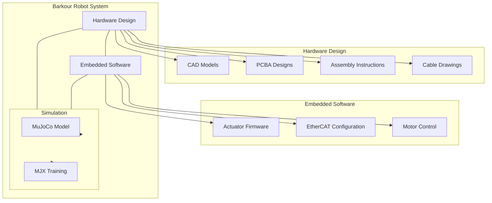
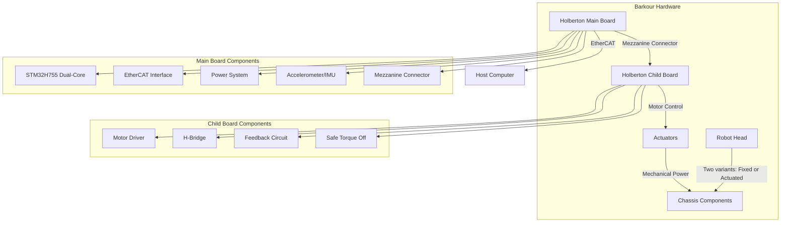
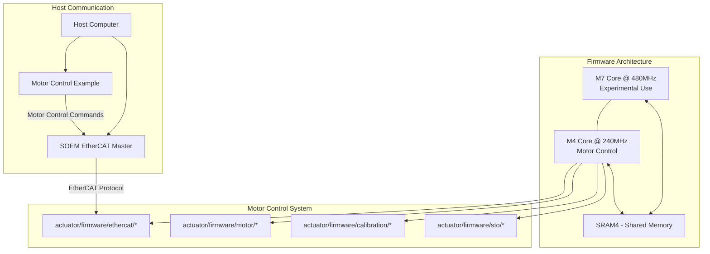
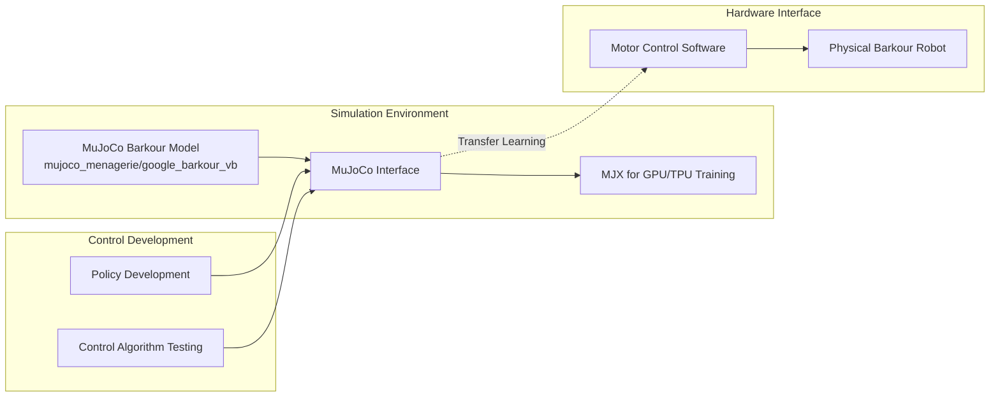

<!-- source: DeepWiki mcp.deepwiki.com · repo google-deepmind/barkour_robot · page 1 Overview · fetched 2026-10-26 -->

# Overview

Relevant source files

The following files were used as context for generating this wiki page:

- [README.md](README.md)

## Purpose and Scope

The Barkour Robot is an agile quadruped robot platform developed by Google DeepMind to support various research projects. This wiki provides comprehensive documentation of the robot's design, assembly, software, and usage. This overview page introduces the Barkour Robot project at a high level, describing its purpose, main components, and the structure of the repository.

For specific guidance on using the robot, see [Getting Started](#1.1). For information about different robot configurations, see [Versions and Variants](#1.2).

Sources: [README.md:3-8]()

## System Architecture

The Barkour Robot system consists of three primary components: hardware design, embedded software, and simulation environments. These components work together to provide a complete platform for robotics research.

The system architecture illustrates how the hardware design, embedded software, and simulation environments interact. The hardware design includes CAD models, PCB designs, assembly instructions, and cable drawings. The embedded software includes actuator firmware, EtherCAT configuration, and motor control code. The simulation environments include MuJoCo models and MJX training capabilities.

Sources: [README.md:12-42](), [README.md:101-108]()

## Hardware Components

The Barkour Robot features a modular design with custom motor drivers, actuators, and mechanical components. The robot is available in two variants: one with a fixed head and one with an actuated head that includes a gripper.

The hardware components diagram shows the relationship between the main hardware elements of the Barkour Robot. The system is built around a main board (Holberton) that connects to child boards for motor control. These boards drive the actuators, which provide mechanical power to the robot chassis. The robot head can be either fixed or actuated depending on the variant.

Sources: [README.md:70-80](), [README.md:45-50]()

## Embedded Software Architecture

The Barkour Robot's embedded software centers around the firmware for the motor drivers, which communicates with a host computer via EtherCAT for real-time control.

The firmware architecture diagram illustrates the motor driver's firmware based on the STM32H755 microcontroller with dual-core design. The M4 core handles the motor control processes, including EtherCAT communication, motor drive, calibration, and safety features. The host computer communicates with the motor drivers using the EtherCAT protocol.

Sources: [README.md:103-108]()

## Simulation Environment

The Barkour Robot includes simulation models for the MuJoCo physics engine, supporting both research development and fast training through MJX.

The simulation environment diagram shows how the MuJoCo simulation model interfaces with both control development and the hardware interface. The simulation allows for policy development and control algorithm testing before deployment to the physical robot. MJX provides acceleration for training on GPUs and TPUs.

Sources: [README.md:57-67]()

## Repository Structure

The Barkour Robot repository is organized into several key directories:

| Directory              | Description                                                          |
|------------------------|----------------------------------------------------------------------|
| `docs/`                | Documentation including getting started guides and assembly instructions |
| `actuator/firmware/`   | Embedded firmware for the motor drivers                              |
| `hardware/electronics/` | PCB design files for the custom electronics                         |
| `hardware/cable_drawings/` | Drawings of all custom cable assemblies                           |

Additionally, the repository links to external resources:
- CAD models hosted on Onshape
- MuJoCo simulation models in the MuJoCo Menagerie repository
- MJX tutorial for accelerated training

Sources: [README.md:12-42]()

## Robot Capabilities

The Barkour Robot platform demonstrates impressive capabilities, including:

- Dynamic movements (jumping, running, dancing)
- Environmental interaction and manipulation (with the actuated head variant)
- Robust locomotion on various terrains
- Balance and stability during external disturbances
- Climbing over obstacles
- Following language-based commands

These capabilities make the Barkour Robot a versatile platform for research in areas such as agile locomotion, manipulation, and learning-based control.

Sources: [README.md:110-141]()

## Versions

This repository contains the "vB" version of the Barkour Robot. An older "v0" version was used in earlier work, with assets available through separate links. For more information about the different versions and variants, see [Versions and Variants](#1.2).

Sources: [README.md:131-141]()

---

