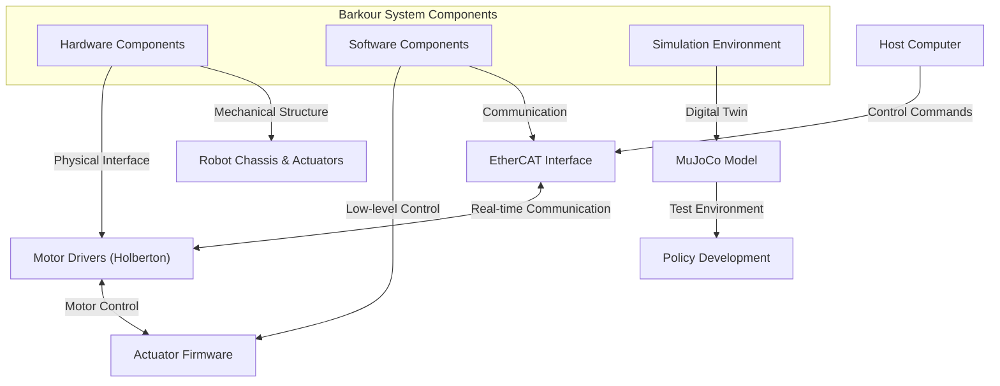
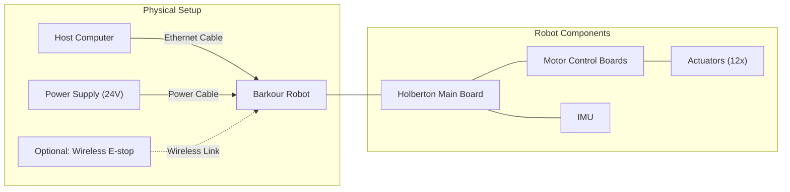
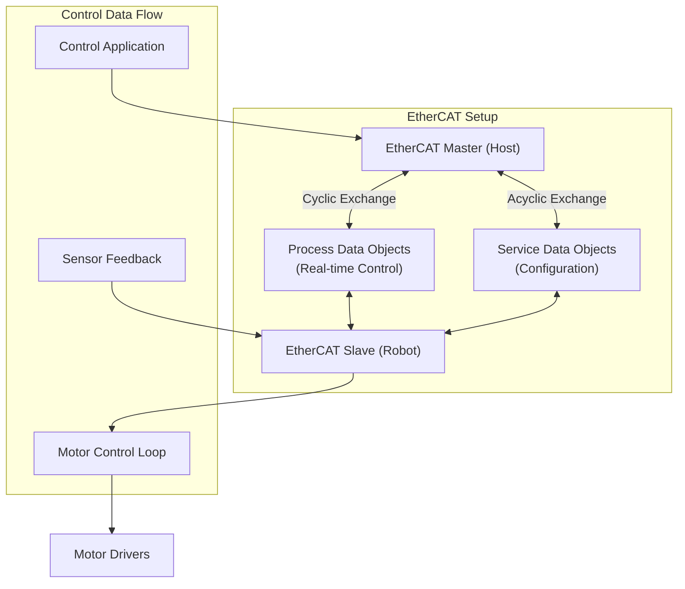
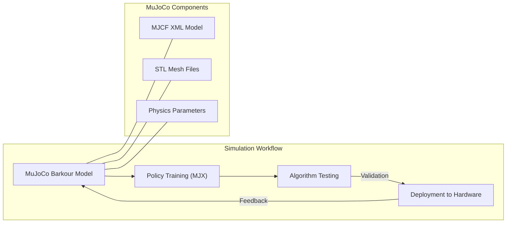

<!-- source: DeepWiki mcp.deepwiki.com · repo google-deepmind/barkour_robot · page 1.1 Getting Started · fetched 2026-10-26 -->

# Getting Started

Relevant source files

The following files were used as context for generating this wiki page:

- [README.md](README.md)

This guide provides essential information for new users to begin working with the Barkour Robot platform. It covers initial setup steps, basic hardware and software configuration, and points to more detailed documentation for specific tasks. For information about different robot versions and variants, see [Versions and Variants](#1.2).

## System Overview

The Barkour Robot is an agile quadruped robot platform developed by Google DeepMind for research purposes. The system integrates custom hardware, embedded firmware, and simulation capabilities.

Sources: [README.md:3-8]()

## Hardware Requirements

Before getting started with the Barkour Robot, ensure you have the following:

1. **Assembled Barkour Robot** - Either build one following the assembly guides or obtain a pre-assembled unit
2. **Host Computer** - With an Ethernet port for EtherCAT communication
3. **Power Supply** - 24V power supply for the robot
4. **Ethernet Cable** - For connecting the host computer to the robot
5. **Optional: Wireless E-stop** - For emergency stopping capability

Refer to the [Bill of Materials](hardware/barkour_robot_bill_of_materials.csv) for a complete list of components if you're building from scratch.

Sources: [README.md:92-94]()

## Basic Hardware Setup

Follow these steps to set up the hardware for initial operation:

1. **Power Connection**: Connect the 24V power supply to the main board power input
2. **Network Connection**: Connect the Ethernet cable between the host computer and the robot's EtherCAT port
3. **Safety Check**: Ensure the robot is secured or placed on a stand with legs free to move
4. **Power On**: Turn on the power supply to boot the robot

For detailed assembly instructions, refer to the [Hardware](#2) section.

Sources: [README.md:78-80](), [README.md:26-33]()

## Software Setup

### Firmware Preparation

The Barkour Robot uses custom firmware based on the Pigweed open-source project. If you need to update or customize the firmware:

1. Follow the firmware build instructions in the [Firmware Architecture](#3.1) section
2. Flash the firmware to the motor drivers using the procedures described in [Building and Flashing](#3.2)

Most users with pre-assembled robots won't need to modify the firmware initially.

### EtherCAT Configuration

EtherCAT is the real-time communication protocol used to control the Barkour Robot. To configure it:

1. Install an EtherCAT master on your host computer
2. Configure the network interface according to the [EtherCAT Configuration](#3.4) guide
3. Set up the PDO (Process Data Object) and SDO (Service Data Object) mapping

Sources: [README.md:18-20]()

## Basic Operation

### Motor Control

To start controlling the robot's motors:

1. Ensure the EtherCAT communication is established
2. If needed, perform motor calibration following the [Calibration](#3.3) guide
3. Send basic motor commands using the example code provided

The repository includes a motor control example to help you get started with basic operations:

Sources: [README.md:20]()

### Safety Considerations

When operating the Barkour Robot, always keep these safety precautions in mind:

1. **Workspace**: Ensure adequate space around the robot to prevent collisions
2. **E-stop**: Keep the emergency stop readily accessible
3. **Power Limits**: Start with low torque/power limits and gradually increase as needed
4. **Supervision**: Never leave the robot operating unattended
5. **Safe Torque Off (STO)**: Understand how to use the STO feature in emergencies

Refer to the [Error Handling](#3.5) section to understand and respond to error codes.

Sources: [README.md:31]()

## Simulation Environment

If you want to develop and test control algorithms before deploying them to the physical robot, the Barkour Robot has a detailed simulation model available:

1. **MuJoCo Model**: Available in the [MuJoCo Menagerie repository](https://github.com/google-deepmind/mujoco_menagerie/tree/main/google_barkour_vb)
2. **MJX Support**: For accelerated training on GPUs and TPUs

Sources: [README.md:56-67]()

## Next Steps

After you've completed the basic setup and tested the robot's functionality, you can explore these areas for further development:

- **Hardware Customization**: Review the [Hardware Specifications](#2.1) for guidance on modifying the robot
- **Firmware Development**: Learn about the [Firmware Architecture](#3.1) to customize the control logic
- **Advanced Control**: Develop advanced control algorithms using the simulation environment first
- **Integration**: Add custom sensors or actuators by studying the [Electronics Architecture](#2.2)

For the full range of the robot's capabilities, see the examples in the repository README.md.

Sources: [README.md:110-129]()

---

