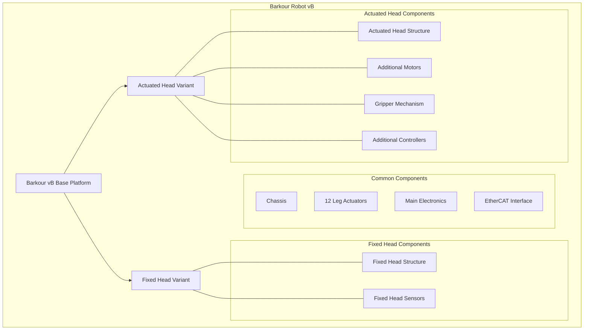
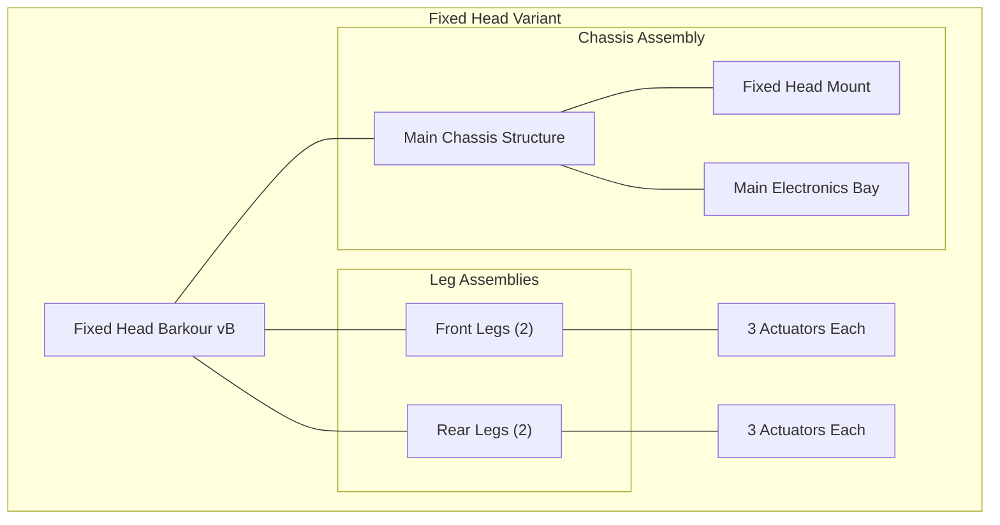
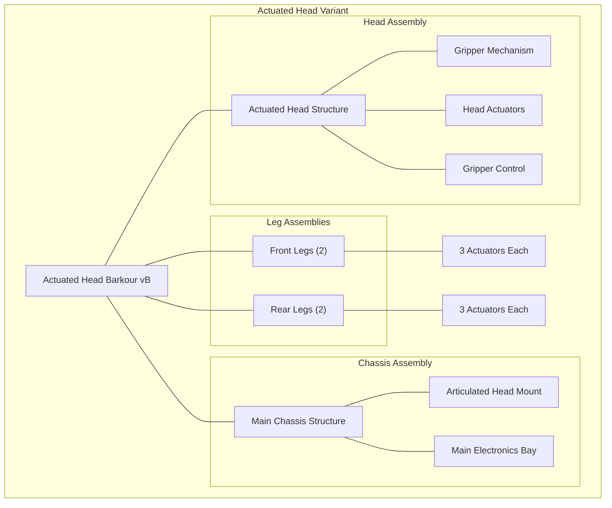
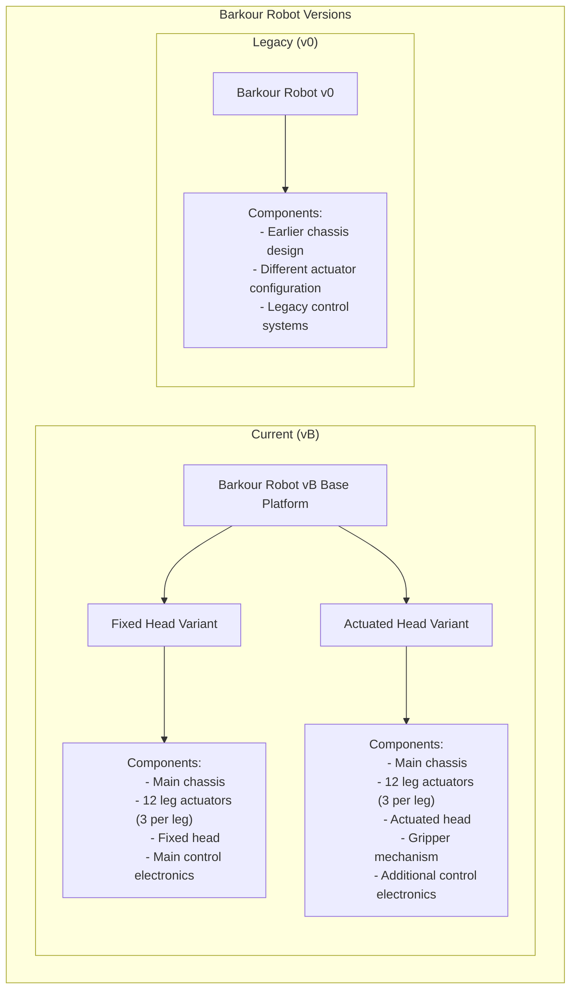

<!-- source: DeepWiki mcp.deepwiki.com · repo google-deepmind/barkour_robot · page 1.2 Versions and Variants · fetched 2026-10-26 -->

# Versions and Variants

Relevant source files

The following files were used as context for generating this wiki page:

- [README.md](README.md)

## Purpose and Scope

This document provides detailed information about the different versions and variants of the Barkour Robot platform. It covers both the current and legacy hardware versions, their distinguishing features, and specific capabilities. For information on hardware specifications, see [Hardware Specifications](#2.1).

## Current Version: Barkour Robot vB

The current release of the Barkour Robot platform is designated as "vB" (version B). This version represents the latest design iteration and is available in two distinct variants.

### Variant Comparison

Sources: [README.md:45-50]()

### Fixed Head Variant

The fixed head variant features a non-articulating head structure rigidly attached to the robot chassis. This variant is simpler in design with fewer components and moving parts, making it more suitable for locomotion research and tasks that don't require manipulation capabilities.

Key characteristics:
- Simplified head structure with fixed mounting to the main chassis
- No additional actuators beyond the standard leg motors
- Reduced weight compared to the actuated variant
- Lower power consumption
- Primary focus on locomotion and mobility research

Sources: [README.md:45-47]()

### Actuated Head Variant

The actuated head variant includes an articulated head with a gripper mechanism (referred to as a "mouth" in the documentation). This variant is designed for research that combines locomotion with simple manipulation tasks.

Key characteristics:
- Articulated head with additional degrees of freedom
- Integrated gripper mechanism capable of grasping objects
- Additional actuators and control electronics for the head
- Slightly higher weight and power consumption
- Enables research in combined locomotion and manipulation

The actuated head enables the robot to perform various manipulation tasks such as:
- Picking up objects (toys, pillboxes, clothing items)
- Opening and closing household fixtures (e.g., dishwashers)
- Simple object transport tasks

Detailed assembly instructions for the actuated head can be found in the documentation. For specific assembly guidance, see [Actuated Head Assembly](#2.3.3).

Sources: [README.md:45-50](), [README.md:124-127]()

## Legacy Version: Barkour Robot v0

Prior to the current vB release, an earlier version of the hardware designated as "v0" was used in previous research. This legacy version has different specifications and capabilities compared to the current vB version.

Key differences from vB:
- Different mechanical design and potentially different dimensions
- May have different actuator specifications
- Distinct control systems and interfaces
- Different CAD models

While the current repository focuses on the vB version, resources for the v0 version are still available for reference, including:
- CAD models
- Simplified CAD for URDF export
- Simulation environments
- Barkour obstacle course simulation
- Scoring scripts for the Barkour course

These resources can be accessed through the links provided in the repository documentation.

Sources: [README.md:131-141]()

## Version and Variant Comparison

The following table provides a side-by-side comparison of the different versions and variants of the Barkour Robot platform:

| Feature | vB Fixed Head | vB Actuated Head | v0 (Legacy) |
|---------|---------------|------------------|-------------|
| Head Type | Non-articulated | Articulated with gripper | Varies by configuration |
| Manipulation Capability | None | Basic object handling | Depends on configuration |
| Primary Use Case | Locomotion research | Combined locomotion and manipulation | Earlier research projects |
| Assembly Complexity | Lower | Higher | Not specified |
| CAD Model | Current repository | Current repository | Separate repository |
| Simulation Support | MuJoCo model available | MuJoCo model available | Legacy MuJoCo model available |
| Documentation | Comprehensive | Comprehensive | Limited in current repository |

Sources: [README.md:45-50](), [README.md:131-141]()

## Hardware Differences Visualization

Sources: [README.md:45-50](), [README.md:131-141]()

## CAD and Simulation Resources

To support development and research with the different variants, the following resources are available:

### CAD Models
- vB Fixed Head and Actuated Head variants: Available through Onshape [README.md:47]()
- v0 Legacy version: Available through separate Onshape links [README.md:137-138]()

### Simulation Models
- vB variants: MuJoCo models available in the MuJoCo Menagerie repository [README.md:59-61]()
- v0 Legacy version: Separate MuJoCo models and Barkour obstacle course simulation [README.md:139-141]()

The simulation models support MJX for fast training on GPUs and TPUs, making them suitable for rapid prototyping and algorithm development before deployment to physical hardware.

Sources: [README.md:45-50](), [README.md:58-65](), [README.md:131-141]()

## Variant-Specific Capabilities

Each variant of the Barkour Robot has specific capabilities suited to different research needs. The following sections highlight the key capabilities of each variant.

### Fixed Head Variant Capabilities
The fixed head variant excels at locomotion tasks including:
- Two-leg and four-leg jumping
- Dynamic movement (dancing, jump turns)
- Stability control (push compensation, tilt compensation)
- Obstacle navigation (box climbing)

### Actuated Head Variant Capabilities
The actuated head variant maintains the locomotion capabilities of the fixed head variant while adding manipulation functionality:
- Object grasping and pickup (toys, pillboxes, slippers)
- Interaction with household items (closing dishwashers)
- Pick and place tasks (picking up shirts and dropping them off)
- Pushing and manipulating objects (box lids, cups)

These enhanced capabilities make the actuated head variant suitable for research in areas requiring both mobility and basic manipulation.

Sources: [README.md:114-129]()

## Software Compatibility

Both variants of the Barkour Robot vB use the same core embedded software and EtherCAT communication protocol. The actuated head variant requires additional configuration for the head actuators but uses the same fundamental control architecture.

For details on software configuration, see the firmware documentation and EtherCAT configuration guides.

Sources: [README.md:103-108]()

---

