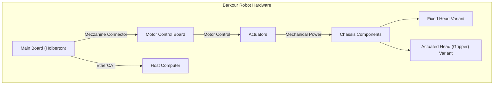
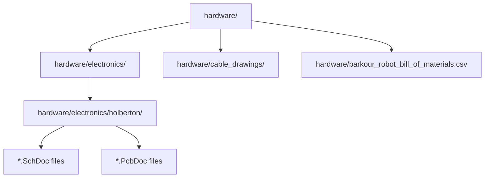
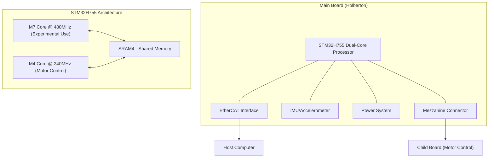
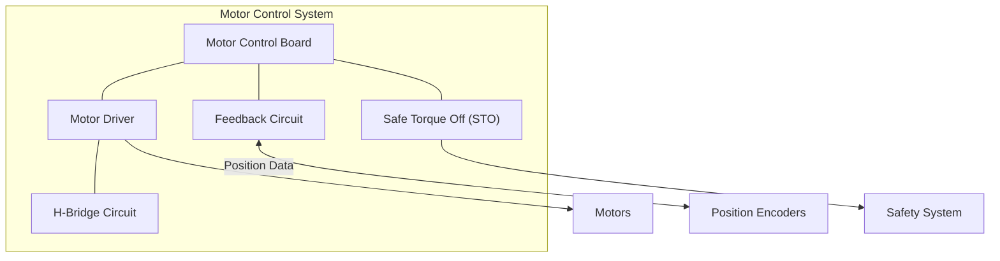
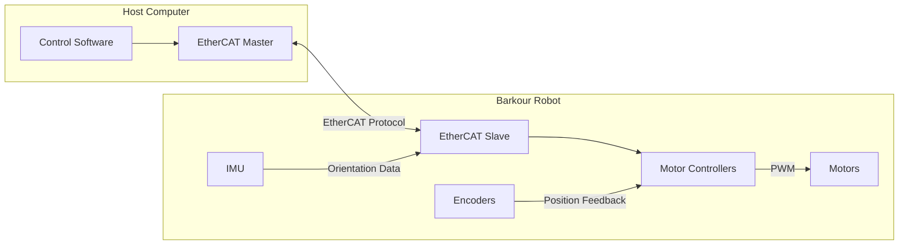
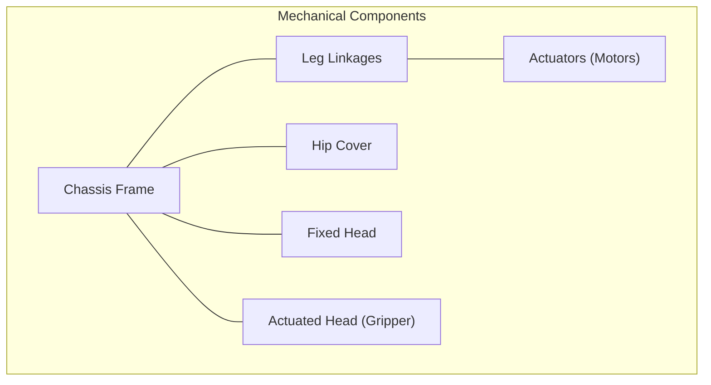
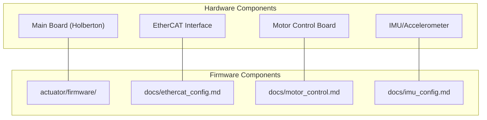
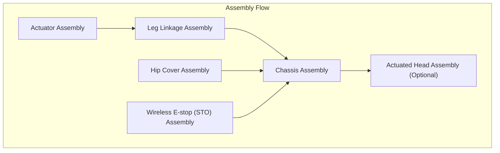

<!-- source: DeepWiki mcp.deepwiki.com · repo google-deepmind/barkour_robot · page 2 Hardware · fetched 2026-10-26 -->

# Hardware

Relevant source files

The following files were used as context for generating this wiki page:

- [README.md](README.md)
- [hardware/electronics/holberton/1-Holberton_TOP.SchDoc](hardware/electronics/holberton/1-Holberton_TOP.SchDoc)

This document provides an overview of the hardware components that make up the Barkour Robot system. This section covers the physical design, electronic architecture, and key specifications of the hardware platform that serves as the foundation for the quadruped robot.

For information about firmware that runs on this hardware, see [Firmware](#3). For assembly instructions, see [Assembly Instructions](#2.3).

## Hardware Overview

The Barkour Robot hardware is an integrated system designed for agile quadrupedal locomotion and optional manipulation capabilities. The system combines custom electronics, actuators, and mechanical components to create a versatile research platform.

### Hardware Component Architecture

The hardware system is built around a main control board (Holberton) that interfaces with motor control boards through mezzanine connectors. The main board communicates with a host computer via EtherCAT and provides control signals to the motor drivers, which power the actuators that drive the mechanical linkages of the robot.

Sources: README.md:70-82

### Hardware Repository Structure

The hardware design files are organized in the repository as shown above, with electronic designs in the `hardware/electronics` directory, cable assembly drawings in `hardware/cable_drawings`, and a complete bill of materials in `hardware/barkour_robot_bill_of_materials.csv`.

Sources: README.md:21-25, README.md:70-76

## Electronic Architecture

The electronic system of the Barkour Robot is based on a custom design centered around the Holberton main board and its associated components.

### Main Board (Holberton)

The Holberton main board features:
- STM32H755 microcontroller with dual-core architecture
  - M7 Core running at 480MHz for experimental use
  - M4 Core running at 240MHz dedicated to motor control
- EtherCAT interface for communication with the host computer
- Integrated IMU/Accelerometer for orientation sensing
- Power management system
- Mezzanine connector for interfacing with motor control boards

The dual cores communicate through shared memory in SRAM4, enabling efficient real-time control while allowing for experimental features.

Sources: hardware/electronics/holberton/1-Holberton_TOP.SchDoc

### Motor Control System

Key components of the motor control system include:
- Motor driver circuitry for generating PWM signals
- H-Bridge for bidirectional motor control
- Feedback circuits for position sensing
- Safe Torque Off (STO) functionality for safety
- Temperature monitoring circuits for thermal protection

The motor control logic runs on the M4 core of the STM32H755 microcontroller, providing real-time control of the actuators.

Sources: README.md:77-79

### Communication System

EtherCAT provides deterministic real-time control necessary for coordinated quadruped locomotion. The communication system includes:
- EtherCAT master on the host computer
- EtherCAT slave on the Holberton board
- Internal communication between the main board and motor controllers
- Sensor feedback channels for closed-loop control

Sources: README.md:77-79

## Mechanical Design

The Barkour Robot is available in two main variants:

1. **Fixed Head Version** - Standard quadruped configuration
2. **Actuated Head Version** - Includes a gripper/mouth for manipulation tasks

The mechanical system consists of:
- Chassis frame serving as the main structural component
- Leg linkages providing the kinematic structure for locomotion
- Actuators (motors) delivering mechanical power
- Hip covers protecting the internal components
- Optional actuated head with gripper for manipulation tasks

The CAD models for both versions are available through the [Onshape platform](https://gdm.onshape.com/documents/2587dbf423d784b45437b14a/v/b07bb08c3dc8b02bae21b866/e/bdcd5797385cee9e4f78dfef).

Sources: README.md:43-50, README.md:83-97

## Hardware-Firmware Interface

The hardware interfaces with custom firmware based on the Pigweed open-source project. The firmware runs on the dual-core STM32H755 microcontroller and implements:
- Motor control algorithms
- EtherCAT communication
- Sensor data processing
- Safety features

Sources: README.md:101-108

## Hardware Specifications

Key specifications of the Barkour Robot hardware:

| Component | Specification |
|-----------|---------------|
| Processor | STM32H755 dual-core (M7 @ 480MHz, M4 @ 240MHz) |
| Communication | EtherCAT |
| Actuators | Custom motor drivers with position feedback |
| Safety Features | Safe Torque Off (STO) |
| Sensors | IMU/Accelerometer, Position Encoders |
| Variants | Fixed Head, Actuated Head (Gripper) |
| Power | 24V system |

For detailed range of motion specifications, please refer to the [Hardware Specifications](#2.1) page.

Sources: README.md

## Bill of Materials

A comprehensive bill of materials (BOM) for building the Barkour Robot is available in the `hardware/barkour_robot_bill_of_materials.csv` file, which includes all electronic and mechanical components needed to build the robot.

Sources: README.md:92-94

## Assembly Overview

The Barkour Robot's assembly process is divided into several main steps:

1. Actuator assembly and setup
2. Leg linkage assembly
3. Hip cover assembly
4. Robot chassis assembly
5. Optional actuated head assembly
6. Wireless E-stop (STO) assembly

Detailed assembly instructions for each component are available in the documentation. For the complete assembly guide, see [Assembly Instructions](#2.3).

Sources: README.md:83-97

## Hardware Capabilities

The Barkour Robot hardware platform enables a wide range of capabilities, including:

- Dynamic quadrupedal locomotion
- Jumping and complex maneuvers
- Optional object manipulation with the actuated head
- Push and tilt compensation
- Climbing over obstacles

These capabilities are demonstrated in the README with various examples of the robot performing different tasks.

Sources: README.md:110-129

## Hardware Versions

This documentation covers the "vB" version of the Barkour Robot. An older version called "v0" was used in earlier work, with assets available at separate links:

- CAD models
- Simplified CAD for URDF export
- Simulation models
- Barkour obstacle course simulation

For information about the older "v0" version, please refer to the README.

Sources: README.md:131-141

---

