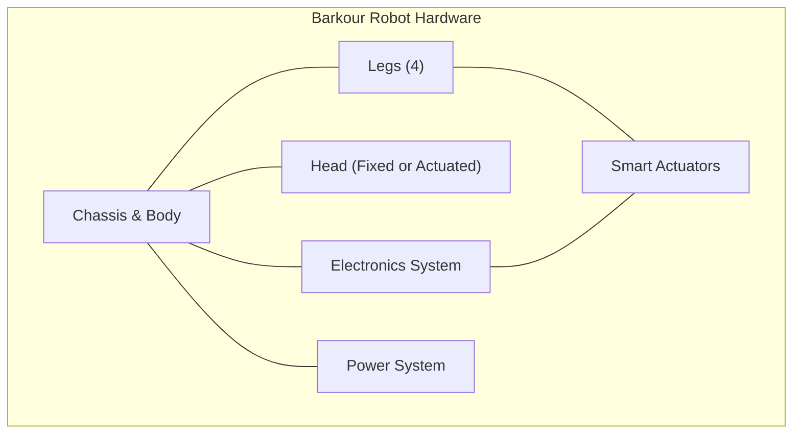
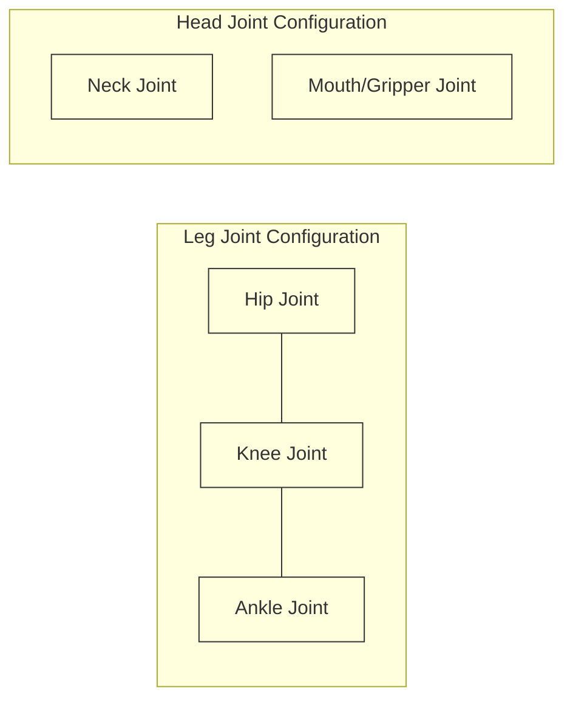
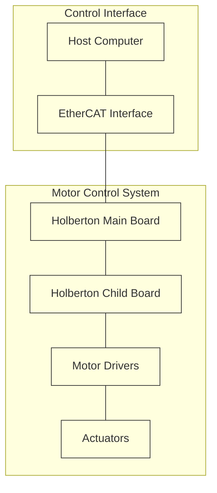
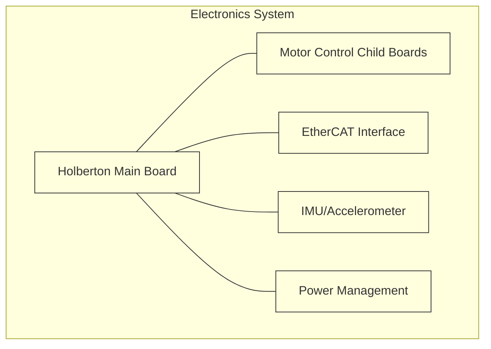
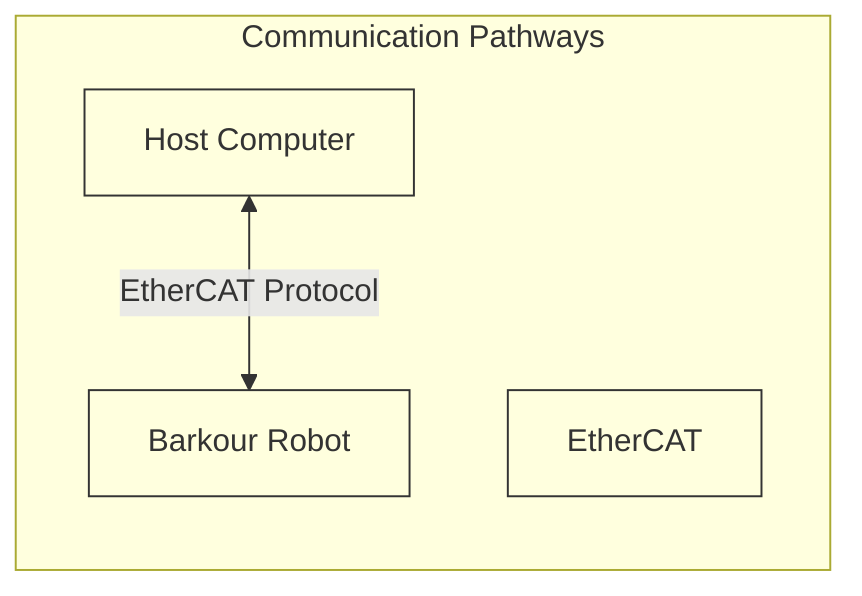
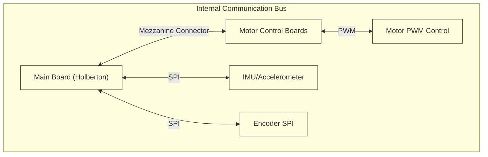
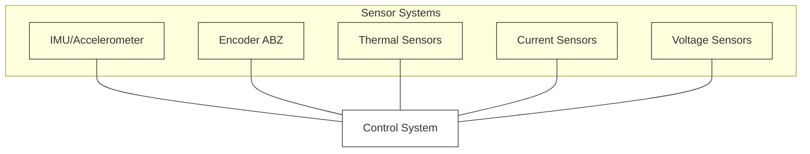
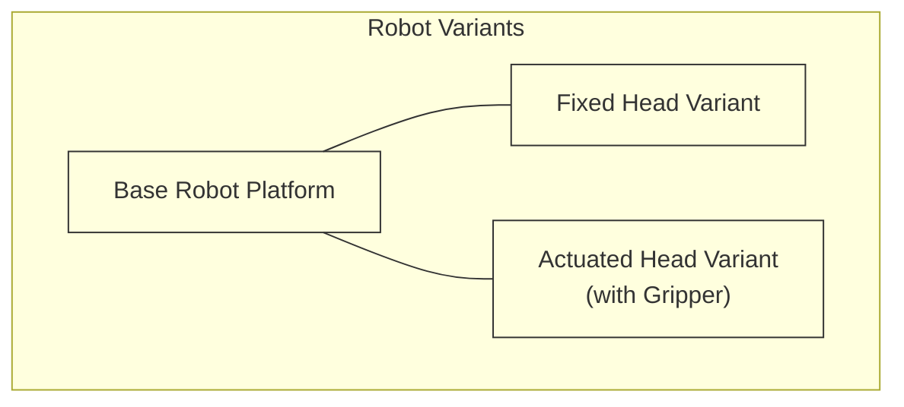
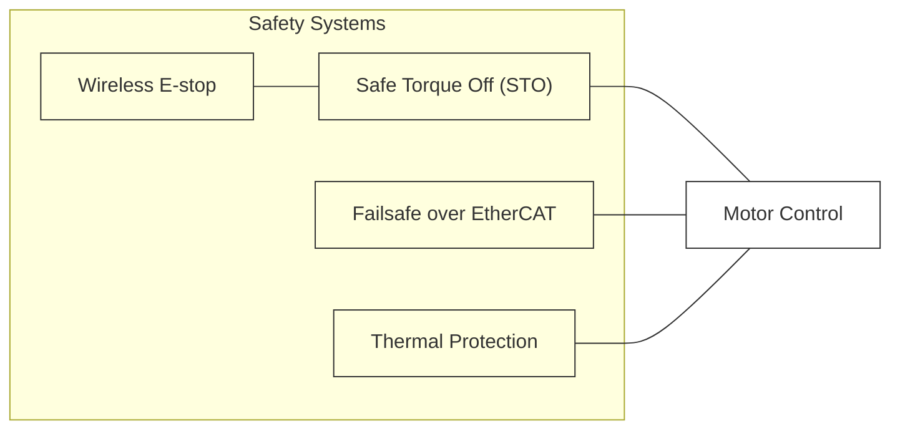

<!-- source: DeepWiki mcp.deepwiki.com · repo google-deepmind/barkour_robot · page 2.1 Hardware Specifications · fetched 2026-10-26 -->

# Hardware Specifications

Relevant source files

The following files were used as context for generating this wiki page:

- [README.md](README.md)
- [hardware/electronics/holberton/1-Holberton_TOP.SchDoc](hardware/electronics/holberton/1-Holberton_TOP.SchDoc)

This document provides detailed technical specifications of the Barkour Robot hardware components. It covers the mechanical and electrical characteristics, communications interfaces, and performance parameters. For information about the electronics architecture, see [Electronics Architecture](#2.2), and for assembly instructions, see [Assembly Instructions](#2.3).

## 1. System Overview

The Barkour Robot is a quadrupedal robotic platform designed for agile locomotion research. The hardware platform consists of a central body chassis with four articulated legs, each with multiple degrees of freedom, and either a fixed or actuated head variant.

Sources: README.md:1-12, README.md:43-48

## 2. Physical Specifications

### 2.1 Form Factor and Dimensions

The Barkour Robot is a quadruped robot with a dog-like form factor, featuring four articulated legs and either a fixed head or an actuated head with a gripper capability.

| Parameter | Specification |
|-----------|---------------|
| Body Type | Quadruped |
| Head Variants | Fixed or Actuated (with gripper) |
| Weight | [Not specified in provided materials] |
| Dimensions | [Not specified in provided materials] |

Sources: README.md:43-48, README.md:111-127

### 2.2 Degrees of Freedom

Each leg has multiple degrees of freedom allowing for complex motion patterns. The actuated head variant adds additional degrees of freedom for manipulation tasks.

Sources: README.md:111-127

## 3. Electrical System

### 3.1 Motor Control System

The Barkour Robot uses custom motor drivers based on the Holberton boards, which provide precise control of the robot's actuators.

The motor control system is based on a dual-processor architecture using STM32H755 microcontrollers, featuring:

| Component | Specification |
|-----------|---------------|
| Processor | STM32H755 dual-core (M7 @ 480MHz, M4 @ 240MHz) |
| Communication | EtherCAT protocol |
| Control Method | Smart actuators with embedded controllers |
| Safety Features | Safe Torque Off (STO) |

Sources: README.md:77-80, hardware/electronics/holberton/1-Holberton_TOP.SchDoc

### 3.2 Electronics Architecture

The main electronic components of the Barkour Robot include:

| Component | Description |
|-----------|-------------|
| Holberton Main Board | Central control board with processor and communications |
| Motor Control Boards | Child boards for driving actuators |
| EtherCAT Interface | Real-time communication protocol for robot control |
| IMU/Accelerometer | Inertial measurement for balance and orientation |
| Power System | Power distribution and management |

Sources: hardware/electronics/holberton/1-Holberton_TOP.SchDoc, README.md:77-80

### 3.3 Power Specifications

The Barkour Robot operates on 24V DC power:

| Parameter | Specification |
|-----------|---------------|
| Main Input Voltage | 24V DC |
| Logic Voltage | 3.3V |
| Analog Voltage | 3.3V (Separate) |
| 5V Rail | Available for peripherals |

Sources: hardware/electronics/holberton/1-Holberton_TOP.SchDoc

## 4. Communication and Interfaces

### 4.1 External Communication

The Barkour Robot uses EtherCAT as its primary communication protocol, providing deterministic real-time control necessary for coordinated quadruped locomotion.

Sources: README.md:77-80, README.md:105-108

### 4.2 Internal Communication

The internal communication architecture includes:

| Interface | Purpose |
|-----------|---------|
| Mezzanine Connector | Connection between main and child boards |
| SPI | Interface for sensors and encoders |
| PWM | Motor control signals |
| I2C | Secondary peripheral communication |

Sources: hardware/electronics/holberton/1-Holberton_TOP.SchDoc

## 5. Sensors and Feedback Systems

The Barkour Robot includes various sensors for control and stability:

| Sensor Type | Function |
|-------------|----------|
| IMU/Accelerometer | Orientation and balance feedback |
| Encoders | Position feedback for actuators |
| Thermal Sensors | Temperature monitoring for motors and drivers |
| Current Sensors | Motor current monitoring |
| Voltage Sensors | System voltage monitoring |

Sources: hardware/electronics/holberton/1-Holberton_TOP.SchDoc

## 6. Head Variants

The Barkour Robot is available in two configurations:

### 6.1 Fixed Head

The standard variant with a fixed head provides a simpler, more robust design for locomotion research.

### 6.2 Actuated Head

The actuated head variant includes a gripper mechanism ("mouth") that enables object manipulation:

| Capability | Description |
|------------|-------------|
| Gripper | Can grasp and manipulate objects |
| Head Movement | Can position the head/gripper as needed |
| Example Tasks | Picking up objects, opening/closing drawers, manipulating boxes |

Sources: README.md:43-48, README.md:123-127

## 7. Performance Capabilities

The Barkour Robot demonstrates a range of dynamic capabilities:

| Capability | Description |
|------------|-------------|
| Two-leg jumping | Vertical jumps using two legs |
| Four-leg jumping | Coordinated vertical jumps using all four legs |
| Jump turning | Jumping while rotating |
| Dynamic stability | Compensation for pushes and tilts |
| Climbing | Ability to climb onto objects like boxes |
| Object manipulation | Picking up and manipulating objects (actuated head variant) |

Sources: README.md:111-129

## 8. Safety Features

The robot includes multiple safety features:

| Safety Feature | Function |
|----------------|----------|
| Safe Torque Off (STO) | Emergency power shutdown for actuators |
| Wireless E-stop | Remote emergency stop capability |
| Thermal monitoring | Protection against overheating |
| Current limiting | Protection against overcurrent conditions |

Sources: hardware/electronics/holberton/1-Holberton_TOP.SchDoc, README.md:31

## 9. Range of Motion

The Barkour Robot features an extensive range of motion across its joints, enabling agile movement. For complete details on the range of motion specifications, refer to the dedicated document: [Range of Motion](#2.4).

Sources: README.md:24

## 10. Additional Resources

For more detailed information about specific aspects of the Barkour Robot hardware:

| Resource | Location |
|----------|----------|
| Electronics designs | hardware/electronics folder |
| Cable assembly drawings | hardware/cable_drawings folder |
| Bill of Materials | hardware/barkour_robot_bill_of_materials.csv |
| CAD models | Onshape (link in README) |

Sources: README.md:69-76, README.md:92-94

---

