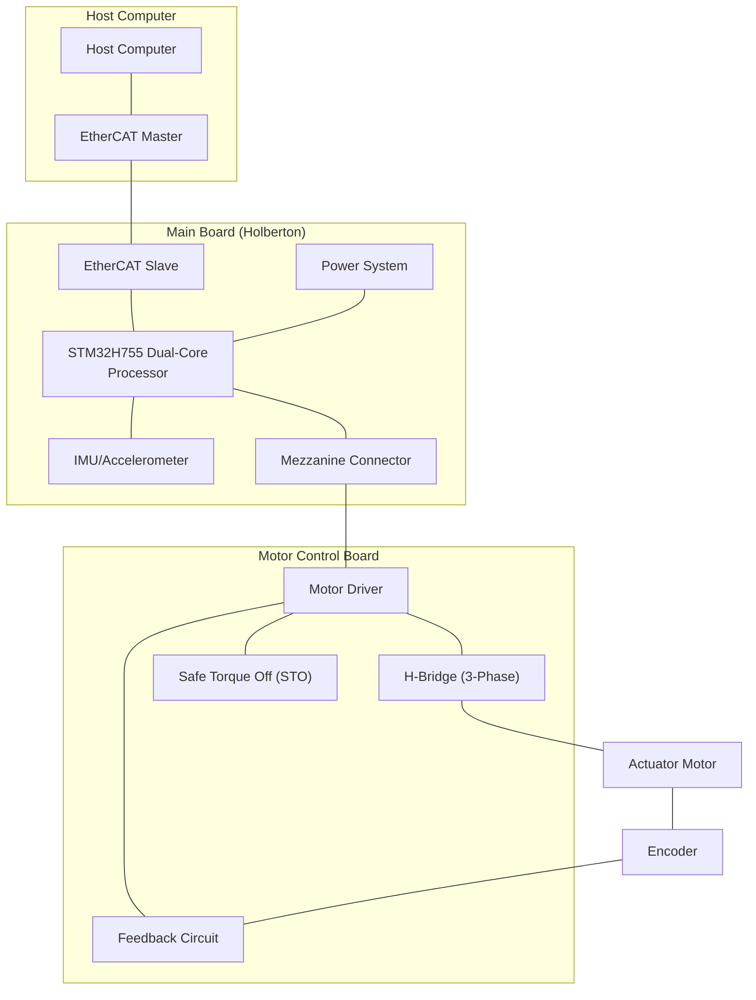
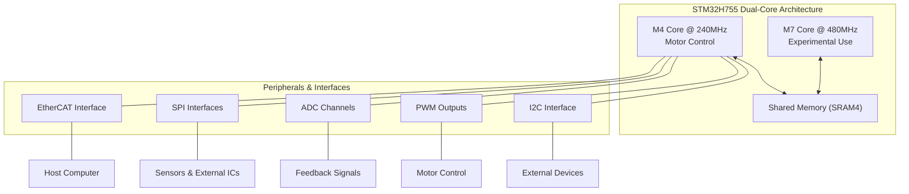
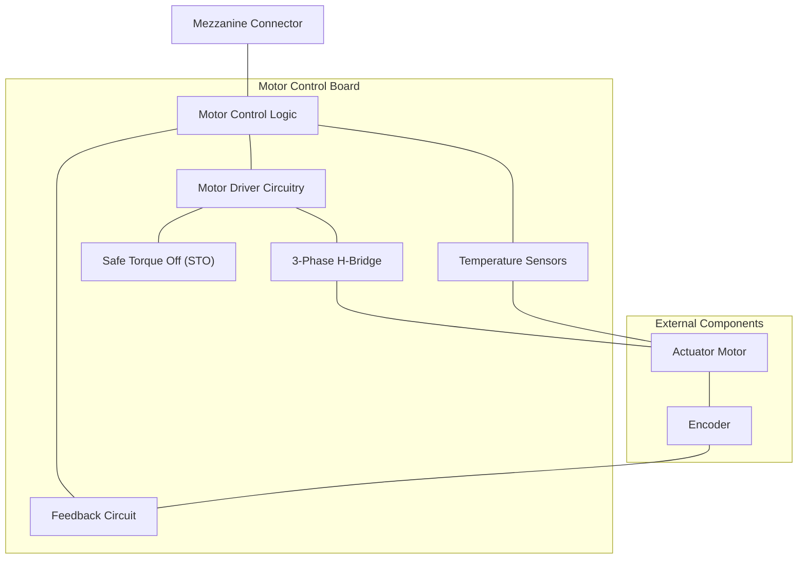
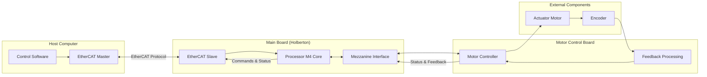
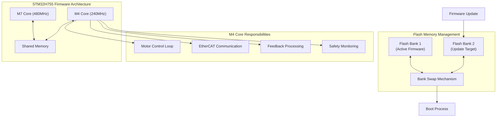
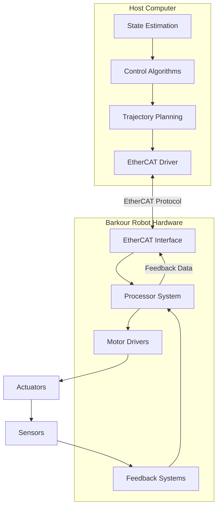

<!-- source: DeepWiki mcp.deepwiki.com · repo google-deepmind/barkour_robot · page 2.2 Electronics Architecture · fetched 2026-10-26 -->

# Electronics Architecture

Relevant source files

The following files were used as context for generating this wiki page:

- [hardware/electronics/holberton/1-Holberton_TOP.SchDoc](hardware/electronics/holberton/1-Holberton_TOP.SchDoc)
- [hardware/electronics/holberton/Holberton.PrjPcb](hardware/electronics/holberton/Holberton.PrjPcb)
- [hardware/electronics/holberton/Holberton.PrjPcbStructure](hardware/electronics/holberton/Holberton.PrjPcbStructure)

## Purpose and Scope

This document provides a comprehensive overview of the electronic system architecture used in the Barkour Robot. It covers the hardware components, their interconnections, and the overall organization of the robot's electronic systems. This page focuses on the architecture at a system level; for detailed specifications of individual components, refer to [Hardware Specifications](#2.1), and for specific details about board designs, refer to the respective pages for the [Main Board](#2.2.1) and [Motor Control Board](#2.2.2).

## System Overview

The Barkour Robot's electronics are built around a two-board design consisting of a main controller board (Holberton) and motor control boards that drive the robot's actuators. The system uses EtherCAT for real-time communication with the host computer, providing precise control and coordination of the robot's movements.

**Diagram: Barkour Robot Electronics System Overview**

Sources: 
- [hardware/electronics/holberton/Holberton.PrjPcbStructure]()
- [hardware/electronics/holberton/1-Holberton_TOP.SchDoc]()

## Main Board Architecture

The main board (Holberton) serves as the central controller for the robot. It hosts the main processor, communication interfaces, sensors, and connects to the motor control boards.

### Processor

The Barkour Robot uses an STM32H755 microcontroller with a dual-core architecture:
- **M7 Core**: Runs at 480MHz, available for experimental use
- **M4 Core**: Runs at 240MHz, primarily responsible for motor control

The cores communicate through shared memory (SRAM4), allowing efficient data exchange while maintaining clear separation of responsibilities.

**Diagram: STM32H755 Processor Architecture**

Sources:
- [hardware/electronics/holberton/Processor.SchDoc]()
- [hardware/electronics/holberton/ProcessorSupport.SchDoc]()

### Communication Interfaces

The main board implements several communication interfaces:

1. **EtherCAT**: Primary interface for real-time communication with the host computer
2. **SPI**: Multiple interfaces for communicating with sensors and peripheral ICs
3. **I2C**: For communication with additional devices
4. **Mezzanine Connector**: High-density connector for interfacing with the motor control boards

### Sensors

The main board includes an integrated accelerometer/IMU for measuring orientation and acceleration, which is critical for balance and motion control. Temperature sensors are also included to monitor system temperature.

### Power System

The power system on the main board provides the necessary voltage rails:

- **24V**: Main power input for actuators
- **5V**: Intermediate supply
- **3.3V**: Digital logic supply
- **3.3VA**: Analog circuitry supply

The power system includes protection circuitry and voltage monitoring to ensure safe operation.

Sources:
- [hardware/electronics/holberton/Power.SchDoc]()
- [hardware/electronics/holberton/1-Holberton_TOP.SchDoc]()
- [hardware/electronics/holberton/Accelerometer.SchDoc]()

## Motor Control Board Architecture

The motor control boards connect to the main board via a mezzanine connector and are responsible for driving the actuator motors. Each motor control board contains all the necessary circuitry to control a single actuator.

**Diagram: Motor Control Board Architecture**

### Motor Driver

The motor driver circuitry generates the precise PWM signals necessary to drive the H-Bridge, which in turn controls the motor phases. The driver incorporates current limiting, voltage monitoring, and thermal protection.

### H-Bridge

The motor control board uses a 3-phase H-Bridge configuration to drive the BLDC motors used in the robot's actuators. The H-Bridge converts the PWM signals from the motor driver into the appropriate voltage and current levels for the motor windings.

### Feedback Systems

The feedback circuitry processes signals from:

- **Encoders**: Provides position feedback
- **Current Sensors**: Monitors phase currents
- **Voltage Sensors**: Monitors bus and phase voltages
- **Temperature Sensors**: Monitors motor and drive temperatures

This feedback is essential for closed-loop control of the actuators, ensuring precise movement and torque control.

### Safety Features

The motor control board includes a Safe Torque Off (STO) circuit that can quickly disable the motor driver in case of a fault condition. This ensures that the robot can safely stop operation if an error is detected, reducing the risk of damage or injury.

Sources:
- [hardware/electronics/holberton/1-Holberton_Child_Top.SchDoc]()
- [hardware/electronics/holberton/Drive.SchDoc]()
- [hardware/electronics/holberton/Feedback.SchDoc]()
- [hardware/electronics/holberton/HBridge.SchDoc]()
- [hardware/electronics/holberton/STO.SchDoc]()
- [hardware/electronics/holberton/Temperature.SchDoc]()

## Communication Architecture

The Barkour Robot uses a hierarchical communication architecture to enable precise control and coordination of its movements.

**Diagram: Communication Architecture**

### EtherCAT Communication

EtherCAT (Ethernet for Control Automation Technology) is the primary communication protocol between the host computer and the Barkour Robot. It provides deterministic, real-time communication with low latency and high throughput, which is essential for precise control of the robot's movements.

The EtherCAT implementation includes:
- **Process Data Objects (PDOs)**: For cyclic transmission of control data
- **Service Data Objects (SDOs)**: For configuration and parameter access
- **File Over EtherCAT (FoE)**: For firmware updates

### Internal Communication

Communication between the main board and motor control boards occurs through the mezzanine connector, which provides a high-speed, parallel interface. This interface carries:

- Motor control commands
- Feedback data (position, current, etc.)
- Status information
- Safety signals

Sources:
- [hardware/electronics/holberton/EtherCATConnectors.SchDoc]()
- [hardware/electronics/holberton/Trinamic.SchDoc]()
- [hardware/electronics/holberton/MezzanineConnectors_Cortes.SchDoc]()

## Firmware Architecture Overview

The firmware architecture is designed to take advantage of the dual-core processor, with specific responsibilities assigned to each core.

**Diagram: Firmware Architecture Overview**

### Core Responsibilities

- **M4 Core (240MHz)**: Handles real-time tasks including motor control, EtherCAT communication, and safety monitoring. This core runs a deterministic control loop to ensure precise timing of motor commands.

- **M7 Core (480MHz)**: Available for experimental use and more complex computational tasks. The M7 core can perform tasks that do not require strict real-time guarantees.

### Firmware Update Mechanism

The firmware includes a bank swap mechanism for reliable updates:
1. New firmware is written to the inactive flash bank
2. A flag is set to indicate a pending bank swap
3. On the next boot, the processor switches to the new firmware bank
4. If the new firmware fails to boot properly, the system can revert to the previous bank

This mechanism ensures that firmware updates can be performed safely without risking an unrecoverable failure.

Sources:
- [hardware/electronics/holberton/Processor.SchDoc]()
- [hardware/electronics/holberton/1-Holberton_TOP.SchDoc]()

## Hardware-Software Interface

The electronic architecture of the Barkour Robot is designed to provide a clean interface for the software control system running on the host computer.

**Diagram: Hardware-Software Interface**

The interface between the host software and robot hardware is primarily through the EtherCAT protocol, which provides:

1. **Command Interface**: The host sends position, velocity, or torque commands to the robot
2. **Feedback Interface**: The robot sends state information (position, velocity, current, etc.) back to the host
3. **Configuration Interface**: The host can configure parameters on the robot
4. **Diagnostic Interface**: The robot sends diagnostic information to the host

This well-defined interface allows the control software to operate at a high level of abstraction, focusing on trajectory planning and control algorithms rather than low-level hardware details.

Sources:
- [hardware/electronics/holberton/Holberton.PrjPcb]()
- [hardware/electronics/holberton/EtherCATConnectors.SchDoc]()

## System Integration

The electronic components of the Barkour Robot are integrated into a cohesive system that provides the capabilities required for agile quadruped locomotion.

### Board-Level Integration

The main board and motor control boards are designed to work together as a unified system. The mezzanine connector provides both electrical connectivity and mechanical support, creating a compact and reliable assembly.

### Physical Integration

The electronic boards are integrated into the mechanical structure of the robot, with careful consideration for:
- Cable routing
- Connector accessibility
- Heat dissipation
- Protection against mechanical stresses
- Weight distribution

### Electrical Integration

Special attention is paid to electrical integration aspects:
- Power distribution
- Signal integrity
- Grounding scheme
- EMI/EMC considerations

This holistic approach to system integration ensures that the electronics work reliably in the dynamic environment of a quadruped robot.

Sources:
- [hardware/electronics/holberton/Holberton.PrjPcbStructure]()
- [hardware/electronics/holberton/1-Holberton_TOP.SchDoc]()

---

