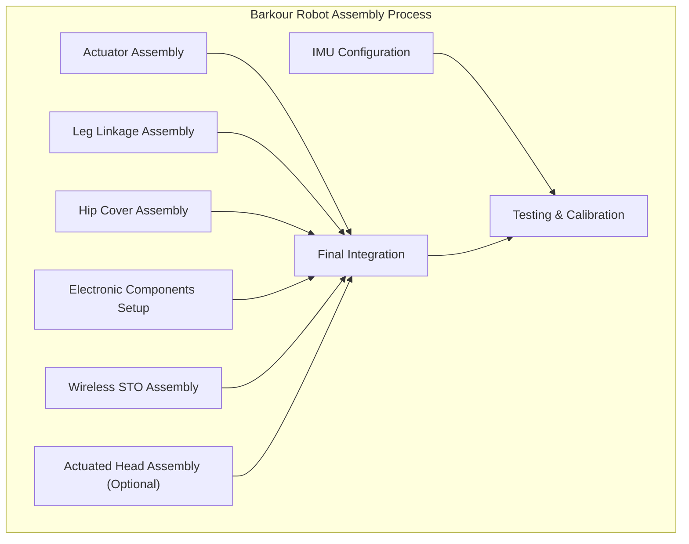
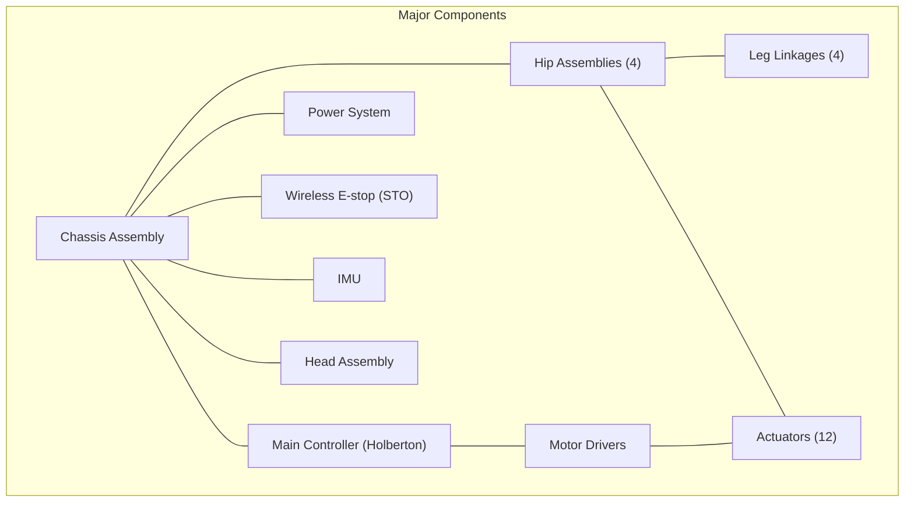
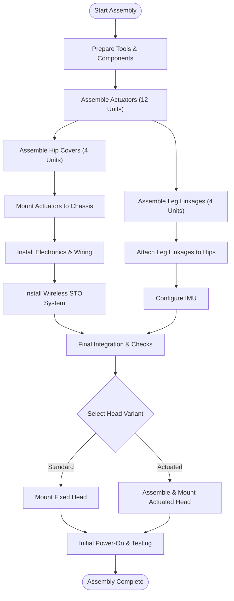
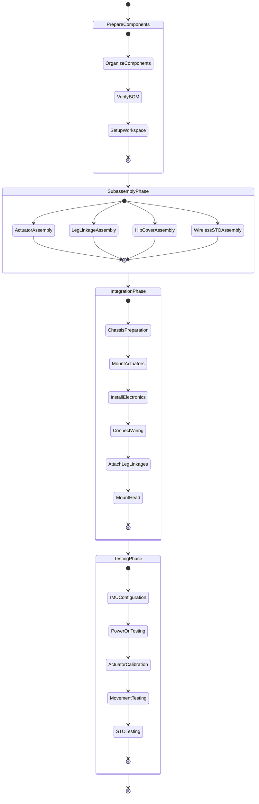
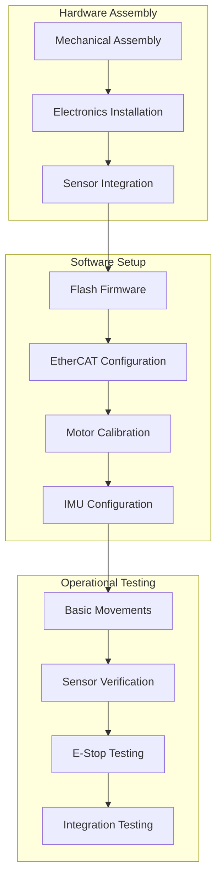

<!-- source: DeepWiki mcp.deepwiki.com · repo google-deepmind/barkour_robot · page 2.3 Assembly Instructions · fetched 2026-10-26 -->

# Assembly Instructions

Relevant source files

The following files were used as context for generating this wiki page:

- [README.md](README.md)

This page provides a comprehensive overview of the Barkour Robot assembly process. It outlines the general assembly workflow, key components, and assembly sequence for building a complete Barkour Robot. For detailed instructions on specific subassemblies, see the dedicated pages for [Actuator Assembly](#2.3.1), [Leg Linkage Assembly](#2.3.2), and [Actuated Head Assembly](#2.3.3).

## Assembly Overview

The Barkour Robot assembly process follows a modular approach, where components are assembled separately and then integrated into the complete robot. The assembly can be categorized into major subsystems that are built independently before final integration.

Sources: `README.md:86-97`

## Major Components

The Barkour Robot consists of several key components that need to be assembled. The diagram below illustrates these major components and their physical relationships in the assembled robot.

Sources: `README.md:26-33`

## Component Descriptions

### Actuators
The Barkour Robot uses 12 actuators (3 per leg) that provide precise motion control. Actuators require careful assembly including motor installation, gear meshing, and electronic connections. For detailed assembly instructions, see [Actuator Assembly](#2.3.1).

### Leg Linkages
The leg linkage system translates the actuator motion into the desired leg movements. This includes custom brackets, linkage arms, and mechanical joints. For detailed assembly instructions, see [Leg Linkage Assembly](#2.3.2).

### Hip Covers and Assemblies
The hip covers protect the actuator assemblies and provide mounting points for the leg linkages. These must be precisely mounted to ensure proper alignment and motion.

### Main Controller (Holberton)
The Holberton main board is the central electronic component, providing communication interfaces and connecting to motor control boards.

### Wireless STO (Safe Torque Off)
The wireless emergency stop system is a critical safety component that requires proper installation and testing.

### Head Assembly
The Barkour Robot is available in two variants:
1. Fixed head (standard)
2. Actuated head with gripper capability

For detailed assembly instructions for the actuated head variant, see [Actuated Head Assembly](#2.3.3).

Sources: `README.md:45-48`

## Assembly Sequence

The recommended assembly sequence ensures efficient workflow and prevents having to disassemble components for corrections later.

Sources: `README.md:99`

## Bill of Materials

Before beginning assembly, ensure you have all required components. The full bill of materials can be found in the hardware directory of the repository.

| Component Category | Quantity | Notes |
|-------------------|----------|-------|
| Actuators | 12 | 3 per leg |
| Leg Linkages | 4 sets | One set per leg |
| Hip Covers | 4 | One per leg |
| Main Controller | 1 | Holberton board |
| Motor Control Boards | 12 | One per actuator |
| Wireless STO System | 1 | Includes transmitter and receiver |
| IMU | 1 | |
| Chassis Components | Various | Includes structural elements |
| Head Assembly | 1 | Fixed or actuated variant |
| Fasteners | Various | Screws, nuts, washers, etc. |
| Cables | Various | Power, signal, and communication |

Sources: `README.md:93-94`

## Required Tools

The following tools are recommended for efficient assembly:

- Hex key set (metric)
- Torque screwdriver
- Needle-nose pliers
- Wire cutters
- Digital multimeter
- ESD-safe workspace
- Cable management supplies
- Thread locker (medium strength)
- Calibration equipment

## Assembly Workflow Checklist

The diagram below provides a visual checklist of the assembly process, highlighting the dependencies between different assembly tasks.

Sources: `README.md:86-97`

## Integration with Software

After completing the hardware assembly, the robot requires firmware installation and configuration. The diagram below illustrates the relationship between the physical assembly and the required software components.

Sources: `README.md:103-108`

## Common Assembly Challenges

During the assembly process, certain steps require particular attention:

1. **Actuator alignment**: Ensuring proper gear mesh and alignment in actuators
2. **Cable routing**: Proper cable management to prevent interference with moving parts
3. **Actuator calibration**: Calibrating zero positions and motion ranges
4. **Electronic connections**: Ensuring secure connections between components
5. **Head variant integration**: Special considerations for the actuated head variant

## Next Steps

After completing the assembly process:

1. Review the [Firmware](#3) documentation for firmware installation and configuration
2. Configure [EtherCAT](#3.4) for communication with the host computer
3. Perform initial [Calibration](#3.3) procedures
4. Test basic movements and functionalities

For troubleshooting assembly issues, refer to the specific subassembly pages for detailed guidance.

Sources: `README.md:16-22`

---

