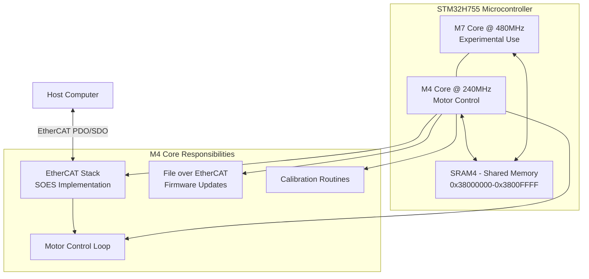
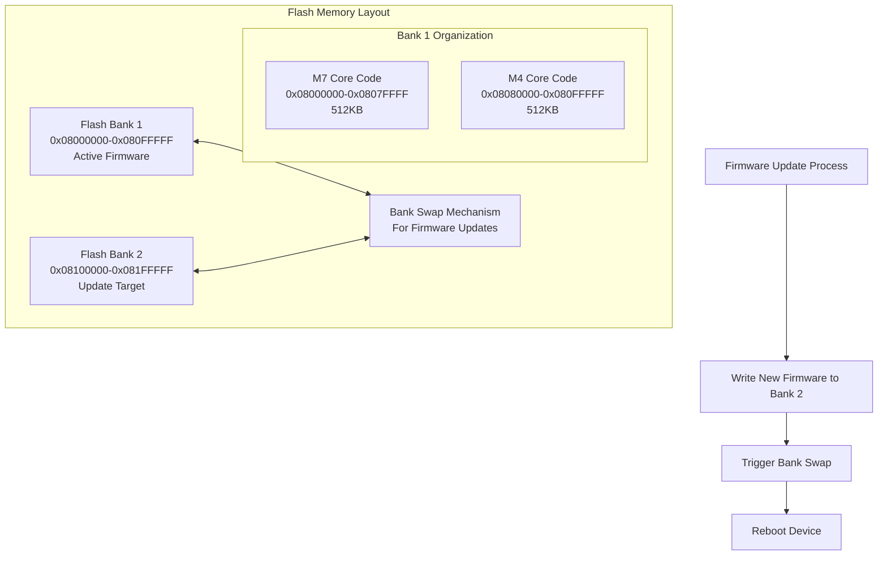
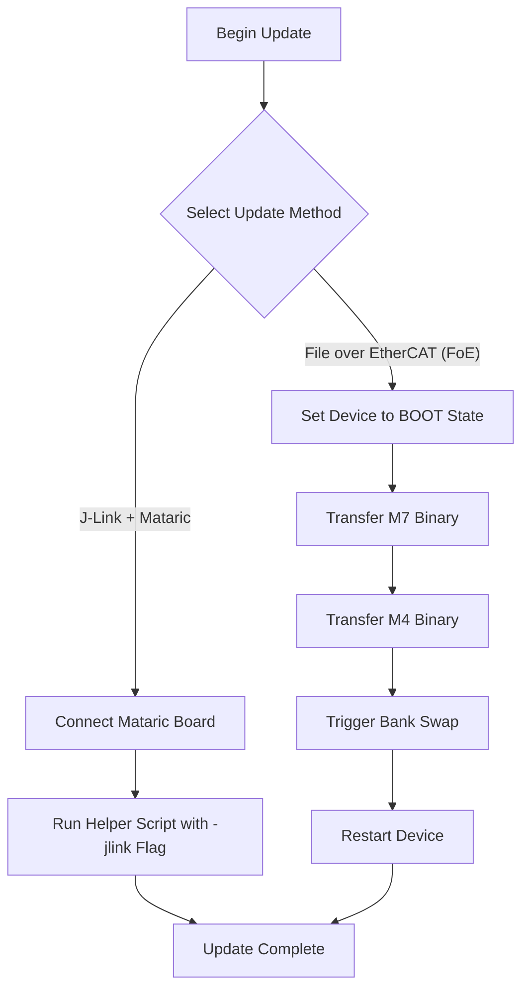
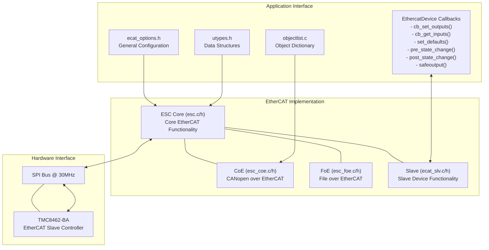
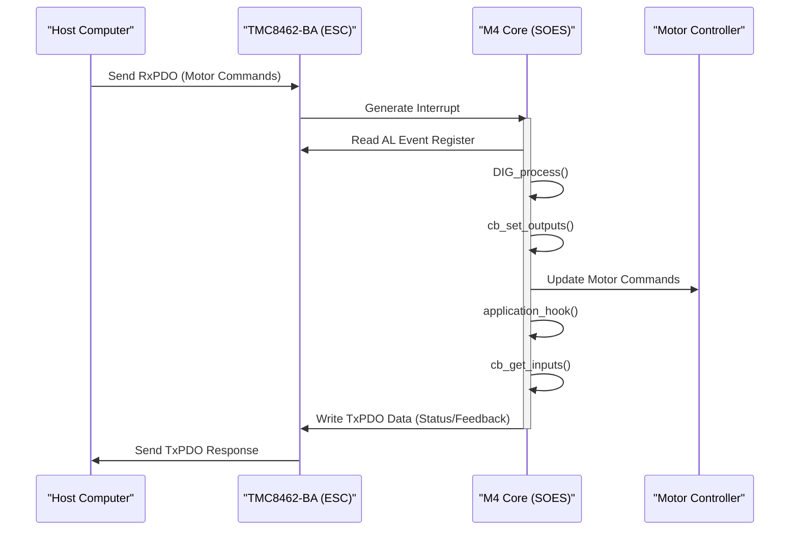

<!-- source: DeepWiki mcp.deepwiki.com · repo google-deepmind/barkour_robot · page 3 Firmware · fetched 2026-10-26 -->

# Firmware

<details>
<summary>Relevant source files</summary>

The following files were used as context for generating this wiki page:

- [README.md](README.md)
- [actuator/firmware/toolchains/arm_toolchain/arm_toolchain.BUILD.bazel](actuator/firmware/toolchains/arm_toolchain/arm_toolchain.BUILD.bazel)
- [docs/firmware.md](docs/firmware.md)

</details>


This page provides a comprehensive overview of the firmware architecture, compilation instructions, flashing procedures, calibration routines, and EtherCAT implementation for the Barkour Robot motor drivers. For information about using the EtherCAT configuration with the motor drivers, see [EtherCAT Configuration](#3.4), and for basic motor control examples, see [Motor Control](#3.4).

## Firmware Architecture

The Barkour motor drivers use custom firmware based on the Pigweed framework, designed for the STM32H755II dual-core microcontroller. This architecture enables precise motor control while providing flexibility for future enhancements.

### Dual-Core Design



Sources: [docs/firmware.md:9-15](), [actuator/firmware/barkour/common/shared_memory.h]()

The motor driver utilizes:
- **M4 Core (240MHz)**: Handles the main motor control loop and EtherCAT communication
- **M7 Core (480MHz)**: Available for experimental purposes
- **Inter-core Communication**: Through shared memory in SRAM4

### Flash Memory Organization



Sources: [docs/firmware.md:209-250]()

The STM32H755 features two identical 1MB flash banks:
- Each bank consists of 8 sectors of 128KB
- Active firmware runs from bank 1
- Updates are written to bank 2
- Bank swap makes the new firmware active

### Shared Memory Block

The cores communicate through a shared memory block in SRAM4 (Domain 3), at address range `0x38000000` - `0x3800FFFF`.

| Address | Alias in Code | Type | Purpose |
|---------|--------------|------|---------|
| `0x38000000` | `kUidWord0Address` | `uint32_t` | STM UID[31:0] |
| `0x38000004` | `kUidWord1Address` | `uint32_t` | STM UID[63:32] |
| `0x38000008` | `kUidWord2Address` | `uint32_t` | STM UID[95:64] |

Sources: [docs/firmware.md:382-406]()

## Building and Flashing

### Compiling the Firmware

The firmware uses Bazel as the build system:

```
# From the top-level directory:
bazel build //actuator/firmware/...
```

To run firmware tests on the host:

```
# From the top-level directory:
bazel test //actuator/firmware/...
```

Sources: [docs/firmware.md:21-40](), [actuator/firmware/toolchains/arm_toolchain/arm_toolchain.BUILD.bazel]()

### Flashing Methods

#### Initial EEPROM (SII) Flashing

For new motor drivers, the EtherCAT chip's EEPROM must be flashed first:

```
cd actuator/ethecat_eeprom
ethercat sii_write -p 0 barkour_robot_sii.hex
ethercat rescan
ethercat slaves
```

Expected output:
```
0   1:0  INIT  E  Cortes
```

*Note: The same SII binary works for both Holberton and Cortes variants.*

Sources: [docs/firmware.md:48-76]()

#### J-Link + Mataric Method

Connect the Mataric board to the motor driver and run:

```
bazel run //actuator/firmware/scripts:helper -- --flash -jlink
```

Sources: [docs/firmware.md:83-93]()

#### EtherCAT Bootloader Method

**For a single device:**
```
bazel run //actuator/firmware/scripts:helper -- --flash --tool ecat --m4 <path to m4.bin> --m7 <path to m7.bin> --device_alias <device_alias>
```

**For all devices:**
```
bazel run //actuator/firmware/scripts:helper -- --flash --tool ecat --m4 <path to m4.bin> --m7 <path to m7.bin> --all
```

After updating, restart the devices through power cycling or an EtherCAT command:
```
ethercat download -a <device_alias> -t uint32 0x3030 00 0xDEADC0DE
```

Sources: [docs/firmware.md:95-175]()

### Firmware Update Process



Sources: [docs/firmware.md:177-207]()

## Calibration

The firmware requires two separate calibration procedures for proper operation.

### Electrical Angle Offset Calibration

This calibration determines the offset between the encoder zero position and the nearest electrical angle zero position, essential for proper motor commutation.

**Procedure:**
1. Attach Mataric board to motor driver
2. Hold `nButton` while powering on or resetting the STM
3. Orange LED lights during calibration
4. Successful calibration: Orange LED turns off
5. Failed calibration: Red LED turns on

**Verification via SDO:**
- Read offset: Index `0x3000`, subindex `0x1` (int32)
- Check status: Index `0x3000`, subindex `0x2` (uint8, should be 1)

Sources: [docs/firmware.md:254-305]()

### Joint Angle Offset Calibration

This calibration determines the offset between a negative-side joint endstop and joint zero position.

**Procedure:**
1. Hold joint against negative endstop
2. Attach Mataric board
3. Press and hold reset button
4. Press and hold `Blinky1` button
5. Release reset button
6. After a few seconds, release `Blinky1` button

**Verification via SDO:**
- Read offset: Index `0x3001`, subindex `0x1` (int32)
- Check status: Index `0x3001`, subindex `0x2` (uint8, should be 1)

Sources: [docs/firmware.md:307-329]()

### Error Reporting System

The firmware reports errors to the CANopen "manufacturer status register" at index `0x1002`, subindex `0x0`. This 32-bit value contains error flags:

| Bit | Error Condition | Result |
|-----|----------------|--------|
| 0 | Electrical angle calibration failed | Controller stops |
| 1 | Joint angle calibration failed | Controller stops |
| 2 | Electrical angle offset not found | Controller stops |
| 3 | Joint angle offset not found | Uses zero offset |
| 4 | Invalid motor parameters | Controller stops |
| 5 | Invalid current limit | Limit set to infinity |
| 6 | Controller component config failed | Controller stops |
| 7 | Failed sensor readings | Controller stops or CiA 402 fault |
| 8 | STO enabled | CiA 402 fault or init failure |
| 9 | Unexpected gate driver state change | CiA 402 fault |
| 10 | EtherCAT not operational | CiA 402 fault |
| 11 | Bus voltage too low | CiA 402 fault |
| 12 | Overheat detected | CiA 402 fault |
| 13 | STO line 1 down | CiA 402 fault |
| 14 | STO line 2 down | CiA 402 fault |

Read the register using:
```
ethercat upload -a <alias> -t uint32 0x1002 0x0
```

Sources: [docs/firmware.md:331-380]()

## EtherCAT Implementation

The motor driver implements EtherCAT communication using the Simple Open EtherCAT Slave (SOES) stack.

### Stack Architecture



Sources: [docs/firmware.md:408-487]()

### EtherCAT Main Loop

The EtherCAT stack runs in a dedicated thread on the M4 core, implemented in `EthercatDevice::run()` in [actuator/firmware/barkour/m4/ecat_device.cc]():

1. Initialize stack with `ecat_slv_init()`
2. Enter infinite loop:
   - Wait on semaphore (released by interrupt handler)
   - Call `ecat_slv_poll()` to get EtherCAT status
   - Process PDOs with `DIG_process()`

The loop is interrupt-driven: when an EtherCAT packet is received, it generates an interrupt that releases a semaphore from `EthercatDevice::EofInterrupt()`. This creates an SM-Synchronous implementation.

Sources: [docs/firmware.md:488-499]()

### Communication Flows

#### SDO Communication Flow

SDO (Service Data Objects) provide mailbox-style communication for parameter access:

1. Host initiates request (e.g., `ethercat upload -p0 0x1000 0`)
2. Interrupt triggers on M4 core
3. EtherCAT task reads AL event register 0x220
4. `ESC_coeprocess()` executes, with pre/post object hooks
5. SOES prepares and sends response

#### PDO Communication Flow

PDO (Process Data Objects) enable cyclical exchange of real-time data:



Sources: [docs/firmware.md:509-559]()

---

