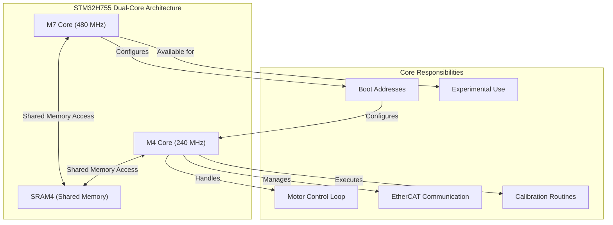
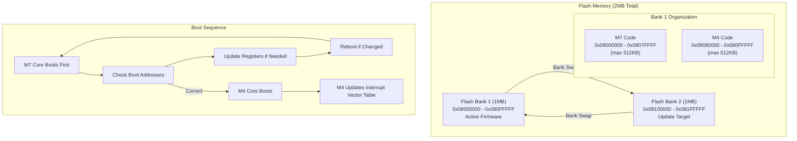
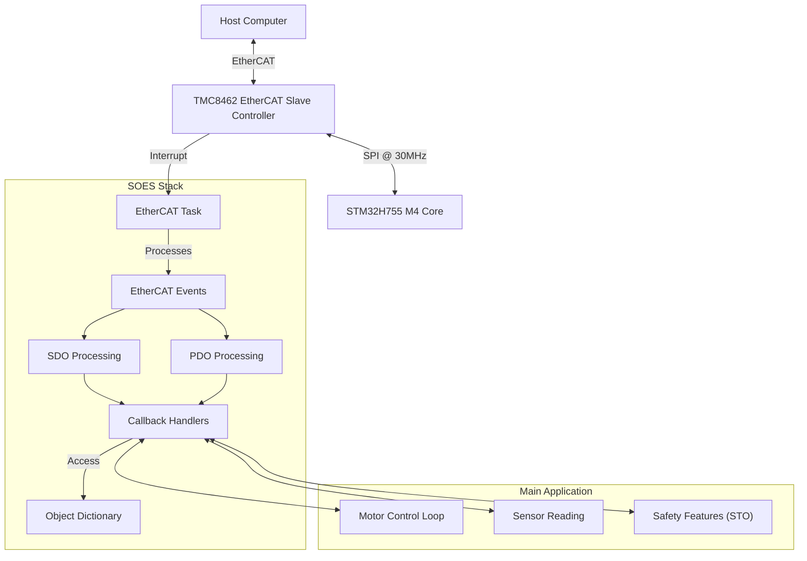
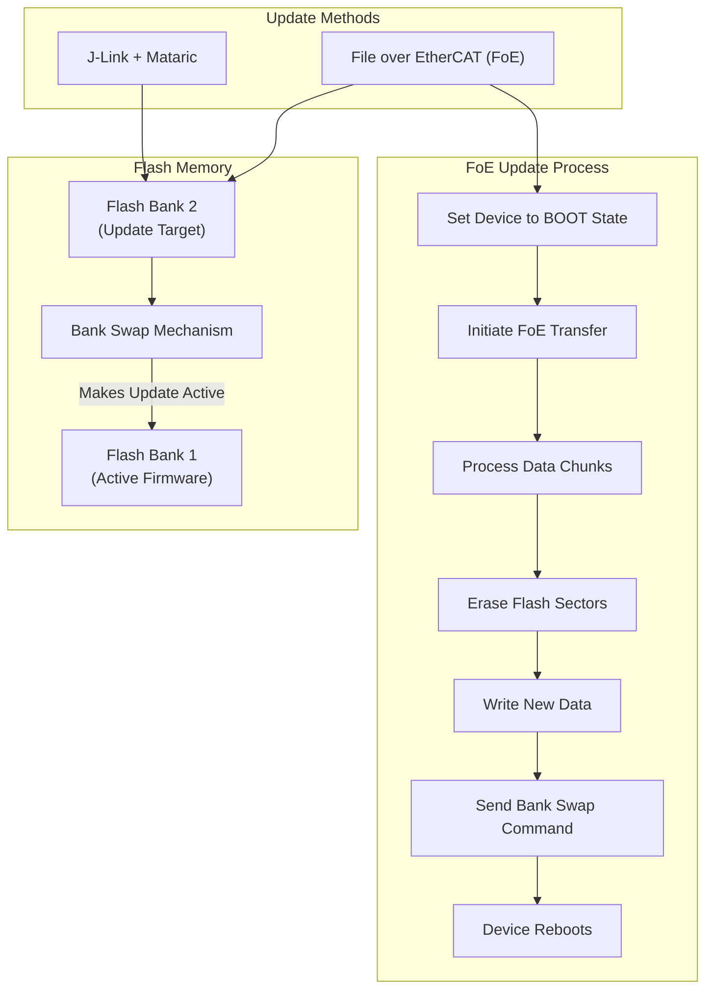
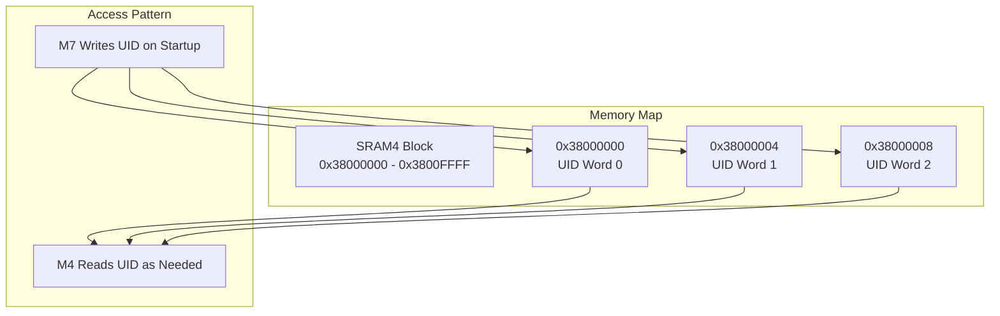
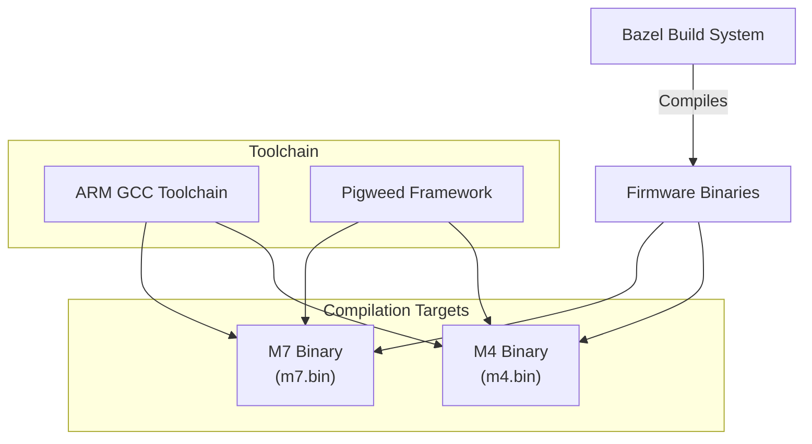

<!-- source: DeepWiki mcp.deepwiki.com · repo google-deepmind/barkour_robot · page 3.1 Firmware Architecture · fetched 2026-10-26 -->

# Firmware Architecture

<details>
<summary>Relevant source files</summary>

The following files were used as context for generating this wiki page:

- [actuator/firmware/toolchains/arm_toolchain/arm_toolchain.BUILD.bazel](actuator/firmware/toolchains/arm_toolchain/arm_toolchain.BUILD.bazel)
- [docs/firmware.md](docs/firmware.md)

</details>


## Purpose and Scope

This document details the firmware architecture of the Barkour Robot motor driver. It covers the dual-core microcontroller organization, memory layout, EtherCAT implementation, inter-core communication, and firmware update mechanisms. For information about building and flashing the firmware, see [Building and Flashing](#3.2). For calibration procedures, see [Calibration](#3.3).

## Microcontroller Architecture

The Barkour Robot's motor driver firmware runs on an STM32H755II dual-core microcontroller, featuring:

- M4 core @ 240MHz - handles the main motor control loop
- M7 core @ 480MHz - available for experimental use
- Inter-core communication via shared memory (SRAM4)



Sources: [docs/firmware.md:9-15](), [docs/firmware.md:386-398]()

## Flash Memory Organization

The firmware utilizes a dual-bank flash memory architecture for reliable operation and updates.



The firmware is organized in the active flash bank (Bank 1) as follows:
- M7 code: 0x08000000 - 0x0807FFFF (max 512KB)
- M4 code: 0x08080000 - 0x080FFFFF (max 512KB)

When firmware updates are received, they are written to Bank 2. A bank swap operation makes the new firmware active by swapping the logical addresses of the banks.

Sources: [docs/firmware.md:209-252]()

## EtherCAT Implementation

The motor driver uses EtherCAT for communication with the host system, based on the Simple Open EtherCAT Slave (SOES) implementation with a TMC8462 EtherCAT Slave Controller (ESC).



### Key EtherCAT Components:

1. **EtherCAT Task**: Runs in a separate thread on the M4 core, polling for EtherCAT events
2. **Callback Handlers**: Process SDO and PDO communications
3. **Object Dictionary**: Defines all accessible parameters
4. **Interrupt-Driven Design**: SM-Synchronous implementation with interrupts when EtherCAT packets are received

### Important Callbacks:
- `cb_set_outputs()`: Called after RxPDO reception to set outputs
- `cb_get_inputs()`: Called before data is transferred to the output buffer
- `set_defaults()`: Called in transition INIT->PREOP
- `pre_state_change()` and `post_state_change()`: Called before/after state changes
- `safeoutput()`: Called upon exit of OP state to ensure safe outputs

Sources: [docs/firmware.md:408-509](), [docs/firmware.md:474-486](), [docs/firmware.md:493-499]()

## Firmware Update Mechanism

The firmware supports two update methods:

1. **J-Link + Mataric**: Direct flashing using debugger hardware
2. **File over EtherCAT (FoE)**: Remote firmware updates via EtherCAT network



### FoE Update Process Details:

1. Set device to BOOT state using `ethercat state BOOT`
2. Initiate FoE data transfer with `ethercat foe_write`
3. An interrupt is generated on the M4 core
4. The EtherCAT task processes the data via `ESC_foeprocess()`
5. The `flash_firmware()` function writes data to flash bank 2
6. A bank swap command activates the new firmware
7. The device reboots with the new firmware

The STM32H755's dual-bank architecture allows for fail-safe updates - if the update process is interrupted, the original firmware remains intact in bank 1.

Sources: [docs/firmware.md:42-206](), [docs/firmware.md:176-180]()

## Inter-Core Communication

Communication between the M7 and M4 cores is facilitated through a shared memory block in SRAM4.



The SRAM4 block is used for inter-core communication because:
1. It's specifically recommended for this purpose in the STM32 reference manual
2. It's separate from the working memory of both cores (M4 uses SRAM1-3, M7 uses AXI SRAM)
3. This prevents potential corruption of stack or other critical data

Currently, the shared memory is primarily used to pass the STM32's unique identifier from the M7 core (which can access it) to the M4 core (which cannot directly access it).

Sources: [docs/firmware.md:386-406]()

## Error Handling

The firmware implements a comprehensive error handling system, reporting errors through the CANopen manufacturer status register (index `0x1002`, subindex `0x0`).

| Bit Index | Error Condition | Result |
|-----------|-----------------|--------|
| 0 | Electrical angle calibration routine failed | Controller loop stops |
| 1 | Joint angle calibration routine failed | Controller loop stops |
| 2 | Calibrated electrical angle offset not found | Controller loop stops |
| 3 | Calibrated joint angle offset not found | Joint angle offset of `0` used |
| 4 | Invalid motor parameters set | Controller loop stops |
| 5 | Invalid current limit set | Current limit set to infinity |
| 6 | Failed to configure controller components | Controller loop stops |
| 7 | Failed to get sensor readings | Controller loop stops or CiA 402 fault |
| 8 | STO enabled | CiA 402 fault or initialization failure |
| 9 | Unexpected gate driver state change | CiA 402 fault |
| 10 | EtherCAT not in "operational" state | CiA 402 fault |
| 11 | Bus voltage too low | CiA 402 fault |
| 12 | Overheat detected | CiA 402 fault |
| 13 | STO line 1 down while voltage is applied | CiA 402 fault |
| 14 | STO line 2 down while voltage is applied | CiA 402 fault |

Error bits that result in a CiA 402 fault are reset upon a CiA 402 fault recovery state transition. The error register can be read via EtherCAT using the command:
```
ethercat upload -a <alias> -t uint32 0x1002 0x0
```

Sources: [docs/firmware.md:333-380]()

## Calibration Support

The firmware includes critical calibration routines:

1. **Electrical Angle Offset Calibration**: 
   - Required for motor commutation
   - Triggered by holding the `nButton` on Mataric board during power-on/reset
   - Results stored in EEPROM as part of EtherCAT SII
   - Accessible via SDO: index `0x3000`, subindex `0x1` (int32)

2. **Joint Angle Offset Calibration**:
   - Sets joint zero position relative to mechanical endstop
   - Triggered by specific button sequence on Mataric board
   - Results stored in EEPROM as part of EtherCAT SII
   - Accessible via SDO: index `0x3001`, subindex `0x1` (int32)

Sources: [docs/firmware.md:254-331]()

## Build System

The firmware is built using the Bazel build system and is based on the Pigweed framework.



The build process uses an ARM GCC toolchain for both cores, with separate binaries created for the M7 and M4 cores. These binaries are then flashed to their respective memory locations.

Sources: [docs/firmware.md:21-40](), [actuator/firmware/toolchains/arm_toolchain/arm_toolchain.BUILD.bazel:1-169]()

## Code Organization

The firmware source code is located in the `actuator/firmware` directory with key components:

| Component | Description | Location |
|-----------|-------------|----------|
| M4 Core Code | Motor control and EtherCAT implementation | `actuator/firmware/barkour/m4/` |
| M7 Core Code | Boot configuration and experimental features | `actuator/firmware/barkour/m7/` |
| Shared Code | Code used by both cores | `actuator/firmware/barkour/common/` |
| EtherCAT Stack | SOES implementation | `actuator/firmware/barkour/m4/ecat/` |
| Flashing Scripts | Tools for firmware updates | `actuator/firmware/scripts/` |

The key firmware files include:
- `main_m7.cc`: Entry point for M7 core, configures boot addresses
- `ecat_device.cc`: EtherCAT implementation and callbacks
- `shared_memory.h`: Defines shared memory structures for inter-core communication

Sources: [docs/firmware.md:6-7](), [docs/firmware.md:47-56](), [docs/firmware.md:398]()

---

