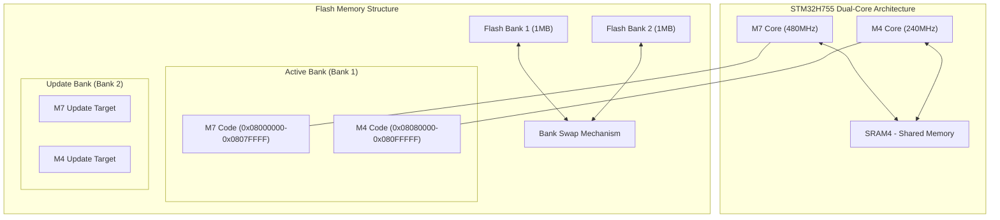
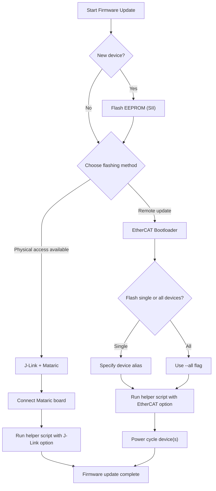
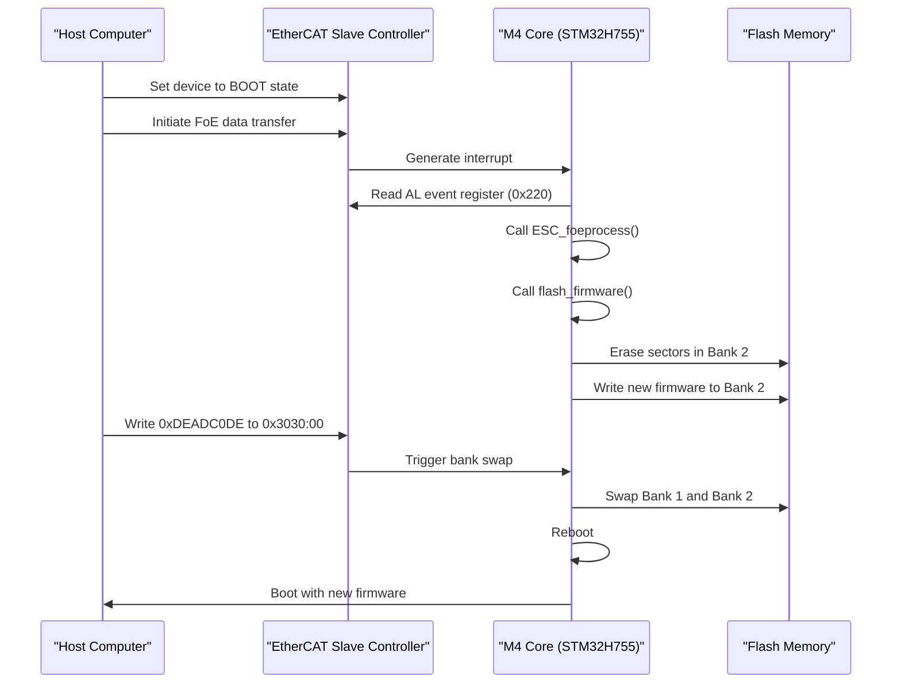

<!-- source: DeepWiki mcp.deepwiki.com · repo google-deepmind/barkour_robot · page 3.2 Building and Flashing · fetched 2026-10-26 -->

# Building and Flashing

<details>
<summary>Relevant source files</summary>

The following files were used as context for generating this wiki page:

- [actuator/firmware/toolchains/arm_toolchain/arm_toolchain.BUILD.bazel](actuator/firmware/toolchains/arm_toolchain/arm_toolchain.BUILD.bazel)
- [docs/firmware.md](docs/firmware.md)

</details>


This page provides detailed instructions for building and flashing firmware to the motor drivers used in the Barkour Robot. It covers the build process using Bazel and explains the two main flashing methods: using a J-Link with Mataric debugger board or via the EtherCAT bootloader. For information about firmware architecture, see [Firmware Architecture](#3.1), and for calibration procedures after flashing, see [Calibration](#3.3).

## Firmware Overview

The Barkour Robot's motor driver firmware is designed for the STM32H755II dual-core microcontroller, which features an Arm M4 core (240MHz) used for the main motor control loop and an Arm M7 core (480MHz) available for experimental use. The firmware is based on the Pigweed framework and uses EtherCAT for communication with the host system.



Sources: [docs/firmware.md:9-15](), [docs/firmware.md:209-240]()

## Prerequisites

### Required Tools

* Bazel build system (version 7.1.2 or higher recommended)
* For J-Link flashing: J-Link debugger and Mataric debugger board
* For EtherCAT flashing: Functioning EtherCAT connection to the motor driver
* Operating system: Debian or Ubuntu recommended (instructions tested on these platforms)

### Initial Setup

If you're flashing a brand new motor driver, you'll need to first flash the EtherCAT EEPROM (SII) to enable EtherCAT communication. This requires the EtherLab library to be installed.

```
cd actuator/ethecat_eeprom
ethercat sii_write -p 0 barkour_robot_sii.hex
```

After flashing the EEPROM, you can confirm the device is detected:

```
ethercat rescan
ethercat slaves
```

The device should appear as "Cortes" in the output (this identifier is used for both Holberton and Cortes variants).

Sources: [docs/firmware.md:48-62]()

## Building the Firmware

The firmware is built using Bazel, which handles all dependencies and toolchain configurations automatically.

### Build Command

To build the firmware binaries and helper scripts:

```
# From the top-level directory:
bazel build //actuator/firmware/...
```

This command compiles both the M4 and M7 firmware images, producing binary files that can be flashed to the motor driver.

### Testing

It's recommended to run the firmware unit tests to ensure everything is working correctly:

```
# From the top-level directory:
bazel test //actuator/firmware/...
```

Sources: [docs/firmware.md:22-40]()

## Flashing Methods

The Barkour Robot's motor drivers support two different flashing methods: using a J-Link with the Mataric debugger board or via EtherCAT bootloader.



Sources: [docs/firmware.md:42-46](), [docs/firmware.md:83-175]()

### Flashing with J-Link + Mataric

This method is recommended for first-time flashing or when EtherCAT communication is not available.

1. Connect the Mataric debugger board to the Cortes or Holberton board (see image in original documentation)
2. Run the helper script with the J-Link option:

```
bazel run //actuator/firmware/scripts:helper -- --flash -jlink
```

Sources: [docs/firmware.md:83-94]()

### Flashing with EtherCAT Bootloader (Single Device)

To flash a single device over EtherCAT:

```
bazel run //actuator/firmware/scripts:helper -- --flash --tool ecat --m4 <path to m4.bin> --m7 <path to m7.bin> --device_alias <device_alias>
```

Example of successful output:

```
INFO:absl:Flashing firmware over ethercat
INFO:absl:M4 binary path: new_fw/m4.bin
INFO:absl:M7 binary path: new_fw/m7.bin
INFO:absl:device_alias: 3
INFO:absl:Flashing M7.
INFO:absl:Finished flashing M7.
INFO:absl:Flashing M4.
INFO:absl:Finished flashing M4.
INFO:absl:Power-cycle the device to boot new firmware.
```

After flashing, the device needs to be power-cycled to boot the new firmware. Alternatively, you can send a reboot command via EtherCAT:

```
ethercat download -a <device_alias> -t uint32 0x3030 00 0x01234567
```

Sources: [docs/firmware.md:96-133]()

### Flashing with EtherCAT Bootloader (All Devices)

To flash all EtherCAT devices in the network:

```
bazel run //actuator/firmware/scripts:helper -- --flash --tool ecat --m4 <path to m4.bin> --m7 <path to m7.bin> --all
```

After updating all devices, it's recommended to power-cycle the entire network to ensure all microcontrollers boot with the new firmware.

Sources: [docs/firmware.md:134-175]()

## Firmware Organization and Memory Structure

The STM32H755 microcontroller used in the motor drivers has two identical memory banks of 1MB each:
- Flash bank 1: starts at address `0x08000000`
- Flash bank 2: starts at address `0x08100000`

Each bank consists of 8 sectors of 128KB each. The firmware uses a bank swapping mechanism for updates, where the current firmware always runs from flash bank 1 and updates are written to flash bank 2.

The firmware is organized within each bank as follows:

| Address Range | Content | Maximum Size |
|---------------|---------|--------------|
| 0x08000000 - 0x0807FFFF | M7 code | 512KB |
| 0x08080000 - 0x080FFFFF | M4 code | 512KB |

When new firmware is flashed:
1. The current firmware runs from bank 1
2. The update is written to bank 2
3. A bank swap is triggered
4. Bank 2 (with the new firmware) becomes bank 1, and the old firmware becomes bank 2
5. The device reboots to run the new firmware

This approach allows for safe firmware updates, as the old firmware is preserved until the new firmware has been successfully installed.

Sources: [docs/firmware.md:209-240]()

## How EtherCAT Firmware Updates Work

File over EtherCAT (FoE) is the protocol used for updating firmware via the EtherCAT connection. Here's how the process works:



The process follows these steps:
1. User sets the device into BOOT state
2. User initiates FoE data transfer for the M4 and M7 binaries
3. The firmware processes the incoming data and writes it to flash bank 2
4. After successful transfer, the bank swap is triggered (automatically or manually)
5. The device reboots with the new firmware

Sources: [docs/firmware.md:176-208]()

## ARM Toolchain Configuration

The Barkour firmware relies on an ARM GNU toolchain for compiling and linking the firmware. The toolchain is configured in Bazel build rules that specify how to compile, link, and process the firmware binaries. 

Key components include:
- arm-none-eabi-gcc: C compiler for ARM targets
- arm-none-eabi-g++: C++ compiler for ARM targets
- arm-none-eabi-objcopy: Utility to convert between binary formats
- arm-none-eabi-objdump: Utility to display information from object files

The toolchain configuration handles cross-platform differences, ensuring that the correct executable is used whether building on Windows or Unix-based systems.

Sources: [actuator/firmware/toolchains/arm_toolchain/arm_toolchain.BUILD.bazel:12-169]()

## Troubleshooting

### Common Issues

1. **EtherCAT device not found:**
   - Ensure the EEPROM (SII) has been properly flashed
   - Check physical connections and power
   - Run `ethercat rescan` and `ethercat slaves` to verify the device is visible

2. **Flashing fails with J-Link:**
   - Verify the Mataric board is properly connected
   - Ensure J-Link is detected by your system
   - Check for any error messages in the console output

3. **EtherCAT flashing fails:**
   - Make sure the device is in the BOOT state before attempting to flash
   - Verify you have the correct device alias
   - Check network connectivity to the EtherCAT device

4. **Device doesn't boot after flashing:**
   - Power cycle the device completely
   - If using the Holberton motor driver, try power cycling via EtherCAT
   - As a last resort, use the J-Link method to reflash the firmware

### Error Reporting

The motor driver firmware reports errors to the CANopen "manufacturer status register" at index `0x1002`, subindex `0x0`. You can check this register to diagnose problems:

```
ethercat upload -a <alias> -t uint32 0x1002 0x0
```

---

