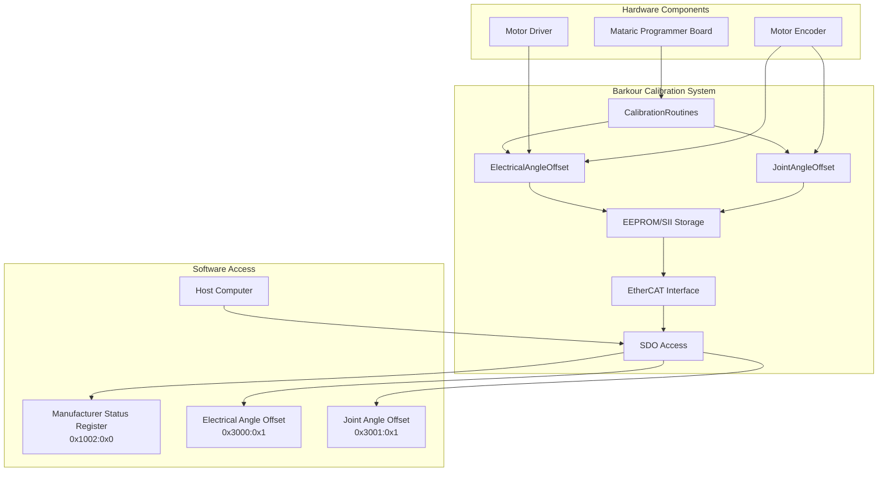
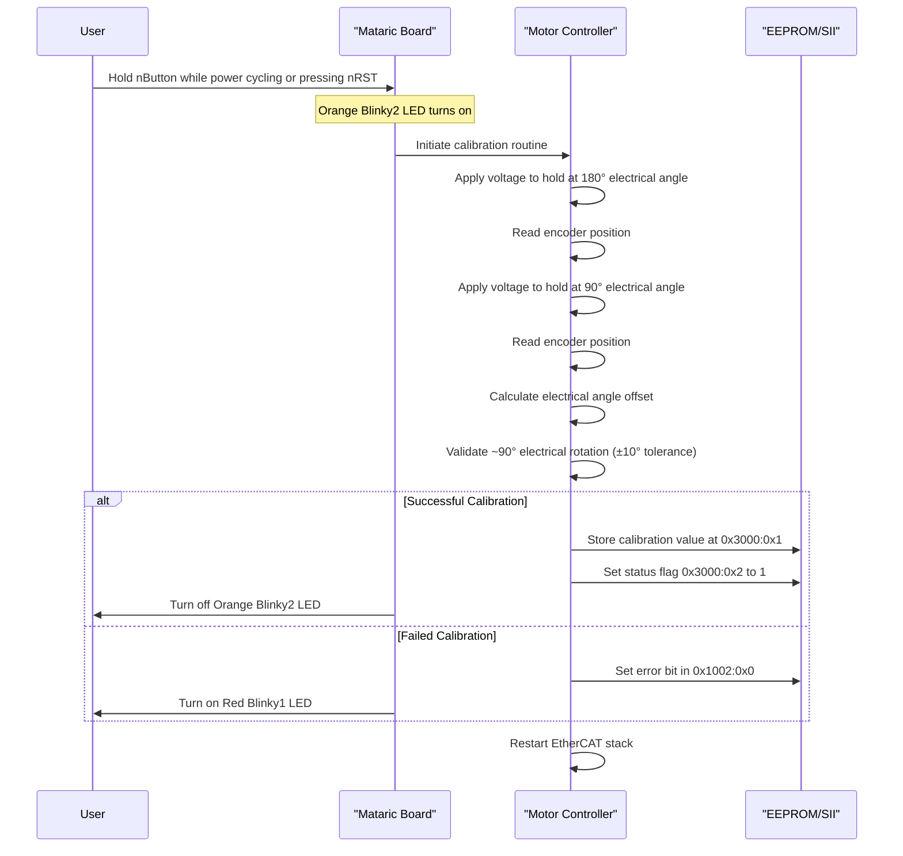
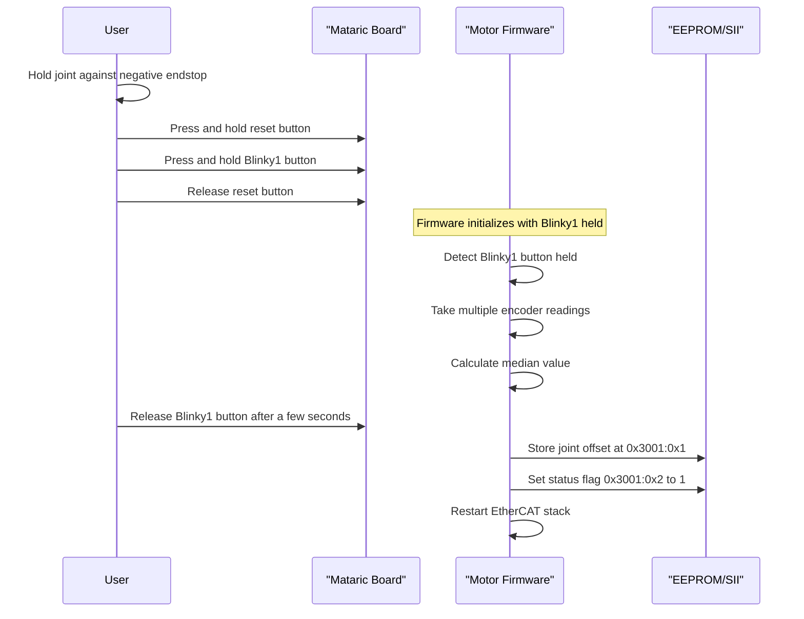
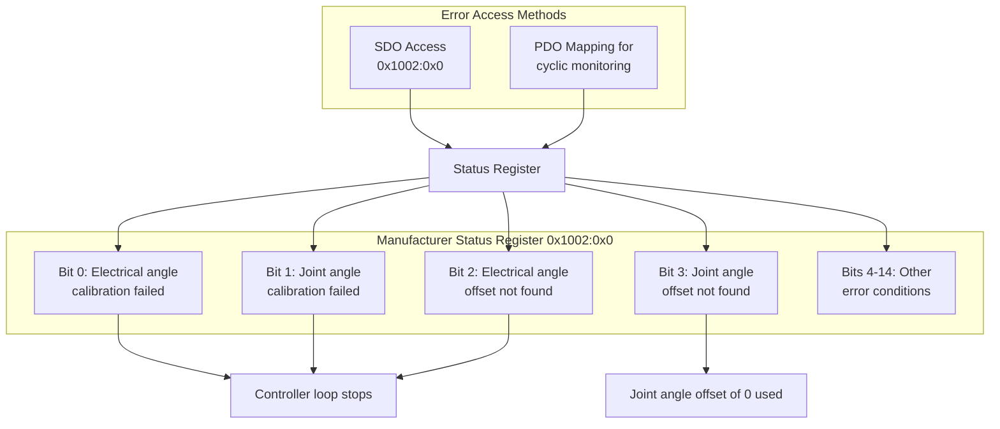
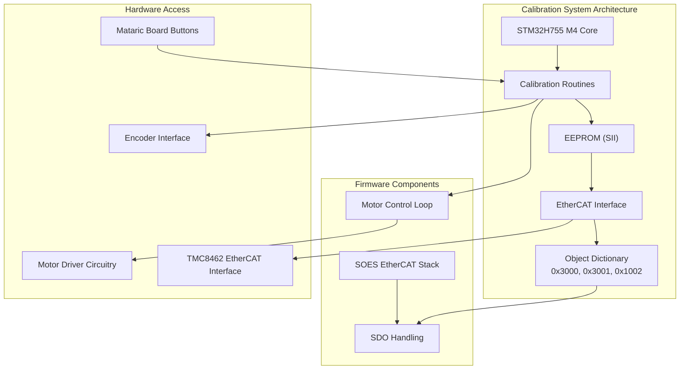

<!-- source: DeepWiki mcp.deepwiki.com · repo google-deepmind/barkour_robot · page 3.3 Calibration · fetched 2026-10-26 -->

# Calibration

<details>
<summary>Relevant source files</summary>

The following files were used as context for generating this wiki page:

- [actuator/firmware/toolchains/arm_toolchain/arm_toolchain.BUILD.bazel](actuator/firmware/toolchains/arm_toolchain/arm_toolchain.BUILD.bazel)
- [docs/firmware.md](docs/firmware.md)

</details>


This document describes the calibration procedures for the Barkour Robot's motor drivers. Calibration is essential for accurate motor control and proper functioning of the robot. The firmware implements two independent calibration routines: Electrical Angle Offset calibration and Joint Angle Offset calibration, both of which are critical to the robot's operation. For firmware architecture details, see [Firmware Architecture](#3.1). For instructions on building and flashing the firmware, see [Building and Flashing](#3.2).

## Calibration Overview

The Barkour Robot requires two distinct calibration routines to function properly:

1. **Electrical Angle Offset**: Calibrates the relationship between encoder position and motor's electrical angle, critical for proper commutation.
2. **Joint Angle Offset**: Establishes a zero position reference for joint angle measurements relative to mechanical endstops.

Both calibration procedures require the Mataric programmer board to be physically attached to the motor driver and are stored in the EEPROM as part of the EtherCAT Slave Information Interface (SII).



Sources: [docs/firmware.md:254-327]()

## Calibration Procedures

### Electrical Angle Offset Calibration

The electrical angle offset is the difference between the encoder zero position and the nearest position where the electrical angle of the motor is zero. This calibration is essential for proper motor commutation.

#### Prerequisites:
- Mataric programmer board connected to the motor driver
- Motor with no significant load attached
- Motor placed in a position where it can rotate freely for at least 15° in each direction
- Ideally, motor positioned with its axis of rotation parallel to gravity

#### Calibration Process:



Sources: [docs/firmware.md:269-301]()

#### Verification and Access:
- The electrical angle offset can be read via SDO (index `0x3000`, subindex `0x1`) as an `int32` value in encoder counts
- Calibration status is stored at SDO (index `0x3000`, subindex `0x2`) as a `uint8` value (1 = successful)

### Joint Angle Offset Calibration

The joint angle offset defines the relationship between a negative-side joint endstop and the joint's zero position. This calibration ensures that position measurements are referenced correctly to the mechanical structure.

#### Prerequisites:
- Mataric programmer board connected to the motor driver
- Robot joint held against its negative endstop

#### Calibration Process:



Sources: [docs/firmware.md:302-329]()

#### Verification and Access:
- The joint angle offset can be read via SDO (index `0x3001`, subindex `0x1`) as an `int32` value in encoder counts
- Calibration status is stored at SDO (index `0x3001`, subindex `0x2`) as a `uint8` value (1 = successful)

## Error Reporting

Calibration errors are reported through the CANopen "manufacturer status register" (index `0x1002`, subindex `0x0`), which contains a 32-bit value where specific bits indicate different error conditions.



Sources: [docs/firmware.md:330-380]()

### Calibration-Related Error Bits

The following bits in the manufacturer status register are specifically related to calibration:

| Bit Index | Error Condition                 | Result                          |
|-----------|--------------------------------|----------------------------------|
| 0         | Electrical angle calibration routine failed | Controller loop stops |
| 1         | Joint angle calibration routine failed | Controller loop stops |
| 2         | Calibrated electrical angle offset not found | Controller loop stops |
| 3         | Calibrated joint angle offset not found | Joint angle offset of `0` used |

The manufacturer status register can be read over EtherCAT using the command:
```
ethercat upload -a <alias> -t uint32 0x1002 0x0
```

Sources: [docs/firmware.md:330-380]()

## Technical Implementation Details

The calibration routines are implemented in the firmware running on the STM32H755 microcontroller's M4 core, which handles the main motor control loop. The calibration values are stored in the EtherCAT Slave Information Interface (SII) EEPROM, making them persistent across power cycles.



Sources: [docs/firmware.md:9-19](), [docs/firmware.md:254-327]()

### Software Integration

Calibration routines are integrated with the firmware's state machine and EtherCAT communication stack. Successful completion of either calibration routine involves a restart of the EtherCAT stack to ensure that the calibrated values are written to EEPROM and properly initialized in the system.

The calibration values are made available via the EtherCAT Object Dictionary, which allows both reading the values and checking their validity status through standard EtherCAT Service Data Object (SDO) access mechanisms.

Sources: [docs/firmware.md:254-327](), [docs/firmware.md:409-435]()

## Troubleshooting Calibration Issues

If calibration issues occur, check the following:

1. Ensure the Mataric programmer board is properly connected to the motor driver
2. Verify that the motor can rotate freely during electrical angle calibration
3. Check the manufacturer status register (0x1002:0x0) for specific error bits
4. Ensure the joint is properly positioned against the endstop during joint angle calibration
5. Power cycle the device after calibration to ensure proper initialization of new values

For persistent issues, the calibration procedures may need to be repeated. If errors continue, the hardware connections and motor driver functionality should be verified.

Sources: [docs/firmware.md:267-268](), [docs/firmware.md:330-380]()

---

