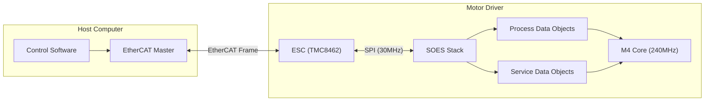
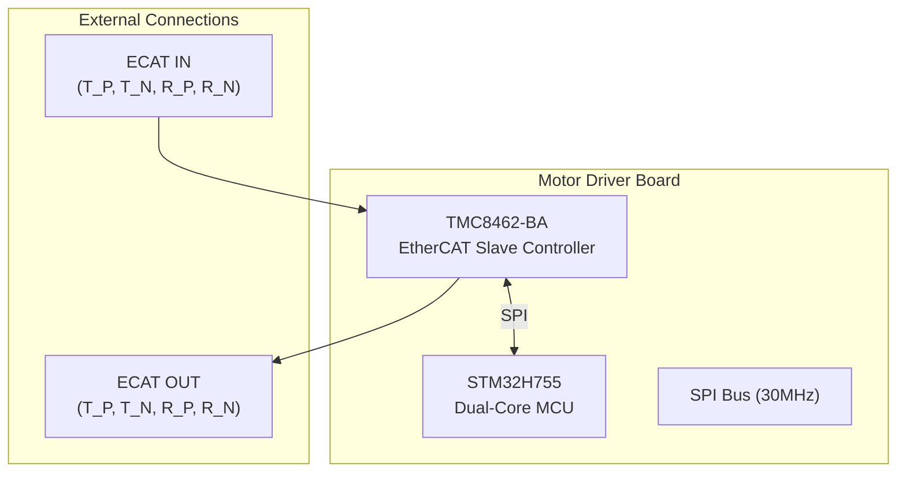
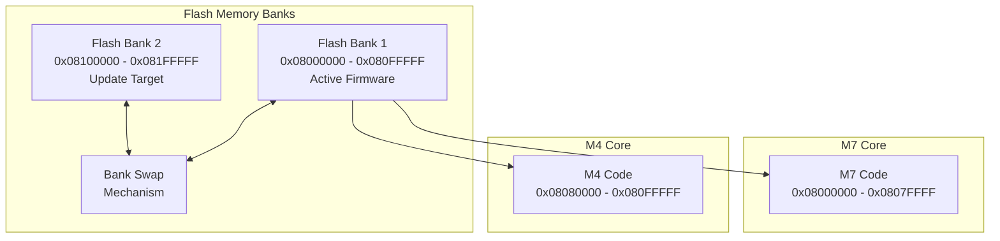

<!-- source: DeepWiki mcp.deepwiki.com · repo google-deepmind/barkour_robot · page 3.4 EtherCAT Configuration · fetched 2026-10-26 -->

# EtherCAT Configuration

<details>
<summary>Relevant source files</summary>

The following files were used as context for generating this wiki page:

- [actuator/firmware/toolchains/arm_toolchain/arm_toolchain.BUILD.bazel](actuator/firmware/toolchains/arm_toolchain/arm_toolchain.BUILD.bazel)
- [docs/firmware.md](docs/firmware.md)
- [hardware/electronics/holberton/EtherCATConnectors.Harness](hardware/electronics/holberton/EtherCATConnectors.Harness)

</details>


This document explains how to configure and use EtherCAT communication with the Barkour Robot. It covers the initial setup, configuration processes, and implementation details of the EtherCAT stack used in the motor drivers. For firmware architecture details, see [Firmware Architecture](#3.1), and for error handling, see [Error Handling](#3.5).

## 1. EtherCAT Overview

EtherCAT (Ethernet for Control Automation Technology) is the primary communication protocol used in the Barkour Robot for real-time control and data exchange between the host computer and the motor drivers. It provides deterministic real-time communication necessary for coordinated quadruped locomotion.



Sources: [docs/firmware.md:13-15](), [docs/firmware.md:414-417]()

## 2. Hardware Configuration

The EtherCAT communication relies on the TMC8462-BA chip on the motor driver board, which serves as the EtherCAT Slave Controller (ESC). This chip is connected to the STM32H755's M4 core via an SPI bus clocked at 30 MHz.



Sources: [docs/firmware.md:452-452](), [hardware/electronics/holberton/EtherCATConnectors.Harness:1-2]()

## 3. Initial EtherCAT Setup

### 3.1 Flashing the EEPROM (SII)

When bringing up a brand new motor driver, the EtherCAT (TMC8462-BA) chip's EEPROM must be flashed to enable EtherCAT communication. This is a one-time process that configures the Slave Information Interface (SII).

To flash the EEPROM (assuming the EtherLab library is installed):

```
cd actuator/ethecat_eeprom
ethercat sii_write -p 0 barkour_robot_sii.hex
```

After rescanning the bus:

```
ethercat rescan
ethercat slaves
```

The device should show up as:

```
0   1:0  INIT  E  Cortes
```

Note: The same SII binary can be used for either the Holberton or Cortes variants. Both variants will appear as `Cortes` on the EtherCAT bus.

Important: The provided file uses Google's EtherCAT vendor ID. For your own implementation, update this to your own vendor ID provided by the EtherCAT Technology Group.

Sources: [docs/firmware.md:48-81]()

## 4. EtherCAT Implementation

### 4.1 Software Stack

The Barkour Robot uses SOES (Simple Open EtherCAT Slave) as its EtherCAT stack implementation. The stack runs on the M4 core of the STM32H755 microcontroller.

```mermaid
graph TD
    subgraph "EtherCAT Implementation"
        direction TB
        APP["Application"]
        CALLBACK["Callback Functions"]
        SOES["SOES Stack"]
        HW["Hardware Interface"]
        ESC["ESC (TMC8462)"]
    end
    
    APP -->|"cb_get_inputs()"| CALLBACK
    APP <--|"cb_set_outputs()"| CALLBACK
    CALLBACK <--> SOES
    SOES <-->|"ESC_read/write()"| HW
    HW <-->|"SPI"| ESC
```

Sources: [docs/firmware.md:421-434](), [docs/firmware.md:444-451](), [docs/firmware.md:475-486]()

### 4.2 EtherCAT Object Dictionary

The EtherCAT object dictionary is defined in the codebase and contains all the data objects that can be accessed via EtherCAT. These objects include:

1. Mandatory CANopen objects (e.g., device type, error register)
2. Manufacturer-specific objects (e.g., calibration data, error status)
3. Process data objects for real-time control

The object dictionary is defined in:
```
actuator/firmware/barkour/m4/ecat/objectlist.c
```

Sources: [docs/firmware.md:463-466]()

### 4.3 Communication Types

#### 4.3.1 Service Data Objects (SDO)

SDOs provide mailbox communication, similar to remote procedure calls, for non-time-critical parameter access. SDO communication is available in all EtherCAT states except INIT.

Example of reading an SDO:
```
ethercat upload -a <device_alias> -t uint32 0x1002 0x0
```

The SDO transaction sequence is:
1. Host initiates a request
2. Interrupt generated on M4 core
3. EtherCAT task wakes up and reads AL event register
4. `ESC_coeprocess()` is called with appropriate hooks
5. Response is prepared and sent back to host

Sources: [docs/firmware.md:510-529]()

#### 4.3.2 Process Data Objects (PDO)

PDOs are used for cyclic real-time data exchange between host and device. They're exchanged only during SAFEOP and OP states.

The PDO mapping is configured by the host during the setup phase in PREOP state by setting up objects:
- 0x1C12 (SM2, Outputs, RxPDO)
- 0x1C13 (SM3, Inputs, TxPDO)

PDO transaction sequence:
1. Host initiates PDO exchange
2. Interrupt generated on M4 core
3. EtherCAT task processes event flags
4. `DIG_process()` is called
5. If SM2 event flag is set, `cb_set_outputs()` is called
6. `cb_get_inputs()` is called to prepare data for TxPDO

Sources: [docs/firmware.md:531-559]()

### 4.4 EtherCAT Main Loop

The EtherCAT stack runs in a separate thread on the M4 core. The main loop is implemented in `EthercatDevice::run()` and follows this sequence:

1. Initialize the EtherCAT stack with `ecat_slv_init()`
2. Enter an infinite loop:
   - Wait on semaphore (released by interrupt)
   - Call `ecat_slv_poll()` to get EtherCAT status
   - Call `DIG_process()` to process PDOs

The loop is interrupt-driven. When an EtherCAT packet is received, it generates an interrupt that releases a semaphore from `EthercatDevice::EofInterrupt()`.

Sources: [docs/firmware.md:493-503]()

## 5. EtherCAT States and Transitions

EtherCAT devices operate in a state machine defined by the ETG (EtherCAT Technology Group):

| State | Description | PDO Exchange | SDO Exchange |
|-------|-------------|:------------:|:------------:|
| INIT | Initial state | No | No |
| PREOP | Pre-operational | No | Yes |
| SAFEOP | Safe-operational | Yes (Input only) | Yes |
| OP | Operational | Yes | Yes |

State transitions are handled by callback functions:
- `pre_state_change()`: Called before state change
- `post_state_change()`: Called after state change
- `safeoutput()`: Called upon exit of OP state to ensure safe output values

Sources: [docs/firmware.md:483-486]()

## 6. Firmware Update via EtherCAT

The Barkour Robot supports firmware updates via File over EtherCAT (FoE). This allows updating firmware without physical access to the device.

### 6.1 FoE Update Process

To update a single device:

```
bazel run //actuator/firmware/scripts:helper -- --flash --tool ecat --m4 <path to m4.bin> --m7 <path to m7.bin> --device_alias <device_alias>
```

To update all devices:

```
bazel run //actuator/firmware/scripts:helper -- --flash --tool ecat --m4 <path to m4.bin> --m7 <path to m7.bin> --all
```

After updating, restart the devices either by power cycling or sending a restart command:

```
ethercat download -a <device_alias> -t uint32 0x3030 00 0x01234567
```

Sources: [docs/firmware.md:97-175](), [docs/firmware.md:177-198]()

### 6.2 Firmware Organization

The STM32H755 has two identical memory banks of 1 megabyte each. The update mechanism uses bank swapping for reliable updates:



Current firmware always runs from flash bank 1, and updates are written to flash bank 2. A bank swap causes the new firmware to become active.

Sources: [docs/firmware.md:209-239]()

## 7. Error Handling and Diagnostics

EtherCAT communication errors and device status can be monitored via the manufacturer status register (SDO index `0x1002`, subindex `0x0`). This 32-bit register contains error flags that indicate various error conditions.

To read the manufacturer status register:

```
ethercat upload -a <alias> -t uint32 0x1002 0x0
```

For detailed information on error codes and handling, see the [Error Handling](#3.5) page.

Sources: [docs/firmware.md:377-380]()

## 8. Additional EtherCAT Commands

Here are some useful EtherCAT commands for interacting with the Barkour Robot:

| Command | Description |
|---------|-------------|
| `ethercat slaves` | List all slaves on the network |
| `ethercat state PREOP -p <position>` | Set slave state to PREOP |
| `ethercat state SAFEOP -p <position>` | Set slave state to SAFEOP |
| `ethercat state OP -p <position>` | Set slave state to OP |
| `ethercat rescan` | Rescan the EtherCAT network |
| `ethercat upload -p <position> <index> <subindex>` | Read SDO value |
| `ethercat download -p <position> -t <type> <index> <subindex> <value>` | Write SDO value |

Sources: [docs/firmware.md:58-69]()

---

