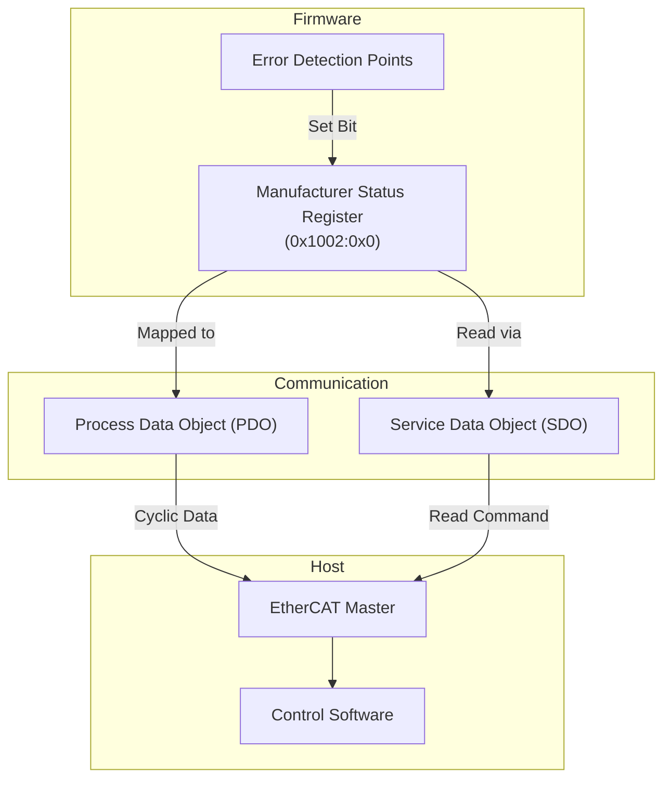
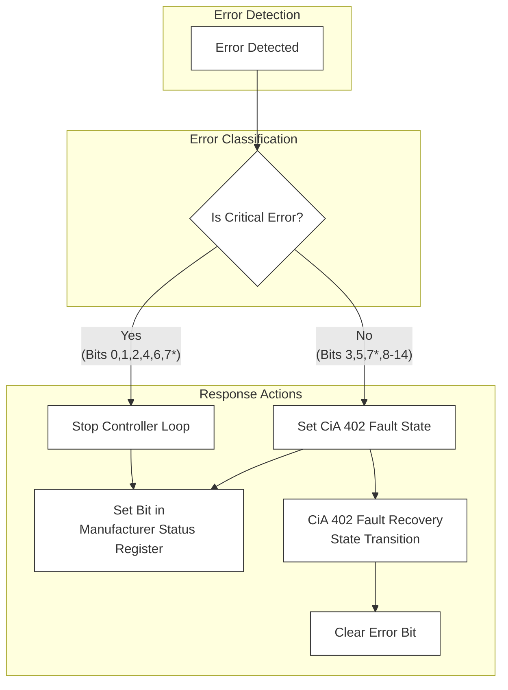

<!-- source: DeepWiki mcp.deepwiki.com · repo google-deepmind/barkour_robot · page 3.5 Error Handling · fetched 2026-10-26 -->

# Error Handling

<details>
<summary>Relevant source files</summary>

The following files were used as context for generating this wiki page:

- [actuator/firmware/toolchains/arm_toolchain/arm_toolchain.BUILD.bazel](actuator/firmware/toolchains/arm_toolchain/arm_toolchain.BUILD.bazel)
- [docs/firmware.md](docs/firmware.md)

</details>


This page documents the error handling system implemented in the Barkour Robot firmware. It explains how errors are detected, reported, and managed within the system. For information about calibration procedures that may help resolve certain errors, see [Calibration](3.3).

## Error Reporting Mechanism

The Barkour Robot firmware reports errors through the CANopen "manufacturer status register", which is located at index `0x1002`, subindex `0x0`. This register contains a `uint32` value where each bit represents a specific error condition. This register can be mapped to a Process Data Object (PDO) to allow monitoring errors in the cyclic control loop on the host side.

### Error Propagation Flow



Sources: [docs/firmware.md:331-380]()

## Error Codes

The Barkour Robot firmware uses a bit-based error code system in the manufacturer status register. Each bit represents a specific error condition with corresponding handling procedures. The firmware handles errors differently based on their severity: critical errors stop the control loop, while less severe errors trigger a CiA 402 fault state.

The following table details each error bit, its meaning, and the resulting action:

| Bit Index | Error Condition | Result |
| --------- | --------------- | ------ |
| 0 | Electrical angle calibration routine failed | Controller loop stops |
| 1 | Joint angle calibration routine failed | Controller loop stops |
| 2 | Calibrated electrical angle offset not found | Controller loop stops |
| 3 | Calibrated joint angle offset not found | Joint angle offset of `0` used |
| 4 | Invalid motor parameters set | Controller loop stops |
| 5 | Invalid current limit set | Current limit set to infinity |
| 6 | Failed to configure one or more controller components | Controller loop stops |
| 7 | Failed to get sensor readings / derived quantities | Controller loop stops (first read), else CiA 402 fault |
| 8 | STO enabled | CiA 402 fault or failure to initialize |
| 9 | Unexpected gate driver state change while voltage is applied to motor | CiA 402 fault |
| 10 | EtherCAT not in "operational" state while CiA 402 state machine initialized | CiA 402 fault |
| 11 | Bus voltage too low | CiA 402 fault |
| 12 | Overheat detected | CiA 402 fault |
| 13 | STO line 1 down while voltage is applied to motor | CiA 402 fault |
| 14 | STO line 2 down while voltage is applied to motor | CiA 402 fault |

Sources: [docs/firmware.md:341-371]()

## Error Classification and Response



*Note: Bit 7 results in a controller loop stop on first read, otherwise a CiA 402 fault.

Sources: [docs/firmware.md:371-375]()

## Reading Error Codes

The manufacturer status register can be read over EtherCAT using the following command:

```
ethercat upload -a <alias> -t uint32 0x1002 0x0
```

Replace `<alias>` with the EtherCAT device alias of the motor driver. This command returns a 32-bit integer value, where each bit corresponds to an error as defined in the error codes table above.

Sources: [docs/firmware.md:376-380]()

## Common Error Scenarios and Resolution

### Calibration Errors (Bits 0-3)

These errors typically occur during device initialization or when calibration procedures fail:

1. **Electrical angle calibration failure (Bit 0)**:
   - Ensure the motor can rotate freely (approximately ±15 mechanical degrees)
   - Position the motor axis parallel to gravity
   - Retry calibration following the procedure in the [Calibration](3.3) section

2. **Joint angle calibration failure (Bit 1)**:
   - Verify the joint is properly held against its negative endstop
   - Check Mataric board connections
   - Retry the calibration sequence outlined in [Calibration](3.3)

3. **Calibration offsets not found (Bits 2-3)**:
   - For electrical angle offset (Bit 2): Perform electrical angle calibration
   - For joint angle offset (Bit 3): System will use 0 as default; perform joint angle calibration if needed

### Safety-Related Errors (Bits 8, 13, 14)

Safe Torque Off (STO) errors indicate safety circuit activation:

1. **STO enabled (Bit 8)**:
   - Check STO circuit connections
   - Verify system is in a safe state before clearing

2. **STO line faults (Bits 13-14)**:
   - Inspect STO lines for proper connections
   - Verify no voltage is being applied to motor when troubleshooting

### Motor Operation Errors (Bits 9-12)

1. **Gate driver state errors (Bit 9)**:
   - Check gate driver connections
   - Verify proper power sequencing

2. **Bus voltage too low (Bit 11)**:
   - Check power supply connections
   - Measure bus voltage and ensure it meets specifications

3. **Overheating (Bit 12)**:
   - Ensure adequate cooling
   - Reduce motor load
   - Check for mechanical obstructions increasing motor current

### Configuration Errors (Bits 4-6)

1. **Invalid motor parameters or controller configuration (Bits 4, 6)**:
   - Review SDO configuration values
   - Reset parameters to defaults and reconfigure

2. **Invalid current limit (Bit 5)**:
   - System will use infinity as default; set appropriate current limit

Sources: [docs/firmware.md:273-327](), [docs/firmware.md:331-375]()

## Error Handling Implementation

The error handling system is implemented within the EtherCAT communication framework. Error bits that result in a CiA 402 fault will be automatically reset upon a CiA 402 fault recovery state transition.

For critical errors that stop the controller loop, the system requires troubleshooting and resolution of the underlying issue before normal operation can resume.

Sources: [docs/firmware.md:371-375]()

---

