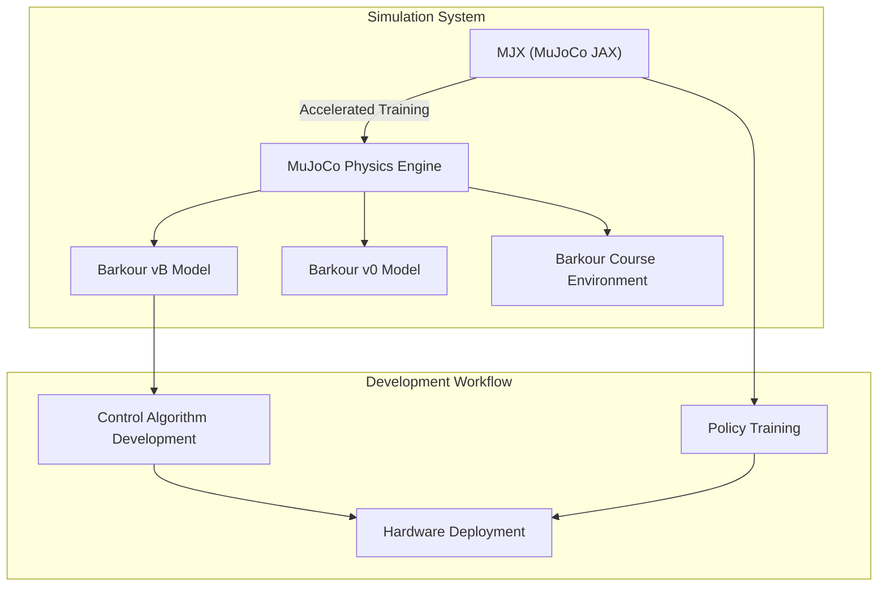
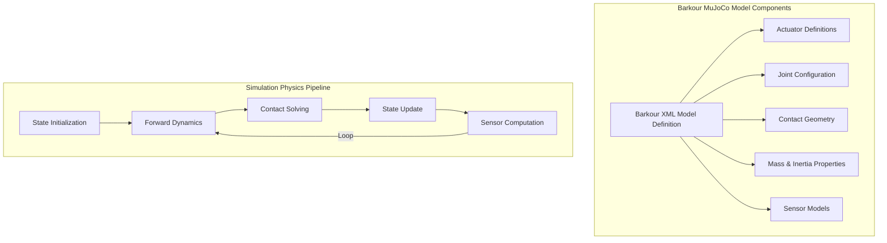
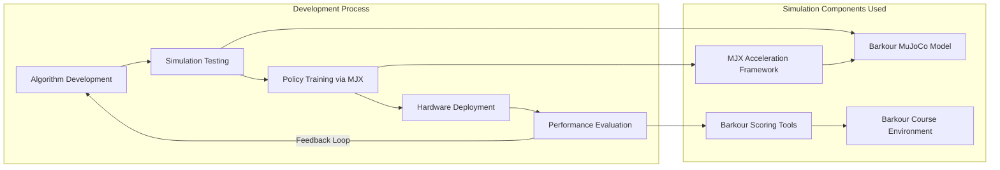

<!-- source: DeepWiki mcp.deepwiki.com · repo google-deepmind/barkour_robot · page 4 Simulation · fetched 2026-10-26 -->

# Simulation

Relevant source files

The following files were used as context for generating this wiki page:

- [README.md](README.md)

The Simulation environment for the Barkour Robot provides physics-based virtual models that accurately replicate the physical robot's behavior for algorithm development, testing, and training without requiring physical hardware access. This page covers the overall simulation architecture and integration. For specific implementation details about the MuJoCo model, see [MuJoCo Model](#4.1), and for information on accelerated training using JAX, see [MJX Training](#4.2).

## Simulation Architecture

The Barkour simulation system integrates several key components to create a comprehensive virtual environment for robot development and testing.

Title: Barkour Simulation Architecture Overview

Sources: README.md:58-65

The simulation models are housed in the MuJoCo Menagerie repository, with separate models for the current vB generation and previous v0 generation robots. The MJX integration enables accelerated training on GPUs and TPUs, significantly reducing training time for reinforcement learning policies.

## Model Structure and Components

The MuJoCo model precisely replicates the physical robot's properties to ensure transferability of control algorithms between simulation and hardware.

Title: Barkour MuJoCo Model Structure

Sources: README.md:58-67

The model implements these key components:
- Precise joint limits matching the physical robot's range of motion
- Actuator parameters calibrated to match real motor characteristics
- Accurate mass distribution and inertia tensors
- Contact and friction parameters tuned to physical behavior
- Sensor models for IMU and joint encoders

## Hardware-to-Simulation Mapping

A critical aspect of the simulation is the faithful representation of physical hardware components. The following table outlines how hardware elements are mapped to simulation counterparts:

| Hardware Component | Simulation Element | Parameters Mapped |
|-------------------|---------------------|-------------------|
| Actuators | `<actuator>` elements | Torque limits, gear ratio, damping |
| Leg linkages | `<body>` and `<joint>` chains | Joint positions, limits, mass properties |
| Body segments | `<geom>` primitives | Mass, inertia tensor, dimensions |
| IMU sensor | `<sensor>` elements | Accelerometer and gyro readings |
| Joint encoders | Position `<sensor>` elements | Position and velocity readings |
| Ground contact | Contact parameters | Friction, restitution coefficients |

Sources: README.md:58-67

This precise hardware-to-simulation mapping ensures that control algorithms developed in simulation can transfer effectively to the physical robot with minimal adjustment.

## Simulation Capabilities

The Barkour simulation environment supports a wide range of research and development activities:

1. **Algorithm Development**: Rapid prototyping and testing of control strategies
2. **Reinforcement Learning**: Accelerated policy training using MJX
3. **Dynamic Behavior Analysis**: Evaluation of complex locomotion patterns
4. **Obstacle Navigation**: Testing with standardized courses and environments

The simulation accurately reproduces the physical robot's demonstrated capabilities, including:
- Multi-leg jumping maneuvers (two-leg and four-leg jumps)
- Dynamic balance and stability control
- Navigation through complex terrain
- Manipulation tasks (for actuated head variants)

Sources: README.md:110-141

## Version Support

The repository includes simulation assets for multiple robot generations:

| Version | Repository Path | Key Features |
|---------|----------------|--------------|
| Barkour vB | mujoco_menagerie/google_barkour_vb | Current generation, supports both fixed head and actuated head variants |
| Barkour v0 | mujoco_menagerie/google_barkour_v0 | Previous generation model |
| Barkour Course | mujoco_menagerie/google_barkour_v0 | Obstacle course environment for standardized testing |

Sources: README.md:131-141

For the v0 model, additional tools are available for evaluating performance on the Barkour obstacle course, including a scoring script that can quantify performance metrics.

## Integration with Development Workflow

The simulation environment is designed to integrate seamlessly with the broader development workflow for the Barkour Robot.

Title: Barkour Development Workflow with Simulation Integration

Sources: README.md:58-67, README.md:110-141

This integrated workflow enables researchers to rapidly iterate on control strategies and policies in simulation before deploying them to physical hardware, significantly accelerating the development cycle and reducing the risk of hardware damage during experimental testing.

---

