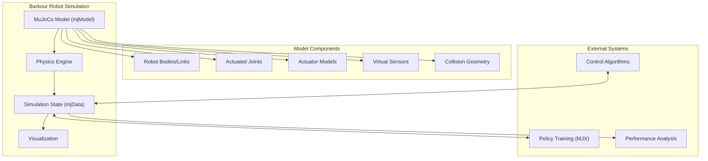
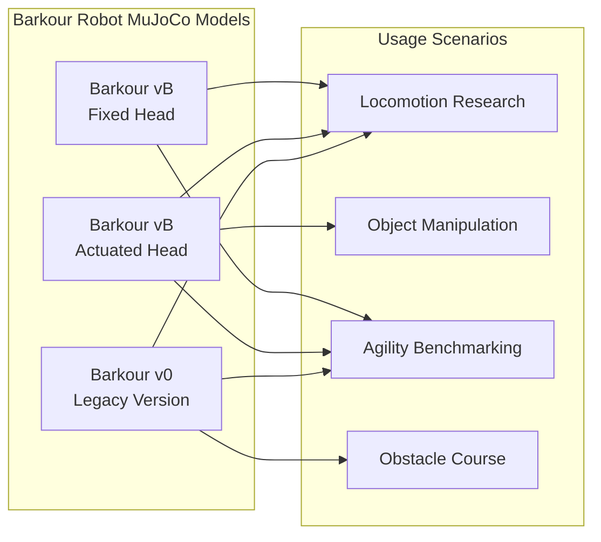
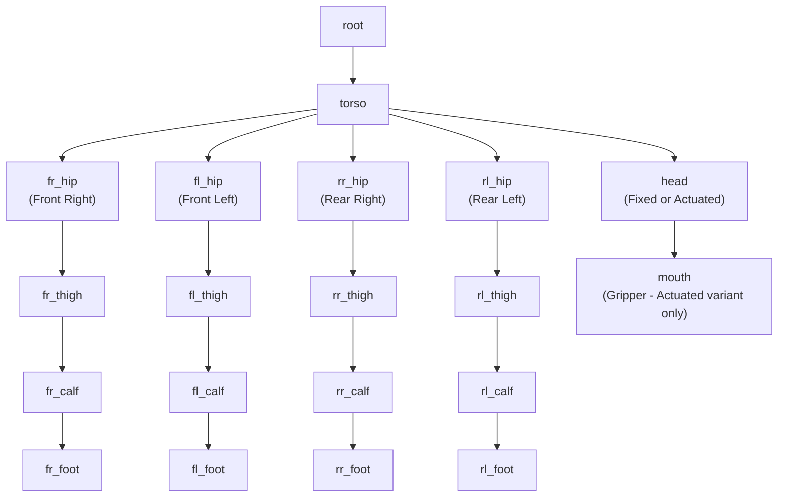
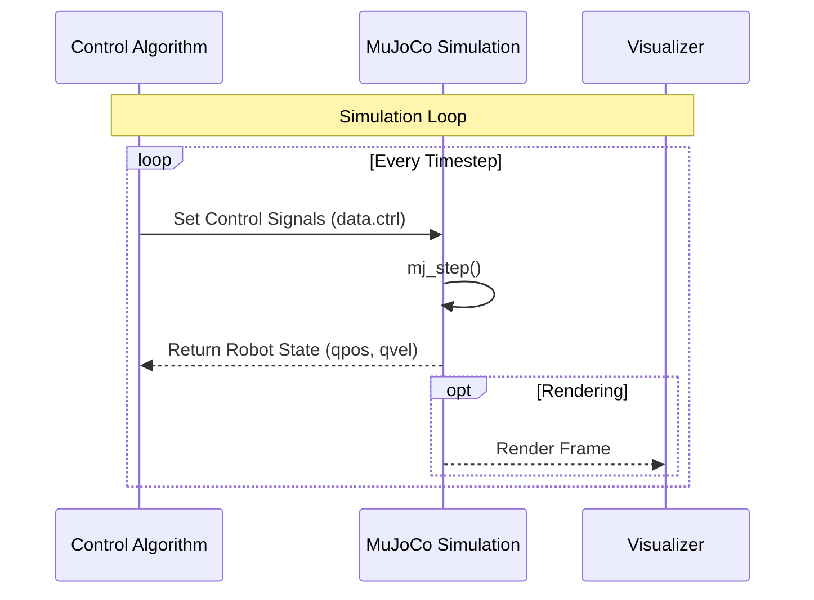
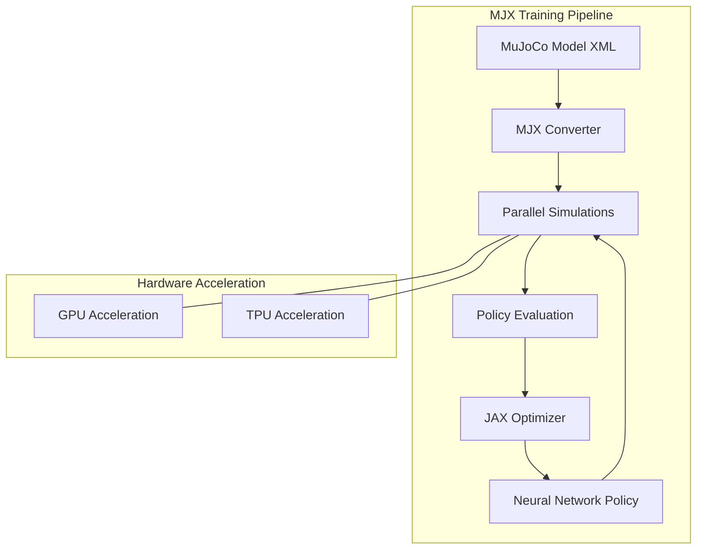

<!-- source: DeepWiki mcp.deepwiki.com · repo google-deepmind/barkour_robot · page 4.1 MuJoCo Model · fetched 2026-10-26 -->

# MuJoCo Model

<details>
<summary>Relevant source files</summary>

The following files were used as context for generating this wiki page:

- [README.md](README.md)

</details>


This document explains the MuJoCo simulation model for the Barkour Robot and how to use it for simulation and training purposes. The model provides a physics-accurate digital twin of the robot for development and testing of control algorithms without requiring physical hardware. For information about training policies with MJX, see [MJX Training](#4.2).

## Overview

The Barkour Robot MuJoCo model is a high-fidelity physics simulation of the Barkour quadruped robot. The model accurately represents the robot's mechanical structure, joint limits, inertial properties, and actuation capabilities. It serves as an essential tool for algorithm development, enabling researchers to rapidly prototype and test control strategies before deploying them to physical hardware.



Sources: [README.md:58-65]()

## Model Variants

The Barkour Robot MuJoCo model is available in multiple variants to match the different physical robot configurations:

1. **Barkour vB with fixed head** - The standard robot configuration
2. **Barkour vB with actuated head** - Includes an additional actuated head with gripper functionality
3. **Barkour v0** - An older version of the hardware with its own simulation model

Each model accurately represents its corresponding physical robot variant, including appropriate mass distribution, joint limits, and actuation parameters.



Sources: [README.md:45-48](), [README.md:132-141]()

## Model Structure

The MuJoCo model represents the Barkour Robot as a hierarchical assembly of bodies, joints, and geometric elements. The model structure follows the physical robot's design with articulated legs connected to a central body.



Sources: [README.md:58-61]()

### Key Components

The MuJoCo model consists of the following key components:

1. **Bodies** - Rigid bodies representing the robot's structural components (torso, legs, etc.)
2. **Joints** - Articulation points that define how bodies move relative to each other
3. **Actuators** - Models of the robot's motors with appropriate torque limits and dynamics
4. **Contacts** - Collision geometry for interaction with the environment
5. **Sensors** - Virtual sensors that simulate the robot's proprioception and environmental sensing
6. **Visual Meshes** - Detailed 3D models for visualization

The model's joint structure closely mimics the physical robot, with 12 actuated degrees of freedom for the legs (3 per leg: hip, thigh, and knee joints) and potentially additional degrees of freedom for the actuated head variant.

## Accessing the Model

The Barkour Robot MuJoCo model is available as part of the MuJoCo Menagerie, a collection of high-quality models maintained by DeepMind. The models can be accessed from the following repository:

- vB models (current): https://github.com/google-deepmind/mujoco_menagerie/tree/main/google_barkour_vb
- v0 models (legacy): https://github.com/google-deepmind/mujoco_menagerie/tree/main/google_barkour_v0

The models are provided in XML format (`.xml` files) along with accompanying mesh files (`.stl` or `.obj`) and textures if applicable.

Sources: [README.md:58-61](), [README.md:139-141]()

## Using the Model

### Basic Usage

To use the Barkour Robot MuJoCo model in Python with the MuJoCo bindings:

```python
import mujoco
import numpy as np

# Load the model
model = mujoco.MjModel.from_xml_path('/path/to/barkour_vb.xml')
data = mujoco.MjData(model)

# Reset the simulation
mujoco.mj_resetData(model, data)

# Simulation loop
for _ in range(1000):
    # Set control signals (e.g., joint torques)
    data.ctrl[:] = compute_control(data)
    
    # Step the simulation
    mujoco.mj_step(model, data)
    
    # Access state information
    joint_positions = data.qpos.copy()
    joint_velocities = data.qvel.copy()
    
    # Optional: Render the scene
    # renderer.render(model, data)
```

### Interacting with the Simulation

The Barkour model can be used to simulate various scenarios:

1. **Locomotion tasks** - Walking, running, jumping on different terrain types
2. **Agility benchmarks** - Testing the robot's ability to navigate obstacles and challenging terrain
3. **Manipulation tasks** - For the actuated head variant, testing object manipulation capabilities



Sources: [README.md:58-61]()

## Training with MJX

MJX is an accelerated implementation of MuJoCo for JAX, enabling fast training on GPUs and TPUs. The Barkour Robot model is compatible with MJX, allowing for efficient policy optimization.

### MJX Workflow



### Key Features of MJX for Barkour

1. **Parallelization** - Run thousands of parallel simulations for sample-efficient training
2. **Hardware acceleration** - Leverage GPUs and TPUs for faster training
3. **JAX compatibility** - Seamlessly integrate with JAX-based machine learning frameworks
4. **Automatic differentiation** - Perform gradient-based optimization through the physics

For detailed usage instructions, refer to the MJX tutorial available in the MuJoCo repository.

Sources: [README.md:63-65]()

## Barkour Obstacle Course

For the v0 version of the Barkour Robot, there is a specialized obstacle course environment designed to benchmark agility. This environment includes various obstacles and a scoring system to evaluate performance.

The Barkour course is available in the MuJoCo Menagerie repository, along with a scoring script that can be used to evaluate policy performance.

Sources: [README.md:140-141]()

## Model Parameters and Performance

The Barkour Robot MuJoCo model is calibrated to match the physical properties of the real robot. Key parameters include:

| Parameter Category | Description |
|-------------------|-------------|
| Mass Properties | Body masses and inertia tensors match the physical robot |
| Joint Limits | Accurate range of motion constraints for all joints |
| Actuator Dynamics | Models motor torque capabilities and dynamics |
| Contact Properties | Friction coefficients for foot-ground interaction |
| Sensor Models | Simulated proprioceptive sensors (joint angles, velocities) |

The model can accurately simulate a range of dynamic behaviors demonstrated by the physical robot, including:

- Walking and running gaits
- Jumping (two-leg and four-leg)
- Dynamic turning
- Push and tilt compensation
- Object manipulation (for actuated head variant)

Sources: [README.md:110-129]()

---

