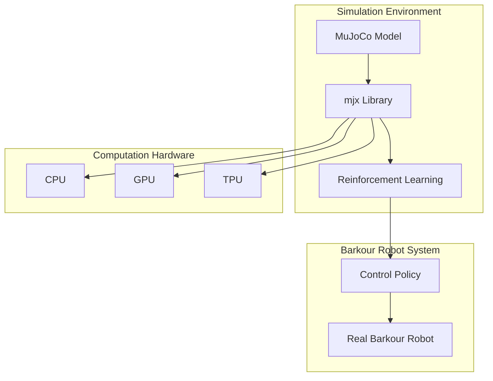
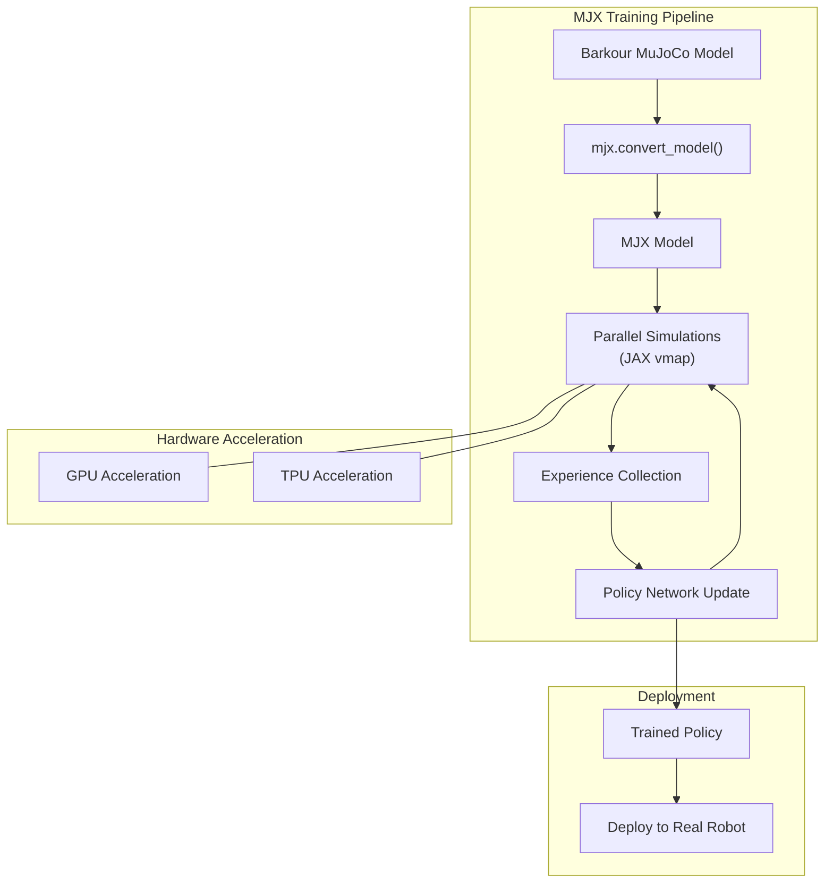
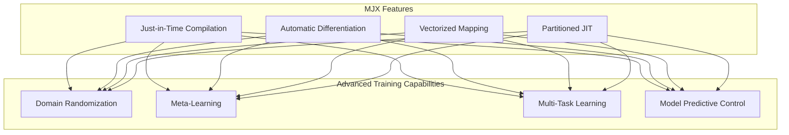

<!-- source: DeepWiki mcp.deepwiki.com · repo google-deepmind/barkour_robot · page 4.2 MJX Training · fetched 2026-10-26 -->

# MJX Training

Relevant source files

The following files were used as context for generating this wiki page:

- [README.md](README.md)

## Purpose and Scope

This document explains MJX (MuJoCo X), a JAX-based implementation of the MuJoCo physics engine that enables fast training of policies for the Barkour Robot on GPUs and TPUs. It covers what MJX is, its benefits for robotics policy training, and how it accelerates simulation-based learning for the Barkour Robot.

For information about the MuJoCo simulation model itself, see [MuJoCo Model](#4.1).

Sources: [README.md:62-65]()

## What is MJX?

MJX is a JAX-based reimplementation of the MuJoCo physics engine. Unlike standard MuJoCo which runs on CPUs, MJX leverages JAX's just-in-time (JIT) compilation and automatic differentiation capabilities to enable:

1. **Accelerated Physics Simulation**: Runs MuJoCo physics on GPUs and TPUs
2. **Massive Parallelization**: Simulates thousands of environments simultaneously
3. **Differentiable Physics**: Computes gradients through the physics simulation
4. **Policy Training**: Trains control policies for the Barkour Robot in minutes

### MJX Architecture

The following diagram illustrates how MJX fits within the Barkour Robot simulation ecosystem:

Sources: [README.md:58-65]()

## Performance Benefits

MJX dramatically accelerates policy training for the Barkour Robot through hardware acceleration and parallelization. The following table illustrates typical performance improvements:

| Configuration | Environment Throughput | Relative Speedup | Training Time Impact |
|---------------|------------------------|------------------|----------------------|
| MuJoCo on CPU (single environment) | Baseline | 1× | Hours to days |
| MJX on GPU (single environment) | 2-5× faster | 2-5× | Moderate improvement |
| MJX on GPU (1,000 parallel environments) | 100-200× faster | 100-200× | Minutes instead of days |
| MJX on TPU (1,000+ parallel environments) | 200-400× faster | 200-400× | Minutes instead of days |

This acceleration enables training complex locomotion policies for the Barkour Robot in minutes rather than days, drastically shortening the research iteration cycle.

Sources: [README.md:64-65]()

## Training Pipeline Architecture

MJX enables a highly efficient training pipeline for Barkour Robot policies through parallelization and acceleration:

The key components include:
- Conversion of the standard Barkour MuJoCo model to MJX format
- Vectorized simulation of many environments in parallel using JAX's `vmap`
- Efficient experience collection for reinforcement learning
- Policy updates using gradient-based optimization
- Deployment of the trained policy to the real Barkour Robot

Sources: [README.md:58-65]()

## Key Advantages for Barkour Robot Research

### 1. Training Efficiency

MJX's acceleration enables:
- Training complex quadrupedal locomotion policies in minutes
- Rapid iteration on policy design and reward functions
- Testing multiple hypotheses in parallel
- Running extensive hyperparameter searches

### 2. Advanced Training Techniques

The hardware acceleration and JAX integration enable sophisticated training approaches:

Sources: [README.md:64-65]()

### 3. Sim-to-Real Transfer

MJX facilitates better transfer from simulation to the physical Barkour Robot through:

- Extensive domain randomization (varying physical parameters)
- Training with simulated sensor noise and actuation delays
- Robust policy optimization across many randomized environments
- Testing policies against various disturbances and terrains

## Getting Started with MJX

To begin training Barkour Robot policies with MJX:

1. **Install Dependencies**: Ensure JAX and MuJoCo are properly installed
2. **Load the Barkour Model**: Use the model from the MuJoCo menagerie
3. **Convert to MJX Format**: Transform the model for GPU/TPU acceleration
4. **Set Up Training Loop**: Configure reinforcement learning algorithm
5. **Run Training**: Execute training on appropriate hardware
6. **Deploy Policy**: Transfer the trained policy to the real robot

For detailed implementation guidance, refer to the MJX tutorial linked in the README, which demonstrates how to train a policy in minutes.

Sources: [README.md:64-65]()

## Conclusion

MJX provides a powerful framework for accelerating Barkour Robot policy training through GPU/TPU acceleration and parallelized physics simulation. By leveraging JAX's capabilities for automatic differentiation and just-in-time compilation, MJX enables researchers to train complex quadrupedal locomotion policies in minutes rather than days, significantly speeding up the research and development cycle.

The ability to rapidly train and iterate on policies makes MJX an essential tool for developing advanced behaviors for the Barkour Robot, from basic locomotion to complex agile maneuvers like jumping, turning, and navigating obstacles.

For information about the MuJoCo simulation model used with MJX, see [MuJoCo Model](#4.1).

Sources: [README.md:58-65]()

---

