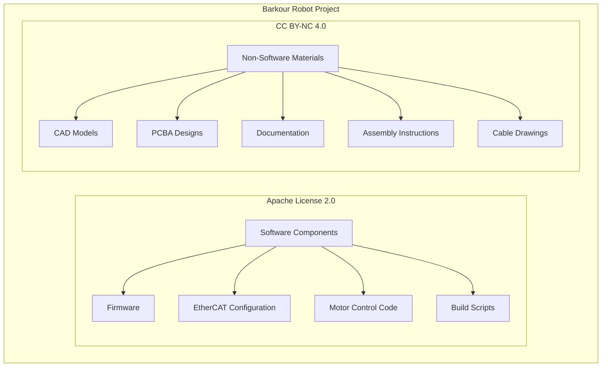
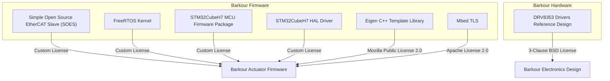
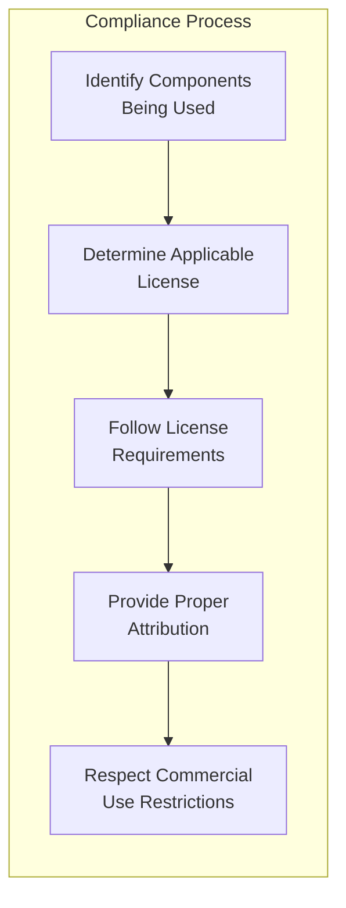

<!-- source: DeepWiki mcp.deepwiki.com · repo google-deepmind/barkour_robot · page 5 Licensing and Attribution · fetched 2026-10-26 -->

# Licensing and Attribution

<details>
<summary>Relevant source files</summary>

The following files were used as context for generating this wiki page:

- [LICENSE](LICENSE)
- [README.md](README.md)

</details>


This document provides detailed information about the licensing terms that apply to the Barkour Robot project, attribution requirements for third-party components, and guidance on how to properly cite the project in academic work.

## Overview of Licensing Approach

The Barkour Robot project employs a dual licensing approach, distinguishing between software components and other materials:

1. **Software Components**: All software is licensed under the Apache License, Version 2.0 (Apache 2.0)
2. **Non-Software Materials**: All other materials (CAD models, documentation, design files, etc.) are licensed under the Creative Commons Attribution-NonCommercial 4.0 International (CC BY-NC 4.0)

## License Distribution

The diagram below illustrates which components of the Barkour Robot project fall under each license:



Sources: [README.md:156-167]()

## License Terms Summary

### Apache License 2.0 (for Software)

The Apache License 2.0 is a permissive free software license that allows users to:

- Use the software for any purpose
- Distribute, modify, and distribute modified versions
- Patent rights for contributions
- Use the project name for attribution (but not for endorsement)

Key requirements:
- Include original copyright notice
- Include attribution notices
- State changes made to the code
- Include a copy of the license

### CC BY-NC 4.0 (for Non-Software Materials)

The Creative Commons Attribution-NonCommercial 4.0 International license allows users to:

- Share: copy and redistribute the material in any medium or format
- Adapt: remix, transform, and build upon the material

Key requirements:
- **Attribution**: Must give appropriate credit, provide a link to the license, and indicate if changes were made
- **Non-Commercial**: Cannot use the material for commercial purposes

### License Comparison

| Aspect | Apache 2.0 (Software) | CC BY-NC 4.0 (Non-Software) |
|--------|------------------------|------------------------------|
| Commercial Use | Permitted | Not permitted |
| Modification | Permitted | Permitted |
| Distribution | Permitted | Permitted |
| Private Use | Permitted | Permitted |
| License and Copyright Notice | Required | Required |
| State Changes | Required | Required |
| Disclose Source | Not required | Not required |
| Patent Grant | Explicit | Not applicable |
| Trademark Use | Restricted | Not applicable |

Sources: [README.md:156-167](), [LICENSE:5-205]()

## Third-Party Components

The Barkour Robot project incorporates or references several third-party components, each with its own licensing terms. These components are primarily used in the firmware and electronics design.



### Third-Party Component Licenses

| Component | Purpose | License |
|-----------|---------|---------|
| DRV8353 Drivers | Reference design for motor drivers | 3-Clause BSD License |
| Simple Open Source EtherCAT Slave (SOES) | EtherCAT communication | Custom license |
| FreeRTOS kernel | Real-time operating system | Custom license |
| STM32CubeH7 MCU Firmware Package | MCU support | Custom license |
| STM32CubeH7 HAL Driver | Hardware abstraction layer | Custom license |
| Eigen | C++ template library for linear algebra | Mozilla Public License 2.0 |
| Mbed TLS | SSL/TLS implementation | Apache License 2.0 |

Sources: [LICENSE:208-233]()

## Academic Citation

If you use the Barkour Robot designs or concepts in your research, please cite the following paper:

```
@article{caluwaerts2023barkour,
  title={Barkour: Benchmarking animal-level agility with quadruped robots},
  author={Caluwaerts, Ken and Iscen, Atil and Kew, J Chase and Yu, Wenhao and Zhang, Tingnan and Freeman, Daniel and Lee, Kuang-Huei and Lee, Lisa and Saliceti, Stefano and Zhuang, Vincent and others},
  journal={arXiv preprint arXiv:2305.14654},
  year={2023}
}
```

Sources: [README.md:143-154]()

## Disclaimers

### Not an Official Google Product

This project is not an official Google product, despite being developed by Google DeepMind.

### "AS IS" Basis

All software and materials distributed under the Apache 2.0 or CC BY-NC licenses are provided on an "AS IS" BASIS, WITHOUT WARRANTIES OR CONDITIONS OF ANY KIND, either express or implied. See the respective licenses for specific language governing permissions and limitations.

Sources: [README.md:156-175]()

## Compliance Guidance

### Software Use and Modification

When using or modifying the software components of the Barkour Robot project:

1. Retain all copyright notices and attributions
2. Include a copy of the Apache 2.0 license
3. Document any significant changes made to the original code
4. Do not use the names of contributors for endorsement without permission

### Non-Software Materials Use

When using the non-software materials (CAD models, documentation, etc.):

1. Provide appropriate attribution to the original project
2. Indicate if changes were made to the original materials
3. Include a link to the CC BY-NC 4.0 license
4. Do not use the materials for commercial purposes
5. Do not imply endorsement from the original creators



Sources: [README.md:156-175](), [LICENSE:5-205]()

---

