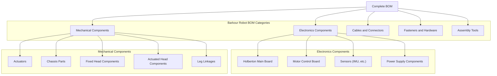
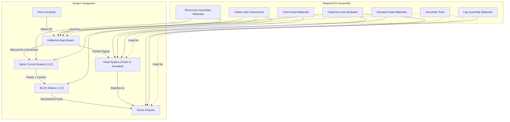
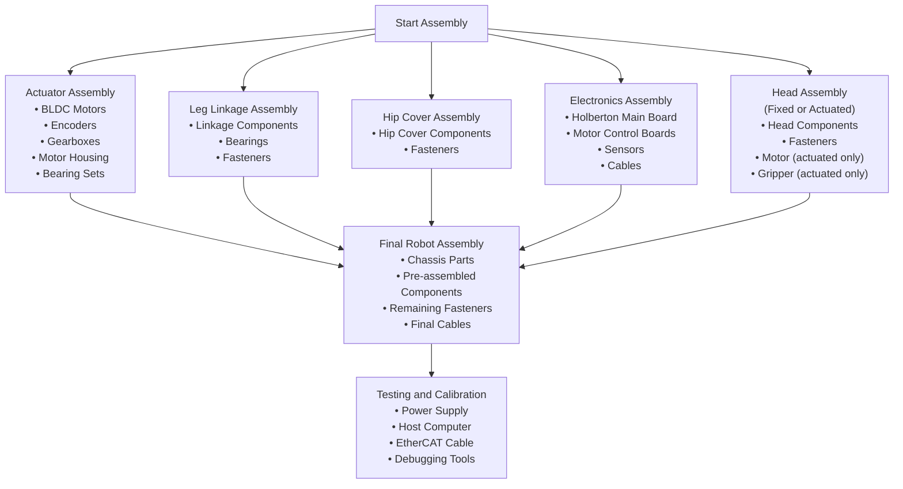

<!-- source: DeepWiki mcp.deepwiki.com · repo google-deepmind/barkour_robot · page 6 Bill of Materials · fetched 2026-10-26 -->

# Bill of Materials

Relevant source files

The following files were used as context for generating this wiki page:

- [README.md](README.md)
- [hardware/electronics/holberton/Project Outputs for Holberton/BOM/Bill of Materials-Holberton.xlsx](hardware/electronics/holberton/Project Outputs for Holberton/BOM/Bill of Materials-Holberton.xlsx)

## Purpose and Scope

This document provides a comprehensive list of all the components required to build a Barkour Robot. It covers both the fixed-head and actuated-head variants, detailing the electronic and mechanical components, fasteners, cables, and tools needed for assembly. For assembly instructions, see [Assembly Instructions](#2.3).

Sources: [README.md:93-94]()

## BOM Structure Overview

The Barkour Robot bill of materials is organized into several categories reflecting the main subsystems of the robot. The following diagram illustrates how these categories are related to the overall robot architecture:

Sources: [README.md:13-34]()

## Electronics Components

### Holberton Main Board

The Holberton Main Board is the primary control board for the Barkour Robot, providing EtherCAT communication with the host computer and connecting to the motor control boards.

| Item | Quantity | Description | Part Number | Notes |
|------|----------|-------------|-------------|-------|
| Holberton Main Board PCB | 1 | STM32H755-based main control board | HOLL-MB-001 | See schematics in hardware/electronics folder |
| STM32H755 Microcontroller | 1 | Dual-core ARM Cortex M7+M4 MCU | STM32H755ZIT6 | 480MHz M7 core, 240MHz M4 core |
| EtherCAT Interface IC | 1 | EtherCAT slave controller | LAN9252 | Interfaces with host computer |
| Accelerometer/IMU | 1 | Inertial measurement unit | ICM-20948 | 9-axis motion sensing |
| Power Regulation Components | Various | Voltage regulators, filters, etc. | - | Power distribution components |
| Mezzanine Connector | 1 | Board-to-board connector | - | Connects to child board |

Sources: [README.md:70-80]()

### Motor Control Board

Each actuator in the Barkour Robot requires a motor control board that connects to the main board.

| Item | Quantity per Actuator | Description | Part Number | Notes |
|------|----------|-------------|-------------|-------|
| Motor Control Board PCB | 1 | H-bridge driver PCB | HOLL-MC-001 | Child board to Holberton |
| H-Bridge Driver | 1 | Motor driver IC | - | Controls motor direction and speed |
| Feedback Circuit Components | Various | Position sensing components | - | Encoder interface circuits |
| STO (Safe Torque Off) Circuit | 1 | Safety circuit components | - | Emergency stop functionality |
| Connectors | Various | Board-to-board, motor connections | - | Interfaces with main board and motor |

Sources: [README.md:77-78]()

## Mechanical Components

### Actuators

The Barkour Robot uses custom actuators for each joint, providing precise control of the robot's movements.

| Item | Quantity | Description | Part Number | Notes |
|------|----------|-------------|-------------|-------|
| Brushless DC Motor | 12 | High-torque BLDC motor | - | 3 per leg × 4 legs |
| Additional Motor | 1 | For actuated head (optional) | - | Only for actuated head variant |
| Encoder | 12 | Position feedback sensor | - | One per motor |
| Gearbox | 12 | Reduction gearing | - | Torque multiplication |
| Motor Housing | 12 | Mechanical housing | - | CNC machined aluminum |
| Bearing Set | 12 | Precision bearings | - | Support for motor shaft |

Sources: [README.md:28]()

### Chassis Components

| Item | Quantity | Description | Part Number | Notes |
|------|----------|-------------|-------------|-------|
| Main Body Frame | 1 | Central structural element | - | CNC machined aluminum |
| Hip Assemblies | 4 | Hip joint mechanical parts | - | One per leg |
| Leg Linkages | 4 | Leg mechanism | - | Includes upper and lower linkages |
| Foot Elements | 4 | Contact points with ground | - | Includes grip material |
| Cover Panels | Various | External covers | - | Protective panels |

Sources: [README.md:30]()

### Head Variants

#### Fixed Head Components

| Item | Quantity | Description | Part Number | Notes |
|------|----------|-------------|-------------|-------|
| Head Frame | 1 | Structural head element | - | Non-movable head |
| Head Cover | 1 | External head cover | - | Protective cover |
| Mounting Hardware | Various | Fasteners for head mounting | - | Secures head to body |

#### Actuated Head Components (Additional/Replacement Items)

| Item | Quantity | Description | Part Number | Notes |
|------|----------|-------------|-------------|-------|
| Head Frame with Gripper | 1 | Movable head with gripper mechanism | - | Replaces fixed head |
| Actuator Motor | 1 | Motor for head movement | - | Additional to the 12 leg motors |
| Gripper Mechanism | 1 | Mouth-like gripper | - | For manipulation tasks |
| Control Electronics | 1 | Additional control board | - | For head actuation |

Sources: [README.md:33](), [README.md:96-97]()

## Cables and Connectors

| Item | Quantity | Description | Part Number | Notes |
|------|----------|-------------|-------------|-------|
| EtherCAT Cable | 1 | Connection to host computer | - | Ethernet specification |
| Motor Power Cables | 12 | Connects control boards to motors | - | High power rating |
| Encoder Cables | 12 | Feedback data connections | - | Shielded signal cables |
| Inter-Board Cables | Various | Connections between electronics boards | - | Internal connections |
| Power Supply Cable | 1 | Main power input | - | From external power source |

Sources: [README.md:25]()

## Fasteners and Hardware

| Item | Quantity | Description | Part Number | Notes |
|------|----------|-------------|-------------|-------|
| M3 Screws | Various | Various lengths | - | For electronic components |
| M4 Screws | Various | Various lengths | - | For mechanical assemblies |
| Washers | Various | For M3, M4 screws | - | Standard hardware |
| Lock Nuts | Various | Self-locking nuts | - | Vibration resistance |
| Thread Locker | 1 | Prevents loosening | - | For critical connections |

## Assembly Tools

| Tool | Purpose | Notes |
|------|---------|-------|
| Hex Key Set | For assembly screws | Metric sizes |
| Torque Screwdriver | For precise tightening | With appropriate bits |
| Soldering Equipment | For any wire connections | If customization needed |
| Multimeter | For testing electronics | Basic functionality testing |
| J-Link Debugger | For firmware flashing | Programming the microcontrollers |

## Component Hierarchy and Relationships

The following diagram illustrates how the various components in the BOM are interconnected in the assembled Barkour Robot:

Sources: [README.md:99-100]()

## Robot Variants and BOM Differences

The Barkour Robot is available in two main variants: with a fixed head or with an actuated head that includes a gripper mechanism. The following table highlights the key differences in the BOM between these variants:

| Component Category | Fixed Head Variant | Actuated Head Variant | Notes |
|-------------------|--------------------|-----------------------|-------|
| Total Motors | 12 (legs only) | 13 (legs + head) | Additional motor for head actuation |
| Motor Control Boards | 12 | 13 | One extra for head actuation |
| Head Assembly Parts | Fixed head components | Actuated head with gripper | Completely different head design |
| Cable Count | Base set | Base set + head cables | Additional cables for head actuation |
| Power Requirements | Base requirement | Slightly higher | Extra motor draws more power |
| Firmware Configuration | Standard config | Head-enabled config | Software differences for head control |

Sources: [README.md:45-50]()

## Assembly Material Flow

This flowchart shows which components from the BOM are needed at each stage of the assembly process:

Sources: [README.md:84-98]()

## Accessing the Complete BOM

The complete, detailed Bill of Materials with exact part numbers, suppliers, and quantities is available in CSV format in the repository at `hardware/barkour_robot_bill_of_materials.csv`. This file provides the most up-to-date and detailed component list needed for building the Barkour Robot.

For the detailed BOM of the Holberton electronics board, refer to the Excel file located at `hardware/electronics/holberton/Project Outputs for Holberton/BOM/Bill of Materials-Holberton.xlsx`.

Sources: [README.md:93-94]()