# Page: Overview

# Overview

<details>
<summary>Relevant source files</summary>

The following files were used as context for generating this wiki page:

- [README.md](README.md)

</details>


## Purpose and Scope

The Barkour Robot is an agile quadruped robot platform developed by Google DeepMind to support various research projects. This wiki provides comprehensive documentation of the robot's design, assembly, software, and usage. This overview page introduces the Barkour Robot project at a high level, describing its purpose, main components, and the structure of the repository.

For specific guidance on using the robot, see [Getting Started](#1.1). For information about different robot configurations, see [Versions and Variants](#1.2).

Sources: [README.md:3-8]()

## System Architecture

The Barkour Robot system consists of three primary components: hardware design, embedded software, and simulation environments. These components work together to provide a complete platform for robotics research.

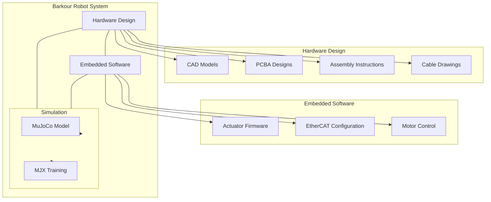

The system architecture illustrates how the hardware design, embedded software, and simulation environments interact. The hardware design includes CAD models, PCB designs, assembly instructions, and cable drawings. The embedded software includes actuator firmware, EtherCAT configuration, and motor control code. The simulation environments include MuJoCo models and MJX training capabilities.

Sources: [README.md:12-42](), [README.md:101-108]()

## Hardware Components

The Barkour Robot features a modular design with custom motor drivers, actuators, and mechanical components. The robot is available in two variants: one with a fixed head and one with an actuated head that includes a gripper.

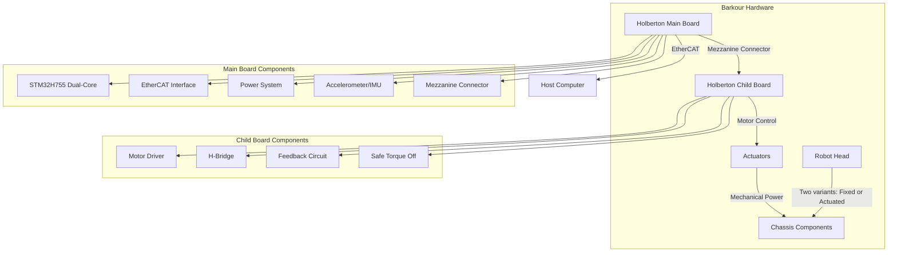

The hardware components diagram shows the relationship between the main hardware elements of the Barkour Robot. The system is built around a main board (Holberton) that connects to child boards for motor control. These boards drive the actuators, which provide mechanical power to the robot chassis. The robot head can be either fixed or actuated depending on the variant.

Sources: [README.md:70-80](), [README.md:45-50]()

## Embedded Software Architecture

The Barkour Robot's embedded software centers around the firmware for the motor drivers, which communicates with a host computer via EtherCAT for real-time control.

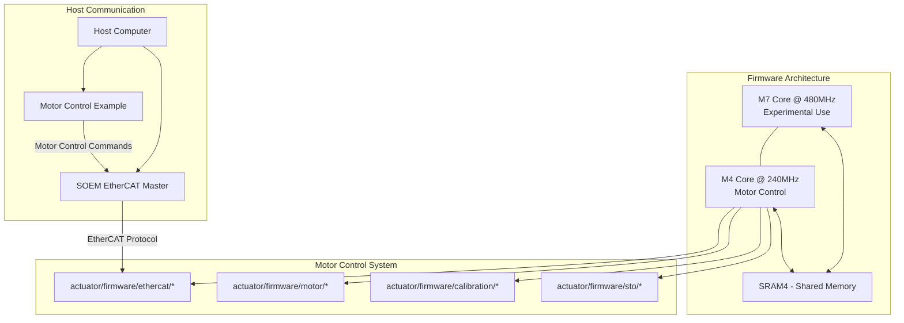

The firmware architecture diagram illustrates the motor driver's firmware based on the STM32H755 microcontroller with dual-core design. The M4 core handles the motor control processes, including EtherCAT communication, motor drive, calibration, and safety features. The host computer communicates with the motor drivers using the EtherCAT protocol.

Sources: [README.md:103-108]()

## Simulation Environment

The Barkour Robot includes simulation models for the MuJoCo physics engine, supporting both research development and fast training through MJX.

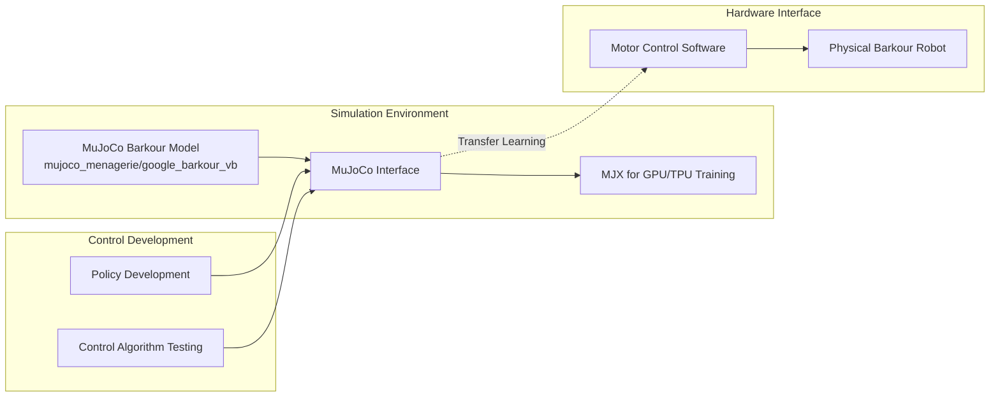

The simulation environment diagram shows how the MuJoCo simulation model interfaces with both control development and the hardware interface. The simulation allows for policy development and control algorithm testing before deployment to the physical robot. MJX provides acceleration for training on GPUs and TPUs.

Sources: [README.md:57-67]()

## Repository Structure

The Barkour Robot repository is organized into several key directories:

| Directory              | Description                                                          |
|------------------------|----------------------------------------------------------------------|
| `docs/`                | Documentation including getting started guides and assembly instructions |
| `actuator/firmware/`   | Embedded firmware for the motor drivers                              |
| `hardware/electronics/` | PCB design files for the custom electronics                         |
| `hardware/cable_drawings/` | Drawings of all custom cable assemblies                           |

Additionally, the repository links to external resources:
- CAD models hosted on Onshape
- MuJoCo simulation models in the MuJoCo Menagerie repository
- MJX tutorial for accelerated training

Sources: [README.md:12-42]()

## Robot Capabilities

The Barkour Robot platform demonstrates impressive capabilities, including:

- Dynamic movements (jumping, running, dancing)
- Environmental interaction and manipulation (with the actuated head variant)
- Robust locomotion on various terrains
- Balance and stability during external disturbances
- Climbing over obstacles
- Following language-based commands

These capabilities make the Barkour Robot a versatile platform for research in areas such as agile locomotion, manipulation, and learning-based control.

Sources: [README.md:110-141]()

## Versions

This repository contains the "vB" version of the Barkour Robot. An older "v0" version was used in earlier work, with assets available through separate links. For more information about the different versions and variants, see [Versions and Variants](#1.2).

Sources: [README.md:131-141]()

---

# Page: Getting Started

# Getting Started

<details>
<summary>Relevant source files</summary>

The following files were used as context for generating this wiki page:

- [README.md](README.md)

</details>


This guide provides essential information for new users to begin working with the Barkour Robot platform. It covers initial setup steps, basic hardware and software configuration, and points to more detailed documentation for specific tasks. For information about different robot versions and variants, see [Versions and Variants](#1.2).

## System Overview

The Barkour Robot is an agile quadruped robot platform developed by Google DeepMind for research purposes. The system integrates custom hardware, embedded firmware, and simulation capabilities.

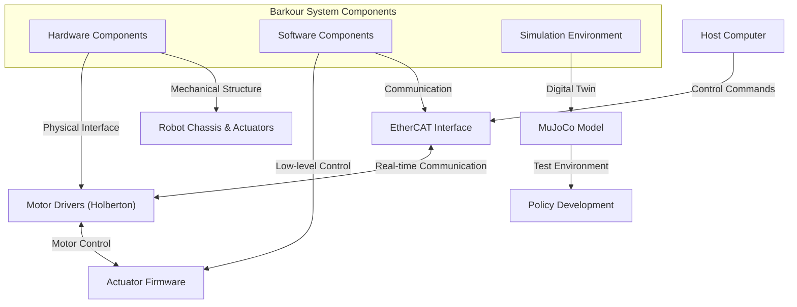

Sources: [README.md:3-8]()

## Hardware Requirements

Before getting started with the Barkour Robot, ensure you have the following:

1. **Assembled Barkour Robot** - Either build one following the assembly guides or obtain a pre-assembled unit
2. **Host Computer** - With an Ethernet port for EtherCAT communication
3. **Power Supply** - 24V power supply for the robot
4. **Ethernet Cable** - For connecting the host computer to the robot
5. **Optional: Wireless E-stop** - For emergency stopping capability

Refer to the [Bill of Materials](hardware/barkour_robot_bill_of_materials.csv) for a complete list of components if you're building from scratch.

Sources: [README.md:92-94]()

## Basic Hardware Setup

Follow these steps to set up the hardware for initial operation:

1. **Power Connection**: Connect the 24V power supply to the main board power input
2. **Network Connection**: Connect the Ethernet cable between the host computer and the robot's EtherCAT port
3. **Safety Check**: Ensure the robot is secured or placed on a stand with legs free to move
4. **Power On**: Turn on the power supply to boot the robot

For detailed assembly instructions, refer to the [Hardware](#2) section.

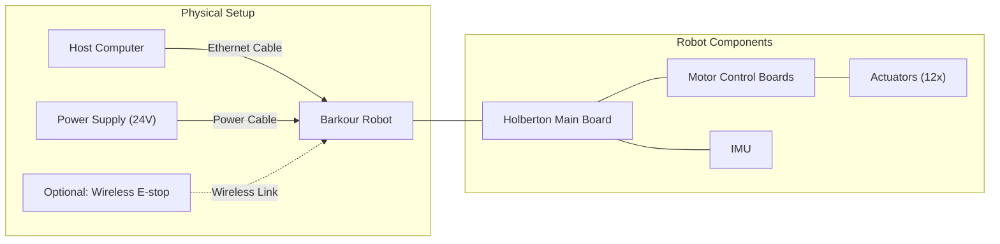

Sources: [README.md:78-80](), [README.md:26-33]()

## Software Setup

### Firmware Preparation

The Barkour Robot uses custom firmware based on the Pigweed open-source project. If you need to update or customize the firmware:

1. Follow the firmware build instructions in the [Firmware Architecture](#3.1) section
2. Flash the firmware to the motor drivers using the procedures described in [Building and Flashing](#3.2)

Most users with pre-assembled robots won't need to modify the firmware initially.

### EtherCAT Configuration

EtherCAT is the real-time communication protocol used to control the Barkour Robot. To configure it:

1. Install an EtherCAT master on your host computer
2. Configure the network interface according to the [EtherCAT Configuration](#3.4) guide
3. Set up the PDO (Process Data Object) and SDO (Service Data Object) mapping

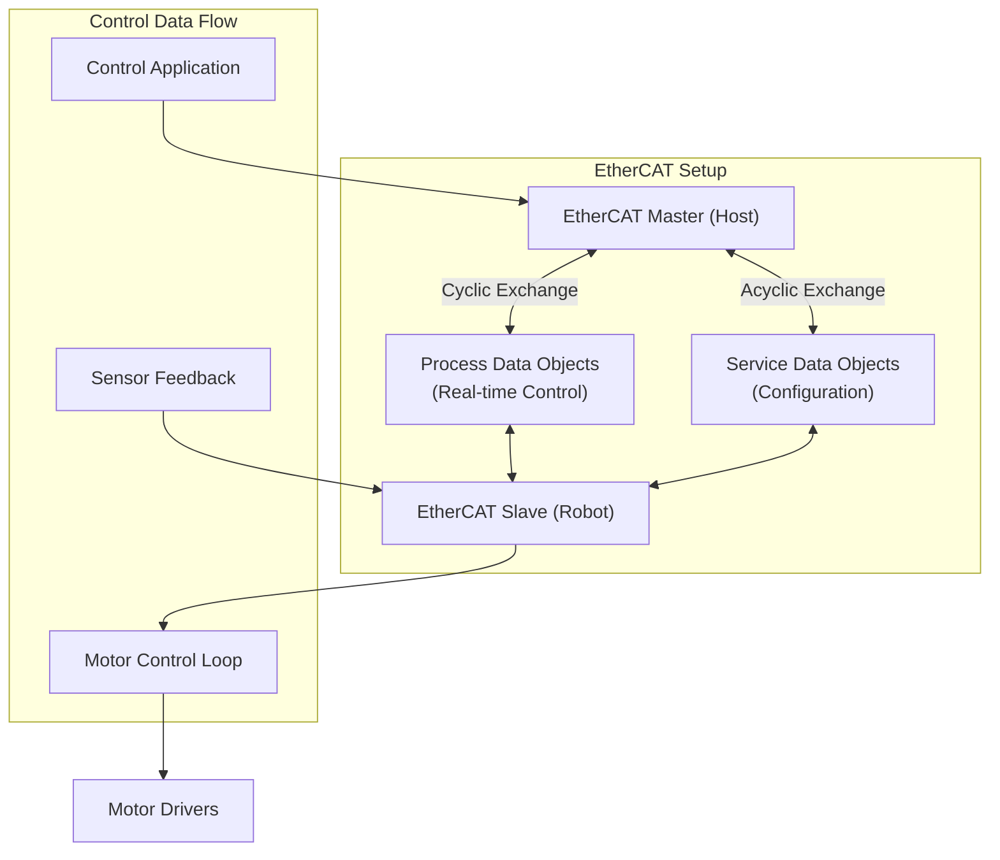

Sources: [README.md:18-20]()

## Basic Operation

### Motor Control

To start controlling the robot's motors:

1. Ensure the EtherCAT communication is established
2. If needed, perform motor calibration following the [Calibration](#3.3) guide
3. Send basic motor commands using the example code provided

The repository includes a motor control example to help you get started with basic operations:

Sources: [README.md:20]()

### Safety Considerations

When operating the Barkour Robot, always keep these safety precautions in mind:

1. **Workspace**: Ensure adequate space around the robot to prevent collisions
2. **E-stop**: Keep the emergency stop readily accessible
3. **Power Limits**: Start with low torque/power limits and gradually increase as needed
4. **Supervision**: Never leave the robot operating unattended
5. **Safe Torque Off (STO)**: Understand how to use the STO feature in emergencies

Refer to the [Error Handling](#3.5) section to understand and respond to error codes.

Sources: [README.md:31]()

## Simulation Environment

If you want to develop and test control algorithms before deploying them to the physical robot, the Barkour Robot has a detailed simulation model available:

1. **MuJoCo Model**: Available in the [MuJoCo Menagerie repository](https://github.com/google-deepmind/mujoco_menagerie/tree/main/google_barkour_vb)
2. **MJX Support**: For accelerated training on GPUs and TPUs

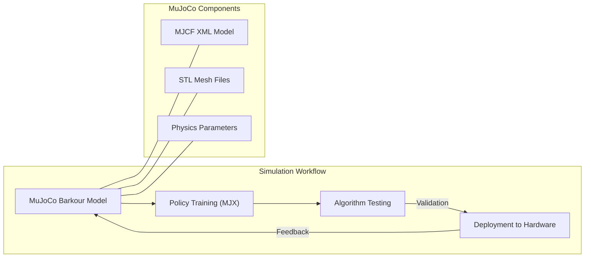

Sources: [README.md:56-67]()

## Next Steps

After you've completed the basic setup and tested the robot's functionality, you can explore these areas for further development:

- **Hardware Customization**: Review the [Hardware Specifications](#2.1) for guidance on modifying the robot
- **Firmware Development**: Learn about the [Firmware Architecture](#3.1) to customize the control logic
- **Advanced Control**: Develop advanced control algorithms using the simulation environment first
- **Integration**: Add custom sensors or actuators by studying the [Electronics Architecture](#2.2)

For the full range of the robot's capabilities, see the examples in the repository README.md.

Sources: [README.md:110-129]()

---

# Page: Versions and Variants

# Versions and Variants

<details>
<summary>Relevant source files</summary>

The following files were used as context for generating this wiki page:

- [README.md](README.md)

</details>


## Purpose and Scope

This document provides detailed information about the different versions and variants of the Barkour Robot platform. It covers both the current and legacy hardware versions, their distinguishing features, and specific capabilities. For information on hardware specifications, see [Hardware Specifications](#2.1).

## Current Version: Barkour Robot vB

The current release of the Barkour Robot platform is designated as "vB" (version B). This version represents the latest design iteration and is available in two distinct variants.

### Variant Comparison

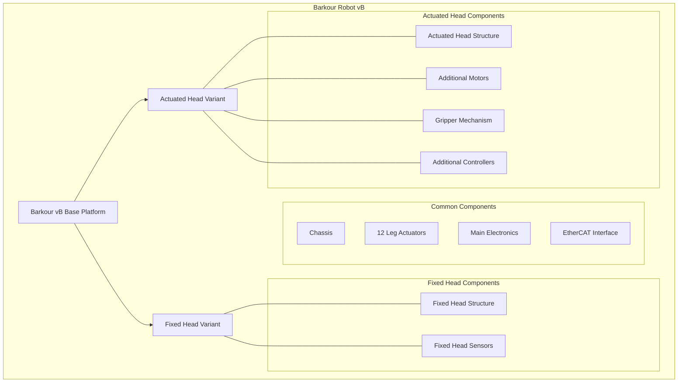

Sources: [README.md:45-50]()

### Fixed Head Variant

The fixed head variant features a non-articulating head structure rigidly attached to the robot chassis. This variant is simpler in design with fewer components and moving parts, making it more suitable for locomotion research and tasks that don't require manipulation capabilities.

Key characteristics:
- Simplified head structure with fixed mounting to the main chassis
- No additional actuators beyond the standard leg motors
- Reduced weight compared to the actuated variant
- Lower power consumption
- Primary focus on locomotion and mobility research

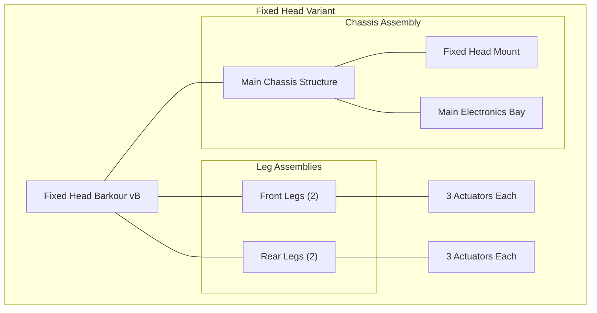

Sources: [README.md:45-47]()

### Actuated Head Variant

The actuated head variant includes an articulated head with a gripper mechanism (referred to as a "mouth" in the documentation). This variant is designed for research that combines locomotion with simple manipulation tasks.

Key characteristics:
- Articulated head with additional degrees of freedom
- Integrated gripper mechanism capable of grasping objects
- Additional actuators and control electronics for the head
- Slightly higher weight and power consumption
- Enables research in combined locomotion and manipulation

The actuated head enables the robot to perform various manipulation tasks such as:
- Picking up objects (toys, pillboxes, clothing items)
- Opening and closing household fixtures (e.g., dishwashers)
- Simple object transport tasks

Detailed assembly instructions for the actuated head can be found in the documentation. For specific assembly guidance, see [Actuated Head Assembly](#2.3.3).

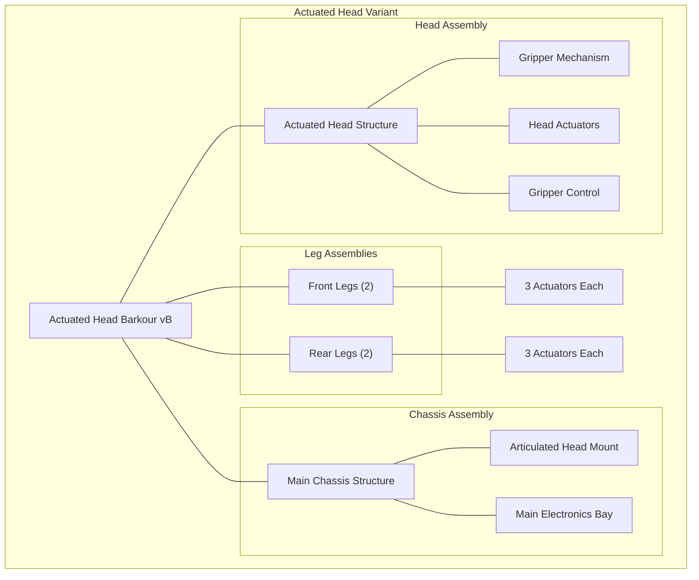

Sources: [README.md:45-50](), [README.md:124-127]()

## Legacy Version: Barkour Robot v0

Prior to the current vB release, an earlier version of the hardware designated as "v0" was used in previous research. This legacy version has different specifications and capabilities compared to the current vB version.

Key differences from vB:
- Different mechanical design and potentially different dimensions
- May have different actuator specifications
- Distinct control systems and interfaces
- Different CAD models

While the current repository focuses on the vB version, resources for the v0 version are still available for reference, including:
- CAD models
- Simplified CAD for URDF export
- Simulation environments
- Barkour obstacle course simulation
- Scoring scripts for the Barkour course

These resources can be accessed through the links provided in the repository documentation.

Sources: [README.md:131-141]()

## Version and Variant Comparison

The following table provides a side-by-side comparison of the different versions and variants of the Barkour Robot platform:

| Feature | vB Fixed Head | vB Actuated Head | v0 (Legacy) |
|---------|---------------|------------------|-------------|
| Head Type | Non-articulated | Articulated with gripper | Varies by configuration |
| Manipulation Capability | None | Basic object handling | Depends on configuration |
| Primary Use Case | Locomotion research | Combined locomotion and manipulation | Earlier research projects |
| Assembly Complexity | Lower | Higher | Not specified |
| CAD Model | Current repository | Current repository | Separate repository |
| Simulation Support | MuJoCo model available | MuJoCo model available | Legacy MuJoCo model available |
| Documentation | Comprehensive | Comprehensive | Limited in current repository |

Sources: [README.md:45-50](), [README.md:131-141]()

## Hardware Differences Visualization

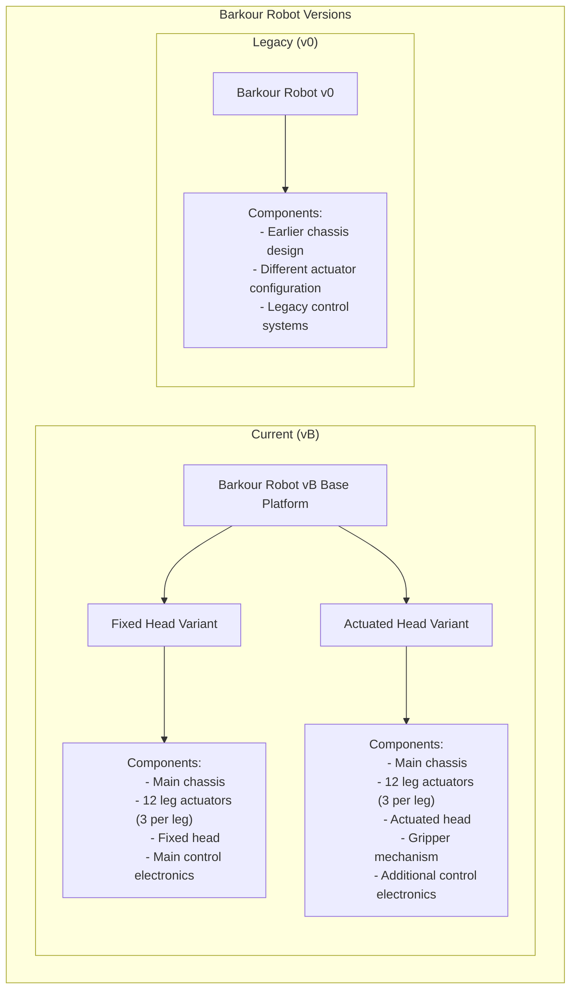

Sources: [README.md:45-50](), [README.md:131-141]()

## CAD and Simulation Resources

To support development and research with the different variants, the following resources are available:

### CAD Models
- vB Fixed Head and Actuated Head variants: Available through Onshape [README.md:47]()
- v0 Legacy version: Available through separate Onshape links [README.md:137-138]()

### Simulation Models
- vB variants: MuJoCo models available in the MuJoCo Menagerie repository [README.md:59-61]()
- v0 Legacy version: Separate MuJoCo models and Barkour obstacle course simulation [README.md:139-141]()

The simulation models support MJX for fast training on GPUs and TPUs, making them suitable for rapid prototyping and algorithm development before deployment to physical hardware.

Sources: [README.md:45-50](), [README.md:58-65](), [README.md:131-141]()

## Variant-Specific Capabilities

Each variant of the Barkour Robot has specific capabilities suited to different research needs. The following sections highlight the key capabilities of each variant.

### Fixed Head Variant Capabilities
The fixed head variant excels at locomotion tasks including:
- Two-leg and four-leg jumping
- Dynamic movement (dancing, jump turns)
- Stability control (push compensation, tilt compensation)
- Obstacle navigation (box climbing)

### Actuated Head Variant Capabilities
The actuated head variant maintains the locomotion capabilities of the fixed head variant while adding manipulation functionality:
- Object grasping and pickup (toys, pillboxes, slippers)
- Interaction with household items (closing dishwashers)
- Pick and place tasks (picking up shirts and dropping them off)
- Pushing and manipulating objects (box lids, cups)

These enhanced capabilities make the actuated head variant suitable for research in areas requiring both mobility and basic manipulation.

Sources: [README.md:114-129]()

## Software Compatibility

Both variants of the Barkour Robot vB use the same core embedded software and EtherCAT communication protocol. The actuated head variant requires additional configuration for the head actuators but uses the same fundamental control architecture.

For details on software configuration, see the firmware documentation and EtherCAT configuration guides.

Sources: [README.md:103-108]()

---

# Page: Hardware

# Hardware

<details>
<summary>Relevant source files</summary>

The following files were used as context for generating this wiki page:

- [README.md](README.md)
- [hardware/electronics/holberton/1-Holberton_TOP.SchDoc](hardware/electronics/holberton/1-Holberton_TOP.SchDoc)

</details>


This document provides an overview of the hardware components that make up the Barkour Robot system. This section covers the physical design, electronic architecture, and key specifications of the hardware platform that serves as the foundation for the quadruped robot.

For information about firmware that runs on this hardware, see [Firmware](#3). For assembly instructions, see [Assembly Instructions](#2.3).

## Hardware Overview

The Barkour Robot hardware is an integrated system designed for agile quadrupedal locomotion and optional manipulation capabilities. The system combines custom electronics, actuators, and mechanical components to create a versatile research platform.

### Hardware Component Architecture

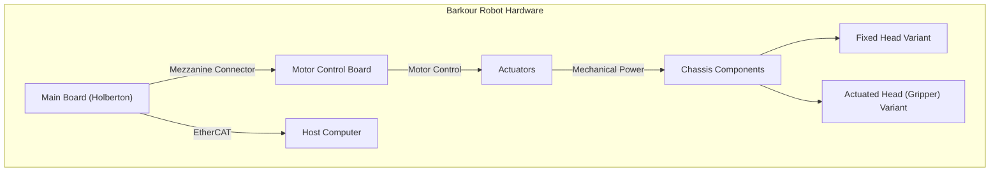

The hardware system is built around a main control board (Holberton) that interfaces with motor control boards through mezzanine connectors. The main board communicates with a host computer via EtherCAT and provides control signals to the motor drivers, which power the actuators that drive the mechanical linkages of the robot.

Sources: README.md:70-82

### Hardware Repository Structure

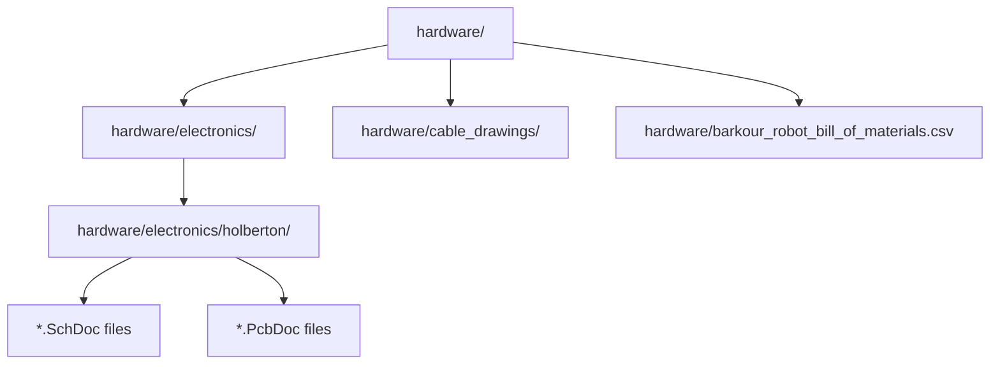

The hardware design files are organized in the repository as shown above, with electronic designs in the `hardware/electronics` directory, cable assembly drawings in `hardware/cable_drawings`, and a complete bill of materials in `hardware/barkour_robot_bill_of_materials.csv`.

Sources: README.md:21-25, README.md:70-76

## Electronic Architecture

The electronic system of the Barkour Robot is based on a custom design centered around the Holberton main board and its associated components.

### Main Board (Holberton)

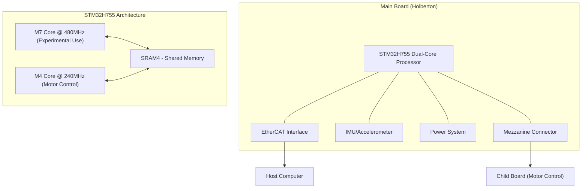

The Holberton main board features:
- STM32H755 microcontroller with dual-core architecture
  - M7 Core running at 480MHz for experimental use
  - M4 Core running at 240MHz dedicated to motor control
- EtherCAT interface for communication with the host computer
- Integrated IMU/Accelerometer for orientation sensing
- Power management system
- Mezzanine connector for interfacing with motor control boards

The dual cores communicate through shared memory in SRAM4, enabling efficient real-time control while allowing for experimental features.

Sources: hardware/electronics/holberton/1-Holberton_TOP.SchDoc

### Motor Control System

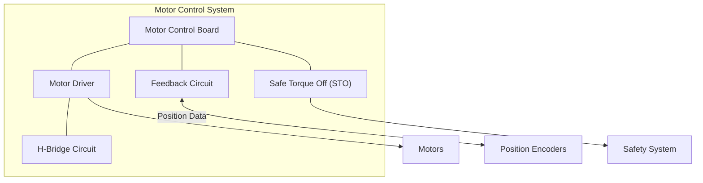

Key components of the motor control system include:
- Motor driver circuitry for generating PWM signals
- H-Bridge for bidirectional motor control
- Feedback circuits for position sensing
- Safe Torque Off (STO) functionality for safety
- Temperature monitoring circuits for thermal protection

The motor control logic runs on the M4 core of the STM32H755 microcontroller, providing real-time control of the actuators.

Sources: README.md:77-79

### Communication System

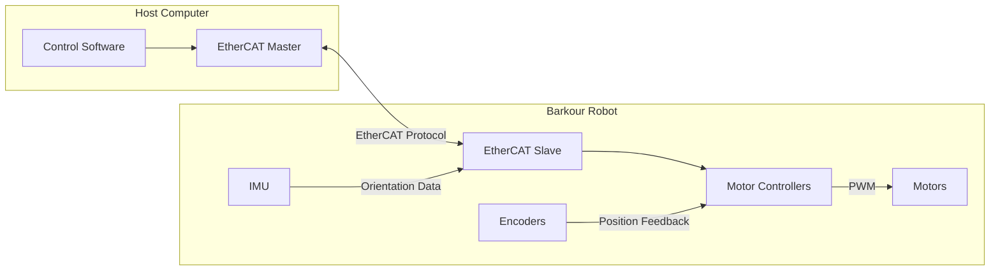

EtherCAT provides deterministic real-time control necessary for coordinated quadruped locomotion. The communication system includes:
- EtherCAT master on the host computer
- EtherCAT slave on the Holberton board
- Internal communication between the main board and motor controllers
- Sensor feedback channels for closed-loop control

Sources: README.md:77-79

## Mechanical Design

The Barkour Robot is available in two main variants:

1. **Fixed Head Version** - Standard quadruped configuration
2. **Actuated Head Version** - Includes a gripper/mouth for manipulation tasks

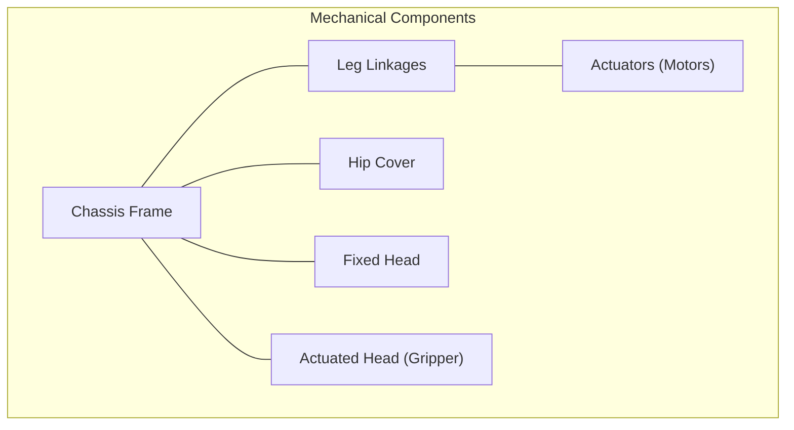

The mechanical system consists of:
- Chassis frame serving as the main structural component
- Leg linkages providing the kinematic structure for locomotion
- Actuators (motors) delivering mechanical power
- Hip covers protecting the internal components
- Optional actuated head with gripper for manipulation tasks

The CAD models for both versions are available through the [Onshape platform](https://gdm.onshape.com/documents/2587dbf423d784b45437b14a/v/b07bb08c3dc8b02bae21b866/e/bdcd5797385cee9e4f78dfef).

Sources: README.md:43-50, README.md:83-97

## Hardware-Firmware Interface

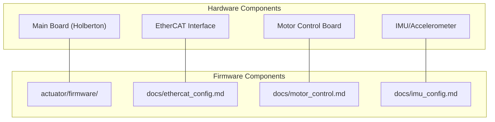

The hardware interfaces with custom firmware based on the Pigweed open-source project. The firmware runs on the dual-core STM32H755 microcontroller and implements:
- Motor control algorithms
- EtherCAT communication
- Sensor data processing
- Safety features

Sources: README.md:101-108

## Hardware Specifications

Key specifications of the Barkour Robot hardware:

| Component | Specification |
|-----------|---------------|
| Processor | STM32H755 dual-core (M7 @ 480MHz, M4 @ 240MHz) |
| Communication | EtherCAT |
| Actuators | Custom motor drivers with position feedback |
| Safety Features | Safe Torque Off (STO) |
| Sensors | IMU/Accelerometer, Position Encoders |
| Variants | Fixed Head, Actuated Head (Gripper) |
| Power | 24V system |

For detailed range of motion specifications, please refer to the [Hardware Specifications](#2.1) page.

Sources: README.md

## Bill of Materials

A comprehensive bill of materials (BOM) for building the Barkour Robot is available in the `hardware/barkour_robot_bill_of_materials.csv` file, which includes all electronic and mechanical components needed to build the robot.

Sources: README.md:92-94

## Assembly Overview

The Barkour Robot's assembly process is divided into several main steps:

1. Actuator assembly and setup
2. Leg linkage assembly
3. Hip cover assembly
4. Robot chassis assembly
5. Optional actuated head assembly
6. Wireless E-stop (STO) assembly

Detailed assembly instructions for each component are available in the documentation. For the complete assembly guide, see [Assembly Instructions](#2.3).

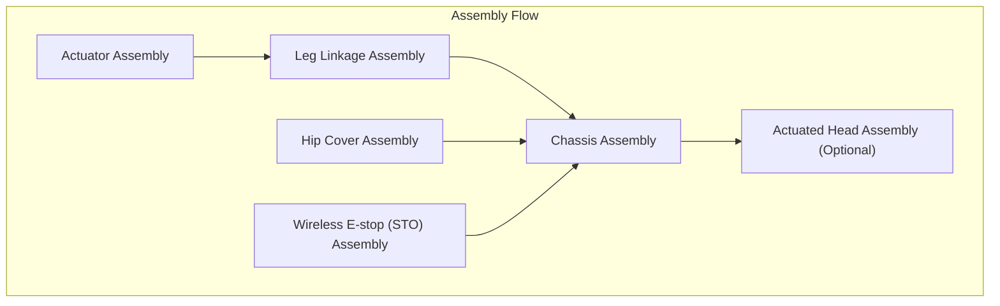

Sources: README.md:83-97

## Hardware Capabilities

The Barkour Robot hardware platform enables a wide range of capabilities, including:

- Dynamic quadrupedal locomotion
- Jumping and complex maneuvers
- Optional object manipulation with the actuated head
- Push and tilt compensation
- Climbing over obstacles

These capabilities are demonstrated in the README with various examples of the robot performing different tasks.

Sources: README.md:110-129

## Hardware Versions

This documentation covers the "vB" version of the Barkour Robot. An older version called "v0" was used in earlier work, with assets available at separate links:

- CAD models
- Simplified CAD for URDF export
- Simulation models
- Barkour obstacle course simulation

For information about the older "v0" version, please refer to the README.

Sources: README.md:131-141

---

# Page: Hardware Specifications

# Hardware Specifications

<details>
<summary>Relevant source files</summary>

The following files were used as context for generating this wiki page:

- [README.md](README.md)
- [hardware/electronics/holberton/1-Holberton_TOP.SchDoc](hardware/electronics/holberton/1-Holberton_TOP.SchDoc)

</details>


This document provides detailed technical specifications of the Barkour Robot hardware components. It covers the mechanical and electrical characteristics, communications interfaces, and performance parameters. For information about the electronics architecture, see [Electronics Architecture](#2.2), and for assembly instructions, see [Assembly Instructions](#2.3).

## 1. System Overview

The Barkour Robot is a quadrupedal robotic platform designed for agile locomotion research. The hardware platform consists of a central body chassis with four articulated legs, each with multiple degrees of freedom, and either a fixed or actuated head variant.

```mermaid
graph TD
    subgraph "Barkour Robot Hardware"
        Body["Chassis & Body"]
        Legs["Legs (4)"]
        Actuators["Smart Actuators"]
        Electronics["Electronics System"]
        Head["Head (Fixed or Actuated)"]
        Power["Power System"]
    end

    Body --- Legs
    Body --- Head
    Body --- Electronics
    Body --- Power
    Legs --- Actuators
    Electronics --- Actuators
```

Sources: README.md:1-12, README.md:43-48

## 2. Physical Specifications

### 2.1 Form Factor and Dimensions

The Barkour Robot is a quadruped robot with a dog-like form factor, featuring four articulated legs and either a fixed head or an actuated head with a gripper capability.

| Parameter | Specification |
|-----------|---------------|
| Body Type | Quadruped |
| Head Variants | Fixed or Actuated (with gripper) |
| Weight | [Not specified in provided materials] |
| Dimensions | [Not specified in provided materials] |

Sources: README.md:43-48, README.md:111-127

### 2.2 Degrees of Freedom

```mermaid
graph LR
    subgraph "Leg Joint Configuration"
        Hip["Hip Joint"]
        Knee["Knee Joint"]
        Ankle["Ankle Joint"]
    end

    subgraph "Head Joint Configuration"
        Neck["Neck Joint"]
        Mouth["Mouth/Gripper Joint"]
    end
    
    Hip --- Knee
    Knee --- Ankle
    
    classDef default fill:none,stroke:#333
```

Each leg has multiple degrees of freedom allowing for complex motion patterns. The actuated head variant adds additional degrees of freedom for manipulation tasks.

Sources: README.md:111-127

## 3. Electrical System

### 3.1 Motor Control System

The Barkour Robot uses custom motor drivers based on the Holberton boards, which provide precise control of the robot's actuators.

```mermaid
graph TB
    subgraph "Motor Control System"
        MainBoard["Holberton Main Board"]
        ChildBoard["Holberton Child Board"]
        MotorDrivers["Motor Drivers"]
        Actuators["Actuators"]
    end

    subgraph "Control Interface"
        HostComputer["Host Computer"]
        EtherCAT["EtherCAT Interface"]
    end

    HostComputer --- EtherCAT
    EtherCAT --- MainBoard
    MainBoard --- ChildBoard
    ChildBoard --- MotorDrivers
    MotorDrivers --- Actuators

    classDef default fill:none,stroke:#333
```

The motor control system is based on a dual-processor architecture using STM32H755 microcontrollers, featuring:

| Component | Specification |
|-----------|---------------|
| Processor | STM32H755 dual-core (M7 @ 480MHz, M4 @ 240MHz) |
| Communication | EtherCAT protocol |
| Control Method | Smart actuators with embedded controllers |
| Safety Features | Safe Torque Off (STO) |

Sources: README.md:77-80, hardware/electronics/holberton/1-Holberton_TOP.SchDoc

### 3.2 Electronics Architecture

The main electronic components of the Barkour Robot include:

```mermaid
graph TD
    subgraph "Electronics System"
        MainBoard["Holberton Main Board"]
        ChildBoard["Motor Control Child Boards"]
        EtherCAT["EtherCAT Interface"]
        IMU["IMU/Accelerometer"]
        PowerMgmt["Power Management"]
    end
    
    MainBoard --- ChildBoard
    MainBoard --- EtherCAT
    MainBoard --- IMU
    MainBoard --- PowerMgmt
    
    classDef default fill:none,stroke:#333
```

| Component | Description |
|-----------|-------------|
| Holberton Main Board | Central control board with processor and communications |
| Motor Control Boards | Child boards for driving actuators |
| EtherCAT Interface | Real-time communication protocol for robot control |
| IMU/Accelerometer | Inertial measurement for balance and orientation |
| Power System | Power distribution and management |

Sources: hardware/electronics/holberton/1-Holberton_TOP.SchDoc, README.md:77-80

### 3.3 Power Specifications

The Barkour Robot operates on 24V DC power:

| Parameter | Specification |
|-----------|---------------|
| Main Input Voltage | 24V DC |
| Logic Voltage | 3.3V |
| Analog Voltage | 3.3V (Separate) |
| 5V Rail | Available for peripherals |

Sources: hardware/electronics/holberton/1-Holberton_TOP.SchDoc

## 4. Communication and Interfaces

### 4.1 External Communication

```mermaid
graph LR
    subgraph "Communication Pathways"
        HostPC["Host Computer"]
        EtherCAT["EtherCAT"]
        Robot["Barkour Robot"]
    end
    
    HostPC <-- "EtherCAT Protocol" --> Robot
    
    classDef default fill:none,stroke:#333
```

The Barkour Robot uses EtherCAT as its primary communication protocol, providing deterministic real-time control necessary for coordinated quadruped locomotion.

Sources: README.md:77-80, README.md:105-108

### 4.2 Internal Communication

```mermaid
graph TD
    subgraph "Internal Communication Bus"
        MainBoard["Main Board (Holberton)"]
        ChildBoards["Motor Control Boards"]
        IMU["IMU/Accelerometer"]
        EncoderSPI["Encoder SPI"]
        MotorPWM["Motor PWM Control"]
    end
    
    MainBoard <-- "Mezzanine Connector" --> ChildBoards
    MainBoard <-- "SPI" --> IMU
    MainBoard <-- "SPI" --> EncoderSPI
    ChildBoards <-- "PWM" --> MotorPWM
    
    classDef default fill:none,stroke:#333
```

The internal communication architecture includes:

| Interface | Purpose |
|-----------|---------|
| Mezzanine Connector | Connection between main and child boards |
| SPI | Interface for sensors and encoders |
| PWM | Motor control signals |
| I2C | Secondary peripheral communication |

Sources: hardware/electronics/holberton/1-Holberton_TOP.SchDoc

## 5. Sensors and Feedback Systems

The Barkour Robot includes various sensors for control and stability:

```mermaid
graph TD
    subgraph "Sensor Systems"
        IMU["IMU/Accelerometer"]
        EncoderABZ["Encoder ABZ"]
        ThermalSensors["Thermal Sensors"]
        CurrentSensors["Current Sensors"]
        VoltageSensors["Voltage Sensors"]
    end
    
    IMU --- Control["Control System"]
    EncoderABZ --- Control
    ThermalSensors --- Control
    CurrentSensors --- Control
    VoltageSensors --- Control
    
    classDef default fill:none,stroke:#333
```

| Sensor Type | Function |
|-------------|----------|
| IMU/Accelerometer | Orientation and balance feedback |
| Encoders | Position feedback for actuators |
| Thermal Sensors | Temperature monitoring for motors and drivers |
| Current Sensors | Motor current monitoring |
| Voltage Sensors | System voltage monitoring |

Sources: hardware/electronics/holberton/1-Holberton_TOP.SchDoc

## 6. Head Variants

The Barkour Robot is available in two configurations:

```mermaid
graph TD
    subgraph "Robot Variants"
        Base["Base Robot Platform"]
        FixedHead["Fixed Head Variant"]
        ActuatedHead["Actuated Head Variant\n(with Gripper)"]
    end
    
    Base --- FixedHead
    Base --- ActuatedHead
    
    classDef default fill:none,stroke:#333
```

### 6.1 Fixed Head

The standard variant with a fixed head provides a simpler, more robust design for locomotion research.

### 6.2 Actuated Head

The actuated head variant includes a gripper mechanism ("mouth") that enables object manipulation:

| Capability | Description |
|------------|-------------|
| Gripper | Can grasp and manipulate objects |
| Head Movement | Can position the head/gripper as needed |
| Example Tasks | Picking up objects, opening/closing drawers, manipulating boxes |

Sources: README.md:43-48, README.md:123-127

## 7. Performance Capabilities

The Barkour Robot demonstrates a range of dynamic capabilities:

| Capability | Description |
|------------|-------------|
| Two-leg jumping | Vertical jumps using two legs |
| Four-leg jumping | Coordinated vertical jumps using all four legs |
| Jump turning | Jumping while rotating |
| Dynamic stability | Compensation for pushes and tilts |
| Climbing | Ability to climb onto objects like boxes |
| Object manipulation | Picking up and manipulating objects (actuated head variant) |

Sources: README.md:111-129

## 8. Safety Features

The robot includes multiple safety features:

```mermaid
graph LR
    subgraph "Safety Systems"
        STO["Safe Torque Off (STO)"]
        FSOE["Failsafe over EtherCAT"]
        WirelessE["Wireless E-stop"]
        ThermalProtection["Thermal Protection"]
    end
    
    STO --- Motors["Motor Control"]
    FSOE --- Motors
    WirelessE --- STO
    ThermalProtection --- Motors
    
    classDef default fill:none,stroke:#333
```

| Safety Feature | Function |
|----------------|----------|
| Safe Torque Off (STO) | Emergency power shutdown for actuators |
| Wireless E-stop | Remote emergency stop capability |
| Thermal monitoring | Protection against overheating |
| Current limiting | Protection against overcurrent conditions |

Sources: hardware/electronics/holberton/1-Holberton_TOP.SchDoc, README.md:31

## 9. Range of Motion

The Barkour Robot features an extensive range of motion across its joints, enabling agile movement. For complete details on the range of motion specifications, refer to the dedicated document: [Range of Motion](#2.4).

Sources: README.md:24

## 10. Additional Resources

For more detailed information about specific aspects of the Barkour Robot hardware:

| Resource | Location |
|----------|----------|
| Electronics designs | hardware/electronics folder |
| Cable assembly drawings | hardware/cable_drawings folder |
| Bill of Materials | hardware/barkour_robot_bill_of_materials.csv |
| CAD models | Onshape (link in README) |

Sources: README.md:69-76, README.md:92-94

---

# Page: Electronics Architecture

# Electronics Architecture

<details>
<summary>Relevant source files</summary>

The following files were used as context for generating this wiki page:

- [hardware/electronics/holberton/1-Holberton_TOP.SchDoc](hardware/electronics/holberton/1-Holberton_TOP.SchDoc)
- [hardware/electronics/holberton/Holberton.PrjPcb](hardware/electronics/holberton/Holberton.PrjPcb)
- [hardware/electronics/holberton/Holberton.PrjPcbStructure](hardware/electronics/holberton/Holberton.PrjPcbStructure)

</details>


## Purpose and Scope

This document provides a comprehensive overview of the electronic system architecture used in the Barkour Robot. It covers the hardware components, their interconnections, and the overall organization of the robot's electronic systems. This page focuses on the architecture at a system level; for detailed specifications of individual components, refer to [Hardware Specifications](#2.1), and for specific details about board designs, refer to the respective pages for the [Main Board](#2.2.1) and [Motor Control Board](#2.2.2).

## System Overview

The Barkour Robot's electronics are built around a two-board design consisting of a main controller board (Holberton) and motor control boards that drive the robot's actuators. The system uses EtherCAT for real-time communication with the host computer, providing precise control and coordination of the robot's movements.

```mermaid
graph TD
    subgraph "Host Computer"
        Host["Host Computer"]
        EtherCATMaster["EtherCAT Master"]
    end
    
    subgraph "Main Board (Holberton)"
        Processor["STM32H755 Dual-Core<br>Processor"]
        EtherCATSlave["EtherCAT Slave"]
        IMU["IMU/Accelerometer"]
        Power["Power System"]
        MezzConn["Mezzanine Connector"]
    end
    
    subgraph "Motor Control Board"
        MotorDriver["Motor Driver"]
        HBridge["H-Bridge (3-Phase)"]
        Feedback["Feedback Circuit"]
        STO["Safe Torque Off (STO)"]
    end
    
    Host --- EtherCATMaster
    EtherCATMaster --- EtherCATSlave
    
    EtherCATSlave --- Processor
    Processor --- IMU
    Processor --- MezzConn
    Power --- Processor
    
    MezzConn --- MotorDriver
    MotorDriver --- HBridge
    MotorDriver --- STO
    MotorDriver --- Feedback
    
    HBridge --- Motor["Actuator Motor"]
    Motor --- Encoder["Encoder"]
    Encoder --- Feedback
```

**Diagram: Barkour Robot Electronics System Overview**

Sources: 
- [hardware/electronics/holberton/Holberton.PrjPcbStructure]()
- [hardware/electronics/holberton/1-Holberton_TOP.SchDoc]()

## Main Board Architecture

The main board (Holberton) serves as the central controller for the robot. It hosts the main processor, communication interfaces, sensors, and connects to the motor control boards.

### Processor

The Barkour Robot uses an STM32H755 microcontroller with a dual-core architecture:
- **M7 Core**: Runs at 480MHz, available for experimental use
- **M4 Core**: Runs at 240MHz, primarily responsible for motor control

The cores communicate through shared memory (SRAM4), allowing efficient data exchange while maintaining clear separation of responsibilities.

```mermaid
graph TD
    subgraph "STM32H755 Dual-Core Architecture"
        M7["M7 Core @ 480MHz<br>Experimental Use"]
        M4["M4 Core @ 240MHz<br>Motor Control"]
        SharedMem["Shared Memory (SRAM4)"]
        
        M7 <--> SharedMem
        M4 <--> SharedMem
    end
    
    subgraph "Peripherals & Interfaces"
        EtherCAT["EtherCAT Interface"]
        SPI["SPI Interfaces"]
        ADC["ADC Channels"]
        PWM["PWM Outputs"]
        I2C["I2C Interface"]
    end
    
    M4 --- EtherCAT
    M4 --- SPI
    M4 --- ADC
    M4 --- PWM
    M4 --- I2C
    
    EtherCAT --- Host["Host Computer"]
    SPI --- Sensors["Sensors & External ICs"]
    ADC --- Feedback["Feedback Signals"]
    PWM --- MotorControl["Motor Control"]
    I2C --- ExternalDevices["External Devices"]
```

**Diagram: STM32H755 Processor Architecture**

Sources:
- [hardware/electronics/holberton/Processor.SchDoc]()
- [hardware/electronics/holberton/ProcessorSupport.SchDoc]()

### Communication Interfaces

The main board implements several communication interfaces:

1. **EtherCAT**: Primary interface for real-time communication with the host computer
2. **SPI**: Multiple interfaces for communicating with sensors and peripheral ICs
3. **I2C**: For communication with additional devices
4. **Mezzanine Connector**: High-density connector for interfacing with the motor control boards

### Sensors

The main board includes an integrated accelerometer/IMU for measuring orientation and acceleration, which is critical for balance and motion control. Temperature sensors are also included to monitor system temperature.

### Power System

The power system on the main board provides the necessary voltage rails:

- **24V**: Main power input for actuators
- **5V**: Intermediate supply
- **3.3V**: Digital logic supply
- **3.3VA**: Analog circuitry supply

The power system includes protection circuitry and voltage monitoring to ensure safe operation.

Sources:
- [hardware/electronics/holberton/Power.SchDoc]()
- [hardware/electronics/holberton/1-Holberton_TOP.SchDoc]()
- [hardware/electronics/holberton/Accelerometer.SchDoc]()

## Motor Control Board Architecture

The motor control boards connect to the main board via a mezzanine connector and are responsible for driving the actuator motors. Each motor control board contains all the necessary circuitry to control a single actuator.

```mermaid
graph TD
    subgraph "Motor Control Board"
        MCU["Motor Control Logic"]
        Driver["Motor Driver Circuitry"]
        HBridge["3-Phase H-Bridge"]
        FeedbackCircuit["Feedback Circuit"]
        STOcircuit["Safe Torque Off (STO)"]
        TempSensors["Temperature Sensors"]
    end
    
    subgraph "External Components"
        Motor["Actuator Motor"]
        Encoder["Encoder"]
    end
    
    MezzConn["Mezzanine Connector"] --- MCU
    MCU --- Driver
    Driver --- HBridge
    Driver --- STOcircuit
    MCU --- FeedbackCircuit
    MCU --- TempSensors
    
    HBridge --- Motor
    Motor --- Encoder
    Encoder --- FeedbackCircuit
    
    TempSensors --- Motor
```

**Diagram: Motor Control Board Architecture**

### Motor Driver

The motor driver circuitry generates the precise PWM signals necessary to drive the H-Bridge, which in turn controls the motor phases. The driver incorporates current limiting, voltage monitoring, and thermal protection.

### H-Bridge

The motor control board uses a 3-phase H-Bridge configuration to drive the BLDC motors used in the robot's actuators. The H-Bridge converts the PWM signals from the motor driver into the appropriate voltage and current levels for the motor windings.

### Feedback Systems

The feedback circuitry processes signals from:

- **Encoders**: Provides position feedback
- **Current Sensors**: Monitors phase currents
- **Voltage Sensors**: Monitors bus and phase voltages
- **Temperature Sensors**: Monitors motor and drive temperatures

This feedback is essential for closed-loop control of the actuators, ensuring precise movement and torque control.

### Safety Features

The motor control board includes a Safe Torque Off (STO) circuit that can quickly disable the motor driver in case of a fault condition. This ensures that the robot can safely stop operation if an error is detected, reducing the risk of damage or injury.

Sources:
- [hardware/electronics/holberton/1-Holberton_Child_Top.SchDoc]()
- [hardware/electronics/holberton/Drive.SchDoc]()
- [hardware/electronics/holberton/Feedback.SchDoc]()
- [hardware/electronics/holberton/HBridge.SchDoc]()
- [hardware/electronics/holberton/STO.SchDoc]()
- [hardware/electronics/holberton/Temperature.SchDoc]()

## Communication Architecture

The Barkour Robot uses a hierarchical communication architecture to enable precise control and coordination of its movements.

```mermaid
graph LR
    subgraph "Host Computer"
        ControlSoftware["Control Software"]
        EtherCATMaster["EtherCAT Master"]
    end
    
    subgraph "Main Board (Holberton)"
        EtherCATSlave["EtherCAT Slave"]
        ProcessorM4["Processor M4 Core"]
        MezzInterface["Mezzanine Interface"]
    end
    
    subgraph "Motor Control Board"
        MotorController["Motor Controller"]
        Feedback["Feedback Processing"]
    end
    
    subgraph "External Components"
        Motor["Actuator Motor"]
        Encoder["Encoder"]
    end
    
    ControlSoftware --> EtherCATMaster
    EtherCATMaster <--> |"EtherCAT Protocol"| EtherCATSlave
    EtherCATSlave --> ProcessorM4
    ProcessorM4 <--> MezzInterface
    
    MezzInterface <--> MotorController
    MotorController --> Motor
    Motor --> Encoder
    Encoder --> Feedback
    Feedback --> MotorController
    
    MotorController --> |"Status & Feedback"| MezzInterface
    ProcessorM4 --> |"Commands & Status"| EtherCATSlave
```

**Diagram: Communication Architecture**

### EtherCAT Communication

EtherCAT (Ethernet for Control Automation Technology) is the primary communication protocol between the host computer and the Barkour Robot. It provides deterministic, real-time communication with low latency and high throughput, which is essential for precise control of the robot's movements.

The EtherCAT implementation includes:
- **Process Data Objects (PDOs)**: For cyclic transmission of control data
- **Service Data Objects (SDOs)**: For configuration and parameter access
- **File Over EtherCAT (FoE)**: For firmware updates

### Internal Communication

Communication between the main board and motor control boards occurs through the mezzanine connector, which provides a high-speed, parallel interface. This interface carries:

- Motor control commands
- Feedback data (position, current, etc.)
- Status information
- Safety signals

Sources:
- [hardware/electronics/holberton/EtherCATConnectors.SchDoc]()
- [hardware/electronics/holberton/Trinamic.SchDoc]()
- [hardware/electronics/holberton/MezzanineConnectors_Cortes.SchDoc]()

## Firmware Architecture Overview

The firmware architecture is designed to take advantage of the dual-core processor, with specific responsibilities assigned to each core.

```mermaid
graph TD
    subgraph "STM32H755 Firmware Architecture"
        M7Core["M7 Core (480MHz)"]
        M4Core["M4 Core (240MHz)"]
        SharedMem["Shared Memory"]
    end
    
    subgraph "M4 Core Responsibilities"
        MotorControl["Motor Control Loop"]
        EtherCATComm["EtherCAT Communication"]
        FeedbackProcessing["Feedback Processing"]
        SafetyMonitoring["Safety Monitoring"]
    end
    
    subgraph "Flash Memory Management"
        Bank1["Flash Bank 1<br>(Active Firmware)"]
        Bank2["Flash Bank 2<br>(Update Target)"]
        BankSwap["Bank Swap Mechanism"]
    end
    
    M7Core <--> SharedMem
    M4Core <--> SharedMem
    
    M4Core --> MotorControl
    M4Core --> EtherCATComm
    M4Core --> FeedbackProcessing
    M4Core --> SafetyMonitoring
    
    Bank1 <--> BankSwap
    Bank2 <--> BankSwap
    
    Update["Firmware Update"] --> Bank2
    BankSwap --> Boot["Boot Process"]
```

**Diagram: Firmware Architecture Overview**

### Core Responsibilities

- **M4 Core (240MHz)**: Handles real-time tasks including motor control, EtherCAT communication, and safety monitoring. This core runs a deterministic control loop to ensure precise timing of motor commands.

- **M7 Core (480MHz)**: Available for experimental use and more complex computational tasks. The M7 core can perform tasks that do not require strict real-time guarantees.

### Firmware Update Mechanism

The firmware includes a bank swap mechanism for reliable updates:
1. New firmware is written to the inactive flash bank
2. A flag is set to indicate a pending bank swap
3. On the next boot, the processor switches to the new firmware bank
4. If the new firmware fails to boot properly, the system can revert to the previous bank

This mechanism ensures that firmware updates can be performed safely without risking an unrecoverable failure.

Sources:
- [hardware/electronics/holberton/Processor.SchDoc]()
- [hardware/electronics/holberton/1-Holberton_TOP.SchDoc]()

## Hardware-Software Interface

The electronic architecture of the Barkour Robot is designed to provide a clean interface for the software control system running on the host computer.

```mermaid
graph TD
    subgraph "Host Computer"
        ControlAlgorithms["Control Algorithms"]
        TrajectoryPlanning["Trajectory Planning"]
        StateEstimation["State Estimation"]
        EtherCATDriver["EtherCAT Driver"]
    end
    
    subgraph "Barkour Robot Hardware"
        EtherCATInterface["EtherCAT Interface"]
        ProcessorSystem["Processor System"]
        MotorDrivers["Motor Drivers"]
        Feedback["Feedback Systems"]
    end
    
    ControlAlgorithms --> TrajectoryPlanning
    StateEstimation --> ControlAlgorithms
    TrajectoryPlanning --> EtherCATDriver
    EtherCATDriver <--> |"EtherCAT Protocol"| EtherCATInterface
    
    EtherCATInterface --> ProcessorSystem
    ProcessorSystem --> MotorDrivers
    MotorDrivers --> Actuators["Actuators"]
    Actuators --> Sensors["Sensors"]
    Sensors --> Feedback
    Feedback --> ProcessorSystem
    ProcessorSystem --> |"Feedback Data"| EtherCATInterface
```

**Diagram: Hardware-Software Interface**

The interface between the host software and robot hardware is primarily through the EtherCAT protocol, which provides:

1. **Command Interface**: The host sends position, velocity, or torque commands to the robot
2. **Feedback Interface**: The robot sends state information (position, velocity, current, etc.) back to the host
3. **Configuration Interface**: The host can configure parameters on the robot
4. **Diagnostic Interface**: The robot sends diagnostic information to the host

This well-defined interface allows the control software to operate at a high level of abstraction, focusing on trajectory planning and control algorithms rather than low-level hardware details.

Sources:
- [hardware/electronics/holberton/Holberton.PrjPcb]()
- [hardware/electronics/holberton/EtherCATConnectors.SchDoc]()

## System Integration

The electronic components of the Barkour Robot are integrated into a cohesive system that provides the capabilities required for agile quadruped locomotion.

### Board-Level Integration

The main board and motor control boards are designed to work together as a unified system. The mezzanine connector provides both electrical connectivity and mechanical support, creating a compact and reliable assembly.

### Physical Integration

The electronic boards are integrated into the mechanical structure of the robot, with careful consideration for:
- Cable routing
- Connector accessibility
- Heat dissipation
- Protection against mechanical stresses
- Weight distribution

### Electrical Integration

Special attention is paid to electrical integration aspects:
- Power distribution
- Signal integrity
- Grounding scheme
- EMI/EMC considerations

This holistic approach to system integration ensures that the electronics work reliably in the dynamic environment of a quadruped robot.

Sources:
- [hardware/electronics/holberton/Holberton.PrjPcbStructure]()
- [hardware/electronics/holberton/1-Holberton_TOP.SchDoc]()

---

# Page: Main Board (Holberton)

# Main Board (Holberton)

<details>
<summary>Relevant source files</summary>

The following files were used as context for generating this wiki page:

- [hardware/electronics/holberton/1-Holberton_TOP.SchDoc](hardware/electronics/holberton/1-Holberton_TOP.SchDoc)
- [hardware/electronics/holberton/Power.SchDoc](hardware/electronics/holberton/Power.SchDoc)
- [hardware/electronics/holberton/Processor.SchDoc](hardware/electronics/holberton/Processor.SchDoc)
- [hardware/electronics/holberton/ProcessorSupport.SchDoc](hardware/electronics/holberton/ProcessorSupport.SchDoc)

</details>


The Holberton Main Board serves as the central control system for the Barkour Robot. This documentation provides a technical overview of the main board's architecture, key components, interfaces, and integration with the rest of the robot system. For details about the Motor Control Board that connects to this main board, see [Motor Control Board](#2.2.2).

## Overview

The Holberton Main Board (named after Betty Holberton, a programming pioneer) is the primary control board in the Barkour Robot system. It houses the main processor, communication interfaces, power management, and sensor connections required for coordinating the robot's movements and operations. The board serves as the bridge between the high-level control software running on a host computer and the motor control boards that drive the robot's actuators.

Sources: `hardware/electronics/holberton/1-Holberton_TOP.SchDoc`

## System Architecture

```mermaid
graph TD
    subgraph "Barkour Robot Control System"
        subgraph "Holberton Main Board"
            STM32["STM32H755 Dual-Core MCU"]
            EtherCAT["EtherCAT Interface"]
            IMU["IMU/Accelerometer"]
            PowerMgmt["Power Management"]
            Mezzanine["Mezzanine Connector"]
            
            STM32 --- EtherCAT
            STM32 --- IMU
            STM32 --- Mezzanine
            PowerMgmt --> STM32
            PowerMgmt --> EtherCAT
            PowerMgmt --> IMU
        end
        
        HostPC["Host Computer"] <--"EtherCAT Protocol"--> EtherCAT
        PowerSupply["24V Power Supply"] --> PowerMgmt
        MotorBoard["Motor Control Board"] <--"Mezzanine Connection"--> Mezzanine
        MotorBoard --> Motors["Actuators"]
        Motors --"Encoder Feedback"--> MotorBoard
    end
```

The diagram illustrates how the Holberton Main Board integrates into the overall Barkour Robot control system. The board takes 24V input power, provides regulated power to on-board components, and interfaces with both the host computer (via EtherCAT) and the motor control boards (via mezzanine connector).

Sources: `hardware/electronics/holberton/1-Holberton_TOP.SchDoc`, `hardware/electronics/holberton/Power.SchDoc`

## Key Components

### STM32H755 Dual-Core Processor

The heart of the Holberton Main Board is the STM32H755IIK3 microcontroller, a high-performance dual-core processor from STMicroelectronics.

```mermaid
graph TD
    subgraph "STM32H755 Dual-Core Architecture"
        M7["M7 Core @ 480MHz<br>Experimental Use"]
        M4["M4 Core @ 240MHz<br>Motor Control"]
        SRAM4["SRAM4 - Shared Memory"]
        Flash["2MB Flash Memory"]
        
        M7 <--"Inter-core Communication"--> SRAM4
        M4 <--"Inter-core Communication"--> SRAM4
        M7 --- Flash
        M4 --- Flash
    end
    
    subgraph "Peripherals"
        SPI["SPI Interfaces"]
        I2C["I2C Interface"]
        ADC["ADC Channels"]
        GPIO["GPIO Pins"]
        Timers["Timer/PWM"]
    end
    
    M7 --- SPI
    M7 --- I2C
    M7 --- EtherCAT["EtherCAT Communication"]
    M4 --- ADC
    M4 --- Timers
    M4 --- GPIO
```

Key features:
- Cortex-M7 core running at 480MHz for high-level processing
- Cortex-M4 core running at 240MHz dedicated to real-time motor control
- Shared memory (SRAM4) for inter-core communication
- 2MB of Flash memory
- Extensive peripheral set including SPI, I2C, ADC, timers

The dual-core architecture allows for separation of concerns, with the M7 core handling communication and high-level control while the M4 core manages real-time motor control operations.

Sources: `hardware/electronics/holberton/Processor.SchDoc`

### Power Management System

The power management system on the Holberton Main Board converts the 24V input to various voltage levels required by on-board components.

```mermaid
graph TD
    Input24V["24V Input"] --> PowerConverter["Power Converter"]
    PowerConverter --> Output5V["5V Output"]
    PowerConverter --> Output3V3["3.3V Digital"]
    PowerConverter --> Output3V3A["3.3V Analog"]
    
    Output5V --> DigitalCircuits["Digital Circuits"]
    Output3V3 --> MCU["STM32H755 MCU"]
    Output3V3 --> Communication["Communication Interfaces"]
    Output3V3A --> Sensors["Analog Sensors"]
```

Key features:
- 24V input from the robot's power supply
- 5V output for digital circuitry
- 3.3V output for the microcontroller and digital interfaces
- 3.3V analog supply for sensor components
- Protection circuitry for overcurrent and reverse polarity

Sources: `hardware/electronics/holberton/Power.SchDoc`

### EtherCAT Interface

The EtherCAT interface enables real-time communication between the Holberton Main Board and the host computer, providing a high-speed, deterministic control channel.

Key features:
- Real-time Ethernet-based protocol
- Deterministic communication with predictable latency
- High-speed data exchange for motor control commands and feedback
- Support for distributed clock synchronization

Sources: `hardware/electronics/holberton/1-Holberton_TOP.SchDoc`

### Sensors

The Holberton Main Board includes interfaces for various sensors used to monitor the robot's state:

- IMU/Accelerometer for orientation sensing
- Temperature sensors for monitoring motor and driver temperatures
- Analog inputs for voltage and current sensing

Sources: `hardware/electronics/holberton/1-Holberton_TOP.SchDoc`

## Interface Diagram

```mermaid
graph TB
    subgraph "Holberton Main Board"
        STM32["STM32H755 MCU"]
        
        subgraph "Communication"
            ECAT_SPI["ECAT_SPI"]
            ECAT_CTRL["ECAT_CTRL"]
            I2C1["I2C1"]
        end
        
        subgraph "Sensor Interfaces"
            IMU_SPI["IMU_SPI"]
            ENC_SPI["ENC_SPI"]
            ENC_ABZ["ENC_ABZ"]
            THERM["Temperature Sensing Interfaces"]
        end
        
        subgraph "Motor Control"
            GD_SPI["GD_SPI"]
            PWM["PWM"]
            VDS_ADC["VDS_ADC"]
            PHASE_CURRENT["PHASE_CURRENT_ADC"]
            BUS_VOLTAGE["BUS_VOLTAGE_ADC"]
        end
        
        subgraph "Safety"
            FSOE_STO1["FSOE_STO1"]
            FSOE_STO2["FSOE_STO2"]
            FB_STO1["FB_STO1"]
            FB_STO2["FB_STO2"]
        end
        
        STM32 --- ECAT_SPI
        STM32 --- ECAT_CTRL
        STM32 --- I2C1
        STM32 --- IMU_SPI
        STM32 --- ENC_SPI
        STM32 --- ENC_ABZ
        STM32 --- THERM
        STM32 --- GD_SPI
        STM32 --- PWM
        STM32 --- VDS_ADC
        STM32 --- PHASE_CURRENT
        STM32 --- BUS_VOLTAGE
        STM32 --- FSOE_STO1
        STM32 --- FSOE_STO2
        STM32 --- FB_STO1
        STM32 --- FB_STO2
    end
    
    Host["Host Computer"] <--"EtherCAT Protocol"--> ECAT_SPI
    IMU["Accelerometer"] <--"SPI Interface"--> IMU_SPI
    MotorBoard["Motor Control Board"] <--"Mezzanine Interface"--> STM32
```

The interface diagram shows the various communication channels and interfaces available on the Holberton Main Board, including connections to sensors, safety systems, and motor control components.

Sources: `hardware/electronics/holberton/1-Holberton_TOP.SchDoc`

## Signal Interfaces

The following table details the key signal interfaces available on the Holberton Main Board:

| Interface | Type | Purpose |
|-----------|------|---------|
| ENC_SPI | SPI | Encoder interface for position feedback |
| IMU_SPI | SPI | Accelerometer/IMU communication |
| GD_SPI | SPI | Gate driver communication |
| PWM | Digital | PWM signals for motor control |
| ECAT_SPI | SPI | EtherCAT interface communication |
| ECAT_CTRL | Digital | EtherCAT control signals |
| I2C1 | I2C | General-purpose I2C interface |
| MOTOR_THERM1-3 | Analog | Motor temperature sensing |
| DRIVE_THERM | Analog | Drive temperature sensing |
| ENC_THERM | Analog | Encoder temperature sensing |
| FSOE_STO1/2 | Digital | Functional Safety over EtherCAT Safe Torque Off |
| FB_STO1/2 | Digital | Safe Torque Off feedback |
| VDS_ADC | Analog | Voltage sensing for gate drivers |
| PHASE_CURRENT_ADC | Analog | Motor phase current sensing |
| BUS_VOLTAGE_ADC | Analog | DC bus voltage monitoring |

Sources: `hardware/electronics/holberton/1-Holberton_TOP.SchDoc`

## Power Distribution

The Holberton Main Board handles power distribution for the entire robot control system. It converts the 24V input power to various voltage levels required by different components.

```mermaid
graph LR
    subgraph "Power Distribution"
        Input24V["24V Input"] --> PowerConverter["Power Converters"]
        PowerConverter --> Out5V["5V Output"]
        PowerConverter --> Out3V3["3.3V Digital"]
        PowerConverter --> Out3V3A["3.3V Analog"]
        
        Out5V --> MCU_5V["MCU 5V Supply"]
        Out3V3 --> MCU_3V3["MCU 3.3V Supply"]
        Out3V3 --> InterfaceLogic["Interface Logic"]
        Out3V3A --> AnalogCircuits["Analog Circuits"]
        Out3V3A --> Sensors["Sensors"]
    end
```

Key features:
- Input voltage: 24V DC
- Output voltages: 5V, 3.3V digital, 3.3V analog
- Power monitoring circuits for voltage and current sensing
- Protection features for safe operation

Sources: `hardware/electronics/holberton/Power.SchDoc`

## Safety Features

The Holberton Main Board incorporates several safety features to protect both the robot and its environment:

- Safe Torque Off (STO) functionality to immediately disable motor power in emergency situations
- Functional Safety over EtherCAT (FSoE) for safety-critical communication
- Feedback mechanisms to verify safety state
- Temperature monitoring to prevent thermal damage
- Voltage and current monitoring to detect electrical faults

Sources: `hardware/electronics/holberton/1-Holberton_TOP.SchDoc`

## Integration with Barkour Robot System

The Holberton Main Board serves as the central hub in the Barkour Robot control system, integrating with various components:

```mermaid
graph TB
    subgraph "System Integration"
        Holberton["Holberton Main Board"] --- Host["Host Computer"]
        Holberton --- MotorBoard["Motor Control Board"]
        Holberton --- PowerSupply["Power Supply"]
        
        Host --- HighLevel["High-level Control Software"]
        MotorBoard --- Motors["Actuators"]
        Motors --- Mechanical["Mechanical Linkages"]
        Mechanical --- Chassis["Robot Chassis"]
    end
```

The Holberton Main Board:
- Processes commands from the host computer
- Manages real-time control loops for motor operation
- Collects sensor data for feedback control
- Monitors system health and safety
- Coordinates power distribution

Sources: `hardware/electronics/holberton/1-Holberton_TOP.SchDoc`, `hardware/electronics/holberton/Processor.SchDoc`

## Technical Specifications

| Parameter | Specification |
|-----------|---------------|
| Main Processor | STM32H755IIK3 Dual-Core (Cortex-M7 @ 480MHz, Cortex-M4 @ 240MHz) |
| Flash Memory | 2MB |
| Main Input Voltage | 24V DC |
| Output Voltages | 5V, 3.3V digital, 3.3V analog |
| Communication | EtherCAT, SPI, I2C |
| Sensor Interfaces | Accelerometer, encoder, temperature sensors |
| Safety Features | Safe Torque Off (STO), temperature monitoring |
| Form Factor | Custom PCB with mezzanine connector for child boards |

Sources: `hardware/electronics/holberton/Processor.SchDoc`, `hardware/electronics/holberton/Power.SchDoc`

## Conclusion

The Holberton Main Board is the central control hardware component of the Barkour Robot system. With its powerful dual-core processor, comprehensive interface options, and integrated safety features, it provides the processing capability and connectivity required for advanced quadruped robot control. The board's design emphasizes performance, reliability, and safety, making it suitable for research applications requiring precise control of multi-actuator robotic systems.

---

# Page: Motor Control Board

# Motor Control Board

<details>
<summary>Relevant source files</summary>

The following files were used as context for generating this wiki page:

- [hardware/electronics/holberton/1-Holberton_Child_Top.SchDoc](hardware/electronics/holberton/1-Holberton_Child_Top.SchDoc)
- [hardware/electronics/holberton/Drive.SchDoc](hardware/electronics/holberton/Drive.SchDoc)
- [hardware/electronics/holberton/Feedback.SchDoc](hardware/electronics/holberton/Feedback.SchDoc)
- [hardware/electronics/holberton/HBridge.SchDoc](hardware/electronics/holberton/HBridge.SchDoc)

</details>


The Motor Control Board (also known as the Holberton Child Board in the schematics) is a critical component of the Barkour Robot system. It serves as the interface between the digital control signals from the Holberton Main Board and the high-power electric motors in the robot's actuators, providing efficient power conversion, motor driving, feedback sensing, and safety mechanisms.

For information about the main control system that interfaces with this board, see [Main Board (Holberton)](#2.2.1). For details about the sensors and communication interfaces, see [Sensors and Communication](#2.2.3).

## Purpose and Role

The Motor Control Board fulfills several key functions in the Barkour Robot system:

1. Converts low-power digital control signals into high-current motor drive signals
2. Implements current and voltage sensing for motor feedback
3. Provides motor phase control for brushless DC (BLDC) motors
4. Implements safety features including Safe Torque Off (STO)
5. Manages power distribution and protection circuitry

This board enables precise control of motor torque, velocity, and position required for the robot's dynamic movements and stabilization.

```mermaid
graph TD
    subgraph "Barkour Robot Control Hierarchy"
        MainBoard["Holberton Main Board"]
        MotorBoard["Motor Control Board"]
        Motors["BLDC Actuators"]
    end
    
    MainBoard --> |"Control Signals (PWM, SPI)"| MotorBoard
    MotorBoard --> |"Phase Outputs"| Motors
    Motors --> |"Feedback Signals"| MotorBoard
    MotorBoard --> |"Status Data (ADC values)"| MainBoard
```

Sources: hardware/electronics/holberton/1-Holberton_Child_Top.SchDoc

## Functional Architecture

The Motor Control Board architecture consists of three primary functional blocks:

```mermaid
graph TD
    subgraph "Motor Control Board Architecture"
        Drive["Driver Circuit"]
        Feedback["Feedback Circuit"]
        STO["Safe Torque Off (STO)"]
    end
    
    MainBoard["Holberton Main Board"] --> |"PWM, SPI"| Drive
    MainBoard --> |"FSOE_STO1, FSOE_STO2"| STO
    Drive --> |"PHASES_OUT"| Motors["Motors"]
    Motors --> |"PHASES_IN"| Feedback
    Feedback --> |"PHASE_CURRENT_ADC, BUS_VOLTAGE_ADC, LG_VOLTAGE_ADC"| MainBoard
    STO --> |"24V0_SAFE"| Drive
    Power["Power Supply (24V0_GB)"] --> Drive
    Power --> Feedback
    STO --> |"FB_STO1, FB_STO2"| MainBoard
```

Sources: hardware/electronics/holberton/1-Holberton_Child_Top.SchDoc, hardware/electronics/holberton/Drive.SchDoc, hardware/electronics/holberton/Feedback.SchDoc

## Key Components

### Driver Circuit

The driver circuit is the core component responsible for generating the high-current motor control signals.

#### Components and Operation

- **Motor Driver IC**: DRV8353RSRGZT (Texas Instruments) 3-phase BLDC motor driver operating at 6-95V
- **H-Bridge MOSFETs**: Power transistors that switch current to motor phases
- **Gate Drivers**: Circuitry for controlling the MOSFET switching
- **PWM Processing**: Converts PWM signals from the main board into motor phase control
- **SPI Interface**: Allows configuration and status reading of the motor driver

```mermaid
graph LR
    subgraph "Drive Circuit Components"
        DRV8353["DRV8353RSRGZT Driver IC"]
        HBridge["H-Bridge Power MOSFETs"]
    end
    
    PWM["PWM from Main Board"] --> DRV8353
    SPI["SPI from Main Board"] --> DRV8353
    PowerSupply["24V0_GB/24V0_SAFE"] --> DRV8353
    DRV8353 --> |"GHA, GLA, GHB, GLB, GHC, GLC"| HBridge
    HBridge --> |"PHASEA_OUT, PHASEB_OUT, PHASEC_OUT"| Motors["Motors"]
    DRV8353 --> |"GD_FAULT_L"| MainBoard["Main Board"]
    DRV8353 --> |"DRIVE_THERMISTOR"| MainBoard
```

Sources: hardware/electronics/holberton/Drive.SchDoc

### Feedback Circuit

The feedback circuit monitors motor operating parameters and provides analog signals to the main board for processing in control algorithms.

#### Monitored Parameters

- **Phase Currents**: Current through each motor phase for torque control
- **Bus Voltage**: Main power supply voltage monitoring for safety
- **Low-Gate Voltages**: Voltage monitoring on low-side gate drivers
- **Motor Current**: Overall motor current for protection functions

```mermaid
graph LR
    subgraph "Feedback Circuit"
        CurrentSensing["Current Sensing Resistors"]
        VoltageSensing["Voltage Sensing Dividers"]
        FilteringCircuitry["Signal Filtering"]
    end
    
    Motors["Motors"] --> |"PHASES_IN"| CurrentSensing
    PowerRails["Power Rails"] --> VoltageSensing
    CurrentSensing --> FilteringCircuitry
    VoltageSensing --> FilteringCircuitry
    FilteringCircuitry --> |"PHASE_CURRENT_ADC"| MainBoard["Main Board"]
    FilteringCircuitry --> |"BUS_VOLTAGE_ADC"| MainBoard
    FilteringCircuitry --> |"LG_VOLTAGE_ADC"| MainBoard
```

Sources: hardware/electronics/holberton/Feedback.SchDoc

### Safe Torque Off (STO)

The STO circuit is a critical safety feature that can quickly disable motor power in case of emergency or fault detection.

#### Operation

- Receives safety commands (`FSOE_STO1`, `FSOE_STO2`) from the main board
- Controls the safety-qualified power supply to the motor driver (`24V0_SAFE`)
- Provides feedback on STO status (`FB_STO1`, `FB_STO2`)
- Implements redundant circuits for high safety integrity

```mermaid
graph TD
    subgraph "STO Circuit"
        STOLogic["STO Logic"]
        PowerControl["Power Switching"]
    end
    
    MainBoard["Main Board"] --> |"FSOE_STO1, FSOE_STO2"| STOLogic
    STOLogic --> PowerControl
    PowerControl --> |"24V0_SAFE"| Drive["Drive Circuit"]
    STOLogic --> |"FB_STO1, FB_STO2"| MainBoard
    PowerControl --> |"24V0_SAFE_ADC"| MainBoard
    RegularPower["24V0_GB"] --> PowerControl
```

Sources: hardware/electronics/holberton/1-Holberton_Child_Top.SchDoc

## Power Distribution

The Motor Control Board operates with multiple power domains to ensure proper isolation between control circuits and power stages.

| Power Rail | Voltage | Description | Usage |
|------------|---------|-------------|-------|
| MPWR | 24-60V | Motor power input | Primary power for motor driving |
| 24V0_GB | 24V | General board power | Powers driver ICs and control circuitry |
| 24V0_SAFE | 24V | Safety-qualified power | STO-controlled supply to motor driver |
| 3V3A_GB | 3.3V | Analog power | Powers sensing and feedback circuits |

Sources: hardware/electronics/holberton/1-Holberton_Child_Top.SchDoc, hardware/electronics/holberton/Drive.SchDoc

## Signal Interfaces

### Interface with Main Board

The Motor Control Board connects to the Holberton Main Board through a mezzanine connector that carries multiple signal groups:

| Signal Group | Description | Key Signals |
|--------------|-------------|-------------|
| Control | Motor control signals | PWM, SPI (SCLK, SDI, SDO, nSCS) |
| Feedback | Analog sensor data | PHASE_CURRENT_ADC, BUS_VOLTAGE_ADC, LG_VOLTAGE_ADC |
| Safety | Safe Torque Off signals | FSOE_STO1, FSOE_STO2, FB_STO1, FB_STO2 |
| Status | Diagnostic signals | GD_FAULT_L, DRIVE_THERMISTOR |
| Power | Power distribution | 24V0_GB, 3V3A_GB, MPWR, MPWR_IN |

### Interface with Motors

The board connects to the BLDC motors through these signal groups:

| Signal Group | Description | Key Signals |
|--------------|-------------|-------------|
| Phase Outputs | Drive signals to motor windings | PHASES_OUT (PHASEA_OUT, PHASEB_OUT, PHASEC_OUT) |
| Phase Inputs | Current sensing return paths | PHASES_IN |

Sources: hardware/electronics/holberton/1-Holberton_Child_Top.SchDoc, hardware/electronics/holberton/Drive.SchDoc, hardware/electronics/holberton/Feedback.SchDoc

## Protection Features

The Motor Control Board implements various protection mechanisms to ensure robust operation in a high-power environment:

- **Current Sense Resistors**: Precision low-resistance components (R157, R160, R161, R162) for accurate current monitoring with minimal power loss
- **Transient Voltage Suppressors**: TVS diodes (D11) protect against voltage spikes and transients
- **Filtering Components**: Capacitors (C26, C30, C153, C161) and ferrite beads (FB6, FB7, FB8) suppress noise and provide EMI compliance
- **Thermal Monitoring**: NTC thermistor (R21) for temperature sensing of drive components
- **Fault Detection**: Hardware-based detection of overcurrent, overvoltage, undervoltage, and driver faults

Sources: hardware/electronics/holberton/Drive.SchDoc, hardware/electronics/holberton/Feedback.SchDoc

## PCB Design Considerations

The Motor Control Board PCB layout is optimized for high-current operation with special attention to:

- **Power Plane Isolation**: Separate planes for power and signal grounds
- **Thermal Management**: Copper pour areas for heat dissipation from power components
- **Signal Integrity**: Carefully routed differential pairs and analog signals
- **EMI Minimization**: Strategic component placement and routing to minimize electromagnetic interference
- **Current Path Optimization**: Short, wide traces for high-current paths to minimize impedance

## Integration with Robot System

In the context of the complete Barkour Robot system, the Motor Control Board plays a central role in the motion control chain:

```mermaid
graph TD
    subgraph "System Integration"
        Host["Host Computer"]
        MainBoard["Holberton Main Board"]
        MotorBoard["Motor Control Board"]
        Actuators["BLDC Actuators"]
        Mechanics["Robot Mechanics"]
    end
    
    Host --> |"EtherCAT Commands"| MainBoard
    MainBoard --> |"Motor Control Signals"| MotorBoard
    MotorBoard --> |"Power Drive"| Actuators
    Actuators --> |"Mechanical Power"| Mechanics
    Actuators --> |"Feedback"| MotorBoard
    MotorBoard --> |"Status/Position"| MainBoard
    MainBoard --> |"State Information"| Host
```

Sources: hardware/electronics/holberton/1-Holberton_Child_Top.SchDoc

This Motor Control Board design enables the Barkour Robot to achieve precise actuation with high power efficiency, making possible the dynamic and responsive quadruped locomotion that characterizes the robot's movements.

---

# Page: Sensors and Communication

# Sensors and Communication

<details>
<summary>Relevant source files</summary>

The following files were used as context for generating this wiki page:

- [hardware/electronics/holberton/Accelerometer.SchDoc](hardware/electronics/holberton/Accelerometer.SchDoc)
- [hardware/electronics/holberton/EtherCATConnectors.SchDoc](hardware/electronics/holberton/EtherCATConnectors.SchDoc)
- [hardware/electronics/holberton/MezzanineConnectors_Cortes.SchDoc](hardware/electronics/holberton/MezzanineConnectors_Cortes.SchDoc)

</details>


This document details the sensor systems and communication interfaces integrated into the Barkour Robot, focusing on the inertial measurement unit (IMU) components and the EtherCAT communication infrastructure. For information about motor control systems, please refer to the [Motor Control Board](#2.2.2) documentation.

## Sensor Systems

### Inertial Measurement Unit (IMU)

The Barkour Robot features a complete 9-axis IMU system that provides comprehensive motion tracking and orientation sensing capabilities. This system consists of two primary components:

- **LSM6DSOTR**: 6-axis inertial sensor combining a 3D accelerometer and 3D gyroscope
- **IIS2MDCTR**: 3-axis magnetometer

Together, these sensors enable precise tracking of linear acceleration, angular velocity, and magnetic field orientation, which are essential for stable quadruped locomotion.

#### IMU System Architecture

```mermaid
graph TD
    subgraph "Barkour Robot IMU System"
        LSM6DSOTR["LSM6DSOTR (3D Accelerometer + 3D Gyroscope)"]
        IIS2MDCTR["IIS2MDCTR (3D Magnetometer)"]
    end
    
    subgraph "Microcontroller Interface"
        SPI_Interface["SPI Interface (AGM_CLK, AGM_MOSI, AGM_MISO, AGM_CS_AG/M)"]
        INT_Signals["Interrupt Signals (AGM_INT1_AG, AGM_INT2_AG, AGM_INT_M, AGM_DRDY_M)"]
    end
    
    LSM6DSOTR --- SPI_Interface
    IIS2MDCTR --- SPI_Interface
    LSM6DSOTR --- INT_Signals
    IIS2MDCTR --- INT_Signals
```

Sources: hardware/electronics/holberton/Accelerometer.SchDoc

#### LSM6DSOTR (Accelerometer & Gyroscope)

The LSM6DSOTR is manufactured by STMicroelectronics and provides high-precision motion sensing in a compact 14-pin LGA package.

**Key Specifications:**
- 3D accelerometer with programmable full-scale range: ±2/±4/±8/±16 g
- 3D gyroscope with programmable full-scale range: ±125/±250/±500/±1000/±2000 dps
- 16-bit data output resolution
- Dual communication interfaces: I²C and SPI (SPI used in Barkour)
- Two programmable interrupt outputs (INT1, INT2)
- Operating voltage: 1.71V to 3.6V

**Pin Connections:**

| LSM6DSOTR Pin | MCU Signal | Description |
|---------------|------------|-------------|
| CS (12) | AGM_CS_AG | Chip Select for SPI |
| SCx/SCL (3/13) | AGM_CLK | SPI/I²C Clock |
| SDx/SDA (2/14) | AGM_MOSI | SPI Data Input / I²C Data |
| SDO/SA0 (1) | AGM_MISO | SPI Data Output |
| INT1 (4) | AGM_INT1_AG | Programmable Interrupt 1 |
| INT2 (9) | AGM_INT2_AG | Programmable Interrupt 2 |
| VDD (8) | 3V3 | Power Supply |
| VDDIO (5) | 3V3 | I/O Power Supply |
| GND (6,7) | GND | Ground |

Sources: hardware/electronics/holberton/Accelerometer.SchDoc

#### IIS2MDCTR (Magnetometer)

The IIS2MDCTR is a 3-axis digital magnetometer in a 12-pin LGA package that complements the LSM6DSOTR to provide full orientation sensing capabilities.

**Key Specifications:**
- 3-axis magnetic field sensing with ±50 gauss range
- 16-bit data output resolution
- I²C and SPI communication interfaces
- Interrupt/data ready output signal
- Operating voltage: 1.71V to 3.6V

**Pin Connections:**

| IIS2MDCTR Pin | MCU Signal | Description |
|---------------|------------|-------------|
| CS (3) | AGM_CS_M | Chip Select for SPI |
| SCL/SPC (1) | AGM_CLK | Clock (shared with LSM6DSOTR) |
| SDA/SDI/SDO (4) | AGM_MOSI/MISO | Bidirectional Data |
| INT/DRDY (7) | AGM_INT_M / AGM_DRDY_M | Interrupt/Data Ready |
| VDD (9) | 3V3 | Power Supply |
| VDD_IO (10) | 3V3 | I/O Power Supply |
| GND (6,8) | GND | Ground |

**Circuit Implementation Notes:**
- Multiple decoupling capacitors (C102, C123, C104, C112) are placed close to the power pins
- Pull-up resistors (R89, R91, R99) are used for CS and interrupt signals
- The design ensures proper power sequencing with VDD_IO powering up 0-10ms before VDD

Sources: hardware/electronics/holberton/Accelerometer.SchDoc

## Communication Systems

### EtherCAT Interface

The Barkour Robot implements EtherCAT (Ethernet for Control Automation Technology) as its primary communication protocol, providing deterministic real-time control between the host computer and the robot.

#### EtherCAT Architecture

```mermaid
graph TD
    subgraph "Host Computer"
        ControlSoftware["Control Software"]
        EtherCATMaster["EtherCAT Master"]
    end
    
    subgraph "Barkour Robot"
        ECAT0["EtherCAT Port 0 (Input)"]
        ECAT1["EtherCAT Port 1 (Output/Daisy Chain)"]
        STM32H755["STM32H755 (EtherCAT Slave)"]
        MotorControl["Motor Control System"]
        SensorSystem["IMU Sensors"]
    end
    
    ControlSoftware --> EtherCATMaster
    EtherCATMaster <-->|"PDO/SDO Exchange"| ECAT0
    ECAT0 --> STM32H755
    STM32H755 --> ECAT1
    STM32H755 --> MotorControl
    SensorSystem --> STM32H755
    ECAT1 -->|"Optional"| NextDevice["Additional EtherCAT Devices"]
```

Sources: hardware/electronics/holberton/EtherCATConnectors.SchDoc

#### EtherCAT Hardware Implementation

The EtherCAT interface consists of the following key components:

- **Connectors**: Dual RJ45 ports supporting daisy-chain topology
- **Transformers**: PULSE_H1102NL Ethernet transformers for electrical isolation
- **Filtering**: 0.01µF/50V ceramic capacitors (C94, C79, C64, C55)
- **Termination**: 75Ω resistors (R74, R84, R45, R61)
- **Isolation**: 1nF/2kV high-voltage isolation capacitors (C80, C57)

This implementation ensures signal integrity, electrical isolation, and protection from common-mode noise and transients.

```mermaid
graph TD
    subgraph "EtherCAT Hardware Components"
        RJ45Connectors["RJ45 Connectors (ECAT0, ECAT1)"]
        IsolationTransformers["PULSE_H1102NL Isolation Transformers"]
        FilteringComponents["Filtering Components (Caps + Resistors)"]
        IsolationCapacitors["Isolation Capacitors (1nF/2kV)"]
    end
    
    PhysicalConnection["Physical Connection (Ethernet Cable)"] --> RJ45Connectors
    RJ45Connectors --> IsolationTransformers
    IsolationTransformers --> FilteringComponents
    FilteringComponents --> IsolationCapacitors
    IsolationCapacitors --> MCU["STM32H755 MCU (EtherCAT Controller)"]
```

Sources: hardware/electronics/holberton/EtherCATConnectors.SchDoc

### Safe Torque Off (STO) Interface

The Barkour Robot incorporates a Safe Torque Off (STO) system as part of its safety architecture. STO is a safety function that prevents unintended motor torque generation while maintaining communication with the control system.

```mermaid
graph TD
    subgraph "Safety System"
        STOInterface["STO Interface"]
        SafetyMonitoring["Safety Monitoring Circuit"]
    end
    
    EmergencyStop["Emergency Stop Signal"] --> STOInterface
    STOInterface -->|"Power Disable"| MotorDrivers["Motor Driver Circuits"]
    STOInterface <--> SafetyMonitoring
    SafetyMonitoring <-->|"Status Feedback"| EtherCATInterface["EtherCAT Interface"]
    EtherCATInterface <--> HostComputer["Host Computer"]
```

Sources: hardware/electronics/holberton/EtherCATConnectors.SchDoc

## System Integration

### Sensor Data Flow

The sensor data flows through the system as follows:

```mermaid
graph LR
    subgraph "Sensor Hardware"
        Accelerometer["Accelerometer (LSM6DSOTR)"]
        Gyroscope["Gyroscope (LSM6DSOTR)"]
        Magnetometer["Magnetometer (IIS2MDCTR)"]
    end
    
    subgraph "STM32H755 Processing"
        SPIInterface["SPI Interface"]
        SensorFusion["Sensor Fusion"]
        DataPackaging["EtherCAT PDO Packaging"]
    end
    
    subgraph "Communication"
        EtherCATSlave["EtherCAT Slave Stack"]
        EtherCATMaster["EtherCAT Master (Host)"]
        ControlAlgorithm["Control Algorithm (Host)"]
    end
    
    Accelerometer --> SPIInterface
    Gyroscope --> SPIInterface
    Magnetometer --> SPIInterface
    SPIInterface --> SensorFusion
    SensorFusion --> DataPackaging
    DataPackaging --> EtherCATSlave
    EtherCATSlave <-->|"Real-time Data Exchange"| EtherCATMaster
    EtherCATMaster --> ControlAlgorithm
    ControlAlgorithm -->|"Control Commands"| EtherCATMaster
```

Sources: hardware/electronics/holberton/Accelerometer.SchDoc, hardware/electronics/holberton/EtherCATConnectors.SchDoc

### EtherCAT Communication Protocol

The EtherCAT protocol provides deterministic, real-time communication with the following features:

| Feature | Description | Benefit for Robotics |
|---------|-------------|----------------------|
| Process Data Objects (PDO) | Cyclic data exchange format | Predictable, real-time sensor and control data transfer |
| Service Data Objects (SDO) | Parameter access mechanism | Configuration of robot parameters during operation |
| Distributed Clocks | Precise synchronization | Coordinated multi-joint control with sub-microsecond precision |
| Cycle Time | Typically 1ms or faster | High-frequency control loop enabling responsive movement |

Communication between the host and the Barkour Robot is organized into PDO mappings:

| PDO Type | Contents | Update Rate |
|----------|----------|-------------|
| Tx PDO (Robot → Host) | IMU data, motor position, velocity, current, status flags | 1kHz typical |
| Rx PDO (Host → Robot) | Motor commands, control modes, configuration parameters | 1kHz typical |

Sources: hardware/electronics/holberton/EtherCATConnectors.SchDoc

## Technical Specifications

### IMU Specifications

| Parameter | LSM6DSOTR (Accel/Gyro) | IIS2MDCTR (Magnetometer) |
|-----------|-------------------------|--------------------------|
| Measurement Range | ±2/±4/±8/±16 g (accel)<br>±125/±250/±500/±1000/±2000 dps (gyro) | ±50 gauss |
| Resolution | 16-bit | 16-bit |
| Sample Rate | Up to 6.6 kHz (accel)<br>Up to 6.6 kHz (gyro) | Up to 100 Hz |
| Interface | SPI/I²C | SPI/I²C |
| Supply Voltage | 1.71V to 3.6V | 1.71V to 3.6V |
| Package | 14-LGA (2.5×3.0×0.83mm) | 12-LGA (2.0×2.0×0.7mm) |

Sources: hardware/electronics/holberton/Accelerometer.SchDoc

### EtherCAT Interface Specifications

| Parameter | Value |
|-----------|-------|
| Physical Layer | 100BASE-TX |
| Connectors | 2x RJ45 (daisy-chain) |
| Cycle Time | 1ms typical, can be faster |
| Process Data Size | Configurable |
| Isolation | Transformer isolation with 2kV isolation capacitors |
| Safety Features | Safe Torque Off (STO) integration |

Sources: hardware/electronics/holberton/EtherCATConnectors.SchDoc

## Design Considerations

### Sensor Placement

The IMU sensors (LSM6DSOTR and IIS2MDCTR) are placed on the main Holberton board with the following considerations:

- Proximity to the robot's center of mass for accurate motion sensing
- Proper decoupling to minimize power supply noise
- Strategic routing to reduce electromagnetic interference
- Mechanical isolation to minimize vibration effects
- Consistent orientation relative to the robot's coordinate system

### Communication Reliability

The EtherCAT implementation incorporates several features to ensure reliable communication:

- Galvanic isolation through transformers to prevent ground loops
- High-voltage isolation capacitors to protect against transients
- Proper termination resistors to maintain signal integrity
- Filtering components to reduce electromagnetic interference
- Support for redundant cabling through dual ports

These design elements help maintain communication integrity during high-torque motor operations and in electromagnetically noisy environments.

## Conclusion

The sensors and communication systems of the Barkour Robot provide:

1. Comprehensive motion and orientation data through the 9-axis IMU
2. Deterministic real-time communication via EtherCAT
3. Safety functionality through the STO implementation
4. Robust design with proper signal integrity considerations

These components form the foundation of the Barkour Robot's sensing and control architecture, enabling precise quadruped locomotion and experimental robotics research.

Sources: hardware/electronics/holberton/Accelerometer.SchDoc, hardware/electronics/holberton/EtherCATConnectors.SchDoc

---

# Page: Assembly Instructions

# Assembly Instructions

<details>
<summary>Relevant source files</summary>

The following files were used as context for generating this wiki page:

- [README.md](README.md)

</details>


This page provides a comprehensive overview of the Barkour Robot assembly process. It outlines the general assembly workflow, key components, and assembly sequence for building a complete Barkour Robot. For detailed instructions on specific subassemblies, see the dedicated pages for [Actuator Assembly](#2.3.1), [Leg Linkage Assembly](#2.3.2), and [Actuated Head Assembly](#2.3.3).

## Assembly Overview

The Barkour Robot assembly process follows a modular approach, where components are assembled separately and then integrated into the complete robot. The assembly can be categorized into major subsystems that are built independently before final integration.

```mermaid
flowchart TD
    subgraph "Barkour Robot Assembly Process"
        A["Actuator Assembly"] --> F
        B["Leg Linkage Assembly"] --> F
        C["Hip Cover Assembly"] --> F
        D["Electronic Components Setup"] --> F
        E["Wireless STO Assembly"] --> F
        F["Final Integration"]
        G["Actuated Head Assembly (Optional)"] --> F
        H["IMU Configuration"] --> I["Testing & Calibration"]
        F --> I
    end
```

Sources: `README.md:86-97`

## Major Components

The Barkour Robot consists of several key components that need to be assembled. The diagram below illustrates these major components and their physical relationships in the assembled robot.

```mermaid
graph TD
    subgraph "Major Components"
        A["Chassis Assembly"]
        B["Hip Assemblies (4)"]
        C["Leg Linkages (4)"]
        D["Actuators (12)"]
        E["Motor Drivers"]
        F["Main Controller (Holberton)"]
        G["Power System"]
        H["Wireless E-stop (STO)"]
        I["IMU"]
        J["Head Assembly"]
    end

    A --- B
    B --- C
    B --- D
    A --- F
    A --- G
    A --- H
    A --- I
    A --- J
    F --- E
    E --- D
```

Sources: `README.md:26-33`

## Component Descriptions

### Actuators
The Barkour Robot uses 12 actuators (3 per leg) that provide precise motion control. Actuators require careful assembly including motor installation, gear meshing, and electronic connections. For detailed assembly instructions, see [Actuator Assembly](#2.3.1).

### Leg Linkages
The leg linkage system translates the actuator motion into the desired leg movements. This includes custom brackets, linkage arms, and mechanical joints. For detailed assembly instructions, see [Leg Linkage Assembly](#2.3.2).

### Hip Covers and Assemblies
The hip covers protect the actuator assemblies and provide mounting points for the leg linkages. These must be precisely mounted to ensure proper alignment and motion.

### Main Controller (Holberton)
The Holberton main board is the central electronic component, providing communication interfaces and connecting to motor control boards.

### Wireless STO (Safe Torque Off)
The wireless emergency stop system is a critical safety component that requires proper installation and testing.

### Head Assembly
The Barkour Robot is available in two variants:
1. Fixed head (standard)
2. Actuated head with gripper capability

For detailed assembly instructions for the actuated head variant, see [Actuated Head Assembly](#2.3.3).

Sources: `README.md:45-48`

## Assembly Sequence

The recommended assembly sequence ensures efficient workflow and prevents having to disassemble components for corrections later.

```mermaid
graph TD
    Start(["Start Assembly"]) --> A["Prepare Tools & Components"]
    A --> B["Assemble Actuators (12 Units)"]
    B --> C["Assemble Hip Covers (4 Units)"]
    B --> D["Assemble Leg Linkages (4 Units)"]
    C --> E["Mount Actuators to Chassis"]
    E --> F["Install Electronics & Wiring"]
    D --> G["Attach Leg Linkages to Hips"]
    F --> H["Install Wireless STO System"]
    G --> I["Configure IMU"]
    H --> J["Final Integration & Checks"]
    I --> J
    J --> K{"Select Head Variant"}
    K -->|"Standard"| L["Mount Fixed Head"]
    K -->|"Actuated"| M["Assemble & Mount Actuated Head"]
    L --> N["Initial Power-On & Testing"]
    M --> N
    N --> End(["Assembly Complete"])
```

Sources: `README.md:99`

## Bill of Materials

Before beginning assembly, ensure you have all required components. The full bill of materials can be found in the hardware directory of the repository.

| Component Category | Quantity | Notes |
|-------------------|----------|-------|
| Actuators | 12 | 3 per leg |
| Leg Linkages | 4 sets | One set per leg |
| Hip Covers | 4 | One per leg |
| Main Controller | 1 | Holberton board |
| Motor Control Boards | 12 | One per actuator |
| Wireless STO System | 1 | Includes transmitter and receiver |
| IMU | 1 | |
| Chassis Components | Various | Includes structural elements |
| Head Assembly | 1 | Fixed or actuated variant |
| Fasteners | Various | Screws, nuts, washers, etc. |
| Cables | Various | Power, signal, and communication |

Sources: `README.md:93-94`

## Required Tools

The following tools are recommended for efficient assembly:

- Hex key set (metric)
- Torque screwdriver
- Needle-nose pliers
- Wire cutters
- Digital multimeter
- ESD-safe workspace
- Cable management supplies
- Thread locker (medium strength)
- Calibration equipment

## Assembly Workflow Checklist

The diagram below provides a visual checklist of the assembly process, highlighting the dependencies between different assembly tasks.

```mermaid
stateDiagram-v2
    [*] --> PrepareComponents
    
    state PrepareComponents {
        [*] --> OrganizeComponents
        OrganizeComponents --> VerifyBOM
        VerifyBOM --> SetupWorkspace
        SetupWorkspace --> [*]
    }
    
    PrepareComponents --> SubassemblyPhase
    
    state SubassemblyPhase {
        [*] --> ActuatorAssembly
        [*] --> LegLinkageAssembly
        [*] --> HipCoverAssembly
        [*] --> WirelessSTOAssembly
        ActuatorAssembly --> [*]
        LegLinkageAssembly --> [*]
        HipCoverAssembly --> [*]
        WirelessSTOAssembly --> [*]
    }
    
    SubassemblyPhase --> IntegrationPhase
    
    state IntegrationPhase {
        [*] --> ChassisPreparation
        ChassisPreparation --> MountActuators
        MountActuators --> InstallElectronics
        InstallElectronics --> ConnectWiring
        ConnectWiring --> AttachLegLinkages
        AttachLegLinkages --> MountHead
        MountHead --> [*]
    }
    
    IntegrationPhase --> TestingPhase
    
    state TestingPhase {
        [*] --> IMUConfiguration
        IMUConfiguration --> PowerOnTesting
        PowerOnTesting --> ActuatorCalibration
        ActuatorCalibration --> MovementTesting
        MovementTesting --> STOTesting
        STOTesting --> [*]
    }
    
    TestingPhase --> [*]
```

Sources: `README.md:86-97`

## Integration with Software

After completing the hardware assembly, the robot requires firmware installation and configuration. The diagram below illustrates the relationship between the physical assembly and the required software components.

```mermaid
graph TD
    subgraph "Hardware Assembly"
        A["Mechanical Assembly"]
        B["Electronics Installation"]
        C["Sensor Integration"]
    end
    
    subgraph "Software Setup"
        D["Flash Firmware"]
        E["EtherCAT Configuration"]
        F["Motor Calibration"]
        G["IMU Configuration"]
    end
    
    A --> B
    B --> C
    C --> D
    D --> E
    E --> F
    F --> G
    
    subgraph "Operational Testing"
        H["Basic Movements"]
        I["Sensor Verification"]
        J["E-Stop Testing"]
        K["Integration Testing"]
    end
    
    G --> H
    H --> I
    I --> J
    J --> K
```

Sources: `README.md:103-108`

## Common Assembly Challenges

During the assembly process, certain steps require particular attention:

1. **Actuator alignment**: Ensuring proper gear mesh and alignment in actuators
2. **Cable routing**: Proper cable management to prevent interference with moving parts
3. **Actuator calibration**: Calibrating zero positions and motion ranges
4. **Electronic connections**: Ensuring secure connections between components
5. **Head variant integration**: Special considerations for the actuated head variant

## Next Steps

After completing the assembly process:

1. Review the [Firmware](#3) documentation for firmware installation and configuration
2. Configure [EtherCAT](#3.4) for communication with the host computer
3. Perform initial [Calibration](#3.3) procedures
4. Test basic movements and functionalities

For troubleshooting assembly issues, refer to the specific subassembly pages for detailed guidance.

Sources: `README.md:16-22`

---

# Page: Actuator Assembly

# Actuator Assembly

<details>
<summary>Relevant source files</summary>

The following files were used as context for generating this wiki page:

- [README.md](README.md)

</details>


## Purpose and Scope

This document provides detailed instructions for assembling the actuators used in the Barkour Robot. Actuators are critical components that convert electrical energy into mechanical motion, enabling the robot's locomotion capabilities. This guide covers the complete assembly process for the standard actuator units used in the robot's joints.

For information about assembling the actuator with the leg linkage, see [Leg Linkage Assembly](#2.3.2). For integration of actuators into the complete robot, see [Barkour Robot Assembly](#2.3).

## Actuator Overview

The Barkour Robot uses custom brushless DC motor actuators with integrated control electronics. Each actuator consists of a motor, gearbox, position encoder, and mounting hardware packaged in a compact unit that provides precise torque and position control.

```mermaid
graph TB
    subgraph "Actuator System"
        Motor["Motor (BLDC)"]
        Gearbox["Gearbox (Planetary)"]
        Encoder["Position Encoder"]
        MotorBoard["Motor Control Board"]
        Housing["Actuator Housing"]
        OutputShaft["Output Shaft"]
        Bearings["Bearings"]
        MountingHardware["Mounting Hardware"]
    end
    
    Motor --> Gearbox
    Gearbox --> OutputShaft
    Encoder --> |"Position Feedback"| MotorBoard
    MotorBoard --> |"PWM Control"| Motor
    Housing --> |"Contains"| Motor
    Housing --> |"Contains"| Gearbox
    Housing --> |"Contains"| Encoder
    Bearings --> |"Support"| OutputShaft
    MountingHardware --> |"Secures"| Housing
    
    subgraph "External Connections"
        EtherCAT["EtherCAT Interface"]
        Power["Power Supply"]
    end
    
    EtherCAT --> |"Control Commands"| MotorBoard
    Power --> |"Power Input"| MotorBoard
```

Sources: README.md

## Required Components

| Component | Quantity | Description |
|-----------|----------|-------------|
| BLDC Motor | 1 | Custom brushless DC motor |
| Planetary Gearbox | 1 | Reduction gearbox |
| Position Encoder | 1 | High-resolution encoder |
| Actuator Housing | 1 | Machined aluminum housing |
| Output Shaft | 1 | Hardened steel output shaft |
| Bearings | 2 | Precision bearings |
| Motor Control Board | 1 | Custom child board |
| Mounting Hardware | 1 set | Screws, washers, and fasteners |
| Heat-set Inserts | As needed | For secure fastening |
| Thermal Interface Material | As needed | For heat transfer |

## Assembly Tools

| Tool | Purpose |
|------|---------|
| Heat Gun | Installing heat-set inserts |
| Torque Wrench | Precise torque on fasteners |
| Allen Key Set | For socket head screws |
| Threadlocker | Securing fasteners |
| Thermal Paste Applicator | Applying thermal interface material |
| Shaft Press | For bearing installation |

## Actuator Assembly Procedure

### 1. Prepare the Housing

1. Inspect the actuator housing for any machining defects or burrs.
2. Install heat-set inserts into designated locations using the heat gun.
3. Clean the housing to remove any residue or particles.

### 2. Install Bearings

1. Align the first bearing with the housing bore.
2. Press the bearing into place using the shaft press.
3. Verify the bearing is fully seated and rotates freely.
4. Repeat for the second bearing on the opposite side.

### 3. Prepare the Gearbox

1. Verify all gears in the planetary set are clean and free of debris.
2. Apply a thin layer of grease to the gear teeth.
3. Assemble the planetary gearbox according to the specified reduction ratio.

### 4. Mount the Motor

1. Apply thermal interface material to the motor mounting surface.
2. Align the motor with the housing mount points.
3. Insert fasteners and tighten in a cross pattern to the specified torque.
4. Ensure the motor shaft is properly aligned with the gearbox input.

### 5. Install Gearbox Assembly

1. Carefully align the gearbox assembly with the motor shaft.
2. Insert the gearbox into the housing.
3. Secure the gearbox using the provided fasteners.
4. Verify smooth rotation by manually turning the output shaft.

### 6. Install Output Shaft

1. Insert the output shaft through the bearings.
2. Connect the output shaft to the gearbox output.
3. Secure with retaining hardware.
4. Check for smooth rotation and minimal backlash.

### 7. Mount Position Encoder

1. Align the encoder with its mounting location.
2. Secure the encoder using the provided fasteners.
3. Connect the encoder wiring to the designated connectors.

### 8. Install Motor Control Board

1. Align the motor control board with its mounting position.
2. Secure the board using the mounting hardware.
3. Connect motor phase wires to the board.
4. Connect encoder signals to the board.
5. Verify all connections are secure.

```mermaid
graph TD
    subgraph "Assembly Sequence"
        A["1. Prepare Housing"] --> B["2. Install Bearings"]
        B --> C["3. Prepare Gearbox"]
        C --> D["4. Mount Motor"]
        D --> E["5. Install Gearbox Assembly"]
        E --> F["6. Install Output Shaft"]
        F --> G["7. Mount Position Encoder"]
        G --> H["8. Install Motor Control Board"]
        H --> I["9. Final Testing"]
    end

    subgraph "Housing Preparation"
        A1["Inspect Housing"]
        A2["Install Heat-set Inserts"]
        A3["Clean Housing"]
    end
    
    subgraph "Bearing Installation"
        B1["Align Bearing"]
        B2["Press Bearing"]
        B3["Verify Seating"]
    end
    
    subgraph "Board Installation"
        H1["Mount Board"]
        H2["Connect Motor Wires"]
        H3["Connect Encoder"]
        H4["Connect Power"]
        H5["Connect EtherCAT"]
    end
    
    A --> A1
    A1 --> A2
    A2 --> A3
    
    B --> B1
    B1 --> B2
    B2 --> B3
    
    H --> H1
    H1 --> H2
    H2 --> H3
    H3 --> H4
    H4 --> H5
```

Sources: README.md

### 9. Final Testing

1. Perform a visual inspection of the entire assembly.
2. Manually rotate the output shaft to ensure smooth motion.
3. Check for any loose fasteners or components.
4. Verify proper alignment of all components.

## Integration with Motor Control System

The actuator's motor control board interfaces with the main Holberton board through a connection system that provides power, control signals, and communication. This integration enables precise control of the actuator through the EtherCAT protocol.

```mermaid
graph LR
    subgraph "Host Computer"
        ControlSoftware["Control Software"]
        EtherCATMaster["EtherCAT Master"]
    end
    
    subgraph "Barkour Robot"
        MainBoard["Main Board (Holberton)"]
        ChildBoard["Motor Control Board"]
        Actuator["Actuator Assembly"]
    end
    
    ControlSoftware --> EtherCATMaster
    EtherCATMaster <--> |"EtherCAT Protocol"| MainBoard
    MainBoard <--> |"Mezzanine Connector"| ChildBoard
    ChildBoard <--> |"Motor Control"| Actuator
    
    subgraph "Motor Control Board Components"
        MotorDriver["Motor Driver"]
        HBridge["H-Bridge Circuit"]
        Feedback["Feedback Circuit"]
        STO["Safe Torque Off"]
    end
    
    ChildBoard --> MotorDriver
    MotorDriver --> HBridge
    HBridge --> |"Phase Control"| Actuator
    Actuator --> |"Position Data"| Feedback
    Feedback --> ChildBoard
    STO --> |"Safety Control"| HBridge
```

Sources: README.md

## Post-Assembly Calibration

After assembly, each actuator must undergo calibration to ensure precise motion control. The calibration process involves:

1. Establishing the zero position reference
2. Setting the position limits
3. Configuring the PID control parameters
4. Calibrating the torque sensing

For detailed calibration procedures, refer to the [Calibration](#3.3) section in the firmware documentation.

## Common Assembly Issues and Troubleshooting

| Issue | Possible Cause | Solution |
|-------|----------------|----------|
| Motor doesn't turn | Disconnected wiring | Check all connections between motor and control board |
| | Damaged motor windings | Inspect motor windings for damage |
| | Controller fault | Check control board for error codes |
| Excessive noise | Loose fasteners | Verify all fasteners are properly torqued |
| | Damaged bearings | Inspect and replace bearings if necessary |
| | Gear misalignment | Disassemble and realign gearbox components |
| Position errors | Encoder issues | Check encoder connections and signals |
| | Mechanical slippage | Verify secure attachment of all components |
| Overheating | Insufficient thermal interface | Reapply thermal interface material |
| | Excessive load | Check for mechanical binding in the assembly |

## Safety Considerations

When assembling actuators:

1. Handle all electronic components with proper ESD protection
2. Ensure proper torque on all fasteners to prevent loosening during operation
3. Follow proper procedures for handling the high-torque mechanisms
4. Be aware of pinch points during assembly and testing

## Performance Specifications

| Parameter | Value | Unit |
|-----------|-------|------|
| Continuous Torque | 17 | Nm |
| Peak Torque | 54 | Nm |
| Maximum Speed | 12 | rad/s |
| Position Resolution | 0.01 | degrees |
| Weight | 475 | g |
| Power Consumption (nominal) | 50 | W |

These specifications represent the performance capabilities of properly assembled actuators. Deviations from these values may indicate assembly issues that require attention.

## Actuator Variants

The Barkour Robot uses the same basic actuator design across all joints, with minor variations for specific mounting configurations:

1. Hip actuators (abduction/adduction)
2. Upper leg actuators (hip flexion/extension)
3. Lower leg actuators (knee flexion/extension)
4. Head actuators (for the actuated head variant)

Each variant differs primarily in mounting brackets and connectors, but the core assembly process remains consistent.

Sources: README.md

---

# Page: Leg Linkage Assembly

# Leg Linkage Assembly

<details>
<summary>Relevant source files</summary>

The following files were used as context for generating this wiki page:

- [README.md](README.md)

</details>


This document provides technical instructions for assembling the leg linkages of the Barkour Robot. Leg linkages are critical mechanical components that connect the actuators to the feet, enabling the robot's mobility and agility capabilities.

For information about actuator assembly, see [Actuator Assembly](#2.3.1). For the actuated head variant, see [Actuated Head Assembly](#2.3.3).

## Purpose and Function

The leg linkage system in the Barkour Robot serves to:
- Transfer power from the actuators to the ground contact points
- Convert rotational actuator motion into the desired foot trajectory
- Provide mechanical advantage for dynamic movements
- Maintain stability during locomotion
- Enable agile movements such as jumping, turning, and climbing

```mermaid
graph TD
    subgraph "Leg Linkage Function"
        A["Actuator Motion"] --> B["Linkage Mechanism"]
        B --> C["Foot Trajectory"]
        B --> D["Force Transmission"]
        B --> E["Stability Control"]
    end
```

Sources: [README.md:112-128]()

## Leg Linkage Architecture

The Barkour Robot employs a linkage-based leg design that connects the hip and knee actuators to the foot. This architecture enables the robot to achieve its impressive range of motion while maintaining structural integrity.

```mermaid
graph TD
    subgraph "Leg Architecture"
        HA["Hip Actuator"] --> UL["Upper Linkage"]
        KA["Knee Actuator"] --> LL["Lower Linkage"]
        UL --> KJ["Knee Joint"]
        KJ --> LL
        LL --> F["Foot"]
    end
```

Sources: [README.md:24, 112-128]()

## Components

Each leg linkage assembly consists of these key components:

| Component | Function | Location |
|-----------|----------|----------|
| Upper linkage | Connects hip to knee | Upper leg segment |
| Lower linkage | Connects knee to foot | Lower leg segment |
| Joint bearings | Provide smooth rotation | At joint connections |
| Mounting brackets | Secure linkages to actuators | At actuator interfaces |
| Fasteners | Hold assembly together | Throughout assembly |

```mermaid
graph TD
    subgraph "Leg Linkage Components"
        UL["Upper Linkage"]
        LL["Lower Linkage"]
        JB["Joint Bearings"]
        MB["Mounting Brackets"]
        F["Fasteners"]
    end
    
    UL --- JB
    LL --- JB
    MB --- UL
    MB --- LL
    F --- UL
    F --- LL
    F --- MB
    F --- JB
```

Sources: [README.md:30, 90]()

## Assembly Process Overview

The general process for assembling the leg linkages involves:

```mermaid
graph TD
    S["Start"] --> A["1. Component Preparation"]
    A --> B["2. Upper Linkage Assembly"]
    B --> C["3. Lower Linkage Assembly"]
    C --> D["4. Bearing Installation"]
    D --> E["5. Linkage Connection"]
    E --> F["6. Actuator Mounting"]
    F --> G["7. Alignment Verification"]
    G --> H["8. Functional Testing"]
    H --> END["End"]
```

1. **Component Preparation**: Gather all components and verify against the bill of materials. Ensure all parts are clean and free from defects.

2. **Upper Linkage Assembly**: Assemble the upper linkage components, including any required bearings or fasteners.

3. **Lower Linkage Assembly**: Assemble the lower linkage components, including any required bearings or fasteners.

4. **Bearing Installation**: Install bearings at joint locations with the correct orientation and preload.

5. **Linkage Connection**: Connect the upper and lower linkages to form the complete leg structure.

6. **Actuator Mounting**: Mount the assembled linkage to the corresponding actuators on the robot body.

7. **Alignment Verification**: Verify proper alignment of all components, ensuring parallelism and correct positioning.

8. **Functional Testing**: Test the assembled linkage for smooth movement throughout its range of motion.

Sources: [README.md:86-90, 99]()

## Critical Assembly Considerations

### Bearing Installation

Proper bearing installation is critical for smooth joint movement and longevity.

```mermaid
graph LR
    subgraph "Bearing Installation"
        H["Housing"] --> B["Bearing"]
        B --> S["Shaft"]
        P["Preload"] --> B
    end
```

Ensure bearings are:
- Installed with the correct orientation
- Properly seated in their housings
- Preloaded to the specified value
- Free from contamination

Sources: [README.md:30, 90]()

### Alignment Verification

Maintaining proper alignment between linkage components is essential for correct operation.

```mermaid
graph TD
    subgraph "Alignment Verification"
        A1["Reference Point 1"]
        A2["Reference Point 2"]
        A3["Reference Point 3"]
        P["Parallelism Check"]
    end
    
    A1 --- A2
    A2 --- A3
    P --- A1
    P --- A3
```

Check for:
- Parallelism between linkage arms
- Proper alignment with actuator output shafts
- Correct positioning relative to the robot body
- Absence of binding or interference

Sources: [README.md:30, 90]()

## Integration with Robot System

The leg linkage assembly integrates with multiple subsystems of the Barkour Robot.

```mermaid
graph TD
    subgraph "System Integration"
        LLA["Leg Linkage Assembly"]
        AS["Actuator System"]
        RC["Robot Chassis"]
        FC["Foot Component"]
    end
    
    AS --> LLA
    LLA --> RC
    LLA --> FC
```

Key integration points include:
- Connection to hip actuator
- Connection to knee actuator
- Attachment to the robot chassis
- Interface with the foot component

Sources: [README.md:28, 30, 90]()

## Functional Verification

After assembly, verify the following:

```mermaid
graph TD
    subgraph "Verification Checklist"
        ROM["Range of Motion"]
        SM["Smooth Movement"]
        AL["Alignment"]
        SF["Secure Fastening"]
    end
    
    ROM --> PASS["Result"]
    SM --> PASS
    AL --> PASS
    SF --> PASS
```

Verification steps include:
1. Checking full range of motion without binding
2. Testing smooth operation of all joints
3. Verifying proper alignment with actuators
4. Confirming secure fastening of all components
5. Ensuring correct foot orientation throughout movement

Sources: [README.md:24, 30, 90]()

## Role in Robot Capabilities

The leg linkage design directly contributes to the Barkour Robot's impressive capabilities, as demonstrated in the project documentation.

```mermaid
graph TD
    subgraph "Capabilities Enabled by Leg Linkage Design"
        LD["Leg Linkage Design"]
        J["Jumping Ability"]
        T["Turning Agility"]
        C["Climbing Capability"]
        PC["Push Compensation"]
    end
    
    LD --> J
    LD --> T
    LD --> C
    LD --> PC
```

The properly assembled leg linkage system enables:
- Two-leg and four-leg jumps
- Agile turning movements
- Climbing capabilities
- Push and tilt compensation
- Overall stability and control

Sources: [README.md:112-128]()

---

# Page: Actuated Head Assembly

# Actuated Head Assembly

<details>
<summary>Relevant source files</summary>

The following files were used as context for generating this wiki page:

- [README.md](README.md)

</details>


## Purpose and Scope

This document provides comprehensive instructions for assembling the actuated head variant of the Barkour Robot. The actuated head includes a functional gripper (mouth) mechanism that enables manipulation capabilities. This guide covers the mechanical assembly, electrical connections, and initial testing of the actuated head component. For information about fixed head assembly, see the basic robot assembly guide [Full Barkour Robot Assembly](#2.3).

## Overview of the Actuated Head

The actuated head is an optional variant of the Barkour Robot that replaces the standard fixed head. It features a gripper mechanism that can open and close like a mouth, allowing the robot to grasp and manipulate objects. This capability extends the robot's functionality beyond locomotion to include basic manipulation tasks.

```mermaid
graph TB
    subgraph "Actuated Head Components"
        HeadFrame["Head Frame"]
        GripperJaws["Gripper Jaws (Upper/Lower)"]
        HeadMotor["Head Motor/Actuator"]
        Controller["Motor Control Board"]
        Sensors["Position Sensors"]
        Cables["Cable Assembly"]
    end
    
    HeadFrame --> GripperJaws
    HeadFrame --> HeadMotor
    HeadMotor --> Controller
    Controller --> Sensors
    Controller --> Cables
```

Sources: README.md

## Required Components

The following table lists the main components needed for the actuated head assembly:

| Component | Quantity | Notes |
|-----------|----------|-------|
| Head frame assembly | 1 | Main structural component |
| Gripper jaws (upper and lower) | 2 | Forms the "mouth" |
| Motor/actuator | 1 | For jaw movement |
| Motor control board | 1 | Controls the head actuator |
| Mounting hardware set | 1 | Screws, washers, etc. |
| Cable assembly | 1 | For power and communication |
| Position sensors | 2 | For jaw position feedback |

Sources: README.md

## Assembly Process

The assembly of the actuated head can be divided into three main phases: mechanical assembly, electrical connections, and integration with the robot body.

### 1. Mechanical Assembly

```mermaid
flowchart TD
    A["Prepare Head Frame"] --> B["Install Motor/Actuator"]
    B --> C["Attach Upper Jaw"]
    C --> D["Attach Lower Jaw"]
    D --> E["Install Position Sensors"]
    E --> F["Test Jaw Movement Manually"]
    
    style A stroke-width:2px
    style B stroke-width:2px
    style C stroke-width:2px
    style D stroke-width:2px
    style E stroke-width:2px
    style F stroke-width:2px
```

1. **Prepare the head frame**:
   - Ensure all mounting points are clean and free of debris
   - Verify that all required screw holes are present and properly threaded
   
2. **Install the motor/actuator**:
   - Secure the motor to its designated mount point in the head frame
   - Ensure the motor shaft is properly aligned with the jaw mechanism
   - Tighten all mounting screws to the specified torque

3. **Attach the upper and lower jaws**:
   - Connect the upper jaw to the head frame using the provided pivot hardware
   - Install the lower jaw and secure it to the actuation mechanism
   - Verify that both jaws align properly when closed
   - Apply a small amount of lubricant to the pivot points if specified

4. **Install position sensors**:
   - Mount the position sensors according to the reference marks
   - Ensure the sensors can detect the full range of jaw movement

Sources: README.md

### 2. Electrical Connections

```mermaid
graph TB
    subgraph "Head Electronics Integration"
        Motor["Head Motor"]
        ControlBoard["Motor Control Board"]
        Sensors["Position Sensors"]
        MainBoard["Main Holberton Board"]
    end
    
    Motor <-->|"Power + Control"| ControlBoard
    Sensors -->|"Position Feedback"| ControlBoard
    ControlBoard <-->|"EtherCAT Communication"| MainBoard
```

1. **Prepare the motor control board**:
   - Verify that the control board is properly configured for the head actuator
   - If necessary, update firmware to support the head actuator

2. **Connect the motor**:
   - Attach power cables from the control board to the motor
   - Ensure proper polarity and secure all connections

3. **Connect position sensors**:
   - Wire the position sensors to their designated inputs on the control board
   - Verify signal integrity using a multimeter if appropriate

4. **Connect the head assembly to the main board**:
   - Route the head control cable from the motor control board to the main Holberton board
   - Ensure the cable is properly secured and protected from pinching during robot movement

Sources: README.md

### 3. Integration with Robot Body

```mermaid
graph TB
    subgraph "Integration Process"
        HeadAssembly["Actuated Head Assembly"]
        Chassis["Robot Chassis"]
        Calibration["Calibration Process"]
        Testing["Functional Testing"]
    end
    
    HeadAssembly -->|"Mechanical Mounting"| Chassis
    HeadAssembly -->|"Electrical Connection"| Chassis
    Chassis --> Calibration
    Calibration --> Testing
```

1. **Mount the head assembly**:
   - Align the head assembly with the mounting points on the robot's front section
   - Secure the head assembly using the specified hardware
   - Ensure all screws are tightened to the proper torque

2. **Route and secure cables**:
   - Route all cables according to the reference diagrams
   - Use cable ties or other fasteners to secure cables
   - Ensure cables have sufficient slack to accommodate head movement
   - Verify cables are protected from potential damage points

3. **Initial verification**:
   - Before powering up, manually check that the head moves freely through its range of motion
   - Ensure all connections are secure

Sources: README.md

## Calibration and Testing

After assembly, the actuated head requires calibration to ensure proper operation.

### Calibration Procedure

1. **Power-up calibration**:
   - Power on the robot in calibration mode
   - Follow the standard motor calibration procedure as outlined in [Calibration](#3.3)
   - Ensure the head actuator is included in the calibration sequence

2. **Range of motion verification**:
   - Verify that the jaws can fully open and close
   - Check for any binding or unusual noise during operation
   - Ensure that position sensors correctly report jaw position throughout the range of motion

### Functional Testing

Perform the following tests to verify proper assembly and operation:

1. **Basic functionality test**:
   - Execute open/close cycles at various speeds
   - Verify smooth operation throughout the entire range of motion

2. **Load testing**:
   - Test the gripper with appropriate test objects
   - Verify that the gripper can hold objects securely
   - Test under different orientations to ensure grip security

3. **Integration testing**:
   - Verify that the head actuator responds correctly to control commands
   - Test simultaneous operation with leg movements to ensure there are no interference issues

Sources: README.md

## Capabilities and Usage Examples

The actuated head enables various manipulation tasks. Some example capabilities include:

- Picking up lightweight objects like toys or small containers
- Opening box lids or drawers
- Closing appliance doors like dishwashers
- Holding and carrying soft objects like clothing items

For examples of these capabilities in action, refer to the capabilities demonstrations mentioned in the project documentation.

```mermaid
graph LR
    subgraph "Manipulation Capabilities"
        Pickup["Object Pickup"]
        Transport["Object Transport"]
        Open["Opening Containers"]
        Interact["Environmental Interaction"]
    end
    
    Head["Actuated Head"] --> Pickup
    Head --> Transport
    Head --> Open
    Head --> Interact
```

Sources: README.md:123-127

## Troubleshooting

| Issue | Possible Causes | Solution |
|-------|----------------|----------|
| Jaws don't move | Power connection issue | Check power connections to the head motor |
| | Control signal issue | Verify control signal from main board to head controller |
| | Mechanical binding | Inspect for physical obstructions in the jaw mechanism |
| Jaws move but don't close properly | Misalignment | Realign jaw components according to assembly instructions |
| | Sensor calibration | Recalibrate position sensors |
| Grinding or unusual noise | Improper gear mesh | Check gear alignment and lubrication |
| | Loose components | Verify all fasteners are properly tightened |

Sources: README.md

## Maintenance

Regular maintenance of the actuated head assembly includes:

1. **Periodic inspection**:
   - Check for loose fasteners
   - Inspect jaw pivot points for wear
   - Verify cable integrity

2. **Lubrication**:
   - Apply recommended lubricant to mechanical pivot points as needed
   - Do not over-lubricate as excess lubricant can attract debris

3. **Calibration checks**:
   - Periodically verify that position sensors remain properly calibrated
   - Recalibrate if positional accuracy has degraded

Sources: README.md

## Conclusion

The actuated head assembly provides advanced manipulation capabilities to the Barkour Robot platform. When properly assembled and calibrated, it enables the robot to interact with its environment beyond simple locomotion, opening possibilities for more complex research tasks and demonstrations.

For questions or issues with the actuated head assembly, refer to the troubleshooting section above or consult the main project documentation.

---

# Page: Firmware

# Firmware

<details>
<summary>Relevant source files</summary>

The following files were used as context for generating this wiki page:

- [README.md](README.md)
- [actuator/firmware/toolchains/arm_toolchain/arm_toolchain.BUILD.bazel](actuator/firmware/toolchains/arm_toolchain/arm_toolchain.BUILD.bazel)
- [docs/firmware.md](docs/firmware.md)

</details>


This page provides a comprehensive overview of the firmware architecture, compilation instructions, flashing procedures, calibration routines, and EtherCAT implementation for the Barkour Robot motor drivers. For information about using the EtherCAT configuration with the motor drivers, see [EtherCAT Configuration](#3.4), and for basic motor control examples, see [Motor Control](#3.4).

## Firmware Architecture

The Barkour motor drivers use custom firmware based on the Pigweed framework, designed for the STM32H755II dual-core microcontroller. This architecture enables precise motor control while providing flexibility for future enhancements.

### Dual-Core Design

```mermaid
graph TD
    subgraph "STM32H755 Microcontroller"
        M7["M7 Core @ 480MHz<br>Experimental Use"] --- M4["M4 Core @ 240MHz<br>Motor Control"]
        SRAM4["SRAM4 - Shared Memory<br>0x38000000-0x3800FFFF"]
        M7 <--> SRAM4
        M4 <--> SRAM4
    end
    
    subgraph "M4 Core Responsibilities"
        EtherCAT["EtherCAT Stack<br>SOES Implementation"]
        MotorLoop["Motor Control Loop"]
        FOE["File over EtherCAT<br>Firmware Updates"]
        Calibration["Calibration Routines"]
    end
    
    M4 --> EtherCAT
    M4 --> MotorLoop
    M4 --> FOE
    M4 --> Calibration
    
    Host["Host Computer"] <--> |"EtherCAT PDO/SDO"| EtherCAT
    EtherCAT --> MotorLoop
```

Sources: [docs/firmware.md:9-15](), [actuator/firmware/barkour/common/shared_memory.h]()

The motor driver utilizes:
- **M4 Core (240MHz)**: Handles the main motor control loop and EtherCAT communication
- **M7 Core (480MHz)**: Available for experimental purposes
- **Inter-core Communication**: Through shared memory in SRAM4

### Flash Memory Organization

```mermaid
graph TD
    subgraph "Flash Memory Layout"
        Bank1["Flash Bank 1<br>0x08000000-0x080FFFFF<br>Active Firmware"] 
        Bank2["Flash Bank 2<br>0x08100000-0x081FFFFF<br>Update Target"]
        
        subgraph "Bank 1 Organization"
            M7Code["M7 Core Code<br>0x08000000-0x0807FFFF<br>512KB"]
            M4Code["M4 Core Code<br>0x08080000-0x080FFFFF<br>512KB"]
        end
        
        BankSwap["Bank Swap Mechanism<br>For Firmware Updates"]
    end
    
    Bank1 <--> BankSwap
    Bank2 <--> BankSwap
    
    UpdateProcess["Firmware Update Process"] --> WriteToBank2["Write New Firmware to Bank 2"]
    WriteToBank2 --> TriggerBankSwap["Trigger Bank Swap"]
    TriggerBankSwap --> RebootDevice["Reboot Device"]
```

Sources: [docs/firmware.md:209-250]()

The STM32H755 features two identical 1MB flash banks:
- Each bank consists of 8 sectors of 128KB
- Active firmware runs from bank 1
- Updates are written to bank 2
- Bank swap makes the new firmware active

### Shared Memory Block

The cores communicate through a shared memory block in SRAM4 (Domain 3), at address range `0x38000000` - `0x3800FFFF`.

| Address | Alias in Code | Type | Purpose |
|---------|--------------|------|---------|
| `0x38000000` | `kUidWord0Address` | `uint32_t` | STM UID[31:0] |
| `0x38000004` | `kUidWord1Address` | `uint32_t` | STM UID[63:32] |
| `0x38000008` | `kUidWord2Address` | `uint32_t` | STM UID[95:64] |

Sources: [docs/firmware.md:382-406]()

## Building and Flashing

### Compiling the Firmware

The firmware uses Bazel as the build system:

```
# From the top-level directory:
bazel build //actuator/firmware/...
```

To run firmware tests on the host:

```
# From the top-level directory:
bazel test //actuator/firmware/...
```

Sources: [docs/firmware.md:21-40](), [actuator/firmware/toolchains/arm_toolchain/arm_toolchain.BUILD.bazel]()

### Flashing Methods

#### Initial EEPROM (SII) Flashing

For new motor drivers, the EtherCAT chip's EEPROM must be flashed first:

```
cd actuator/ethecat_eeprom
ethercat sii_write -p 0 barkour_robot_sii.hex
ethercat rescan
ethercat slaves
```

Expected output:
```
0   1:0  INIT  E  Cortes
```

*Note: The same SII binary works for both Holberton and Cortes variants.*

Sources: [docs/firmware.md:48-76]()

#### J-Link + Mataric Method

Connect the Mataric board to the motor driver and run:

```
bazel run //actuator/firmware/scripts:helper -- --flash -jlink
```

Sources: [docs/firmware.md:83-93]()

#### EtherCAT Bootloader Method

**For a single device:**
```
bazel run //actuator/firmware/scripts:helper -- --flash --tool ecat --m4 <path to m4.bin> --m7 <path to m7.bin> --device_alias <device_alias>
```

**For all devices:**
```
bazel run //actuator/firmware/scripts:helper -- --flash --tool ecat --m4 <path to m4.bin> --m7 <path to m7.bin> --all
```

After updating, restart the devices through power cycling or an EtherCAT command:
```
ethercat download -a <device_alias> -t uint32 0x3030 00 0xDEADC0DE
```

Sources: [docs/firmware.md:95-175]()

### Firmware Update Process

```mermaid
flowchart TB
    Start["Begin Update"] --> SelectMethod{"Select Update Method"}
    
    SelectMethod -->|"J-Link + Mataric"| JLink["Connect Mataric Board"]
    SelectMethod -->|"File over EtherCAT (FoE)"| FOE["Set Device to BOOT State"]
    
    JLink --> RunJLinkHelper["Run Helper Script with -jlink Flag"]
    FOE --> TransferM7["Transfer M7 Binary"]
    TransferM7 --> TransferM4["Transfer M4 Binary"]
    TransferM4 --> BankSwap["Trigger Bank Swap"]
    BankSwap --> Restart["Restart Device"]
    
    RunJLinkHelper --> Complete["Update Complete"]
    Restart --> Complete
```

Sources: [docs/firmware.md:177-207]()

## Calibration

The firmware requires two separate calibration procedures for proper operation.

### Electrical Angle Offset Calibration

This calibration determines the offset between the encoder zero position and the nearest electrical angle zero position, essential for proper motor commutation.

**Procedure:**
1. Attach Mataric board to motor driver
2. Hold `nButton` while powering on or resetting the STM
3. Orange LED lights during calibration
4. Successful calibration: Orange LED turns off
5. Failed calibration: Red LED turns on

**Verification via SDO:**
- Read offset: Index `0x3000`, subindex `0x1` (int32)
- Check status: Index `0x3000`, subindex `0x2` (uint8, should be 1)

Sources: [docs/firmware.md:254-305]()

### Joint Angle Offset Calibration

This calibration determines the offset between a negative-side joint endstop and joint zero position.

**Procedure:**
1. Hold joint against negative endstop
2. Attach Mataric board
3. Press and hold reset button
4. Press and hold `Blinky1` button
5. Release reset button
6. After a few seconds, release `Blinky1` button

**Verification via SDO:**
- Read offset: Index `0x3001`, subindex `0x1` (int32)
- Check status: Index `0x3001`, subindex `0x2` (uint8, should be 1)

Sources: [docs/firmware.md:307-329]()

### Error Reporting System

The firmware reports errors to the CANopen "manufacturer status register" at index `0x1002`, subindex `0x0`. This 32-bit value contains error flags:

| Bit | Error Condition | Result |
|-----|----------------|--------|
| 0 | Electrical angle calibration failed | Controller stops |
| 1 | Joint angle calibration failed | Controller stops |
| 2 | Electrical angle offset not found | Controller stops |
| 3 | Joint angle offset not found | Uses zero offset |
| 4 | Invalid motor parameters | Controller stops |
| 5 | Invalid current limit | Limit set to infinity |
| 6 | Controller component config failed | Controller stops |
| 7 | Failed sensor readings | Controller stops or CiA 402 fault |
| 8 | STO enabled | CiA 402 fault or init failure |
| 9 | Unexpected gate driver state change | CiA 402 fault |
| 10 | EtherCAT not operational | CiA 402 fault |
| 11 | Bus voltage too low | CiA 402 fault |
| 12 | Overheat detected | CiA 402 fault |
| 13 | STO line 1 down | CiA 402 fault |
| 14 | STO line 2 down | CiA 402 fault |

Read the register using:
```
ethercat upload -a <alias> -t uint32 0x1002 0x0
```

Sources: [docs/firmware.md:331-380]()

## EtherCAT Implementation

The motor driver implements EtherCAT communication using the Simple Open EtherCAT Slave (SOES) stack.

### Stack Architecture

```mermaid
graph TB
    subgraph "EtherCAT Implementation"
        ESC["ESC Core (esc.c/h)<br>Core EtherCAT Functionality"]
        COE["CoE (esc_coe.c/h)<br>CANopen over EtherCAT"]
        FOE["FoE (esc_foe.c/h)<br>File over EtherCAT"]
        SLV["Slave (ecat_slv.c/h)<br>Slave Device Functionality"]
        
        ESC --- COE
        ESC --- FOE
        ESC --- SLV
    end
    
    subgraph "Hardware Interface"
        SPI["SPI Bus @ 30MHz"]
        TMC["TMC8462-BA<br>EtherCAT Slave Controller"]
        
        SPI --- TMC
    end
    
    subgraph "Application Interface"
        OBJ["objectlist.c<br>Object Dictionary"]
        CONFIG["ecat_options.h<br>General Configuration"]
        TYPES["utypes.h<br>Data Structures"]
        
        CALLBACKS["EthercatDevice Callbacks<br>- cb_set_outputs()<br>- cb_get_inputs()<br>- set_defaults()<br>- pre_state_change()<br>- post_state_change()<br>- safeoutput()"]
    end
    
    ESC <--> SPI
    SPI <--> TMC
    
    OBJ --> COE
    CONFIG --> ESC
    TYPES --> ESC
    
    CALLBACKS <--> SLV
```

Sources: [docs/firmware.md:408-487]()

### EtherCAT Main Loop

The EtherCAT stack runs in a dedicated thread on the M4 core, implemented in `EthercatDevice::run()` in [actuator/firmware/barkour/m4/ecat_device.cc]():

1. Initialize stack with `ecat_slv_init()`
2. Enter infinite loop:
   - Wait on semaphore (released by interrupt handler)
   - Call `ecat_slv_poll()` to get EtherCAT status
   - Process PDOs with `DIG_process()`

The loop is interrupt-driven: when an EtherCAT packet is received, it generates an interrupt that releases a semaphore from `EthercatDevice::EofInterrupt()`. This creates an SM-Synchronous implementation.

Sources: [docs/firmware.md:488-499]()

### Communication Flows

#### SDO Communication Flow

SDO (Service Data Objects) provide mailbox-style communication for parameter access:

1. Host initiates request (e.g., `ethercat upload -p0 0x1000 0`)
2. Interrupt triggers on M4 core
3. EtherCAT task reads AL event register 0x220
4. `ESC_coeprocess()` executes, with pre/post object hooks
5. SOES prepares and sends response

#### PDO Communication Flow

PDO (Process Data Objects) enable cyclical exchange of real-time data:

```mermaid
sequenceDiagram
    participant Host as "Host Computer"
    participant TMC as "TMC8462-BA (ESC)"
    participant M4 as "M4 Core (SOES)"
    participant Motor as "Motor Controller"
    
    Host->>TMC: Send RxPDO (Motor Commands)
    TMC->>M4: Generate Interrupt
    activate M4
    M4->>TMC: Read AL Event Register
    M4->>M4: DIG_process()
    M4->>M4: cb_set_outputs()
    M4->>Motor: Update Motor Commands
    M4->>M4: application_hook()
    M4->>M4: cb_get_inputs()
    M4->>TMC: Write TxPDO Data (Status/Feedback)
    deactivate M4
    TMC->>Host: Send TxPDO Response
```

Sources: [docs/firmware.md:509-559]()

---

# Page: Firmware Architecture

# Firmware Architecture

<details>
<summary>Relevant source files</summary>

The following files were used as context for generating this wiki page:

- [actuator/firmware/toolchains/arm_toolchain/arm_toolchain.BUILD.bazel](actuator/firmware/toolchains/arm_toolchain/arm_toolchain.BUILD.bazel)
- [docs/firmware.md](docs/firmware.md)

</details>


## Purpose and Scope

This document details the firmware architecture of the Barkour Robot motor driver. It covers the dual-core microcontroller organization, memory layout, EtherCAT implementation, inter-core communication, and firmware update mechanisms. For information about building and flashing the firmware, see [Building and Flashing](#3.2). For calibration procedures, see [Calibration](#3.3).

## Microcontroller Architecture

The Barkour Robot's motor driver firmware runs on an STM32H755II dual-core microcontroller, featuring:

- M4 core @ 240MHz - handles the main motor control loop
- M7 core @ 480MHz - available for experimental use
- Inter-core communication via shared memory (SRAM4)

```mermaid
graph TD
    subgraph "STM32H755 Dual-Core Architecture"
        M7["M7 Core (480 MHz)"]
        M4["M4 Core (240 MHz)"]
        SRAM4["SRAM4 (Shared Memory)"]
        
        M7 <--> |"Shared Memory Access"| SRAM4
        M4 <--> |"Shared Memory Access"| SRAM4
    end
    
    subgraph "Core Responsibilities"
        M7 --> |"Configures"| BootAddresses["Boot Addresses"]
        M7 --> |"Available for"| Experimental["Experimental Use"]
        
        M4 --> |"Handles"| MotorControl["Motor Control Loop"]
        M4 --> |"Manages"| EtherCAT["EtherCAT Communication"]
        M4 --> |"Executes"| Calibration["Calibration Routines"]
    end
    
    BootAddresses --> |"Configures"| M4
```

Sources: [docs/firmware.md:9-15](), [docs/firmware.md:386-398]()

## Flash Memory Organization

The firmware utilizes a dual-bank flash memory architecture for reliable operation and updates.

```mermaid
graph TD
    subgraph "Flash Memory (2MB Total)"
        Bank1["Flash Bank 1 (1MB)<br>0x08000000 - 0x080FFFFF<br>Active Firmware"]
        Bank2["Flash Bank 2 (1MB)<br>0x08100000 - 0x081FFFFF<br>Update Target"]
        
        Bank1 --> |"Bank Swap"| Bank2
        Bank2 --> |"Bank Swap"| Bank1
        
        subgraph "Bank 1 Organization"
            M7Code["M7 Code<br>0x08000000 - 0x0807FFFF<br>(max 512KB)"]
            M4Code["M4 Code<br>0x08080000 - 0x080FFFFF<br>(max 512KB)"]
        end
    end
    
    subgraph "Boot Sequence"
        M7Boot["M7 Core Boots First"]
        ConfigCheck["Check Boot Addresses"]
        UpdateConfig["Update Registers if Needed"]
        Reboot["Reboot if Changed"]
        M4Boot["M4 Core Boots"]
        M4VectorUpdate["M4 Updates Interrupt Vector Table"]
    end
    
    M7Boot --> ConfigCheck
    ConfigCheck --> UpdateConfig
    UpdateConfig --> Reboot
    Reboot --> M7Boot
    ConfigCheck -->|"Correct"| M4Boot
    M4Boot --> M4VectorUpdate
```

The firmware is organized in the active flash bank (Bank 1) as follows:
- M7 code: 0x08000000 - 0x0807FFFF (max 512KB)
- M4 code: 0x08080000 - 0x080FFFFF (max 512KB)

When firmware updates are received, they are written to Bank 2. A bank swap operation makes the new firmware active by swapping the logical addresses of the banks.

Sources: [docs/firmware.md:209-252]()

## EtherCAT Implementation

The motor driver uses EtherCAT for communication with the host system, based on the Simple Open EtherCAT Slave (SOES) implementation with a TMC8462 EtherCAT Slave Controller (ESC).

```mermaid
graph TD
    Host["Host Computer"] <--> |"EtherCAT"| ESC["TMC8462 EtherCAT Slave Controller"]
    ESC <--> |"SPI @ 30MHz"| STM32["STM32H755 M4 Core"]
    
    subgraph "SOES Stack"
        EcatTask["EtherCAT Task"]
        CallbackHandlers["Callback Handlers"]
        ObjDict["Object Dictionary"]
        
        EcatTask --> |"Processes"| EcatEvents["EtherCAT Events"]
        EcatEvents --> SDO["SDO Processing"]
        EcatEvents --> PDO["PDO Processing"]
        
        SDO --> CallbackHandlers
        PDO --> CallbackHandlers
        
        CallbackHandlers --> |"Access"| ObjDict
    end
    
    ESC -->|"Interrupt"| EcatTask
    
    subgraph "Main Application"
        MotorControl["Motor Control Loop"]
        SensorReading["Sensor Reading"]
        SafetyFeatures["Safety Features (STO)"]
    end
    
    CallbackHandlers <--> MotorControl
    CallbackHandlers <--> SensorReading
    CallbackHandlers <--> SafetyFeatures
```

### Key EtherCAT Components:

1. **EtherCAT Task**: Runs in a separate thread on the M4 core, polling for EtherCAT events
2. **Callback Handlers**: Process SDO and PDO communications
3. **Object Dictionary**: Defines all accessible parameters
4. **Interrupt-Driven Design**: SM-Synchronous implementation with interrupts when EtherCAT packets are received

### Important Callbacks:
- `cb_set_outputs()`: Called after RxPDO reception to set outputs
- `cb_get_inputs()`: Called before data is transferred to the output buffer
- `set_defaults()`: Called in transition INIT->PREOP
- `pre_state_change()` and `post_state_change()`: Called before/after state changes
- `safeoutput()`: Called upon exit of OP state to ensure safe outputs

Sources: [docs/firmware.md:408-509](), [docs/firmware.md:474-486](), [docs/firmware.md:493-499]()

## Firmware Update Mechanism

The firmware supports two update methods:

1. **J-Link + Mataric**: Direct flashing using debugger hardware
2. **File over EtherCAT (FoE)**: Remote firmware updates via EtherCAT network

```mermaid
graph TD
    subgraph "Update Methods"
        JLink["J-Link + Mataric"]
        FOE["File over EtherCAT (FoE)"]
    end
    
    subgraph "Flash Memory"
        Bank1["Flash Bank 1<br>(Active Firmware)"]
        Bank2["Flash Bank 2<br>(Update Target)"]
        BankSwap["Bank Swap Mechanism"]
    end
    
    JLink --> Bank2
    FOE --> Bank2
    
    Bank2 --> BankSwap
    BankSwap --> |"Makes Update Active"| Bank1
    
    subgraph "FoE Update Process"
        SetBOOT["Set Device to BOOT State"]
        InitFoE["Initiate FoE Transfer"]
        ProcessData["Process Data Chunks"]
        EraseFlash["Erase Flash Sectors"]
        WriteFlash["Write New Data"]
        BankSwapCmd["Send Bank Swap Command"]
        DeviceReboot["Device Reboots"]
    end
    
    FOE --> SetBOOT
    SetBOOT --> InitFoE
    InitFoE --> ProcessData
    ProcessData --> EraseFlash
    EraseFlash --> WriteFlash
    WriteFlash --> BankSwapCmd
    BankSwapCmd --> DeviceReboot
```

### FoE Update Process Details:

1. Set device to BOOT state using `ethercat state BOOT`
2. Initiate FoE data transfer with `ethercat foe_write`
3. An interrupt is generated on the M4 core
4. The EtherCAT task processes the data via `ESC_foeprocess()`
5. The `flash_firmware()` function writes data to flash bank 2
6. A bank swap command activates the new firmware
7. The device reboots with the new firmware

The STM32H755's dual-bank architecture allows for fail-safe updates - if the update process is interrupted, the original firmware remains intact in bank 1.

Sources: [docs/firmware.md:42-206](), [docs/firmware.md:176-180]()

## Inter-Core Communication

Communication between the M7 and M4 cores is facilitated through a shared memory block in SRAM4.

```mermaid
graph TD
    subgraph "Memory Map"
        SRAM4["SRAM4 Block<br>0x38000000 - 0x3800FFFF"]
        
        UID0["0x38000000<br>UID Word 0"]
        UID1["0x38000004<br>UID Word 1"]
        UID2["0x38000008<br>UID Word 2"]
    end
    
    subgraph "Access Pattern"
        M7Write["M7 Writes UID on Startup"]
        M4Read["M4 Reads UID as Needed"]
    end
    
    M7Write --> UID0
    M7Write --> UID1
    M7Write --> UID2
    
    UID0 --> M4Read
    UID1 --> M4Read
    UID2 --> M4Read
```

The SRAM4 block is used for inter-core communication because:
1. It's specifically recommended for this purpose in the STM32 reference manual
2. It's separate from the working memory of both cores (M4 uses SRAM1-3, M7 uses AXI SRAM)
3. This prevents potential corruption of stack or other critical data

Currently, the shared memory is primarily used to pass the STM32's unique identifier from the M7 core (which can access it) to the M4 core (which cannot directly access it).

Sources: [docs/firmware.md:386-406]()

## Error Handling

The firmware implements a comprehensive error handling system, reporting errors through the CANopen manufacturer status register (index `0x1002`, subindex `0x0`).

| Bit Index | Error Condition | Result |
|-----------|-----------------|--------|
| 0 | Electrical angle calibration routine failed | Controller loop stops |
| 1 | Joint angle calibration routine failed | Controller loop stops |
| 2 | Calibrated electrical angle offset not found | Controller loop stops |
| 3 | Calibrated joint angle offset not found | Joint angle offset of `0` used |
| 4 | Invalid motor parameters set | Controller loop stops |
| 5 | Invalid current limit set | Current limit set to infinity |
| 6 | Failed to configure controller components | Controller loop stops |
| 7 | Failed to get sensor readings | Controller loop stops or CiA 402 fault |
| 8 | STO enabled | CiA 402 fault or initialization failure |
| 9 | Unexpected gate driver state change | CiA 402 fault |
| 10 | EtherCAT not in "operational" state | CiA 402 fault |
| 11 | Bus voltage too low | CiA 402 fault |
| 12 | Overheat detected | CiA 402 fault |
| 13 | STO line 1 down while voltage is applied | CiA 402 fault |
| 14 | STO line 2 down while voltage is applied | CiA 402 fault |

Error bits that result in a CiA 402 fault are reset upon a CiA 402 fault recovery state transition. The error register can be read via EtherCAT using the command:
```
ethercat upload -a <alias> -t uint32 0x1002 0x0
```

Sources: [docs/firmware.md:333-380]()

## Calibration Support

The firmware includes critical calibration routines:

1. **Electrical Angle Offset Calibration**: 
   - Required for motor commutation
   - Triggered by holding the `nButton` on Mataric board during power-on/reset
   - Results stored in EEPROM as part of EtherCAT SII
   - Accessible via SDO: index `0x3000`, subindex `0x1` (int32)

2. **Joint Angle Offset Calibration**:
   - Sets joint zero position relative to mechanical endstop
   - Triggered by specific button sequence on Mataric board
   - Results stored in EEPROM as part of EtherCAT SII
   - Accessible via SDO: index `0x3001`, subindex `0x1` (int32)

Sources: [docs/firmware.md:254-331]()

## Build System

The firmware is built using the Bazel build system and is based on the Pigweed framework.

```mermaid
graph TD
    BazelBuild["Bazel Build System"] --> |"Compiles"| FirmwareBinaries["Firmware Binaries"]
    
    subgraph "Compilation Targets"
        M7Binary["M7 Binary<br>(m7.bin)"]
        M4Binary["M4 Binary<br>(m4.bin)"]
    end
    
    subgraph "Toolchain"
        ArmGCC["ARM GCC Toolchain"]
        Pigweed["Pigweed Framework"]
    end
    
    FirmwareBinaries --> M7Binary
    FirmwareBinaries --> M4Binary
    
    ArmGCC --> M7Binary
    ArmGCC --> M4Binary
    Pigweed --> M7Binary
    Pigweed --> M4Binary
```

The build process uses an ARM GCC toolchain for both cores, with separate binaries created for the M7 and M4 cores. These binaries are then flashed to their respective memory locations.

Sources: [docs/firmware.md:21-40](), [actuator/firmware/toolchains/arm_toolchain/arm_toolchain.BUILD.bazel:1-169]()

## Code Organization

The firmware source code is located in the `actuator/firmware` directory with key components:

| Component | Description | Location |
|-----------|-------------|----------|
| M4 Core Code | Motor control and EtherCAT implementation | `actuator/firmware/barkour/m4/` |
| M7 Core Code | Boot configuration and experimental features | `actuator/firmware/barkour/m7/` |
| Shared Code | Code used by both cores | `actuator/firmware/barkour/common/` |
| EtherCAT Stack | SOES implementation | `actuator/firmware/barkour/m4/ecat/` |
| Flashing Scripts | Tools for firmware updates | `actuator/firmware/scripts/` |

The key firmware files include:
- `main_m7.cc`: Entry point for M7 core, configures boot addresses
- `ecat_device.cc`: EtherCAT implementation and callbacks
- `shared_memory.h`: Defines shared memory structures for inter-core communication

Sources: [docs/firmware.md:6-7](), [docs/firmware.md:47-56](), [docs/firmware.md:398]()

---

# Page: Building and Flashing

# Building and Flashing

<details>
<summary>Relevant source files</summary>

The following files were used as context for generating this wiki page:

- [actuator/firmware/toolchains/arm_toolchain/arm_toolchain.BUILD.bazel](actuator/firmware/toolchains/arm_toolchain/arm_toolchain.BUILD.bazel)
- [docs/firmware.md](docs/firmware.md)

</details>


This page provides detailed instructions for building and flashing firmware to the motor drivers used in the Barkour Robot. It covers the build process using Bazel and explains the two main flashing methods: using a J-Link with Mataric debugger board or via the EtherCAT bootloader. For information about firmware architecture, see [Firmware Architecture](#3.1), and for calibration procedures after flashing, see [Calibration](#3.3).

## Firmware Overview

The Barkour Robot's motor driver firmware is designed for the STM32H755II dual-core microcontroller, which features an Arm M4 core (240MHz) used for the main motor control loop and an Arm M7 core (480MHz) available for experimental use. The firmware is based on the Pigweed framework and uses EtherCAT for communication with the host system.

```mermaid
graph TD
    subgraph "STM32H755 Dual-Core Architecture"
        M7["M7 Core (480MHz)"]
        M4["M4 Core (240MHz)"]
        SRAM4["SRAM4 - Shared Memory"]
        
        M7 <--> SRAM4
        M4 <--> SRAM4
    end
    
    subgraph "Flash Memory Structure"
        Bank1["Flash Bank 1 (1MB)"]
        Bank2["Flash Bank 2 (1MB)"]
        
        subgraph "Active Bank (Bank 1)"
            M7Code["M7 Code (0x08000000-0x0807FFFF)"]
            M4Code["M4 Code (0x08080000-0x080FFFFF)"]
        end
        
        subgraph "Update Bank (Bank 2)"
            M7Update["M7 Update Target"]
            M4Update["M4 Update Target"]
        end
        
        BankSwap["Bank Swap Mechanism"]
        
        Bank1 <--> BankSwap
        Bank2 <--> BankSwap
    end
    
    M7 --- M7Code
    M4 --- M4Code
```

Sources: [docs/firmware.md:9-15](), [docs/firmware.md:209-240]()

## Prerequisites

### Required Tools

* Bazel build system (version 7.1.2 or higher recommended)
* For J-Link flashing: J-Link debugger and Mataric debugger board
* For EtherCAT flashing: Functioning EtherCAT connection to the motor driver
* Operating system: Debian or Ubuntu recommended (instructions tested on these platforms)

### Initial Setup

If you're flashing a brand new motor driver, you'll need to first flash the EtherCAT EEPROM (SII) to enable EtherCAT communication. This requires the EtherLab library to be installed.

```
cd actuator/ethecat_eeprom
ethercat sii_write -p 0 barkour_robot_sii.hex
```

After flashing the EEPROM, you can confirm the device is detected:

```
ethercat rescan
ethercat slaves
```

The device should appear as "Cortes" in the output (this identifier is used for both Holberton and Cortes variants).

Sources: [docs/firmware.md:48-62]()

## Building the Firmware

The firmware is built using Bazel, which handles all dependencies and toolchain configurations automatically.

### Build Command

To build the firmware binaries and helper scripts:

```
# From the top-level directory:
bazel build //actuator/firmware/...
```

This command compiles both the M4 and M7 firmware images, producing binary files that can be flashed to the motor driver.

### Testing

It's recommended to run the firmware unit tests to ensure everything is working correctly:

```
# From the top-level directory:
bazel test //actuator/firmware/...
```

Sources: [docs/firmware.md:22-40]()

## Flashing Methods

The Barkour Robot's motor drivers support two different flashing methods: using a J-Link with the Mataric debugger board or via EtherCAT bootloader.

```mermaid
flowchart TD
    Start["Start Firmware Update"]
    
    NewDevice{"New device?"}
    SII["Flash EEPROM (SII)"]
    
    ChooseMethod{"Choose flashing method"}
    
    JLink["J-Link + Mataric"]
    EtherCAT["EtherCAT Bootloader"]
    
    ConnectMataric["Connect Mataric board"]
    RunHelper["Run helper script with J-Link option"]
    
    SelectDevice{"Flash single or all devices?"}
    
    SingleDevice["Specify device alias"]
    AllDevices["Use --all flag"]
    
    RunEtherCATHelper["Run helper script with EtherCAT option"]
    PowerCycle["Power cycle device(s)"]
    
    Complete["Firmware update complete"]
    
    Start --> NewDevice
    NewDevice -- "Yes" --> SII
    NewDevice -- "No" --> ChooseMethod
    SII --> ChooseMethod
    
    ChooseMethod -- "Physical access available" --> JLink
    ChooseMethod -- "Remote update" --> EtherCAT
    
    JLink --> ConnectMataric
    ConnectMataric --> RunHelper
    RunHelper --> Complete
    
    EtherCAT --> SelectDevice
    SelectDevice -- "Single" --> SingleDevice
    SelectDevice -- "All" --> AllDevices
    
    SingleDevice --> RunEtherCATHelper
    AllDevices --> RunEtherCATHelper
    
    RunEtherCATHelper --> PowerCycle
    PowerCycle --> Complete
```

Sources: [docs/firmware.md:42-46](), [docs/firmware.md:83-175]()

### Flashing with J-Link + Mataric

This method is recommended for first-time flashing or when EtherCAT communication is not available.

1. Connect the Mataric debugger board to the Cortes or Holberton board (see image in original documentation)
2. Run the helper script with the J-Link option:

```
bazel run //actuator/firmware/scripts:helper -- --flash -jlink
```

Sources: [docs/firmware.md:83-94]()

### Flashing with EtherCAT Bootloader (Single Device)

To flash a single device over EtherCAT:

```
bazel run //actuator/firmware/scripts:helper -- --flash --tool ecat --m4 <path to m4.bin> --m7 <path to m7.bin> --device_alias <device_alias>
```

Example of successful output:

```
INFO:absl:Flashing firmware over ethercat
INFO:absl:M4 binary path: new_fw/m4.bin
INFO:absl:M7 binary path: new_fw/m7.bin
INFO:absl:device_alias: 3
INFO:absl:Flashing M7.
INFO:absl:Finished flashing M7.
INFO:absl:Flashing M4.
INFO:absl:Finished flashing M4.
INFO:absl:Power-cycle the device to boot new firmware.
```

After flashing, the device needs to be power-cycled to boot the new firmware. Alternatively, you can send a reboot command via EtherCAT:

```
ethercat download -a <device_alias> -t uint32 0x3030 00 0x01234567
```

Sources: [docs/firmware.md:96-133]()

### Flashing with EtherCAT Bootloader (All Devices)

To flash all EtherCAT devices in the network:

```
bazel run //actuator/firmware/scripts:helper -- --flash --tool ecat --m4 <path to m4.bin> --m7 <path to m7.bin> --all
```

After updating all devices, it's recommended to power-cycle the entire network to ensure all microcontrollers boot with the new firmware.

Sources: [docs/firmware.md:134-175]()

## Firmware Organization and Memory Structure

The STM32H755 microcontroller used in the motor drivers has two identical memory banks of 1MB each:
- Flash bank 1: starts at address `0x08000000`
- Flash bank 2: starts at address `0x08100000`

Each bank consists of 8 sectors of 128KB each. The firmware uses a bank swapping mechanism for updates, where the current firmware always runs from flash bank 1 and updates are written to flash bank 2.

The firmware is organized within each bank as follows:

| Address Range | Content | Maximum Size |
|---------------|---------|--------------|
| 0x08000000 - 0x0807FFFF | M7 code | 512KB |
| 0x08080000 - 0x080FFFFF | M4 code | 512KB |

When new firmware is flashed:
1. The current firmware runs from bank 1
2. The update is written to bank 2
3. A bank swap is triggered
4. Bank 2 (with the new firmware) becomes bank 1, and the old firmware becomes bank 2
5. The device reboots to run the new firmware

This approach allows for safe firmware updates, as the old firmware is preserved until the new firmware has been successfully installed.

Sources: [docs/firmware.md:209-240]()

## How EtherCAT Firmware Updates Work

File over EtherCAT (FoE) is the protocol used for updating firmware via the EtherCAT connection. Here's how the process works:

```mermaid
sequenceDiagram
    participant Host as "Host Computer"
    participant ESC as "EtherCAT Slave Controller"
    participant M4 as "M4 Core (STM32H755)"
    participant Flash as "Flash Memory"
    
    Host->>ESC: Set device to BOOT state
    Host->>ESC: Initiate FoE data transfer
    ESC->>M4: Generate interrupt
    M4->>ESC: Read AL event register (0x220)
    M4->>M4: Call ESC_foeprocess()
    M4->>M4: Call flash_firmware()
    M4->>Flash: Erase sectors in Bank 2
    M4->>Flash: Write new firmware to Bank 2
    Host->>ESC: Write 0xDEADC0DE to 0x3030:00
    ESC->>M4: Trigger bank swap
    M4->>Flash: Swap Bank 1 and Bank 2
    M4->>M4: Reboot
    M4->>Host: Boot with new firmware
```

The process follows these steps:
1. User sets the device into BOOT state
2. User initiates FoE data transfer for the M4 and M7 binaries
3. The firmware processes the incoming data and writes it to flash bank 2
4. After successful transfer, the bank swap is triggered (automatically or manually)
5. The device reboots with the new firmware

Sources: [docs/firmware.md:176-208]()

## ARM Toolchain Configuration

The Barkour firmware relies on an ARM GNU toolchain for compiling and linking the firmware. The toolchain is configured in Bazel build rules that specify how to compile, link, and process the firmware binaries. 

Key components include:
- arm-none-eabi-gcc: C compiler for ARM targets
- arm-none-eabi-g++: C++ compiler for ARM targets
- arm-none-eabi-objcopy: Utility to convert between binary formats
- arm-none-eabi-objdump: Utility to display information from object files

The toolchain configuration handles cross-platform differences, ensuring that the correct executable is used whether building on Windows or Unix-based systems.

Sources: [actuator/firmware/toolchains/arm_toolchain/arm_toolchain.BUILD.bazel:12-169]()

## Troubleshooting

### Common Issues

1. **EtherCAT device not found:**
   - Ensure the EEPROM (SII) has been properly flashed
   - Check physical connections and power
   - Run `ethercat rescan` and `ethercat slaves` to verify the device is visible

2. **Flashing fails with J-Link:**
   - Verify the Mataric board is properly connected
   - Ensure J-Link is detected by your system
   - Check for any error messages in the console output

3. **EtherCAT flashing fails:**
   - Make sure the device is in the BOOT state before attempting to flash
   - Verify you have the correct device alias
   - Check network connectivity to the EtherCAT device

4. **Device doesn't boot after flashing:**
   - Power cycle the device completely
   - If using the Holberton motor driver, try power cycling via EtherCAT
   - As a last resort, use the J-Link method to reflash the firmware

### Error Reporting

The motor driver firmware reports errors to the CANopen "manufacturer status register" at index `0x1002`, subindex `0x0`. You can check this register to diagnose problems:

```
ethercat upload -a <alias> -t uint32 0x1002 0x0
```

---

# Page: Calibration

# Calibration

<details>
<summary>Relevant source files</summary>

The following files were used as context for generating this wiki page:

- [actuator/firmware/toolchains/arm_toolchain/arm_toolchain.BUILD.bazel](actuator/firmware/toolchains/arm_toolchain/arm_toolchain.BUILD.bazel)
- [docs/firmware.md](docs/firmware.md)

</details>


This document describes the calibration procedures for the Barkour Robot's motor drivers. Calibration is essential for accurate motor control and proper functioning of the robot. The firmware implements two independent calibration routines: Electrical Angle Offset calibration and Joint Angle Offset calibration, both of which are critical to the robot's operation. For firmware architecture details, see [Firmware Architecture](#3.1). For instructions on building and flashing the firmware, see [Building and Flashing](#3.2).

## Calibration Overview

The Barkour Robot requires two distinct calibration routines to function properly:

1. **Electrical Angle Offset**: Calibrates the relationship between encoder position and motor's electrical angle, critical for proper commutation.
2. **Joint Angle Offset**: Establishes a zero position reference for joint angle measurements relative to mechanical endstops.

Both calibration procedures require the Mataric programmer board to be physically attached to the motor driver and are stored in the EEPROM as part of the EtherCAT Slave Information Interface (SII).

```mermaid
graph TD
    subgraph "Barkour Calibration System"
        CAL["CalibrationRoutines"]
        ELO["ElectricalAngleOffset"]
        JAO["JointAngleOffset"]
        EEPROM["EEPROM/SII Storage"]
        ECAT["EtherCAT Interface"]
        SDO["SDO Access"]
    end
    
    CAL --> ELO
    CAL --> JAO
    ELO --> EEPROM
    JAO --> EEPROM
    EEPROM --> ECAT
    ECAT --> SDO
    
    subgraph "Hardware Components"
        MATARIC["Mataric Programmer Board"]
        MOTOR["Motor Driver"]
        ENCODER["Motor Encoder"]
    end
    
    MATARIC --> CAL
    MOTOR --> ELO
    ENCODER --> ELO
    ENCODER --> JAO
    
    subgraph "Software Access"
        HOST["Host Computer"]
        STATUS["Manufacturer Status Register<br>0x1002:0x0"]
        EAO_SDO["Electrical Angle Offset<br>0x3000:0x1"]
        JAO_SDO["Joint Angle Offset<br>0x3001:0x1"]
    end
    
    SDO --> EAO_SDO
    SDO --> JAO_SDO
    SDO --> STATUS
    HOST --> SDO
```

Sources: [docs/firmware.md:254-327]()

## Calibration Procedures

### Electrical Angle Offset Calibration

The electrical angle offset is the difference between the encoder zero position and the nearest position where the electrical angle of the motor is zero. This calibration is essential for proper motor commutation.

#### Prerequisites:
- Mataric programmer board connected to the motor driver
- Motor with no significant load attached
- Motor placed in a position where it can rotate freely for at least 15° in each direction
- Ideally, motor positioned with its axis of rotation parallel to gravity

#### Calibration Process:

```mermaid
sequenceDiagram
    participant User
    participant Mataric as "Mataric Board"
    participant Motor as "Motor Controller"
    participant EEPROM as "EEPROM/SII"
    
    User->>Mataric: Hold nButton while power cycling or pressing nRST
    Note over Mataric: Orange Blinky2 LED turns on
    Mataric->>Motor: Initiate calibration routine
    
    Motor->>Motor: Apply voltage to hold at 180° electrical angle
    Motor->>Motor: Read encoder position
    Motor->>Motor: Apply voltage to hold at 90° electrical angle
    Motor->>Motor: Read encoder position
    Motor->>Motor: Calculate electrical angle offset
    
    Motor->>Motor: Validate ~90° electrical rotation (±10° tolerance)
    
    alt Successful Calibration
        Motor->>EEPROM: Store calibration value at 0x3000:0x1
        Motor->>EEPROM: Set status flag 0x3000:0x2 to 1
        Mataric->>User: Turn off Orange Blinky2 LED
    else Failed Calibration
        Motor->>EEPROM: Set error bit in 0x1002:0x0
        Mataric->>User: Turn on Red Blinky1 LED
    end
    
    Motor->>Motor: Restart EtherCAT stack
```

Sources: [docs/firmware.md:269-301]()

#### Verification and Access:
- The electrical angle offset can be read via SDO (index `0x3000`, subindex `0x1`) as an `int32` value in encoder counts
- Calibration status is stored at SDO (index `0x3000`, subindex `0x2`) as a `uint8` value (1 = successful)

### Joint Angle Offset Calibration

The joint angle offset defines the relationship between a negative-side joint endstop and the joint's zero position. This calibration ensures that position measurements are referenced correctly to the mechanical structure.

#### Prerequisites:
- Mataric programmer board connected to the motor driver
- Robot joint held against its negative endstop

#### Calibration Process:

```mermaid
sequenceDiagram
    participant User
    participant Mataric as "Mataric Board"
    participant Firmware as "Motor Firmware"
    participant EEPROM as "EEPROM/SII"
    
    User->>User: Hold joint against negative endstop
    User->>Mataric: Press and hold reset button
    User->>Mataric: Press and hold Blinky1 button
    User->>Mataric: Release reset button
    Note over Firmware: Firmware initializes with Blinky1 held
    Firmware->>Firmware: Detect Blinky1 button held
    Firmware->>Firmware: Take multiple encoder readings
    Firmware->>Firmware: Calculate median value
    User->>Mataric: Release Blinky1 button after a few seconds
    
    Firmware->>EEPROM: Store joint offset at 0x3001:0x1
    Firmware->>EEPROM: Set status flag 0x3001:0x2 to 1
    Firmware->>Firmware: Restart EtherCAT stack
```

Sources: [docs/firmware.md:302-329]()

#### Verification and Access:
- The joint angle offset can be read via SDO (index `0x3001`, subindex `0x1`) as an `int32` value in encoder counts
- Calibration status is stored at SDO (index `0x3001`, subindex `0x2`) as a `uint8` value (1 = successful)

## Error Reporting

Calibration errors are reported through the CANopen "manufacturer status register" (index `0x1002`, subindex `0x0`), which contains a 32-bit value where specific bits indicate different error conditions.

```mermaid
graph TD
    subgraph "Manufacturer Status Register 0x1002:0x0"
        B0["Bit 0: Electrical angle<br>calibration failed"]
        B1["Bit 1: Joint angle<br>calibration failed"]
        B2["Bit 2: Electrical angle<br>offset not found"]
        B3["Bit 3: Joint angle<br>offset not found"]
        OtherBits["Bits 4-14: Other<br>error conditions"]
    end
    
    B0 --> Controller["Controller loop stops"]
    B1 --> Controller
    B2 --> Controller
    B3 --> ZeroUsed["Joint angle offset of 0 used"]
    
    subgraph "Error Access Methods"
        SDOAccess["SDO Access<br>0x1002:0x0"]
        PDOMapping["PDO Mapping for<br>cyclic monitoring"]
    end
    
    SDOAccess --> StatusRegister["Status Register"]
    PDOMapping --> StatusRegister
    StatusRegister --> B0
    StatusRegister --> B1
    StatusRegister --> B2
    StatusRegister --> B3
    StatusRegister --> OtherBits
```

Sources: [docs/firmware.md:330-380]()

### Calibration-Related Error Bits

The following bits in the manufacturer status register are specifically related to calibration:

| Bit Index | Error Condition                 | Result                          |
|-----------|--------------------------------|----------------------------------|
| 0         | Electrical angle calibration routine failed | Controller loop stops |
| 1         | Joint angle calibration routine failed | Controller loop stops |
| 2         | Calibrated electrical angle offset not found | Controller loop stops |
| 3         | Calibrated joint angle offset not found | Joint angle offset of `0` used |

The manufacturer status register can be read over EtherCAT using the command:
```
ethercat upload -a <alias> -t uint32 0x1002 0x0
```

Sources: [docs/firmware.md:330-380]()

## Technical Implementation Details

The calibration routines are implemented in the firmware running on the STM32H755 microcontroller's M4 core, which handles the main motor control loop. The calibration values are stored in the EtherCAT Slave Information Interface (SII) EEPROM, making them persistent across power cycles.

```mermaid
graph TD
    subgraph "Calibration System Architecture"
        M4Core["STM32H755 M4 Core"]
        FirmwareCalibration["Calibration Routines"]
        EtherCAT["EtherCAT Interface"]
        EEPROM["EEPROM (SII)"]
        ObjectDictionary["Object Dictionary<br>0x3000, 0x3001, 0x1002"]
    end
    
    M4Core --> FirmwareCalibration
    FirmwareCalibration --> EEPROM
    EEPROM --> EtherCAT
    EtherCAT --> ObjectDictionary
    
    subgraph "Firmware Components"
        SOESStack["SOES EtherCAT Stack"]
        MotorControl["Motor Control Loop"]
        SDOHandling["SDO Handling"]
    end
    
    ObjectDictionary --> SDOHandling
    SOESStack --> SDOHandling
    FirmwareCalibration --> MotorControl
    
    subgraph "Hardware Access"
        ECATPins["TMC8462 EtherCAT Interface"]
        MotorDriver["Motor Driver Circuitry"]
        Encoder["Encoder Interface"]
        MatericButtons["Mataric Board Buttons"]
    end
    
    EtherCAT --> ECATPins
    MotorControl --> MotorDriver
    FirmwareCalibration --> Encoder
    MatericButtons --> FirmwareCalibration
```

Sources: [docs/firmware.md:9-19](), [docs/firmware.md:254-327]()

### Software Integration

Calibration routines are integrated with the firmware's state machine and EtherCAT communication stack. Successful completion of either calibration routine involves a restart of the EtherCAT stack to ensure that the calibrated values are written to EEPROM and properly initialized in the system.

The calibration values are made available via the EtherCAT Object Dictionary, which allows both reading the values and checking their validity status through standard EtherCAT Service Data Object (SDO) access mechanisms.

Sources: [docs/firmware.md:254-327](), [docs/firmware.md:409-435]()

## Troubleshooting Calibration Issues

If calibration issues occur, check the following:

1. Ensure the Mataric programmer board is properly connected to the motor driver
2. Verify that the motor can rotate freely during electrical angle calibration
3. Check the manufacturer status register (0x1002:0x0) for specific error bits
4. Ensure the joint is properly positioned against the endstop during joint angle calibration
5. Power cycle the device after calibration to ensure proper initialization of new values

For persistent issues, the calibration procedures may need to be repeated. If errors continue, the hardware connections and motor driver functionality should be verified.

Sources: [docs/firmware.md:267-268](), [docs/firmware.md:330-380]()

---

# Page: EtherCAT Configuration

# EtherCAT Configuration

<details>
<summary>Relevant source files</summary>

The following files were used as context for generating this wiki page:

- [actuator/firmware/toolchains/arm_toolchain/arm_toolchain.BUILD.bazel](actuator/firmware/toolchains/arm_toolchain/arm_toolchain.BUILD.bazel)
- [docs/firmware.md](docs/firmware.md)
- [hardware/electronics/holberton/EtherCATConnectors.Harness](hardware/electronics/holberton/EtherCATConnectors.Harness)

</details>


This document explains how to configure and use EtherCAT communication with the Barkour Robot. It covers the initial setup, configuration processes, and implementation details of the EtherCAT stack used in the motor drivers. For firmware architecture details, see [Firmware Architecture](#3.1), and for error handling, see [Error Handling](#3.5).

## 1. EtherCAT Overview

EtherCAT (Ethernet for Control Automation Technology) is the primary communication protocol used in the Barkour Robot for real-time control and data exchange between the host computer and the motor drivers. It provides deterministic real-time communication necessary for coordinated quadruped locomotion.

```mermaid
graph LR
    subgraph "Host Computer"
        CS["Control Software"]
        EM["EtherCAT Master"]
    end
    
    subgraph "Motor Driver"
        ESC["ESC (TMC8462)"]
        SOES["SOES Stack"]
        M4["M4 Core (240MHz)"]
        PDO["Process Data Objects"]
        SDO["Service Data Objects"]
    end
    
    CS --> EM
    EM <-->|"EtherCAT Frame"| ESC
    ESC <-->|"SPI (30MHz)"| SOES
    SOES --> PDO
    SOES --> SDO
    PDO --> M4
    SDO --> M4
```

Sources: [docs/firmware.md:13-15](), [docs/firmware.md:414-417]()

## 2. Hardware Configuration

The EtherCAT communication relies on the TMC8462-BA chip on the motor driver board, which serves as the EtherCAT Slave Controller (ESC). This chip is connected to the STM32H755's M4 core via an SPI bus clocked at 30 MHz.

```mermaid
graph TD
    subgraph "Motor Driver Board"
        TMC["TMC8462-BA<br>EtherCAT Slave Controller"]
        STM["STM32H755<br>Dual-Core MCU"]
        SPI["SPI Bus (30MHz)"]
    end
    
    subgraph "External Connections"
        IN["ECAT IN<br>(T_P, T_N, R_P, R_N)"]
        OUT["ECAT OUT<br>(T_P, T_N, R_P, R_N)"]
    end
    
    IN --> TMC
    TMC --> OUT
    TMC <-->|"SPI"| STM
```

Sources: [docs/firmware.md:452-452](), [hardware/electronics/holberton/EtherCATConnectors.Harness:1-2]()

## 3. Initial EtherCAT Setup

### 3.1 Flashing the EEPROM (SII)

When bringing up a brand new motor driver, the EtherCAT (TMC8462-BA) chip's EEPROM must be flashed to enable EtherCAT communication. This is a one-time process that configures the Slave Information Interface (SII).

To flash the EEPROM (assuming the EtherLab library is installed):

```
cd actuator/ethecat_eeprom
ethercat sii_write -p 0 barkour_robot_sii.hex
```

After rescanning the bus:

```
ethercat rescan
ethercat slaves
```

The device should show up as:

```
0   1:0  INIT  E  Cortes
```

Note: The same SII binary can be used for either the Holberton or Cortes variants. Both variants will appear as `Cortes` on the EtherCAT bus.

Important: The provided file uses Google's EtherCAT vendor ID. For your own implementation, update this to your own vendor ID provided by the EtherCAT Technology Group.

Sources: [docs/firmware.md:48-81]()

## 4. EtherCAT Implementation

### 4.1 Software Stack

The Barkour Robot uses SOES (Simple Open EtherCAT Slave) as its EtherCAT stack implementation. The stack runs on the M4 core of the STM32H755 microcontroller.

```mermaid
graph TD
    subgraph "EtherCAT Implementation"
        direction TB
        APP["Application"]
        CALLBACK["Callback Functions"]
        SOES["SOES Stack"]
        HW["Hardware Interface"]
        ESC["ESC (TMC8462)"]
    end
    
    APP -->|"cb_get_inputs()"| CALLBACK
    APP <--|"cb_set_outputs()"| CALLBACK
    CALLBACK <--> SOES
    SOES <-->|"ESC_read/write()"| HW
    HW <-->|"SPI"| ESC
```

Sources: [docs/firmware.md:421-434](), [docs/firmware.md:444-451](), [docs/firmware.md:475-486]()

### 4.2 EtherCAT Object Dictionary

The EtherCAT object dictionary is defined in the codebase and contains all the data objects that can be accessed via EtherCAT. These objects include:

1. Mandatory CANopen objects (e.g., device type, error register)
2. Manufacturer-specific objects (e.g., calibration data, error status)
3. Process data objects for real-time control

The object dictionary is defined in:
```
actuator/firmware/barkour/m4/ecat/objectlist.c
```

Sources: [docs/firmware.md:463-466]()

### 4.3 Communication Types

#### 4.3.1 Service Data Objects (SDO)

SDOs provide mailbox communication, similar to remote procedure calls, for non-time-critical parameter access. SDO communication is available in all EtherCAT states except INIT.

Example of reading an SDO:
```
ethercat upload -a <device_alias> -t uint32 0x1002 0x0
```

The SDO transaction sequence is:
1. Host initiates a request
2. Interrupt generated on M4 core
3. EtherCAT task wakes up and reads AL event register
4. `ESC_coeprocess()` is called with appropriate hooks
5. Response is prepared and sent back to host

Sources: [docs/firmware.md:510-529]()

#### 4.3.2 Process Data Objects (PDO)

PDOs are used for cyclic real-time data exchange between host and device. They're exchanged only during SAFEOP and OP states.

The PDO mapping is configured by the host during the setup phase in PREOP state by setting up objects:
- 0x1C12 (SM2, Outputs, RxPDO)
- 0x1C13 (SM3, Inputs, TxPDO)

PDO transaction sequence:
1. Host initiates PDO exchange
2. Interrupt generated on M4 core
3. EtherCAT task processes event flags
4. `DIG_process()` is called
5. If SM2 event flag is set, `cb_set_outputs()` is called
6. `cb_get_inputs()` is called to prepare data for TxPDO

Sources: [docs/firmware.md:531-559]()

### 4.4 EtherCAT Main Loop

The EtherCAT stack runs in a separate thread on the M4 core. The main loop is implemented in `EthercatDevice::run()` and follows this sequence:

1. Initialize the EtherCAT stack with `ecat_slv_init()`
2. Enter an infinite loop:
   - Wait on semaphore (released by interrupt)
   - Call `ecat_slv_poll()` to get EtherCAT status
   - Call `DIG_process()` to process PDOs

The loop is interrupt-driven. When an EtherCAT packet is received, it generates an interrupt that releases a semaphore from `EthercatDevice::EofInterrupt()`.

Sources: [docs/firmware.md:493-503]()

## 5. EtherCAT States and Transitions

EtherCAT devices operate in a state machine defined by the ETG (EtherCAT Technology Group):

| State | Description | PDO Exchange | SDO Exchange |
|-------|-------------|:------------:|:------------:|
| INIT | Initial state | No | No |
| PREOP | Pre-operational | No | Yes |
| SAFEOP | Safe-operational | Yes (Input only) | Yes |
| OP | Operational | Yes | Yes |

State transitions are handled by callback functions:
- `pre_state_change()`: Called before state change
- `post_state_change()`: Called after state change
- `safeoutput()`: Called upon exit of OP state to ensure safe output values

Sources: [docs/firmware.md:483-486]()

## 6. Firmware Update via EtherCAT

The Barkour Robot supports firmware updates via File over EtherCAT (FoE). This allows updating firmware without physical access to the device.

### 6.1 FoE Update Process

To update a single device:

```
bazel run //actuator/firmware/scripts:helper -- --flash --tool ecat --m4 <path to m4.bin> --m7 <path to m7.bin> --device_alias <device_alias>
```

To update all devices:

```
bazel run //actuator/firmware/scripts:helper -- --flash --tool ecat --m4 <path to m4.bin> --m7 <path to m7.bin> --all
```

After updating, restart the devices either by power cycling or sending a restart command:

```
ethercat download -a <device_alias> -t uint32 0x3030 00 0x01234567
```

Sources: [docs/firmware.md:97-175](), [docs/firmware.md:177-198]()

### 6.2 Firmware Organization

The STM32H755 has two identical memory banks of 1 megabyte each. The update mechanism uses bank swapping for reliable updates:

```mermaid
graph TD
    subgraph "Flash Memory Banks"
        FB1["Flash Bank 1<br>0x08000000 - 0x080FFFFF<br>Active Firmware"]
        FB2["Flash Bank 2<br>0x08100000 - 0x081FFFFF<br>Update Target"]
        BS["Bank Swap<br>Mechanism"]
    end
    
    subgraph "M7 Core"
        M7C["M7 Code<br>0x08000000 - 0x0807FFFF"]
    end
    
    subgraph "M4 Core"
        M4C["M4 Code<br>0x08080000 - 0x080FFFFF"]
    end
    
    FB1 --> M7C
    FB1 --> M4C
    FB2 <--> BS
    FB1 <--> BS
```

Current firmware always runs from flash bank 1, and updates are written to flash bank 2. A bank swap causes the new firmware to become active.

Sources: [docs/firmware.md:209-239]()

## 7. Error Handling and Diagnostics

EtherCAT communication errors and device status can be monitored via the manufacturer status register (SDO index `0x1002`, subindex `0x0`). This 32-bit register contains error flags that indicate various error conditions.

To read the manufacturer status register:

```
ethercat upload -a <alias> -t uint32 0x1002 0x0
```

For detailed information on error codes and handling, see the [Error Handling](#3.5) page.

Sources: [docs/firmware.md:377-380]()

## 8. Additional EtherCAT Commands

Here are some useful EtherCAT commands for interacting with the Barkour Robot:

| Command | Description |
|---------|-------------|
| `ethercat slaves` | List all slaves on the network |
| `ethercat state PREOP -p <position>` | Set slave state to PREOP |
| `ethercat state SAFEOP -p <position>` | Set slave state to SAFEOP |
| `ethercat state OP -p <position>` | Set slave state to OP |
| `ethercat rescan` | Rescan the EtherCAT network |
| `ethercat upload -p <position> <index> <subindex>` | Read SDO value |
| `ethercat download -p <position> -t <type> <index> <subindex> <value>` | Write SDO value |

Sources: [docs/firmware.md:58-69]()

---

# Page: Error Handling

# Error Handling

<details>
<summary>Relevant source files</summary>

The following files were used as context for generating this wiki page:

- [actuator/firmware/toolchains/arm_toolchain/arm_toolchain.BUILD.bazel](actuator/firmware/toolchains/arm_toolchain/arm_toolchain.BUILD.bazel)
- [docs/firmware.md](docs/firmware.md)

</details>


This page documents the error handling system implemented in the Barkour Robot firmware. It explains how errors are detected, reported, and managed within the system. For information about calibration procedures that may help resolve certain errors, see [Calibration](3.3).

## Error Reporting Mechanism

The Barkour Robot firmware reports errors through the CANopen "manufacturer status register", which is located at index `0x1002`, subindex `0x0`. This register contains a `uint32` value where each bit represents a specific error condition. This register can be mapped to a Process Data Object (PDO) to allow monitoring errors in the cyclic control loop on the host side.

### Error Propagation Flow

```mermaid
graph TD
    subgraph "Firmware"
        ErrorDetection["Error Detection Points"]
        StatusRegister["Manufacturer Status Register\n(0x1002:0x0)"]
    end
    
    subgraph "Communication"
        PDO["Process Data Object (PDO)"]
        SDO["Service Data Object (SDO)"]
    end
    
    subgraph "Host"
        EtherCATMaster["EtherCAT Master"]
        ControlSoftware["Control Software"]
    end
    
    ErrorDetection -->|"Set Bit"| StatusRegister
    StatusRegister -->|"Mapped to"| PDO
    StatusRegister -->|"Read via"| SDO
    PDO -->|"Cyclic Data"| EtherCATMaster
    SDO -->|"Read Command"| EtherCATMaster
    EtherCATMaster --> ControlSoftware
```

Sources: [docs/firmware.md:331-380]()

## Error Codes

The Barkour Robot firmware uses a bit-based error code system in the manufacturer status register. Each bit represents a specific error condition with corresponding handling procedures. The firmware handles errors differently based on their severity: critical errors stop the control loop, while less severe errors trigger a CiA 402 fault state.

The following table details each error bit, its meaning, and the resulting action:

| Bit Index | Error Condition | Result |
| --------- | --------------- | ------ |
| 0 | Electrical angle calibration routine failed | Controller loop stops |
| 1 | Joint angle calibration routine failed | Controller loop stops |
| 2 | Calibrated electrical angle offset not found | Controller loop stops |
| 3 | Calibrated joint angle offset not found | Joint angle offset of `0` used |
| 4 | Invalid motor parameters set | Controller loop stops |
| 5 | Invalid current limit set | Current limit set to infinity |
| 6 | Failed to configure one or more controller components | Controller loop stops |
| 7 | Failed to get sensor readings / derived quantities | Controller loop stops (first read), else CiA 402 fault |
| 8 | STO enabled | CiA 402 fault or failure to initialize |
| 9 | Unexpected gate driver state change while voltage is applied to motor | CiA 402 fault |
| 10 | EtherCAT not in "operational" state while CiA 402 state machine initialized | CiA 402 fault |
| 11 | Bus voltage too low | CiA 402 fault |
| 12 | Overheat detected | CiA 402 fault |
| 13 | STO line 1 down while voltage is applied to motor | CiA 402 fault |
| 14 | STO line 2 down while voltage is applied to motor | CiA 402 fault |

Sources: [docs/firmware.md:341-371]()

## Error Classification and Response

```mermaid
flowchart TD
    subgraph "Error Detection"
        Error["Error Detected"]
    end
    
    subgraph "Error Classification"
        IsCritical{"Is Critical Error?"}
    end
    
    subgraph "Response Actions"
        SetRegisterBit["Set Bit in\nManufacturer Status Register"]
        StopController["Stop Controller Loop"]
        SetCiA402Fault["Set CiA 402 Fault State"]
        FaultRecovery["CiA 402 Fault Recovery\nState Transition"]
        ClearErrorBit["Clear Error Bit"]
    end
    
    Error --> IsCritical
    IsCritical -->|"Yes\n(Bits 0,1,2,4,6,7*)"| StopController
    IsCritical -->|"No\n(Bits 3,5,7*,8-14)"| SetCiA402Fault
    StopController --> SetRegisterBit
    SetCiA402Fault --> SetRegisterBit
    SetCiA402Fault --> FaultRecovery
    FaultRecovery --> ClearErrorBit

    classDef default stroke:#333,fill:#fff;
```

*Note: Bit 7 results in a controller loop stop on first read, otherwise a CiA 402 fault.

Sources: [docs/firmware.md:371-375]()

## Reading Error Codes

The manufacturer status register can be read over EtherCAT using the following command:

```
ethercat upload -a <alias> -t uint32 0x1002 0x0
```

Replace `<alias>` with the EtherCAT device alias of the motor driver. This command returns a 32-bit integer value, where each bit corresponds to an error as defined in the error codes table above.

Sources: [docs/firmware.md:376-380]()

## Common Error Scenarios and Resolution

### Calibration Errors (Bits 0-3)

These errors typically occur during device initialization or when calibration procedures fail:

1. **Electrical angle calibration failure (Bit 0)**:
   - Ensure the motor can rotate freely (approximately ±15 mechanical degrees)
   - Position the motor axis parallel to gravity
   - Retry calibration following the procedure in the [Calibration](3.3) section

2. **Joint angle calibration failure (Bit 1)**:
   - Verify the joint is properly held against its negative endstop
   - Check Mataric board connections
   - Retry the calibration sequence outlined in [Calibration](3.3)

3. **Calibration offsets not found (Bits 2-3)**:
   - For electrical angle offset (Bit 2): Perform electrical angle calibration
   - For joint angle offset (Bit 3): System will use 0 as default; perform joint angle calibration if needed

### Safety-Related Errors (Bits 8, 13, 14)

Safe Torque Off (STO) errors indicate safety circuit activation:

1. **STO enabled (Bit 8)**:
   - Check STO circuit connections
   - Verify system is in a safe state before clearing

2. **STO line faults (Bits 13-14)**:
   - Inspect STO lines for proper connections
   - Verify no voltage is being applied to motor when troubleshooting

### Motor Operation Errors (Bits 9-12)

1. **Gate driver state errors (Bit 9)**:
   - Check gate driver connections
   - Verify proper power sequencing

2. **Bus voltage too low (Bit 11)**:
   - Check power supply connections
   - Measure bus voltage and ensure it meets specifications

3. **Overheating (Bit 12)**:
   - Ensure adequate cooling
   - Reduce motor load
   - Check for mechanical obstructions increasing motor current

### Configuration Errors (Bits 4-6)

1. **Invalid motor parameters or controller configuration (Bits 4, 6)**:
   - Review SDO configuration values
   - Reset parameters to defaults and reconfigure

2. **Invalid current limit (Bit 5)**:
   - System will use infinity as default; set appropriate current limit

Sources: [docs/firmware.md:273-327](), [docs/firmware.md:331-375]()

## Error Handling Implementation

The error handling system is implemented within the EtherCAT communication framework. Error bits that result in a CiA 402 fault will be automatically reset upon a CiA 402 fault recovery state transition.

For critical errors that stop the controller loop, the system requires troubleshooting and resolution of the underlying issue before normal operation can resume.

Sources: [docs/firmware.md:371-375]()

---

# Page: Simulation

# Simulation

<details>
<summary>Relevant source files</summary>

The following files were used as context for generating this wiki page:

- [README.md](README.md)

</details>


The Simulation environment for the Barkour Robot provides physics-based virtual models that accurately replicate the physical robot's behavior for algorithm development, testing, and training without requiring physical hardware access. This page covers the overall simulation architecture and integration. For specific implementation details about the MuJoCo model, see [MuJoCo Model](#4.1), and for information on accelerated training using JAX, see [MJX Training](#4.2).

## Simulation Architecture

The Barkour simulation system integrates several key components to create a comprehensive virtual environment for robot development and testing.

```mermaid
graph TD
    subgraph "Simulation System"
        MuJoCo["MuJoCo Physics Engine"]
        MJX["MJX (MuJoCo JAX)"]
        BarkourVB["Barkour vB Model"]
        BarkourV0["Barkour v0 Model"]
        CourseEnv["Barkour Course Environment"]
    end
    
    MuJoCo --> BarkourVB
    MuJoCo --> BarkourV0
    MuJoCo --> CourseEnv
    MJX --> |"Accelerated Training"| MuJoCo
    
    subgraph "Development Workflow"
        ControlAlgo["Control Algorithm Development"]
        PolicyTraining["Policy Training"]
        HardwareDeployment["Hardware Deployment"]
    end
    
    BarkourVB --> ControlAlgo
    MJX --> PolicyTraining
    ControlAlgo --> HardwareDeployment
    PolicyTraining --> HardwareDeployment
```

Title: Barkour Simulation Architecture Overview

Sources: README.md:58-65

The simulation models are housed in the MuJoCo Menagerie repository, with separate models for the current vB generation and previous v0 generation robots. The MJX integration enables accelerated training on GPUs and TPUs, significantly reducing training time for reinforcement learning policies.

## Model Structure and Components

The MuJoCo model precisely replicates the physical robot's properties to ensure transferability of control algorithms between simulation and hardware.

```mermaid
graph TB
    subgraph "Barkour MuJoCo Model Components"
        BarkourXML["Barkour XML Model Definition"]
        ActuatorDefs["Actuator Definitions"]
        JointConfig["Joint Configuration"]
        ContactGeom["Contact Geometry"]
        MassProps["Mass & Inertia Properties"]
        Sensors["Sensor Models"]
    end
    
    BarkourXML --> ActuatorDefs
    BarkourXML --> JointConfig
    BarkourXML --> ContactGeom
    BarkourXML --> MassProps
    BarkourXML --> Sensors
    
    subgraph "Simulation Physics Pipeline"
        StateInit["State Initialization"]
        ForwardDynamics["Forward Dynamics"]
        ContactSolve["Contact Solving"]
        StateUpdate["State Update"]
        SensorOutput["Sensor Computation"]
    end
    
    StateInit --> ForwardDynamics
    ForwardDynamics --> ContactSolve
    ContactSolve --> StateUpdate
    StateUpdate --> SensorOutput
    SensorOutput --> |"Loop"| ForwardDynamics
```

Title: Barkour MuJoCo Model Structure

Sources: README.md:58-67

The model implements these key components:
- Precise joint limits matching the physical robot's range of motion
- Actuator parameters calibrated to match real motor characteristics
- Accurate mass distribution and inertia tensors
- Contact and friction parameters tuned to physical behavior
- Sensor models for IMU and joint encoders

## Hardware-to-Simulation Mapping

A critical aspect of the simulation is the faithful representation of physical hardware components. The following table outlines how hardware elements are mapped to simulation counterparts:

| Hardware Component | Simulation Element | Parameters Mapped |
|-------------------|---------------------|-------------------|
| Actuators | `<actuator>` elements | Torque limits, gear ratio, damping |
| Leg linkages | `<body>` and `<joint>` chains | Joint positions, limits, mass properties |
| Body segments | `<geom>` primitives | Mass, inertia tensor, dimensions |
| IMU sensor | `<sensor>` elements | Accelerometer and gyro readings |
| Joint encoders | Position `<sensor>` elements | Position and velocity readings |
| Ground contact | Contact parameters | Friction, restitution coefficients |

Sources: README.md:58-67

This precise hardware-to-simulation mapping ensures that control algorithms developed in simulation can transfer effectively to the physical robot with minimal adjustment.

## Simulation Capabilities

The Barkour simulation environment supports a wide range of research and development activities:

1. **Algorithm Development**: Rapid prototyping and testing of control strategies
2. **Reinforcement Learning**: Accelerated policy training using MJX
3. **Dynamic Behavior Analysis**: Evaluation of complex locomotion patterns
4. **Obstacle Navigation**: Testing with standardized courses and environments

The simulation accurately reproduces the physical robot's demonstrated capabilities, including:
- Multi-leg jumping maneuvers (two-leg and four-leg jumps)
- Dynamic balance and stability control
- Navigation through complex terrain
- Manipulation tasks (for actuated head variants)

Sources: README.md:110-141

## Version Support

The repository includes simulation assets for multiple robot generations:

| Version | Repository Path | Key Features |
|---------|----------------|--------------|
| Barkour vB | mujoco_menagerie/google_barkour_vb | Current generation, supports both fixed head and actuated head variants |
| Barkour v0 | mujoco_menagerie/google_barkour_v0 | Previous generation model |
| Barkour Course | mujoco_menagerie/google_barkour_v0 | Obstacle course environment for standardized testing |

Sources: README.md:131-141

For the v0 model, additional tools are available for evaluating performance on the Barkour obstacle course, including a scoring script that can quantify performance metrics.

## Integration with Development Workflow

The simulation environment is designed to integrate seamlessly with the broader development workflow for the Barkour Robot.

```mermaid
graph LR
    subgraph "Development Process"
        AlgoDev["Algorithm Development"]
        SimTest["Simulation Testing"]
        PolicyTraining["Policy Training via MJX"]
        HardwareDeployment["Hardware Deployment"]
        Evaluation["Performance Evaluation"]
    end
    
    AlgoDev --> SimTest
    SimTest --> PolicyTraining
    PolicyTraining --> HardwareDeployment
    HardwareDeployment --> Evaluation
    Evaluation --> |"Feedback Loop"| AlgoDev
    
    subgraph "Simulation Components Used"
        BarkourSim["Barkour MuJoCo Model"]
        CourseEnv["Barkour Course Environment"]
        MJXAccel["MJX Acceleration Framework"]
        ScoreScript["Barkour Scoring Tools"]
    end
    
    SimTest --> BarkourSim
    PolicyTraining --> MJXAccel
    MJXAccel --> BarkourSim
    Evaluation --> ScoreScript
    ScoreScript --> CourseEnv
```

Title: Barkour Development Workflow with Simulation Integration

Sources: README.md:58-67, README.md:110-141

This integrated workflow enables researchers to rapidly iterate on control strategies and policies in simulation before deploying them to physical hardware, significantly accelerating the development cycle and reducing the risk of hardware damage during experimental testing.

---

# Page: MuJoCo Model

# MuJoCo Model

<details>
<summary>Relevant source files</summary>

The following files were used as context for generating this wiki page:

- [README.md](README.md)

</details>


This document explains the MuJoCo simulation model for the Barkour Robot and how to use it for simulation and training purposes. The model provides a physics-accurate digital twin of the robot for development and testing of control algorithms without requiring physical hardware. For information about training policies with MJX, see [MJX Training](#4.2).

## Overview

The Barkour Robot MuJoCo model is a high-fidelity physics simulation of the Barkour quadruped robot. The model accurately represents the robot's mechanical structure, joint limits, inertial properties, and actuation capabilities. It serves as an essential tool for algorithm development, enabling researchers to rapidly prototype and test control strategies before deploying them to physical hardware.

```mermaid
graph TD
    subgraph "Barkour Robot Simulation"
        MJModel["MuJoCo Model (mjModel)"]
        MJData["Simulation State (mjData)"]
        Physics["Physics Engine"]
        Visualization["Visualization"]
    end
    
    subgraph "Model Components"
        Bodies["Robot Bodies/Links"]
        Joints["Actuated Joints"]
        Actuators["Actuator Models"]
        Sensors["Virtual Sensors"]
        Collisions["Collision Geometry"]
    end
    
    MJModel --> Bodies
    MJModel --> Joints
    MJModel --> Actuators
    MJModel --> Sensors
    MJModel --> Collisions
    
    MJModel --> Physics
    Physics --> MJData
    MJData --> Visualization
    
    subgraph "External Systems"
        Control["Control Algorithms"]
        Training["Policy Training (MJX)"]
        Analysis["Performance Analysis"]
    end
    
    Control <--> MJData
    MJData <--> Training
    MJData --> Analysis
```

Sources: [README.md:58-65]()

## Model Variants

The Barkour Robot MuJoCo model is available in multiple variants to match the different physical robot configurations:

1. **Barkour vB with fixed head** - The standard robot configuration
2. **Barkour vB with actuated head** - Includes an additional actuated head with gripper functionality
3. **Barkour v0** - An older version of the hardware with its own simulation model

Each model accurately represents its corresponding physical robot variant, including appropriate mass distribution, joint limits, and actuation parameters.

```mermaid
graph LR
    subgraph "Barkour Robot MuJoCo Models"
        VB_Fixed["Barkour vB<br>Fixed Head"]
        VB_Actuated["Barkour vB<br>Actuated Head"]
        V0["Barkour v0<br>Legacy Version"]
    end
    
    subgraph "Usage Scenarios"
        Locomotion["Locomotion Research"]
        Manipulation["Object Manipulation"]
        Agility["Agility Benchmarking"]
        Course["Obstacle Course"]
    end
    
    VB_Fixed --> Locomotion
    VB_Fixed --> Agility
    
    VB_Actuated --> Locomotion
    VB_Actuated --> Manipulation
    VB_Actuated --> Agility
    
    V0 --> Locomotion
    V0 --> Course
    V0 --> Agility
```

Sources: [README.md:45-48](), [README.md:132-141]()

## Model Structure

The MuJoCo model represents the Barkour Robot as a hierarchical assembly of bodies, joints, and geometric elements. The model structure follows the physical robot's design with articulated legs connected to a central body.

```mermaid
graph TD
    Root["root"] --> Torso["torso"]
    
    Torso --> FR_hip["fr_hip<br>(Front Right)"]
    Torso --> FL_hip["fl_hip<br>(Front Left)"]
    Torso --> RR_hip["rr_hip<br>(Rear Right)"]
    Torso --> RL_hip["rl_hip<br>(Rear Left)"]
    Torso --> Head["head<br>(Fixed or Actuated)"]
    
    FR_hip --> FR_thigh["fr_thigh"]
    FR_thigh --> FR_calf["fr_calf"]
    FR_calf --> FR_foot["fr_foot"]
    
    FL_hip --> FL_thigh["fl_thigh"]
    FL_thigh --> FL_calf["fl_calf"]
    FL_calf --> FL_foot["fl_foot"]
    
    RR_hip --> RR_thigh["rr_thigh"]
    RR_thigh --> RR_calf["rr_calf"]
    RR_calf --> RR_foot["rr_foot"]
    
    RL_hip --> RL_thigh["rl_thigh"]
    RL_thigh --> RL_calf["rl_calf"]
    RL_calf --> RL_foot["rl_foot"]
    
    %% Actuated head variant
    Head --> Mouth["mouth<br>(Gripper - Actuated variant only)"]
```

Sources: [README.md:58-61]()

### Key Components

The MuJoCo model consists of the following key components:

1. **Bodies** - Rigid bodies representing the robot's structural components (torso, legs, etc.)
2. **Joints** - Articulation points that define how bodies move relative to each other
3. **Actuators** - Models of the robot's motors with appropriate torque limits and dynamics
4. **Contacts** - Collision geometry for interaction with the environment
5. **Sensors** - Virtual sensors that simulate the robot's proprioception and environmental sensing
6. **Visual Meshes** - Detailed 3D models for visualization

The model's joint structure closely mimics the physical robot, with 12 actuated degrees of freedom for the legs (3 per leg: hip, thigh, and knee joints) and potentially additional degrees of freedom for the actuated head variant.

## Accessing the Model

The Barkour Robot MuJoCo model is available as part of the MuJoCo Menagerie, a collection of high-quality models maintained by DeepMind. The models can be accessed from the following repository:

- vB models (current): https://github.com/google-deepmind/mujoco_menagerie/tree/main/google_barkour_vb
- v0 models (legacy): https://github.com/google-deepmind/mujoco_menagerie/tree/main/google_barkour_v0

The models are provided in XML format (`.xml` files) along with accompanying mesh files (`.stl` or `.obj`) and textures if applicable.

Sources: [README.md:58-61](), [README.md:139-141]()

## Using the Model

### Basic Usage

To use the Barkour Robot MuJoCo model in Python with the MuJoCo bindings:

```python
import mujoco
import numpy as np

# Load the model
model = mujoco.MjModel.from_xml_path('/path/to/barkour_vb.xml')
data = mujoco.MjData(model)

# Reset the simulation
mujoco.mj_resetData(model, data)

# Simulation loop
for _ in range(1000):
    # Set control signals (e.g., joint torques)
    data.ctrl[:] = compute_control(data)
    
    # Step the simulation
    mujoco.mj_step(model, data)
    
    # Access state information
    joint_positions = data.qpos.copy()
    joint_velocities = data.qvel.copy()
    
    # Optional: Render the scene
    # renderer.render(model, data)
```

### Interacting with the Simulation

The Barkour model can be used to simulate various scenarios:

1. **Locomotion tasks** - Walking, running, jumping on different terrain types
2. **Agility benchmarks** - Testing the robot's ability to navigate obstacles and challenging terrain
3. **Manipulation tasks** - For the actuated head variant, testing object manipulation capabilities

```mermaid
sequenceDiagram
    participant Control as Control Algorithm
    participant MuJoCo as MuJoCo Simulation
    participant Visualization as Visualizer
    
    Note over Control, Visualization: Simulation Loop
    
    loop Every Timestep
        Control->>MuJoCo: Set Control Signals (data.ctrl)
        MuJoCo->>MuJoCo: mj_step()
        MuJoCo-->>Control: Return Robot State (qpos, qvel)
        opt Rendering
            MuJoCo-->>Visualization: Render Frame
        end
    end
```

Sources: [README.md:58-61]()

## Training with MJX

MJX is an accelerated implementation of MuJoCo for JAX, enabling fast training on GPUs and TPUs. The Barkour Robot model is compatible with MJX, allowing for efficient policy optimization.

### MJX Workflow

```mermaid
graph TD
    subgraph "MJX Training Pipeline"
        Model["MuJoCo Model XML"]
        MJX["MJX Converter"]
        Policy["Neural Network Policy"]
        Optimizer["JAX Optimizer"]
        Simulation["Parallel Simulations"]
        Evaluation["Policy Evaluation"]
    end
    
    Model --> MJX
    MJX --> Simulation
    Policy --> Simulation
    Simulation --> Evaluation
    Evaluation --> Optimizer
    Optimizer --> Policy
    
    subgraph "Hardware Acceleration"
        GPU["GPU Acceleration"]
        TPU["TPU Acceleration"]
    end
    
    Simulation --- GPU
    Simulation --- TPU
```

### Key Features of MJX for Barkour

1. **Parallelization** - Run thousands of parallel simulations for sample-efficient training
2. **Hardware acceleration** - Leverage GPUs and TPUs for faster training
3. **JAX compatibility** - Seamlessly integrate with JAX-based machine learning frameworks
4. **Automatic differentiation** - Perform gradient-based optimization through the physics

For detailed usage instructions, refer to the MJX tutorial available in the MuJoCo repository.

Sources: [README.md:63-65]()

## Barkour Obstacle Course

For the v0 version of the Barkour Robot, there is a specialized obstacle course environment designed to benchmark agility. This environment includes various obstacles and a scoring system to evaluate performance.

The Barkour course is available in the MuJoCo Menagerie repository, along with a scoring script that can be used to evaluate policy performance.

Sources: [README.md:140-141]()

## Model Parameters and Performance

The Barkour Robot MuJoCo model is calibrated to match the physical properties of the real robot. Key parameters include:

| Parameter Category | Description |
|-------------------|-------------|
| Mass Properties | Body masses and inertia tensors match the physical robot |
| Joint Limits | Accurate range of motion constraints for all joints |
| Actuator Dynamics | Models motor torque capabilities and dynamics |
| Contact Properties | Friction coefficients for foot-ground interaction |
| Sensor Models | Simulated proprioceptive sensors (joint angles, velocities) |

The model can accurately simulate a range of dynamic behaviors demonstrated by the physical robot, including:

- Walking and running gaits
- Jumping (two-leg and four-leg)
- Dynamic turning
- Push and tilt compensation
- Object manipulation (for actuated head variant)

Sources: [README.md:110-129]()

---

# Page: MJX Training

# MJX Training

<details>
<summary>Relevant source files</summary>

The following files were used as context for generating this wiki page:

- [README.md](README.md)

</details>


## Purpose and Scope

This document explains MJX (MuJoCo X), a JAX-based implementation of the MuJoCo physics engine that enables fast training of policies for the Barkour Robot on GPUs and TPUs. It covers what MJX is, its benefits for robotics policy training, and how it accelerates simulation-based learning for the Barkour Robot.

For information about the MuJoCo simulation model itself, see [MuJoCo Model](#4.1).

Sources: [README.md:62-65]()

## What is MJX?

MJX is a JAX-based reimplementation of the MuJoCo physics engine. Unlike standard MuJoCo which runs on CPUs, MJX leverages JAX's just-in-time (JIT) compilation and automatic differentiation capabilities to enable:

1. **Accelerated Physics Simulation**: Runs MuJoCo physics on GPUs and TPUs
2. **Massive Parallelization**: Simulates thousands of environments simultaneously
3. **Differentiable Physics**: Computes gradients through the physics simulation
4. **Policy Training**: Trains control policies for the Barkour Robot in minutes

### MJX Architecture

The following diagram illustrates how MJX fits within the Barkour Robot simulation ecosystem:

```mermaid
graph TD
    subgraph "Barkour Robot System"
        RealRobot["Real Barkour Robot"]
        Policy["Control Policy"]
    end
    
    subgraph "Simulation Environment"
        MuJoCo["MuJoCo Model"]
        MJX["mjx Library"]
        Trainer["Reinforcement Learning"]
    end
    
    subgraph "Computation Hardware"
        CPU["CPU"]
        GPU["GPU"]
        TPU["TPU"]
    end
    
    MuJoCo --> MJX
    MJX --> Trainer
    Trainer --> Policy
    Policy --> RealRobot
    
    MJX --> CPU
    MJX --> GPU
    MJX --> TPU
```

Sources: [README.md:58-65]()

## Performance Benefits

MJX dramatically accelerates policy training for the Barkour Robot through hardware acceleration and parallelization. The following table illustrates typical performance improvements:

| Configuration | Environment Throughput | Relative Speedup | Training Time Impact |
|---------------|------------------------|------------------|----------------------|
| MuJoCo on CPU (single environment) | Baseline | 1× | Hours to days |
| MJX on GPU (single environment) | 2-5× faster | 2-5× | Moderate improvement |
| MJX on GPU (1,000 parallel environments) | 100-200× faster | 100-200× | Minutes instead of days |
| MJX on TPU (1,000+ parallel environments) | 200-400× faster | 200-400× | Minutes instead of days |

This acceleration enables training complex locomotion policies for the Barkour Robot in minutes rather than days, drastically shortening the research iteration cycle.

Sources: [README.md:64-65]()

## Training Pipeline Architecture

MJX enables a highly efficient training pipeline for Barkour Robot policies through parallelization and acceleration:

```mermaid
flowchart TD
    subgraph "MJX Training Pipeline"
        direction LR
        Model["Barkour MuJoCo Model"] --> Converter["mjx.convert_model()"]
        Converter --> MJXModel["MJX Model"]
        
        MJXModel --> ParallelSim["Parallel Simulations
        (JAX vmap)"]
        
        ParallelSim --> Experience["Experience Collection"]
        Experience --> PolicyUpdate["Policy Network Update"]
        PolicyUpdate --> ParallelSim
    end
    
    subgraph "Hardware Acceleration"
        GPU["GPU Acceleration"]
        TPU["TPU Acceleration"]
    end
    
    ParallelSim --- GPU
    ParallelSim --- TPU
    
    subgraph "Deployment"
        PolicyUpdate --> TrainedPolicy["Trained Policy"]
        TrainedPolicy --> Deploy["Deploy to Real Robot"]
    end
```

The key components include:
- Conversion of the standard Barkour MuJoCo model to MJX format
- Vectorized simulation of many environments in parallel using JAX's `vmap`
- Efficient experience collection for reinforcement learning
- Policy updates using gradient-based optimization
- Deployment of the trained policy to the real Barkour Robot

Sources: [README.md:58-65]()

## Key Advantages for Barkour Robot Research

### 1. Training Efficiency

MJX's acceleration enables:
- Training complex quadrupedal locomotion policies in minutes
- Rapid iteration on policy design and reward functions
- Testing multiple hypotheses in parallel
- Running extensive hyperparameter searches

### 2. Advanced Training Techniques

The hardware acceleration and JAX integration enable sophisticated training approaches:

```mermaid
graph TD
    subgraph "Advanced Training Capabilities"
        DR["Domain Randomization"]
        MAML["Meta-Learning"]
        MT["Multi-Task Learning"]
        MPC["Model Predictive Control"]
    end
    
    subgraph "MJX Features"
        JIT["Just-in-Time Compilation"]
        AD["Automatic Differentiation"]
        VMAP["Vectorized Mapping"]
        PJIT["Partitioned JIT"]
    end
    
    JIT --> DR
    JIT --> MAML
    JIT --> MT
    JIT --> MPC
    
    AD --> DR
    AD --> MAML
    AD --> MT
    AD --> MPC
    
    VMAP --> DR
    VMAP --> MAML
    VMAP --> MT
    VMAP --> MPC
    
    PJIT --> DR
    PJIT --> MAML
    PJIT --> MT
    PJIT --> MPC
```

Sources: [README.md:64-65]()

### 3. Sim-to-Real Transfer

MJX facilitates better transfer from simulation to the physical Barkour Robot through:

- Extensive domain randomization (varying physical parameters)
- Training with simulated sensor noise and actuation delays
- Robust policy optimization across many randomized environments
- Testing policies against various disturbances and terrains

## Getting Started with MJX

To begin training Barkour Robot policies with MJX:

1. **Install Dependencies**: Ensure JAX and MuJoCo are properly installed
2. **Load the Barkour Model**: Use the model from the MuJoCo menagerie
3. **Convert to MJX Format**: Transform the model for GPU/TPU acceleration
4. **Set Up Training Loop**: Configure reinforcement learning algorithm
5. **Run Training**: Execute training on appropriate hardware
6. **Deploy Policy**: Transfer the trained policy to the real robot

For detailed implementation guidance, refer to the MJX tutorial linked in the README, which demonstrates how to train a policy in minutes.

Sources: [README.md:64-65]()

## Conclusion

MJX provides a powerful framework for accelerating Barkour Robot policy training through GPU/TPU acceleration and parallelized physics simulation. By leveraging JAX's capabilities for automatic differentiation and just-in-time compilation, MJX enables researchers to train complex quadrupedal locomotion policies in minutes rather than days, significantly speeding up the research and development cycle.

The ability to rapidly train and iterate on policies makes MJX an essential tool for developing advanced behaviors for the Barkour Robot, from basic locomotion to complex agile maneuvers like jumping, turning, and navigating obstacles.

For information about the MuJoCo simulation model used with MJX, see [MuJoCo Model](#4.1).

Sources: [README.md:58-65]()

---

# Page: Licensing and Attribution

# Licensing and Attribution

<details>
<summary>Relevant source files</summary>

The following files were used as context for generating this wiki page:

- [LICENSE](LICENSE)
- [README.md](README.md)

</details>


This document provides detailed information about the licensing terms that apply to the Barkour Robot project, attribution requirements for third-party components, and guidance on how to properly cite the project in academic work.

## Overview of Licensing Approach

The Barkour Robot project employs a dual licensing approach, distinguishing between software components and other materials:

1. **Software Components**: All software is licensed under the Apache License, Version 2.0 (Apache 2.0)
2. **Non-Software Materials**: All other materials (CAD models, documentation, design files, etc.) are licensed under the Creative Commons Attribution-NonCommercial 4.0 International (CC BY-NC 4.0)

## License Distribution

The diagram below illustrates which components of the Barkour Robot project fall under each license:

```mermaid
flowchart TD
    subgraph "Barkour Robot Project"
        subgraph "Apache License 2.0" 
            SW["Software Components"]
            SW --> FW["Firmware"]
            SW --> EC["EtherCAT Configuration"]
            SW --> MC["Motor Control Code"]
            SW --> BSW["Build Scripts"]
        end
        
        subgraph "CC BY-NC 4.0"
            NSW["Non-Software Materials"]
            NSW --> CAD["CAD Models"]
            NSW --> PCB["PCBA Designs"]
            NSW --> DOC["Documentation"]
            NSW --> INS["Assembly Instructions"]
            NSW --> DRW["Cable Drawings"]
        end
    end
```

Sources: [README.md:156-167]()

## License Terms Summary

### Apache License 2.0 (for Software)

The Apache License 2.0 is a permissive free software license that allows users to:

- Use the software for any purpose
- Distribute, modify, and distribute modified versions
- Patent rights for contributions
- Use the project name for attribution (but not for endorsement)

Key requirements:
- Include original copyright notice
- Include attribution notices
- State changes made to the code
- Include a copy of the license

### CC BY-NC 4.0 (for Non-Software Materials)

The Creative Commons Attribution-NonCommercial 4.0 International license allows users to:

- Share: copy and redistribute the material in any medium or format
- Adapt: remix, transform, and build upon the material

Key requirements:
- **Attribution**: Must give appropriate credit, provide a link to the license, and indicate if changes were made
- **Non-Commercial**: Cannot use the material for commercial purposes

### License Comparison

| Aspect | Apache 2.0 (Software) | CC BY-NC 4.0 (Non-Software) |
|--------|------------------------|------------------------------|
| Commercial Use | Permitted | Not permitted |
| Modification | Permitted | Permitted |
| Distribution | Permitted | Permitted |
| Private Use | Permitted | Permitted |
| License and Copyright Notice | Required | Required |
| State Changes | Required | Required |
| Disclose Source | Not required | Not required |
| Patent Grant | Explicit | Not applicable |
| Trademark Use | Restricted | Not applicable |

Sources: [README.md:156-167](), [LICENSE:5-205]()

## Third-Party Components

The Barkour Robot project incorporates or references several third-party components, each with its own licensing terms. These components are primarily used in the firmware and electronics design.

```mermaid
flowchart TD
    subgraph "Barkour Firmware"
        SOES["Simple Open Source EtherCAT Slave (SOES)"]
        FRTOS["FreeRTOS Kernel"]
        STM32["STM32CubeH7 MCU Firmware Package"]
        HAL["STM32CubeH7 HAL Driver"]
        EIGEN["Eigen C++ Template Library"]
        MBEDTLS["Mbed TLS"]
    end
    
    subgraph "Barkour Hardware"
        DRV["DRV8353 Drivers Reference Design"]
    end
    
    SOES --> |"Custom License"| FIRMWARE["Barkour Actuator Firmware"]
    FRTOS --> |"Custom License"| FIRMWARE
    STM32 --> |"Custom License"| FIRMWARE
    HAL --> |"Custom License"| FIRMWARE
    EIGEN --> |"Mozilla Public License 2.0"| FIRMWARE
    MBEDTLS --> |"Apache License 2.0"| FIRMWARE
    
    DRV --> |"3-Clause BSD License"| HW["Barkour Electronics Design"]
```

### Third-Party Component Licenses

| Component | Purpose | License |
|-----------|---------|---------|
| DRV8353 Drivers | Reference design for motor drivers | 3-Clause BSD License |
| Simple Open Source EtherCAT Slave (SOES) | EtherCAT communication | Custom license |
| FreeRTOS kernel | Real-time operating system | Custom license |
| STM32CubeH7 MCU Firmware Package | MCU support | Custom license |
| STM32CubeH7 HAL Driver | Hardware abstraction layer | Custom license |
| Eigen | C++ template library for linear algebra | Mozilla Public License 2.0 |
| Mbed TLS | SSL/TLS implementation | Apache License 2.0 |

Sources: [LICENSE:208-233]()

## Academic Citation

If you use the Barkour Robot designs or concepts in your research, please cite the following paper:

```
@article{caluwaerts2023barkour,
  title={Barkour: Benchmarking animal-level agility with quadruped robots},
  author={Caluwaerts, Ken and Iscen, Atil and Kew, J Chase and Yu, Wenhao and Zhang, Tingnan and Freeman, Daniel and Lee, Kuang-Huei and Lee, Lisa and Saliceti, Stefano and Zhuang, Vincent and others},
  journal={arXiv preprint arXiv:2305.14654},
  year={2023}
}
```

Sources: [README.md:143-154]()

## Disclaimers

### Not an Official Google Product

This project is not an official Google product, despite being developed by Google DeepMind.

### "AS IS" Basis

All software and materials distributed under the Apache 2.0 or CC BY-NC licenses are provided on an "AS IS" BASIS, WITHOUT WARRANTIES OR CONDITIONS OF ANY KIND, either express or implied. See the respective licenses for specific language governing permissions and limitations.

Sources: [README.md:156-175]()

## Compliance Guidance

### Software Use and Modification

When using or modifying the software components of the Barkour Robot project:

1. Retain all copyright notices and attributions
2. Include a copy of the Apache 2.0 license
3. Document any significant changes made to the original code
4. Do not use the names of contributors for endorsement without permission

### Non-Software Materials Use

When using the non-software materials (CAD models, documentation, etc.):

1. Provide appropriate attribution to the original project
2. Indicate if changes were made to the original materials
3. Include a link to the CC BY-NC 4.0 license
4. Do not use the materials for commercial purposes
5. Do not imply endorsement from the original creators

```mermaid
flowchart LR
    subgraph "Compliance Process"
        S1["Identify Components<br>Being Used"]
        S2["Determine Applicable<br>License"]
        S3["Follow License<br>Requirements"]
        S4["Provide Proper<br>Attribution"]
        S5["Respect Commercial<br>Use Restrictions"]
    end
    
    S1 --> S2 --> S3 --> S4 --> S5
```

Sources: [README.md:156-175](), [LICENSE:5-205]()

---

# Page: Bill of Materials

# Bill of Materials

<details>
<summary>Relevant source files</summary>

The following files were used as context for generating this wiki page:

- [README.md](README.md)
- [hardware/electronics/holberton/Project Outputs for Holberton/BOM/Bill of Materials-Holberton.xlsx](hardware/electronics/holberton/Project Outputs for Holberton/BOM/Bill of Materials-Holberton.xlsx)

</details>


## Purpose and Scope

This document provides a comprehensive list of all the components required to build a Barkour Robot. It covers both the fixed-head and actuated-head variants, detailing the electronic and mechanical components, fasteners, cables, and tools needed for assembly. For assembly instructions, see [Assembly Instructions](#2.3).

Sources: [README.md:93-94]()

## BOM Structure Overview

The Barkour Robot bill of materials is organized into several categories reflecting the main subsystems of the robot. The following diagram illustrates how these categories are related to the overall robot architecture:

```mermaid
graph TD
    subgraph "Barkour Robot BOM Categories"
        Electronics["Electronics Components"]
        Mechanics["Mechanical Components"]
        Cables["Cables and Connectors"]
        Fasteners["Fasteners and Hardware"]
        Tools["Assembly Tools"]
    end
    
    subgraph "Electronics Components"
        MainBoard["Holberton Main Board"]
        ChildBoard["Motor Control Board"]
        Sensors["Sensors (IMU, etc.)"]
        PowerSupply["Power Supply Components"]
    end
    
    subgraph "Mechanical Components"
        Actuators["Actuators"]
        Chassis["Chassis Parts"]
        FixedHead["Fixed Head Components"]
        ActuatedHead["Actuated Head Components"]
        Linkages["Leg Linkages"]
    end
    
    Electronics --> MainBoard
    Electronics --> ChildBoard
    Electronics --> Sensors
    Electronics --> PowerSupply
    
    Mechanics --> Actuators
    Mechanics --> Chassis
    Mechanics --> FixedHead
    Mechanics --> ActuatedHead
    Mechanics --> Linkages
    
    BOM["Complete BOM"] --> Electronics
    BOM --> Mechanics
    BOM --> Cables
    BOM --> Fasteners
    BOM --> Tools
```

Sources: [README.md:13-34]()

## Electronics Components

### Holberton Main Board

The Holberton Main Board is the primary control board for the Barkour Robot, providing EtherCAT communication with the host computer and connecting to the motor control boards.

| Item | Quantity | Description | Part Number | Notes |
|------|----------|-------------|-------------|-------|
| Holberton Main Board PCB | 1 | STM32H755-based main control board | HOLL-MB-001 | See schematics in hardware/electronics folder |
| STM32H755 Microcontroller | 1 | Dual-core ARM Cortex M7+M4 MCU | STM32H755ZIT6 | 480MHz M7 core, 240MHz M4 core |
| EtherCAT Interface IC | 1 | EtherCAT slave controller | LAN9252 | Interfaces with host computer |
| Accelerometer/IMU | 1 | Inertial measurement unit | ICM-20948 | 9-axis motion sensing |
| Power Regulation Components | Various | Voltage regulators, filters, etc. | - | Power distribution components |
| Mezzanine Connector | 1 | Board-to-board connector | - | Connects to child board |

Sources: [README.md:70-80]()

### Motor Control Board

Each actuator in the Barkour Robot requires a motor control board that connects to the main board.

| Item | Quantity per Actuator | Description | Part Number | Notes |
|------|----------|-------------|-------------|-------|
| Motor Control Board PCB | 1 | H-bridge driver PCB | HOLL-MC-001 | Child board to Holberton |
| H-Bridge Driver | 1 | Motor driver IC | - | Controls motor direction and speed |
| Feedback Circuit Components | Various | Position sensing components | - | Encoder interface circuits |
| STO (Safe Torque Off) Circuit | 1 | Safety circuit components | - | Emergency stop functionality |
| Connectors | Various | Board-to-board, motor connections | - | Interfaces with main board and motor |

Sources: [README.md:77-78]()

## Mechanical Components

### Actuators

The Barkour Robot uses custom actuators for each joint, providing precise control of the robot's movements.

| Item | Quantity | Description | Part Number | Notes |
|------|----------|-------------|-------------|-------|
| Brushless DC Motor | 12 | High-torque BLDC motor | - | 3 per leg × 4 legs |
| Additional Motor | 1 | For actuated head (optional) | - | Only for actuated head variant |
| Encoder | 12 | Position feedback sensor | - | One per motor |
| Gearbox | 12 | Reduction gearing | - | Torque multiplication |
| Motor Housing | 12 | Mechanical housing | - | CNC machined aluminum |
| Bearing Set | 12 | Precision bearings | - | Support for motor shaft |

Sources: [README.md:28]()

### Chassis Components

| Item | Quantity | Description | Part Number | Notes |
|------|----------|-------------|-------------|-------|
| Main Body Frame | 1 | Central structural element | - | CNC machined aluminum |
| Hip Assemblies | 4 | Hip joint mechanical parts | - | One per leg |
| Leg Linkages | 4 | Leg mechanism | - | Includes upper and lower linkages |
| Foot Elements | 4 | Contact points with ground | - | Includes grip material |
| Cover Panels | Various | External covers | - | Protective panels |

Sources: [README.md:30]()

### Head Variants

#### Fixed Head Components

| Item | Quantity | Description | Part Number | Notes |
|------|----------|-------------|-------------|-------|
| Head Frame | 1 | Structural head element | - | Non-movable head |
| Head Cover | 1 | External head cover | - | Protective cover |
| Mounting Hardware | Various | Fasteners for head mounting | - | Secures head to body |

#### Actuated Head Components (Additional/Replacement Items)

| Item | Quantity | Description | Part Number | Notes |
|------|----------|-------------|-------------|-------|
| Head Frame with Gripper | 1 | Movable head with gripper mechanism | - | Replaces fixed head |
| Actuator Motor | 1 | Motor for head movement | - | Additional to the 12 leg motors |
| Gripper Mechanism | 1 | Mouth-like gripper | - | For manipulation tasks |
| Control Electronics | 1 | Additional control board | - | For head actuation |

Sources: [README.md:33](), [README.md:96-97]()

## Cables and Connectors

| Item | Quantity | Description | Part Number | Notes |
|------|----------|-------------|-------------|-------|
| EtherCAT Cable | 1 | Connection to host computer | - | Ethernet specification |
| Motor Power Cables | 12 | Connects control boards to motors | - | High power rating |
| Encoder Cables | 12 | Feedback data connections | - | Shielded signal cables |
| Inter-Board Cables | Various | Connections between electronics boards | - | Internal connections |
| Power Supply Cable | 1 | Main power input | - | From external power source |

Sources: [README.md:25]()

## Fasteners and Hardware

| Item | Quantity | Description | Part Number | Notes |
|------|----------|-------------|-------------|-------|
| M3 Screws | Various | Various lengths | - | For electronic components |
| M4 Screws | Various | Various lengths | - | For mechanical assemblies |
| Washers | Various | For M3, M4 screws | - | Standard hardware |
| Lock Nuts | Various | Self-locking nuts | - | Vibration resistance |
| Thread Locker | 1 | Prevents loosening | - | For critical connections |

## Assembly Tools

| Tool | Purpose | Notes |
|------|---------|-------|
| Hex Key Set | For assembly screws | Metric sizes |
| Torque Screwdriver | For precise tightening | With appropriate bits |
| Soldering Equipment | For any wire connections | If customization needed |
| Multimeter | For testing electronics | Basic functionality testing |
| J-Link Debugger | For firmware flashing | Programming the microcontrollers |

## Component Hierarchy and Relationships

The following diagram illustrates how the various components in the BOM are interconnected in the assembled Barkour Robot:

```mermaid
graph TD
    subgraph "System Integration"
        HostPC["Host Computer"]
        MainBoard["Holberton Main Board"]
        MotorBoards["Motor Control Boards (×12)"]
        Motors["BLDC Motors (×12)"]
        HeadSystem["Head System (Fixed or Actuated)"]
        Chassis["Robot Chassis"]
    end
    
    HostPC --> |"EtherCAT"| MainBoard
    MainBoard --> |"Mezzanine Connection"| MotorBoards
    MotorBoards --> |"Power + Control"| Motors
    Motors --> |"Mechanical Power"| Chassis
    MainBoard --> |"Control Signal"| HeadSystem
    HeadSystem --> |"Attaches to"| Chassis
    
    subgraph "Required for Assembly"
        FixedHead["Fixed Head Materials"]
        ActuatedHead["Actuated Head Materials"]
        LegComponents["Leg Assembly Materials"]
        ElectronicsComponents["Electronics Assembly Materials"]
        Fasteners["Fasteners and Hardware"]
        Cables["Cables and Connections"]
        AssemblyTools["Assembly Tools"]
    end
    
    LegComponents --> Chassis
    ElectronicsComponents --> MainBoard
    ElectronicsComponents --> MotorBoards
    FixedHead --> HeadSystem
    ActuatedHead --> HeadSystem
    Fasteners --> Chassis
    Fasteners --> HeadSystem
    Fasteners --> MainBoard
    Cables --> MainBoard
    Cables --> MotorBoards
    Cables --> Motors
    AssemblyTools -.-> |"Used for"| Chassis
    AssemblyTools -.-> |"Used for"| HeadSystem
    AssemblyTools -.-> |"Used for"| MainBoard
```

Sources: [README.md:99-100]()

## Robot Variants and BOM Differences

The Barkour Robot is available in two main variants: with a fixed head or with an actuated head that includes a gripper mechanism. The following table highlights the key differences in the BOM between these variants:

| Component Category | Fixed Head Variant | Actuated Head Variant | Notes |
|-------------------|--------------------|-----------------------|-------|
| Total Motors | 12 (legs only) | 13 (legs + head) | Additional motor for head actuation |
| Motor Control Boards | 12 | 13 | One extra for head actuation |
| Head Assembly Parts | Fixed head components | Actuated head with gripper | Completely different head design |
| Cable Count | Base set | Base set + head cables | Additional cables for head actuation |
| Power Requirements | Base requirement | Slightly higher | Extra motor draws more power |
| Firmware Configuration | Standard config | Head-enabled config | Software differences for head control |

Sources: [README.md:45-50]()

## Assembly Material Flow

This flowchart shows which components from the BOM are needed at each stage of the assembly process:

```mermaid
flowchart TD
    Start["Start Assembly"]
    ActuatorAssembly["Actuator Assembly
    • BLDC Motors
    • Encoders
    • Gearboxes
    • Motor Housing
    • Bearing Sets"]
    
    LegLinkage["Leg Linkage Assembly
    • Linkage Components
    • Bearings
    • Fasteners"]
    
    HipCover["Hip Cover Assembly
    • Hip Cover Components
    • Fasteners"]
    
    ElectronicsAssembly["Electronics Assembly
    • Holberton Main Board
    • Motor Control Boards
    • Sensors
    • Cables"]
    
    HeadAssembly["Head Assembly
    (Fixed or Actuated)
    • Head Components
    • Fasteners
    • Motor (actuated only)
    • Gripper (actuated only)"]
    
    FinalAssembly["Final Robot Assembly
    • Chassis Parts
    • Pre-assembled Components
    • Remaining Fasteners
    • Final Cables"]
    
    Testing["Testing and Calibration
    • Power Supply
    • Host Computer
    • EtherCAT Cable
    • Debugging Tools"]
    
    Start --> ActuatorAssembly
    Start --> LegLinkage
    Start --> HipCover
    Start --> ElectronicsAssembly
    Start --> HeadAssembly
    
    ActuatorAssembly --> FinalAssembly
    LegLinkage --> FinalAssembly
    HipCover --> FinalAssembly
    ElectronicsAssembly --> FinalAssembly
    HeadAssembly --> FinalAssembly
    
    FinalAssembly --> Testing
```

Sources: [README.md:84-98]()

## Accessing the Complete BOM

The complete, detailed Bill of Materials with exact part numbers, suppliers, and quantities is available in CSV format in the repository at `hardware/barkour_robot_bill_of_materials.csv`. This file provides the most up-to-date and detailed component list needed for building the Barkour Robot.

For the detailed BOM of the Holberton electronics board, refer to the Excel file located at `hardware/electronics/holberton/Project Outputs for Holberton/BOM/Bill of Materials-Holberton.xlsx`.

Sources: [README.md:93-94]()