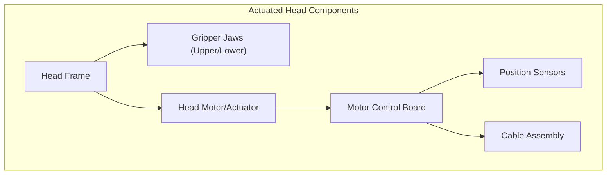
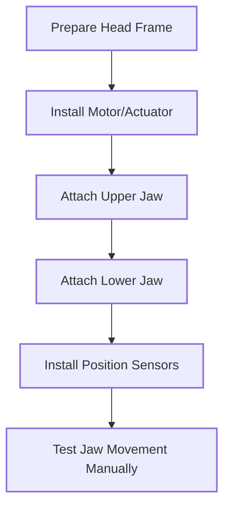
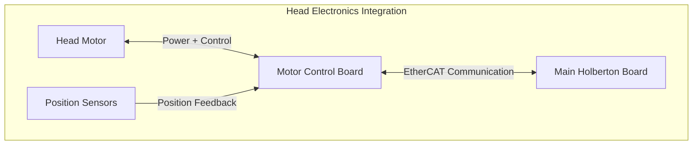
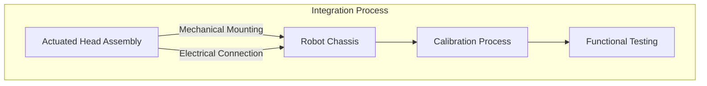
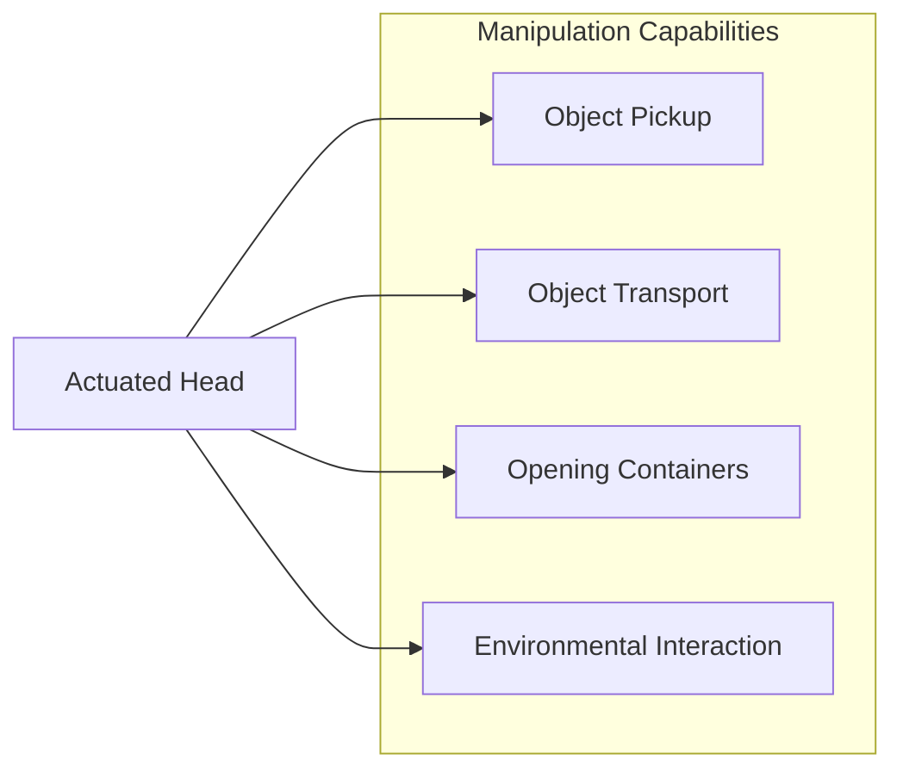

<!-- source: DeepWiki mcp.deepwiki.com · repo google-deepmind/barkour_robot · extra page Actuated Head Assembly · fetched 2026-10-26 -->

# Actuated Head Assembly

Relevant source files

The following files were used as context for generating this wiki page:

- [README.md](README.md)

## Purpose and Scope

This document provides comprehensive instructions for assembling the actuated head variant of the Barkour Robot. The actuated head includes a functional gripper (mouth) mechanism that enables manipulation capabilities. This guide covers the mechanical assembly, electrical connections, and initial testing of the actuated head component. For information about fixed head assembly, see the basic robot assembly guide [Full Barkour Robot Assembly](#2.3).

## Overview of the Actuated Head

The actuated head is an optional variant of the Barkour Robot that replaces the standard fixed head. It features a gripper mechanism that can open and close like a mouth, allowing the robot to grasp and manipulate objects. This capability extends the robot's functionality beyond locomotion to include basic manipulation tasks.

Sources: README.md

## Required Components

The following table lists the main components needed for the actuated head assembly:

| Component | Quantity | Notes |
|-----------|----------|-------|
| Head frame assembly | 1 | Main structural component |
| Gripper jaws (upper and lower) | 2 | Forms the "mouth" |
| Motor/actuator | 1 | For jaw movement |
| Motor control board | 1 | Controls the head actuator |
| Mounting hardware set | 1 | Screws, washers, etc. |
| Cable assembly | 1 | For power and communication |
| Position sensors | 2 | For jaw position feedback |

Sources: README.md

## Assembly Process

The assembly of the actuated head can be divided into three main phases: mechanical assembly, electrical connections, and integration with the robot body.

### 1. Mechanical Assembly

1. **Prepare the head frame**:
   - Ensure all mounting points are clean and free of debris
   - Verify that all required screw holes are present and properly threaded
   
2. **Install the motor/actuator**:
   - Secure the motor to its designated mount point in the head frame
   - Ensure the motor shaft is properly aligned with the jaw mechanism
   - Tighten all mounting screws to the specified torque

3. **Attach the upper and lower jaws**:
   - Connect the upper jaw to the head frame using the provided pivot hardware
   - Install the lower jaw and secure it to the actuation mechanism
   - Verify that both jaws align properly when closed
   - Apply a small amount of lubricant to the pivot points if specified

4. **Install position sensors**:
   - Mount the position sensors according to the reference marks
   - Ensure the sensors can detect the full range of jaw movement

Sources: README.md

### 2. Electrical Connections

1. **Prepare the motor control board**:
   - Verify that the control board is properly configured for the head actuator
   - If necessary, update firmware to support the head actuator

2. **Connect the motor**:
   - Attach power cables from the control board to the motor
   - Ensure proper polarity and secure all connections

3. **Connect position sensors**:
   - Wire the position sensors to their designated inputs on the control board
   - Verify signal integrity using a multimeter if appropriate

4. **Connect the head assembly to the main board**:
   - Route the head control cable from the motor control board to the main Holberton board
   - Ensure the cable is properly secured and protected from pinching during robot movement

Sources: README.md

### 3. Integration with Robot Body

1. **Mount the head assembly**:
   - Align the head assembly with the mounting points on the robot's front section
   - Secure the head assembly using the specified hardware
   - Ensure all screws are tightened to the proper torque

2. **Route and secure cables**:
   - Route all cables according to the reference diagrams
   - Use cable ties or other fasteners to secure cables
   - Ensure cables have sufficient slack to accommodate head movement
   - Verify cables are protected from potential damage points

3. **Initial verification**:
   - Before powering up, manually check that the head moves freely through its range of motion
   - Ensure all connections are secure

Sources: README.md

## Calibration and Testing

After assembly, the actuated head requires calibration to ensure proper operation.

### Calibration Procedure

1. **Power-up calibration**:
   - Power on the robot in calibration mode
   - Follow the standard motor calibration procedure as outlined in [Calibration](#3.3)
   - Ensure the head actuator is included in the calibration sequence

2. **Range of motion verification**:
   - Verify that the jaws can fully open and close
   - Check for any binding or unusual noise during operation
   - Ensure that position sensors correctly report jaw position throughout the range of motion

### Functional Testing

Perform the following tests to verify proper assembly and operation:

1. **Basic functionality test**:
   - Execute open/close cycles at various speeds
   - Verify smooth operation throughout the entire range of motion

2. **Load testing**:
   - Test the gripper with appropriate test objects
   - Verify that the gripper can hold objects securely
   - Test under different orientations to ensure grip security

3. **Integration testing**:
   - Verify that the head actuator responds correctly to control commands
   - Test simultaneous operation with leg movements to ensure there are no interference issues

Sources: README.md

## Capabilities and Usage Examples

The actuated head enables various manipulation tasks. Some example capabilities include:

- Picking up lightweight objects like toys or small containers
- Opening box lids or drawers
- Closing appliance doors like dishwashers
- Holding and carrying soft objects like clothing items

For examples of these capabilities in action, refer to the capabilities demonstrations mentioned in the project documentation.

Sources: README.md:123-127

## Troubleshooting

| Issue | Possible Causes | Solution |
|-------|----------------|----------|
| Jaws don't move | Power connection issue | Check power connections to the head motor |
| | Control signal issue | Verify control signal from main board to head controller |
| | Mechanical binding | Inspect for physical obstructions in the jaw mechanism |
| Jaws move but don't close properly | Misalignment | Realign jaw components according to assembly instructions |
| | Sensor calibration | Recalibrate position sensors |
| Grinding or unusual noise | Improper gear mesh | Check gear alignment and lubrication |
| | Loose components | Verify all fasteners are properly tightened |

Sources: README.md

## Maintenance

Regular maintenance of the actuated head assembly includes:

1. **Periodic inspection**:
   - Check for loose fasteners
   - Inspect jaw pivot points for wear
   - Verify cable integrity

2. **Lubrication**:
   - Apply recommended lubricant to mechanical pivot points as needed
   - Do not over-lubricate as excess lubricant can attract debris

3. **Calibration checks**:
   - Periodically verify that position sensors remain properly calibrated
   - Recalibrate if positional accuracy has degraded

Sources: README.md

## Conclusion

The actuated head assembly provides advanced manipulation capabilities to the Barkour Robot platform. When properly assembled and calibrated, it enables the robot to interact with its environment beyond simple locomotion, opening possibilities for more complex research tasks and demonstrations.

For questions or issues with the actuated head assembly, refer to the troubleshooting section above or consult the main project documentation.

---

