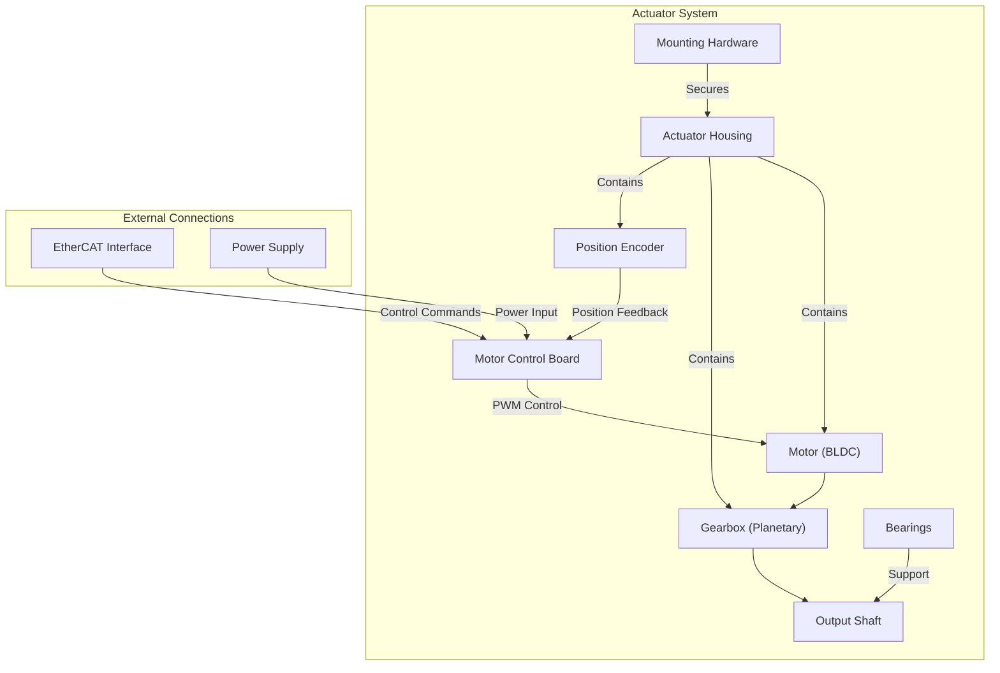
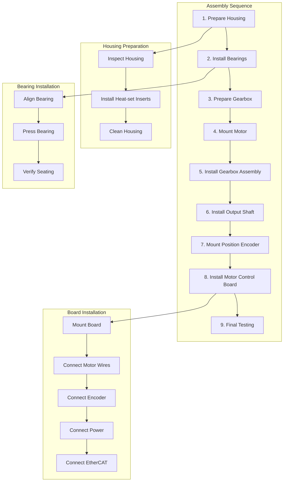
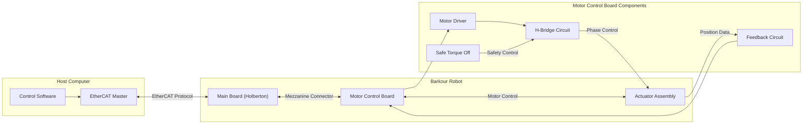

<!-- source: DeepWiki mcp.deepwiki.com · repo google-deepmind/barkour_robot · extra page Actuator Assembly · fetched 2026-10-26 -->

# Actuator Assembly

Relevant source files

The following files were used as context for generating this wiki page:

- [README.md](README.md)

## Purpose and Scope

This document provides detailed instructions for assembling the actuators used in the Barkour Robot. Actuators are critical components that convert electrical energy into mechanical motion, enabling the robot's locomotion capabilities. This guide covers the complete assembly process for the standard actuator units used in the robot's joints.

For information about assembling the actuator with the leg linkage, see [Leg Linkage Assembly](#2.3.2). For integration of actuators into the complete robot, see [Barkour Robot Assembly](#2.3).

## Actuator Overview

The Barkour Robot uses custom brushless DC motor actuators with integrated control electronics. Each actuator consists of a motor, gearbox, position encoder, and mounting hardware packaged in a compact unit that provides precise torque and position control.

Sources: README.md

## Required Components

| Component | Quantity | Description |
|-----------|----------|-------------|
| BLDC Motor | 1 | Custom brushless DC motor |
| Planetary Gearbox | 1 | Reduction gearbox |
| Position Encoder | 1 | High-resolution encoder |
| Actuator Housing | 1 | Machined aluminum housing |
| Output Shaft | 1 | Hardened steel output shaft |
| Bearings | 2 | Precision bearings |
| Motor Control Board | 1 | Custom child board |
| Mounting Hardware | 1 set | Screws, washers, and fasteners |
| Heat-set Inserts | As needed | For secure fastening |
| Thermal Interface Material | As needed | For heat transfer |

## Assembly Tools

| Tool | Purpose |
|------|---------|
| Heat Gun | Installing heat-set inserts |
| Torque Wrench | Precise torque on fasteners |
| Allen Key Set | For socket head screws |
| Threadlocker | Securing fasteners |
| Thermal Paste Applicator | Applying thermal interface material |
| Shaft Press | For bearing installation |

## Actuator Assembly Procedure

### 1. Prepare the Housing

1. Inspect the actuator housing for any machining defects or burrs.
2. Install heat-set inserts into designated locations using the heat gun.
3. Clean the housing to remove any residue or particles.

### 2. Install Bearings

1. Align the first bearing with the housing bore.
2. Press the bearing into place using the shaft press.
3. Verify the bearing is fully seated and rotates freely.
4. Repeat for the second bearing on the opposite side.

### 3. Prepare the Gearbox

1. Verify all gears in the planetary set are clean and free of debris.
2. Apply a thin layer of grease to the gear teeth.
3. Assemble the planetary gearbox according to the specified reduction ratio.

### 4. Mount the Motor

1. Apply thermal interface material to the motor mounting surface.
2. Align the motor with the housing mount points.
3. Insert fasteners and tighten in a cross pattern to the specified torque.
4. Ensure the motor shaft is properly aligned with the gearbox input.

### 5. Install Gearbox Assembly

1. Carefully align the gearbox assembly with the motor shaft.
2. Insert the gearbox into the housing.
3. Secure the gearbox using the provided fasteners.
4. Verify smooth rotation by manually turning the output shaft.

### 6. Install Output Shaft

1. Insert the output shaft through the bearings.
2. Connect the output shaft to the gearbox output.
3. Secure with retaining hardware.
4. Check for smooth rotation and minimal backlash.

### 7. Mount Position Encoder

1. Align the encoder with its mounting location.
2. Secure the encoder using the provided fasteners.
3. Connect the encoder wiring to the designated connectors.

### 8. Install Motor Control Board

1. Align the motor control board with its mounting position.
2. Secure the board using the mounting hardware.
3. Connect motor phase wires to the board.
4. Connect encoder signals to the board.
5. Verify all connections are secure.

Sources: README.md

### 9. Final Testing

1. Perform a visual inspection of the entire assembly.
2. Manually rotate the output shaft to ensure smooth motion.
3. Check for any loose fasteners or components.
4. Verify proper alignment of all components.

## Integration with Motor Control System

The actuator's motor control board interfaces with the main Holberton board through a connection system that provides power, control signals, and communication. This integration enables precise control of the actuator through the EtherCAT protocol.

Sources: README.md

## Post-Assembly Calibration

After assembly, each actuator must undergo calibration to ensure precise motion control. The calibration process involves:

1. Establishing the zero position reference
2. Setting the position limits
3. Configuring the PID control parameters
4. Calibrating the torque sensing

For detailed calibration procedures, refer to the [Calibration](#3.3) section in the firmware documentation.

## Common Assembly Issues and Troubleshooting

| Issue | Possible Cause | Solution |
|-------|----------------|----------|
| Motor doesn't turn | Disconnected wiring | Check all connections between motor and control board |
| | Damaged motor windings | Inspect motor windings for damage |
| | Controller fault | Check control board for error codes |
| Excessive noise | Loose fasteners | Verify all fasteners are properly torqued |
| | Damaged bearings | Inspect and replace bearings if necessary |
| | Gear misalignment | Disassemble and realign gearbox components |
| Position errors | Encoder issues | Check encoder connections and signals |
| | Mechanical slippage | Verify secure attachment of all components |
| Overheating | Insufficient thermal interface | Reapply thermal interface material |
| | Excessive load | Check for mechanical binding in the assembly |

## Safety Considerations

When assembling actuators:

1. Handle all electronic components with proper ESD protection
2. Ensure proper torque on all fasteners to prevent loosening during operation
3. Follow proper procedures for handling the high-torque mechanisms
4. Be aware of pinch points during assembly and testing

## Performance Specifications

| Parameter | Value | Unit |
|-----------|-------|------|
| Continuous Torque | 17 | Nm |
| Peak Torque | 54 | Nm |
| Maximum Speed | 12 | rad/s |
| Position Resolution | 0.01 | degrees |
| Weight | 475 | g |
| Power Consumption (nominal) | 50 | W |

These specifications represent the performance capabilities of properly assembled actuators. Deviations from these values may indicate assembly issues that require attention.

## Actuator Variants

The Barkour Robot uses the same basic actuator design across all joints, with minor variations for specific mounting configurations:

1. Hip actuators (abduction/adduction)
2. Upper leg actuators (hip flexion/extension)
3. Lower leg actuators (knee flexion/extension)
4. Head actuators (for the actuated head variant)

Each variant differs primarily in mounting brackets and connectors, but the core assembly process remains consistent.

Sources: README.md

---

