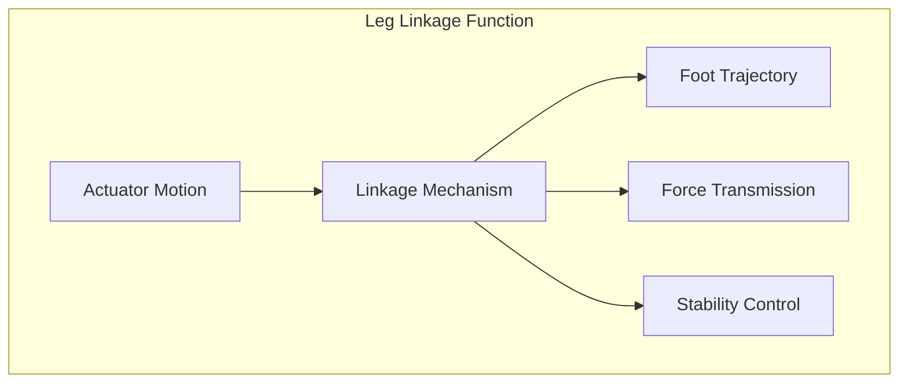
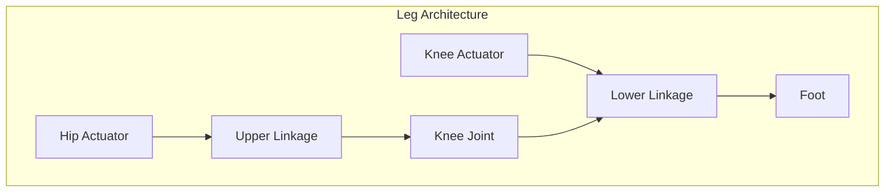
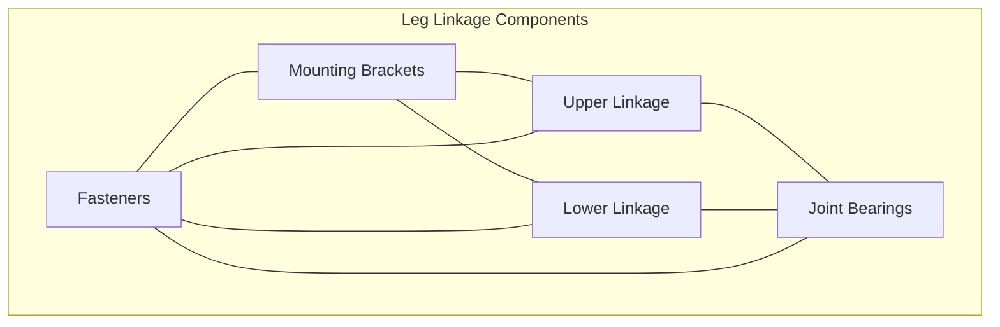
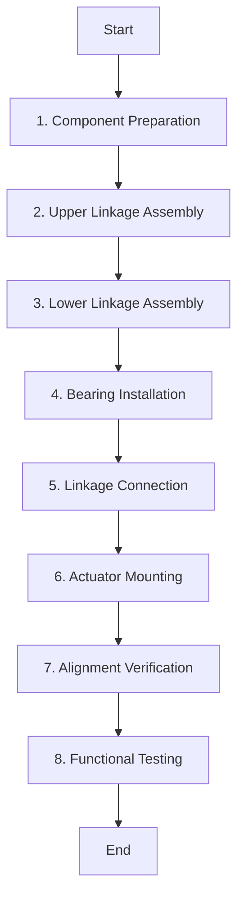
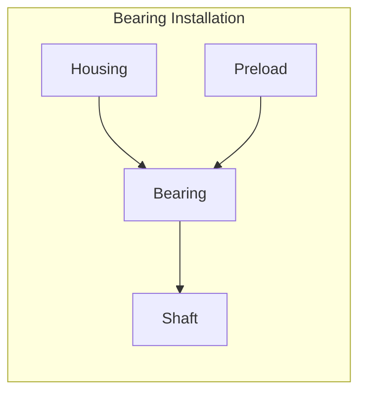
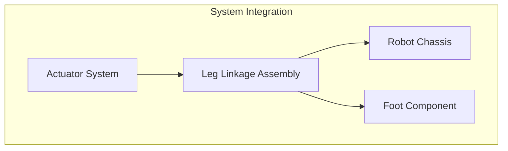
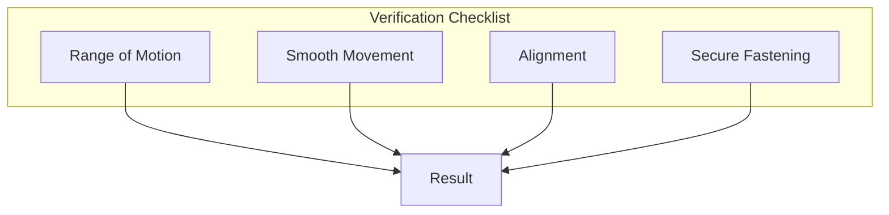
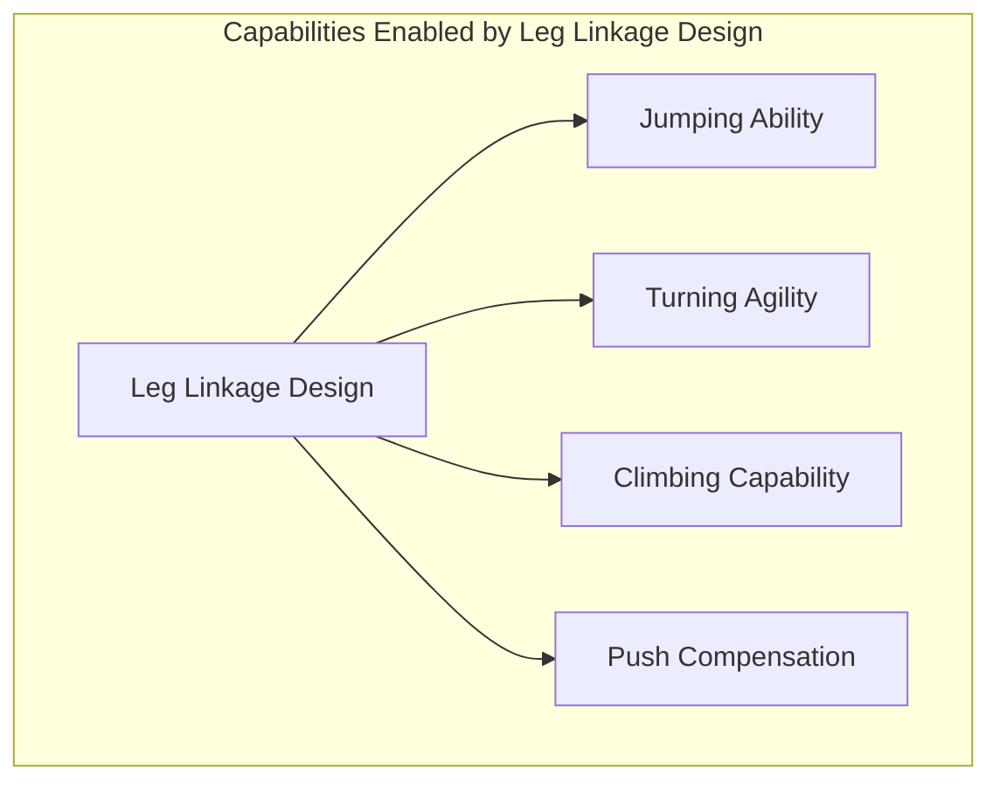

<!-- source: DeepWiki mcp.deepwiki.com · repo google-deepmind/barkour_robot · extra page Leg Linkage Assembly · fetched 2026-10-26 -->

# Leg Linkage Assembly

Relevant source files

The following files were used as context for generating this wiki page:

- [README.md](README.md)

This document provides technical instructions for assembling the leg linkages of the Barkour Robot. Leg linkages are critical mechanical components that connect the actuators to the feet, enabling the robot's mobility and agility capabilities.

For information about actuator assembly, see [Actuator Assembly](#2.3.1). For the actuated head variant, see [Actuated Head Assembly](#2.3.3).

## Purpose and Function

The leg linkage system in the Barkour Robot serves to:
- Transfer power from the actuators to the ground contact points
- Convert rotational actuator motion into the desired foot trajectory
- Provide mechanical advantage for dynamic movements
- Maintain stability during locomotion
- Enable agile movements such as jumping, turning, and climbing

Sources: [README.md:112-128]()

## Leg Linkage Architecture

The Barkour Robot employs a linkage-based leg design that connects the hip and knee actuators to the foot. This architecture enables the robot to achieve its impressive range of motion while maintaining structural integrity.

Sources: [README.md:24, 112-128]()

## Components

Each leg linkage assembly consists of these key components:

| Component | Function | Location |
|-----------|----------|----------|
| Upper linkage | Connects hip to knee | Upper leg segment |
| Lower linkage | Connects knee to foot | Lower leg segment |
| Joint bearings | Provide smooth rotation | At joint connections |
| Mounting brackets | Secure linkages to actuators | At actuator interfaces |
| Fasteners | Hold assembly together | Throughout assembly |

Sources: [README.md:30, 90]()

## Assembly Process Overview

The general process for assembling the leg linkages involves:

1. **Component Preparation**: Gather all components and verify against the bill of materials. Ensure all parts are clean and free from defects.

2. **Upper Linkage Assembly**: Assemble the upper linkage components, including any required bearings or fasteners.

3. **Lower Linkage Assembly**: Assemble the lower linkage components, including any required bearings or fasteners.

4. **Bearing Installation**: Install bearings at joint locations with the correct orientation and preload.

5. **Linkage Connection**: Connect the upper and lower linkages to form the complete leg structure.

6. **Actuator Mounting**: Mount the assembled linkage to the corresponding actuators on the robot body.

7. **Alignment Verification**: Verify proper alignment of all components, ensuring parallelism and correct positioning.

8. **Functional Testing**: Test the assembled linkage for smooth movement throughout its range of motion.

Sources: [README.md:86-90, 99]()

## Critical Assembly Considerations

### Bearing Installation

Proper bearing installation is critical for smooth joint movement and longevity.

Ensure bearings are:
- Installed with the correct orientation
- Properly seated in their housings
- Preloaded to the specified value
- Free from contamination

Sources: [README.md:30, 90]()

### Alignment Verification

Maintaining proper alignment between linkage components is essential for correct operation.

Check for:
- Parallelism between linkage arms
- Proper alignment with actuator output shafts
- Correct positioning relative to the robot body
- Absence of binding or interference

Sources: [README.md:30, 90]()

## Integration with Robot System

The leg linkage assembly integrates with multiple subsystems of the Barkour Robot.

Key integration points include:
- Connection to hip actuator
- Connection to knee actuator
- Attachment to the robot chassis
- Interface with the foot component

Sources: [README.md:28, 30, 90]()

## Functional Verification

After assembly, verify the following:

Verification steps include:
1. Checking full range of motion without binding
2. Testing smooth operation of all joints
3. Verifying proper alignment with actuators
4. Confirming secure fastening of all components
5. Ensuring correct foot orientation throughout movement

Sources: [README.md:24, 30, 90]()

## Role in Robot Capabilities

The leg linkage design directly contributes to the Barkour Robot's impressive capabilities, as demonstrated in the project documentation.

The properly assembled leg linkage system enables:
- Two-leg and four-leg jumps
- Agile turning movements
- Climbing capabilities
- Push and tilt compensation
- Overall stability and control

Sources: [README.md:112-128]()

---

