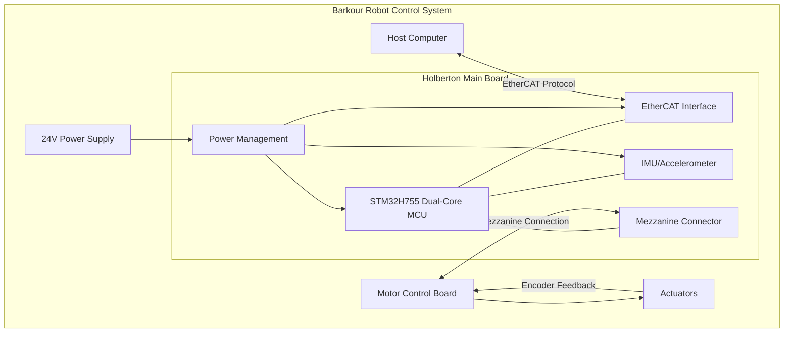
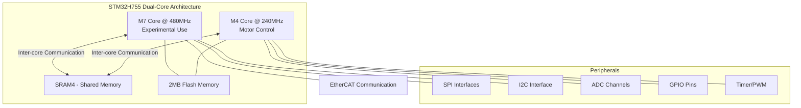
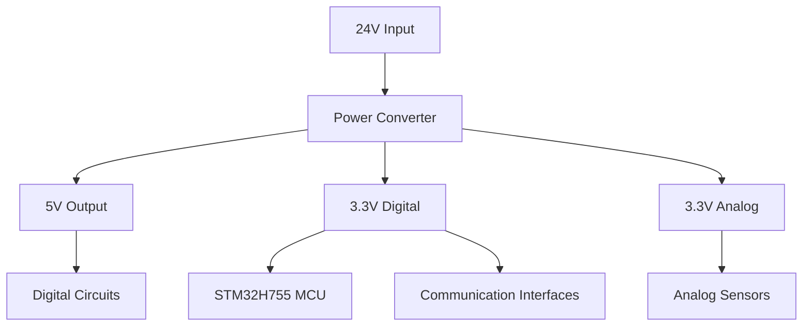
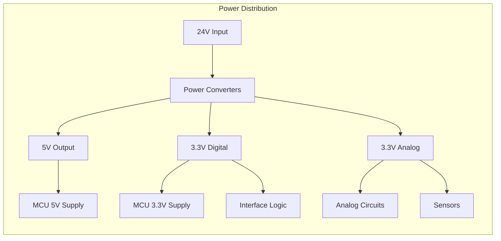
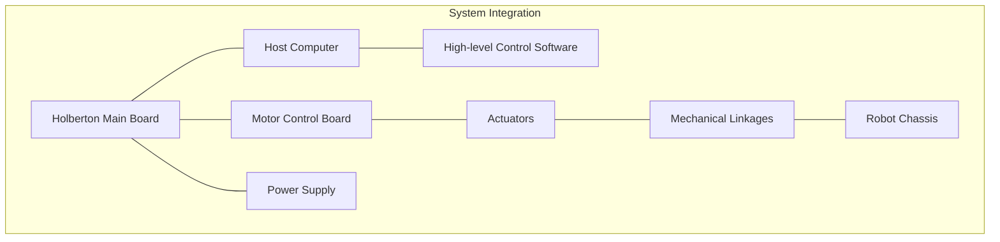

<!-- source: DeepWiki mcp.deepwiki.com · repo google-deepmind/barkour_robot · extra page Main Board (Holberton) · fetched 2026-10-26 -->

# Main Board (Holberton)

Relevant source files

The following files were used as context for generating this wiki page:

- [hardware/electronics/holberton/1-Holberton_TOP.SchDoc](hardware/electronics/holberton/1-Holberton_TOP.SchDoc)
- [hardware/electronics/holberton/Power.SchDoc](hardware/electronics/holberton/Power.SchDoc)
- [hardware/electronics/holberton/Processor.SchDoc](hardware/electronics/holberton/Processor.SchDoc)
- [hardware/electronics/holberton/ProcessorSupport.SchDoc](hardware/electronics/holberton/ProcessorSupport.SchDoc)

The Holberton Main Board serves as the central control system for the Barkour Robot. This documentation provides a technical overview of the main board's architecture, key components, interfaces, and integration with the rest of the robot system. For details about the Motor Control Board that connects to this main board, see [Motor Control Board](#2.2.2).

## Overview

The Holberton Main Board (named after Betty Holberton, a programming pioneer) is the primary control board in the Barkour Robot system. It houses the main processor, communication interfaces, power management, and sensor connections required for coordinating the robot's movements and operations. The board serves as the bridge between the high-level control software running on a host computer and the motor control boards that drive the robot's actuators.

Sources: `hardware/electronics/holberton/1-Holberton_TOP.SchDoc`

## System Architecture

The diagram illustrates how the Holberton Main Board integrates into the overall Barkour Robot control system. The board takes 24V input power, provides regulated power to on-board components, and interfaces with both the host computer (via EtherCAT) and the motor control boards (via mezzanine connector).

Sources: `hardware/electronics/holberton/1-Holberton_TOP.SchDoc`, `hardware/electronics/holberton/Power.SchDoc`

## Key Components

### STM32H755 Dual-Core Processor

The heart of the Holberton Main Board is the STM32H755IIK3 microcontroller, a high-performance dual-core processor from STMicroelectronics.

Key features:
- Cortex-M7 core running at 480MHz for high-level processing
- Cortex-M4 core running at 240MHz dedicated to real-time motor control
- Shared memory (SRAM4) for inter-core communication
- 2MB of Flash memory
- Extensive peripheral set including SPI, I2C, ADC, timers

The dual-core architecture allows for separation of concerns, with the M7 core handling communication and high-level control while the M4 core manages real-time motor control operations.

Sources: `hardware/electronics/holberton/Processor.SchDoc`

### Power Management System

The power management system on the Holberton Main Board converts the 24V input to various voltage levels required by on-board components.

Key features:
- 24V input from the robot's power supply
- 5V output for digital circuitry
- 3.3V output for the microcontroller and digital interfaces
- 3.3V analog supply for sensor components
- Protection circuitry for overcurrent and reverse polarity

Sources: `hardware/electronics/holberton/Power.SchDoc`

### EtherCAT Interface

The EtherCAT interface enables real-time communication between the Holberton Main Board and the host computer, providing a high-speed, deterministic control channel.

Key features:
- Real-time Ethernet-based protocol
- Deterministic communication with predictable latency
- High-speed data exchange for motor control commands and feedback
- Support for distributed clock synchronization

Sources: `hardware/electronics/holberton/1-Holberton_TOP.SchDoc`

### Sensors

The Holberton Main Board includes interfaces for various sensors used to monitor the robot's state:

- IMU/Accelerometer for orientation sensing
- Temperature sensors for monitoring motor and driver temperatures
- Analog inputs for voltage and current sensing

Sources: `hardware/electronics/holberton/1-Holberton_TOP.SchDoc`

## Interface Diagram

```mermaid
graph TB
    subgraph "Holberton Main Board"
        STM32["STM32H755 MCU"]
        
        subgraph "Communication"
            ECAT_SPI["ECAT_SPI"]
            ECAT_CTRL["ECAT_CTRL"]
            I2C1["I2C1"]
        end
        
        subgraph "Sensor Interfaces"
            IMU_SPI["IMU_SPI"]
            ENC_SPI["ENC_SPI"]
            ENC_ABZ["ENC_ABZ"]
            THERM["Temperature Sensing Interfaces"]
        end
        
        subgraph "Motor Control"
            GD_SPI["GD_SPI"]
            PWM["PWM"]
            VDS_ADC["VDS_ADC"]
            PHASE_CURRENT["PHASE_CURRENT_ADC"]
            BUS_VOLTAGE["BUS_VOLTAGE_ADC"]
        end
        
        subgraph "Safety"
            FSOE_STO1["FSOE_STO1"]
            FSOE_STO2["FSOE_STO2"]
            FB_STO1["FB_STO1"]
            FB_STO2["FB_STO2"]
        end
        
        STM32 --- ECAT_SPI
        STM32 --- ECAT_CTRL
        STM32 --- I2C1
        STM32 --- IMU_SPI
        STM32 --- ENC_SPI
        STM32 --- ENC_ABZ
        STM32 --- THERM
        STM32 --- GD_SPI
        STM32 --- PWM
        STM32 --- VDS_ADC
        STM32 --- PHASE_CURRENT
        STM32 --- BUS_VOLTAGE
        STM32 --- FSOE_STO1
        STM32 --- FSOE_STO2
        STM32 --- FB_STO1
        STM32 --- FB_STO2
    end
    
    Host["Host Computer"] <--"EtherCAT Protocol"--> ECAT_SPI
    IMU["Accelerometer"] <--"SPI Interface"--> IMU_SPI
    MotorBoard["Motor Control Board"] <--"Mezzanine Interface"--> STM32
```

The interface diagram shows the various communication channels and interfaces available on the Holberton Main Board, including connections to sensors, safety systems, and motor control components.

Sources: `hardware/electronics/holberton/1-Holberton_TOP.SchDoc`

## Signal Interfaces

The following table details the key signal interfaces available on the Holberton Main Board:

| Interface | Type | Purpose |
|-----------|------|---------|
| ENC_SPI | SPI | Encoder interface for position feedback |
| IMU_SPI | SPI | Accelerometer/IMU communication |
| GD_SPI | SPI | Gate driver communication |
| PWM | Digital | PWM signals for motor control |
| ECAT_SPI | SPI | EtherCAT interface communication |
| ECAT_CTRL | Digital | EtherCAT control signals |
| I2C1 | I2C | General-purpose I2C interface |
| MOTOR_THERM1-3 | Analog | Motor temperature sensing |
| DRIVE_THERM | Analog | Drive temperature sensing |
| ENC_THERM | Analog | Encoder temperature sensing |
| FSOE_STO1/2 | Digital | Functional Safety over EtherCAT Safe Torque Off |
| FB_STO1/2 | Digital | Safe Torque Off feedback |
| VDS_ADC | Analog | Voltage sensing for gate drivers |
| PHASE_CURRENT_ADC | Analog | Motor phase current sensing |
| BUS_VOLTAGE_ADC | Analog | DC bus voltage monitoring |

Sources: `hardware/electronics/holberton/1-Holberton_TOP.SchDoc`

## Power Distribution

The Holberton Main Board handles power distribution for the entire robot control system. It converts the 24V input power to various voltage levels required by different components.

Key features:
- Input voltage: 24V DC
- Output voltages: 5V, 3.3V digital, 3.3V analog
- Power monitoring circuits for voltage and current sensing
- Protection features for safe operation

Sources: `hardware/electronics/holberton/Power.SchDoc`

## Safety Features

The Holberton Main Board incorporates several safety features to protect both the robot and its environment:

- Safe Torque Off (STO) functionality to immediately disable motor power in emergency situations
- Functional Safety over EtherCAT (FSoE) for safety-critical communication
- Feedback mechanisms to verify safety state
- Temperature monitoring to prevent thermal damage
- Voltage and current monitoring to detect electrical faults

Sources: `hardware/electronics/holberton/1-Holberton_TOP.SchDoc`

## Integration with Barkour Robot System

The Holberton Main Board serves as the central hub in the Barkour Robot control system, integrating with various components:

The Holberton Main Board:
- Processes commands from the host computer
- Manages real-time control loops for motor operation
- Collects sensor data for feedback control
- Monitors system health and safety
- Coordinates power distribution

Sources: `hardware/electronics/holberton/1-Holberton_TOP.SchDoc`, `hardware/electronics/holberton/Processor.SchDoc`

## Technical Specifications

| Parameter | Specification |
|-----------|---------------|
| Main Processor | STM32H755IIK3 Dual-Core (Cortex-M7 @ 480MHz, Cortex-M4 @ 240MHz) |
| Flash Memory | 2MB |
| Main Input Voltage | 24V DC |
| Output Voltages | 5V, 3.3V digital, 3.3V analog |
| Communication | EtherCAT, SPI, I2C |
| Sensor Interfaces | Accelerometer, encoder, temperature sensors |
| Safety Features | Safe Torque Off (STO), temperature monitoring |
| Form Factor | Custom PCB with mezzanine connector for child boards |

Sources: `hardware/electronics/holberton/Processor.SchDoc`, `hardware/electronics/holberton/Power.SchDoc`

## Conclusion

The Holberton Main Board is the central control hardware component of the Barkour Robot system. With its powerful dual-core processor, comprehensive interface options, and integrated safety features, it provides the processing capability and connectivity required for advanced quadruped robot control. The board's design emphasizes performance, reliability, and safety, making it suitable for research applications requiring precise control of multi-actuator robotic systems.

---

