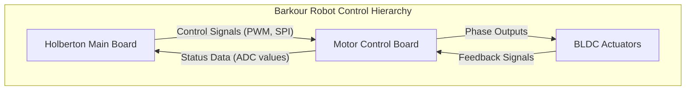
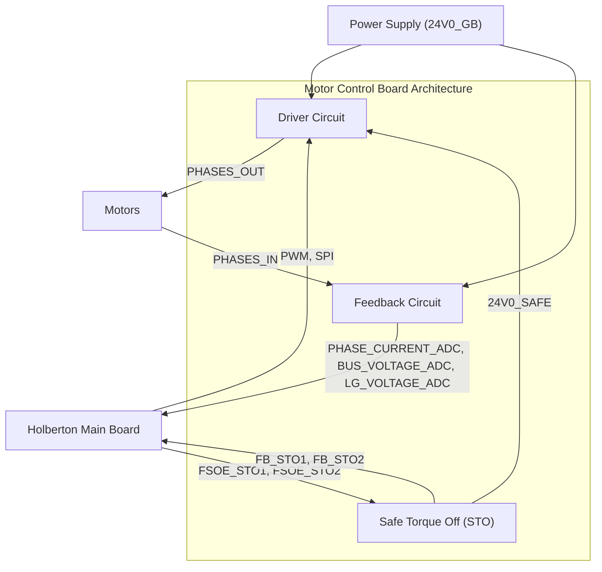
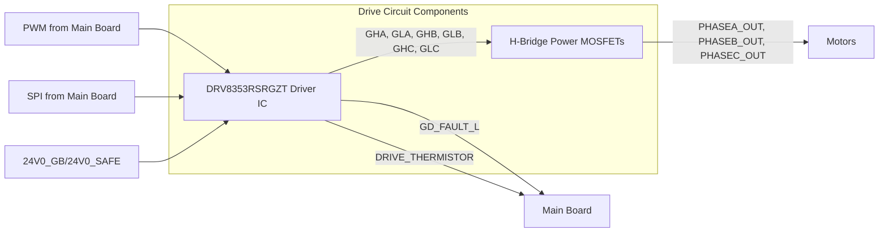
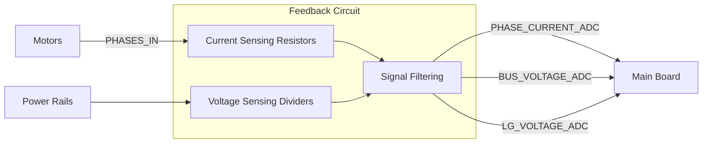
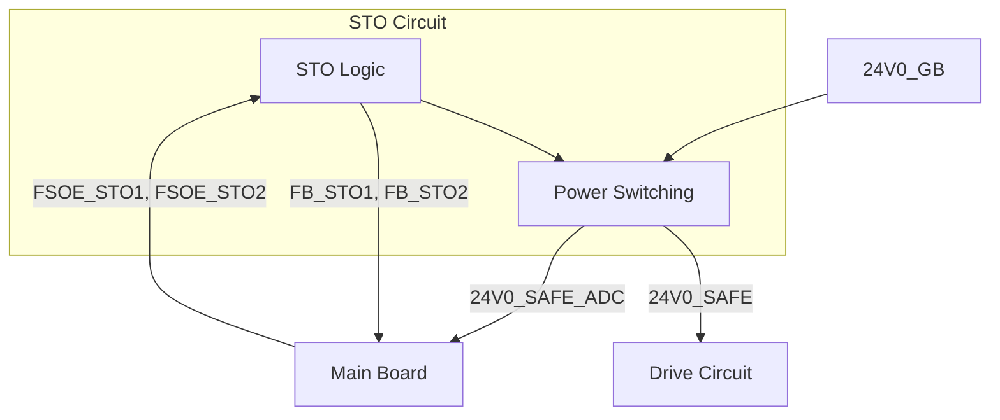
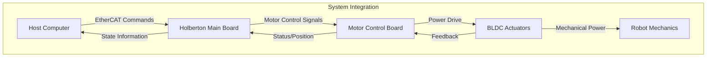

<!-- source: DeepWiki mcp.deepwiki.com · repo google-deepmind/barkour_robot · extra page Motor Control Board · fetched 2026-10-26 -->

# Motor Control Board

Relevant source files

The following files were used as context for generating this wiki page:

- [hardware/electronics/holberton/1-Holberton_Child_Top.SchDoc](hardware/electronics/holberton/1-Holberton_Child_Top.SchDoc)
- [hardware/electronics/holberton/Drive.SchDoc](hardware/electronics/holberton/Drive.SchDoc)
- [hardware/electronics/holberton/Feedback.SchDoc](hardware/electronics/holberton/Feedback.SchDoc)
- [hardware/electronics/holberton/HBridge.SchDoc](hardware/electronics/holberton/HBridge.SchDoc)

The Motor Control Board (also known as the Holberton Child Board in the schematics) is a critical component of the Barkour Robot system. It serves as the interface between the digital control signals from the Holberton Main Board and the high-power electric motors in the robot's actuators, providing efficient power conversion, motor driving, feedback sensing, and safety mechanisms.

For information about the main control system that interfaces with this board, see [Main Board (Holberton)](#2.2.1). For details about the sensors and communication interfaces, see [Sensors and Communication](#2.2.3).

## Purpose and Role

The Motor Control Board fulfills several key functions in the Barkour Robot system:

1. Converts low-power digital control signals into high-current motor drive signals
2. Implements current and voltage sensing for motor feedback
3. Provides motor phase control for brushless DC (BLDC) motors
4. Implements safety features including Safe Torque Off (STO)
5. Manages power distribution and protection circuitry

This board enables precise control of motor torque, velocity, and position required for the robot's dynamic movements and stabilization.

Sources: hardware/electronics/holberton/1-Holberton_Child_Top.SchDoc

## Functional Architecture

The Motor Control Board architecture consists of three primary functional blocks:

Sources: hardware/electronics/holberton/1-Holberton_Child_Top.SchDoc, hardware/electronics/holberton/Drive.SchDoc, hardware/electronics/holberton/Feedback.SchDoc

## Key Components

### Driver Circuit

The driver circuit is the core component responsible for generating the high-current motor control signals.

#### Components and Operation

- **Motor Driver IC**: DRV8353RSRGZT (Texas Instruments) 3-phase BLDC motor driver operating at 6-95V
- **H-Bridge MOSFETs**: Power transistors that switch current to motor phases
- **Gate Drivers**: Circuitry for controlling the MOSFET switching
- **PWM Processing**: Converts PWM signals from the main board into motor phase control
- **SPI Interface**: Allows configuration and status reading of the motor driver

Sources: hardware/electronics/holberton/Drive.SchDoc

### Feedback Circuit

The feedback circuit monitors motor operating parameters and provides analog signals to the main board for processing in control algorithms.

#### Monitored Parameters

- **Phase Currents**: Current through each motor phase for torque control
- **Bus Voltage**: Main power supply voltage monitoring for safety
- **Low-Gate Voltages**: Voltage monitoring on low-side gate drivers
- **Motor Current**: Overall motor current for protection functions

Sources: hardware/electronics/holberton/Feedback.SchDoc

### Safe Torque Off (STO)

The STO circuit is a critical safety feature that can quickly disable motor power in case of emergency or fault detection.

#### Operation

- Receives safety commands (`FSOE_STO1`, `FSOE_STO2`) from the main board
- Controls the safety-qualified power supply to the motor driver (`24V0_SAFE`)
- Provides feedback on STO status (`FB_STO1`, `FB_STO2`)
- Implements redundant circuits for high safety integrity

Sources: hardware/electronics/holberton/1-Holberton_Child_Top.SchDoc

## Power Distribution

The Motor Control Board operates with multiple power domains to ensure proper isolation between control circuits and power stages.

| Power Rail | Voltage | Description | Usage |
|------------|---------|-------------|-------|
| MPWR | 24-60V | Motor power input | Primary power for motor driving |
| 24V0_GB | 24V | General board power | Powers driver ICs and control circuitry |
| 24V0_SAFE | 24V | Safety-qualified power | STO-controlled supply to motor driver |
| 3V3A_GB | 3.3V | Analog power | Powers sensing and feedback circuits |

Sources: hardware/electronics/holberton/1-Holberton_Child_Top.SchDoc, hardware/electronics/holberton/Drive.SchDoc

## Signal Interfaces

### Interface with Main Board

The Motor Control Board connects to the Holberton Main Board through a mezzanine connector that carries multiple signal groups:

| Signal Group | Description | Key Signals |
|--------------|-------------|-------------|
| Control | Motor control signals | PWM, SPI (SCLK, SDI, SDO, nSCS) |
| Feedback | Analog sensor data | PHASE_CURRENT_ADC, BUS_VOLTAGE_ADC, LG_VOLTAGE_ADC |
| Safety | Safe Torque Off signals | FSOE_STO1, FSOE_STO2, FB_STO1, FB_STO2 |
| Status | Diagnostic signals | GD_FAULT_L, DRIVE_THERMISTOR |
| Power | Power distribution | 24V0_GB, 3V3A_GB, MPWR, MPWR_IN |

### Interface with Motors

The board connects to the BLDC motors through these signal groups:

| Signal Group | Description | Key Signals |
|--------------|-------------|-------------|
| Phase Outputs | Drive signals to motor windings | PHASES_OUT (PHASEA_OUT, PHASEB_OUT, PHASEC_OUT) |
| Phase Inputs | Current sensing return paths | PHASES_IN |

Sources: hardware/electronics/holberton/1-Holberton_Child_Top.SchDoc, hardware/electronics/holberton/Drive.SchDoc, hardware/electronics/holberton/Feedback.SchDoc

## Protection Features

The Motor Control Board implements various protection mechanisms to ensure robust operation in a high-power environment:

- **Current Sense Resistors**: Precision low-resistance components (R157, R160, R161, R162) for accurate current monitoring with minimal power loss
- **Transient Voltage Suppressors**: TVS diodes (D11) protect against voltage spikes and transients
- **Filtering Components**: Capacitors (C26, C30, C153, C161) and ferrite beads (FB6, FB7, FB8) suppress noise and provide EMI compliance
- **Thermal Monitoring**: NTC thermistor (R21) for temperature sensing of drive components
- **Fault Detection**: Hardware-based detection of overcurrent, overvoltage, undervoltage, and driver faults

Sources: hardware/electronics/holberton/Drive.SchDoc, hardware/electronics/holberton/Feedback.SchDoc

## PCB Design Considerations

The Motor Control Board PCB layout is optimized for high-current operation with special attention to:

- **Power Plane Isolation**: Separate planes for power and signal grounds
- **Thermal Management**: Copper pour areas for heat dissipation from power components
- **Signal Integrity**: Carefully routed differential pairs and analog signals
- **EMI Minimization**: Strategic component placement and routing to minimize electromagnetic interference
- **Current Path Optimization**: Short, wide traces for high-current paths to minimize impedance

## Integration with Robot System

In the context of the complete Barkour Robot system, the Motor Control Board plays a central role in the motion control chain:

Sources: hardware/electronics/holberton/1-Holberton_Child_Top.SchDoc

This Motor Control Board design enables the Barkour Robot to achieve precise actuation with high power efficiency, making possible the dynamic and responsive quadruped locomotion that characterizes the robot's movements.

---

