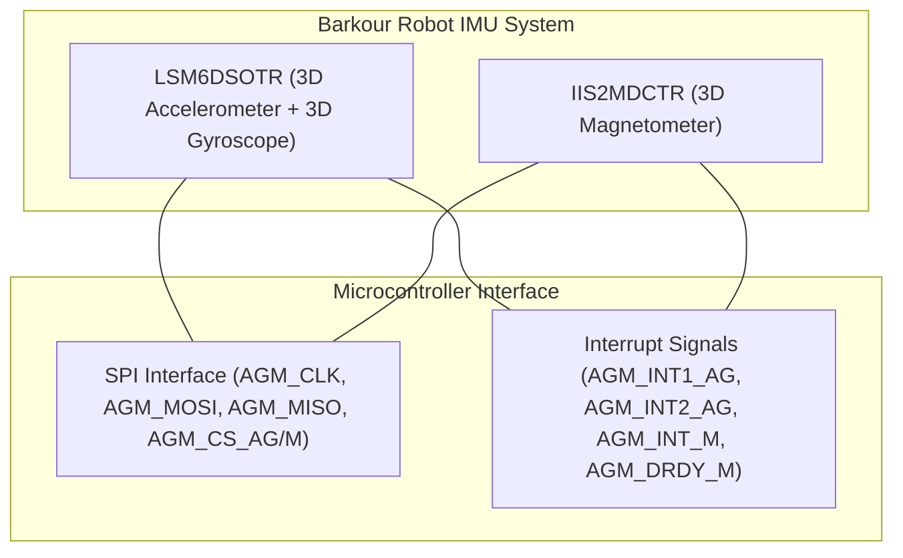
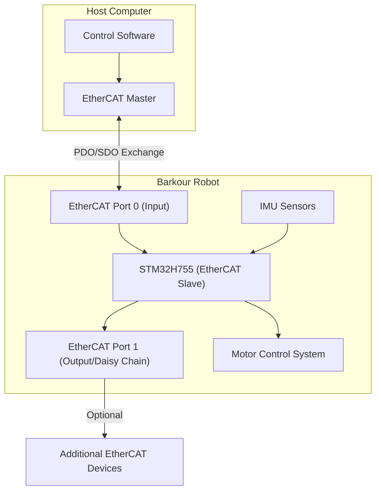
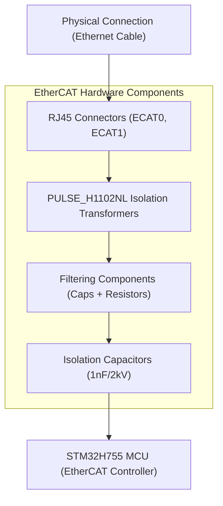
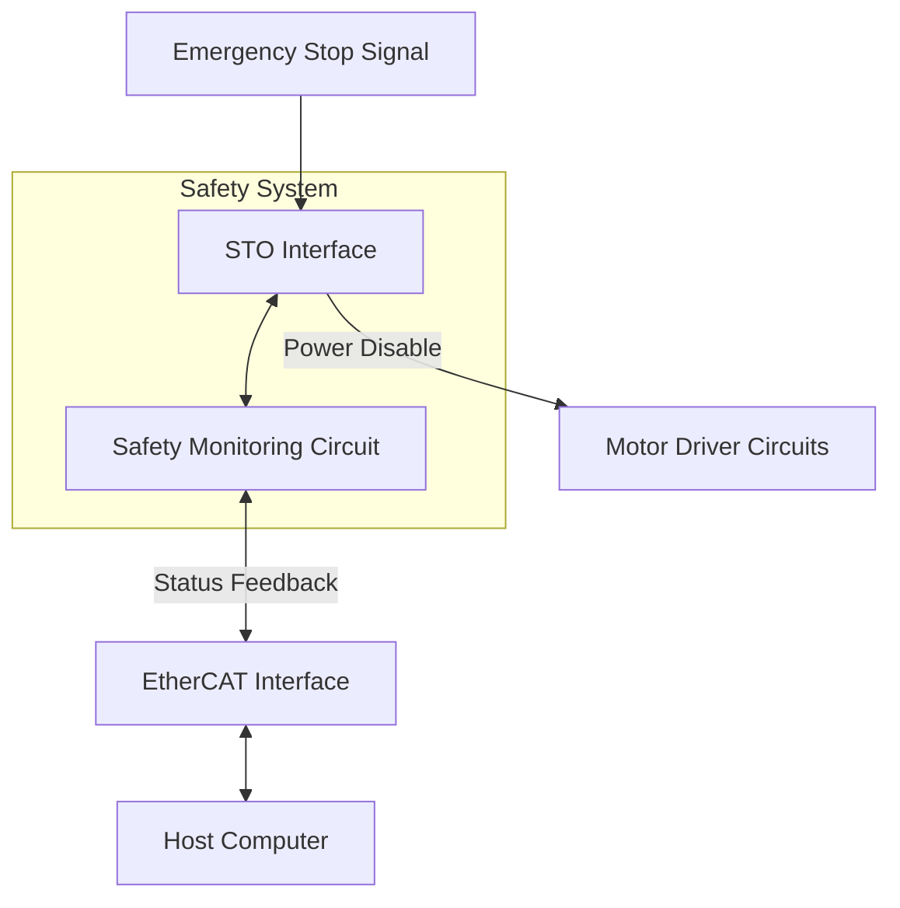
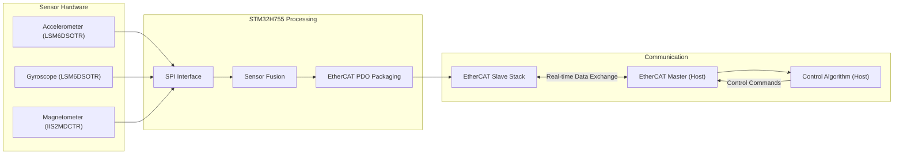

<!-- source: DeepWiki mcp.deepwiki.com · repo google-deepmind/barkour_robot · extra page Sensors and Communication · fetched 2026-10-26 -->

# Sensors and Communication

Relevant source files

The following files were used as context for generating this wiki page:

- [hardware/electronics/holberton/Accelerometer.SchDoc](hardware/electronics/holberton/Accelerometer.SchDoc)
- [hardware/electronics/holberton/EtherCATConnectors.SchDoc](hardware/electronics/holberton/EtherCATConnectors.SchDoc)
- [hardware/electronics/holberton/MezzanineConnectors_Cortes.SchDoc](hardware/electronics/holberton/MezzanineConnectors_Cortes.SchDoc)

This document details the sensor systems and communication interfaces integrated into the Barkour Robot, focusing on the inertial measurement unit (IMU) components and the EtherCAT communication infrastructure. For information about motor control systems, please refer to the [Motor Control Board](#2.2.2) documentation.

## Sensor Systems

### Inertial Measurement Unit (IMU)

The Barkour Robot features a complete 9-axis IMU system that provides comprehensive motion tracking and orientation sensing capabilities. This system consists of two primary components:

- **LSM6DSOTR**: 6-axis inertial sensor combining a 3D accelerometer and 3D gyroscope
- **IIS2MDCTR**: 3-axis magnetometer

Together, these sensors enable precise tracking of linear acceleration, angular velocity, and magnetic field orientation, which are essential for stable quadruped locomotion.

#### IMU System Architecture

Sources: hardware/electronics/holberton/Accelerometer.SchDoc

#### LSM6DSOTR (Accelerometer & Gyroscope)

The LSM6DSOTR is manufactured by STMicroelectronics and provides high-precision motion sensing in a compact 14-pin LGA package.

**Key Specifications:**
- 3D accelerometer with programmable full-scale range: ±2/±4/±8/±16 g
- 3D gyroscope with programmable full-scale range: ±125/±250/±500/±1000/±2000 dps
- 16-bit data output resolution
- Dual communication interfaces: I²C and SPI (SPI used in Barkour)
- Two programmable interrupt outputs (INT1, INT2)
- Operating voltage: 1.71V to 3.6V

**Pin Connections:**

| LSM6DSOTR Pin | MCU Signal | Description |
|---------------|------------|-------------|
| CS (12) | AGM_CS_AG | Chip Select for SPI |
| SCx/SCL (3/13) | AGM_CLK | SPI/I²C Clock |
| SDx/SDA (2/14) | AGM_MOSI | SPI Data Input / I²C Data |
| SDO/SA0 (1) | AGM_MISO | SPI Data Output |
| INT1 (4) | AGM_INT1_AG | Programmable Interrupt 1 |
| INT2 (9) | AGM_INT2_AG | Programmable Interrupt 2 |
| VDD (8) | 3V3 | Power Supply |
| VDDIO (5) | 3V3 | I/O Power Supply |
| GND (6,7) | GND | Ground |

Sources: hardware/electronics/holberton/Accelerometer.SchDoc

#### IIS2MDCTR (Magnetometer)

The IIS2MDCTR is a 3-axis digital magnetometer in a 12-pin LGA package that complements the LSM6DSOTR to provide full orientation sensing capabilities.

**Key Specifications:**
- 3-axis magnetic field sensing with ±50 gauss range
- 16-bit data output resolution
- I²C and SPI communication interfaces
- Interrupt/data ready output signal
- Operating voltage: 1.71V to 3.6V

**Pin Connections:**

| IIS2MDCTR Pin | MCU Signal | Description |
|---------------|------------|-------------|
| CS (3) | AGM_CS_M | Chip Select for SPI |
| SCL/SPC (1) | AGM_CLK | Clock (shared with LSM6DSOTR) |
| SDA/SDI/SDO (4) | AGM_MOSI/MISO | Bidirectional Data |
| INT/DRDY (7) | AGM_INT_M / AGM_DRDY_M | Interrupt/Data Ready |
| VDD (9) | 3V3 | Power Supply |
| VDD_IO (10) | 3V3 | I/O Power Supply |
| GND (6,8) | GND | Ground |

**Circuit Implementation Notes:**
- Multiple decoupling capacitors (C102, C123, C104, C112) are placed close to the power pins
- Pull-up resistors (R89, R91, R99) are used for CS and interrupt signals
- The design ensures proper power sequencing with VDD_IO powering up 0-10ms before VDD

Sources: hardware/electronics/holberton/Accelerometer.SchDoc

## Communication Systems

### EtherCAT Interface

The Barkour Robot implements EtherCAT (Ethernet for Control Automation Technology) as its primary communication protocol, providing deterministic real-time control between the host computer and the robot.

#### EtherCAT Architecture

Sources: hardware/electronics/holberton/EtherCATConnectors.SchDoc

#### EtherCAT Hardware Implementation

The EtherCAT interface consists of the following key components:

- **Connectors**: Dual RJ45 ports supporting daisy-chain topology
- **Transformers**: PULSE_H1102NL Ethernet transformers for electrical isolation
- **Filtering**: 0.01µF/50V ceramic capacitors (C94, C79, C64, C55)
- **Termination**: 75Ω resistors (R74, R84, R45, R61)
- **Isolation**: 1nF/2kV high-voltage isolation capacitors (C80, C57)

This implementation ensures signal integrity, electrical isolation, and protection from common-mode noise and transients.

Sources: hardware/electronics/holberton/EtherCATConnectors.SchDoc

### Safe Torque Off (STO) Interface

The Barkour Robot incorporates a Safe Torque Off (STO) system as part of its safety architecture. STO is a safety function that prevents unintended motor torque generation while maintaining communication with the control system.

Sources: hardware/electronics/holberton/EtherCATConnectors.SchDoc

## System Integration

### Sensor Data Flow

The sensor data flows through the system as follows:

Sources: hardware/electronics/holberton/Accelerometer.SchDoc, hardware/electronics/holberton/EtherCATConnectors.SchDoc

### EtherCAT Communication Protocol

The EtherCAT protocol provides deterministic, real-time communication with the following features:

| Feature | Description | Benefit for Robotics |
|---------|-------------|----------------------|
| Process Data Objects (PDO) | Cyclic data exchange format | Predictable, real-time sensor and control data transfer |
| Service Data Objects (SDO) | Parameter access mechanism | Configuration of robot parameters during operation |
| Distributed Clocks | Precise synchronization | Coordinated multi-joint control with sub-microsecond precision |
| Cycle Time | Typically 1ms or faster | High-frequency control loop enabling responsive movement |

Communication between the host and the Barkour Robot is organized into PDO mappings:

| PDO Type | Contents | Update Rate |
|----------|----------|-------------|
| Tx PDO (Robot → Host) | IMU data, motor position, velocity, current, status flags | 1kHz typical |
| Rx PDO (Host → Robot) | Motor commands, control modes, configuration parameters | 1kHz typical |

Sources: hardware/electronics/holberton/EtherCATConnectors.SchDoc

## Technical Specifications

### IMU Specifications

| Parameter | LSM6DSOTR (Accel/Gyro) | IIS2MDCTR (Magnetometer) |
|-----------|-------------------------|--------------------------|
| Measurement Range | ±2/±4/±8/±16 g (accel) ±125/±250/±500/±1000/±2000 dps (gyro) | ±50 gauss |
| Resolution | 16-bit | 16-bit |
| Sample Rate | Up to 6.6 kHz (accel) Up to 6.6 kHz (gyro) | Up to 100 Hz |
| Interface | SPI/I²C | SPI/I²C |
| Supply Voltage | 1.71V to 3.6V | 1.71V to 3.6V |
| Package | 14-LGA (2.5×3.0×0.83mm) | 12-LGA (2.0×2.0×0.7mm) |

Sources: hardware/electronics/holberton/Accelerometer.SchDoc

### EtherCAT Interface Specifications

| Parameter | Value |
|-----------|-------|
| Physical Layer | 100BASE-TX |
| Connectors | 2x RJ45 (daisy-chain) |
| Cycle Time | 1ms typical, can be faster |
| Process Data Size | Configurable |
| Isolation | Transformer isolation with 2kV isolation capacitors |
| Safety Features | Safe Torque Off (STO) integration |

Sources: hardware/electronics/holberton/EtherCATConnectors.SchDoc

## Design Considerations

### Sensor Placement

The IMU sensors (LSM6DSOTR and IIS2MDCTR) are placed on the main Holberton board with the following considerations:

- Proximity to the robot's center of mass for accurate motion sensing
- Proper decoupling to minimize power supply noise
- Strategic routing to reduce electromagnetic interference
- Mechanical isolation to minimize vibration effects
- Consistent orientation relative to the robot's coordinate system

### Communication Reliability

The EtherCAT implementation incorporates several features to ensure reliable communication:

- Galvanic isolation through transformers to prevent ground loops
- High-voltage isolation capacitors to protect against transients
- Proper termination resistors to maintain signal integrity
- Filtering components to reduce electromagnetic interference
- Support for redundant cabling through dual ports

These design elements help maintain communication integrity during high-torque motor operations and in electromagnetically noisy environments.

## Conclusion

The sensors and communication systems of the Barkour Robot provide:

1. Comprehensive motion and orientation data through the 9-axis IMU
2. Deterministic real-time communication via EtherCAT
3. Safety functionality through the STO implementation
4. Robust design with proper signal integrity considerations

These components form the foundation of the Barkour Robot's sensing and control architecture, enabling precise quadruped locomotion and experimental robotics research.

Sources: hardware/electronics/holberton/Accelerometer.SchDoc, hardware/electronics/holberton/EtherCATConnectors.SchDoc

---

