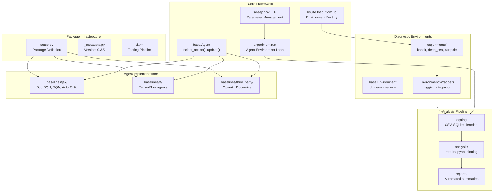
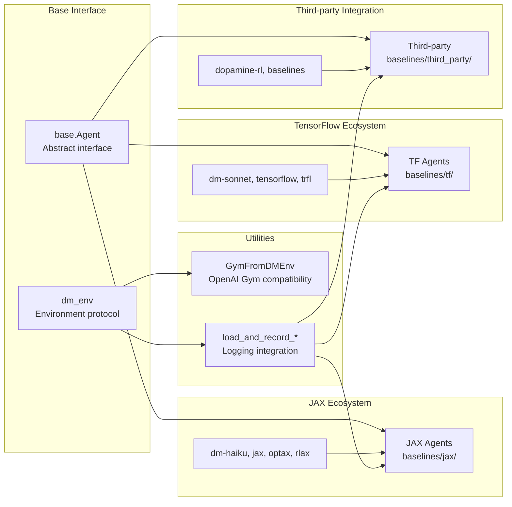
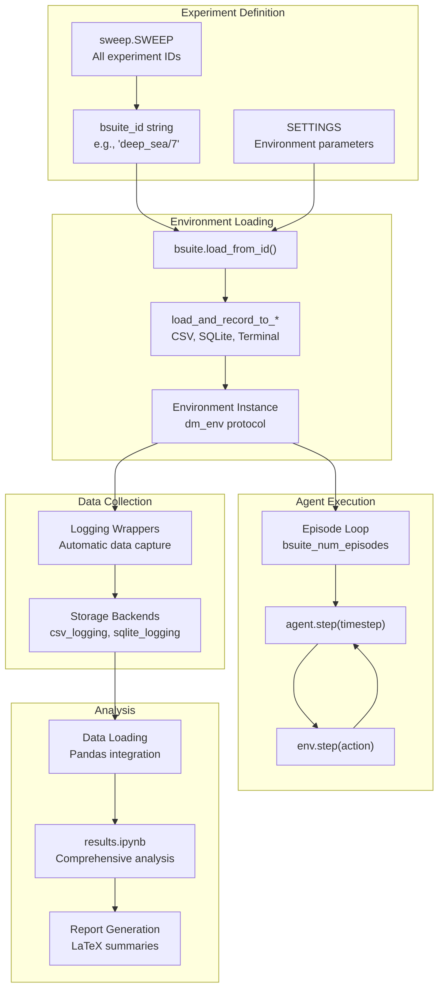

<!-- source: DeepWiki mcp.deepwiki.com · repo google-deepmind/bsuite · page 1 Overview · fetched 2026-10-26 -->

# Overview

Relevant source files

The following files were used as context for generating this wiki page:

- [.github/workflows/ci.yml](.github/workflows/ci.yml)
- [README.md](README.md)
- [bsuite/_metadata.py](bsuite/_metadata.py)
- [setup.py](setup.py)

This document introduces the bsuite (Behaviour Suite) repository, explaining its purpose as a comprehensive evaluation framework for reinforcement learning agents, its core architectural components, and how they work together to enable systematic RL research. For detailed information about specific components, see [Package Structure and Installation](#1.1), [Core Framework](#2), [Environments](#3), [Agent Implementations](#4), [Experiment Management](#5), and [Data and Analysis](#6).

## Purpose and Scope

bsuite is a collection of carefully-designed diagnostic environments and evaluation tools for reinforcement learning research. The system serves two primary objectives: (1) providing clear, informative problems that capture key issues in RL algorithm design, and (2) enabling systematic study of agent behavior through standardized benchmarks with automated evaluation and analysis.

The framework automates the entire research pipeline from experiment definition through execution to comprehensive analysis, supporting multiple machine learning frameworks and providing reproducible evaluation protocols for RL algorithms.

Sources: [README.md:11-21](), [setup.py:62-63]()

## System Architecture

The bsuite system consists of five major subsystems that work together to provide end-to-end evaluation capabilities:

### High-Level System Components

Sources: [setup.py:1-104](), [README.md:31-48](), [bsuite/_metadata.py:22]()

## Core Framework Integration

The system integrates multiple frameworks through a unified interface while maintaining framework-specific optimizations:

### Framework Support Structure

Sources: [setup.py:24-50](), [README.md:187-199]()

## Data Flow and Experiment Execution

The system orchestrates experiments through a standardized pipeline that maintains consistency across different agent implementations:

### Experiment Execution Pipeline

Sources: [README.md:93-112](), [README.md:138-154](), [README.md:176-185]()

## Package Dependencies and Installation

The system supports flexible installation with optional dependencies for different use cases:

| Dependency Group | Key Libraries | Purpose |
|------------------|---------------|---------|
| Core | `dm_env`, `numpy`, `pandas`, `matplotlib` | Basic functionality |
| JAX Baselines | `jax`, `dm-haiku`, `optax`, `rlax` | JAX agent implementations |
| TF Baselines | `tensorflow`, `dm-sonnet`, `trfl` | TensorFlow agents |
| Third-party | `dopamine-rl`, `baselines` | External agent integration |
| Testing | `pytest-xdist`, `pytype`, `gym==0.20.0` | Development and CI |

The modular dependency structure allows users to install only the components they need:

- `pip install bsuite` - Core framework only
- `pip install bsuite[baselines_jax]` - Include JAX agents  
- `pip install bsuite[baselines]` - Include TensorFlow agents
- `pip install bsuite[testing]` - Include development tools

Sources: [setup.py:73-91](), [README.md:58-82]()

## Research Integration and Extensibility  

bsuite supports the complete research lifecycle from hypothesis testing to publication-ready results. The system provides:

- **Standardized Benchmarks**: Consistent evaluation across different algorithms
- **Automated Analysis**: Pre-built Jupyter notebooks for comprehensive evaluation
- **Publication Support**: LaTeX report generation for conference submissions
- **Framework Agnostic**: Support for JAX, TensorFlow, and third-party libraries
- **Extensible Design**: Clear interfaces for adding new environments and agents

The framework facilitates reproducible research by automating data collection within environments through the `load_and_record_*` functions, ensuring consistent logging across all experiments without constraining agent implementations.

Sources: [README.md:11-26](), [README.md:278-288](), [setup.py:95-103]()

---

