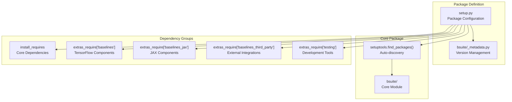
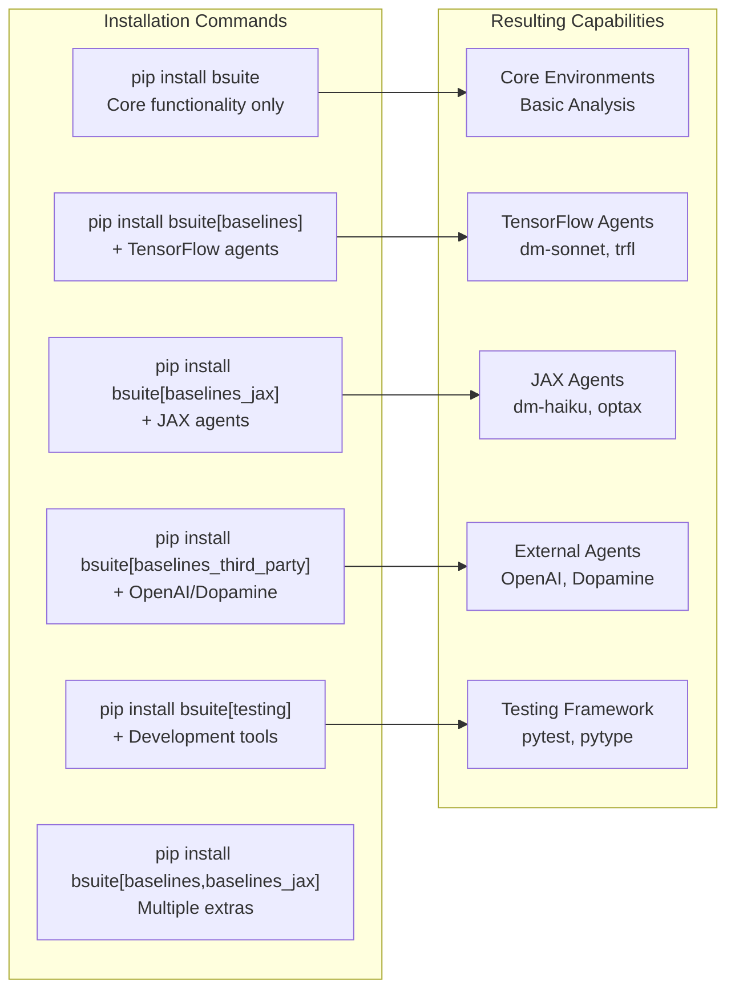
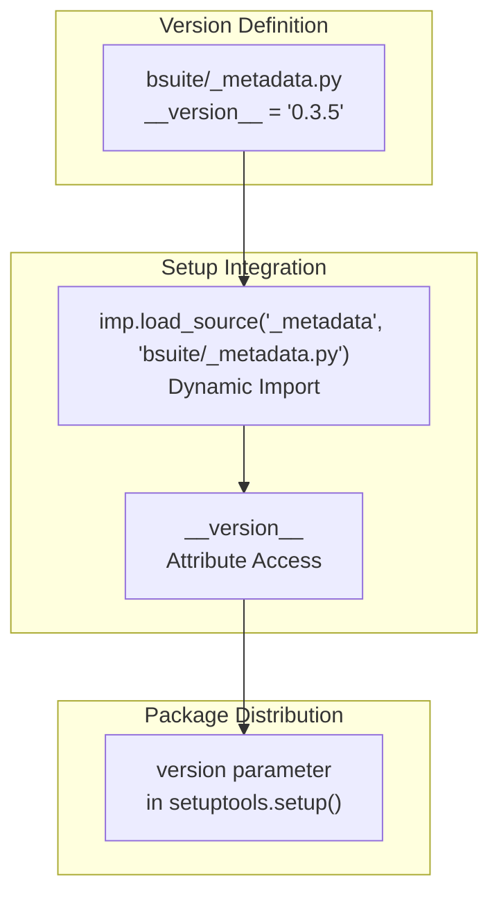

<!-- source: DeepWiki mcp.deepwiki.com · repo google-deepmind/bsuite · page 1.1 Package Structure and Installation · fetched 2026-10-26 -->

# Package Structure and Installation

<details>
<summary>Relevant source files</summary>

The following files were used as context for generating this wiki page:

- [bsuite/_metadata.py](bsuite/_metadata.py)
- [setup.py](setup.py)

</details>


This document covers the bsuite package organization, dependency management, installation procedures, and metadata handling. It explains how the package is structured for distribution and the various installation options available for different use cases.

For information about getting started with basic usage after installation, see [Quick Start Guide](#1.2). For details about the development environment setup, see [Development Setup](#7.2).

## Package Organization

The bsuite package follows a standard Python package structure with modular organization and flexible dependency management. The package definition and metadata are centrally managed through setuptools configuration.

### Package Structure Diagram



Sources: [setup.py:60-104](), [bsuite/_metadata.py:22]()

The package uses `setuptools.find_packages()` for automatic package discovery, which recursively identifies all Python packages within the bsuite directory structure.

## Core Dependencies

The bsuite package has a minimal set of core dependencies required for basic functionality, with additional optional dependencies organized into logical groups.

### Core Requirements

The following dependencies are required for all bsuite installations:

| Package | Purpose |
|---------|---------|
| `absl-py` | Command-line flag handling and logging |
| `dm_env` | DeepMind environment interface |
| `immutabledict` | Immutable dictionary data structures |
| `matplotlib` | Plotting and visualization |
| `numpy` | Numerical computing |
| `pandas` | Data manipulation and analysis |
| `plotnine` | Grammar of graphics plotting |
| `scipy` | Scientific computing |
| `scikit-image` | Image processing |
| `six` | Python 2/3 compatibility |
| `termcolor` | Terminal color output |

Sources: [setup.py:73-85]()

## Installation Options

The bsuite package supports multiple installation configurations through setuptools extras, allowing users to install only the components they need.

### Installation Methods Diagram



Sources: [setup.py:86-91]()

### Basic Installation

For core bsuite functionality without baseline agents:

```bash
pip install bsuite
```

This installs only the core dependencies and provides access to all bsuite environments and basic analysis tools.

### Extended Installation Options

#### TensorFlow Baselines
Includes TensorFlow-based agent implementations:

```bash
pip install bsuite[baselines]
```

Dependencies added: `dm-sonnet`, `dm-tree`, `tensorflow`, `tensorflow_probability`, `trfl`, `tqdm`

#### JAX Baselines  
Includes JAX-based agent implementations:

```bash
pip install bsuite[baselines_jax]
```

Dependencies added: `dataclasses`, `dm-haiku`, `dm-tree`, `jax`, `jaxlib`, `optax`, `rlax`, `tqdm`

#### Third-party Integrations
Includes OpenAI Baselines and Dopamine integration:

```bash
pip install bsuite[baselines_third_party]
```

Dependencies added: `tensorflow==1.15`, `dopamine-rl`, `baselines`

#### Development Environment
Includes testing and development tools:

```bash
pip install bsuite[testing]
```

Dependencies added: `gym==0.20.0`, `tensorflow_probability==0.14.1`, `mock`, `pytest-xdist`, `pytype`

Sources: [setup.py:22-58]()

## Version Management

The bsuite package implements a centralized version management system that separates version information from the main package code.

### Version System Architecture



Sources: [bsuite/_metadata.py:22](), [setup.py:70]()

The version is defined in `bsuite/_metadata.py` as `__version__ = '0.3.5'` and dynamically imported during package setup using `imp.load_source()`. This separation allows the version to be accessed during installation before bsuite's dependencies are available.

## Platform and Python Support

The package supports multiple operating systems and Python versions:

### Supported Platforms
- Linux (POSIX)
- Windows  
- macOS

### Python Versions
- Python 3.6
- Python 3.7

### Package Metadata
- Development Status: Alpha
- License: Apache License, Version 2.0
- Intended Audience: Science/Research
- Topic: Scientific/Engineering/Artificial Intelligence

Sources: [setup.py:92-103]()

## Package Metadata Configuration

The setuptools configuration defines comprehensive package metadata for distribution:

| Field | Value |
|-------|-------|
| Name | `bsuite` |
| Description | Core RL Behaviour Suite. A collection of reinforcement learning experiments. |
| URL | https://github.com/deepmind/bsuite |
| Author | DeepMind |
| License | Apache License, Version 2.0 |
| Keywords | reinforcement-learning, python, machine-learning |

The long description is automatically loaded from `README.md` with Markdown content type for package repository display.

Sources: [setup.py:60-71]()

---

