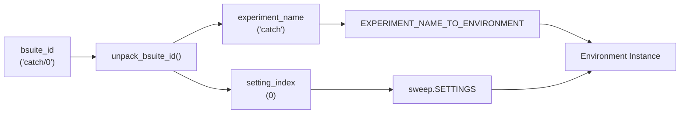
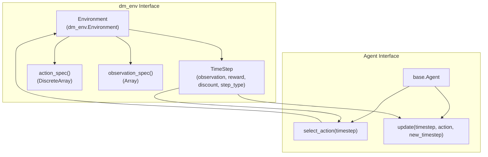
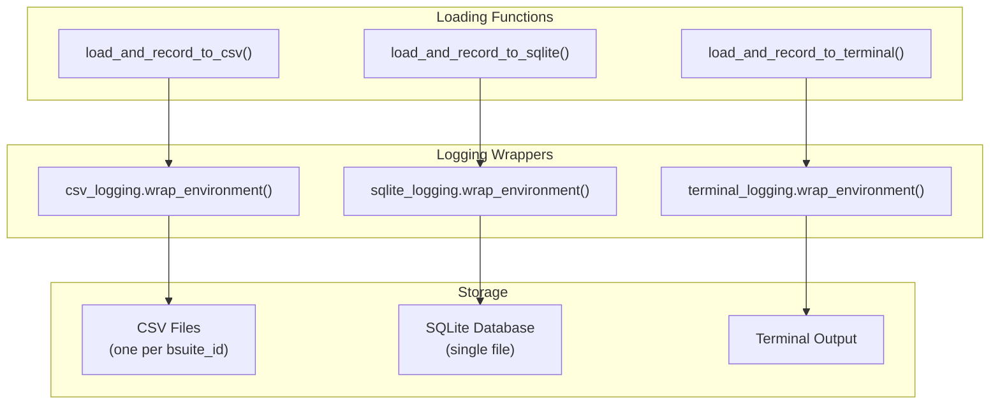
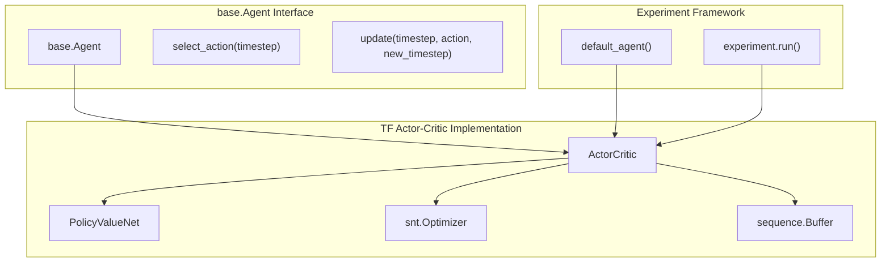
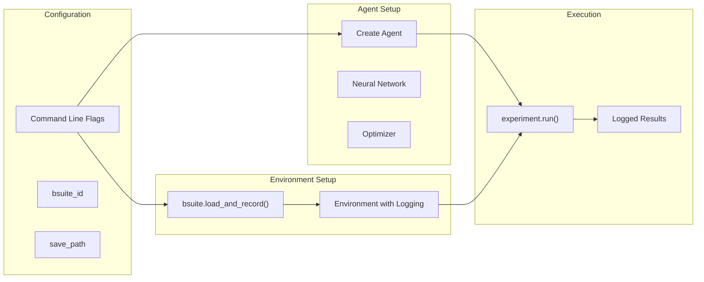

<!-- source: DeepWiki mcp.deepwiki.com · repo google-deepmind/bsuite · page 1.2 Quick Start Guide · fetched 2026-10-26 -->

# Quick Start Guide

<details>
<summary>Relevant source files</summary>

The following files were used as context for generating this wiki page:

- [.github/workflows/ci.yml](.github/workflows/ci.yml)
- [README.md](README.md)
- [bsuite/baselines/tf/actor_critic/__init__.py](bsuite/baselines/tf/actor_critic/__init__.py)
- [bsuite/baselines/tf/actor_critic/agent.py](bsuite/baselines/tf/actor_critic/agent.py)
- [bsuite/baselines/tf/actor_critic/run.py](bsuite/baselines/tf/actor_critic/run.py)
- [bsuite/baselines/tf/actor_critic/run_test.py](bsuite/baselines/tf/actor_critic/run_test.py)
- [bsuite/bsuite.py](bsuite/bsuite.py)
- [bsuite/experiments/bandit_noise/__init__.py](bsuite/experiments/bandit_noise/__init__.py)
- [bsuite/experiments/umbrella_length/umbrella_length.py](bsuite/experiments/umbrella_length/umbrella_length.py)

</details>


This guide provides a concise walkthrough for getting started with bsuite, covering environment loading, basic agent interaction, and result logging. For detailed information about specific environments, see [Core Diagnostic Environments](#3.1). For comprehensive experiment management and parameter sweeps, see [Experiment Configuration and Sweeps](#5.2).

## Installation

Install bsuite from PyPI with basic dependencies:

```bash
pip install bsuite
```

For baseline agent implementations, install with additional dependencies:

```bash
pip install bsuite[baselines]
```

Sources: [README.md:59-82]()

## Basic Environment Loading

Load any bsuite environment using its `bsuite_id` string identifier:

```python
import bsuite

# Load a specific environment
env = bsuite.load_from_id('catch/0')
```

### Environment ID System

**Environment ID Structure**


Get all available environment IDs:

```python
from bsuite import sweep

# All environments in the full sweep
print(sweep.SWEEP)

# Specific experiment variants
print(sweep.DEEP_SEA)
print(sweep.CARTPOLE)

# Environments grouped by research focus
print(sweep.TAGS['basic'])
print(sweep.TAGS['exploration'])
```

Sources: [bsuite/bsuite.py:85-110](), [README.md:105-136]()

## Agent-Environment Interaction Loop

All bsuite environments implement the `dm_env` interface with discrete actions:

```python
# Get environment specifications
num_actions = env.action_spec().num_values
obs_shape = env.observation_spec().shape

# Basic interaction loop
for episode in range(env.bsuite_num_episodes):
    timestep = env.reset()
    while not timestep.last():
        # Your agent logic here
        action = select_action(timestep.observation)
        timestep = env.step(action)
```

### Core Interaction Components

**Agent-Environment Interface**


Sources: [README.md:156-185](), [bsuite/baselines/tf/actor_critic/agent.py:105-127]()

## Logging Results

bsuite provides automatic logging wrappers that capture data without modifying your agent code:

### CSV Logging
```python
# Log to separate CSV files per environment
env = bsuite.load_and_record_to_csv(
    bsuite_id='catch/0',
    results_dir='/path/to/results',
    overwrite=False
)
```

### SQLite Logging
```python
# Log to single database file (recommended for multiple experiments)
env = bsuite.load_and_record_to_sqlite(
    bsuite_id='catch/0', 
    db_path='/path/to/results.db'
)
```

### Terminal Logging
```python
# Log to terminal output
env = bsuite.load_and_record_to_terminal('catch/0')
```

**Logging System Architecture**


Sources: [bsuite/bsuite.py:112-216](), [README.md:138-154]()

## Using Baseline Agents

bsuite includes several baseline agent implementations. Here's how to use the TensorFlow Actor-Critic agent:

```python
from bsuite.baselines.tf import actor_critic
from bsuite.baselines import experiment

# Load environment with logging
env = bsuite.load_and_record_to_csv('cartpole/0', '/tmp/results')

# Create agent with default parameters
agent = actor_critic.default_agent(
    obs_spec=env.observation_spec(),
    action_spec=env.action_spec()
)

# Run experiment
experiment.run(
    agent=agent,
    environment=env,
    num_episodes=env.bsuite_num_episodes
)
```

### Agent Implementation Pattern

**Baseline Agent Structure**


Sources: [bsuite/baselines/tf/actor_critic/agent.py:40-169](), [bsuite/baselines/tf/actor_critic/run.py:55-89]()

## Running Full Experiments

Use the provided run scripts to execute complete experiments:

```bash
# Run single environment
python -m bsuite.baselines.tf.actor_critic.run --bsuite_id=catch/0

# Run full sweep (all environments)
python -m bsuite.baselines.tf.actor_critic.run --bsuite_id=SWEEP
```

### Command Line Parameters

| Parameter | Description | Default |
|-----------|-------------|---------|
| `--bsuite_id` | Environment ID or sweep name | `'catch/0'` |
| `--save_path` | Results directory | `'/tmp/bsuite'` |
| `--logging_mode` | Logging format | `'csv'` |
| `--num_episodes` | Override episode count | `None` |
| `--seed` | Random seed | `42` |

**Experiment Execution Flow**


Sources: [bsuite/baselines/tf/actor_critic/run.py:32-111](), [README.md:214-267]()

## OpenAI Gym Compatibility

Use bsuite environments with Gym-compatible codebases:

```python
import bsuite
from bsuite.utils import gym_wrapper

# Load with logging
env = bsuite.load_and_record_to_csv('catch/0', '/tmp/results')

# Wrap for Gym compatibility  
gym_env = gym_wrapper.GymFromDMEnv(env)

# Use with Gym-style interface
obs = gym_env.reset()
action = gym_env.action_space.sample()
obs, reward, done, info = gym_env.step(action)
```

Sources: [README.md:187-202]()

## Next Steps

- **Environment Details**: See [Core Diagnostic Environments](#3.1) for comprehensive environment descriptions
- **Agent Development**: See [Agent Interface and Experiment Framework](#2.1) for implementing custom agents  
- **Large-Scale Experiments**: See [Running Experiments](#5.1) for parallel execution and parameter sweeps
- **Analysis**: See [Analysis and Visualization](#6.2) for result analysis tools and Jupyter notebooks

Sources: [README.md:47-48](), [README.md:269-289]()

---

