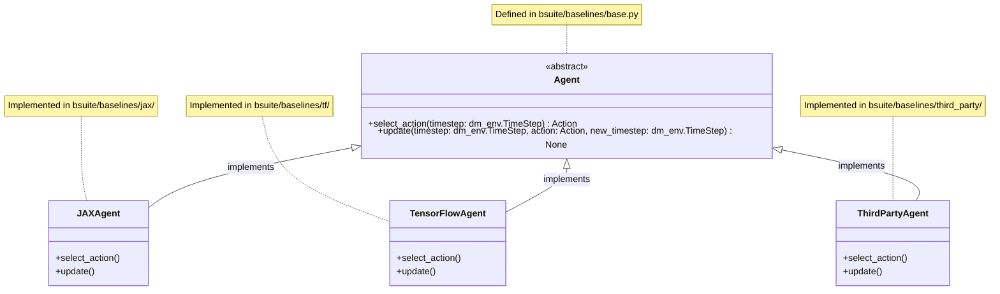
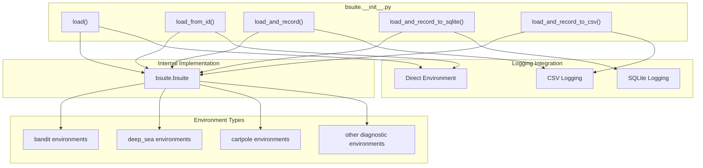
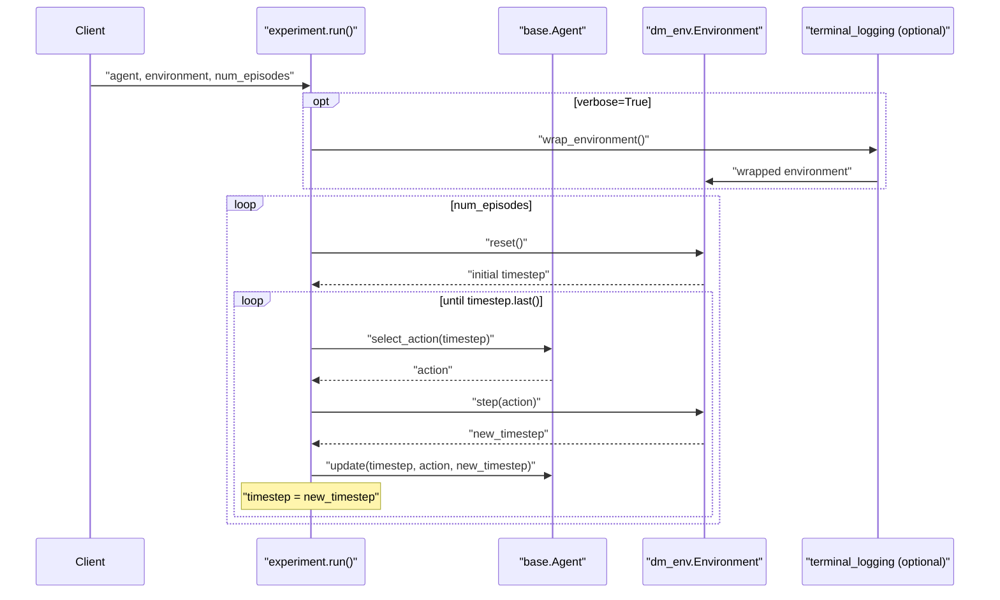
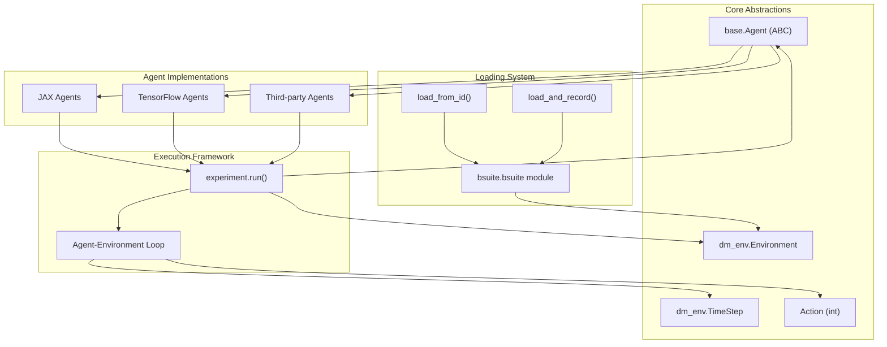

<!-- source: DeepWiki mcp.deepwiki.com · repo google-deepmind/bsuite · page 2 Core Framework · fetched 2026-10-26 -->

# Core Framework

Relevant source files

The following files were used as context for generating this wiki page:

- [bsuite/__init__.py](bsuite/__init__.py)
- [bsuite/baselines/base.py](bsuite/baselines/base.py)
- [bsuite/baselines/experiment.py](bsuite/baselines/experiment.py)
- [bsuite/baselines/jax/__init__.py](bsuite/baselines/jax/__init__.py)
- [bsuite/baselines/tf/__init__.py](bsuite/baselines/tf/__init__.py)
- [bsuite/baselines/third_party/__init__.py](bsuite/baselines/third_party/__init__.py)

This document covers the fundamental abstractions and interfaces that form the foundation of the bsuite system. The core framework provides the essential building blocks for agent-environment interaction, experiment orchestration, and data collection that all other components depend on.

For information about specific agent implementations, see [Agent Implementations](#4). For details about environment-specific functionality, see [Environments](#3). For execution and configuration management, see [Experiment Management](#5).

## Agent Interface

The core of bsuite's agent abstraction is defined by the `Agent` class in [bsuite/baselines/base.py:24-38](). This abstract base class establishes the fundamental contract that all agents must implement.

### Agent Interface Components

| Method | Purpose | Parameters | Returns |
|--------|---------|------------|---------|
| `select_action()` | Action selection from agent's policy | `timestep: dm_env.TimeStep` | `Action` (int) |
| `update()` | Learning update from transition data | `timestep`, `action`, `new_timestep` | `None` |

The interface uses discrete actions only, as specified by the type alias `Action = int` at [bsuite/baselines/base.py:21]().

**Sources:** [bsuite/baselines/base.py:1-39]()

## Environment Loading System

The bsuite package provides a standardized interface for loading environments through functions exported in the main module. These functions handle environment instantiation, configuration, and optional logging integration.

### Loading Function Categories

| Function | Purpose | Logging |
|----------|---------|---------|
| `load()` | Basic environment loading | None |
| `load_from_id()` | Load by environment identifier | None |
| `load_and_record()` | Load with automatic logging | Configurable |
| `load_and_record_to_sqlite()` | Load with SQLite logging | SQLite database |
| `load_and_record_to_csv()` | Load with CSV logging | CSV files |

All loading functions delegate to the internal `bsuite.bsuite` module implementation, providing a clean public API while maintaining implementation flexibility.

**Sources:** [bsuite/__init__.py:16-26]()

## Experiment Execution Framework

The experiment execution framework coordinates the interaction between agents and environments through the `run()` function in [bsuite/baselines/experiment.py:24-57](). This function implements the standard reinforcement learning training loop.

### Execution Loop Components

The `run()` function orchestrates four key interactions:

1. **Environment Reset**: Each episode begins with `environment.reset()` 
2. **Action Selection**: Agent chooses actions via `agent.select_action(timestep)`
3. **Environment Step**: Environment advances with `environment.step(action)`
4. **Agent Update**: Agent learns from `agent.update(timestep, action, new_timestep)`

### Optional Logging Integration

When `verbose=True`, the framework automatically wraps the environment with terminal logging through `terminal_logging.wrap_environment()`, providing real-time training feedback without modifying the core loop logic.

**Sources:** [bsuite/baselines/experiment.py:1-58]()

## Core Framework Integration

The core framework components work together to provide a unified foundation for reinforcement learning experiments in bsuite.

### Framework Flow

1. **Environment Loading**: Client code calls loading functions to instantiate environments
2. **Agent Creation**: Agent implementations inherit from `base.Agent` and implement required methods
3. **Experiment Execution**: `experiment.run()` coordinates agent-environment interaction
4. **Data Flow**: `dm_env.TimeStep` objects and discrete actions flow between components

This architecture enables modular development where agents, environments, and execution logic can evolve independently while maintaining consistent interfaces.

**Sources:** [bsuite/baselines/base.py:1-39](), [bsuite/__init__.py:16-26](), [bsuite/baselines/experiment.py:1-58]()

---

