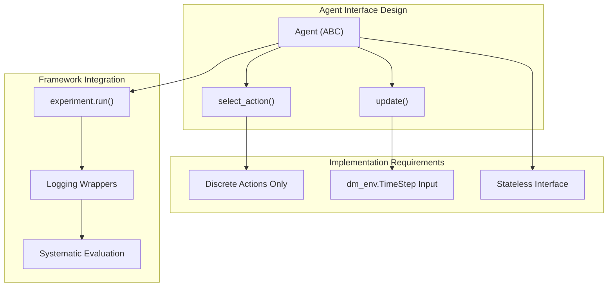
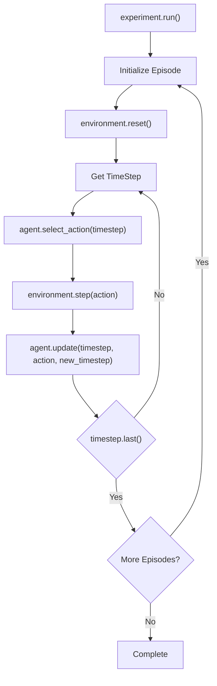
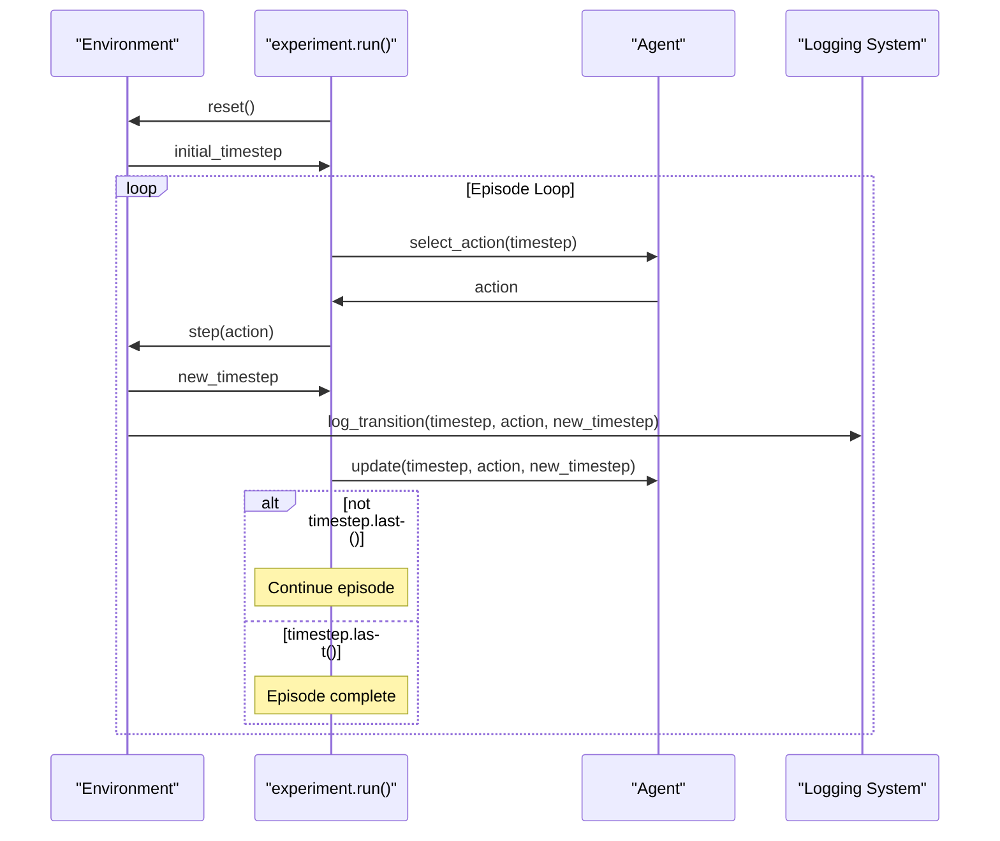
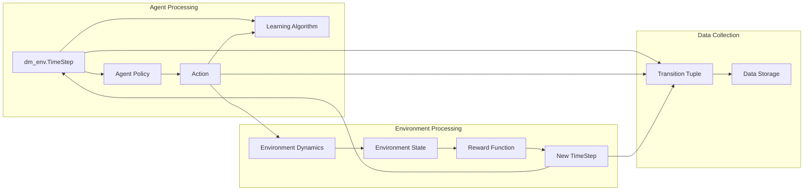
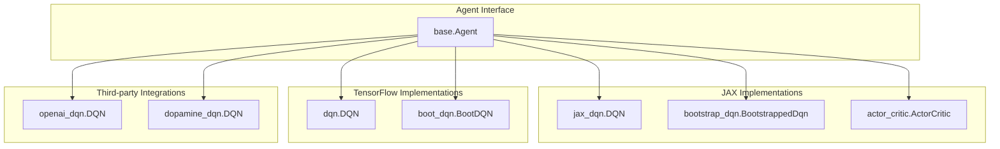

<!-- source: DeepWiki mcp.deepwiki.com · repo google-deepmind/bsuite · page 2.1 Agent Interface and Experiment Framework · fetched 2026-10-26 -->

# Agent Interface and Experiment Framework

<details>
<summary>Relevant source files</summary>

The following files were used as context for generating this wiki page:

- [bsuite/__init__.py](bsuite/__init__.py)
- [bsuite/baselines/base.py](bsuite/baselines/base.py)
- [bsuite/baselines/experiment.py](bsuite/baselines/experiment.py)
- [bsuite/baselines/jax/__init__.py](bsuite/baselines/jax/__init__.py)
- [bsuite/baselines/tf/__init__.py](bsuite/baselines/tf/__init__.py)
- [bsuite/baselines/third_party/__init__.py](bsuite/baselines/third_party/__init__.py)

</details>


This document covers the core abstractions and execution framework that enable systematic agent evaluation in bsuite. It explains the `Agent` interface that all baseline implementations must implement, and the experiment execution framework that orchestrates agent-environment interactions.

For information about environment loading and ID management, see [Environment Loading System](#2.2). For parameter sweeps and configuration management, see [Sweep and Configuration Management](#2.3). For specific agent implementations, see [Agent Implementations](#4).

## Agent Interface

The bsuite framework defines a minimal but powerful agent interface through the abstract `Agent` class. This interface ensures all agents can be evaluated consistently across the diagnostic environments.

### Base Agent Abstraction

The `Agent` class in [bsuite/baselines/base.py:24-38]() defines the core interface that all bsuite agents must implement:

```python
class Agent(abc.ABC):
  @abc.abstractmethod
  def select_action(self, timestep: dm_env.TimeStep) -> Action:
    """Takes in a timestep, samples from agent's policy, returns an action."""

  @abc.abstractmethod
  def update(self, timestep: dm_env.TimeStep, action: Action, 
             new_timestep: dm_env.TimeStep) -> None:
    """Updates the agent given a transition."""
```

#### Agent Interface Components

| Method | Purpose | Input | Output |
|--------|---------|-------|--------|
| `select_action()` | Policy execution | `dm_env.TimeStep` | `Action` (int) |
| `update()` | Learning from experience | Transition tuple | None |

**Action Space**: Currently limited to discrete actions represented as integers [bsuite/baselines/base.py:21]().

**State Representation**: Uses DeepMind Environment `TimeStep` objects containing observations, rewards, discounts, and step types.

### Agent Interface Design Principles



Sources: [bsuite/baselines/base.py:18-38]()

## Experiment Execution Framework

The experiment framework provides a standardized training loop that works with any agent implementation and bsuite environment. This ensures consistent evaluation conditions across all experiments.

### Core Execution Loop

The `run()` function in [bsuite/baselines/experiment.py:24-58]() implements the agent-environment interaction loop:

#### Execution Flow



Sources: [bsuite/baselines/experiment.py:24-58]()

### Experiment Parameters

The `run()` function accepts the following parameters [bsuite/baselines/experiment.py:24-27]():

| Parameter | Type | Purpose |
|-----------|------|---------|
| `agent` | `base.Agent` | Agent implementation to evaluate |
| `environment` | `dm_env.Environment` | Environment to run on |
| `num_episodes` | `int` | Number of episodes to execute |
| `verbose` | `bool` | Enable terminal logging |

### Logging Integration

The experiment framework integrates seamlessly with bsuite's logging system:

- **Automatic Logging**: bsuite environments handle logging internally [bsuite/baselines/experiment.py:30]()
- **Optional Terminal Output**: Verbose mode wraps environment with terminal logging [bsuite/baselines/experiment.py:39-41]()
- **Transparent Wrappers**: Logging wrappers maintain the `dm_env.Environment` interface

## Agent-Environment Interaction Protocol

The interaction between agents and environments follows a strict protocol that enables consistent data collection and analysis.

### Interaction Sequence



Sources: [bsuite/baselines/experiment.py:43-57]()

### Data Flow Architecture



Sources: [bsuite/baselines/experiment.py:47-57](), [bsuite/baselines/base.py:28-38]()

## Integration with bsuite System

The agent interface and experiment framework integrate with the broader bsuite system through several key mechanisms.

### Environment Loading Integration

The experiment framework works with environments loaded through bsuite's loading system:

```python
# From bsuite.__init__.py
load = _bsuite.load
load_from_id = _bsuite.load_from_id
load_and_record = _bsuite.load_and_record
```

**Typical Usage Pattern**:
1. Load environment with `bsuite.load_from_id()`
2. Create agent instance
3. Call `experiment.run(agent, environment, num_episodes)`

### Framework Extension Points

The experiment framework provides several extension points:

| Extension Point | Mechanism | Purpose |
|----------------|-----------|---------|
| **Logging** | Environment wrappers | Data collection and analysis |
| **Visualization** | Terminal logging wrapper | Real-time monitoring |
| **Environment Modification** | Wrapper system | Reward scaling, observation processing |

### Multi-Framework Support

The agent interface supports implementations across multiple ML frameworks:



Sources: [bsuite/__init__.py:21-25](), [bsuite/baselines/jax/__init__.py](), [bsuite/baselines/tf/__init__.py](), [bsuite/baselines/third_party/__init__.py]()

## Key Design Benefits

The agent interface and experiment framework provide several important benefits for reproducible RL research:

**Standardization**: All agents implement the same interface, enabling fair comparison across algorithms and frameworks.

**Simplicity**: The minimal interface reduces implementation overhead while maintaining full functionality.

**Transparency**: The experiment loop is explicit and visible, making it easy to understand and modify.

**Integration**: Seamless integration with bsuite's logging, analysis, and environment systems.

**Extensibility**: The abstract interface supports diverse learning algorithms from value-based methods to policy gradients.

Sources: [bsuite/baselines/base.py:16-38](), [bsuite/baselines/experiment.py:16-58]()

---

