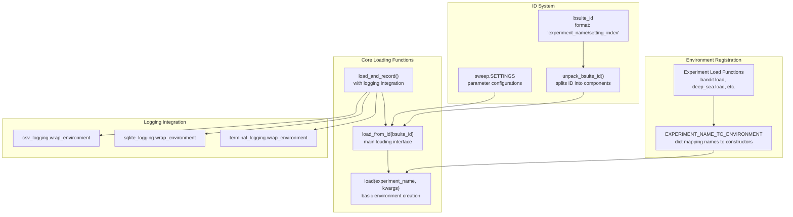
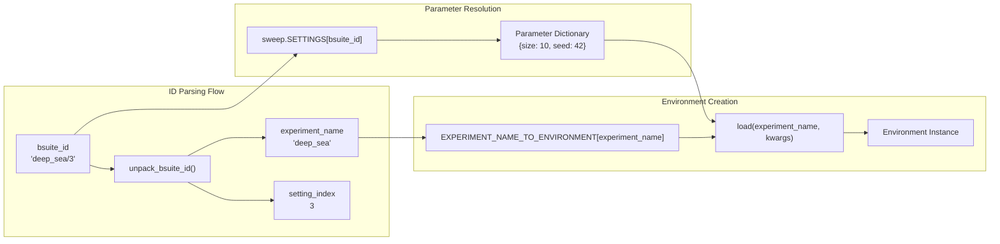
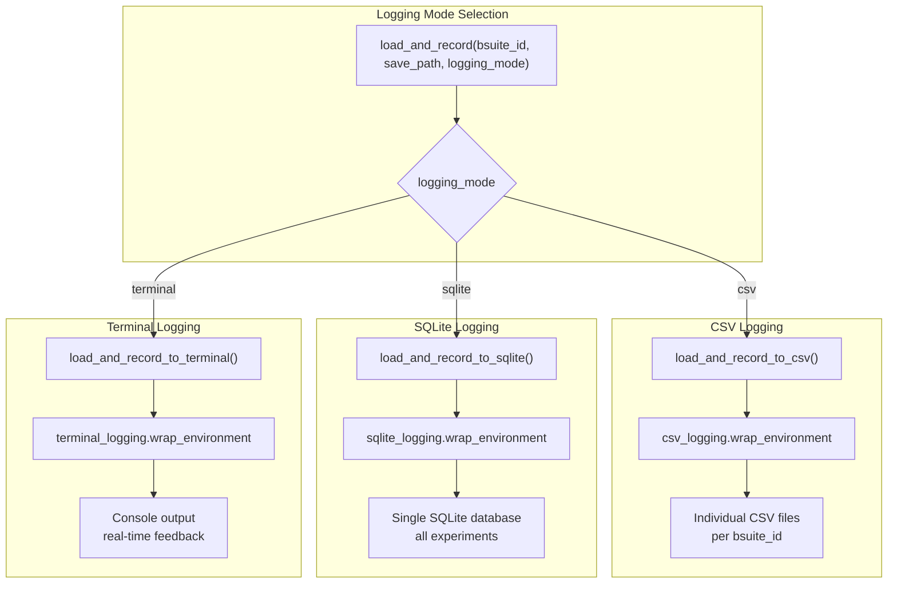

<!-- source: DeepWiki mcp.deepwiki.com · repo google-deepmind/bsuite · page 2.2 Environment Loading System · fetched 2026-10-26 -->

# Environment Loading System

<details>
<summary>Relevant source files</summary>

The following files were used as context for generating this wiki page:

- [bsuite/baselines/tf/actor_critic/__init__.py](bsuite/baselines/tf/actor_critic/__init__.py)
- [bsuite/baselines/tf/actor_critic/agent.py](bsuite/baselines/tf/actor_critic/agent.py)
- [bsuite/baselines/tf/actor_critic/run.py](bsuite/baselines/tf/actor_critic/run.py)
- [bsuite/baselines/tf/actor_critic/run_test.py](bsuite/baselines/tf/actor_critic/run_test.py)
- [bsuite/bsuite.py](bsuite/bsuite.py)
- [bsuite/experiments/bandit_noise/__init__.py](bsuite/experiments/bandit_noise/__init__.py)
- [bsuite/experiments/deep_sea/__init__.py](bsuite/experiments/deep_sea/__init__.py)
- [bsuite/experiments/deep_sea/deep_sea.py](bsuite/experiments/deep_sea/deep_sea.py)
- [bsuite/experiments/discounting_chain/__init__.py](bsuite/experiments/discounting_chain/__init__.py)
- [bsuite/experiments/discounting_chain/discounting_chain.py](bsuite/experiments/discounting_chain/discounting_chain.py)
- [bsuite/experiments/memory_len/__init__.py](bsuite/experiments/memory_len/__init__.py)
- [bsuite/experiments/memory_len/memory_len.py](bsuite/experiments/memory_len/memory_len.py)
- [bsuite/experiments/mnist/mnist.py](bsuite/experiments/mnist/mnist.py)
- [bsuite/experiments/mountain_car/mountain_car.py](bsuite/experiments/mountain_car/mountain_car.py)
- [bsuite/experiments/umbrella_length/umbrella_length.py](bsuite/experiments/umbrella_length/umbrella_length.py)

</details>


This document covers the bsuite environment loading system, which provides a unified interface for creating and configuring diagnostic environments with integrated logging capabilities. The system handles environment instantiation from string identifiers, parameter management, and automatic logging wrapper integration.

For information about the experiment execution framework that uses these loaded environments, see [Agent Interface and Experiment Framework](#2.1). For details about parameter sweeps and configuration management, see [Sweep and Configuration Management](#2.3).

## Core Architecture

The environment loading system consists of three main components: environment registration, ID-based loading, and logging integration.



Sources: [bsuite/bsuite.py:55-82](), [bsuite/bsuite.py:85-110](), [bsuite/bsuite.py:112-130]()

## Environment Registration System

The loading system maintains a central registry that maps experiment names to their corresponding constructors or load functions. Each experiment provides either a constructor class or a `load` function that accepts keyword arguments.

| Experiment | Constructor/Load Function | Type |
|------------|---------------------------|------|
| `bandit` | `bandit.load` | Function |
| `deep_sea` | `deep_sea.load` | Function |
| `cartpole_swingup` | `cartpole_swingup.CartpoleSwingup` | Class |
| `memory_len` | `memory_len.load` | Function |
| `mountain_car` | `mountain_car.load` | Function |

The registry is defined in `EXPERIMENT_NAME_TO_ENVIRONMENT` and includes all available diagnostic environments with their noise and scale variants.

```python
# Example registration pattern
EXPERIMENT_NAME_TO_ENVIRONMENT = dict(
    bandit=bandit.load,
    deep_sea=deep_sea.load,
    cartpole_swingup=cartpole_swingup.CartpoleSwingup,
    # ... other experiments
)
```

Sources: [bsuite/bsuite.py:58-82](), [bsuite/experiments/deep_sea/deep_sea.py:20](), [bsuite/experiments/mountain_car/mountain_car.py:26](), [bsuite/experiments/memory_len/memory_len.py:31-39]()

## ID System and Loading Process

The loading system uses a hierarchical identifier format where each environment is specified by `experiment_name/setting_index`. The system parses these IDs and maps them to specific parameter configurations.



The `unpack_bsuite_id` function splits the ID using `sweep.SEPARATOR` and validates the format:

```python
def unpack_bsuite_id(bsuite_id: str) -> Tuple[str, int]:
  parts = bsuite_id.split(sweep.SEPARATOR)
  assert len(parts) == 2
  experiment_name = parts[0]
  setting_index = int(parts[1])
  return experiment_name, setting_index
```

Sources: [bsuite/bsuite.py:85-91](), [bsuite/bsuite.py:102-109](), [bsuite/bsuite.py:94-99]()

## Logging Integration

The loading system provides three logging modes that wrap environments transparently to capture experimental data. Each mode serves different use cases and storage requirements.



### Logging Mode Characteristics

| Mode | Storage | Use Case | Multi-process Safe |
|------|---------|----------|-------------------|
| `csv` | Separate files per experiment | Individual analysis, simple debugging | Yes (with different directories) |
| `sqlite` | Single database file | Aggregate analysis, complex queries | Yes |
| `terminal` | Console output | Real-time monitoring, debugging | N/A |

The SQLite mode automatically handles database file extension and provides centralized storage for sweep analysis:

```python
if logging_mode == 'sqlite':
  if not save_path.endswith('.db'):
    save_path += '.db'
```

Sources: [bsuite/bsuite.py:112-130](), [bsuite/bsuite.py:132-171](), [bsuite/bsuite.py:173-207](), [bsuite/bsuite.py:210-215]()

## Usage Patterns

The loading system supports several common usage patterns for different experimental workflows.

### Basic Environment Loading

```python
# Direct loading with ID
env = bsuite.load_from_id('deep_sea/3')

# Manual parameter specification  
env = bsuite.load('deep_sea', {'size': 10, 'seed': 42})
```

### Experimental Workflows

```python
# Single experiment with CSV logging
env = bsuite.load_and_record(
    bsuite_id='catch/0',
    save_path='/tmp/results', 
    logging_mode='csv'
)

# Sweep with SQLite aggregation
env = bsuite.load_and_record(
    bsuite_id='bandit/5',
    save_path='/tmp/sweep_results.db',
    logging_mode='sqlite'
)
```

### Testing and Development

The system integrates with the testing framework through parameterized tests that iterate over sweep configurations:

```python
@parameterized.parameters(*sweep.TESTING)
def test_run(self, bsuite_id: str):
  env = bsuite.load_from_id(bsuite_id)
  agent = create_test_agent(env.observation_spec(), env.action_spec())
  # ... run test
```

Sources: [bsuite/baselines/tf/actor_critic/run_test.py:29-39](), [bsuite/baselines/tf/actor_critic/run.py:58-63]()

---

