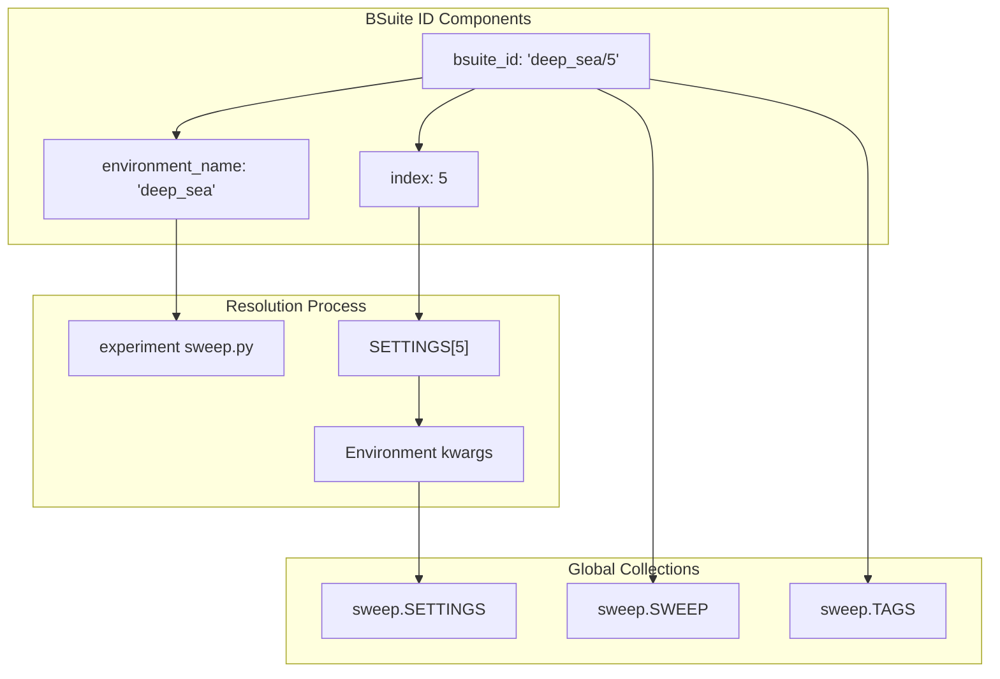
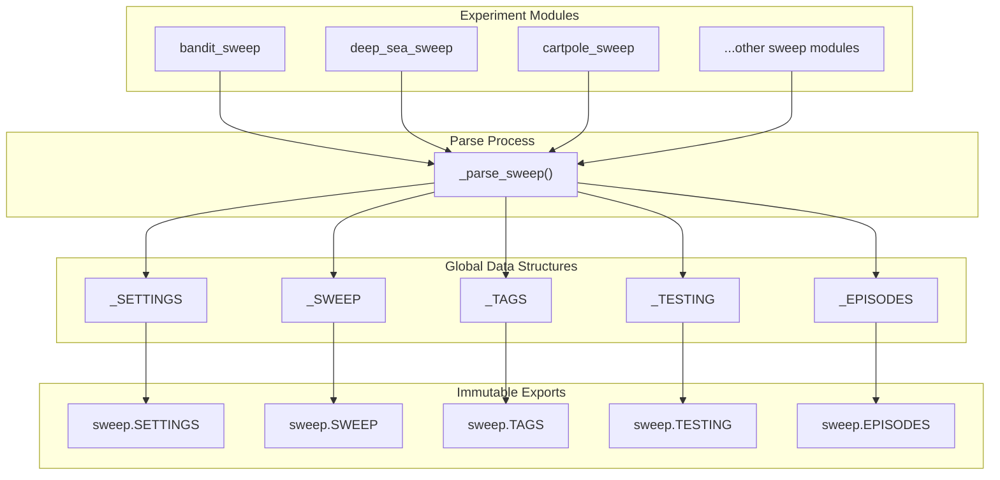
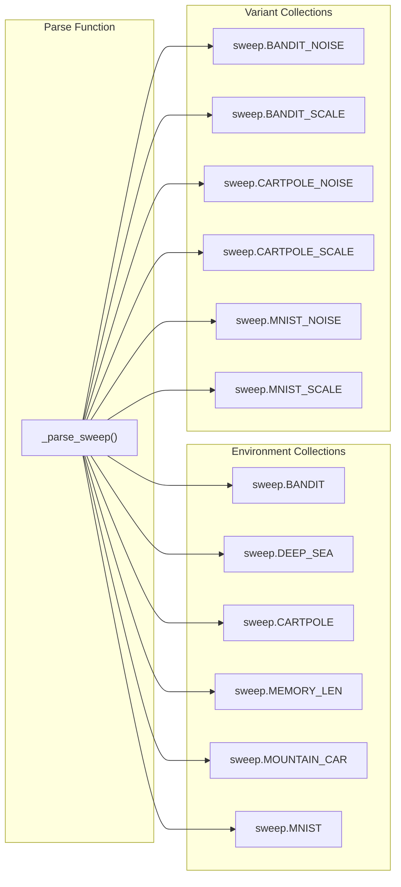
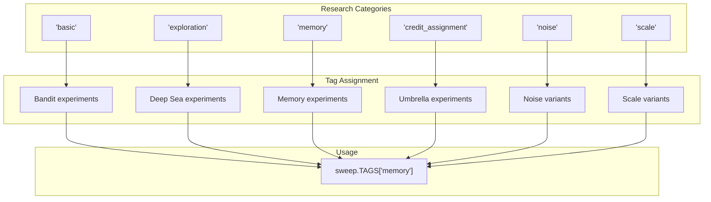

<!-- source: DeepWiki mcp.deepwiki.com · repo google-deepmind/bsuite · page 2.3 Sweep and Configuration Management · fetched 2026-10-26 -->

# Sweep and Configuration Management

<details>
<summary>Relevant source files</summary>

The following files were used as context for generating this wiki page:

- [bsuite/experiments/umbrella_distract/analysis.py](bsuite/experiments/umbrella_distract/analysis.py)
- [bsuite/experiments/umbrella_distract/sweep.py](bsuite/experiments/umbrella_distract/sweep.py)
- [bsuite/experiments/umbrella_length/analysis.py](bsuite/experiments/umbrella_length/analysis.py)
- [bsuite/experiments/umbrella_length/sweep.py](bsuite/experiments/umbrella_length/sweep.py)
- [bsuite/sweep.py](bsuite/sweep.py)
- [bsuite/sweep_test.py](bsuite/sweep_test.py)

</details>


This document covers the sweep and configuration management system in bsuite, which provides a standardized way to define, organize, and iterate over experiment parameter configurations. The system enables systematic evaluation across multiple environment variants and parameter settings through a unified interface.

For information about running experiments using these sweep configurations, see [Experiment Configuration and Sweeps](#5.2). For details about the environment loading system that uses these sweep IDs, see [Environment Loading System](#2.2).

## Overview

The sweep system manages experiment configurations through a hierarchical identifier system. Each experiment variant is assigned a unique `bsuite_id` string that encodes both the environment name and parameter configuration index. This enables reproducible experiment specification and systematic parameter exploration.

## BSuite ID System

### ID Format and Structure

Each `bsuite_id` follows the format `environment_name/index`, where the index corresponds to a specific parameter configuration within that environment's sweep definition.



**BSuite ID Resolution Flow**

Sources: [bsuite/sweep.py:16-34]()

The core type definitions establish the system's data structures:

| Type | Definition | Purpose |
|------|------------|---------|
| `BSuiteId` | `str` | Unique experiment identifier |
| `Tag` | `str` | Experiment category label |
| `EnvKWargs` | `Dict[str, Any]` | Environment constructor arguments |

Sources: [bsuite/sweep.py:64-67]()

### Sweep Processing Architecture

The `_parse_sweep()` function processes individual experiment sweep modules to build the global configuration mappings:



**Sweep Processing Pipeline**

Sources: [bsuite/sweep.py:81-105]()

The processing logic extracts experiment names from module paths, constructs `bsuite_id` strings, and populates the global data structures while handling special cases like test sweep eligibility.

## Configuration Data Structures

### Core Mappings

The sweep system exposes five primary immutable data structures:

| Structure | Type | Purpose |
|-----------|------|---------|
| `SETTINGS` | `Mapping[BSuiteId, EnvKWargs]` | Maps IDs to environment parameters |
| `SWEEP` | `Tuple[BSuiteId, ...]` | All available experiment IDs |
| `TAGS` | `Mapping[Tag, Tuple[BSuiteId, ...]]` | Groups experiments by category |
| `TESTING` | `Tuple[BSuiteId, ...]` | Subset for agent testing |
| `EPISODES` | `Mapping[BSuiteId, int]` | Episode counts per experiment |

Sources: [bsuite/sweep.py:133-150]()

### Environment-Specific Collections

Individual experiment collections are created through sweep parsing:



**Environment Collection Organization**

Sources: [bsuite/sweep.py:108-131]()

## Experiment Sweep Definitions

### Sweep Module Structure

Each experiment defines its parameter space through a sweep module containing:

- `SETTINGS`: Tuple of parameter dictionaries
- `TAGS`: Tuple of category strings
- `NUM_EPISODES`: Integer episode count

Example from umbrella_length experiment:

```python
# Parameter space definition
_log_spaced = []
_log_spaced.extend(range(1, 11))          # 1-10
_log_spaced.extend([12, 14, 17, 20, 25])  # Selected mid-range
_log_spaced.extend(range(30, 105, 10))    # 30-100 by 10s

SETTINGS = tuple({'chain_length': n, 'n_distractor': 20} for n in _log_spaced)
TAGS = ('credit_assignment', 'noise')
NUM_EPISODES = 10000
```

Sources: [bsuite/experiments/umbrella_length/sweep.py:18-27]()

### Parameter Configuration Patterns

The system supports various parameter space exploration patterns:

| Pattern | Example | Use Case |
|---------|---------|----------|
| Linear Range | `range(1, 11)` | Simple parameter scaling |
| Log Spacing | `[1, 2, 5, 10, 20, 50]` | Exponential parameter effects |
| Fixed Combinations | `{'param1': a, 'param2': b}` | Multi-parameter settings |
| Inheritance | Import from base experiment | Variant experiments |

### Tag-Based Organization

Tags group experiments by research focus:



**Tag-Based Experiment Organization**

Sources: [bsuite/sweep.py:99-103](), [bsuite/experiments/umbrella_length/sweep.py:27](), [bsuite/experiments/umbrella_distract/sweep.py:28]()

## Testing and Quality Assurance

### Test Sweep Selection

The system automatically creates a representative test subset by including the first setting (index 0) from each base environment, excluding noise and scale variants:

```python
IGNORE_FOR_TESTING = ('_noise', '_scale')

# In _parse_sweep():
eligible_for_test_sweep = not any(experiment_name.endswith(s) 
                                  for s in IGNORE_FOR_TESTING)
if i == 0 and eligible_for_test_sweep:
    _TESTING.append(bsuite_id)
```

Sources: [bsuite/sweep.py:72](), [bsuite/sweep.py:86-94]()

### Immutability Guarantees

All exported data structures use `immutabledict` to prevent accidental modification:

```python
SETTINGS: Mapping[BSuiteId, EnvKWargs] = immutabledict.immutabledict(**_SETTINGS)
TAGS: Mapping[Tag, Tuple[BSuiteId, ...]] = immutabledict.immutabledict(
    **{k: tuple(v) for k, v in _TAGS.items()})
```

Sources: [bsuite/sweep.py:134-144]()

## Integration with Analysis

### Analysis Module Interface

Experiment analysis modules use sweep parameters for data processing and visualization:

```python
def score_by_group(df: pd.DataFrame, group_col: str) -> float:
    """Score grouped by sweep parameter."""
    regret_list = []
    for _, sub_df in df.groupby(group_col):
        max_eps = np.minimum(sub_df.episode.max(), sweep.NUM_EPISODES)
        # ... scoring logic
    return np.mean(np.array(regret_list) < REGRET_THRESH)
```

Sources: [bsuite/experiments/umbrella_length/analysis.py:32-40]()

### Sweep-Aware Plotting

Analysis functions group data by sweep parameters for visualization:

```python
def plot_learning(df: pd.DataFrame, sweep_vars=None) -> gg.ggplot:
    """Plot learning curves grouped by sweep parameter."""
    return plotting.plot_regret_group_nosmooth(
        df_in=df,
        group_col='chain_length',  # Sweep parameter
        sweep_vars=sweep_vars,
        max_episode=sweep.NUM_EPISODES,
    )
```

Sources: [bsuite/experiments/umbrella_length/analysis.py:47-55]()

## Usage Patterns

### Complete Sweep Iteration

```python
# Iterate over all experiments
for bsuite_id in sweep.SWEEP:
    env = bsuite.load_from_id(bsuite_id)
    # Run experiment...

# Category-specific sweeps
for bsuite_id in sweep.TAGS['memory']:
    # Run memory experiments...

# Environment-specific sweeps  
for bsuite_id in sweep.DEEP_SEA:
    # Run deep sea variants...
```

### Configuration Access

```python
# Get environment parameters
env_kwargs = sweep.SETTINGS['deep_sea/5']
episode_count = sweep.EPISODES['deep_sea/5']

# Check experiment categories
memory_experiments = sweep.TAGS['memory']
test_experiments = sweep.TESTING
```

Sources: [bsuite/sweep.py:27-33](), [bsuite/sweep.py:133-150]()

---

