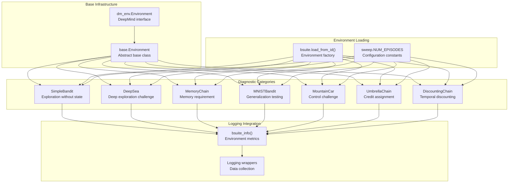
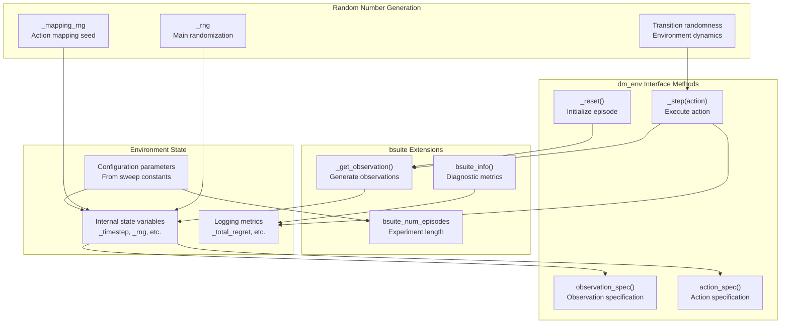

<!-- source: DeepWiki mcp.deepwiki.com · repo google-deepmind/bsuite · page 3 Environments · fetched 2026-10-26 -->

# Environments

Relevant source files

The following files were used as context for generating this wiki page:

- [bsuite/environments/bandit.py](bsuite/environments/bandit.py)
- [bsuite/environments/deep_sea.py](bsuite/environments/deep_sea.py)
- [bsuite/environments/discounting_chain.py](bsuite/environments/discounting_chain.py)
- [bsuite/environments/memory_chain.py](bsuite/environments/memory_chain.py)
- [bsuite/environments/mnist.py](bsuite/environments/mnist.py)
- [bsuite/environments/mountain_car.py](bsuite/environments/mountain_car.py)
- [bsuite/environments/umbrella_chain.py](bsuite/environments/umbrella_chain.py)

The bsuite environments provide a collection of diagnostic tasks designed to systematically evaluate reinforcement learning algorithms across key behavioral competencies. Each environment implements a specific research challenge such as exploration, memory, credit assignment, or generalization, allowing researchers to identify strengths and weaknesses in their agents' capabilities.

For information about running experiments with these environments, see [Experiment Management](#5). For details about agent implementations that interact with these environments, see [Agent Implementations](#4).

## Environment System Overview

The bsuite environment system is built around the `dm_env.Environment` interface, with all diagnostic environments inheriting from `base.Environment`. Each environment is designed to test a specific aspect of agent behavior while providing standardized logging and evaluation metrics.

**Environment System Architecture**

Sources: [bsuite/environments/bandit.py:32-74](), [bsuite/environments/deep_sea.py:48-156](), [bsuite/environments/memory_chain.py:34-113](), [bsuite/environments/mnist.py:33-86](), [bsuite/environments/mountain_car.py:34-101](), [bsuite/environments/umbrella_chain.py:36-115](), [bsuite/environments/discounting_chain.py:37-106]()

## Environment Categories

The diagnostic environments are organized into distinct categories, each targeting specific aspects of reinforcement learning competency:

### Exploration Environments

**Bandit Tasks**
- `SimpleBandit`: Tests exploration in a stateless multi-armed bandit setting with 11 arms and deterministic rewards linearly spaced from 0 to 1
- `MNISTBandit`: Evaluates generalization using MNIST digit classification as a contextual bandit problem

**Deep Exploration**
- `DeepSea`: Implements the classic deep exploration challenge on an N×N grid where the agent must consistently take the "right" action to reach a valuable terminal state

### Memory and Credit Assignment

**Memory Tasks**
- `MemoryChain`: Tests working memory by requiring agents to remember and recall context information after a specified delay period
- `UmbrellaChain`: Evaluates credit assignment by separating action consequences from rewards across long temporal delays

**Temporal Understanding**
- `DiscountingChain`: Tests the agent's ability to properly discount future rewards across different time horizons (1, 3, 10, 30, 100 steps)

### Control Challenges

**Classic Control**
- `MountainCar`: Implements the standard underpowered car environment requiring momentum-based solutions to reach the goal

| Environment | Primary Challenge | Observation Space | Action Space | Episode Length |
|-------------|------------------|------------------|--------------|----------------|
| `SimpleBandit` | Exploration | (1,1) constant | 11 discrete | 1 step |
| `DeepSea` | Deep exploration | (N,N) grid | 2 discrete | N steps |
| `MemoryChain` | Working memory | (1, num_bits+2) | 2 discrete | memory_length+1 |
| `UmbrellaChain` | Credit assignment | (1, 3+n_distractor) | 2 discrete | chain_length |
| `DiscountingChain` | Temporal discounting | (1,2) | 5 discrete | 100 steps |
| `MNISTBandit` | Generalization | (28,28) images | 10 discrete | 1 step |
| `MountainCar` | Control | (1,3) continuous | 3 discrete | max_steps |

Sources: [bsuite/environments/bandit.py:16-20](), [bsuite/environments/deep_sea.py:16-26](), [bsuite/environments/memory_chain.py:16-23](), [bsuite/environments/umbrella_chain.py:16-24](), [bsuite/environments/discounting_chain.py:16-25](), [bsuite/environments/mnist.py:16-20](), [bsuite/environments/mountain_car.py:16-22]()

## Technical Implementation

All bsuite environments follow a consistent implementation pattern, inheriting from `base.Environment` and implementing the `dm_env.Environment` interface with specific diagnostic metrics.

**Environment Implementation Pattern**

### Core Implementation Components

**State Management**
Each environment maintains internal state through private attributes:
- `_timestep`: Current step within episode
- `_rng`: NumPy RandomState for reproducible randomness  
- Environment-specific state variables (e.g., `_position`, `_velocity` in MountainCar)

**Observation Generation**
The `_get_observation()` method constructs observations specific to each diagnostic challenge:
- `SimpleBandit`: Returns constant observation `np.ones(shape=(1, 1))` [bsuite/environments/bandit.py:53-54]()
- `DeepSea`: Creates N×N grid with agent position marked [bsuite/environments/deep_sea.py:103-108]()
- `MemoryChain`: Encodes time, query, and context information [bsuite/environments/memory_chain.py:60-71]()

**Diagnostic Metrics**
The `bsuite_info()` method returns environment-specific metrics for analysis:
- `total_regret`: Cumulative suboptimality measure
- `total_bad_episodes`: Count of episodes with exploration failures
- `denoised_return`: Clean reward signal without noise

**Randomization Control**
Environments support multiple random seeds for different aspects:
- `seed`: Main environment randomness
- `mapping_seed`: Action mapping randomization (e.g., in DeepSea)
- Deterministic variants for debugging and analysis

Sources: [bsuite/environments/bandit.py:35-74](), [bsuite/environments/deep_sea.py:51-156](), [bsuite/environments/memory_chain.py:37-113](), [bsuite/environments/umbrella_chain.py:39-115](), [bsuite/environments/discounting_chain.py:40-106]()

## Integration with bsuite Framework

The environments integrate seamlessly with the broader bsuite experimental framework through standardized interfaces and configuration management.

### Environment Loading System

Environments are instantiated through the central loading system using unique identifiers and parameter sweeps. Each environment specifies its experiment length through `bsuite_num_episodes` attributes that reference sweep configurations.

### Logging and Analysis

The `bsuite_info()` method provides standardized metrics that feed into the logging and analysis systems. These metrics are automatically collected during experiment runs and used for cross-algorithm comparisons and behavioral analysis.

### Sweep Integration  

Each environment references sweep constants for consistent experimental parameters:
- `sweep.NUM_EPISODES`: Standard episode count per experiment
- Parameter variations for systematic evaluation across different environment configurations

Sources: [bsuite/environments/bandit.py:51](), [bsuite/environments/deep_sea.py:101](), [bsuite/environments/memory_chain.py:58](), [bsuite/environments/mnist.py:59](), [bsuite/environments/mountain_car.py:60](), [bsuite/environments/umbrella_chain.py:58](), [bsuite/environments/discounting_chain.py:61]()

---

