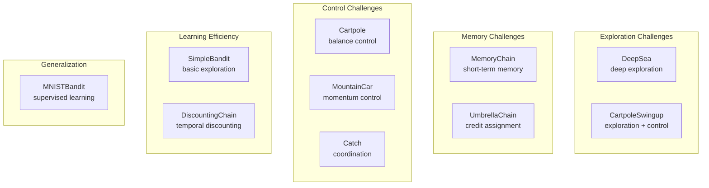
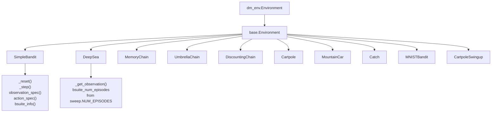
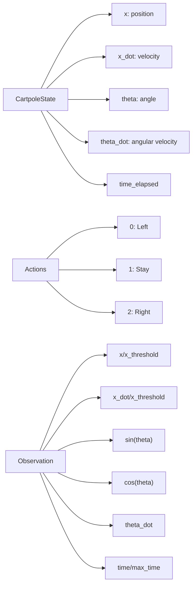
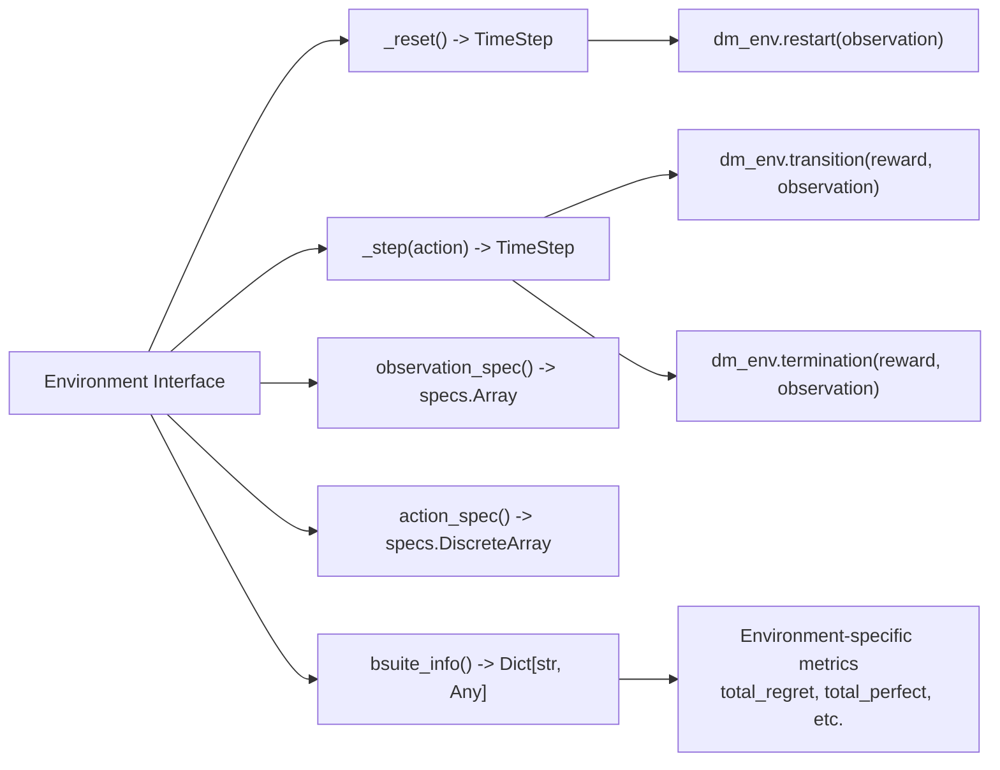

<!-- source: DeepWiki mcp.deepwiki.com · repo google-deepmind/bsuite · page 3.1 Core Diagnostic Environments · fetched 2026-10-26 -->

# Core Diagnostic Environments

<details>
<summary>Relevant source files</summary>

The following files were used as context for generating this wiki page:

- [bsuite/environments/bandit.py](bsuite/environments/bandit.py)
- [bsuite/environments/cartpole.py](bsuite/environments/cartpole.py)
- [bsuite/environments/catch.py](bsuite/environments/catch.py)
- [bsuite/environments/deep_sea.py](bsuite/environments/deep_sea.py)
- [bsuite/environments/discounting_chain.py](bsuite/environments/discounting_chain.py)
- [bsuite/environments/memory_chain.py](bsuite/environments/memory_chain.py)
- [bsuite/environments/mnist.py](bsuite/environments/mnist.py)
- [bsuite/environments/mountain_car.py](bsuite/environments/mountain_car.py)
- [bsuite/environments/umbrella_chain.py](bsuite/environments/umbrella_chain.py)
- [bsuite/experiments/cartpole_swingup/analysis.py](bsuite/experiments/cartpole_swingup/analysis.py)
- [bsuite/experiments/cartpole_swingup/cartpole_swingup.py](bsuite/experiments/cartpole_swingup/cartpole_swingup.py)

</details>


This document covers the main diagnostic environments provided by bsuite and their specific research objectives. These environments are designed to test different aspects of reinforcement learning agent capabilities through carefully controlled scenarios.

For information about environment wrappers and utilities, see [Environment Wrappers and Utilities](#3.2). For details about environment variants and extensions, see [Environment Variants and Extensions](#3.3).

## Research Categories and Objectives

The bsuite environments are organized around specific research challenges in reinforcement learning. Each environment is designed to isolate and test particular agent capabilities.



## Environment Class Hierarchy

All bsuite environments inherit from the base `Environment` class and implement the DeepMind Environment (dm_env) interface.



Sources: [bsuite/environments/base.py](), [bsuite/environments/bandit.py:32-74](), [bsuite/environments/deep_sea.py:48-156]()

## Core Environment Implementations

### Bandit Environments

**SimpleBandit** provides the most basic reinforcement learning challenge - a multi-armed bandit problem with deterministic rewards.

| Property | Value |
|----------|-------|
| Class | `SimpleBandit` |
| Observation | Single pixel (1x1) with value 0 |
| Actions | 11 discrete actions (configurable) |
| Reward | Deterministic values [0, 0.1, ..., 1] randomly assigned to arms |
| Key Metric | `total_regret` |

The environment maps random reward values to actions using `mapping_seed` and tracks cumulative regret against the optimal policy.

Sources: [bsuite/environments/bandit.py:32-74]()

### Exploration Environments

**DeepSea** tests deep exploration capabilities through a grid-world where the agent must navigate to a distant high-reward state.

| Property | Value |
|----------|-------|
| Class | `DeepSea` |
| Observation | N×N grid with agent position |
| Actions | 2 discrete (left/right, state-dependent mapping) |
| Reward | +1 at bottom-right, small move cost |
| Key Metrics | `total_bad_episodes`, `denoised_return` |

The environment includes action randomization per state and optional stochastic transitions for increased difficulty.

Sources: [bsuite/environments/deep_sea.py:48-156]()

**CartpoleSwingup** combines exploration with control by requiring the agent to swing up an inverted pendulum from the bottom position.

Sources: [bsuite/experiments/cartpole_swingup/cartpole_swingup.py:29-156]()

### Memory Environments

**MemoryChain** tests short-term memory by showing context information only at the beginning of episodes.

| Property | Value |
|----------|-------|
| Class | `MemoryChain` |
| Observation | [time, query, context_bits] |
| Actions | 2 discrete (binary response) |
| Challenge | Remember initial context for later query |
| Key Metrics | `total_perfect`, `total_regret` |

Sources: [bsuite/environments/memory_chain.py:34-113]()

**UmbrellaChain** tests credit assignment by requiring the agent to make an early decision that only affects reward at the end of long episodes.

| Property | Value |
|----------|-------|
| Class | `UmbrellaChain` |
| Observation | [need_umbrella, have_umbrella, time_to_live, distractors] |
| Actions | 2 discrete (take/don't take umbrella) |
| Challenge | First action determines final reward |
| Key Metric | `total_regret` |

Sources: [bsuite/environments/umbrella_chain.py:36-115]()

### Control Environments

**Cartpole** implements the classic pole-balancing control task.



Sources: [bsuite/environments/cartpole.py:68-182]()

**MountainCar** tests the agent's ability to build momentum to reach a goal despite insufficient immediate power.

| Property | Value |
|----------|-------|
| Class | `MountainCar` |
| Observation | [position, velocity, time_fraction] |
| Actions | 3 discrete (left, stay, right) |
| Challenge | Build momentum to reach goal |
| Key Metric | `raw_return` |

Sources: [bsuite/environments/mountain_car.py:34-103]()

**Catch** provides a simple coordination task where the agent controls a paddle to catch falling balls.

Sources: [bsuite/environments/catch.py:30-118]()

### Generalization Environments

**MNISTBandit** tests generalization by framing MNIST digit classification as a bandit problem.

| Property | Value |
|----------|-------|
| Class | `MNISTBandit` |
| Observation | 28×28 MNIST image |
| Actions | 10 discrete (digit classes 0-9) |
| Challenge | Classify digits without explicit supervision |
| Key Metric | `total_regret` |

Sources: [bsuite/environments/mnist.py:33-86]()

## Common Interface Patterns

All environments implement a consistent interface following the dm_env specification:



### Episode Configuration

Environments integrate with the sweep system for experiment configuration:

| Pattern | Implementation |
|---------|----------------|
| Episode Count | `self.bsuite_num_episodes = sweep.NUM_EPISODES` |
| Random Seeds | `np.random.RandomState(seed)` for reproducibility |
| Parameter Sweeps | Configuration via constructor arguments |

### Logging and Metrics

Each environment tracks domain-specific metrics through the `bsuite_info()` method:

- **Regret-based**: `total_regret` for bandit-style problems
- **Performance-based**: `raw_return`, `best_episode` for control tasks  
- **Success-based**: `total_perfect`, `total_bad_episodes` for binary outcomes

Sources: [bsuite/environments/bandit.py:72-73](), [bsuite/environments/deep_sea.py:153-155](), [bsuite/environments/memory_chain.py:109-112]()

## Environment-Specific Features

### Stochastic Variants

Several environments support stochastic modes for increased difficulty:

- **DeepSea**: Optional "windy" transitions with probability 1/N failure rate
- **Memory/Umbrella Chains**: Random distractor observations to test robustness

### Action Randomization

**DeepSea** implements state-dependent action mapping to prevent trivial solutions:
```python
self._action_mapping = self._mapping_rng.binomial(1, 0.5, [size, size])
action_right = action == self._action_mapping[self._row, self._column]
```

### Auto-reset Behavior

**Cartpole** and **CartpoleSwingup** implement custom auto-reset behavior rather than using the standard `_reset()/_step()` pattern, allowing for seamless episode transitions.

Sources: [bsuite/environments/deep_sea.py:79-85](), [bsuite/environments/cartpole.py:118-153]()

---

