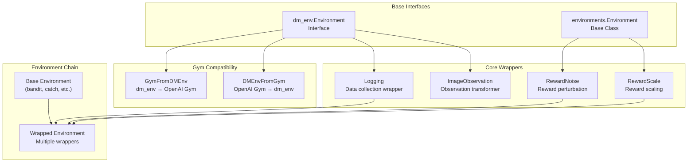
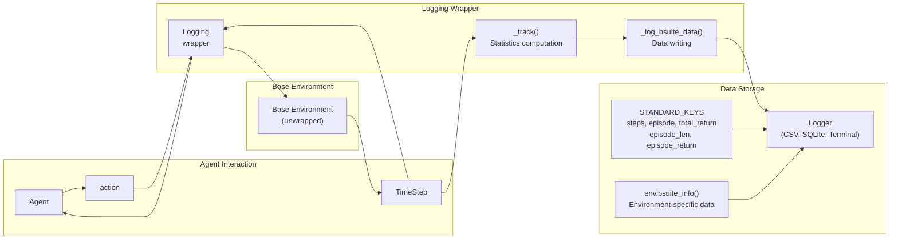
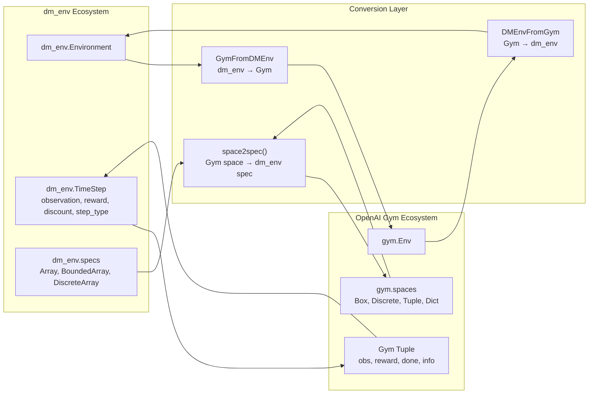
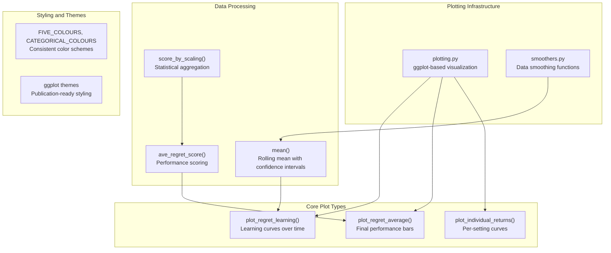

<!-- source: DeepWiki mcp.deepwiki.com · repo google-deepmind/bsuite · page 3.2 Environment Wrappers and Utilities · fetched 2026-10-26 -->

# Environment Wrappers and Utilities

<details>
<summary>Relevant source files</summary>

The following files were used as context for generating this wiki page:

- [bsuite/logging/csv_load_test.py](bsuite/logging/csv_load_test.py)
- [bsuite/logging/sqlite_load.py](bsuite/logging/sqlite_load.py)
- [bsuite/logging/sqlite_logging.py](bsuite/logging/sqlite_logging.py)
- [bsuite/utils/datasets.py](bsuite/utils/datasets.py)
- [bsuite/utils/gym_wrapper.py](bsuite/utils/gym_wrapper.py)
- [bsuite/utils/gym_wrapper_test.py](bsuite/utils/gym_wrapper_test.py)
- [bsuite/utils/plotting.py](bsuite/utils/plotting.py)
- [bsuite/utils/smoothers.py](bsuite/utils/smoothers.py)
- [bsuite/utils/wrappers.py](bsuite/utils/wrappers.py)
- [bsuite/utils/wrappers_test.py](bsuite/utils/wrappers_test.py)

</details>


This document covers the wrapper system and utility functions that extend and modify bsuite environments without changing their core behavior. Environment wrappers provide transparent functionality for logging, observation transformation, reward modification, and compatibility with external frameworks like OpenAI Gym. For information about the core diagnostic environments themselves, see [Core Diagnostic Environments](#3.1). For environment variants and extensions, see [Environment Variants and Extensions](#3.3).

## Wrapper Architecture Overview

The bsuite wrapper system follows the decorator pattern, allowing multiple wrappers to be composed around base environments. All wrappers implement the `dm_env.Environment` interface and delegate core functionality to the wrapped environment while adding their specific behavior.

### Wrapper Class Hierarchy



Sources: [bsuite/utils/wrappers.py:34-138](), [bsuite/utils/gym_wrapper.py:30-185]()

## Logging Wrapper System

The `Logging` wrapper provides transparent data collection for bsuite experiments without modifying environment behavior. It tracks standard metrics and delegates environment-specific metadata collection to the underlying environment.

### Logging Data Flow



Sources: [bsuite/utils/wrappers.py:30-126](), [bsuite/logging/sqlite_logging.py:35-42]()

### Standard Logging Keys

The logging wrapper automatically computes and tracks these standard metrics:

| Key | Description | Computation |
|-----|-------------|-------------|
| `steps` | Total environment steps | Incremented on each transition |
| `episode` | Episode number | Incremented on episode termination |
| `total_return` | Cumulative reward | Sum of all rewards received |
| `episode_len` | Current episode length | Steps in current episode |
| `episode_return` | Current episode return | Rewards in current episode |

Sources: [bsuite/utils/wrappers.py:30-31](), [bsuite/utils/wrappers.py:114-125]()

### Logarithmic Logging Strategy

The logging wrapper uses a logarithmic strategy to reduce data volume while maintaining temporal resolution:

```python
# Logs at episodes: 1, 1.2, 1.4, 1.7, 2, 2.5, 3, 4, 5, 6, 7, 8, 9, 10, 12, 14, ...
def _logarithmic_logging(episode: int) -> bool
```

Sources: [bsuite/utils/wrappers.py:140-147]()

## Observation Transformation Wrappers

### ImageObservation Wrapper

The `ImageObservation` wrapper converts scalar or small-dimensional observations into image-like formats, enabling the use of convolutional architectures on traditionally non-visual environments.

```mermaid
graph TB
    subgraph "Observation Transformation Pipeline"
        original_obs["Original Observation<br/>np.ndarray"]
        shape_check["Shape Analysis<br/>observation.size <= 4?"]
        small_state["_small_state_to_image()<br/>Hand-crafted mapping"]
        interpolate["_interpolate_to_image()<br/>Resize with interpolation"]
        image_obs["Image Observation<br/>Target shape"]
    end
    
    subgraph "Transformation Methods"
        size_1["Size 1<br/>Fill entire image"]
        size_2["Size 2<br/>Left/right split"]
        size_3_4["Size 3-4<br/>Quadrant mapping"]
        resize_2d["2D Resize<br/>skimage.transform.resize"]
    end
    
    original_obs --> shape_check
    shape_check -->|"≤ 4"| small_state
    shape_check -->|"> 4"| interpolate
    small_state --> size_1
    small_state --> size_2
    small_state --> size_3_4
    interpolate --> resize_2d
    size_1 --> image_obs
    size_2 --> image_obs
    size_3_4 --> image_obs
    resize_2d --> image_obs
```

Sources: [bsuite/utils/wrappers.py:150-248]()

### Image Transformation Examples

```python
# Convert 3-element state to 84x84x4 Atari-like format
observation = to_image((84, 84, 4), np.array([1, 2, 0]))

# Small state mappings:
# Size 1: fills entire image with single value
# Size 2: left half = first value, right half = second value  
# Size 3-4: quadrant mapping (top-left, top-right, bottom-left, bottom-right)
```

Sources: [bsuite/utils/wrappers.py:222-248]()

## Reward Modification Wrappers

### RewardNoise Wrapper

Adds Gaussian noise to environment rewards to test agent robustness:

```python
reward_noisy = reward_original + noise_scale * random_normal()
```

### RewardScale Wrapper  

Scales all rewards by a constant factor:

```python
reward_scaled = reward_original * reward_scale
```

Both wrappers preserve the `raw_env` property for unwrapping and delegate `bsuite_info()` calls to maintain environment metadata.

Sources: [bsuite/utils/wrappers.py:250-373]()

## Gym Compatibility Layer

The Gym compatibility system provides bidirectional conversion between DeepMind Environment (`dm_env`) and OpenAI Gym interfaces.

### Gym Conversion Architecture



Sources: [bsuite/utils/gym_wrapper.py:30-185]()

### Space and Spec Conversions

| Gym Space | dm_env Spec | Conversion Notes |
|-----------|-------------|------------------|
| `spaces.Discrete(n)` | `specs.DiscreteArray(num_values=n)` | Direct mapping |
| `spaces.Box(low, high, shape)` | `specs.BoundedArray(minimum=low, maximum=high, shape=shape)` | Preserves bounds |
| `spaces.MultiBinary(n)` | `specs.BoundedArray(minimum=0, maximum=1, shape=n)` | Binary constraint |
| `spaces.MultiDiscrete(nvec)` | `specs.BoundedArray(minimum=0, maximum=nvec, shape=nvec.shape)` | Per-dimension bounds |
| `spaces.Tuple(spaces)` | `tuple(specs)` | Recursive conversion |
| `spaces.Dict(spaces)` | `dict(specs)` | Recursive conversion |

Sources: [bsuite/utils/gym_wrapper.py:103-142]()

### Gym Wrapper Features

The `GymFromDMEnv` wrapper provides:
- Rendering support (`render()` method with 'human' and 'rgb_array' modes)
- Game state tracking (`game_over` attribute for Dopamine compatibility)
- Proper episode termination handling
- Reward range specification from environment specs

Sources: [bsuite/utils/gym_wrapper.py:30-101]()

## Utility Functions and Helpers

### Plotting Utilities

The plotting system provides specialized functions for visualizing bsuite experiment results:



Sources: [bsuite/utils/plotting.py:57-274](), [bsuite/utils/smoothers.py:57-122]()

### Dataset Utilities

The `datasets.py` module provides MNIST dataset loading functionality for environments that require image classification capabilities:

```python
def load_mnist(directory="/tmp/mnist") -> Tuple[Tuple[np.ndarray, np.ndarray], Tuple[np.ndarray, np.ndarray]]
```

This downloads and parses MNIST data for use in environments like `mnist_bandit`.

Sources: [bsuite/utils/datasets.py:42-69]()

### Wrapper Composition and Unwrapping

All bsuite wrappers support the `raw_env` property for accessing the underlying unwrapped environment:

```python
# Recursive unwrapping through multiple wrapper layers
@property
def raw_env(self):
    wrapped = self._env
    if hasattr(wrapped, 'raw_env'):
        return wrapped.raw_env
    return wrapped
```

This enables introspection and debugging of heavily wrapped environments.

Sources: [bsuite/utils/wrappers.py:127-133](), [bsuite/utils/wrappers.py:291-297]()

---

